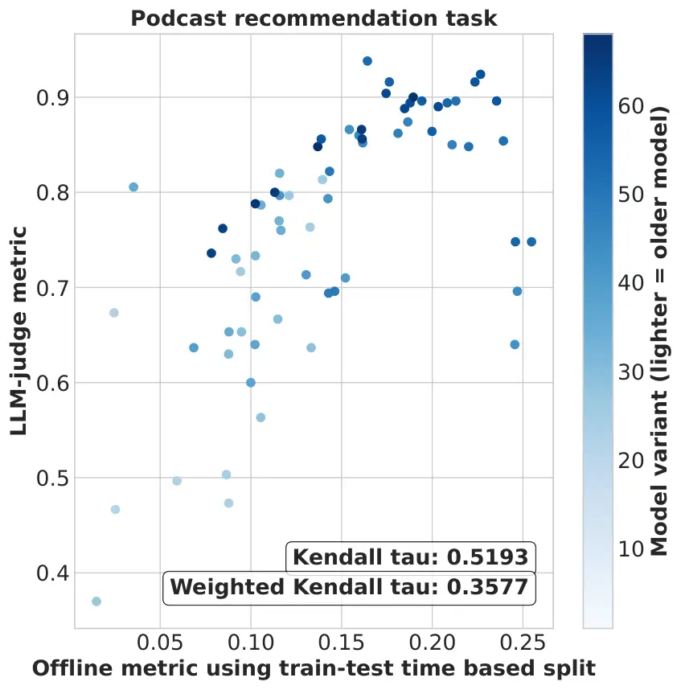

# From IR to RecSys: Evaluating LLM-based Judges in Cranfield-style Recommendation Collections

DOI: [XXXXXXX.XXXXXXX](https://doi.org/XXXXXXX.XXXXXXX)Conference: Unified
Search and Recommendation Workshop (USRW), co-located with RecSys ’26;
October 2, 2026; Minneapolis, Minnesota, USACCS: Information
systems Recommender systemsCCS: Information systems Relevance
assessmentCCS: Information systems Test collections

Gustavo Penha Affiliation: Spotify, United States email:
<gustavop@spotify.com> , Aleksandr V. Petrov Affiliation: Spotify,
United Kingdom email: <aleksandrv@spotify.com> , Claudia Hauff
Affiliation: Spotify, Netherlands email: <claudiah@spotify.com> , Enrico
Palumbo Affiliation: Spotify, Italy email: <enricop@spotify.com> , Ali
Vardasbi Affiliation: Spotify, Netherlands email: <aliv@spotify.com> ,
Edoardo D’Amico Affiliation: Spotify, Spain email:
<edoardod@spotify.com> , Francesco Fabbri Affiliation: Spotify, Spain
email: <francescof@spotify.com> , Alice Wang Affiliation: Spotify,
United States email: <alicew@spotify.com> , Praveen Chandar
Affiliation: Spotify, United States email: <praveenr@spotify.com> ,
Henrik Lindström Affiliation: Spotify, Sweden email: <henok@spotify.com>
, Hugues Bouchard Affiliation: Spotify, Spain email: <hb@spotify.com>
and Mounia Lalmas Affiliation: Spotify, United Kingdom email:
<mounia@acm.org>

2026

###### Abstract.

The Cranfield paradigm has long provided reliable, reproducible
evaluation in ad hoc retrieval, and recent work has begun extending this
framework to recommender systems. A recent development in IR is the use
of Large Language Models (LLMs) as automatic relevance judges, showing
promising agreement with human assessors. Whether this LLM-judge
paradigm—studied predominantly on query–document pairs—transfers to the
subjective, profile-driven nature of recommendation remains an open
question. This paper bridges the IR and RecSys evaluation traditions by
systematically investigating LLM-based judges within a Cranfield-style
recommendation collection. Using the ML-32M-ext movie recommendation
collection, we first demonstrate that traditional train–test splits
yield substantially incomplete relevance labels and unreliable system
rankings compared to Cranfield-style pooling. We then assess LLM-judge
alignment with human labels, finding that richer item metadata and
longer user histories improve agreement, although item-level agreement
remains moderate overall. Rankings derived from LLM-judge labels achieve
high agreement with human-based rankings (Kendall’s $`\tau`$ up to 0.92
for nDCG@100 across 52 system configurations), comparable to values
reported for TREC ad hoc retrieval collections. Crucially, LLM-judge
recovers system rankings that are distorted under traditional
evaluation—correctly identifying systems that are undervalued or
overvalued by incomplete labels. An industrial case study in podcast
recommendation further demonstrates the practical value of LLM-judge for
model selection. Rather than positioning LLM-judges as a replacement for
human or interaction-based evaluation, our results support their use as
a promising _complementary_ signal: item-level agreement with humans is
moderate, yet system-level rankings—which aggregate judgments over many
user–item pairs—remain stable.

###### Keywords: 

LLM-judge for recommender systems, Cranfield-style collections,
Completeness of relevance labels, Unified search and recommendation
evaluation

## 1. Introduction

Search and recommendation systems share a common goal—connecting users
with relevant items—yet their evaluation traditions have developed
largely in isolation. In ad hoc retrieval, the *Cranfield
paradigm* (Cleverdon, 1967) has provided a standardized evaluation
framework for decades: test collections of queries, documents, and human
relevance judgments enable reproducible and comparable system
evaluations, forming the basis of large-scale campaigns such as
TREC (Voorhees, 2019). Recommender system evaluation, by contrast, still
lacks a widely accepted offline framework (Said and Bellogín, 2014),
relying instead on historical interaction data (Bauer et al., 2024),
sampled metrics (Krichene and Rendle, 2020; Pereira et al., 2025), and
heterogeneous splitting strategies (Sun, 2023; Gusak et al., 2025) that
produce inconsistent, often non-reproducible assessments. Issues such as
exposure bias (Deffayet et al., 2023), popularity bias (Bellogín et al.,
2017), and incomplete relevance labels (Rahmani et al., 2025) further
complicate the fundamental question: _Which recommendation model
performs best_?

Recent work has begun to explore Cranfield-style evaluation frameworks
for recommender systems (Chamani, 2024; Smucker and Chamani, 2025;
Umemoto, 2022; Hashemi et al., 2016), demonstrating that such
collections can help mitigate popularity and exposure biases while
producing more reliable model rankings. However, these efforts remain
costly and limited in scale. For example, extending MovieLens into a
Cranfield-style collection required over \$10,000 CAD to obtain
relevance labels for only 51 users (Smucker and Chamani, 2025), a sample
size likely insufficient to capture variance in user preferences and
demographics.

In ad hoc retrieval, similar scalability challenges have been addressed
by employing Large Language Models (LLMs) as automatic judges capable of
predicting relevance labels. While some concerns remain regarding
potential biases, circularity, and robustness to adversarial
inputs (Dietz et al., 2025; Alaofi et al., 2024), this approach has
often shown high agreement with human assessors (Faggioli et al., 2023;
Thomas et al., 2024; Arabzadeh and Clarke, 2025; Upadhyay et al., 2024;
Rahmani et al., 2025). So far, however, this LLM-judge evaluation
paradigm has been validated mostly on ad hoc retrieval, where relevance
judgments are made for query-document pairs based on the semantic
alignment between an information need (expressed through the textual
query) and a corresponding document.

In contrast to the relatively objective nature of relevance in
retrieval, relevance in recommendation is inherently subjective (Schedl
et al., 2025), depending on both context (Mateos and Bellogín, 2024) and
domain (Sun, 2025). Unlike short, well-defined textual queries,
recommendation tasks involve long and often noisy user profiles,
represented by user-item interactions that reflect evolving preferences
over time, which are more challenging to encode for LLMs. Moreover,
signals such as popularity, trendiness, and collaborative filtering
patterns may be underrepresented in an LLM’s parametric knowledge (Penha
and Hauff, 2020). A related line of work has explored LLMs as user
simulators for recommendation (see Section 2), generating synthetic user
feedback rather than acting as relevance judges; while complementary,
this paradigm differs from the explicit relevance judgment task we study
here. These differences raise an important question: _Can the LLM’s
judging ability be generalized from ad hoc retrieval to recommendation
tasks?_

In this paper, we investigate whether LLM-judge can serve as a reliable
evaluator for recommender systems within a Cranfield-style evaluation
framework. Our work directly addresses the question of whether
evaluation methodologies validated in the IR community can be
transferred to RecSys, contributing to the broader goal of unified
evaluation across search and recommendation. We begin by motivating our
work through an examination of the limitations of existing evaluation
methodologies. We then explore: (1) the alignment between LLM-predicted
and human-provided relevance labels; (2) the extent to which model
rankings based on LLM labels agree with those derived from human
judgments; and (3) the performance of LLM-judge in an industrial
model-selection setting. We find that:

1.  (1)
    Alignment with human labels: Agreement between LLM-judge and human
    annotations increases when additional metadata fields (beyond the
    item title) are provided, suggesting that richer contextual
    information helps the model better match user preferences to
    recommended items. We also observe that incorporating more items
    from a user’s history as input further improves alignment. Absolute
    item-level agreement nonetheless remains moderate (55–57% pairwise
    agreement) and decreases further for fine-grained interest
    distinctions.
2.  (2)
    Agreement in system rankings: Using LLM-judge relevance labels to
    rank different systems yields a Kendall’s $`\tau`$ agreement of up
    to 0.92 for nDCG@100 across 52 system configurations, comparable to
    the alignment scores reported by Arabzadeh and Clarke (2025) for ad
    hoc retrieval collections such as TREC-DL. The LLM-judge also
    correctly recovers system rankings that are distorted under
    traditional train–test evaluation due to label incompleteness.
3.  (3)
    Industrial applicability: In an industrial setting, LLM-judge proves
    useful for assisting with model ranking and selection prior to
    conducting human feedback sessions and A/B tests, as demonstrated in
    podcast recommendation.

Overall, our results indicate that the LLM-judge evaluation paradigm,
already validated in IR, shows promise when applied to recommender
systems in domains such as movies and podcasts. We deliberately frame
LLM-judges as a _complementary_ evaluation signal rather than a
replacement for human or interaction-based assessment: item-level
agreement with humans is moderate, and LLM-based evaluation carries its
own risks of hallucinated reasoning and inherited biases, which we
discuss in Section 7. Established best-practice guidelines (Dietz
et al., 2025) should be followed to ensure validity and integrity of the
assessments.

## 2. Related Work

The evaluation paradigms of ad hoc retrieval and recommender systems
share deep structural similarities, yet have developed largely
independently—a gap that motivates the broader unified search and
recommendation research agenda. In ad hoc retrieval, the Cranfield
paradigm provides a standardized framework based on test collections
composed of documents, queries, and human relevance judgments. Because
exhaustively judging every query–document pair is infeasible,
large-scale evaluation campaigns such as TREC introduced pooling, where
assessors label documents drawn from the union of the top results from
multiple retrieval systems.

The completeness of these pooled judgments—particularly for systems that
did not participate in pooling—determines the reliability and
reusability of a collection for future evaluations. Unpooled documents
returned by non-participating systems may still be relevant, yet are
treated as irrelevant by standard information retrieval metrics,
potentially underestimating the effectiveness of newer models (Arabzadeh
et al., 2022; Voorhees et al., 2022). Indeed, many commonly used
evaluation measures are not robust to substantially incomplete relevance
judgements (Buckley and Voorhees, 2004), and the choice of metric itself
can significantly affect the reliability of system comparisons (Valcarce
et al., 2020). In top-N recommendation, Valcarce et al. (2018); Valcarce
et al. (2020) demonstrated that nDCG at deeper cut-offs (e.g., nDCG@100)
offers the highest discriminative power and robustness against sparsity,
while Otero et al. (2025) showed that high system-level rank
correlations can mask high rates of false positives regarding
statistical differences among top-performing systems.

In recommender systems, the situation is even more complex.
Recommendation collections mirror IR test collections---comprising a
corpus of items, a set of users, and user–item relevance signals---but
these signals are derived from sparse historical interaction data rather
than explicit human annotation.¹¹ 1 The relevance of an item to a user
can be determined either through pre-interaction judgments, implicit or
explicit signals during interaction, or post-interaction feedback (Sun,
2025). While prior work suggests that assessors can serve as reliable
judges on behalf of other users (Lu et al., 2021; Bailey et al., 2008),
the standard practice continues to rely on offline evaluations using
historical logs.

Typically, such evaluations withhold a portion of interactions for
testing while using the remainder for training (e.g., global-time,
leave-one-out splits, or user-based splits) (Cañamares et al., 2020; Ji
et al., 2023). However, this methodology is prone to multiple biases:
popularity bias arising from long-tail relevance distributions (Bellogín
et al., 2017); exposure bias driven by production logging
policies (Deffayet et al., 2023); and missing-not-at-random (MNAR)
patterns (Little and Rubin, 2002; Steck, 2010; Schnabel et al., 2016),
where users rate only items they particularly enjoy. Additionally, not
all rejected recommendations are truly irrelevant (Frumerman et al.,
2019). Combined with data leakage from non-time-based splits (Gusak
et al., 2025) and the use of sampled metrics (Krichene and Rendle, 2020;
Pereira et al., 2025), these issues can lead to inconsistent
evaluations, where offline rankings diverge from those observed in
online or user studies (Rossetti et al., 2016), complicating the
progress in the field (Ferrari Dacrema et al., 2019).

To address these limitations, several efforts have sought to construct
Cranfield-style collections for recommender systems, replicating the
benefits of IR-style pooling (Smucker and Chamani, 2025; Umemoto, 2022;
Hashemi et al., 2016). Yet, such datasets remain expensive and small in
scale. In ad hoc retrieval, LLMs have been shown to effectively fill
judgment gaps (MacAvaney and Soldaini, 2023) and predict relevance
labels directly (Arabzadeh and Clarke, 2025), though concerns persist
regarding biases, circularity, and robustness to adversarial
manipulation (Dietz et al., 2025; Alaofi et al., 2024). Early work in
recommendation further suggests that LLM-judge (Wu et al., 2024; Fabbri
et al., 2025) (and LLM rankers (Dai et al., 2023; Hou et al., 2024)) can
mirror offline evaluation trends. However, questions remain about their
generalization, particularly given evidence that LLMs may memorize
public datasets such as MovieLens (Di Palma et al., 2025), and the
absence of studies replicating Cranfield-style recommendation
collections with LLM judges.

A related line of work explores LLMs as user simulators for recommender
systems. Recent surveys (Ni et al., 2026; Peng et al., 2025) document
the growing use of LLM-powered agents that simulate user behavior for
training and evaluating recommender systems. Ebrat et al. (2025) propose
Lusifer, an LLM-based feedback environment for online recommender
evaluation. While user simulation focuses on generating synthetic
interactions to train or test recommenders, our work uses LLMs in a
different role: as relevance judges that predict human interest labels
within a Cranfield-style evaluation framework. More broadly, the
intersection of LLMs and recommender systems has been extensively
surveyed, covering generative recommendation (Deldjoo et al., 2024; Zhao
et al., 2024) and LLM-based recommendation assistants (Huang et al.,
2025). Our work is complementary, focusing specifically on the
evaluation side rather than the recommendation task itself.

To explore these open questions, the next section outlines our
experimental design for evaluating LLM-judge in a Cranfield-style
recommender system setting.

## 3. Experimental Setup

In this section, we describe the experimental setup used to evaluate
LLM-judge, including the datasets, recommender system models, and
evaluation procedures employed.

#### Pooling-based evaluation for recommendation

To overcome the limitations of traditional train-test splits, we rely on
a Cranfield-style extension of the popular MovieLens interaction
dataset (Harper and Konstan, 2015). The ML-32M dataset²² 2
[https://grouplens.org/datasets/movielens/32m/](https://grouplens.org/datasets/movielens/32m/)
consists of 32 million ratings across 87,585 movies by 200,948 users,
collected between 1995 and 2023 and released in 2024. The
Cranfield-style extension of the ML-32M, introduced by Smucker and
Chamani (2025) and referred to as ML-32M-ext, was released in 2025 and
is available exclusively to researchers. Access requires submitting a
form confirming that the dataset will not be publicly shared nor used
beyond research purposes. Consequently, we consider it unlikely that
current LLMs have memorized this dataset.

ML-32M-ext consists of an additional 31,236 relevance judgments provided
by 51 participants for movies that they had not rated before. The movies
selected for evaluation were drawn from a pool of 22 recommender system
models, each having access to the histories of the 51 participants and
other users from the ML-32M dataset. During two labeling phases, each
participant evaluated at least 600 movies based on metadata including
the poster, title, plot summary, release year, running time, cast,
directors, genres, and languages. Participants then rated their interest
in watching, familiarity with, and predicted rating for each movie.

We use the primary relevance file from ML-32M-ext: interest.qrels, which
captures participants’ interest in watching movies. Interest levels
range from 0 (Not interested), 1 (Somewhat interested), 2 (Interested),
3 (Very interested), 4 (Extremely interested), 5 (ranked 3), 6 (ranked
2), to 7 (Ranked 1), where 5–7 represent the top-three items selected by
each user. For details on dataset construction, we refer readers
to (Smucker and Chamani, 2025; Chamani, 2024).

To the best of our knowledge this is the only suitable dataset for
investigating LLM-judges Cranfield-style collections in recommender
systems.

#### Recommender system models

Following Smucker and Chamani (2025), we use the RecBole framework (Zhao
et al., 2021)³³ 3 We use RecBole
([https://github.com/RUCAIBox/RecBole](https://github.com/RUCAIBox/RecBole))
because it provides access to a wide range of recommendation models
through a unified API. While we acknowledge existing concerns about the
reproducibility of third-party model implementations (Hidasi and Czapp,
2023a), these have limited impact on our results. Our focus lies in
analyzing the alignment between LLM-judge predictions and human
judgments, rather than the absolute effectiveness of individual models.
Hence, the diversity of models available in the framework is more
critical to our study than their specific performance levels. for model
implementation. Our 52 system configurations span 18 distinct model
families: non-personalized baselines (Pop, Random), linear models
(EASE – Embarrassingly Shallow Autoencoders, ADMMSLIM, SLIMElastic,
NCEPLRec), matrix factorization (BPR, NeuMF, ENMF, SimpleX),
autoencoders (CDAE, MultiVAE – Multinomial VAE, MultiDAE, RaCT,
DiffRec), neighbor-based (ItemKNN, AsymKNN), and graph-based (DGCF).
Hyperparameter and seed variants yield the full set of 52
configurations. For models that participated in the pooling stage, we
adopt the same hyperparameters as in (Smucker and Chamani, 2025); for
the rest, we train for 10 epochs using default settings. Models with
closed-form solutions (e.g., EASE, ADMMSLIM, SLIMElastic) require only a
single epoch. As recommended by the ML-32M-ext authors, we evaluate
system effectiveness using the Compatibility measure (Clarke et al.,
2021), with the default value of $`p=0.95`$ provided by
ir-measures (MacAvaney et al., 2022) library and the interest.qrels file
which contains interest in watching relevance labels. The Compatibility
metric is the maximum normalized rank biased overlap between the results
and an ideal ranking where $`p`$ represents searcher patience or
persistence.

Full retrieval is performed over the entire item collection, that is no
sampled negatives are introduced for metric computation. Items that are
not present in the pooling of ML-32M-ext are considered irrelevant in
the evaluation metrics.

For training, we sample 10,000 users from ML-32M, add the history of the
51 ML-32M-ext participants, and exclude items and users with less than
20 interactions. Preliminary experiments confirmed that this smaller
training set yields comparable performance and model rankings on
ML-32M-ext, enabling more efficient experimentation.

#### LLM-judge

For the LLM-judge, we use gpt-5-2025-08-07 with the default reasoning
level set to medium as the LLM backbone.⁴⁴ 4 We additionally ran two
representative experiments from Sections 5.1 and 5.2 using
Qwen2.5-32B-Instruct. While this model cannot handle very long user
profiles due to its smaller context length, we observe similar trends:
(i) increasing user profile length improves alignment, albeit with 2–4%
fewer agreement pairs, and (ii) using more predictions per user to
construct the relevance labels file leads to higher system ranking
agreement, with comparable Kendall-$`\tau`$ scores. Each experiment is
repeated three times, and we report averaged results. Unless stated
otherwise, the LLM predicts relevance for up to 50 randomly selected
movies per participant (all of which have human labels in ML-32M-ext).
This sampling is adopted to reduce time and costs of experimentation,
since a single run would otherwise require 93,708 (3\*31,236) LLM calls,
and allowed us to run each single point in this experiment three times.
The small variance observed across runs with different samples combined
with experiments increasing the number of selected items reveal that
this does not affect the findings of the paper.

By default, we include 1000 movies for each user as part of their
interaction history, along with the user’s explicit rating (on a 1–5
scale) for each movie. Because timestamp information is unavailable for
ML-32M-ext, we randomly sample items from each user’s history rather
than applying recency-based selection. The prompt used for LLM-judge
evaluations is shown in Figure 1. The prompt was not iteratively
optimized, and it is only different for the ablation experiments
presented later (see the effect of movie metadata fields in Table 3).

LLM-judge prompt Instruction:  
Your task is to evaluate the relevance of a movie recommendation for a
user, given the metadata of the movie and the user’s previous
interactions.  
Inputs:  
User profile: {USER_PROFILE}  
Movie recommendation: {METADATA_RECOMMENDED_MOVIE}  
Expected output:  
reasoning: Reason for the interest in watching the movie considering
their previous interactions.  
interest_in_watching: The interest in watching the movie considering
their previous interactions, on a scale of 0 to 7.  
User profile structure Movie metadata: {METADATA_MOVIE_0}  
User rating on scale 1-5: {RATING_0}  
Movie metadata: {METADATA_MOVIE_1}  
User rating on scale 1-5: {RATING_1}  
…  
Movie metadata: {METADATA_MOVIE_N}  
User rating on scale 1-5: {RATING_N}  
Movie metadata structure Title + Average rating + Genres + Directors +
Overview + Cast + Runtime + Number ratings + Year + Languages.

Figure 1. Prompt template, user profile structure, and movie metadata
structure used for LLM-judge evaluations.

#### Reproducibility

While we are unable to release code or prediction files, all components
required to reproduce our setup are documented in this paper: the
dataset and its statistics as well as the recommender system models
(this section), the exact prompt template (Figure 1) and its
metadata-ablation variants (Table 3), the LLM backbone, settings, and
sampling procedure (above), and the hyperparameter and seed variants of
all 52 system configurations (Appendix A). Access to ML-32M-ext must be
requested from the original authors (Smucker and Chamani, 2025).

## 4. Limitations of Current Evaluation Methodologies

Evaluating recommender systems using traditional offline methodologies
presents several fundamental limitations. In this section, we examine
the incompleteness of relevance labels under different evaluation
methodologies and the implications for the reliability of model
comparisons.

A key limitation of traditional train-test splits based on historical
interactions is the incompleteness of relevance labels: not all items
retrieved by the compared recommender systems have corresponding
relevance labels. The resulting sparsity, across different models, makes
it difficult to reliably compare recommender system rankings, as
confirmed by prior studies on partially complete collections (Gao
et al., 2022; Pereira et al., 2025). We use Judged@100⁵⁵ 5
[https://ir-measur.es/en/latest/measures.html#judged](https://ir-measur.es/en/latest/measures.html#judged),
defined as the average percentage of items with relevance judgments (any
relevance level) among the top 100 ranked items for each user, to
quantify this incompleteness.

We next compare the completeness of traditional train–test splits with
that of Cranfield-style collections and show how low Judged@100 values
lead to discrepancies in system rankings.

|                        |                                            |                                    |
| ---------------------- | ------------------------------------------ | ---------------------------------- |
| Models                 | ML-32M Historical 80%–20% train–test split | ML-32M-ext Cranfield-style pooling |
| Pooled models (7)      | 0.0774                                     | 0.5981                             |
| Non-pooled models (45) | 0.0601                                     | 0.5503                             |

Table 1. Average Judged@100 under historical interactions train–test
split vs. Cranfield-style pooling (ML-32M-ext).

#### Comparison with a Cranfield-style pooled collection

A Cranfield-style collection offers a compelling alternative to
traditional historical train–test splits. By collecting explicit
feedback from multiple recommender systems, such collections provide a
more complete set of relevance judgments for models that participated in
the pooling process, that is, models used to generate candidate
recommendations during dataset creation. Incorporating a diverse set of
models into the pool also helps mitigate the selection bias that would
arise from relying on a single production recommender.

In standard offline evaluation, user interactions are typically sorted
by time and then split into train–test sets on a per-user basis (Sun
et al., 2020).⁶⁶ 6 For example, the widely used RecBole library does not
implement a global time-based split and only supports time-ordering
prior to splitting the data into training and test sets (see
[https://recbole.io/docs/user_guide/config/evaluation_settings.html](https://recbole.io/docs/user_guide/config/evaluation_settings.html)).
This approach can inadvertently cause temporal leakage, as each user has
their own time cutoff between training and testing (Ji et al., 2023;
Hidasi and Czapp, 2023b; Gusak et al., 2025). In contrast,
Cranfield-style collections enable a natural global time split, where
all interactions occurring before the dataset creation are used for
training, and the relevance judgments collected during dataset
construction are used for testing.

We argue that this setup more closely reflects real-world recommendation
scenarios, offering both higher completeness of relevance labels and
more reliable model rankings. To quantify this difference, we compare
the completeness of relevance labels under the two methodologies.

As shown in Table 1, traditional train–test splits yield substantially
lower Judged@100 scores compared to the Cranfield-style collection
(ML-32M-ext (Smucker and Chamani, 2025)). We evaluate 52 system
configurations comprising 18 distinct models with hyperparameter and
seed variants. Models that participated in the ML-32M-ext pooling
process see a large increase in completeness under the Cranfield-style
setup (from 0.08 to 0.60 on average). A similar trend is observed for
the 45 system configurations that did not participate in pooling: their
Judged@100 values are also higher under the Cranfield-style evaluation
(from 0.06 to 0.55), though overall scores are lower than for the pooled
models. Notably, the Pop (popularity) baseline achieves low Judged@100
even under Cranfield-style pooling, because its recommendations are
drawn from globally popular items that may not overlap with the items
pooled from the 22 personalized models used during dataset construction.

#### Impact on model ranking reliability

An important consideration is how the evaluation methodology and the
completeness of relevance labels affect the final rankings of
recommender systems. Across our 52 system configurations, the agreement
between nDCG@100 rankings derived from the historical interactions
train-test split (which have low completeness) and those from the
Cranfield-style collection (which have higher completeness) is notably
low: 0.26 Kendall’s $`\tau`$ ($`p<0.01`$), as shown in Figure 2. For
comparison, an often cited threshold for acceptable agreement between
system rankings based on independently created set of human relevance
judgments is 0.90 (Voorhees, 1998; Arabzadeh and Clarke, 2025).

The rank disagreements are not merely statistical noise—they reflect
systematic distortions. For example, NCEPLRec is ranked 1^(st) out of 52
configurations under the train-test split but drops to 43^(rd) under the
Cranfield collection, a shift of 42 positions. Conversely, SimpleX rises
from 47^(th) under the train-test split to 14^(th) under Cranfield (+33
positions), and DGCF configurations improve by up to 29 positions. These
“undervalued” runs recommend items outside the user’s historical
interactions that human assessors nonetheless rate as relevant, while
“overvalued” runs like NCEPLRec and MultiVAE (which shifts by up to 30
positions) primarily succeed at predicting held-out interactions without
genuinely capturing user interest.

Figure 2. nDCG@100 under the traditional train-test split vs. the
Cranfield-style pooled collection for 52 system configurations. The low
correlation (Kendall’s $`\tau=0.26`$) shows that system rankings change
substantially with more complete relevance labels.

#### Limitations of pooled collections

While pooled collections improve the completeness of relevance
judgements, they are inherently“frozen in time”: evaluation can only be
conducted using a single time-based split (before and after the pooling
process). In domains where user preferences evolve rapidly (e.g. short
video consumption) reliable evaluation may require multiple temporal
splits to capture such dynamics.

In addition, decisions regarding which models participate in pooling,
how they are trained, and the pooling depth can influence both the
completeness and longevity of the collection. Models that resemble those
used during pooling may be inadvertently favored, while newer or
substantially different models may be disadvantaged. Finally,
constructing pooled collections is resource-intensive. For instance,
generating ML-32M-ext with participants required approximately \$10,000
CAD. In contrast, using an LLM-judge could reduce this cost by an order
of magnitude.⁷⁷ 7 The estimate was obtained using GPT-5 mini, via the
batch API, based on the average context length of a textified user
history containing all metadata and 100 movies. Optimizations on the
number of LLM relevance predictions and which metadata to use could make
the LLM-judge 2–3 orders of magnitude cheaper.

#### Summary

[TABLE]

Table 2. Comparison of evaluation methodologies for recommender systems.

As summarized in Table 2, existing evaluation methodologies for
recommender systems involve a trade-off between bias, completeness, and
cost. Historical-interaction evaluations are inexpensive but suffer from
biases and incompleteness, whereas Cranfield-style pooling offers higher
reliability at the expense of substantial human-annotation cost.

The LLM-judge approach provides an appealing middle ground: assuming
sufficient alignment with user judgments, it mitigates exposure and
popularity biases by offering complete coverage of relevance labels at a
moderate cost.

However, LLM-based evaluations introduce their own sources of bias (Ye
et al., 2024; Sguerra et al., 2025) and potential pitfalls that may lead
to invalid conclusions (Dietz et al., 2025; Clarke and Dietz, 2024). For
example, popular entities or items may be overrepresented in an LLM’s
parametric knowledge (Ni et al., 2025; Lichtenberg et al., 2024), so
judgments for long-tail items are likely to be less reliable than for
mainstream ones; test sets might inadvertently appear in the model’s
training data (Di Palma et al., 2025; Xu et al., 2024); LLMs may
hallucinate—generating confident but factually incorrect reasoning about
item attributes or user preferences that results in plausible-looking
yet wrong labels; LLMs can be adversarially prompted to produce overly
positive relevance labels (Alaofi et al., 2024); and using LLM-judge
within the evaluated systems themselves risks circularity issues (Li
et al., 2025).

These potential advantages and shortcomings motivate our investigation
into whether LLMs can serve as scalable and reliable judges for
recommender system evaluation.

## 5. Assessing LLM-judge Alignment and Agreement

In this section, we evaluate the effectiveness of LLM-judge as an
automatic evaluator for recommender systems. Following the evaluation
methodology of  Arabzadeh and Clarke (2025), we assess LLM-based
relevance judgments along two dimensions: (1) their alignment with human
labels, and (2) their agreement with recommender system rankings derived
from human relevance judgments. Together, these analyses allow us to
understand not only how closely LLM-judge mirrors human annotation
behavior but also whether it preserves the relative ordering of model
performance, both essential requirements for scalable, reliable
evaluation.

### 5.1. Alignment with Human Labels

We first evaluate the alignment between LLM-judge predictions and the
primary relevance file from ML-32M-ext. The LLM-judge receives a fixed
number of randomly ordered historical user ratings as inputs,¹⁰¹⁰ 10 The
LLM-judge has access to the same metadata provided to participants
during the relevance labeling process, with the exception of the cover
image and the addition of two extra fields: average rating and number of
ratings. enabling it to infer how well a user’s preferences align with
the metadata of a recommended movie. Both the LLM-judge predictions and
the human labels are expressed on the same interest scale ranging from 0
to 7.

To quantify this alignment, we calculate the proportions of agreement,
tie and disagreement between label pairs. Specifically, for each user,
we compare all pairs of items labeled as relevant (interest levels 1–7)
versus non-relevant (interest level 0), and determine:

- •
  Agreement: the LLM-judge ranks the items in the same order as the
  human judgments.
- •
  Tie: the LLM-judge assigns equal scores to both items.
- •
  Disagreement: the LLM-judge ranks the pair in the opposite order from
  the human judgments.

#### Effect of including different item metadata fields

We first examine how different metadata fields (used for movies in both
the user’s history and the recommended movie) contribute to the
alignment between LLM-judge and human labels.

As shown in Table 3, all metadata fields except average rating
positively impact the pairwise agreement between LLM-judge predictions
and human judgments. Overall, these results indicate that the model
effectively leverages the content information from a user’s movie
profile and compares it against the metadata of recommended items; each
additional metadata field independently helps improve alignment. At the
same time, interaction-derived features such as average rating and
number of ratings may inadvertently reinforce—or reintroduce—popularity
biases into the evaluation.

|                        |                                       |                         |                                       |
| ---------------------- | ------------------------------------- | ----------------------- | ------------------------------------- |
| Metadata               | Agreement (%)                         | Tie (%)                 | Disagreement (%)                      |
| Title + Average rating | $`0.5398\pm 0.0033^{\downarrow}`$     | $`0.2565\pm 0.0008`$    | $`0.2037\pm 0.0028^{\downarrow}`$     |
| Title                  | $`0.5479\pm 0.0019`$                  | $`0.2607\pm 0.0017`$    | $`0.1914\pm 0.0011`$                  |
| Title + Genres         | $`0.5516\pm 0.0020`$                  | $`0.2596\pm 0.0000`$    | $`0.1888\pm 0.0020`$                  |
| Title + Directors      | $`0.5551\pm 0.0006`$                  | $`0.2514\pm 0.0024`$    | $`0.1935\pm 0.0024^{\downarrow}`$     |
| Title + Overview       | $`0.5529\pm 0.0019`$                  | $`0.2645\pm 0.0007`$    | $`0.1826\pm 0.0025`$                  |
| Title + Cast           | $`0.5649\pm 0.0033`$                  | $`0.2456\pm 0.0008`$    | $`0.1895\pm 0.0030`$                  |
| Title + Runtime        | $`0.5592\pm 0.0005`$                  | $`0.2561\pm 0.0012`$    | $`0.1847\pm 0.0015`$                  |
| Title + Number ratings | $`0.5612\pm 0.0022`$                  | $`0.2489\pm 0.0005`$    | $`0.1899\pm 0.0017`$                  |
| Title + Year           | $`0.5590\pm 0.0011`$                  | $`0.2536\pm 0.0012`$    | $`0.1874\pm 0.0021`$                  |
| Title + Languages      | $`\mathbf{0.5726}\pm\mathbf{0.0008}`$ | $`{0.2362}\pm{0.0021}`$ | $`0.1912\pm 0.0013`$                  |
| Title + All metadata   | $`0.5599\pm 0.0031`$                  | $`0.2610\pm 0.0013`$    | $`\mathbf{0.1790}\pm\mathbf{0.0021}`$ |

Table 3. Effect of movie metadata fields on LLM-judge pair agreement
metrics. ($`\pm`$) indicates the 95% confidence interval. Best per
column in bold. $`\downarrow`$ indicates worse than the baseline which
only uses the Title of the movies as input.

When compared with prior work on LLM-based judges for ad hoc retrieval
 (Arabzadeh and Clarke, 2025), our alignment scores (55–57%) are higher
than those achieved by pointwise LLM-judges on the ANTIQUE dataset
(~40%) but lower than those observed on TREC DL-19/20/21 (~80%). It is
worth noting that our movie recommendation judge operates in a zero-shot
setting without prompt iteration or in-context learning examples, which
makes these results particularly encouraging.

#### Effect of the size of the user history

When using all available metadata fields for each movie, the context
size of the user profile grows rapidly. On average, each user who
participated in the ML-32M-ext pooling rated 1,425 movies, resulting in
an average profile length of approximately 170k tokens, with a maximum
of 1 million tokens for a user who rated 8,496 movies.

Figure 3. Effect of increasing the size of the user history on the
LLM-judge pair agreement.

To understand the impact of profile size, we analyze how the number of
items in a user’s history influences the alignment between LLM-judge and
human relevance labels. As illustrated in Figure 3, larger user profiles
lead to higher pairwise agreements and fewer disagreements between the
two sets of judgments. This trend is consistent with early findings from
LLM-judge evaluations in podcast recommendations (Fabbri et al., 2025).
We note that timestamp information for the user interactions was not
available for ML-32M-ext, and therefore, profile items were not ordered
by recency in this analysis. These results suggest that providing richer
user context enables LLMs to better infer preference patterns, improving
their ability to approximate human relevance judgments.

#### Effect of the difference in human label interest levels

Previous sections evaluate the LLM-judge agreement using not relevant
(interest level of 0) vs relevant (interest levels from 1–7) pairs of
items. Here, we take a closer look at agreement over unrestricted pairs
of interest levels, considering more fine-grained distinctions (e.g.
interested vs very interested).

As shown in Figure 4, agreement decreases as the distance between
interest labels becomes smaller and potentially subtler, leading to
increased proportions of disagreements and ties.

Figure 4. Effect of decreasing the interest level differences between
the pairs of labels.

### 5.2. Agreement with Recommender System Rankings

We next examine how rankings of different recommender systems compare
when derived from human labels versus the LLM-judge predictions. To
assess this, we compute the Kendall’s $`\tau`$ between the ranking of 14
recommender systems using the human relevance labels and the
corresponding rankings obtained from LLM-judge–predicted labels,
considering the full scale of interest levels from 1–7 to calculate the
Compatibility measure as recommended by Smucker and Chamani (2025). We
also include a weighted variant that emphasizes disagreements involving
top-ranked items.

As shown in Table 4, increasing the number of LLM-judge predictions per
user (selecting items to judge randomly) from 10 to 100 substantially
improves the ranking agreement with the complete set of human relevance
labels. Beyond 100 predictions per user, the improvement plateaus,
indicating a performance ceiling, as extending predictions to 200 movies
does not further increase agreement. With 100 LLM-judge predictions per
user (corresponding to approximately 5,100 relevance labels—about ~16%
of the total human-labeled set), we obtain a high Kendall’s $`\tau`$ of
0.92 for nDCG@100 between LLM-judge and the human judgments across 52
system configurations. This level of agreement is comparable to the
values reported by Arabzadeh and Clarke (2025) for ad hoc retrieval
collections such as TREC-DL, which range between 0.77 and 0.92. These
findings suggest that LLM-judge can approximate human-based model
rankings with high fidelity, even when using a fraction of the
human-labeled data.

|     |                    |      |       |                      |      |       |
| --- | ------------------ | ---- | ----- | -------------------- | ---- | ----- |
|     | Kendall’s $`\tau`$ |      |       | W-Kendall’s $`\tau`$ |      |       |
| K   | Compat             | nDCG | Bpref | Compat               | nDCG | Bpref |
| 10  | .710               | .831 | .873  | .738                 | .811 | .848  |
| 50  | .802               | .899 | .855  | .797                 | .910 | .860  |
| 100 | .802               | .923 | .866  | .737                 | .913 | .863  |
| 200 | .829               | .896 | .858  | .774                 | .894 | .854  |

Table 4. Agreement between LLM-judge and human system rankings by the
number of LLM-judge predictions per user.

Figure 5. nDCG@100 correlation between LLM-judge (100 predictions per
user) and human relevance labels for 52 system configurations.

The per-system values shown in Figure 5 illustrate this relationship and
reveal that the LLM-judge recovers system rankings that are distorted
under traditional train-test evaluation (Section 4). The runs identified
earlier as undervalued by the train-test split—SimpleX, which drops from
rank 47 to 14 when moving to the Cranfield collection, and DGCF, which
improves by up to 29 positions—are ranked at positions 16 and 23
respectively by the LLM-judge, closely matching their Cranfield ranks.
Similarly, the overvalued NCEPLRec, ranked 1^(st) by train-test but
43^(rd) by Cranfield, is correctly placed at rank 44 by the LLM-judge.
Across all 52 configurations, the median absolute rank displacement
between LLM-judge and Cranfield is just 1 position, compared to 8 for
the train-test split. This suggests that LLM-judge can identify
undervalued systems that traditional evaluation methodologies
systematically penalize due to label incompleteness.

#### Why moderate item-level agreement still yields stable system rankings

The contrast between moderate item-level alignment (Section 5.1) and
high system-level ranking agreement warrants explanation. System-level
metrics aggregate over thousands of user–item judgments, so item-level
errors that are not systematically correlated with particular systems
largely cancel out: what matters is not that every label is correct, but
that errors do not consistently favor some systems over others—mirroring
IR meta-evaluation, where assessor disagreement affects absolute scores
but leaves system orderings largely intact (Voorhees, 1998). Two caveats
follow. First, aggregation only protects against _unbiased_ noise: LLM
errors that correlate with system characteristics (e.g., overrating
popular items) can distort rankings in ways a global $`\tau`$ does not
reveal. Second, stable rankings across 52 configurations do not
guarantee reliable discrimination between closely matched top
systems (Otero et al., 2025). LLM-judge scores should thus be read as a
system-level signal, not a substitute for item-level human ground truth.

#### Sensitivity of rankings to unjudged items

The experiments above restrict the LLM-judge to predicting labels only
for items that were already judged by humans, treating all unjudged
items as irrelevant. While this enables a controlled comparison with the
human ground truth, it leaves open the question of how sensitive system
rankings are to the large number of unjudged items in each system’s
retrieved list. To investigate this, we allow the LLM-judge to evaluate
unjudged items from the top-100 retrieved results of each recommender
system and compare system rankings under three evaluation scenarios:

- •
  Human-only: The current setup—only human-judged items are evaluated,
  unjudged items are treated as irrelevant.
- •
  LLM fills gaps: Human labels are used where available; for unjudged
  items in the top-100, LLM-judge predictions are used instead.
- •
  Full LLM: The LLM-judge evaluates all top-100 items, ignoring human
  labels entirely.

We note that without additional human judgments on the unjudged items,
we cannot verify whether the LLM labels are correct. Instead, this
experiment measures the _stability_ of system rankings when moving from
sparse human judgments to denser LLM-augmented evaluations.

|                    |            |                |          |
| ------------------ | ---------- | -------------- | -------- |
|                    | Human-only | LLM fills gaps | Full LLM |
| vs. Human-only     | —          | .844           | .763     |
| vs. LLM fills gaps | .844       | —              | .797     |
| vs. Full LLM       | .763       | .797           | —        |
| Avg. Judged@100    | .559       | 1.00           | 1.00     |

Table 5. System ranking agreement (Kendall’s $`\tau`$ on Compat) across
evaluation scenarios and average Judged@100 for each. Human-only treats
unjudged items as irrelevant; LLM fills gaps augments human qrels with
calibrated LLM predictions for unjudged items; Full LLM uses only LLM
predictions.

As shown in Table 5, filling unjudged gaps with LLM predictions
increases the completeness of relevance labels (Judged@100) from 0.56 to
1.00. System rankings remain stable under these denser evaluations, with
Kendall’s $`\tau`$ = 0.84 between Human-only and LLM fills gaps
scenarios. Notably, Judged@100 varies widely across individual systems
(0.07–0.87), yet the overall system ordering is preserved once gaps are
filled with calibrated LLM predictions. The Full LLM scenario, which
replaces all human labels with LLM predictions, also maintains strong
agreement ($`\tau`$ = 0.76 with Human-only), further supporting the
viability of LLM-only evaluation when human judgments are unavailable.
For the LLM fills gaps scenario, the LLM and human labels must be placed
on a common scale before mixing, because the LLM assigns systematically
higher scores than humans for the same items (mean 5.3 vs. 1.4 on the
0–7 scale). We calibrate LLM scores using the mean human score per LLM
grade, estimated from the 13,336 items that have both labels. We report
Compat in Table 5 rather than nDCG@100 because nDCG uses exponential
gains ($`2^{rel}-1`$), so even small residual score differences between
the two sources translate into large gain differences—for example, a
relevance of 5 contributes 31$`\times`$ the gain of a relevance of 1.
This makes nDCG rankings in the mixed-source LLM fills gaps scenario
unstable ($`\tau`$ = 0.26 with Human-only). Compat, which compares
systems by the fraction of item pairs ranked consistently with the
relevance labels, is less sensitive to absolute score magnitudes and
therefore more appropriate when combining heterogeneous label sources.

We emphasize the epistemic status of these results: the findings on
human-judged items (Tables 3 and 4) are _directly validated_ against
human ground truth, whereas Table 5 constitutes _indirect_
evidence—rankings do not change erratically when gaps are filled, but
the filled labels themselves are unverified. Validating them requires
new human judgments, which we leave to future work.

## 6. Industrial Case Study: Applying LLM-judge for Model Selection

We now examine LLM-judge in an industrial podcast recommendation
setting, where evaluations based on logged interactions are biased
toward the production model and Cranfield-style collections are
impractical. We employ a criteria-based LLM-judge that predicts interest
alignment between a user and a recommended podcast across multiple
dimensions (topic, host & guest, style & format, and tone & genre).
Using 100 users, we score the top five recommendations per candidate
model. Over a four-month development period, LLM-judge scores were
computed alongside traditional offline metrics and human annotations to
select the final model for A/B testing.

#### LLM-judge vs. historical interaction metrics

We compare LLM-judge rankings with traditional offline metrics derived
from logged interactions (global time train-test splits).

Figure 6. Correlation of recommender system rankings between LLM-judge
and offline metrics based on historical interactions global train-test
split.

As shown in Figure 6, the agreement between LLM-judge and conventional
offline metrics is low. One explanation for this disparity is that
LLM-judge mitigates exposure and popularity biases that arise from the
incompleteness of relevance labels in historical interaction data. In
fact, when evaluating a model that applied a popularity debiasing
technique, we observed diverging behaviors between the two evaluation
methods. Offline metrics based on logged interactions decreased notably,
whereas LLM-judge scores increased. Consequently, the model performing
best according to LLM-judge was not the same as the one ranked highest
by traditional offline metrics.

|                                   |         |         |
| --------------------------------- | ------- | ------- |
|                                   | Model 1 | Model 2 |
| Train–test time based split R@30  | 0.512   | 0.295   |
| LLM–judge avg. interest alignment | 0.734   | 0.890   |
| Employee preference               | 0.353   | 0.647   |

Table 6. Comparison between two podcast recommender system models using
different evaluation metrics in the context of model selection.

To further investigate, we conducted an internal evaluation with 20
employees, who compared the recommendations produced by two model
variants. The results, summarized in Table 6, show that the model
preferred by employees was the same as the one favored by LLM-judge (the
variant incorporating a popularity debiasing mechanism), rather than the
model ranked higher by conventional offline evaluation. These findings
suggest that the LLM-judge can provide a less popularity biased
assessment of model quality compared to historical interaction-based
evaluations.¹¹¹¹ 11 We acknowledge that, while this study illustrates
the potential of LLM-judges, the number of participants is low and
further research is necessary to investigate popularity debiasing
effects in LLM-judges for recommendation

#### Summary

LLM-judge provided valuable complementary insights: while train--test
metrics reflect how well models fit logged data, LLM-judge can evaluate
recommendations for new objectives such as interest diversity. The
selected model was deployed as an additional retrieval source in a
large-scale streaming platform, increasing non-habit podcast episode
streams¹²¹² 12 We define non-habit podcast streams as episode streams
from shows for which the user did not listen to in the past 28 days. by
3.5% while keeping guardrail metrics intact.

## 7. Discussion and Conclusion

#### Risks of delegating assessment to LLMs

Delegating relevance assessment to LLMs carries risks that
complete-looking label coverage can mask. First, LLM-judges can
hallucinate: generated reasoning may confidently reference inaccurate
plot elements, cast members, or user preferences, producing plausible
but wrong labels (Ni et al., 2025)—errors that, unlike missing human
judgments, are silent and hard to audit at scale. Second, LLM-judges may
inherit training-data biases: LLMs perform better and are better
calibrated on popular knowledge (Ni et al., 2025), so judgments for
long-tail or recent items—precisely where human labels are scarcest—are
likely least reliable, though evidence on the direction of popularity
effects in LLM-based recommendation is mixed (Lichtenberg et al., 2024).
Our case study offers encouraging but limited evidence here (the
LLM-judge favored a popularity-debiased model, agreeing with human
preferences); a systematic audit of long-tail effects remains open.
Third, circularity arises when the evaluated systems themselves rely on
LLMs (Li et al., 2025), and LLM-judges can be adversarially steered
toward positive labels (Alaofi et al., 2024). Finally, alignment with
human labels and ranking agreement on human-judged items are directly
validated (Sections 5.1 and 5.2), whereas the LLM-judge’s behavior on
unjudged items, its resilience to the biases above, and its reliability
in other domains are inferred indirectly. We therefore recommend
LLM-judges for pre-screening, model triage, and augmenting sparse human
labels, with human judgments retained as the ultimate arbiter.

#### Judging vs. recommending

One might ask: if an LLM can judge relevance well enough, could it
simply replace the recommender system itself? Judging relevance is a
post-hoc evaluation of a single user–item pair given rich contextual
information. Recommendation, by contrast, requires efficiently searching
over large sets of candidate items under latency constraints, balancing
exploration and exploitation, and optimizing for long-term engagement.

In this paper, we investigated the potential of LLMs to serve as
automatic judges for recommender system evaluation, addressing
long-standing challenges of scalability and incompleteness in existing
offline methodologies. Our central question—whether the LLM-judge
paradigm, validated in ad hoc retrieval, transfers to the subjective and
profile-driven nature of recommendation—is directly relevant to the
broader agenda of unifying search and recommendation evaluation. Using
the ML-32M-ext Cranfield-style collection, we demonstrated that
traditional historical train–test splits suffer from label sparsity,
leading to unstable and unreliable model rankings. In contrast, the
LLM-judge approach produces complete relevance estimations across
systems, which can help mitigate selection and exposure biases at a
moderate cost, while introducing risks of its own, as discussed above.

Our results show that the alignment between LLM-judge predictions and
human labels improves when richer item metadata and longer user
histories are provided, although item-level agreement remains moderate,
particularly for fine-grained interest distinctions. We further
demonstrate that rankings derived from LLM-judge relevance labels
achieve high agreement with human judgments (Kendall’s $`\tau`$ up to
0.92 for nDCG@100), comparable to those observed in ad hoc retrieval
benchmarks—a contrast we attribute to system-level aggregation canceling
out item-level errors that are not correlated with particular systems
(Section 5.2). Crucially, the LLM-judge correctly recovers system
rankings that are distorted under traditional evaluation, identifying
systems that are systematically undervalued or overvalued due to label
incompleteness. In addition, our industrial case study in the podcast
domain illustrates that LLM-judge can assist model selection and
evaluation in real-world settings, offering a scalable complement to
human annotation and traditional offline metrics.

Looking ahead, several directions warrant exploration. First,
incorporating human-in-the-loop frameworks could strengthen reliability
and accountability, particularly given the risks of relying solely on
automated judgments. Second, systematically studying biases introduced
by LLM-judges, for example, through popularity, domain representation,
or prompt design, will be critical for ensuring fairness and validity in
evaluation. Third, prompt optimization—including explicit scale
definitions and richer user profile representations—could further
improve alignment; an ablation with explicit scale definitions showed
that system-level rankings are robust to this choice (Kendall’s $`\tau`$
differences $`<0.002`$; Appendix B). Finally, advancing human–LLM
alignment through techniques such as in-context learning, supervised
fine-tuning, or reinforcement learning could further enhance agreement
and interpretability.

Overall, our findings suggest that the LLM-judge evaluation paradigm can
transfer from IR to RecSys as a promising _complementary_ evaluation
signal—rather than a proven replacement for human or interaction-based
evaluation—representing a promising step toward scalable and robust
evaluation frameworks for recommender systems, bridging the IR and
RecSys evaluation traditions.

## References

- Alaofi et al. (2024) Marwah Alaofi, Paul Thomas, Falk Scholer, and
  Mark Sanderson. 2024. LLMs can be Fooled into Labelling a Document as
  Relevant: best café near me; this paper is perfectly relevant. In
  _Proceedings of the 2024 Annual International ACM SIGIR Conference on
  Research and Development in Information Retrieval in the Asia Pacific
  Region_ (Tokyo, Japan) _(SIGIR-AP 2024)_. Association for Computing
  Machinery, New York, NY, USA, 32–41.
  [doi:10.1145/3673791.3698431](https://doi.org/10.1145/3673791.3698431)
- Arabzadeh and Clarke (2025) Negar Arabzadeh and Charles LA
  Clarke. 2025. Benchmarking LLM-based relevance judgment methods. In
  _Proceedings of the 48th International ACM SIGIR Conference on
  Research and Development in Information Retrieval_. 3194–3204.
- Arabzadeh et al. (2022) Negar Arabzadeh, Alexandra Vtyurina, Xinyi
  Yan, and Charles LA Clarke. 2022. Shallow pooling for sparse labels.
  _Information Retrieval Journal_ 25, 4 (2022), 365–385.
- Bailey et al. (2008) Peter Bailey, Nick Craswell, Ian Soboroff, Paul
  Thomas, Arjen P de Vries, and Emine Yilmaz. 2008. Relevance
  assessment: are judges exchangeable and does it matter. In
  _Proceedings of the 31st annual international ACM SIGIR conference on
  Research and development in information retrieval_. 667–674.
- Bauer et al. (2024) Christine Bauer, Eva Zangerle, and Alan
  Said. 2024. Exploring the landscape of recommender systems evaluation:
  Practices and perspectives. _ACM Transactions on Recommender Systems_
  2, 1 (2024), 1–31.
- Bellogín et al. (2017) Alejandro Bellogín, Pablo Castells, and Iván
  Cantador. 2017. Statistical biases in information retrieval metrics
  for recommender systems. _Information Retrieval Journal_ 20, 6 (2017),
  606–634.
- Buckley and Voorhees (2004) Chris Buckley and Ellen M Voorhees. 2004.
  Retrieval evaluation with incomplete information. In _Proceedings of
  the 27th annual international ACM SIGIR conference on Research and
  development in information retrieval_. 25–32.
- Cañamares et al. (2020) Rocío Cañamares, Pablo Castells, and Alistair
  Moffat. 2020. Offline evaluation options for recommender systems.
  _Inf. Retr._ 23, 4 (March 2020), 387–410.
  [doi:10.1007/s10791-020-09371-3](https://doi.org/10.1007/s10791-020-09371-3)
- Chamani (2024) Houmaan Chamani. 2024. _A Test Collection for Offline
  Evaluation of Recommender Systems_. Ph. D. Dissertation. Master’s
  thesis. University of Waterloo. https://hdl. handle. net/10012/21175.
- Clarke and Dietz (2024) Charles LA Clarke and Laura Dietz. 2024.
  LLM-based relevance assessment still can’t replace human relevance
  assessment. _arXiv preprint arXiv:2412.17156_ (2024).
- Clarke et al. (2021) Charles L. A. Clarke, Alexandra Vtyurina, and
  Mark D. Smucker. 2021. Assessing Top- Preferences. _ACM Trans. Inf.
  Syst._ 39, 3 (2021), 33:1–33:21.
  [doi:10.1145/3451161](https://doi.org/10.1145/3451161)
- Cleverdon (1967) Cyril Cleverdon. 1967. The Cranfield tests on index
  language devices. In _Aslib proceedings_, Vol. 19. MCB UP Ltd,
  173–194.
- Dai et al. (2023) Sunhao Dai, Ninglu Shao, Haiyuan Zhao, Weijie Yu,
  Zihua Si, Chen Xu, Zhongxiang Sun, Xiao Zhang, and Jun Xu. 2023.
  Uncovering ChatGPT’s Capabilities in Recommender Systems. In
  _Proceedings of the 17th ACM Conference on Recommender Systems_
  _(RecSys ’23)_. ACM, 1126–1132.
  [doi:10.1145/3604915.3610646](https://doi.org/10.1145/3604915.3610646)
- Deffayet et al. (2023) Romain Deffayet, Thibaut Thonet, Jean-Michel
  Renders, and Maarten De Rijke. 2023. Offline evaluation for
  reinforcement learning-based recommendation: a critical issue and some
  alternatives. In _Acm sigir forum_, Vol. 56. ACM New York, NY, USA,
  1–14.
- Deldjoo et al. (2024) Yashar Deldjoo, Zhankui He, Julian McAuley,
  Anton Korikov, Scott Sanner, Arnau Ramisa, Rene Vidal, Maheswaran
  Sathiamoorthy, Atoosa Kasirzadeh, and Silvia Milano. 2024. A Review of
  Modern Recommender Systems Using Generative Models (Gen-RecSys). In
  _Proceedings of the 30th ACM SIGKDD Conference on Knowledge Discovery
  and Data Mining_.
- Di Palma et al. (2025) Dario Di Palma, Felice Antonio Merra, Maurizio
  Sfilio, Vito Walter Anelli, Fedelucio Narducci, and Tommaso
  Di Noia. 2025. Do LLMs Memorize Recommendation Datasets? A Preliminary
  Study on MovieLens-1M. In _Proceedings of the 48th International ACM
  SIGIR Conference on Research and Development in Information Retrieval_
  _(SIGIR ’25)_. ACM, 2582–2586.
  [doi:10.1145/3726302.3730178](https://doi.org/10.1145/3726302.3730178)
- Dietz et al. (2025) Laura Dietz, Oleg Zendel, Peter Bailey, Charles
  L. A. Clarke, Ellese Cotterill, Jeff Dalton, Faegheh Hasibi, Mark
  Sanderson, and Nick Craswell. 2025. Principles and Guidelines for the
  Use of LLM Judges. In _Proceedings of the 2025 International ACM SIGIR
  Conference on Innovative Concepts and Theories in Information
  Retrieval (ICTIR)_ _(ICTIR ’25)_. ACM, 218–229.
  [doi:10.1145/3731120.3744588](https://doi.org/10.1145/3731120.3744588)
- Ebrat et al. (2025) Danial Ebrat, Eli Paradalis, and Luis Rueda. 2025.
  Lusifer: LLM-based User Simulated Feedback Environment for Online
  Recommender Systems. In _Canadian AI 2025_.
- Fabbri et al. (2025) Francesco Fabbri, Gustavo Penha, Edoardo D’Amico,
  Alice Wang, Marco De Nadai, Jackie Doremus, Paul Gigioli, Andreas
  Damianou, Oskar Stål, and Mounia Lalmas. 2025. Evaluating Podcast
  Recommendations with Profile-Aware LLM-as-a-Judge. In _Proceedings of
  the Nineteenth ACM Conference on Recommender Systems_ _(RecSys ’25)_.
  ACM, 1181–1186.
  [doi:10.1145/3705328.3759305](https://doi.org/10.1145/3705328.3759305)
- Faggioli et al. (2023) Guglielmo Faggioli, Laura Dietz, Charles LA
  Clarke, Gianluca Demartini, Matthias Hagen, Claudia Hauff, Noriko
  Kando, Evangelos Kanoulas, Martin Potthast, Benno Stein, et al. 2023.
  Perspectives on large language models for relevance judgment. In
  _Proceedings of the 2023 ACM SIGIR international conference on theory
  of information retrieval_. 39–50.
- Ferrari Dacrema et al. (2019) Maurizio Ferrari Dacrema, Paolo
  Cremonesi, and Dietmar Jannach. 2019. Are we really making much
  progress? A worrying analysis of recent neural recommendation
  approaches. In _Proceedings of the 13th ACM conference on recommender
  systems_. 101–109.
- Frumerman et al. (2019) Shir Frumerman, Guy Shani, Bracha Shapira, and
  Oren Sar Shalom. 2019. Are All Rejected Recommendations Equally Bad?
  Towards Analysing Rejected Recommendations. In _Proceedings of the
  27th ACM Conference on User Modeling, Adaptation and Personalization_
  (Larnaca, Cyprus) _(UMAP ’19)_. Association for Computing Machinery,
  New York, NY, USA, 157–165.
  [doi:10.1145/3320435.3320448](https://doi.org/10.1145/3320435.3320448)
- Gao et al. (2022) Chongming Gao, Shijun Li, Wenqiang Lei, Jiawei Chen,
  Biao Li, Peng Jiang, Xiangnan He, Jiaxin Mao, and Tat-Seng Chua. 2022.
  KuaiRec: A Fully-observed Dataset and Insights for Evaluating
  Recommender Systems. In _Proceedings of the 31st ACM International
  Conference on Information and Knowledge Management_ _(CIKM ’22)_. ACM,
  540–550.
  [doi:10.1145/3511808.3557220](https://doi.org/10.1145/3511808.3557220)
- Gusak et al. (2025) Danil Gusak, Anna Volodkevich, Anton Klenitskiy,
  Alexey Vasilev, and Evgeny Frolov. 2025. Time to Split: Exploring Data
  Splitting Strategies for Offline Evaluation of Sequential
  Recommenders. In _Proceedings of the Nineteenth ACM Conference on
  Recommender Systems_. 874–883.
- Harper and Konstan (2015) F. Maxwell Harper and Joseph A.
  Konstan. 2015. The MovieLens Datasets: History and Context. _ACM
  Trans. Interact. Intell. Syst._ 5, 4, Article 19 (Dec. 2015),
  19 pages. [doi:10.1145/2827872](https://doi.org/10.1145/2827872)
- Hashemi et al. (2016) Seyyed Hadi Hashemi, Jaap Kamps, Julia Kiseleva,
  Charles LA Clarke, and Ellen M Voorhees. 2016. Overview of the TREC
  2016 Contextual Suggestion Track.. In _TREC_.
- Hidasi and Czapp (2023a) Balázs Hidasi and Ádám Tibor Czapp. 2023a.
  The Effect of Third Party Implementations on Reproducibility. In
  _Proceedings of the 17th ACM Conference on Recommender Systems_
  _(RecSys ’23)_. ACM, 272–282.
  [doi:10.1145/3604915.3609487](https://doi.org/10.1145/3604915.3609487)
- Hidasi and Czapp (2023b) Balázs Hidasi and Ádám Tibor Czapp. 2023b.
  Widespread Flaws in Offline Evaluation of Recommender Systems. In
  _Proceedings of the 17th ACM Conference on Recommender Systems_
  _(RecSys ’23)_. ACM, 848–855.
  [doi:10.1145/3604915.3608839](https://doi.org/10.1145/3604915.3608839)
- Hou et al. (2024) Yupeng Hou, Junjie Zhang, Zihan Lin, Hongyu Lu,
  Ruobing Xie, Julian McAuley, and Wayne Xin Zhao. 2024. Large Language
  Models are Zero-Shot Rankers for Recommender Systems.
  arXiv:2305.08845 \[cs.IR\]
  [https://arxiv.org/abs/2305.08845](https://arxiv.org/abs/2305.08845)
- Huang et al. (2025) Jiani Huang, Shijie Wang, Liangbo Ning, Wenqi Fan,
  Shuaiqiang Wang, Dawei Yin, and Qing Li. 2025. Towards Next-Generation
  Recommender Systems: A Benchmark for Personalized Recommendation
  Assistant with LLMs. In _Proceedings of the 19th ACM International
  Conference on Web Search and Data Mining (WSDM)_. 217–226.
- Ji et al. (2023) Yitong Ji, Aixin Sun, Jie Zhang, and Chenliang
  Li. 2023. A Critical Study on Data Leakage in Recommender System
  Offline Evaluation. _ACM Transactions on Information Systems_ 41, 3
  (Feb. 2023), 1–27.
  [doi:10.1145/3569930](https://doi.org/10.1145/3569930)
- Krichene and Rendle (2020) Walid Krichene and Steffen Rendle. 2020. On
  sampled metrics for item recommendation. In _Proceedings of the 26th
  ACM SIGKDD international conference on knowledge discovery & data
  mining_. 1748–1757.
- Li et al. (2025) Dawei Li, Renliang Sun, Yue Huang, Ming Zhong, Bohan
  Jiang, Jiawei Han, Xiangliang Zhang, Wei Wang, and Huan Liu. 2025.
  Preference leakage: A contamination problem in llm-as-a-judge. _arXiv
  preprint arXiv:2502.01534_ (2025).
- Lichtenberg et al. (2024) Jan Malte Lichtenberg, Alexander Buchholz,
  and Pola Schwöbel. 2024. Large language models as recommender systems:
  A study of popularity bias. _arXiv preprint arXiv:2406.01285_ (2024).
- Little and Rubin (2002) R.J.A. Little and D.B. Rubin. 2002.
  _Statistical analysis with missing data_. Wiley.
  [http://books.google.com/books?id=aYPwAAAAMAAJ](http://books.google.com/books?id=aYPwAAAAMAAJ)
- Lu et al. (2021) Hongyu Lu, Weizhi Ma, Min Zhang, Maarten De Rijke,
  Yiqun Liu, and Shaoping Ma. 2021. Standing in your shoes: External
  assessments for personalized recommender systems. In _Proceedings of
  the 44th International ACM SIGIR Conference on Research and
  Development in Information Retrieval_. 1523–1533.
- MacAvaney et al. (2022) Sean MacAvaney, Craig Macdonald, and Iadh
  Ounis. 2022. Streamlining Evaluation with ir-measures. In _Advances in
  Information Retrieval - 44th European Conference on IR Research, ECIR
  2022, Stavanger, Norway, April 10-14, 2022, Proceedings, Part II_
  _(Lecture Notes in Computer Science, Vol. 13186)_, Matthias Hagen,
  Suzan Verberne, Craig Macdonald, Christin Seifert, Krisztian Balog,
  Kjetil Nørvåg, and Vinay Setty (Eds.). Springer, 305–310.
  [doi:10.1007/978-3-030-99739-7_38](https://doi.org/10.1007/978-3-030-99739-7_38)
- MacAvaney and Soldaini (2023) Sean MacAvaney and Luca Soldaini. 2023.
  One-Shot Labeling for Automatic Relevance Estimation. In _Proceedings
  of the 46th International ACM SIGIR Conference on Research and
  Development in Information Retrieval_ _(SIGIR ’23)_. ACM, 2230–2235.
  [doi:10.1145/3539618.3592032](https://doi.org/10.1145/3539618.3592032)
- Mateos and Bellogín (2024) Pablo Mateos and Alejandro Bellogín. 2024.
  A systematic literature review of recent advances on context-aware
  recommender systems. _Artificial Intelligence Review_ 58, 1
  (2024), 20.
- Ni et al. (2026) Bo Ni, Yu Wang, Leyao Wang, Branislav Kveton,
  et al. 2026. A Survey on LLM-based Conversational User Simulation. In
  _Proceedings of the 19th Conference of the European Chapter of the
  Association for Computational Linguistics (EACL)_.
- Ni et al. (2025) Shiyu Ni, Keping Bi, Jiafeng Guo, and Xueqi
  Cheng. 2025. How Knowledge Popularity Influences and Enhances LLM
  Knowledge Boundary Perception. _arXiv preprint arXiv:2505.17537_
  (2025).
- Otero et al. (2025) David Otero, Javier Parapar, and Alvaro
  Barreiro. 2025. Limitations of Automatic Relevance Assessments with
  Large Language Models for Fair and Reliable Retrieval Evaluation. In
  _Proceedings of the 48th International ACM SIGIR Conference on
  Research and Development in Information Retrieval_. 2545–2549.
- Peng et al. (2025) Qiyao Peng, Hongtao Liu, Hua Huang, Jian Yang, Qing
  Yang, and Minglai Shao. 2025. A Survey on LLM-powered Agents for
  Recommender Systems. In _Findings of the Association for Computational
  Linguistics: EMNLP 2025_.
- Penha and Hauff (2020) Gustavo Penha and Claudia Hauff. 2020. What
  does bert know about books, movies and music? probing bert for
  conversational recommendation. In _Proceedings of the 14th ACM
  conference on recommender systems_. 388–397.
- Pereira et al. (2025) Bruno L Pereira, Alan Said, and Rodrygo LT
  Santos. 2025. On the Reliability of Sampling Strategies in Offline
  Recommender Evaluation. In _Proceedings of the Nineteenth ACM
  Conference on Recommender Systems_. 360–369.
- Rahmani et al. (2025) Hossein A. Rahmani, Clemencia Siro, Mohammad
  Aliannejadi, Nick Craswell, Charles L. A. Clarke, Guglielmo Faggioli,
  Bhaskar Mitra, Paul Thomas, and Emine Yilmaz. 2025. Judging the
  Judges: A Collection of LLM-Generated Relevance Judgements.
  arXiv:2502.13908 \[cs.IR\]
  [https://arxiv.org/abs/2502.13908](https://arxiv.org/abs/2502.13908)
- Rossetti et al. (2016) Marco Rossetti, Fabio Stella, and Markus
  Zanker. 2016. Contrasting Offline and Online Results when Evaluating
  Recommendation Algorithms. In _Proceedings of the 10th ACM Conference
  on Recommender Systems_ (Boston, Massachusetts, USA) _(RecSys ’16)_.
  Association for Computing Machinery, New York, NY, USA, 31–34.
  [doi:10.1145/2959100.2959176](https://doi.org/10.1145/2959100.2959176)
- Said and Bellogín (2014) Alan Said and Alejandro Bellogín. 2014.
  Comparative recommender system evaluation: benchmarking recommendation
  frameworks. In _Proceedings of the 8th ACM Conference on Recommender
  systems_. 129–136.
- Schedl et al. (2025) Markus Schedl, Elisabeth Lex, and Marko
  Tkalcic. 2025. Psychological Aspects in Retrieval and Recommendation.
  In _Proceedings of the 48th International ACM SIGIR Conference on
  Research and Development in Information Retrieval_. 4114–4117.
- Schnabel et al. (2016) Tobias Schnabel, Adith Swaminathan, Ashudeep
  Singh, Navin Chandak, and Thorsten Joachims. 2016. Recommendations as
  Treatments: Debiasing Learning and Evaluation.
  arXiv:1602.05352 \[cs.LG\]
  [https://arxiv.org/abs/1602.05352](https://arxiv.org/abs/1602.05352)
- Sguerra et al. (2025) Bruno Sguerra, Elena V Epure, Harin Lee, and
  Manuel Moussallam. 2025. Biases in LLM-Generated Musical Taste
  Profiles for Recommendation. In _Proceedings of the Nineteenth ACM
  Conference on Recommender Systems_. 527–532.
- Smucker and Chamani (2025) Mark D Smucker and Houmaan Chamani. 2025.
  Extending MovieLens-32M to Provide New Evaluation Objectives. In
  _Proceedings of the 48th International ACM SIGIR Conference on
  Research and Development in Information Retrieval_. 3520–3529.
- Steck (2010) Harald Steck. 2010. Training and testing of recommender
  systems on data missing not at random. In _Proceedings of the 16th ACM
  SIGKDD international conference on Knowledge discovery and data
  mining_. 713–722.
- Sun (2023) Aixin Sun. 2023. Take a fresh look at recommender systems
  from an evaluation standpoint. In _Proceedings of the 46th
  International ACM SIGIR Conference on Research and Development in
  Information Retrieval_. 2629–2638.
- Sun (2025) Aixin Sun. 2025. Are We Solving a Well-Defined Problem? A
  Task-Centric Perspective on Recommendation Tasks. _arXiv preprint
  arXiv:2503.21188_ (2025).
- Sun et al. (2020) Zhu Sun, Di Yu, Hui Fang, Jie Yang, Xinghua Qu, Jie
  Zhang, and Cong Geng. 2020. Are we evaluating rigorously? benchmarking
  recommendation for reproducible evaluation and fair comparison. In
  _Proceedings of the 14th ACM Conference on Recommender Systems_.
  23–32.
- Thomas et al. (2024) Paul Thomas, Seth Spielman, Nick Craswell, and
  Bhaskar Mitra. 2024. Large language models can accurately predict
  searcher preferences. In _Proceedings of the 47th International ACM
  SIGIR Conference on Research and Development in Information
  Retrieval_. 1930–1940.
- Umemoto (2022) Kazutoshi Umemoto. 2022. ML-1M++: MovieLens-compatible
  additional preferences for more robust offline evaluation of
  sequential recommenders. In _Proceedings of the 31st ACM international
  conference on information & knowledge management_. 4540–4544.
- Upadhyay et al. (2024) Shivani Upadhyay, Ronak Pradeep, Nandan Thakur,
  Daniel Campos, Nick Craswell, Ian Soboroff, Hoa Trang Dang, and Jimmy
  Lin. 2024. A large-scale study of relevance assessments with large
  language models: An initial look. _arXiv preprint arXiv:2411.08275_
  (2024).
- Valcarce et al. (2018) Daniel Valcarce, Alejandro Bellogín, Javier
  Parapar, and Pablo Castells. 2018. On the Robustness and
  Discriminative Power of Information Retrieval Metrics for Top-N
  Recommendation. In _Proceedings of the 12th ACM Conference on
  Recommender Systems_. 260–268.
- Valcarce et al. (2020) Daniel Valcarce, Alejandro Bellogín, Javier
  Parapar, and Pablo Castells. 2020. Assessing Ranking Metrics in Top-N
  Recommendation. _Information Retrieval Journal_ 23, 4 (2020), 411–448.
- Voorhees (1998) Ellen M Voorhees. 1998. Variations in relevance
  judgments and the measurement of retrieval effectiveness. In
  _Proceedings of the 21st annual international ACM SIGIR conference on
  Research and development in information retrieval_. 315–323.
- Voorhees (2019) Ellen M Voorhees. 2019. The evolution of cranfield. In
  _Information Retrieval Evaluation in a Changing World: Lessons Learned
  from 20 Years of CLEF_. Springer, 45–69.
- Voorhees et al. (2022) Ellen M Voorhees, Nick Craswell, and Jimmy
  Lin. 2022. Too Many Relevants: Whither Cranfield Test Collections?. In
  _Proceedings of the 45th International ACM SIGIR Conference on
  Research and Development in Information Retrieval_. 2970–2980.
- Wu et al. (2024) Zhuo Wu, Qinglin Jia, Chuhan Wu, Zhaocheng Du, Shuai
  Wang, Zan Wang, and Zhenhua Dong. 2024. RecSys Arena: Pair-wise
  Recommender System Evaluation with Large Language Models.
  arXiv:2412.11068 \[cs.IR\]
  [https://arxiv.org/abs/2412.11068](https://arxiv.org/abs/2412.11068)
- Xu et al. (2024) Cheng Xu, Shuhao Guan, Derek Greene, M Kechadi,
  et al. 2024. Benchmark data contamination of large language models: A
  survey. _arXiv preprint arXiv:2406.04244_ (2024).
- Ye et al. (2024) Jiayi Ye, Yanbo Wang, Yue Huang, Dongping Chen, Qihui
  Zhang, Nuno Moniz, Tian Gao, Werner Geyer, Chao Huang, Pin-Yu Chen,
  et al. 2024. Justice or prejudice? quantifying biases in
  llm-as-a-judge. _arXiv preprint arXiv:2410.02736_ (2024).
- Zhao et al. (2021) Wayne Xin Zhao, Shanlei Mu, Yupeng Hou, Zihan Lin,
  Yushuo Chen, Xingyu Pan, Kaiyuan Li, Yujie Lu, Hui Wang, Changxin
  Tian, Yingqian Min, Zhichao Feng, Xinyan Fan, Xu Chen, Pengfei Wang,
  Wendi Ji, Yaliang Li, Xiaoling Wang, and Ji-Rong Wen. 2021. RecBole:
  Towards a Unified, Comprehensive and Efficient Framework for
  Recommendation Algorithms. In _CIKM_. ACM, 4653–4664.
- Zhao et al. (2024) Zihuai Zhao, Wenqi Fan, Jiatong Li, Yunqing Liu,
  Xiaowei Mei, Yiqi Wang, Zhen Wen, Fei Wang, Xiangyu Zhao, Jiliang
  Tang, and Qing Li. 2024. Recommender Systems in the Era of Large
  Language Models (LLMs). _IEEE Transactions on Knowledge and Data
  Engineering_ 36, 11 (2024), 6889–6907.

## Appendix A Recommender System Model Hyperparameters

Table 7 lists the hyperparameters used for each recommender system
model. Models marked with $`\dagger`$ participated in the original
ML-32M-ext pooling phase; their hyperparameters follow Smucker and
Chamani (2025). All remaining models use RecBole default settings and
are trained for 10 epochs. Full retrieval over the entire item catalog
is performed for all models.

To increase the number of systems for computing ranking agreement, we
create two additional variants per model. For stochastic models (those
involving neural network training), we vary the random seed (seed
$`\in\{123,456\}`$, base: 42), which changes weight initialization while
keeping the data split fixed. For deterministic models (closed-form or
neighbor-based), we vary a key hyperparameter: reg*weight for EASE (250,
1000), $`\lambda*{1}`$/$`\lambda*{2}`$ for ADMMSLIM (2/500, 10/2000),
$`\alpha`$/$`\ell*{1}`$ ratio for SLIMElastic (0.1/0.05, 0.5/0.1), and
$`k`$ for ItemKNN and AsymKNN (30, 200).

|              |           |     |                                             |
| ------------ | --------- | --- | ------------------------------------------- |
| Model        | Type      | Ep. | Key Hyperparameters                         |
| Pop^(†)      | Non-pers. | 1   | —                                           |
| Random       | Non-pers. | 1   | —                                           |
| EASE^(†)     | Linear    | 1   | reg_weight = 500                            |
| ADMMSLIM^(†) | Linear    | 1   | $`\lambda_{1}`$ = 5, $`\lambda_{2}`$ = 1000 |
| SLIMElastic  | Linear    | 1   | $`\alpha`$ = 0.2, $`\ell_{1}`$ = 0.02       |
| NCEPLRec     | Linear    | 10  | rank = 450, $`\beta`$ = 1.0                 |
| BPR^(†)      | MF        | 659 | emb = 2048, lr = 1e-4                       |
| NeuMF^(†)    | MF        | 137 | mlp = \[128,64\], lr = 5e-4                 |
| ENMF         | MF        | 10  | emb = 64, neg_w = 0.5                       |
| SimpleX      | MF        | 10  | emb = 64, margin = 0.5                      |
| CDAE^(†)     | AE        | 176 | lr = 0.05, reg = 0.01                       |
| MultiVAE^(†) | AE        | 227 | mlp = \[300\], lr = 0.01                    |
| MultiDAE     | AE        | 10  | mlp = \[600\], dropout = 0.5                |
| RaCT         | AE        | 10  | mlp = \[600\], lat = 256                    |
| DiffRec      | AE        | 10  | steps = 5, emb = 10                         |
| ItemKNN^(†)  | Neighbor  | —   | $`k`$ = 100                                 |
| AsymKNN      | Neighbor  | —   | $`k`$ = 100                                 |
| DGCF         | Graph     | 10  | emb = 64, factors = 4                       |

Table 7. Model hyperparameters ($`\dagger`$ = pooled model).

## Appendix B Prompt Sensitivity: Explicit Scale Definitions

As shown in Figure 1, the baseline LLM-judge prompt instructs the model
to predict interest on a scale of 0 to 7, but does not define what each
level means. In contrast, the human annotators of ML-32M-ext received
explicit definitions for each interest level during the labeling
process (Smucker and Chamani, 2025). To assess the sensitivity of the
LLM-judge to this prompt design choice, we create a defined-scale prompt
variant that augments the baseline prompt with the following scale
definitions, matching the instructions given to human annotators:

> 0 = Not interested  
> 1 = Somewhat interested  
> 2 = Interested  
> 3 = Very interested  
> 4 = Extremely interested  
> 5 = Ranked 3 (would place in their top-3 picks)  
> 6 = Ranked 2 (would place in their top-3 picks)  
> 7 = Ranked 1 (would place in their top-3 picks)

All other aspects of the experimental setup remain identical: the same
model (gpt-5-2025-08-07), user profiles (1000 items), and metadata
fields.

#### Alignment with human labels (Section 5.1)

Table 8 reports the pairwise agreement, tie, and disagreement rates for
the baseline and defined-scale prompts. Adding explicit scale
definitions slightly reduces the disagreement rate, but increases ties
and lowers overall agreement. This suggests that the definitions cause
the LLM to distribute scores more conservatively, clustering predictions
around fewer distinct values.

|                |           |        |              |
| -------------- | --------- | ------ | ------------ |
| Prompt variant | Agreement | Tie    | Disagreement |
| Baseline       | 51.83%    | 29.97% | 18.20%       |
| Defined scale  | 48.08%    | 34.88% | 17.04%       |

Table 8. Effect of explicit scale definitions on pairwise agreement
between LLM-judge and human labels (51 users, 50 recs/user).

#### Agreement with system rankings (Section 5.2)

Table 9 reports Kendall’s $`\tau`$ between the system rankings derived
from LLM-judge labels and those derived from human labels, using 100
predictions per user across 52 system configurations. Both prompt
variants yield nearly identical ranking agreement, with tau values
differing by less than 0.002 for nDCG@100 and Compat. This demonstrates
that the system-level ranking produced by LLM-judge is robust to the
inclusion of explicit scale definitions in the prompt.

|                |        |          |        |
| -------------- | ------ | -------- | ------ |
| Prompt variant | Compat | nDCG@100 | Bpref  |
| Baseline       | 0.8020 | 0.9229   | 0.8655 |
| Defined scale  | 0.7974 | 0.9214   | 0.8791 |

Table 9. Effect of explicit scale definitions on system ranking
agreement (Kendall’s $`\tau`$) with 100 predictions per user.
