# Who Judges the Judge? LLM Jury-on-Demand: Building Trustworthy LLM Evaluation Systems

Xiaochuan Li ^(†)^(†)thanks: These authors contributed equally to this
work. Affiliation: Shubham Choudhary, Yaqun Wang, Linwei Hu,    Ke
Wang¹¹footnotemark: 1 Affiliation: Joel Vaughan, Freddy Lecue    Girija
Gouda Affiliation: Wells Fargo Bank, N.A., USA

###### Abstract

As Large Language Models (LLMs) become integrated into high-stakes
domains, there is a growing need for evaluation methods that are both
scalable for real-time deployment and reliable for critical
decision-making. While human evaluation is reliable, it is slow and
costly. Single LLM judges are biased, and static juries lack
adaptability. To overcome these limitations, we propose LLM
Jury-on-Demand - a dynamic, learning-based framework for scalable and
context-aware evaluation. Our method trains a set of reliability
predictors to assess when LLM judges will agree with human experts,
leveraging token distributions, embeddings, and structural input
features. This enables a fully adaptive evaluation where, for each data
point, an optimal jury of the most reliable judges is dynamically
selected and their scores are aggregated using their reliability as
weights. Experiments on summarization and RAG benchmarks show that our
dynamic jury system achieves significantly higher correlation with human
judgment than both single-judge and static-jury baselines. These results
highlight the promise of adaptive, learning-based juries for building
scalable, more reliable and trustworthy evaluation systems for modern
LLMs in high-stakes domains.¹¹ 1 The views expressed in this paper are
solely those of the authors and do not necessarily reflect the views of
their affiliated institutions.

## 1 Introduction

Large Language Models (LLMs) such as the GPT series, Llama, and Gemini
have demonstrated transformative capabilities, leading to their rapid
integration into critical, real-world applications (Brown et al., 2020;
Touvron et al., 2023; Team et al., 2023). As these models are deployed
in high-stakes domains, ensuring their outputs are reliable, safe, and
aligned with human expectations has become a paramount concern (Shukla,
2025; Wang et al., 2023). The gold standard for assessing these
qualities would be human evaluation, where experts provide nuanced
judgments. However, this process is notoriously slow, expensive, and
difficult to scale, making it impractical for the rapid development
cycles of modern AI (Calderon et al., 2025). To overcome this
scalability bottleneck, the field historically relied on reference-based
automated metrics like BLEU and ROUGE, which measure lexical overlap
between the generated output and a ground-truth reference text (Papineni
et al., 2002; Lin, 2004). These methods are now widely considered
insufficient for capturing multifaceted attributes like completeness,
relevance, or groundedness in the sophisticated outputs of modern
generative models (Zhang et al., 2019; Cao et al., 2025).

To address this evaluation gap, researchers have increasingly adopted
the LLM-as-a-Judge paradigm, which leverages powerful language models
like GPT-4 to serve as scalable, automated evaluators (Zheng et al.,
2023; Li et al., 2024b; Gu et al., 2024). While promising, this approach
introduces a critical trade-off where the scalability of a single LLM
judge comes at the cost of reliability. The papers Schroeder and
Wood-Doughty (2024), Li et al. (2024a) and Baumann et al. (2025) contain
substantial evidence showing that single judges can be prone to
systematic biases and inconsistencies, limiting their trustworthiness. A
logical evolution has been to employ a “jury” of multiple LLMs to
improve robustness (Feng et al., 2025; Verga et al., 2024). However,
these jury systems typically rely on static aggregation methods, such as
simple averaging. This fails to address a more fundamental issue, as a
judge's expertise is context-dependent and its reliability can change
dramatically based on the text being evaluated. This leaves a critical
gap for a truly adaptive evaluation system.

In this paper, we introduce LLM Jury-on-Demand, a novel framework that
bridges this gap by creating a dynamic, learning-based evaluation
system. Our work moves beyond static juries by training a system to
predict the reliability of each potential judge based on a rich set of
features extracted from the text. This allows our framework to perform a
fully adaptive evaluation where, for each data point, an optimal jury of
the most reliable judges is dynamically selected, and their scores are
aggregated using their reliability as weights. Our main contributions
are threefold:

- •
  A new framework for adaptive LLM evaluation that demonstrates superior
  correlation with human judgment compared to single-judge and
  static-jury baselines.
- •
  A method to predict LLM judge reliability at the instance level using
  text-based features.
- •
  Extensive experiments and analyses across multiple tasks and datasets
  to validate the effectiveness of the proposed approach.

## 2 Related Work

The evaluation of large language models is a rapidly evolving field, as
captured in recent surveys mapping the transition from static benchmarks
to more dynamic and automated evaluation frameworks (Cao et al., 2025).
Our work builds upon three key research areas: the LLM-as-a-Judge
paradigm, the evolution from single judges to multi-model juries, and
the broader concept of LLM performance prediction.

The LLM-as-a-Judge approach has become a scalable alternative to human
annotation (Zheng et al., 2023), with surveys documenting its widespread
application and promising correlation with human preferences(Li et al.,
2024b; Gu et al., 2024). However, this paradigm has significant
limitations. LLM judges exhibit biases, such as a preference for longer
answers and sensitivity to the order in which responses are presented
(Schroeder and Wood-Doughty, 2024), and their judgments can be skewed by
their own intrinsic style or pre-training data, which compromises the
fairness and reliability of the evaluation (Li et al., 2024a). These
challenges motivate the need for more robust frameworks that can
mitigate the inherent biases of a single judge.

To address these limitations, a growing body of work has explored using
a “jury” of multiple LLMs, based on the insight that collaboration among
diverse models can lead to more stable and reliable assessments (Feng et
al., 2025). Initial work shows that simple ensembles, such as averaging
the scores from a panel of smaller models, can outperform a single,
larger model at a lower cost(Verga et al., 2024; Rahmani et al., 2024).
More advanced methods have explored multi-agent frameworks where judges
engage in peer-review or debate-like discussions to arrive at a
consensus (Chu et al., 2024; Zhao et al., 2024). While a significant
step forward, they typically rely on either static aggregation methods
like simple voting or averaging or require complex and often unscalable
conversational interactions. They do not account for the fact that a
judge’s expertise varies across different contexts, leaving a critical
gap for systems that can adapt the jury’s composition and weight to the
specific context of the text being evaluated.

Our work is also grounded in LLM performance prediction. Studies have
shown that it is possible to train a model to predict an LLM’s
performance on a given task by using features derived from the model and
the task itself (Ye et al., 2023). Some approaches have even trained
“assessor” models to predict when another model is likely to answer a
question correctly, a concept that parallels our goal of predicting
reliability (Schellaert et al., 2025). While these works validate the
fundamental premise that LLM performance has learnable patterns, they
typically focus on predicting general, task-level success rather than
the instance-level reliability of an LLM acting as an evaluator. Our
framework innovates by applying this concept to jury-based evaluation,
enabling the dynamic selection and weighting of judges on a per-instance
basis.

## 3 Methodology

In this section, we detail the architecture and components of LLM
Jury-on-Demand framework. Our framework is designed to produce more
reliable automated evaluations by shifting from a static to a dynamic,
learning-based process. The central hypothesis of our work is that an
LLM judge's reliability is not fixed, but varies based on the specific
characteristics of the text it evaluates. Our system models this
variance by learning to predict when each judge is likely to agree with
human experts.

### 3.1 Framework Overview

The LLM Jury-on-Demand framework operates through a multi-stage
pipeline, as shown in Fig. 1. The process begins with a set of input
texts related to the evaluation task. Crucially, the set of texts we
analyze depends on the task itself. For summarization tasks, the system
analyzes both the original source text and the model-generated output
summary. For Retrieval-Augmented Generation (RAG) tasks, it analyzes the
source text, the retrieved context, and the final generated answer. This
context-rich approach allows the system to capture a more complete
picture of the evaluation challenge.

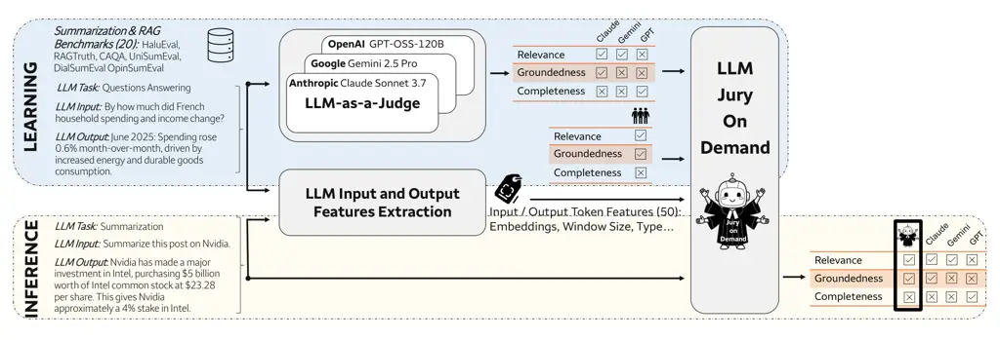

Figure 1: Overview of the LLM Jury-on-Demand inference pipeline. The
system extracts features from input texts to predict judge reliability,
dynamically assembles a jury of the top $`K`$ most reliable judges for
each instance, and calculates a final weighted score.

These texts are first processed by a feature extraction module, which
extracts a wide range of textual and semantic signals. The resulting
feature vector for each instance serves as input to a suite of
pre-trained reliability prediction models. In the final stage, the
system leverages these reliability predictions to perform a fully
adaptive, per-instance evaluation. For each data point, a jury of a
pre-tuned size $`K`$ is dynamically assembled by selecting the judges
with the highest predicted reliability for that specific instance. The
final score is then computed as a weighted average of these selected
judges' raw scores, using their reliability predictions as the weights.

### 3.2 Feature Engineering for Reliability Prediction

The foundation of our system is its ability to represent the evaluation
context through a rich set of predictive features. We hypothesize that
signals related to a text's size, complexity, and semantic content can
reveal the scenarios in which different LLM judges excel or struggle.
The features are extracted from all available texts (source, context,
and output, as applicable to the task) and concatenated into a single
feature vector for each data point. Many of these features are computed
using Natural Language Toolkit (NLTK) (Bird et al., 2009). A complete
list of features is in the Appendix A. Key feature categories are:

Text Size Features: These include basic structural metrics such as word
count, sentence count, paragraph count, and the compression ratio
between the source and generated text.

Special Words Features: These count the occurrences of specific word
types that can indicate the style or complexity of the text. Examples
include counts of difficult words (words that have more than two
syllables), named entities and modality verbs (e.g. “could”, “should”)
etc.

Text Complexity Features: These quantify readability and ambiguity using
established linguistic formulas. Examples include the Flesch reading
ease index (Kincaid et al., 1975), lexical diversity (the variety of
words used), and other measures of syntactic and semantic ambiguity.

Embedding-Related Features: Embeddings encode text into a dense vector
representation (Mikolov et al., 2013; Pennington et al., 2014; Devlin et
al., 2019). These capture the semantic meaning and topic of the text.
Top 10 PCA components (Jolliffe, 2011) of text embeddings are used as
features. Additionally, we compute cosine similarity between each text
component’s embedding and a set of predefined topic embeddings (e.g.
finance, technology), using these similarity scores as additional
topical relevance features.

### 3.3 Learning to Predict Judge Reliability

Our framework learns judge reliability by training a dedicated machine
learning model for each specific evaluation context. That is, for each
potential judge, for each task (e.g., summarization), and for each
evaluation metric (e.g., completeness), we train a distinct model. The
purpose of this model is not to predict the evaluation score itself, but
rather to predict the probability that the corresponding judge will be
reliable on that metric for a given data point.

We frame this as a binary classification task to predict whether a
judge's score will be “good” or “bad”. To generate the ground-truth
labels for training, we compare each judge's score against a
gold-standard human expert score. First, we apply min-max normalization
to all human and model scores to scale them to a \[0, 1\] range. A
judge's evaluation is then labeled as “good” (1) if its normalized score
falls within a predefined tolerance hyperparameter, $`\tau`$, of the
normalized human score. Otherwise, it is labeled as “bad” (0).

For each classification model, we use XGBoost, a gradient-boosted tree
algorithm known for its strong performance on tabular data (Chen and
Guestrin, 2016). This approach is grounded in the broader research area
of LLM performance prediction, which has shown that model performance
can be learned from features (Ye et al., 2023; Schellaert et al., 2025).
At inference time, our trained models output a probability score between
0 and 1, which we use as the predicted reliability.

### 3.4 Assembling and Scoring the Jury

The core of our framework is its ability to assemble an expert jury and
use its members' dynamically weighted opinions to compute a final score.
This process, which is applied for each individual data point, involves
two key mechanics: a reliability-based jury selection algorithm and an
instance-level dynamic weighting scheme.

Jury Selection. For each data point, we first use the suite of
pre-trained reliability models (described in Sec. 3.3) to generate a
reliability score for each of the $`N`$ judges in our pool. A jury of a
pre-tuned size $`K`$ is then formed by simply selecting the $`K`$ judges
with the highest predicted reliability scores for that specific
instance. This approach allows the jury's composition to be completely
dynamic, adapting to the unique characteristics of each text.

Dynamic Score Aggregation. Once the instance-specific jury is selected,
the final evaluation score is calculated as a weighted average of the
raw scores from those $`K`$ jury members. The weights are derived
directly from the instance-specific reliability scores,
$`[r_{1},r_{2}\dots,r_{K}]`$. Specifically, the weight for judge $`i`$
in the jury is calculated as $`w_{i}=r_{i}/(\sum_{j=1}^{K}r_{j})`$. This
dynamic, per-instance selection and weighting process allows our system
to prioritize the opinions of the most trustworthy judges for any given
text, which stands in contrast to prior systems that rely on static
juries and static aggregation methods like simple averaging (Verga et
al., 2024).

These two mechanics are the building blocks for our system's training
and inference pipelines.

### 3.5 System Training and Inference

Our framework involves a one-time training and tuning phase to establish
an optimal configuration, which is then used in a repeatable inference
pipeline to evaluate new data points.

Training and Hyperparameter Tuning. The goal of the training phase is to
find the optimal hyperparameters that will generalize best. This
involves finding the single best jury size $`K`$ and the optimal
tolerance level $`\tau`$ for each individual judge’s reliability model.
To do this, we first train a large pool of reliability predictor models
on our training data, covering all possible combinations of judges and
tolerance values. We then conduct a search over the hyperparameter space
of possible jury sizes ($`K`$) and per-judge tolerance configurations.
Each configuration is evaluated on a held-out validation set. For every
data point in the validation set, we apply the Jury Selection and
Dynamic Score Aggregation mechanics described in Sec. 3.4. The
configuration that yields the highest Kendall's Tau correlation with
human scores across the validation set is selected as the optimal
configuration for the final system.

Inference Pipeline. With the optimal configuration locked in (i.e., a
fixed $`K`$ and a set of optimal reliability models), the system is
ready to evaluate a new, unseen data point. For a new instance, the
system first uses the optimal reliability models to predict an
instance-specific reliability score for every potential judge in the
pool. It then applies the Jury Selection and Dynamic Score Aggregation
mechanisms to select the top $`K`$ judges and compute the final,
weighted score.

## 4 Experimental Setup

To validate the effectiveness of our LLM Jury-on-Demand framework, we
conducted a series of experiments designed to measure its performance
against standard evaluation methods. This section details the datasets,
evaluation protocol, and implementation specifics of our experiments.

### 4.1 Datasets and Tasks

Our evaluation spans two challenging natural language generation tasks:
summarization and retrieval-augmented generation (RAG). For each task,
we focus on evaluating three core metrics: groundedness, relevance, and
completeness. These metrics are essential for assessing the quality and
trustworthiness of generated text. Detailed definitions for each metric
are provided in Appendix B.

To train our jury framework, we chose datasets with human annotations
for these dimensions. We reviewed a diverse set of datasets for
training, selecting 3-4 datasets per task by metric dimension to ensure
coverage across various domains. To prevent any single dataset or any
single metrics category from dominating a particular evaluation task, we
applied stratified down-sampling where necessary. The details are
provided in Appendix C.

### 4.2 Evaluation Protocol

Our experimental protocol is designed to ensure a fair and rigorous
comparison between our proposed system and relevant baselines.

Evaluation Metric. The primary metric for our experiments is the
Kendall's Tau correlation coefficient (KENDALL, 1938). This
non-parametric statistic measures the ordinal association between two
sets of rankings. In our context, it quantifies how well a system's
evaluation scores align with the rankings provided by human experts. A
Kendall's Tau value close to 1 indicates strong agreement with human
judgment.

Judge Prompting Protocol. To generate the raw scores for our experiment,
each potential judge model was prompted with a carefully structured
template. This template includes a system prompt to set the judge's
persona (“You are a helpful, respectful and honest assistant”) and a
user prompt that defines the task, the specific metric (e.g.,
Completeness), and the required scoring format. The scoring scale was
adapted to the task: for summarization, all judges were instructed to
provide a single integer score from 1 (lowest quality) to 5 (highest
quality); for RAG, a scale of 1 (lowest quality) to 3 (highest quality)
was used. The full prompt structure is provided in the Appendix D.
Additionally, we conducted an ablation study to analyse the effect on
the system’s resilience to slight prompt variations as described in the
Appendix H.4.

Baselines. To benchmark our system's performance, we established a judge
pool consisting of 10 diverse LLMs. This pool serves as the foundation
for all evaluation methods compared in our study and includes the
following models: Claude 3.7 SONNET (12), Gemini 2.5 Pro (Comanici et
al., 2025), Gemini 2.5 Flash, Gemini 2.0 Flash, GPT-OSS-20B (Agarwal et
al., 2025), GPT-OSS-120B, Gemma 3-27B-IT (Team et al., 2025),
Phi-4-reasoning (Abdin et al., 2025), LLAMA-3.2-3B-Instruct (Grattafiori
et al., 2024), and DeepSeek-R1 (Guo et al., 2025). From this pool, we
formed two categories of baselines:

1.  1.  Single-Judge Baselines: The performance of each of the 10 judges
        when used as a standalone evaluator.
2.  2.  Static-Jury Baselines: We compare against four distinct static jury
        formulations to rigorously test the benefits of dynamic selection:
    - •
      Static Jury (Average-All): The performance of a non-adaptive,
      naive jury that uses all 10 judges in the pool. For each data
      point, the final score for this baseline is the simple average of
      the raw scores from all 10 judges.
    - •
      Static Jury (Average-Top-K): This baseline identifies the
      Top-$`K`$ best-performing single judges based on their Kendall’s
      Tau on the validation set. The final score is the simple average
      of these Top-$`K`$ judges. The value of $`K`$ is tuned on the
      validation set.
    - •
      Static Jury (Weighted-Regression): A regression-based jury using
      all 10 judges. We train a linear regression model without
      intercept using human annotation scores as labels and single judge
      scores as features on the training set.
    - •
      Static Jury (Weighted-Tau): A performance-weighted average of all
      10 judges. The weights are derived from each judge’s validation
      Kendall’s Tau, normalized using a softmax function.

### 4.3 Implementation Details

This section provides the specific procedures used to configure and
train our system for the experiments.

First, we prepared the data for each task and metric by combining all
relevant source datasets. For example, to evaluate the completeness
metric for the summarization task, we aggregated the data from SummEval,
TLDR, and UniSumEval into a single, combined dataset. We then performed
a global 60-20-20 split on this combined data to create our final
training, validation, and holdout test sets, ensuring data from all
sources were represented in each split. As described in Sec. 3.3, all
human and model scores were then normalized to a \[0, 1\] range to
ensure consistency.

Next, we determined the system’s optimal configuration through a
comprehensive hyperparameter tuning process on the combined validation
set, as outlined in Sec. 3.5. We defined a search space for three key
hyperparameter categories: the jury size $`K`$ (ranging from 2 to 9),
the per-judge tolerance values $`\tau`$ used for training the
reliability predictors, and the internal parameters of the XGBoost
models. We exclude $`K=1`$ as it reduces the jury to a single judge
selector, effectively duplicating the Single-Judge baseline paradigm. We
also exclude $`K=10`$ (the full pool), as this configuration represents
a static ensemble identical to the Average-All baseline, negating the
benefit of dynamic selection. The sets of tolerance values were chosen
to reflect the varying scales of the original human annotation scores
across the different source datasets. For each candidate configuration,
we evaluated its performance by applying the full per-instance jury
selection and weighting pipeline (Sec. 3.4) to every data point in the
combined validation set. The final optimal configuration was chosen
based on which set of hyperparameters yielded the highest Kendall’s Tau
correlation on this combined validation set. This finalized
configuration was then used for the final, unbiased evaluation on the
locked-away test set.

Additionally, to assess robustness beyond validation-based tuning, we
conduct ablation studies on jury size ($`K`$) and tolerance ($`\tau`$),
detailed in Appendix H.2 and H.3. Jury size is varied from 1 to 9 across
two representative tasks, Summarization-Completeness and
RAG-Groundedness, over 10 independent runs. As shown in Fig. 17,
performance for both tasks follows a similar pattern: accuracy improves
as jury size increases, reaches an optimal range (around $`K=5`$–$`8`$),
and then declines slightly at very large sizes, indicating diminishing
returns beyond the peak.

## 5 Results and Analysis

This section evaluates our LLM Jury-on-Demand framework against the
single-judge and static-jury baselines. To ensure robustness, all
experiments were repeated 10 times with different random seeds for data
partitioning, and we report the mean and standard deviation of the
results. Our analysis presents the main performance, both overall and at
a granular dataset-level, followed by a diagnostic analysis of our
system’s internal mechanics, including feature importance and judge
selection frequency.

### 5.1 Performance Analysis

We assess performance by comparing the Kendall’s Tau correlation of each
method with human judgment on the test sets for each task-metric
combination. The distribution of results from our 10 independent runs is
summarized in Fig. 2.

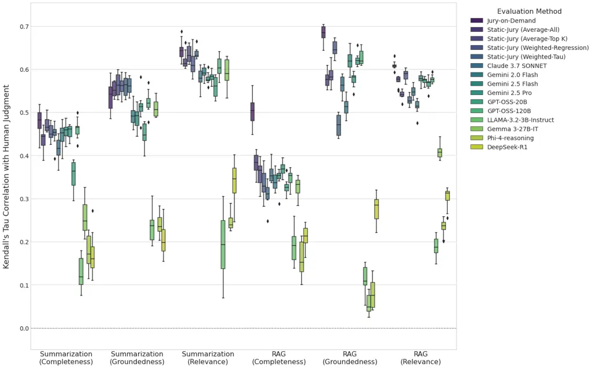

Figure 2: Overall performance comparison over 10 runs. Boxplot of
Kendall’s Tau correlation between each evaluation method’s scores and
human judgements, aggregated across all datasets for the 6 task-metric
combinations. Our Jury-on-Demand system achieves the highest median
correlation in nearly all categories and shows the most robust
performance.

The results clearly demonstrate that our Jury-on-Demand framework
consistently outperforms all baselines across every task and metric. In
all six categories, our method achieves the highest mean correlation
with human judgment, validating its effectiveness. For instance, in the
challenging RAG-Groundedness task, our system achieves a mean Kendall’s
Tau of 0.68 (± 0.02). This represents a significant improvement not only
over the simple Static Jury (Average-All) (0.58 ± 0.02) but also over
the stronger optimized baselines, such as Static Jury
(Weighted-Regression) (0.65 ± 0.02) and the strongest single judge for
that task, GPT-OSS-120B (0.63 ± 0.02).

To provide a more detailed view of performance, we now analyze the
results for the RAG-Completeness task at the individual dataset level.
The granular results in Table 1 confirm the findings from the overall
analysis: our Jury-on-Demand system outperforms all four static jury
baselines and the best-performing single judge on every individual
dataset for this task. The performance lift is particularly pronounced
on the ASQA dataset, indicating that our system is robust and its
advantages are not an artifact of data aggregation but hold true at a
more granular level. The full breakdown of results for all tasks and
datasets is available in Appendix E.1. We also report statistical
significance and effect sizes. Specifically, we perform one-sided
Wilcoxon signed-rank tests (Wilcoxon, 1945) and compute Cliff’s delta
(Cliff, 1993), a non-parametric effect size metric that quantifies the
difference between two groups. The results are presented in Appendix
E.1.

Finally, the results also highlight the inherent unreliability of
relying on a single LLM as an evaluator. As shown in Fig. 2, the
performance of single judges is highly variable. The “best” single judge
changes from one task to another; for example, Claude 3.7 SONNET is
often the strongest single judge for Summarization-Groundedness, but it
is one of the weakest for Summarization-Completeness. This instability
proves that there is no single “best” LLM judge, making a static choice
of evaluator a risky and unreliable strategy.

The comparison between our Jury-on-Demand and the various static jury
baselines isolates the benefit of our core contribution. While baselines
like Static Jury (Weighted-Regression) are competitive, our dynamic
system is consistently superior. This demonstrates that the primary
performance gain comes not just from using a jury, but from the ability
to dynamically select and weight its members based on the context of the
input. The stability of this outperformance, demonstrated across 10
runs, underscores the reliability of our dynamic approach.

| Dataset | Jury-on-Demand   | Static (Avg-All) | Static (Avg-TopK) | Static (W-Reg)   | Static (W-Tau)   | Best Single                          |
| ------- | ---------------- | ---------------- | ----------------- | ---------------- | ---------------- | ------------------------------------ |
| ALCE    | $`0.47\pm 0.07`$ | $`0.38\pm 0.09`$ | $`0.28\pm 0.08`$  | $`0.34\pm 0.11`$ | $`0.23\pm 0.10`$ | $`0.40\pm 0.07`$ (GPT-OSS-20B)       |
| ASQA    | $`0.54\pm 0.05`$ | $`0.38\pm 0.05`$ | $`0.38\pm 0.04`$  | $`0.36\pm 0.04`$ | $`0.34\pm 0.03`$ | $`0.42\pm 0.03`$ (Claude 3.7 SONNET) |
| QASPER  | $`0.44\pm 0.08`$ | $`0.41\pm 0.08`$ | $`0.27\pm 0.08`$  | $`0.35\pm 0.07`$ | $`0.24\pm 0.11`$ | $`0.43\pm 0.07`$ (GPT-OSS-120B)      |

Table 1: Granular Performance on RAG-Completeness. Mean Kendall’s Tau
correlation ($`\pm`$ std. dev.) on the individual test sets across 10
runs. Our Jury-on-Demand system consistently outperforms all static
baselines and the best single judge.

### 5.2 Analyzing the Interaction Between Judges, Tasks, and Data Attributes

We begin by analyzing judge selection patterns within juries across
different tasks and datasets. Fig. 3 summarizes the selection frequency
of each judge for the RAG groundedness and RAG completeness tasks. The
results reveal distinct preferences: Claude 3.7 Sonnet and DeepSeek R1
are frequently selected for completeness evaluation but are rarely
chosen for groundedness. In contrast, Gemini 2.5 Flash is commonly
selected for groundedness but appears less frequently in completeness
evaluations. GPT OSS 20B and GPT OSS 120B are consistently selected
across both metrics. A comprehensive comparison of judge selection
across all tasks is in Appendix E.2.

We now examine how data properties impact judge performance. For
illustration, we focus on two tasks: RAG groundedness and summarization
completeness. The analysis for summarization completeness is in Appendix
E.2. We select properties that rank among the most important features in
the XGBoost model. For the summarization task, the key property is the
compression ratio (i.e., the length of the summary divided by the length
of the article). For the RAG task, the selected property is the
character count of each response.

To better illustrate the findings, we focus on three judges for each
task. We begin with the RAG groundedness task. Fig. 4 shows model
performance across bins of low, medium, and high response character
counts. Two main observations emerge:

1.  1.  All judges perform worse as the character count increases.
2.  2.  Gemini 2.0 Flash performs comparably to the others when the
        character count is low, but its performance drops significantly at
        higher character counts, especially compared to Gemini 2.5 Flash and
        GPT OSS 20B.

To explain these trends, we examine the distribution of annotation
scores in the low and high character count regions (see Fig. 5). In the
high character count region, many responses receive a score of 1
(moderately ungrounded), whereas in the low character count region, most
scores are either 0 (severely ungrounded) or 2 (fully grounded). It is
easier for judges to distinguish between scores 0 and 2, but more
difficult to differentiate between 1 and 2. Weaker judges, such as
Gemini 2.0 Flash, particularly struggle with identifying ungrounded
content. Fig. 6 and Fig. 7 present the score confusion matrices for
Gemini 2.0 Flash and Gemini 2.5 Flash for long and short responses.
Compared to Gemini 2.5 Flash, Gemini 2.0 Flash assigns a
disproportionately high number of score 2s, which explains its poor
performance in the high character count region and relatively good
performance in the low character count region. We also reviewed specific
examples to understand why Gemini 2.0 Flash assigns score 2 even when
the content is ungrounded. This analysis is provided in the Appendix
E.3.

Finally, the jury selection dynamically aligns with model performance,
as shown in Fig. 4. This is most evident in the high character count
bin, where the performance of Gemini 2.0 Flash drops significantly.
Correspondingly, its selection percentage in our dynamic jury plummets
to its lowest point, demonstrating that the reliability predictors
correctly identify and avoid this weaker judge when it is unreliable.
Conversely, Gemini 2.5 Flash maintains the highest performance in this
high-count bin, and our system selects it for the jury in the vast
majority of cases. GPT-OSS-20B also shows strong alignment in the medium
character count bin, where it achieves its highest performance and is
also the most selected judge.

The framework also demonstrates robustness beyond simply picking the
single best-performing judge. For instance, in the low character count
bin, GPT-OSS-20B has the highest kendall’s Tau. While it is selected
frequently, Gemini 2.5 Flash, which also performs exceptionally well, is
selected more often. This illustrates that the system does not rely on a
single judge; rather, it identifies a pool of highly reliable judges for
a given context and assembles an optimal jury from that pool.

These findings reinforce the importance of constructing dynamic juries
that adapt to specific data characteristics and demonstrate the
potential of our framework to predict judge reliability based on
interpretable data properties.

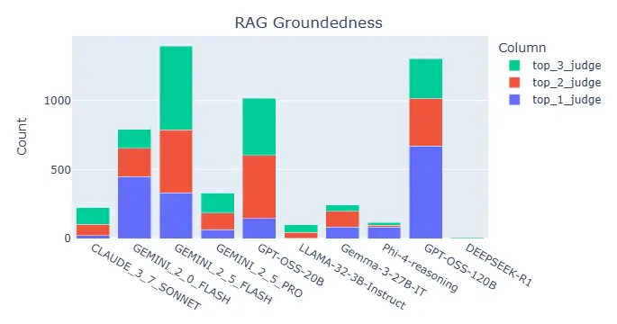

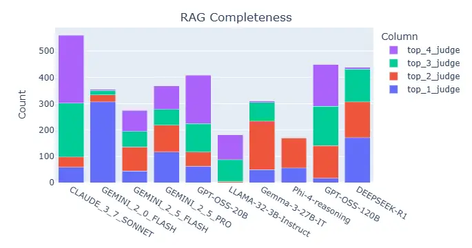

Figure 3: Selection frequency of the judge in the jury. Top k judge
means that the judge has the k-th highest reliability score in the jury.
Claude 3.7 Sonnet and DeepSeek R1 are favored in completeness, while
Gemini 2.5 Flash is more often selected for groundedness.

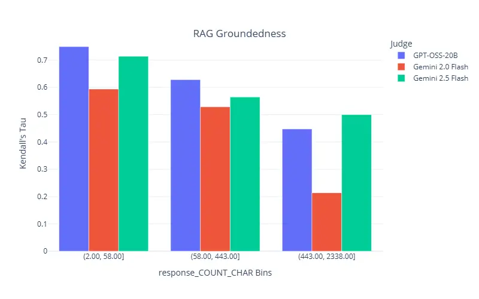

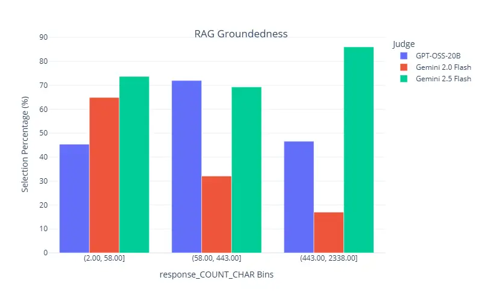

Figure 4: RAG Groundedness analysis by response character count. (Left)
Kendall’s Tau correlation for three single judges across low, medium,
and high response character count bins. (Right) The selection percentage
of these judges in the final dynamic jury for data points within each
bin. The analysis shows that judge performance degrades with longer
responses, particularly for Gemini 2.0 Flash. Our system’s jury
selection adapts to this, heavily favoring the more reliable Gemini 2.5
Flash in the high-count bin.

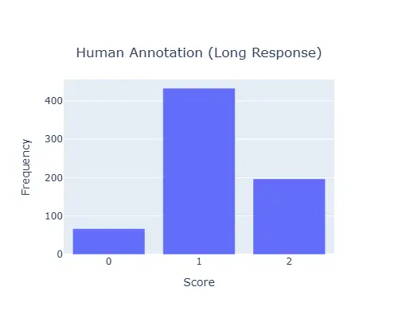

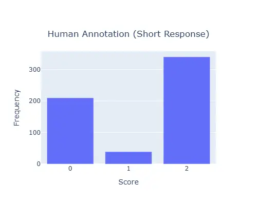

Figure 5: RAG Groundedness: Distribution of annotation scores across
response lengths. Longer responses tend to receive more score 1s
(moderately ungrounded), while shorter responses are more often assigned
scores of 0 (severely ungrounded) or 2 (fully grounded).

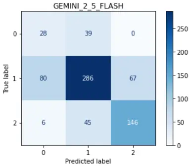

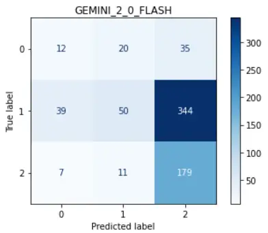

Figure 6: RAG Groundedness: Confusion matrix for long responses. Gemini
2.0 Flash frequently assigns score 2 to ungrounded content, leading to
reduced performance in this region.

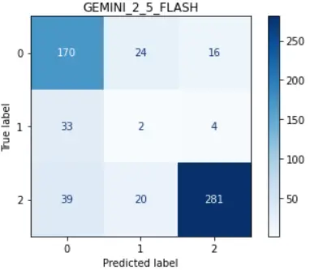

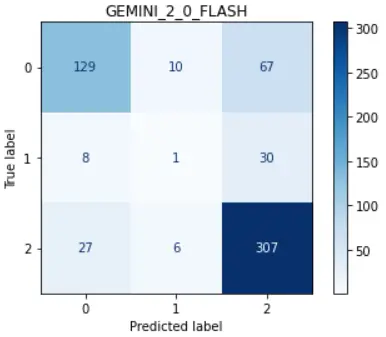

Figure 7: RAG Groundedness: Confusion matrix for short responses. Gemini
2.0 Flash performs better in this region, as human annotation scores are
predominantly 0 (severely ungrounded) or 2 (fully grounded), making them
easier to distinguish.

Table 2 presents the top five most important features for the judge
reliability XGBoost model, as determined by permutation feature
importance (Fisher et al., 2019), with the summarization groundedness
task as an example. For illustration, we focus on Gemini 2.5 Pro and
GPT-OSS-120B, while the complete results for all judges are in Appendix
E.2. The analysis reveals the variation in feature importance across
judges. For instance, embedding-related features are more influential
for GPT-OSS-120B, suggesting that different judges rely on distinct data
properties when assessing reliability. We further aggregate the top five
features that frequently appear across tasks, with results provided in
Appendix E.2. The analysis reveals clear task-specific trends: text
size-related features, such as word count and compression ratio, along
with token entropy, are more prominent in RAG tasks. In contrast,
embedding-based features, including PCA components and embedding
similarity, play a more significant role in summarization tasks. These
findings align with the ablation analysis in Appendix H.1, which shows
that removing embedding features leads to a greater performance drop in
the summarization task compared to RAG. These observations imply that
evaluation reliability is task-dependent and further demonstrate that
our approach effectively links data characteristics to judge
reliability, enabling more informed and adaptive jury construction
across diverse evaluation scenarios.

| Judge          | Feature 1          | Feature 2  | Feature 3           | Feature 4                 | Feature 5              |
| -------------- | ------------------ | ---------- | ------------------- | ------------------------- | ---------------------- |
| Gemini 2.5 Pro | output compression | input pca7 | input reading index | output embedding science  | output pca10           |
| GPT-OSS-120B   | output pca1        | input pca1 | output compression  | output embedding business | output embedding legal |

Table 2: Top 5 important features for the summarization groundedness
task. Gemini 2.5 Pro relies more on embedding-based features.

### 5.3 Analysis of Jury Failure in Evaluation Tasks

In this section, we investigate the conditions under which the dynamic
jury fails to accurately assess model outputs. Given that jury
performance is inherently dependent on the individual scoring behaviors
of its constituent judges, our analysis aims to identify common regions
and conditions where judges exhibit unreliable evaluations.

To uncover data attributes associated with jury failure, we train
XGBoost models using a set of text attributes we measured as predictors
and a binary response variable indicating jury success or failure.
Feature importance is subsequently assessed via permutation-based
methods to identify the most influential attributes affecting jury
outcomes. For each of the top-ranked features, we conduct a binning
analysis to evaluate jury performance across discrete intervals. Using
the RAG groundedness task as a case study, we find that the most
predictive features are related to the size and complexity of the
generated text such as token entropy and character count. Figure 8
illustrates jury performance across bins of these two attributes,
revealing a clear trend: as the length and entropy of generated text
increase, the jury’s ability to reliably assess groundedness diminishes.
The complete results for top features identified in this task are
presented in Appendix E.5.

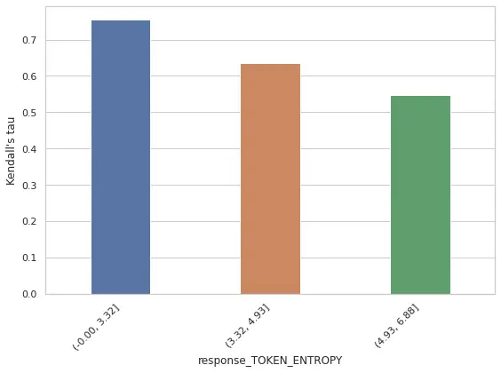

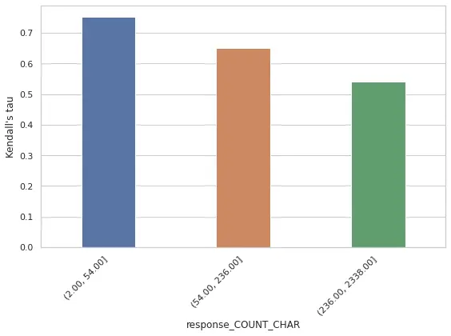

Figure 8: Jury Performance Across Binned Segments of Token Entropy and
Character Count in Generated Responses. Higher jury accuracy is observed
when outputs are shorter or exhibit lower textual complexity.

We further analyze the predicted reliability scores of the
top-performing judges selected to form the jury, comparing cases of jury
success versus failure. Using the RAG groundedness task as a
representative example, we focus on the optimal jury configuration of
three judges selected from a pool of ten for each evaluation instance.
Figure 9 presents a box plot summarizing the predicted reliability
scores of the top three judges across both successful and failed jury
outcomes. The results exhibit a consistent pattern: judges involved in
successful jury decisions tend to have higher predicted reliability
scores than those in failure cases. This trend is corroborated by
similar findings in the summarization completeness task, detailed in
Figure 9 as well. In that task, the optimal jury size is seven, we
highlight the top three judges for clarity.

These observations validate the effectiveness of our jury construction
strategy, which prioritizes the selection of judges based on their
predicted reliability. Moreover, the results suggest that the XGBoost
models used to estimate individual judge reliability accurately capture
behavioral patterns. When the models predict high reliability, the
corresponding judges typically perform well, contributing to successful
jury outcomes. Conversely, when even the top-ranked judges struggle, the
overall jury performance deteriorates.

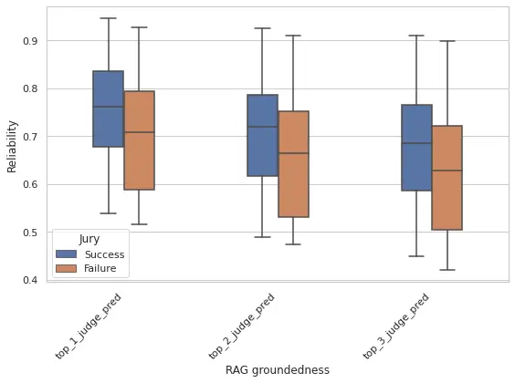

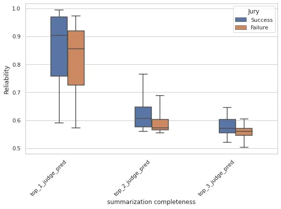

Figure 9: Predicted Reliability Scores of Top Judges for Successful and
Failed Jury Outcomes in RAG Groundedness and Summarization Completeness
Tasks. Higher reliability scores are consistently observed in successful
jury cases, validating the effectiveness of judge selection based on
model-predicted performance.

## 6 Conclusion

In this work, we addressed the critical challenge of creating scalable
and reliable evaluation systems for Large Language Models. We introduced
LLM Jury-on-Demand, a novel framework that moves beyond the static
aggregation methods of prior jury-based systems by learning to predict
judge reliability and dynamically assembling an expert jury for each
data point. Our experimental results demonstrated that this adaptive
approach consistently outperforms both single-judge and static-jury
baselines in aligning with human expert judgement. This confirms our
central hypothesis that for automated evaluation to be trustworthy, it
must be context-aware and adaptive, rather than static.

While our results are promising, this work has several limitations that
open clear paths for future research. Our current framework relies on a
human-annotated dataset to train the reliability predictors; future work
could explore semi-supervised or self-supervised techniques to reduce
this dependency and enhance scalability. Furthermore, we conduct
experiments to assess the framework’s ability to generalize beyond its
training domains by training on a subset of domains and applying it to
held-out domains. The results indicate partial generalization: certain
learned patterns transfer effectively to new domains, while others do
not (see Appendix J for details). These findings suggest that the
framework’s generalizability is contingent on both the diversity of the
training data and the characteristics of the unseen domains. As
additional annotated data becomes available and incorporated into
training, we anticipate that the framework’s capacity to generalize will
improve, enabling broader applicability across diverse areas.

Another promising direction for future work is mitigating bias in judge
scores. For example, certain judges may consistently assign higher or
lower scores compared to human annotations. We explore score calibration
in Appendix K. Our experiments show that calibration can sometimes
improve alignment between judge scores and human annotations, but in
other cases, it may amplify the bias. Addressing this challenge remains
an open problem, and we plan to investigate more robust approaches in
future work.

## References

- Abdin et al. (2025) M. Abdin, S. Agarwal, A. Awadallah, V.
  Balachandran, H. Behl, L. Chen, G. de Rosa, S. Gunasekar, M.
  Javaheripi, N. Joshi, et al. Phi-4-reasoning technical report. arXiv
  preprint arXiv:2504.21318. Cited by: §4.2.
- Agarwal et al. (2025) S. Agarwal, L. Ahmad, J. Ai, S. Altman, A.
  Applebaum, E. Arbus, R. K. Arora, Y. Bai, B. Baker, H. Bao, et al.
  Gpt-oss-120b & gpt-oss-20b model card. arXiv preprint
  arXiv:2508.10925. Cited by: §4.2.
- Bajaj et al. (2016) P. Bajaj, D. Campos, N. Craswell, L. Deng, J.
  Gao, X. Liu, R. Majumder, A. McNamara, B. Mitra, T. Nguyen, et al. Ms
  marco: a human generated machine reading comprehension dataset. arXiv
  preprint arXiv:1611.09268. Cited by: Table 5.
- Baumann et al. (2025) J. Baumann, P. Röttger, A. Urman, A.
  Wendsjö, F. M. Plaza-del-Arco, J. B. Gruber, and D. Hovy Large
  language model hacking: quantifying the hidden risks of using llms for
  text annotation. External Links: 2509.08825,
  [Link](https://arxiv.org/abs/2509.08825) Cited by: §1.
- Bird et al. (2009) S. Bird, E. Klein, and E. Loper Natural language
  processing with python. O'Reilly (English). External Links: ISBN
  978-0-596-51649-9 Cited by: §3.2.
- Blei et al. (2003) D. M. Blei, A. Y. Ng, and M. I. Jordan Latent
  dirichlet allocation. Journal of machine Learning research 3 (Jan),
  pp. 993–1022. Cited by: §E.4.
- Brown et al. (2020) T. Brown, B. Mann, N. Ryder, M. Subbiah, J. D.
  Kaplan, P. Dhariwal, A. Neelakantan, P. Shyam, G. Sastry, A. Askell,
  et al. Language models are few-shot learners. Advances in neural
  information processing systems 33, pp. 1877—-1901. Cited by: §1.
- Calderon et al. (2025) N. Calderon, R. Reichart, and R. Dror The
  alternative annotator test for llm-as-a-judge: how to statistically
  justify replacing human annotators with llms. arXiv preprint
  arXiv:2501.10970. Cited by: §1.
- Cao et al. (2025) Y. Cao, S. Hong, X. Li, J. Ying, Y. Ma, H. Liang, Y.
  Liu, Z. Yao, X. Wang, D. Huang, et al. Toward generalizable evaluation
  in the llm era: a survey beyond benchmarks. arXiv preprint
  arXiv:2504.18838. Cited by: §1, §2.
- Chen and Guestrin (2016) T. Chen and C. Guestrin Xgboost: a scalable
  tree boosting system. In Proceedings of the 22nd acm sigkdd
  international conference on knowledge discovery and data mining,
  pp. 785—-794. Cited by: §3.3.
- Chu et al. (2024) Z. Chu, Q. Ai, Y. Tu, H. Li, and Y. Liu Pre: a peer
  review based large language model evaluator. arXiv preprint
  arXiv:2401.15641. Cited by: §2.
- \[12\] Claude 3.7 sonnet system card. External Links:
  [Link](https://api.semanticscholar.org/CorpusID:276612236) Cited by:
  §4.2.
- Cliff (1993) N. Cliff Dominance statistics: ordinal analyses to answer
  ordinal questions. Psychological Bulletin 114, pp. 494–509. External
  Links: [Document](https://dx.doi.org/10.1037/0033-2909.114.3.494)
  Cited by: §E.1, §5.1.
- Comanici et al. (2025) G. Comanici, E. Bieber, M. Schaekermann, I.
  Pasupat, N. Sachdeva, I. Dhillon, M. Blistein, O. Ram, D. Zhang, E.
  Rosen, et al. Gemini 2.5: pushing the frontier with advanced
  reasoning, multimodality, long context, and next generation agentic
  capabilities. arXiv preprint arXiv:2507.06261. Cited by: §4.2.
- Dasigi et al. (2021) P. Dasigi, K. Lo, I. Beltagy, A. Cohan, N. A.
  Smith, and M. Gardner A dataset of information-seeking questions and
  answers anchored in research papers. In Proceedings of the 2021
  Conference of the North American Chapter of the Association for
  Computational Linguistics: Human Language Technologies,
  pp. 4599—-4610. Cited by: Table 5.
- Devlin et al. (2019) J. Devlin, M. Chang, K. Lee, and K. Toutanova
  Bert: pre-training of deep bidirectional transformers for language
  understanding. In Proceedings of the 2019 conference of the North
  American chapter of the association for computational linguistics:
  human language technologies, volume 1 (long and short papers),
  pp. 4171—-4186. Cited by: §3.2.
- Fabbri et al. (2021) A. R. Fabbri, W. Kry\\sci\\nski, B. McCann, C.
  Xiong, R. Socher, and D. Radev Summeval: re-evaluating summarization
  evaluation. Transactions of the Association for Computational
  Linguistics 9, pp. 391—-409. Cited by: Table 4, Table 4, Table 4.
- Feng et al. (2025) S. Feng, W. Ding, A. Liu, Z. Wang, W. Shi, Y.
  Wang, Z. Shen, X. Han, H. Lang, C. Lee, et al. When one llm drools,
  multi-llm collaboration rules. arXiv preprint arXiv:2502.04506. Cited
  by: §1, §2.
- Fisher et al. (2019) A. Fisher, C. Rudin, and F. Dominici All models
  are wrong, but many are useful: learning a variable's importance by
  studying an entire class of prediction models simultaneously. Journal
  of Machine Learning Research 20 (177), pp. 1—-81. Cited by: §E.2,
  §5.2.
- Gao and Wan (2022) M. Gao and X. Wan DialSummEval: revisiting
  summarization evaluation for dialogues. In Proceedings of the 2022
  Conference of the North American Chapter of the Association for
  Computational Linguistics: Human Language Technologies, M. Carpuat, M.
  de Marneffe, and I. V. Meza Ruiz (Eds.), Seattle, United States,
  pp. 5693—-5709. External Links:
  [Link](https://aclanthology.org/2022.naacl-main.418/),
  [Document](https://dx.doi.org/10.18653/v1/2022.naacl-main.418) Cited
  by: Table 4, Table 4.
- Gao et al. (2023) T. Gao, H. Yen, J. Yu, and D. Chen Enabling large
  language models to generate text with citations. In Empirical Methods
  in Natural Language Processing (EMNLP), Cited by: Table 5, Table 5.
- Grattafiori et al. (2024) A. Grattafiori, A. Dubey, A. Jauhri, A.
  Pandey, A. Kadian, A. Al-Dahle, A. Letman, A. Mathur, A. Schelten, A.
  Vaughan, et al. The llama 3 herd of models. arXiv preprint
  arXiv:2407.21783. Cited by: §4.2.
- Gu et al. (2024) J. Gu, X. Jiang, Z. Shi, H. Tan, X. Zhai, C. Xu, W.
  Li, Y. Shen, S. Ma, H. Liu, et al. A survey on llm-as-a-judge. arXiv
  preprint arXiv:2411.15594. Cited by: §1, §2.
- Guo et al. (2025) D. Guo, D. Yang, H. Zhang, J. Song, R. Zhang, R.
  Xu, Q. Zhu, S. Ma, P. Wang, X. Bi, et al. Deepseek-r1: incentivizing
  reasoning capability in llms via reinforcement learning. arXiv
  preprint arXiv:2501.12948. Cited by: §4.2.
- Hu et al. (2025) N. Hu, J. Chen, Y. Wu, G. Qi, H. Wang, S. Bi, Y.
  Chen, T. Wu, and J. Z. Pan Can LLMs evaluate complex attribution in
  QA? automatic benchmarking using knowledge graphs. In Proceedings of
  the 63rd Annual Meeting of the Association for Computational
  Linguistics (Volume 1: Long Papers), W. Che, J. Nabende, E. Shutova,
  and M. T. Pilehvar (Eds.), Vienna, Austria, pp. 17096—-17118. External
  Links: [Link](https://aclanthology.org/2025.acl-long.837/),
  [Document](https://dx.doi.org/10.18653/v1/2025.acl-long.837), ISBN
  979-8-89176-251-0 Cited by: Table 5.
- Jolliffe (2011) I. Jolliffe Principal component analysis. In
  International encyclopedia of statistical science, pp. 1094—-1096.
  Cited by: §3.2.
- KENDALL (1938) M. G. KENDALL A new measure of rank correlation.
  Biometrika 30 (1-2), pp. 81–93. External Links: ISSN 0006-3444,
  [Document](https://dx.doi.org/10.1093/biomet/30.1-2.81),
  [Link](https://doi.org/10.1093/biomet/30.1-2.81),
  https://academic.oup.com/biomet/article-pdf/30/1-2/81/423380/30-1-2-81.pdf
  Cited by: §4.2.
- Kincaid et al. (1975) P. Kincaid, R. P. Fishburne, R. L. Rogers,
  and B. S. Chissom Derivation of new readability formulas (automated
  readability index, fog count and flesch reading ease formula) for navy
  enlisted personnel. External Links:
  [Link](https://api.semanticscholar.org/CorpusID:61131325) Cited by:
  §3.2.
- Lee et al. (2024) Y. Lee, T. Yun, J. Cai, H. Su, and H. Song
  UniSumEval: towards unified, fine-grained, multi-dimensional
  summarization evaluation for LLMs. In Findings of the Association for
  Computational Linguistics: EMNLP 2024, Y. Al-Onaizan, M. Bansal,
  and Y. Chen (Eds.), Miami, Florida, USA, pp. 3941–3960. External
  Links: [Link](https://aclanthology.org/2024.findings-emnlp.227/),
  [Document](https://dx.doi.org/10.18653/v1/2024.findings-emnlp.227)
  Cited by: Table 4, Table 4, Table 4.
- Li et al. (2024a) H. Li, J. Chen, Q. Ai, Z. Chu, Y. Zhou, Q. Dong,
  and Y. Liu Calibraeval: calibrating prediction distribution to
  mitigate selection bias in llms-as-judges. arXiv preprint
  arXiv:2410.15393. Cited by: §1, §2.
- Li et al. (2024b) H. Li, Q. Dong, J. Chen, H. Su, Y. Zhou, Q. Ai, Z.
  Ye, and Y. Liu Llms-as-judges: a comprehensive survey on llm-based
  evaluation methods. arXiv preprint arXiv:2412.05579. Cited by: §1, §2.
- Li et al. (2023) J. Li, X. Cheng, W. X. Zhao, J. Nie, and J. Wen
  HaluEval: a large-scale hallucination evaluation benchmark for large
  language models. In Proceedings of the 2023 Conference on Empirical
  Methods in Natural Language Processing, pp. 6449—-6464. Cited by:
  Table 5.
- Lin (2004) C. Lin Rouge: a package for automatic evaluation of
  summaries. In Text summarization branches out, pp. 74—-81. Cited by:
  §1.
- Mikolov et al. (2013) T. Mikolov, K. Chen, G. S. Corrado, and J. Dean
  Efficient estimation of word representations in vector space. In
  International Conference on Learning Representations, External Links:
  [Link](https://api.semanticscholar.org/CorpusID:5959482) Cited by:
  §3.2.
- Niculescu-Mizil and Caruana (2005) A. Niculescu-Mizil and R. Caruana
  Predicting good probabilities with supervised learning. In Proceedings
  of the 22nd international conference on Machine learning, pp. 625–632.
  Cited by: Appendix K.
- Niu et al. (2024) C. Niu, Y. Wu, J. Zhu, S. Xu, K. Shum, R. Zhong, J.
  Song, and T. Zhang RAGTruth: a hallucination corpus for developing
  trustworthy retrieval-augmented language models. In Proceedings of the
  62nd Annual Meeting of the Association for Computational Linguistics
  (Volume 1: Long Papers), L. Ku, A. Martins, and V. Srikumar (Eds.),
  Bangkok, Thailand, pp. 10862—-10878. External Links:
  [Link](https://aclanthology.org/2024.acl-long.585/),
  [Document](https://dx.doi.org/10.18653/v1/2024.acl-long.585) Cited by:
  Table 5.
- Papineni et al. (2002) K. Papineni, S. Roukos, T. Ward, and W. Zhu
  Bleu: a method for automatic evaluation of machine translation. In
  Proceedings of the 40th annual meeting of the Association for
  Computational Linguistics, pp. 311—-318. Cited by: §1.
- Pennington et al. (2014) J. Pennington, R. Socher, and C. Manning
  GloVe: global vectors for word representation. In Proceedings of the
  2014 Conference on Empirical Methods in Natural Language Processing
  (EMNLP), A. Moschitti, B. Pang, and W. Daelemans (Eds.), Doha, Qatar,
  pp. 1532—-1543. External Links:
  [Link](https://aclanthology.org/D14-1162/),
  [Document](https://dx.doi.org/10.3115/v1/D14-1162) Cited by: §3.2.
- Rahmani et al. (2024) H. A. Rahmani, E. Yilmaz, N. Craswell, and B.
  Mitra Judgeblender: ensembling judgments for automatic relevance
  assessment. arXiv preprint arXiv:2412.13268. Cited by: §2.
- Schellaert et al. (2025) W. Schellaert, F. Mart\\\inez-Plumed, and J.
  Hern\\andez-Orallo Analysing the predictability of language model
  performance. ACM Transactions on Intelligent Systems and Technology 16
  (2), pp. 1—-26. Cited by: §2, §3.3.
- Schroeder and Wood-Doughty (2024) K. Schroeder and Z. Wood-Doughty Can
  you trust llm judgments? reliability of llm-as-a-judge. arXiv preprint
  arXiv:2412.12509. Cited by: §1, §2.
- Shen and Wan (2023) Y. Shen and X. Wan Opinsummeval: revisiting
  automated evaluation for opinion summarization. arXiv preprint
  arXiv:2310.18122. Cited by: Table 4.
- Shukla (2025) A. K. Shukla Large language model evaluation in 2025:
  smarter metrics that separate hype from trust. Cited by: §1.
- Stelmakh et al. (2022) I. Stelmakh, Y. Luan, B. Dhingra, and M. Chang
  ASQA: factoid questions meet long-form answers. In Proceedings of the
  2022 Conference on Empirical Methods in Natural Language
  Processing, Y. Goldberg, Z. Kozareva, and Y. Zhang (Eds.), Abu Dhabi,
  United Arab Emirates, pp. 8273—-8288. External Links:
  [Link](https://aclanthology.org/2022.emnlp-main.566/),
  [Document](https://dx.doi.org/10.18653/v1/2022.emnlp-main.566) Cited
  by: Table 5.
- Stiennon et al. (2020) N. Stiennon, L. Ouyang, J. Wu, D. Ziegler, R.
  Lowe, C. Voss, A. Radford, D. Amodei, and P. F. Christiano Learning to
  summarize with human feedback. Advances in neural information
  processing systems 33, pp. 3008—-3021. Cited by: Table 4, Table 4.
- Team et al. (2023) G. Team, R. Anil, S. Borgeaud, J. Alayrac, J.
  Yu, R. Soricut, J. Schalkwyk, A. M. Dai, A. Hauth, K. Millican, et al.
  Gemini: a family of highly capable multimodal models. arXiv preprint
  arXiv:2312.11805. Cited by: §1.
- Team et al. (2025) G. Team, A. Kamath, J. Ferret, S. Pathak, N.
  Vieillard, R. Merhej, S. Perrin, T. Matejovicova, A. Ramé, M. Rivière,
  et al. Gemma 3 technical report. arXiv preprint arXiv:2503.19786.
  Cited by: §4.2.
- Touvron et al. (2023) H. Touvron, L. Martin, K. Stone, P. Albert, A.
  Almahairi, Y. Babaei, N. Bashlykov, S. Batra, P. Bhargava, S. Bhosale,
  et al. Llama 2: open foundation and fine-tuned chat models. arXiv
  preprint arXiv:2307.09288. Cited by: §1.
- Verga et al. (2024) P. Verga, S. Hofstatter, S. Althammer, Y. Su, A.
  Piktus, A. Arkhangorodsky, M. Xu, N. White, and P. Lewis Replacing
  judges with juries: evaluating llm generations with a panel of diverse
  models. arXiv preprint arXiv:2404.18796. Cited by: §1, §2, §3.4.
- Wang et al. (2023) B. Wang, W. Chen, H. Pei, C. Xie, M. Kang, C.
  Zhang, C. Xu, Z. Xiong, R. Dutta, R. Schaeffer, et al. DecodingTrust:
  a comprehensive assessment of trustworthiness in gpt models.. In
  NeurIPS, Cited by: §1.
- Wilcoxon (1945) F. Wilcoxon Individual comparisons by ranking methods.
  Biometrics bulletin 1 (6), pp. 80–83. Cited by: §E.1, §5.1.
- Yang et al. (2018) Z. Yang, P. Qi, S. Zhang, Y. Bengio, W. Cohen, R.
  Salakhutdinov, and C. D. Manning HotpotQA: a dataset for diverse,
  explainable multi-hop question answering. In Proceedings of the 2018
  Conference on Empirical Methods in Natural Language Processing,
  pp. 2369—-2380. Cited by: Table 5.
- Ye et al. (2023) Q. Ye, H. Y. Fu, X. Ren, and R. Jia How predictable
  are large language model capabilities? a case study on big-bench.
  arXiv preprint arXiv:2305.14947. Cited by: §2, §3.3.
- Zhang et al. (2019) T. Zhang, V. Kishore, F. Wu, K. Q. Weinberger,
  and Y. Artzi Bertscore: evaluating text generation with bert. arXiv
  preprint arXiv:1904.09675. Cited by: §1.
- Zhao et al. (2024) R. Zhao, W. Zhang, Y. K. Chia, W. Xu, D. Zhao,
  and L. Bing Auto-arena: automating llm evaluations with agent peer
  battles and committee discussions. arXiv preprint arXiv:2405.20267.
  Cited by: §2.
- Zheng et al. (2023) L. Zheng, W. Chiang, Y. Sheng, S. Zhuang, Z.
  Wu, Y. Zhuang, Z. Lin, Z. Li, D. Li, E. Xing, et al. Judging
  llm-as-a-judge with mt-bench and chatbot arena. Advances in neural
  information processing systems 36, pp. 46595—-46623. Cited by: §1, §2.

## Appendix A List of Data Features

| Feature Name            | Explanation                                                                                                                                                                  | Category        |
| ----------------------- | ---------------------------------------------------------------------------------------------------------------------------------------------------------------------------- | --------------- |
| COUNT_WORD              | Number of words in the context.                                                                                                                                              | Text size       |
| COUNT_CHAR              | Number of characters in the context.                                                                                                                                         | Text size       |
| COUNT_SENTENCE          | Number of sentences in the context.                                                                                                                                          | Text size       |
| COUNT_PARAGRAPH         | Number of paragraphs in the context.                                                                                                                                         | Text size       |
| CHAR_COMPRESSION        | The ratio of the number of characters in the output context (summary or answer) to those in the input context (article or cited context).                                    | Text size       |
| WORD_COMPRESSION        | The ratio of the number of words in the output context (summary or answer) to those in the input context (article or cited context).                                         | Text size       |
| NUM_WORD\_ SENTENCE     | Average number of words per sentence.                                                                                                                                        | Text size       |
| NUM_CHAR_WORD           | Average number of characters per word.                                                                                                                                       | Text size       |
| DIFFICULT_WORD          | Number of difficult words in the context, defined as words with more than two syllables.                                                                                     | Special words   |
| STOP_WORDS              | Number of stop words in the context, such as “I”, “to”, “and”, “of”, etc.                                                                                                    | Special words   |
| MODALITY                | Number of modality verbs in the context, such as “can”, “could”, “should”, etc.                                                                                              | Special words   |
| NUMBER_COUNT            | Count of numbers in the context, such as date, time, percent etc.                                                                                                            | Special words   |
| NAMED_ENTITY            | Count of named entities in the context, including person, organization, date, time, Geo-Political entity, location and money.                                                | Special words   |
| FACTUAL_DENSISTY        | Number of entities divided by context length.                                                                                                                                | Special words   |
| NGRAM_COUNT             | Count of n(3)-grams in the context.                                                                                                                                          | Special words   |
| NEGATION_SENTENCE       | Count of sentences with negation words such as “no”, “not”, “never”, etc.                                                                                                    | Special words   |
| COUNT_QUESTION          | Number of questions in the context.                                                                                                                                          | Special words   |
| TOKEN_ENTROPY           | Shannon entropy on token distribution.                                                                                                                                       | Text complexity |
| LEXICAL_DIVERSITY       | Number of unique words divided by the total number of words in the context.                                                                                                  | Text complexity |
| READING_INDEX           | Flesch reading ease index, measuring the difficulty of reading the context.                                                                                                  | Text complexity |
| NGRAM_REPETITION        | N(3)-gram repetition ratio in the context.                                                                                                                                   | Text complexity |
| SENTENCE\_ SIMILARITY   | Average cosine similarity between each pair of sentence embeddings.                                                                                                          | Text complexity |
| SYNTACTIC\_ AMBIGUITY   | The average number of syntactically ambiguous POS tags (IN, TO) across sentences. These tags indicate structural complexity or multiple possible parses.                     | Text complexity |
| SEMANTIC\_ AMBIGUITY    | The average number of WordNet senses per word across all sentences in the text. A higher average suggests more potential meanings and interpretive complexity.               | Text complexity |
| COREFERENCE_CHAIN       | The average number of pronouns per sentence.                                                                                                                                 | Text complexity |
| COREFERENCE\_ AMBIGUOUS | Number of pronoun-ambiguous sentences in the context. Sentences with more than one pronoun are classified as ambiguous.                                                      | Text complexity |
| SYNTACTIC_ANOMALY       | Number of syntactic anomaly sentences in the context. A sentence is syntactic anomaly if either subject or verb is missing, or both are missing.                             | Text complexity |
| RHETORICAL\_ STRUCTURE  | Number of sentences with discourse markers (however, therefore) and rhetorical structure (moreover, in contrast, thus, instead, etc.).                                       | Text complexity |
| POLARITY                | The polarity score of the context, measuring the emotional tone of the text.                                                                                                 | Text complexity |
| SUBJECTIVITY            | The subjectivity score of the context, measuring the degree of personal opinion or factuality.                                                                               | Text complexity |
| PCA                     | Text embeddings are computed via mean pooling and reduced in dimensionality using PCA. The top 10 principal components are used as features.                                 | Embedding       |
| Topic similarity        | Cosine similarity between each text’s embedding and a set of predefined topic embeddings - market, bank, business, tech, education, politics, legal, sports, media, science. | Embedding       |

Table 3: Data features in judge reliability model.

## Appendix B Evaluation Metric Definitions

For each task, we focus on evaluating three core metrics: groundedness,
relevance, and completeness.

Groundedness: Assesses how well the output is supported by the context
of the input. A grounded output accurately reflects the source
information without introducing unsupported or fabricated content. This
dimension is closely related to the concept of hallucination in language
models.

Relevance: Measures the degree to which the output includes only
essential and contextually appropriate information, avoiding extraneous
or off-topic content. However, for RAG, annotated data which assesses
output (answer) relevance is not readily available, so instead we check
retrieval relevance. Specifically, how closely and thoroughly the
retrieved context addresses the posed question. A context is considered
relevant if it is clearly focused on the question and provides
sufficient information to support a complete and accurate answer.
Similarly, we can assess how relevant the context is with respect to the
reference answer.

Completeness: Captures whether the output includes all critical
information from the input context, ensuring comprehensive coverage.

## Appendix C List of Datasets

The datasets used for different evaluation metrics are listed in Table 4
(summarization) and Table 5 (RAG). We prioritized datasets with
annotated scores for completeness, groundedness, or relevance. However,
annotated data for the completeness metric is relatively scarce. To
address this, we simulate incomplete outputs by removing sentences from
multi-sentence references and assigning scores accordingly. This
approach is applied to the SummEval dataset for summarization and to all
three datasets used in the RAG task.

| Metric       | Data                              | Size | Annotation (Ann.)                                                                                                                                                                                                                                          | Ann. scale        | Domain                                                                    |
| ------------ | --------------------------------- | ---- | ---------------------------------------------------------------------------------------------------------------------------------------------------------------------------------------------------------------------------------------------------------- | ----------------- | ------------------------------------------------------------------------- |
| Completeness | TL;DR (Stiennon et al., 2020)     | 1680 | Coverage score measures how much important information from the original post is covered                                                                                                                                                                   | 1 to 7            | Reddit Discussion                                                         |
|              | UniSumEval (Lee et al., 2024)     | 1623 | Completeness ratio measures the proportion of key facts inferable from the summary                                                                                                                                                                         | 0 to 1 (fraction) | Nine different domains including Wikihow, CNN/DM, GovReport, PubMed, etc. |
|              | SummEval (Fabbri et al., 2021)    | 793  | Original data does not have completeness score. To create annotation for completeness, we assign score 5 to the reference summary and remove different proportions of sentences in the reference summary to create incomplete summaries with scores 1 to 4 | 1 to 5            | CNN/DM                                                                    |
| Groundedness | SummEval (Fabbri et al., 2021)    | 1600 | Consistency score measures the factual alignment between the summary and the summarized source. A factually consistent summary contains only statements that are entailed by the source document.                                                          | 1 to 5            | CNN/DM                                                                    |
|              | TL;DR (Stiennon et al., 2020)     | 1597 | Accuracy score, measures to what degree the statements in the summary are stated in the post                                                                                                                                                               | 1 to 7            | Reddit Discussion                                                         |
|              | DialSummEval (Gao and Wan, 2022)  | 1400 | Consistency score measures how well the summary aligns with the dialogue in fact. It focuses on whether the summary contains factual errors.                                                                                                               | 1 to 5            | SAMSum (message dialogues)                                                |
|              | UniSumEval (Lee et al., 2024)     | 1624 | Faithfulness score measures the proportion of factually correct summary sentences.                                                                                                                                                                         | 0 to 1 (fraction) | 9 different domains including Wikihow, CNN/DM, GovReport,PubMed, etc.     |
| Relevance    | OpinSummEval (Shen and Wan, 2023) | 1400 | Aspect relevance, measures whether the mainly discussed aspects in the reviews are covered exactly by the summary. It focuses on whether summary correctly reflects the main aspects in the reviews.                                                       | 1 to 5            | Yelp reviews                                                              |
|              | SummEval (Fabbri et al., 2021)    | 1600 | Relevance score, measures selection of important content from the source. The summary should include only important information from the source document.                                                                                                  | 1 to 5            | CNN/DM                                                                    |
|              | DialSummEval (Gao and Wan, 2022)  | 1400 | Relevance score, measures how well the summary captures the key points of the dialogue. It focuses on whether all and only the important aspects are contained in the summary.                                                                             | 1 to 5            | SAMSum (message dialogues)                                                |
|              | UniSumEval (Lee et al., 2024)     | 1623 | Conciseness score, measures the proportion of summary sentences aligned with the key-facts.                                                                                                                                                                | 0 to 1 (fraction) | Nine different domains including Wikihow, CNN/DM, GovReport,PubMed, etc.  |

Table 4: List of Datasets for Summarization

| Metric       | Data                          | Size | Annotation (Ann.)                                                                                                                                                                                                                              | Ann. scale | Domain                              |
| ------------ | ----------------------------- | ---- | ---------------------------------------------------------------------------------------------------------------------------------------------------------------------------------------------------------------------------------------------- | ---------- | ----------------------------------- |
| Completeness | ASQA (Stelmakh et al., 2022)  | 3231 | Original data does not have completeness score. To create annotations for completeness, we assign score 2 to the reference answer and remove different proportions of sentences in the answer to create incomplete answers with scores 0 and 1 | 0, 1, 2    | Wikipedia                           |
|              | ALCE (Gao et al., 2023)       | 593  | Original data does not have completeness score. To create annotations for completeness, we assign score 2 to the reference answer and remove different proportions of sentences in the answer to create incomplete answers with scores 0 and 2 | 0, 1, 2    | Wikipedia and Reddit                |
|              | QASPER (Dasigi et al., 2021)  | 561  | Original data does not have completeness score. To create annotations for completeness, we assign score 2 to the reference answer and remove different proportions of sentences in the answer to create incomplete answers with scores 0 and 3 | 0, 1, 2    | NLP research papers                 |
| Groundedness | RagTruth (Niu et al., 2024)   | 3206 | We assigned scores 0 to 2 based on count of hallucination spans in the output                                                                                                                                                                  | 0, 1, 2    | MS Marco                            |
|              | HaluEval (Li et al., 2023)    | 3000 | Whether output contained hallucinated content                                                                                                                                                                                                  | 0, 1       | HotPot-QA                           |
|              | CAQA (Hu et al., 2025)        | 3000 | Whether the cited text supports the answer. There are 4 labels, supportive, partially supportive, contradict and irrelevant                                                                                                                    | 0,1,2      | Knowledge Graph generated questions |
| Relevance    | MS MARCO (Bajaj et al., 2016) | 3200 | Whether the cited text is relevant to the question                                                                                                                                                                                             | 0, 1, 2, 3 | Bing queries                        |
|              | HotpotQA (Yang et al., 2018)  | 3000 | Whether the cited text is relevant to the question                                                                                                                                                                                             | 0,1,2      | Wikipedia-based QA                  |
|              | ALCE (Gao et al., 2023)       | 2896 | Whether the cited text is relevant to the answer                                                                                                                                                                                               | 0,1,2      | Wikipedia and Reddit                |

Table 5: List of Datasets for RAG

## Appendix D Prompt Template

We use the same prompt template across tasks. Below we list the prompt
for summarization (Table 6) and RAG (Table 7), with dimension
groundedness.

| System prompt: You are a helpful, respectful and honest assistant. Follow instructions attentively. Do not add any extraneous information.                                                                                                                                                                                                                                                                                                                                                                                                                                                                                                                                                                                                  |
| ------------------------------------------------------------------------------------------------------------------------------------------------------------------------------------------------------------------------------------------------------------------------------------------------------------------------------------------------------------------------------------------------------------------------------------------------------------------------------------------------------------------------------------------------------------------------------------------------------------------------------------------------------------------------------------------------------------------------------------------- |
| User prompt: You will be given an input context followed by a corresponding summary. Your task is to evaluate the quality of the summary with respect to groundedness. Definition of Groundedness: Groundedness refers to how well the summary is supported by the content of the input context. A grounded summary should accurately reflect the information presented in the input context without introducing unsupported claims. Provide a score for this summary on a scale from 1 (worst) to 5 (best). Valid scores are: 1, 2, 3, 4, or 5. Output format: \[score number\](on its own line, only one number here, no brackets or letters or 'score:') \[explanation\](starting on the next line) Conversation: source Summary: output |

Table 6: Prompt for summarization.

| System prompt: You are a helpful, respectful and honest assistant. Follow instructions attentively. Do not add any extraneous information.                                                                                                                                                                                                                                                                                                                                                                                                                                                                                                                                                                                                                                                                                                                                                                                                                       |
| ---------------------------------------------------------------------------------------------------------------------------------------------------------------------------------------------------------------------------------------------------------------------------------------------------------------------------------------------------------------------------------------------------------------------------------------------------------------------------------------------------------------------------------------------------------------------------------------------------------------------------------------------------------------------------------------------------------------------------------------------------------------------------------------------------------------------------------------------------------------------------------------------------------------------------------------------------------------- |
| User prompt: You will be given a question ('Question' below) followed by a response ('Response' below) for the question. After that, cited background information is provided ('Context' below). The response was generated by a LLM based on the cited background information. Your task is to evaluate the quality of the response with respect to groundedness. Definition of Groundedness: Groundedness refers to how well the response is supported by the content of the cited background information. A grounded response should accurately reflect the cited background information without introducing unsupported claims. Provide a score for the response on a scale of 0 (bad), 1 (fair), or 2 (good). Valid scores are: 0, 1, or 2. Output format: \[score number\](on its own line, only one number here, no brackets or letters or 'score:') \[explanation\](starting on the next line) Question: question Response: response Context: cited text |

Table 7: Prompt for RAG.

## Appendix E Full Experimental Results

We first show the jury performance, then analyze the interactions
between judges, tasks and data properties.

### E.1 Full Results by Task and Dataset

Tables 8 - 11 present the complete Kendall’s Tau correlation results of
our experiments. Due to the table size limit, we split the results for
clarity. Tables 8 and 10 compare our Jury-on-Demand system against the
four Static Jury baselines (Average-All, Average-TopK,
Weighted-Regression, and Weighted-Tau). Tables 9 and 11 compare
Jury-on-Demand against the 10 Single-Judge baselines. Each row
corresponds to a specific evaluation set, either an “Overall”
aggregation or an individual source dataset. All values represent the
mean Kendall’s Tau rank correlation coefficient ($`\pm`$ standard
deviation) calculated across 10 independent runs. Higher values indicate
better performance and stronger alignment with human judgment.

We also report statistical significance and effect sizes. Specifically,
we perform one-sided Wilcoxon signed-rank tests (Wilcoxon, 1945) to
compare the Tau differences between Jury-on-Demand and either static
juries or single judges. The corresponding p-values are presented in
Table 12 through Table 15. Among these p-values, 77$`\%`$ are
statistically significant (p \< 0.05). Values in parentheses represent
Cliff’s delta (Cliff, 1993), a non-parametric effect size metric that
quantifies the difference between two groups, with Jury-on-Demand
serving as the baseline. According to conventional thresholds, an effect
size is considered large if it exceeds 0.47 and medium if it falls
between 0.33 and 0.47. Across all Cliff’s delta values, 80$`\%`$ are
classified as either large (70$`\%`$) or medium (10$`\%`$). This high
proportion of significant p-values and substantial effect sizes
indicates that, in most cases, Jury-on-Demand outperforms static
baselines and single judges.

| Data         | Jury-on-Demand | Static Jury (Average-All) | Static Jury (Average-TopK) | Static Jury (Weighted-Regression) | Static Jury (Weighted-Tau) |
| ------------ | -------------- | ------------------------- | -------------------------- | --------------------------------- | -------------------------- |
| Completeness |                |                           |                            |                                   |                            |
| Overall      | 0.48           | 0.44                      | 0.47                       | 0.45                              | 0.45                       |
|              | (0.03)         | (0.02)                    | (0.02)                     | (0.02)                            | (0.02)                     |
| SummEval     | 0.72           | 0.60                      | 0.67                       | 0.69                              | 0.61                       |
|              | (0.05)         | (0.06)                    | (0.08)                     | (0.04)                            | (0.05)                     |
| TL;DR        | 0.38           | 0.40                      | 0.44                       | 0.41                              | 0.41                       |
|              | (0.08)         | (0.05)                    | (0.05)                     | (0.02)                            | (0.04)                     |
| UniSumEval   | 0.66           | 0.59                      | 0.63                       | 0.59                              | 0.61                       |
|              | (0.04)         | (0.03)                    | (0.04)                     | (0.04)                            | (0.05)                     |
| Groundedness |                |                           |                            |                                   |                            |
| Overall      | 0.54           | 0.55                      | 0.56                       | 0.56                              | 0.56                       |
|              | (0.04)         | (0.02)                    | (0.03)                     | (0.02)                            | (0.02)                     |
| DialSummEval | 0.67           | 0.66                      | 0.69                       | 0.68                              | 0.68                       |
|              | (0.05)         | (0.02)                    | (0.02)                     | (0.02)                            | (0.02)                     |
| SummEval     | 0.61           | 0.65                      | 0.62                       | 0.64                              | 0.65                       |
|              | (0.08)         | (0.04)                    | (0.05)                     | (0.03)                            | (0.04)                     |
| TL;DR        | 0.43           | 0.45                      | 0.46                       | 0.46                              | 0.46                       |
|              | (0.05)         | (0.06)                    | (0.05)                     | (0.05)                            | (0.06)                     |
| UniSumEval   | 0.62           | 0.63                      | 0.64                       | 0.64                              | 0.65                       |
|              | (0.07)         | (0.07)                    | (0.07)                     | (0.07)                            | (0.06)                     |
| Relevance    |                |                           |                            |                                   |                            |
| Overall      | 0.64           | 0.62                      | 0.63                       | 0.61                              | 0.64                       |
|              | (0.02)         | (0.02)                    | (0.02)                     | (0.03)                            | (0.01)                     |
| DialSummEval | 0.69           | 0.65                      | 0.63                       | 0.65                              | 0.66                       |
|              | (0.04)         | (0.03)                    | (0.04)                     | (0.03)                            | (0.03)                     |
| OpinSummEval | 0.46           | 0.42                      | 0.40                       | 0.42                              | 0.44                       |
|              | (0.06)         | (0.04)                    | (0.07)                     | (0.04)                            | (0.04)                     |
| SummEval     | 0.71           | 0.70                      | 0.72                       | 0.69                              | 0.70                       |
|              | (0.07)         | (0.04)                    | (0.05)                     | (0.08)                            | (0.04)                     |
| UniSumEval   | 0.42           | 0.41                      | 0.41                       | 0.40                              | 0.42                       |
|              | (0.09)         | (0.09)                    | (0.11)                     | (0.10)                            | (0.09)                     |

Table 8: Summarization Results: Jury-on-Demand vs Static Jury baselines.
Numbers in parentheses are standard deviation. Bold indicates the
highest mean and its std in the row, underline indicates the second
highest mean and its std.

[TABLE]

Table 9: Summarization Results: Jury-on-Demand vs Single Judge
baselines. Numbers in parentheses are standard deviation. Here Gemn. is
Gemini and LL is LLAMA. Bold indicates the highest mean and its std in
the row, underline indicates the second highest mean and its std.

| Data         | Jury-on-Demand | Static Jury (Average-All) | Static Jury (Average-TopK) | Static Jury (Weighted-Regression) | Static Jury (Weighted-Tau) |
| ------------ | -------------- | ------------------------- | -------------------------- | --------------------------------- | -------------------------- |
| Completeness |                |                           |                            |                                   |                            |
| Overall      | 0.50           | 0.38                      | 0.36                       | 0.34                              | 0.31                       |
|              | (0.03)         | (0.03)                    | (0.03)                     | (0.03)                            | (0.03)                     |
| ALCE         | 0.47           | 0.38                      | 0.28                       | 0.34                              | 0.23                       |
|              | (0.07)         | (0.09)                    | (0.08)                     | (0.11)                            | (0.10)                     |
| ASQA         | 0.54           | 0.38                      | 0.38                       | 0.36                              | 0.34                       |
|              | (0.05)         | (0.05)                    | (0.04)                     | (0.04)                            | (0.03)                     |
| QASPER       | 0.44           | 0.41                      | 0.27                       | 0.35                              | 0.24                       |
|              | (0.08)         | (0.08)                    | (0.08)                     | (0.07)                            | (0.11)                     |
| Groundedness |                |                           |                            |                                   |                            |
| Overall      | 0.68           | 0.58                      | 0.59                       | 0.65                              | 0.47                       |
|              | (0.02)         | (0.02)                    | (0.02)                     | (0.02)                            | (0.02)                     |
| CAQA         | 0.68           | 0.56                      | 0.60                       | 0.62                              | 0.50                       |
|              | (0.03)         | (0.03)                    | (0.03)                     | (0.03)                            | (0.05)                     |
| HaluEval     | 0.77           | 0.73                      | 0.74                       | 0.74                              | 0.53                       |
|              | (0.02)         | (0.02)                    | (0.04)                     | (0.04)                            | (0.05)                     |
| RagTruth     | 0.57           | 0.53                      | 0.34                       | 0.55                              | 0.15                       |
|              | (0.03)         | (0.05)                    | (0.07)                     | (0.02)                            | (0.08)                     |
| Relevance    |                |                           |                            |                                   |                            |
| Overall      | 0.61           | 0.57                      | 0.54                       | 0.59                              | 0.53                       |
|              | (0.01)         | (0.01)                    | (0.01)                     | (0.01)                            | (0.01)                     |
| ALCE         | 0.61           | 0.60                      | 0.44                       | 0.60                              | 0.38                       |
|              | (0.03)         | (0.03)                    | (0.04)                     | (0.03)                            | (0.03)                     |
| HotpotQA     | 0.90           | 0.86                      | 0.87                       | 0.85                              | 0.86                       |
|              | (0.02)         | (0.02)                    | (0.03)                     | (0.02)                            | (0.03)                     |
| MS MARCO     | 0.46           | 0.39                      | 0.45                       | 0.44                              | 0.44                       |
|              | (0.04)         | (0.04)                    | (0.04)                     | (0.03)                            | (0.03)                     |

Table 10: RAG Results: Jury-on-Demand vs Static Jury baselines. Numbers
in parentheses are standard deviation. Bold indicates the highest mean
and its std in the row, underline indicates the second highest mean and
its std.

[TABLE]

Table 11: RAG Results: Jury-on-Demand vs Single Judge baselines. Numbers
in parentheses are standard deviation. Here Gemn. is Gemini and LL is
LLAMA. Bold indicates the highest mean and its std in the row, underline
indicates the second highest mean and its std.

| Data               | Static Jury (Average-All) | Static Jury (Average-TopK) | Static Jury (Weighted-Regression) | Static Jury (Weighted-Tau) |
| ------------------ | ------------------------- | -------------------------- | --------------------------------- | -------------------------- |
| Completeness       |                           |                            |                                   |                            |
| Overall            | 0.001                     | 0.161                      | 0.024                             | 0.019                      |
|                    | (0.76)                    | (0.26)                     | (0.56)                            | (0.64)                     |
| Summ - Eval        | 0.001                     | 0.116                      | 0.116                             | 0.001                      |
|                    | (0.88)                    | (0.34)                     | (0.44)                            | (0.86)                     |
| TL;DR              | 0.722                     | 0.981                      | 0.722                             | 0.919                      |
|                    | (-0.08)                   | (-0.50)                    | (-0.06)                           | (-0.24)                    |
| UniSum - Eval      | 0.002                     | 0.014                      | 0.001                             | 0.005                      |
|                    | (0.82)                    | (0.46)                     | (0.86)                            | (0.54)                     |
| Groundedness       |                           |                            |                                   |                            |
| Overall            | 0.958                     | 0.981                      | 0.995                             | 0.997                      |
|                    | (-0.22)                   | (-0.42)                    | (-0.36)                           | (-0.38)                    |
| Summ - Eval        | 0.958                     | 0.652                      | 0.968                             | 0.976                      |
|                    | (-0.36)                   | (-0.14)                    | (-0.34)                           | (-0.42)                    |
| TL;DR              | 0.903                     | 0.958                      | 0.986                             | 0.919                      |
|                    | (-0.14)                   | (-0.30)                    | (-0.36)                           | (-0.16)                    |
| UniSum - Eval      | 0.500                     | 0.813                      | 0.688                             | 0.903                      |
|                    | (-0.10)                   | (-0.10)                    | (-0.18)                           | (-0.32)                    |
| Dial - Summ - Eval | 0.313                     | 0.958                      | 0.784                             | 0.688                      |
|                    | (0.08)                    | (-0.40)                    | (-0.22)                           | (-0.16)                    |
| Relevance          |                           |                            |                                   |                            |
| Overall            | 0.002                     | 0.080                      | 0.002                             | 0.116                      |
|                    | (0.60)                    | (0.14)                     | (0.64)                            | (0.24)                     |
| Dial - Summ - Eval | 0.001                     | 0.002                      | 0.007                             | 0.032                      |
|                    | (0.62)                    | (0.74)                     | (0.54)                            | (0.46)                     |
| Opin - Summ - Eval | 0.001                     | 0.001                      | 0.010                             | 0.007                      |
|                    | (0.34)                    | (0.46)                     | (0.42)                            | (0.26)                     |
| Summ - Eval        | 0.216                     | 0.903                      | 0.032                             | 0.313                      |
|                    | (0.16)                    | (-0.08)                    | (0.18)                            | (0.14)                     |
| UniSum - Eval      | 0.461                     | 0.461                      | 0.312                             | 0.500                      |
|                    | (0.08)                    | (0.04)                     | (0.08)                            | (0.04)                     |

Table 12: Summarization: p-value of Wilcoxon test for the Tau difference
between Jury-On-Demand and Static Jury baselines. Numbers in paranthesis
() are effect size Cliff’s delta.

[TABLE]

Table 13: Summarization: p-value of Wilcoxon test for the Tau difference
between Jury-On-Demand and single judge. Here Gemn. is Gemini and LL is
LLAMA. Numbers in paranthesis () are effect size Cliff’s delta.

| Data         | Static Jury (Average-All) | Static Jury (Average-TopK) | Static Jury (Weighted-Regression) | Static Jury (Weighted-Tau) |
| ------------ | ------------------------- | -------------------------- | --------------------------------- | -------------------------- |
| Completeness |                           |                            |                                   |                            |
| Overall      | 0.001                     | 0.001                      | 0.001                             | 0.001                      |
|              | (1.00)                    | (1.00)                     | (1.00)                            | (1.00)                     |
| ALCE         | 0.001                     | 0.001                      | 0.003                             | 0.001                      |
|              | (0.58)                    | (0.96)                     | (0.78)                            | (0.94)                     |
| ASQA         | 0.001                     | 0.001                      | 0.001                             | 0.001                      |
|              | (0.96)                    | (1.00)                     | (1.00)                            | (1.00)                     |
| QASPER       | 0.188                     | 0.001                      | 0.007                             | 0.005                      |
|              | (0.24)                    | (0.92)                     | (0.66)                            | (0.84)                     |
| Groundedness |                           |                            |                                   |                            |
| Overall      | 0.001                     | 0.001                      | 0.001                             | 0.001                      |
|              | (1.00)                    | (1.00)                     | (0.82)                            | (1.00)                     |
| CAQA         | 0.001                     | 0.001                      | 0.001                             | 0.001                      |
|              | (1.00)                    | (0.98)                     | (0.78)                            | (1.00)                     |
| Halu - Eval  | 0.002                     | 0.001                      | 0.005                             | 0.001                      |
|              | (0.74)                    | (0.48)                     | (0.52)                            | (1.00)                     |
| Rag - Truth  | 0.001                     | 0.001                      | 0.010                             | 0.001                      |
|              | (0.44)                    | (1.00)                     | (0.32)                            | (1.00)                     |
| Relevance    |                           |                            |                                   |                            |
| Overall      | 0.001                     | 0.001                      | 0.003                             | 0.001                      |
|              | (0.80)                    | (1.00)                     | (0.90)                            | (1.00)                     |
| ALCE         | 0.001                     | 0.001                      | 0.066                             | 0.001                      |
|              | (0.36)                    | (1.00)                     | (0.30)                            | (1.00)                     |
| Hotpot - QA  | 0.001                     | 0.003                      | 0.001                             | 0.001                      |
|              | (0.92)                    | (0.74)                     | (1.00)                            | (0.86)                     |
| MS MARCO     | 0.001                     | 0.138                      | 0.003                             | 0.001                      |
|              | (0.84)                    | (0.20)                     | (0.28)                            | (0.36)                     |

Table 14: RAG: p-value of Wilcoxon test for the Tau difference between
Jury-On-Demand and Static Jury baselines. Numbers in paranthesis () are
effect size Cliff’s delta.

[TABLE]

Table 15: RAG: p-value of Wilcoxon test for the Tau difference between
Jury-On-Demand and single judge. Numbers in paranthesis () are effect
size Cliff’s delta.

### E.2 Analyzing the Interaction Between Judges, Tasks, and Data Attributes

Fig. 10 summarizes the selection frequency of each judge, revealing that
summarization juries tend to include a broader set of judges compared to
those used in RAG tasks. Within RAG, Claude 3.7 Sonnet and DeepSeek R1
are frequently selected for completeness evaluation but are rarely
chosen for groundedness. In contrast, Gemini 2.5 Flash is commonly
selected for groundedness but appears less frequently in completeness
evaluations. GPT OSS 20B and GPT OSS 120B are consistently selected
across both metrics.

To further explore how data properties influence model performance and
judge selection, we examine Kendall’s tau and selection patterns across
different bins of key attributes. Following Section 5.2. We focus on
summarization completeness task and property compression ratio. Fig. 11
compares judge performance across low, medium, and high compression
ratio bins. Performance improves as the compression ratio increases,
likely because judges find it more difficult to identify incomplete
summaries, which tend to have lower compression ratios. Fig. 11 shows
that Gemma performs particularly poorly when the compression ratio is
low. Upon reviewing the data, Gemma’s scores, and its explanations, we
found that it sometimes struggles to distinguish between the source
context and the summary. As a result, it incorrectly assigns a score of
2, interpreting the context as part of the summary. Examples
illustrating this issue are provided in the Section E.3. Stronger
models—such as the Gemini series, GPT models, and Claude 3.7 Sonnet—do
not exhibit this issue and are able to correctly identify missing
content in the summaries.

Jury selection, shown in the right plot, is generally consistent with
judge performance across the bins. In the low compression bin where
Gemma fails, it is selected least often. In contrast, Gemini 2.0 Flash
has the highest performance in this bin and is selected in nearly all
juries, showing strong alignment. However, the selection mechanism again
proves more sophisticated than just selecting the top-ranked judge. In
the high compression ratio bin, Gemini 2.5 Flash (red) achieves the
highest Kendall’s Tau. Yet, Gemini 2.0 Flash (blue), which also performs
well, is selected more frequently. This demonstrates that the
reliability model identifies multiple judges as reliable in this context
and dynamically constructs juries based on this broader reliability
assessment rather than overfitting to a single “best” judge for the bin.

These findings reinforce the importance of constructing dynamic juries
that adapt to specific data characteristics, and demonstrate the
potential of predicting judge reliability based on interpretable data
properties.

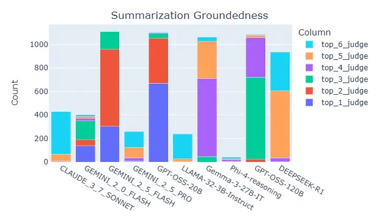

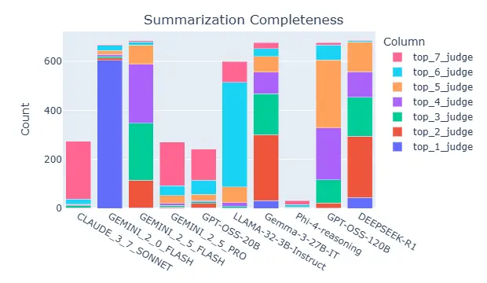

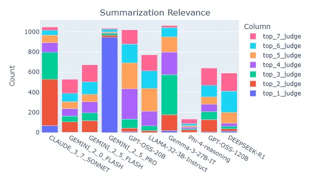

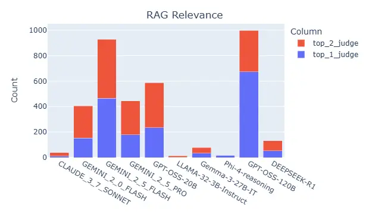

Figure 10: Selection frequency of the judge in the jury. Top k judge
means that the judge has the k-th highest reliability score in the jury.
Summarization juries tend to incorporate a more diverse set of judges
compared to those used in RAG tasks. For RAG Claude 3.7 Sonnet and
DeepSeek R1 are frequently selected for completeness evaluation but are
rarely chosen for groundedness. In contrast, Gemini 2.5 Flash is
commonly selected for groundedness but appears less frequently in
completeness evaluations. GPT OSS 20B and GPT OSS 120B are consistently
selected across both metrics.

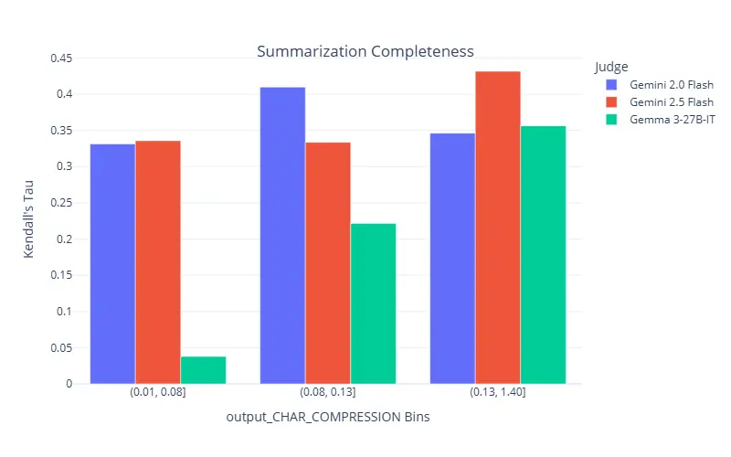

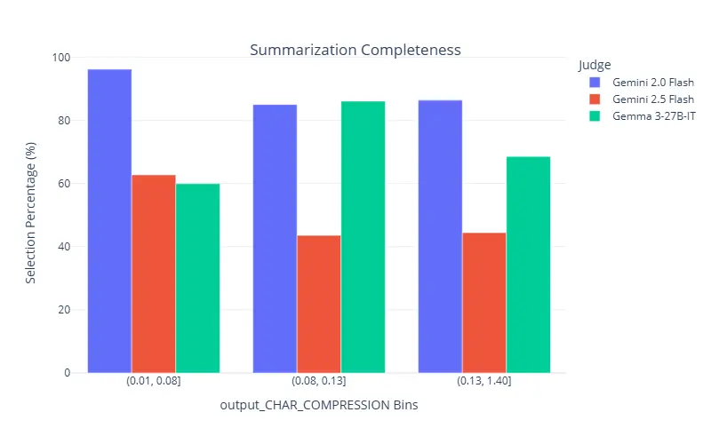

Figure 11: Summarization Completeness analysis by character compression
ratio. (Left) Kendall’s Tau correlation for three single judges across
low, medium, and high compression ratio bins. (Right) The selection
percentage of three judges in the final dynamic jury for data points
within each bin. Performance generally degrades at lower compression
ratio, with Gemma 3-27B-IT failing significantly in this region. The
jury selection percentage correctly mirrors this, heavily selecting
Gemini 2.0 Flash which is the most reliable in that bin.

Tables 16-17 present the top five most important features for each
judge’s XGBoost model, as determined by permutation feature importance
(Fisher et al., 2019), using the summarization groundedness task as an
illustrative example. The results show substantial variation in the
top-ranked features across different judges, suggesting that each
judge’s reliability is influenced by distinct data properties.

Fig. 12 aggregates the top five features that frequently appear across
tasks, revealing clear task-specific patterns. For instance, character
count is more prominent in RAG tasks, while compression ratio and
embedding-related features such as PCA components and embedding
similarity are more influential in summarization tasks. These findings
align with the ablation analysis in Appendix H.1, which shows that
removing embedding features leads to a greater performance drop in the
summarization task compared to RAG. For RAG, removing text size-related
features results in a larger decline than removing embedding features.

These observations imply that evaluation reliability is task-dependent,
and further demonstrate that our approach effectively links data
characteristics to judge reliability, enabling more informed and
adaptive jury construction across diverse evaluation scenarios.

| Judge                | Feature 1                                      | Feature 2                                       | Feature 3                                       |
| -------------------- | ---------------------------------------------- | ----------------------------------------------- | ----------------------------------------------- |
| CLAUDE 3 .7 SONNET   | input \_ embedding \_ similarity \_ politics   | input \_ COUNT \_ WORD                          | input \_SUBJECTIVITY                            |
| GEMINI 2.0 FLASH     | input_pca_9                                    | output_pca_9                                    | output \_pca \_7                                |
| GEMINI 2.5 FLASH     | input_pca_9                                    | output \_embedding \_similarity \_legal         | output_pca_1                                    |
| GEMINI 2.5 PRO       | input \_embedding \_similarity \_financemarket | output \_embedding \_similarity \_financebank   | output \_CHAR \_COMPRESSION                     |
| GPT-OSS-20B          | output \_pca \_1                               | output \_WORD \_COMPRESSION                     | output \_pca \_2                                |
| LLAMA-32-3B-Instruct | output \_READING \_INDEX                       | input \_embedding \_similarity \_media          | input \_READING \_INDEX                         |
| Gemma-3-27B-IT       | input \_embedding \_similarity \_sports        | output \_SENTENCE \_SIMILARITY                  | output \_embedding \_similarity \_media         |
| Phi-4-reasoning      | input \_DIFFICULT \_WORD                       | output \_NUM \_WORD \_SENTENCE                  | output \_LEXICAL \_DIVERSITY                    |
| GPT-OSS-120B         | input \_embedding \_similarity \_financemarket | output \_embedding \_similarity \_financemarket | output \_CHAR \_COMPRESSION                     |
| DEEPSEEK-R1          | input_pca_6                                    | output \_embedding \_similarity \_legal         | output \_embedding \_similarity \_financemarket |

Table 16: The top 3 most important features for each judge’s XGBoost
model from summarization groundedness. The results show substantial
variation in the top-ranked features across different judges.

| Judge                | Feature 4                      | Feature 5                                  |
| -------------------- | ------------------------------ | ------------------------------------------ |
| CLAUDE 3 .7 SONNET   | output \_DIFFICULT \_WORD      | output \_pca \_8                           |
| GEMINI 2.0 FLASH     | input_pca_7                    | output \_pca \_3                           |
| GEMINI 2.5 FLASH     | input \_pca \_1                | output \_WORD \_COMPRESSION                |
| GEMINI 2.5 PRO       | output \_pca \_3               | output \_pca \_1                           |
| GPT-OSS-20B          | output \_pca \_9               | output \_embedding \_similarity \_business |
| LLAMA-32-3B-Instruct | output \_ COUNT \_ WORD        | output \_pca \_1                           |
| Gemma-3-27B-IT       | output \_COREFERENCE \_CHAIN   | input \_SEMANTIC \_AMBIGUITY               |
| Phi-4-reasoning      | output \_pca \_5               | output \_READING \_INDEX                   |
| GPT-OSS-120B         | output \_pca \_3               | output \_pca \_1                           |
| DEEPSEEK-R1          | output \_SENTENCE \_SIMILARITY | input \_NAMED \_ENTITIE                    |

Table 17: The 4th and 5th most important features for each judge’s
XGBoost model from summarization groundedness. The results show
substantial variation in the top-ranked features across different
judges.

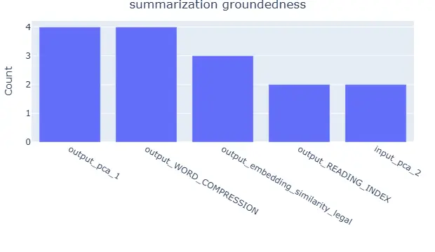

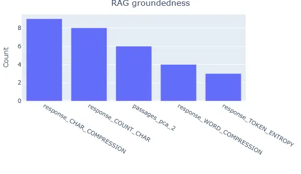

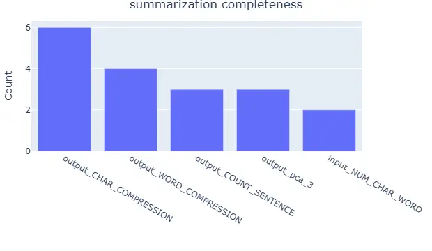

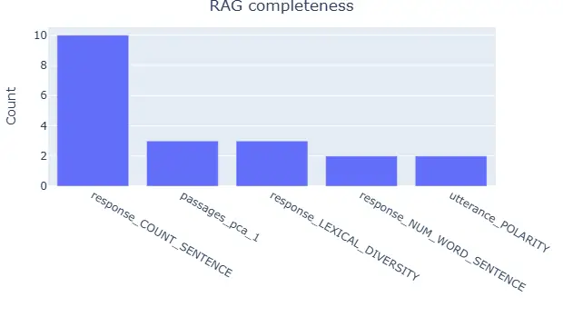

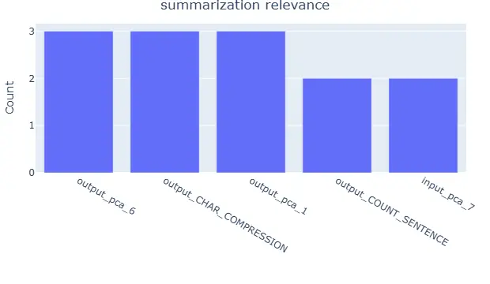

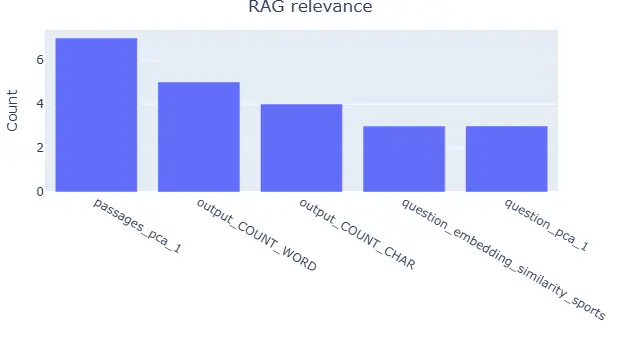

Figure 12: Aggregating the top five features that frequently appear
across tasks. Character count is more prominent in RAG tasks, while
compression ratio and embedding-related features such as PCA components
and embedding similarity are more influential in summarization tasks.

### E.3 Human-Reviewed Examples

In this section, we present examples where specific judges fail to
evaluate correctly. For illustration, we select one example and one
judge from each of the two tasks: RAG groundedness and summarization
completeness. Fig. 13 shows how Gemini 2.0 Flash evaluates groundedness
in the RAG task. It fails to identify ungrounded content in the
response—for instance, Okavango Delta, which is not mentioned in the
cited context. Fig. 14 illustrates how Gemma 3 27B IT fails to assess
the completeness of a summary. The summary merely repeats the first
sentence of the post and omits key details, yet Gemma incorrectly
considers it complete and explains that it covers all key events.

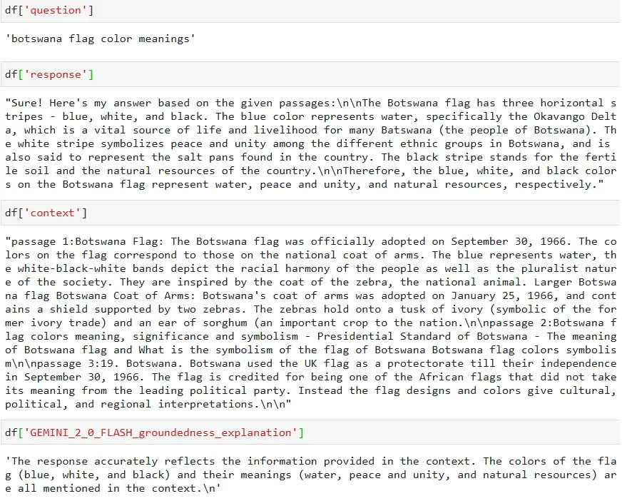

Figure 13: Gemini 2.0 Flash fails to identify ungrounded content in the
response—for instance, Okavango Delta, which is not mentioned in the
cited context.

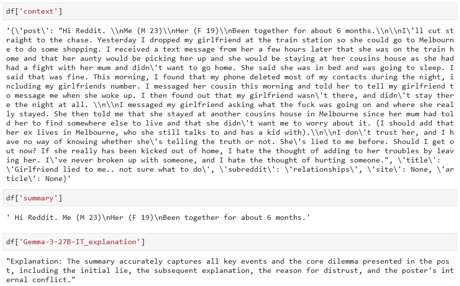

Figure 14: Gemma 3 27B IT fails to assess the completeness of a summary.
The summary merely repeats the first sentence of the post and omits key
details, yet Gemma incorrectly considers it complete and explains that
it covers all key events.

### E.4 Explanations on Embedding PCA-Related Features

In this section, we provide insights into the embedding PCA-related
features. For illustration, we use the summarization completeness task
as an example. Fig. 15 (left) shows the data distribution after applying
K-means clustering based on the first two principal components (PCA 1
and PCA 2) of the embedding features. Fig. 15 (right) displays the same
data distribution, colored by source dataset. It is evident that under
PCA 1 and PCA 2, the TLDR dataset is clearly separated from the other
two datasets, indicating that these embedding features capture
meaningful dataset-level information. A likely explanation for this
separation lies in differences in topic and writing style. TLDR samples
originate from Reddit posts, which typically focus on personal or
emotional dilemmas and are written in a less formal style. In contrast,
source contexts from SummEval and UniSumm consist of more formally
written news articles and reports. This observation is further supported
by topic modeling using Latent Dirichlet Allocation (LDA) (Blei et al.,
2003). Below, we summarize the top words and inferred topics for each
dataset:

- •
  SummEval: Top words include club, hull, liverpool, time, and claim,
  suggesting topics related to sports and crime.
- •
  UniSumm: Top words include text, rate, city, and officer, indicating
  topics such as technical instructions and city-related events.
- •
  TLDR: Top words include want, boyfriend, girlfriend, love, and
  problem, reflecting themes of romantic desires and relationship
  issues.

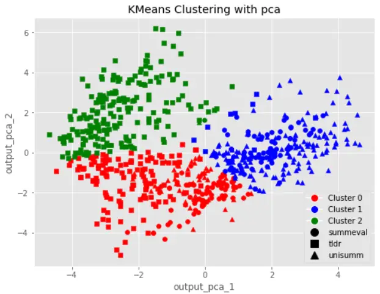

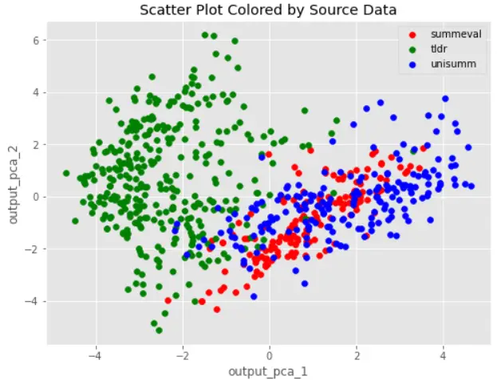

Figure 15: The left figure shows the data distribution after applying
K-means clustering based on the first two principal components (PCA 1
and PCA 2) of the embedding features. The right figure displays the same
data distribution, colored by source dataset. It is evident that under
PCA 1 and PCA 2, the TLDR dataset is clearly separated from the other
two datasets.

### E.5 Analysis of Jury Failure in Evaluation Tasks

Figure 16 presents the complete results of binning analyses of top
features for the RAG groundedness task. The results reveal a clear
trend: as the length or complexity of generated text increase, the
jury’s ability to reliably assess groundedness decreases. It is hard to
interpret the meaning of PCA features of generated text but a clear
pattern is also shown.

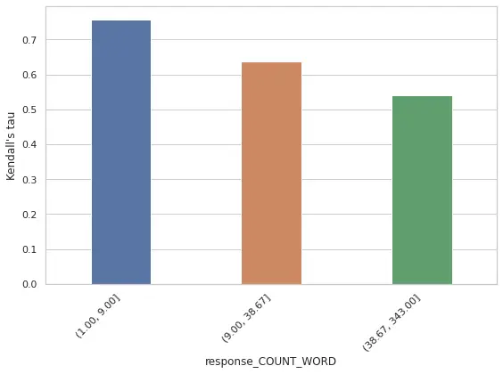

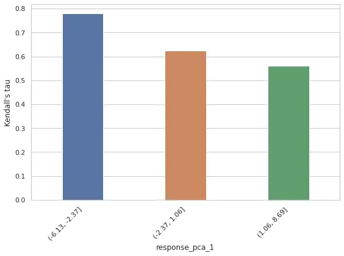

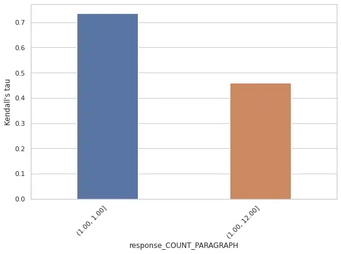

Figure 16: Jury performance across segments of top features indentifed
in the RAG goundedness task. Jury has better outcomes when the generated
text is shorter or less complex.

## Appendix F Human Evaluation Consistency

We examine the consistency of human evaluations and compare them with
the performance of our jury model. Both the SummEval and DialSumm
datasets include three human annotators per evaluation dimension. Tables
18 to 21 report Kendall’s tau correlations between each individual
annotation and the average of the three scores, which serves as the
reference in our analysis. The top-left cell in each table presents the
Kendall’s tau of the jury model. Our findings reveal that
inter-annotator agreement is generally low, highlighting notable
discrepancies among human judgments. While Kendall’s tau increases when
comparing individual annotator scores to the average, substantial
variation remains. For instance, in the SummEval Relevance dimension,
the highest tau between a human annotator and the average is 0.875,
whereas the lowest is only 0.411. Although the jury model rarely
surpasses the best-performing annotator, it consistently outperforms the
weaker ones. This suggests that the jury model offers a reliable and
robust alternative to individual human evaluations.

| 0.576         | Average score | Annotator 1 | Annotator 2 | Annotator 3 |
| ------------- | ------------- | ----------- | ----------- | ----------- |
| Average score | 1             | 0.893       | 0.893       | 0.735       |
| Annotator 1   | 0.893         | 1           | 0.748       | 0.793       |
| Annotator 2   | 0.893         | 0.748       | 1           | 0.807       |
| Annotator 3   | 0.735         | 0.793       | 0.807       | 1           |

Table 18: Kendall’s tau for human annotations – SummEval Groundedness

| 0.696         | Average score | Annotator 1 | Annotator 2 | Annotator 3 |
| ------------- | ------------- | ----------- | ----------- | ----------- |
| Average score | 1             | 0.667       | 0.875       | 0.411       |
| Annotator 1   | 0.667         | 1           | 0.455       | 0.388       |
| Annotator 2   | 0.875         | 0.455       | 1           | 0.394       |
| Annotator 3   | 0.411         | 0.388       | 0.394       | 1           |

Table 19: Kendall’s tau for human annotations – SummEval Relevance.

| 0.699         | Average score | Annotator 1 | Annotator 2 | Annotator 3 |
| ------------- | ------------- | ----------- | ----------- | ----------- |
| Average score | 1             | 0.647       | 0.712       | 0.679       |
| Annotator 1   | 0.647         | 1           | 0.462       | 0.379       |
| Annotator 2   | 0.712         | 0.463       | 1           | 0.351       |
| Annotator 3   | 0.679         | 0.379       | 0.351       | 1           |

Table 20: Kendall’s tau for human annotations – DialSumm Groundedness.

| 0.639         | Average score | Annotator 1 | Annotator 2 | Annotator 3 |
| ------------- | ------------- | ----------- | ----------- | ----------- |
| Average score | 1             | 0.741       | 0.758       | 0.622       |
| Annotator 1   | 0.741         | 1           | 0.564       | 0.365       |
| Annotator 2   | 0.758         | 0.564       | 1           | 0.344       |
| Annotator 3   | 0.622         | 0.365       | 0.344       | 1           |

Table 21: Kendall’s tau for human annotations – DialSumm Relevance.

## Appendix G Judge Reliability Prediction Model Performance

Table 22 presents the AUC scores of ROC curves for each judge
reliability model trained using XGBoost on the testing set. The AUC
values are relatively consistent across tasks; we include results for
summarization completeness and RAG groundedness as representative
examples. Result varies across judges and tasks, with most AUCs ranging
between 0.63 and 0.78, indicating that the models demonstrate adequate
predictive capability for these evaluation tasks.

| Metric             | Claude 3.7 SONNET | Gemn. 2.0 Flash | Gemn. 2.5 Flash | Gemn. 2.5 Pro | GPT-OSS-20B | GPT-OSS-120B | LLAMA -3.2-3B Instruct | Gemma 3-27B-IT | Phi-4-reason - ing | DS-R1 |
| ------------------ | ----------------- | --------------- | --------------- | ------------- | ----------- | ------------ | ---------------------- | -------------- | ------------------ | ----- |
| Summ -completeness | 0.63              | 0.67            | 0.72            | 0.66          | 0.76        | 0.75         | 0.63                   | 0.63           | 0.62               | 0.68  |
| RAG -groundedness  | 0.70              | 0.78            | 0.67            | 0.68          | 0.76        | 0.73         | 0.61                   | 0.77           | 0.75               | 0.73  |

Table 22: AUC of ROC for the judge reliability model. Here Gemn. is
Gemini, DS is DeepSeek.

## Appendix H Ablation Study and Model Weakness Analysis

### H.1 Ablation Study (Data Properties)

To investigate the influence of data property features on jury
performance, we conduct ablation studies by selectively removing feature
sets during model construction. As illustrative examples, we focus on
two tasks: summarization completeness and RAG groundedness. The full
categorization of features is provided in Appendix A. Specifically, we
remove three groups of features in separate experiments: (1) text
size-related features and special word count features (jointly removed
due to their high correlation), (2) text complexity features, and (3)
embedding-based features. The results are presented in Tables 23 and 24
for summarization completeness and RAG groundedness, respectively. We
observe that the jury model achieves its best performance when all
feature sets are included, underscoring the importance of comprehensive
feature representation. Although the performance differences are modest,
this can be attributed to the internal correlations within each feature
category. Additionally, different tasks exhibit varying sensitivity to
feature sets. For instance, removing embedding features leads to a
greater performance drop in the summarization completeness task than in
RAG groundedness, where text size-related features have a more
pronounced impact.

| Data       | Text size + special words removed (k=6) | Text complexity removed (k=5) | Embedding removed (k=6) | All features (k=7) |
| ---------- | --------------------------------------- | ----------------------------- | ----------------------- | ------------------ |
| Overall    | 0.487                                   | 0.478                         | 0.471                   | 0.488              |
| SummEval   | 0.639                                   | 0.658                         | 0.688                   | 0.721              |
| TL;DR      | 0.352                                   | 0.459                         | 0.318                   | 0.427              |
| UniSumEval | 0.619                                   | 0.595                         | 0.589                   | 0.612              |

Table 23: Kendall’s tau for jury performance on summarization
completeness under feature ablation. The number of judges (k) is
indicated for each configuration. The jury using all features achieves
the highest performance, particularly on SummEval.

|          |                                         |                               |                         |                    |
| -------- | --------------------------------------- | ----------------------------- | ----------------------- | ------------------ |
| Data     | Text size + special words removed (k=4) | Text complexity removed (k=3) | Embedding removed (k=3) | All features (k=3) |
| Overall  | 0.667                                   | 0.672                         | 0.667                   | 0.678              |
| CAQA     | 0.659                                   | 0.659                         | 0.676                   | 0.651              |
| HaluEval | 0.761                                   | 0.759                         | 0.766                   | 0.798              |
| RagTruth | 0.558                                   | 0.596                         | 0.575                   | 0.576              |

Table 24: Kendall’s tau for jury performance on RAG grounded under
feature ablation. The number of judges (k) is indicated for each
configuration. The jury using all features achieves the highest
performance, particularly on RagTruth.

### H.2 Ablation Study (Jury Size - $`K`$)

We conduct experiments to test the effectiveness of varying jury size
compared to keeping a fixed value. We focus on the tasks
Summarization-Completeness and RAG-Groundedness for this study. The
tolerance level for all trained XGBoost models is set to 0 which means
only the exactly matching scores are considered as correct. Performance
is measured across 10 runs and average is taken for each jury size. Fig.
17 shows that the performance varies with jury size. In the
Summarization-Completeness task, performance steadily improves as jury
size increases, reaching its peak around a jury size of 7–8 before
slightly declining. This indicates that adding more judges generally
strengthens the overall decision by reducing individual biases, but very
large juries introduce diminishing returns and slight degradation.
Similarly, in the RAG-Groundedness task, performance starts low at
smaller jury sizes and improves significantly with larger juries,
peaking at 5 and 8 and then tapering off. In both cases, increasing jury
size enhances robustness against noisy predictions, but there is an
optimal range beyond which gains flatten or reverse. This shows that
tuning jury size per task still provides significant improvements
compared to fixing it, though the optimal size tends to be moderately
large for both tasks.

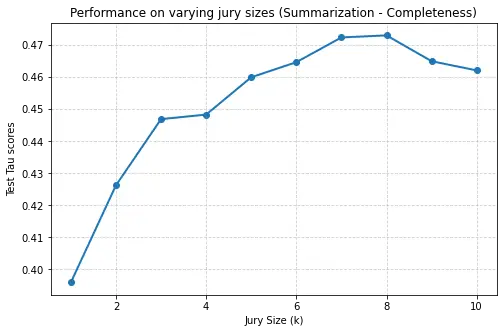

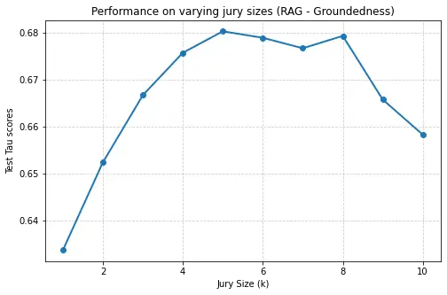

Figure 17: Test performance with varying jury size.

### H.3 Ablation Study (Tolerance levels - $`\tau`$)

We consider two tolerance levels for summarization tasks (0 and 1) and a
single tolerance level (0) for RAG tasks. For RAG tasks valid scores are
0-2. Thus, a tolerance level of 1 or more would mean that a score of 1
is always considered as correct. For the same reason, we do not
experiment with a tolerance level of 2 or more for summarization tasks
where the valid scores are 1-5.

For this study, we focus on Summarization-Completeness. We experiment
with two tolerance levels: 0 and 1 in the original scale (1-5). After
min-max normalization to \[0, 1\], these correspond to 0 and 0.25. The
performance of the jury is observed with all the XGBoost models trained
either on tolerance of 0 or 0.25. Table 25 summarizes the means and
standard deviations of the Kendall’s Tau across the 10 runs and shows
the comparison with tuned tolerance models. We observe that allowing
different tolerance levels across different XGBoost models gives
slightly better performance than a fixed tolerance level across all
models.

Additionally, Table 25 further illustrates the importance of tolerance
tuning. While Jury-on-Demand with variable tolerance achieves the best
overall performance, the optimal fixed tolerance differs across
datasets: TL;DR performs better with a tolerance of 0, whereas
UniSumEval favors 0.25. This variability underscores that no single
fixed tolerance can fit all datasets. In practical scenarios, especially
for unseen datasets without human annotations, it is impossible to know
the ideal tolerance beforehand. Therefore, adaptive approaches that
allow tolerance to vary across models or instances are crucial for
robust generalization.

Finally, the results with fixed tolerance levels are better than the
static jury as we have chosen the best jury size ($`K=7`$) overall
across the runs.

| Data       | Fixed tolerance (0) | Fixed tolerance (0.25) | Jury on Demand (variable tolerance) | Static Jury |
| ---------- | ------------------- | ---------------------- | ----------------------------------- | ----------- |
| Overall    | 0.47 (0.02)         | 0.47 (0.00)            | 0.48 (0.03)                         | 0.44 (0.02) |
| SummEval   | 0.69 (0.05)         | 0.75 (0.04)            | 0.72 (0.05)                         | 0.60 (0.06) |
| TL;DR      | 0.38 (0.06)         | 0.37 (0.04)            | 0.38 (0.08)                         | 0.40 (0.05) |
| UniSumEval | 0.63 (0.04)         | 0.66 (0.05)            | 0.66 (0.04)                         | 0.59 (0.03) |

Table 25: Kendall’s tau for jury performance on
Summarization-Completeness under tolerance ablation. The number of
judges ($`K`$) is fixed to 7 (overall best) for the fixed tolerance
configurations.

### H.4 Ablation Study (Prompt Variation)

We analyze the effect of using different prompts with the judges on the
overall jury performance. We focus on the task
Summarization-Completeness for our analysis. The performance with the
prompt as described in Table 6 is compared against the performance with
a slightly different prompt which omits the list of valid scores.

We observe that changing the prompt while maintaining its meaningfulness
(the prompt should clearly explain the input and the expected output),
changes the evaluation scores for roughly $`30\%`$ of the data points by
1 score point (on average across datasets, judges and metrics). Fig. 18
shows the distribution of score differences for judging the Completeness
of summaries using GEMINI 2.5 PRO as the judge.

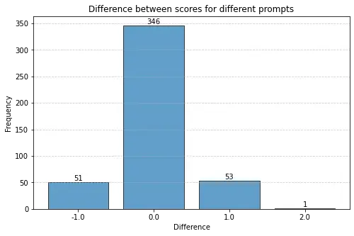

Figure 18: Score differences in the results of GEMINI 2.5 PRO judge with
two different prompts

The XGBoost judge reliability models are then trained using the scores
from the second prompt. We observe changes in the reliability scores
across judges with the perturbed prompt. The distribution of the
reliability score differences is shown in Fig. 19. It is seen that on
average roughly $`50\%`$ of the datapoints have less than 0.1 difference
in the reliability scores of the judges.

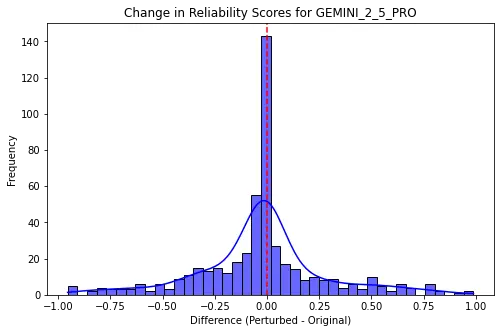

Figure 19: Predicted reliability score differences in the results of
GEMINI 2.5 PRO judge with two different prompts

It is also observed that even though the scores might change by one
score point, their agreement or disagreement with the human given scores
generally remains consistent even with slightly different prompts. For
example, in the case of Gemini 2.5 PRO as the judge, for 439/495
datapoints, the judge responses either both match the human score or
both disagree. Table 26 summarizes the agreement changes with the human
scores.

| Measurement Metric           | Both or Neither Match | Only one matches |
| ---------------------------- | --------------------- | ---------------- |
| Number of datapoints         | 439                   | 56               |
| $`\%tage`$ age of datapoints | 88.7                  | 11.3             |

Table 26: Agreement changes with the human scores for two prompts on
GEMINI 2.5 PRO judge

We also observe how the number of appearances of the models in the
selected jury panel changes with slight change in the prompts. Fig. 20
shows that there is limited change in the inclusion of individual judges
in a given jury with the changed prompt.

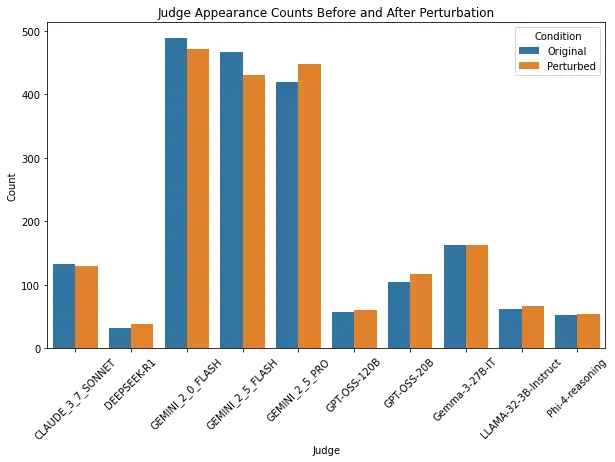

Figure 20: Number of appearances of various judges in the selected jury
panel

We observe that on average, 3.5 out of 4 final judges in the jury
remained the same on using different prompts.

|                         |     |     |     |     |     |
| ----------------------- | --- | --- | --- | --- | --- |
| $`\#`$ of common judges | 0   | 1   | 2   | 3   | 4   |
| Counts                  | 0   | 3   | 21  | 182 | 289 |

Table 27: Distribution of the number of common judges between the two
runs with different prompts

Table 27 shows that the jury compositions do not change much when using
slightly different prompts.

The perturbation analysis demonstrates that the evaluation framework is
highly robust to prompt variations. While minor prompt changes introduce
some variability (about $`30\%`$ of data points shift by one score
point), the overall agreement with human evaluations remains largely
stable. For instance, in the Gemini 2.5 PRO case, over $`88\%`$ of
instances (439/495) either consistently match or consistently diverge
from human scores across prompt variations.

Reliability score changes exhibit minimal changes, with $`50\%`$ of data
points showing less than 0.1 difference, indicating that prompt-induced
randomness is minimal and does not significantly affect judge
reliability. Furthermore, jury composition stability is striking. On
average, 3.5 out of 4 jury members remain unchanged, and the aggregated
jury scores show negligible deviation. This suggests that the
methodology maintains integrity even under prompt perturbations.

The system’s resilience to prompt changes implies that the evaluation
pipeline is not overly sensitive to linguistic nuances, making it
suitable for real-world deployment where prompt variability is
inevitable. This robustness ensures consistent decision-making and
fairness in model evaluation, reinforcing confidence in the methodology
for broader applications.

### H.5 Model Weakness Analysis

To identify conditions where the jury model underperforms, we analyzed
feature distributions between instances with high and low prediction
discrepancies - excluding embedding features for interpretability. We
focus on the RAG groundedness task for illustration. The dataset was
split into two groups:

1.  1.  High Difference: Instances with large prediction errors.
2.  2.  Low/No Difference: Instances with minimal errors.

For each feature, we computed mean and median values across both groups
and ranked features by their median absolute differences in Table 28.
This revealed two failure modes:

1.  1.  Systematic Bias: Features like factual density and named entities
        show consistent shifts in both mean and median, suggesting bias
        toward certain content structures.
2.  2.  Distributional Fragility: Features such as syntactic anomaly and
        subjectivity show high median shifts but low mean differences,
        indicating sensitivity to rare or irregular linguistic patterns.

| Feature                       | Median Difference | Mean Difference |
| ----------------------------- | ----------------- | --------------- |
| utterance_SYNTACTIC_ANOMALY   | 1.97              | 0.11            |
| utterance_NAMED_ENTITY        | 0.77              | 0.37            |
| utterance_SYNTACTIC_AMBIGUITY | 0.74              | 0.22            |
| context_FACTUAL_DENSISTY      | 0.63              | 0.36            |
| context_SUBJECTIVITY          | 0.53              | 0.17            |

Table 28: Top 5 features ranked by median differences between
high-difference and low/no-difference groups.

## Appendix I Judge Scoring Runtimes

Here we provide some notes the runtime for judges scoring select data.
For this work, each judge was implemented in one of three distinct
environments: Google Cloud API, Nvidia H200 with 140 GB RAM, or Nvidia
TESLA V100 with 32 GB RAM. These choices were made based on the nature
of the models (closed vs. open) and resource needs of the the
open-weight models.

- •
  GCP was selected for the closed models such as Claude 3.7 Sonnet and
  Gemini 2.5.
- •
  The Nvidia H200 was used for larger open-weight models like Phi-4
  Reasoning, Llama 3.2-3B, and Gemma 3 27B-IT, leveraging its high
  memory capacity for large-scale inference.
- •
  V100 served as a baseline GPU environment for evaluating performance
  under constrained resources.

The runtime for each dataset varied depending on several factors
including the size of the dataset, the computational environment used,
and the specific model being executed. Table 29 summarizes the runtimes
observed for select datasets during our experiments. Note that this is
not intended as to represent a rigorus comparitive study of the models
but to provide a general sense of the time necessary for executing judge
scoring.

|                   |             |         |            |          |         |
| ----------------- | ----------- | ------- | ---------- | -------- | ------- |
| LLM               | Environment | TLDR    | unisumeval | MS MARCO | QASPER  |
| Claude 3.7 SONNET | GCP         | 3 mins  | 4 mins     | 7 mins   | 5 mins  |
| Gemini 2.5 Pro    |             | 6 mins  | 6 mins     | 26 mins  | 2 mins  |
| Gemini 2.5 Flash  |             | 2 mins  | 3 mins     | 13 mins  | 2 mins  |
| Phi-4 Reasoning   | H200        | 81 mins | 116 mins   | 579 mins | 36 mins |
| Llama 3.2-3B      |             | 9 mins  | 68 mins    | 136 mins | 17 mins |
| Gemma 3 27B-IT    |             | 17 mins | 66 mins    | 477 mins | 17 mins |
| DeepSeek-R1       | V100        | 76 mins | 401 mins   | 721 mins | 18 mins |

Table 29: Observed model runtimes (in minutes) across different
environments and datasets used in the analysis

## Appendix J Framework Generalizability to Unseen Domains

To assess the framework’s generalizability to unseen domains, we employ
a leave-one-out procedure. Specifically, for each experiment, one data
source is excluded from the training of XGBoost reliability models and
jury construction, and the trained framework is then evaluated on the
held-out source. This approach tests whether the Jury-on-Demand
mechanism consistently outperforms both static juries and individual
judges in previously unseen domains.

Using the RAG-Relevance task as an illustrative example, the dataset
comprises three sources: ALCE, Hotpot-QA, and MS MARCO. In the first
iteration, ALCE is held out while the framework is trained on Hotpot-QA
and MS MARCO; performance is then assessed on ALCE. The process is
repeated for each remaining source. The complete results are presented
in Table 30. Across all three cases, Jury-on-Demand achieves the highest
performance, indicating that the learned patterns generalize effectively
to held-out domains.

| Held-out  | Jury-on-Demand | Static-Jury | Claude 3.7 | Gemn. 2.0 | Gemn. 2.5 | Gemn. 2.5 Pro | GPT-OSS-20B | GPT-OSS-120B | LL-3.2 | Gemma 3 | Phi-4 | Deep-Seek-R1 |
| --------- | -------------- | ----------- | ---------- | --------- | --------- | ------------- | ----------- | ------------ | ------ | ------- | ----- | ------------ |
| ALCE      | 0.62           | 0.59        | 0.58       | 0.55      | 0.57      | 0.57          | 0.58        | 0.6          | 0.22   | 0.42    | 0.13  | 0.28         |
| Hotpot-QA | 0.92           | 0.86        | 0.87       | 0.81      | 0.88      | 0.88          | 0.89        | 0.89         | 0.39   | 0.78    | 0.47  | 0.57         |
| MS-MARCO  | 0.46           | 0.38        | 0.44       | 0.38      | 0.4       | 0.43          | 0.39        | 0.4          | 0.2    | 0.12    | 0.12  | 0.29         |

Table 30: Kendall’s tau on held-out data source - RAG Relevance

We extend our evaluation to the Summarization-Groundedness task, which
includes four data sources: Summ-Eval, TL;DR, UniSum-Eval, and
Dial-Summ-Eval. Table 31 reports the performance of the Jury-on-Demand
framework under the leave-one-out setting for each source. The results
indicate strong generalization for three sources, while performance on
Summ-Eval is weaker.

These findings reinforce that the framework’s generalizability is
influenced by both the diversity of training data and the
characteristics of unseen domains. As additional annotated datasets
become available and incorporated into training, we expect the
framework’s ability to generalize to new domains to improve
substantially.

| Held-out       | Jury-on-Demand | Static-Jury | Claude 3.7 | Gemn. 2.0 | Gemn. 2.5 | Gemn. 2.5 Pro | GPT-OSS-20B | GPT-OSS-120B | LL-3.2 | Gemma 3 | Phi-4 | Deep-Seek-R1 |
| -------------- | -------------- | ----------- | ---------- | --------- | --------- | ------------- | ----------- | ------------ | ------ | ------- | ----- | ------------ |
| Dial-Summ-Eval | 0.7            | 0.64        | 0.63       | 0.63      | 0.69      | 0.65          | 0.66        | 0.68         | 0.3    | 0.69    | 0.26  | 0.28         |
| Summ-Eval      | 0.63           | 0.68        | 0.63       | 0.54      | 0.68      | 0.66          | 0.64        | 0.68         | 0.33   | 0.63    | 0.23  | 0.02         |
| TL;DR          | 0.46           | 0.43        | 0.38       | 0.43      | 0.32      | 0.33          | 0.27        | 0.41         | 0.06   | 0.42    | 0.12  | 0.14         |
| Uni-Summ-Eval  | 0.63           | 0.53        | 0.52       | 0.56      | 0.59      | 0.58          | 0.6         | 0.59         | 0.15   | 0.58    | 0.17  | -0.1         |

Table 31: Kendall’s tau on held-out data source - Summarization
Groundedness

## Appendix K Judge Score Calibration

Some judges may consistently assign lower or higher scores compared to
human annotations. To address this, we apply score calibration.
Specifically, we perform isotonic calibration (Niculescu-Mizil and
Caruana, 2005) for each judge’s score within each dataset, then retrain
the XGBoost model and construct the jury using the calibrated scores.
For illustration, we focus on summarization completeness and RAG
groundedness. Prior to calibration, we examine the difference between
each judge’s mean score and the mean human annotation score (annotation
score minus judge score). Fig. 21 show these differences for
completeness in Unisumm and groundedness in RagTruth. We observe that
weaker models—particularly LLAMA 3.2 3B Instruct, Gemma 3.2 7B IT, Phi 4
Reasoning and DeepSeek R1—tend to exhibit larger discrepancies.

Tables 33 and 32 compare Kendall’s tau before and after calibration.
Overall performance changes are minimal, with calibrated results
slightly improving on RAG groundedness (0.69 vs. 0.67) but slightly
worsening on summarization completeness (0.46 vs. 0.49). Differences
become more pronounced within certain datasets and for specific judges.
For example, as shown in Fig. 22 (left), tau for Gemini 2.5 Flash on
Unisumm completeness drops from 0.62 to 0.54 because many original score
5s are calibrated to 4, leading to underestimation of human annotation
scores. Conversely, for RagTruth groundedness (Fig. 22 (right)), Gemini
2.5 Flash’s tau increases from 0.57 to 0.58 after calibration because
scores of 0 are calibrated to 1, reducing bias in judge scores. In
summary, calibration can be beneficial for certain tasks and judges, but
it may also introduce under- or overestimation of human annotations,
reducing alignment. Future work will explore strategies to mitigate
judge score bias more effectively.

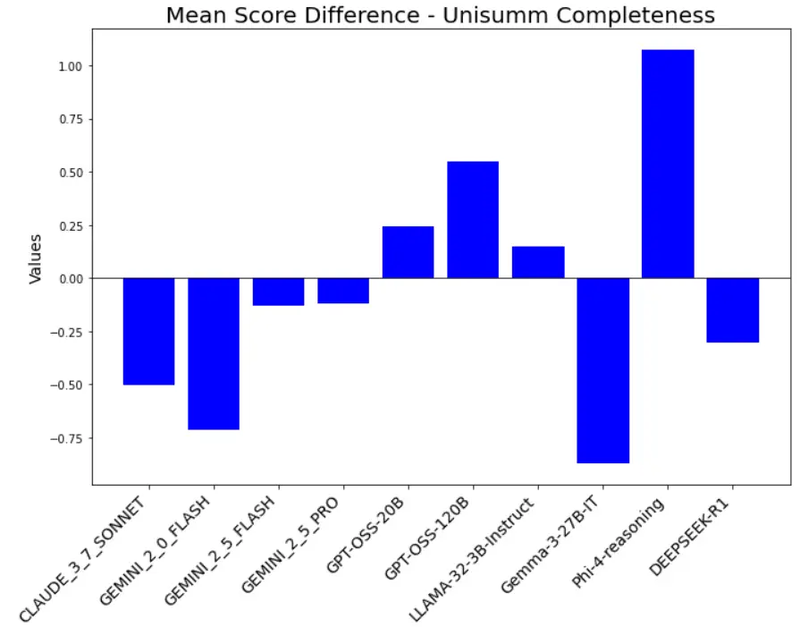

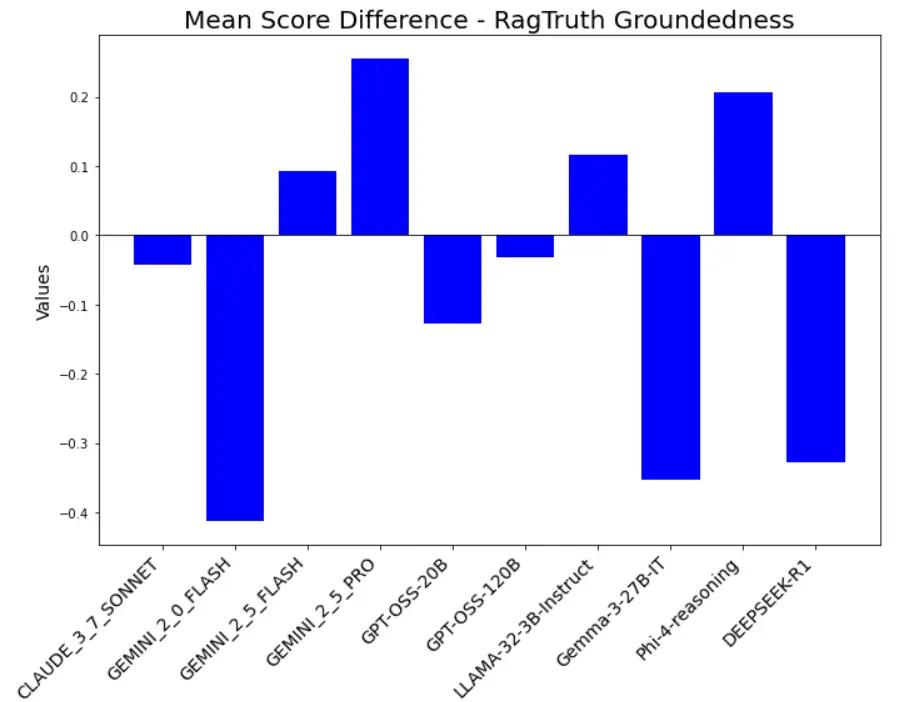

Figure 21: The difference between each judge’s mean score and the mean
human annotation score (annotation score minus judge score) for
completeness and groundedness in Unisumm.

| Model         | Jury-on-Demand | Claude 3.7 | Gemn. 2.0 | Gemn. 2.5 | Gemn. 2.5 Pro | GPT-OSS-20B | GPT-OSS-120B | LL-3.2  | Gma. 3 | Phi-4  | DS-R1  |
| ------------- | -------------- | ---------- | --------- | --------- | ------------- | ----------- | ------------ | ------- | ------ | ------ | ------ |
| Overall       | 0.46           | 0.38       | 0.47      | 0.51      | 0.44          | 0.38        | 0.46         | 0.15    | 0.22   | 0.16   | 0.23   |
|               | (0.49)         | (0.39)     | (0.46)    | (0.46)    | (0.43)        | (0.39)      | (0.47)       | (0.13)  | (0.25) | (0.22) | (0.27) |
| Summ-Eval     | 0.63           | 0.64       | 0.61      | 0.58      | 0.47          | NA          | 0.62         | -0.04   | 0.07   | 0.31   | 0.69   |
|               | (0.72)         | (0.59)     | (0.62)    | (0.60)    | (0.46)        | (-0.02)     | (0.63)       | (-0.04) | (0.24) | (0.21) | (0.69) |
| TL;DR         | 0.35           | 0.31       | 0.41      | 0.36      | 0.35          | 0.29        | 0.39         | 0.06    | 0.23   | NA     | 0.12   |
|               | (0.43)         | (0.32)     | (0.40)    | (0.37)    | (0.37)        | (0.34)      | (0.39)       | (0.12)  | (0.17) | (0.02) | (0.12) |
| Uni-Summ-Eval | 0.58           | 0.41       | 0.46      | 0.54      | 0.46          | 0.66        | 0.61         | 0.26    | 0.54   | 0.33   | 0.35   |
|               | (0.61)         | (0.57)     | (0.58)    | (0.62)    | (0.58)        | (0.62)      | (0.71)       | (0.26)  | (0.64) | (0.34) | (0.38) |

Table 32: Summarization completeness: Kendall’s tau after calibration,
with original values shown in parentheses. NA indicates cases where all
scores were calibrated to a single value, making Kendall’s tau
computation infeasible.

| Model     | Jury-on-Demand | Claude 3.7 | Gemn. 2.0 | Gemn. 2.5 | Gemn. 2.5 Pro | GPT-OSS-20B | GPT-OSS-120B | LL-3.2 | Gma. 3 | Phi-4  | DS-R1  |
| --------- | -------------- | ---------- | --------- | --------- | ------------- | ----------- | ------------ | ------ | ------ | ------ | ------ |
| Overall   | 0.69           | 0.56       | 0.50      | 0.64      | 0.60          | 0.63        | 0.63         | NA     | 0.10   | 0.03   | 0.28   |
|           | (0.67)         | (0.53)     | (0.48)    | (0.61)    | (0.56)        | (0.61)      | (0.61)       | (0.09) | (0.02) | (0.13) | (0.25) |
| CAQA      | 0.65           | 0.57       | 0.57      | 0.58      | 0.57          | 0.57        | 0.59         | NA     | NA     | NA     | 0.19   |
|           | (0.65)         | (0.57)     | (0.58)    | (0.57)    | (0.57)        | (0.57)      | (0.58)       | (0.1)  | (0.01) | (0.03) | (0.23) |
| Halu-Eval | 0.79           | 0.72       | 0.52      | 0.79      | 0.76          | 0.78        | 0.79         | NA     | 0.14   | -0.04  | 0.39   |
|           | (0.79)         | (0.70)     | (0.51)    | (0.77)    | (0.76)        | (0.78)      | (0.79)       | (0.14) | (0.14) | (0.11) | (0.39) |
| Rag-Truth | 0.55           | 0.48       | NA        | 0.58      | 0.50          | 0.55        | 0.53         | NA     | NA     | NA     | NA     |
|           | (0.57)         | (0.44)     | (0.32)    | (0.57)    | (0.47)        | (0.52)      | (0.51)       | (0.13) | (0.16) | (0.21) | (0.24) |

Table 33: RAG groundedness: Kendall’s tau after calibration, with
original values shown in parentheses. NA indicates cases where all
scores were calibrated to a single value, making Kendall’s tau
computation infeasible.

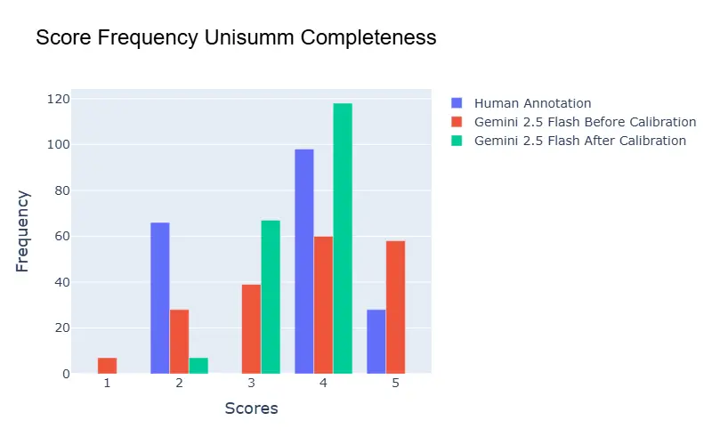

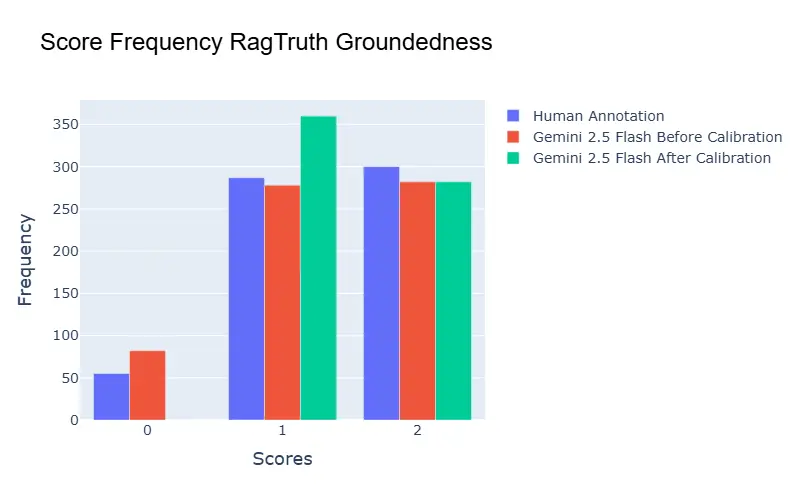

Figure 22: The difference between each judge’s mean score and the mean
human annotation score (annotation score minus judge score) for
completeness and groundedness in Unisumm.

## Appendix L Comparison with Baselines

In this section, we examine how performance varies with the number of
judges $`K`$, we focused on two tasks for illustration:
Summarization-Completeness and RAG-Groundedness. We compared
Jury-on-Demand (JOD) with two static jury baselines: Simple Average and
Weighted Regression (see section 4.2 for definitions). For these static
jury baselines, we first determine which judges to include.
Specifically, we rank judges by their Kendall’s tau performance for each
task and select the top $`K`$ judges for the static jury. Table 34 shows
the judge ranked by performance for each task. Tables 35 and 35
illustrate how Kendall’s tau changes with jury size $`K`$ for
Summarization-Completeness and RAG-Groundedness, respectively. Results
are averaged over 10 runs. Our main observations are:

- •
  JOD consistently outperforms static juries: Performance varies with
  jury size $`K`$, but JOD consistently outperforms both static
  baselines across all $`K`$ values, except for a few cases in
  Summarization-Completeness. The performance margin of JOD over static
  juries is larger for RAG-Groundedness than for
  Summarization-Completeness.
- •
  Effect of jury size differs by task: For Summarization-Completeness,
  there is no clear pattern on performance do not for different juries.
  JOD’s performance do not vary too much as $`K`$ changes, Simple
  Average jury show performance decrease as $`K`$ increases. For
  RAG-Groundedness, performance generally improves with larger $`K`$,
  except that Simple Average shows a drop at $`K=10`$. These
  observations can be exaplained by the larger score bias in weaker
  judges. Large biases degrade performance when these judges are
  included, especially for Simple Average, which assigns equal weight
  regardless of bias.
- •
  Weighted Regression struggles with small K: Weighted Regression
  performs worse than other jury methods when $`K`$ is small,
  particularly for RAG-Groundedness. One contributing factor is that the
  regression coefficients for RAG-Groundedness are very small, which
  results in weighted regression scores that fall below human annotation
  scores. To ensure realistic outputs, we round up any weighted
  regression score that is lower than the minimum human annotation
  score. However, because the coefficients are small, this adjustment
  often causes many weighted regression scores to equal the lowest human
  annotation score, further degrading performance. Another potential
  reason for poor performance at small $`K`$ is the high correlation
  among strong judges (e.g., Gemini models, GPT-OSS models, Claude 3.7
  Sonnet), with correlation values around 0.7–0.8. Using such highly
  correlated features in regression can negatively impact model
  performance.

In summary, how performance changes with jury size $`K`$ depends on
multiple factors, including task characteristics, score distributions,
and correlations among judge scores. Although JOD requires more training
data and a more complex training process compared to static juries, its
dynamic jury selection and adaptive weight assignment enable it to
choose the best judges for each instance and achieve superior overall
performance.

| K                  | 1            | 2        | 3           | 4            | 5      | 6           | 7     | 8       | 9      | 10      |
| ------------------ | ------------ | -------- | ----------- | ------------ | ------ | ----------- | ----- | ------- | ------ | ------- |
| Summ-complete-ness | GPT-OSS-120B | Gemn-2.5 | Gemn-2.0    | Gemn-2.5-Pro | Claude | GPT-OSS-20B | DS-R1 | Gemma-3 | Phi 4  | LL 3.2  |
| RAG-grounded-ness  | GPT-OSS-120B | Gemn-2.5 | GPT-OSS-20B | Gemn-2.5-Pro | Claude | Gemn-2.0    | DS-R1 | Phi 4   | LL 3.2 | Gemma-3 |

Table 34: Judges ranked by Kendall’s tau (high to low).

| K                  | 2    | 3    | 4    | 5    | 6    | 7    | 8    | 9    | 10   |
| ------------------ | ---- | ---- | ---- | ---- | ---- | ---- | ---- | ---- | ---- |
| Jury-on-Demand     | 0.43 | 0.45 | 0.45 | 0.46 | 0.46 | 0.47 | 0.47 | 0.46 | 0.46 |
| Static (Average K) | 0.46 | 0.47 | 0.48 | 0.48 | 0.46 | 0.45 | 0.45 | 0.44 | 0.43 |
| Static (Average K) | 0.46 | 0.45 | 0.45 | 0.46 | 0.46 | 0.46 | 0.46 | 0.44 | 0.45 |

Table 35: Summarization Completeness: Kendall’s tau across varying jury
sizes for different baselines.

| K                  | 2    | 3    | 4    | 5    | 6    | 7    | 8    | 9    | 10   |
| ------------------ | ---- | ---- | ---- | ---- | ---- | ---- | ---- | ---- | ---- |
| Jury-on-Demand     | 0.65 | 0.67 | 0.67 | 0.68 | 0.68 | 0.67 | 0.68 | 0.67 | 0.66 |
| Static (Average K) | 0.64 | 0.65 | 0.65 | 0.65 | 0.65 | 0.64 | 0.64 | 0.63 | 0.58 |
| Static (Average K) | 0.58 | 0.58 | 0.56 | 0.54 | 0.52 | 0.60 | 0.65 | 0.65 | 0.65 |

Table 36: RAG Groundedness: Kendall’s tau across varying jury sizes for
different baselines.

## Appendix M Parameter Tuning in XGBoost

We use random search to tune the hyperparameters of the XGBoost models
for judge reliability scores. The search space for the tuned parameters
is provided in Table 37. Parameters not listed in the table are set to
their default values.

| Parameter     | Search Space                     |
| ------------- | -------------------------------- |
| max_depth     | 2, 3, 4, 5, 6, 7, 8, 9           |
| learning_rate | 0.01, 0.03, 0.05, 0.07, 0.1, 0.2 |
| n_estimators  | 500, 600, 800, 1000, 1200        |

Table 37: Parameter search space in XGBoost.
