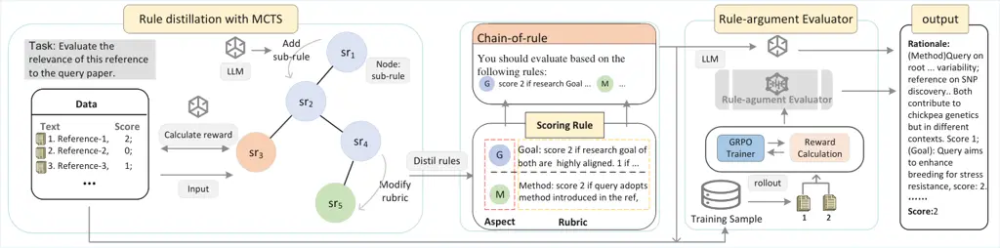
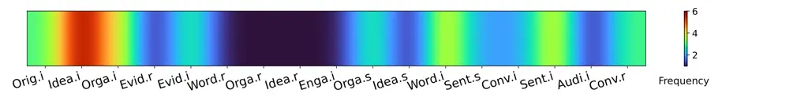
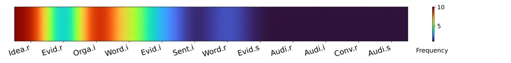

# Learned-Rule-Augmented Large Language Model Evaluators

Jie Meng Affiliation: Wuhan University / Wuhan
Email: [mengjie@whu.edu.cn](mailto:)    Jin Mao Affiliation: Wuhan
University / Wuhan Email: [maojin@whu.edu.cn](mailto:)

###### Abstract

Large language models (LLMs) are predominantly used as evaluators for
natural language generation (NLG) tasks, but their application to
broader evaluation scenarios remains limited. In this work, we explore
the potential of LLMs as general evaluators across diverse tasks.
Although LLM-based evaluators have made progress in different areas,
existing methods struggle to generalize due to their reliance on costly,
human-designed evaluation principles, which are often misaligned with
both annotated data and LLMs’ understanding.To address these challenges,
we propose a rule-augmented evaluation paradigm. First, we introduce a
rule distillation method that automatically extracts scoring rules from
data using an LLM-assisted Monte Carlo Tree Search (MCTS), alleviating
scalability issues and improving alignment with data. Second, to enable
LLMs to effectively apply the learned rules, we propose two strategies:
(1) Chain-of-Rule (CoR), which guides LLM to follow distilled rules, and
(2) training a rule-augmented LLM evaluator (RuAE) via reinforcement
learning, further bridging the gap between rules and LLMs’ reasoning.
Extensive experiments on diverse tasks demonstrate the effectiveness and
generalizability of our approach across various evaluation scenarios.

## 1 Introduction

Recent advancements in large language models (LLMs) have positioned them
as effective and scalable evaluators for assessing generated text
quality in Natural Language Generation (NLG) tasks(Kocmi and Federmann,
2023; Shen et al., 2023). This raises a natural question: can the
paradigm of LLMs as evaluators be extended to diverse tasks? Studies
have explored this potential, investigating LLMs’ capabilities in
grading essays(Mizumoto and Eguchi, 2023) and assessing citation
significance(Zhao et al., 2025). In essence, this means enabling LLMs to
quantitatively evaluate text from specific perspectives, for example,
assessing quality, measuring expressed tendencies (like empathy or
aggressiveness)(Wang et al., 2024), or evaluating textual relationships
(like relevance). These applications across multiple domains confirm
LLMs’ versatility as evaluators.

Nevertheless, research has revealed challenges in LLM’s application as
trustworthy general evaluators. Primarily, most existing approaches
develop task-specific Chain-of-Thought (CoT) prompts (i.e., evaluation
principles)(Mizrahi et al., 2024; Törnberg, 2024), which are difficult
to generalize across diverse tasks. Moreover, these evaluation methods
often fail to align with human judgment, manifesting in two key
misalignments: 1) mis-1: misalignments between evaluation principles and
human-labeled data, and 2) mis-2: misalignments between LLMs’
understanding and application of these principles. These issues hinder
progress toward developing a general text evaluator.

To investigate the root of these misalignments, we conducted an
exploratory study on ASAP (see Section 4.1) by prompting Qwen-7b to
propose evaluation principles and score essays accordingly. We analyzed
600 responses, extracted principles and performed dimensionality
reduction. As shown in Fig. 1, we observed highly dispersed principles
with no unified standards. Even within the same evaluation dimension,
consistent scoring remained challenging. This contrasts with human
evaluation patterns, suggesting that the misalignment primarily stems
from differing evaluation standards.

Inspired by this insight, we propose a rule-argumented text evaluation
paradigm. These rules represent principles that specify evaluation
aspects and detailed criteria for assigning scores. While rules can be
manually summarized, this is costly and lacks generalizability. Instead,
we focus on learning scoring rules from data. To achieve this, we
introduce an LLM-assisted Monte Carlo Tree Search (MCTS)(Browne et al., 2012) approach to distill rules from annotated data, efficiently
generating structured and interpretable rules while avoiding
compositional search complexity. This approach aligns better with LLMs’
understanding and human-labeled data, potentially addressing the
misalignment mis-1.

Figure 1: Clustering visualization of evaluation principles generated by
Qwen-7b.

When attempting to enable LLMs to apply these rules, we encounter
another misalignment challenge mis-2: how can LLMs effectively follow
rules during evaluation? Even well-crafted rules cannot prevent
deviations in LLMs’ execution(Calderon et al., 2025), whether in
providing rationales or assigning scores. To address this, we explore
two strategies to enhance LLMs’ reasoning with learned rules: 1)
Chain-of-Rule (CoR): injecting distilled rules into prompts, a simple
and scalable method. However, it may not fully resolve misalignments,
especially if the LLMs for rule distillation and application differ. 2)
Training a rule-augmented LLM evaluator (RuAE). While supervised
fine-tuning (SFT) Trivedi et al. (2024) is a typical choice for training
LLMs, its limitations include overfitting, catastrophic forgetting, and
and lack of alignment with human judgment due to limited reasoning
process data. Inspired by recent advancements in reasoning models, Guo
et al. (2025). we train an LLM evaluator using reinforcement learning
(RL). We design a composite reward function and train the model using
Group Relative Policy Optimization (Shao et al., 2024). We conduct
extensive experiments on four diverse tasks (grading, regression,
ranking, and judging). Results show that CoR improves performance across
models of different sizes, while RuAE outperforms larger reasoning
models on complex tasks. Moreover, the learned rules are reasonable and
human-algined. The results demonstrate the effectiveness and
generalizability of our approach. Our contributions are as follows:

- •
  We propose a scalable method to learn interpretable scoring rules from
  data.
- •
  We introduce a rule-augmented LLM evaluator trained with reinforcement
  learning, improving reasoning ability in evaluation.
- •
  Extensive experiments demonstrate the effectiveness of our approach
  across various scenarios, extending the domain coverage of LLM-based
  evaluators. Results further highlight the importance of enhanced
  reasoning ability, especially in tasks involving complex criteria and
  long-form text.

## 2 Related Work

LLM as evaluators. LLM evaluators have emerged as cost-effective
alternatives to human assessment in multiple generative tasks including
machine translation(Kocmi and Federmann, 2023), summarization(Shen
et al., 2023), and dialogue generation(Liu et al., 2024b). By equipping
models with evaluation criteria and instructing them to generate scores
to assess the quality of candidate text, score-based LLM evaluators have
been developed that can be easily adapted to various tasks through
instruction tuning (Mizrahi et al., 2024). Automated Essay Scoring
represents one of the earliest tasks to explore this capability(Chen and
He, 2013). Initial approaches utilized zero-shot evaluator prompts with
GPT-2 to return overall scores based solely on given scoring
criteria(Mizumoto and Eguchi, 2023). Yancey et al. revealed the
advantages of LLMs by referencing detailed scoring rubrics or generating
reasoning before scoring(Yancey et al., 2023). LLM evaluators have since
been applied to additional domains, such as automatic annotation in
computational social science for measuring political leanings(Törnberg,
2024), as well as citation importance evaluation in literature
mining(Huang and Chang, 2023). Nevertheless, these methods remain
difficult to scale due to their reliance on domain-specific expert
prompt engineering.

Reasoning with LLMs. Early work has primarily proposed Chain-of-Thought
(CoT) to encourage step-by-step thinking (Wei et al., 2023). Building on
it, non-linear thinking approaches utilizing tree or graph structures
are proposed to guide CoT generation(Yao et al., 2023). Drawing
parallels to tree reasoning, some studies explore Monte Carlo Tree
Search (MCTS) to enhance LLM Xie et al. (2024). Several methods attempt
to optimize LLMs by leveraging reasoning paths identified through MCTS.
However, a significant challenge with MCTS is that token-level states
create an extremely large search space, resulting in inefficient search.
In contrast, our MCTS approach searches at rule-level, substantially
reducing complexity. Beyond search strategies, Reinforcement Learning
(RL) offers another pathway to improve the intrinsic reasoning ability
of language modelsPang et al. (2023); Feng et al. (2024). PPO and DPO
algorithms were initially applied to align models with human by training
a reward model from pairwise preferencesChristiano et al. (2023);
Stephan (2023). Recently, to efficiently apply reinforcement learning
for optimizing reasoning models, DeepSeek proposed the GRPO algorithm
Shao et al. (2024), eliminates the need for a critic model by estimating
baselines from group scores, enabling efficient policy model training.
Similarly, RLOOAhmadian et al. (2024) introduces a simplified
REINFORCE-style Williams (1992) optimization framework, has shown
improvements in pure RL training.



Figure 2: Overview of Our Method

## 3 Method

We formalize the process of LLM evaluators as
$`p_{\mathcal{M}}(s,RT\mid y;I)`$, where $`y`$ is the input text, $`I`$
is the instruction, $`s`$ is the score, and $`RT`$ is the rationale.
Existing CoT-like methods introduce additional human-designed guidance
($`G`$), extending the formulation to
$`p_{\mathcal{M}}(s,RT\mid y;I,G)`$. However, such guidance may not
always align with data. For simplicity, we omit the $`RT`$ and $`I`$
terms hereafter. We decompose the scoring process as,
$`p_{\mathcal{M}}(s\mid y)\propto p_{\mathcal{M}}(y\mid s)\times p_{\mathcal{M}}(s)`$.
Here, $`p_{\mathcal{M}}(y\mid s)`$ captures what a text with score $`s`$
should look like. Our key insight is to learn interpretable scoring
rules ($`\mathcal{R}`$) from data, so that $`p_{\mathcal{M}}(y\mid s)`$
better approximates human judgment $`p_{\mathcal{H}}(y\mid s)`$.

```math
\mathcal{R}^{*}=\arg\min_{\mathcal{R}}\;\underset{s\sim\mathcal{D}}{\mathbb{E}}\left[\mathcal{L}\left(p_{\mathcal{M}}(y\mid s;\mathcal{R}),\;p_{\mathcal{H}}(y\mid s)\right)\right] \tag{1}
```

Based on this idea, our method is structured in two stages. As shown in
Fig. 2, the first stage is to distill interpretable scoring rules from
data. Then, we apply these rules to guide the evaluation process in two
ways: (1) by prompting LLMs with the learned rules (CoR), and (2) by
further aligning the evaluator to these rules and prior
$`p_{\mathcal{M}}(s;I)`$ via reinforcement learning (RuAE), ensuring
both the rationale $`RT`$ and the scoring are consistent with human and
rules.

### 3.1 Scoring Rule Distillation with Mento Carlo Tree Search

Scoring Rule. A scoring rule $`\mathcal{R}`$ is formalized as a set of
sub-rules $`\{sr_{1},sr_{2},...sr_{k}\}`$, where each sub-rule
encapsulates a specific evaluation criterion. Formally, a sub-rule
defined as a tuple $`sr=(\mathrm{asp},\mathrm{ru})`$, where
$`\mathrm{asp}`$ represents the aspect of evaluation (e.g., clarity or
coherence in NLG evaluation), and is required to be independent from
other aspects; $`\mathrm{ru}`$ denotes the rubric, a detailed scoring
guideline for the corresponding aspect.

States, Actions in MCTS. With the scoring rule defined, the state,
action, and reward in MCTS for scoring rule searching can be defined as:

- •
  State ($`\mathcal{S}`$): Each state represents a candidate scoring
  rule, consisting of a set of sub-rules in the search process,
  $`S_{n}=\{sr_{1},sr_{2},...sr_{k}\}`$. The initial state is the empty
  set, $`S_{0}=\emptyset`$.
- •
  Action ($`\mathcal{A}`$): Actions are categorized into two types: (i).
  Adding a new sub-rule to the current state, i.e.,
  $`\mathcal{A}_{add}:S\rightarrow S\cup sr_{i}`$, where $`sr_{i}`$ is
  generated by LLM. (ii). Modify the rubric of an existing sub-rule in
  the current state,i.e.,
  $`\mathcal{A}_{mod}:S\{sr_{i}(\mathrm{asp},\mathrm{ru})\}\rightarrow S\{sr_{i}(\mathrm{asp},\mathrm{ru^{\prime}})\}`$,
  where rubric $`\mathrm{ru^{\prime}}`$ is modified by LLM.

Sub-rule Generation. Actions in the action space are generated by LLMs.
For $`\mathcal{A}_{add}`$, a candidate pool of sub-rules can be
pre-generated before the search to ensure independence among sub-rules
while maintaining action space stability. When generating new sub-rules,
specific aspects or domain-specific constraints can be specified to
reduce ineffective exploration if some evaluation dimensions are known.
For action type $`\mathcal{A}_{mod}`$, despite numerous possible
modification directions, we restrict modifications to two directions:
stricter or more lenient rubrics. Prompts are provided in Appendix C.

Simulation. This stage calculates the reward of a new node to evaluate
the rule’s quality after changing a sub-rule. We use a dataset $`D`$ and
an LLM as the environment. The rule’s effectiveness is measured by
comparing LLM-predicted scores $`\hat{y}_{i}=\mathbf{LM}(d_{i}|S)`$ to
the ground truth $`y_{i}`$,
$`\mathbb{E}_{d_{i}\sim D}\left[\mathcal{C}(\hat{y}_{i},y_{i})\right]`$.
Here, $`\mathcal{C}(\cdot,\cdot)`$ is a task-specific measure, such as
mean squared error in regression. Evaluating each new state across the
dataset is computationally costly. For efficiency, we assume independent
sub-rules have equal weight, calculating the total predicted score as:
$`\hat{y}_{i}=\frac{1}{k}\sum_{j=1}^{k}p_{j}`$, where
$`p_{k}=\mathbf{LM}(d_{i}|sr_{k})`$ represents the prediction from the
$`k`$-th sub-rule, and a caching buffer stores prior predicted scores
$`(p_{1},p_{2},\dots,p_{k-1})`$. This approach can also minimizes
context window, ensuring independent aspect assessment.

Selection and Expansion. The selection phase starts from the root node
and iteratively chooses the most promising child node using the Upper
Confidence Bound applied to Trees (UCT) formula, until a leaf node is
reached.

```math
\text{UCT}_{i}=\frac{W_{i}}{N_{i}}+C\cdot\sqrt{\frac{2\ln N_{p}}{N_{i}}}, \tag{2}
```

where $`W_{i}`$ is node $`i`$’s total reward, $`N_{i}`$ is its visit
count, $`N_{p}`$ is the parent’s visit count, and $`C`$ adjusts
exploration. If this leaf node is not terminal, the expansion phase
creates new child nodes for unexplored actions.

To enhance search efficiency and explore novel evaluation aspects, our
algorithm divides search process into two stages. The initial expansion
stage-1 limits the action space to $`\mathcal{A}_{add}`$ for adding
sub-rules. When the state with the maximum number of sub-rules in the
search tree reaches a predefined threshold, the process transitions to
the stage-2, where the action space switches to $`\mathcal{A}_{mod}`$
for refining existing sub-rules. To balance exploration and
exploitation, the UCT exploration coefficient $`C`$ is higher in stage-1
for exploration and lower in the stage-2 for exploitation.

Backpropagation. The reward obtained from the simulation is propagated
upward through the selected path from the leaf node to the root.

### 3.2 Rule-Augmented Evaluator

At this stage, we utilize the rules learned from the MCTS phase to
enhance the LLM’s reasoning and scoring abilities as a evaluator. We
introduce two approaches: Chain-of-Rule (CoR) and Rule-Augmented
Evaluator (RuAE).

#### 3.2.1 Chain-of-Rule

We prepend the learned rules to the task instructions to guide LLMs in
performing rule-based evaluations, enabling structured assessment
without training. Follow the steps below for CoR: 1) Rule Filtration:
Filter out rules with extremely low frequency to ensure that only
meaningful rules are considered, eliminating noise. 2) Selection:
Calculate the average reward of each rule and select the top 5 as
scoring rules, constitutes high-value rules. 3) Generation: Randomly
sample a rule from this set, inserting after the task instruction and
the text to be evaluated to form a prompt. The prompt instructs the LLM
to follow the rule and evaluate the text from multiple aspects. Details
in C.

#### 3.2.2 Train Rule-Augmented Evaluator with Reinforcement Learning

Rule-guided Prompt Construction. We adopt a prompt scheme similar to
that in Chain-of-Rule, but with modifications tailored for comparative
evaluation. Each prompt evaluates a pair of text samples
$`(t_{1},t_{2})`$ for comparison. To maintain balance between
exploration during rollout, we expand the ruleset by incorporating
sub-rules from high-value rules in CoR, keeping only the highest-reward
version when aspects overlap. The instruction also prompts the LLM to
select key aspects from these sub-rules and assign weights accordingly.
Detailed implementation is provided in the Appendix A.

Reward Design. To ensure the LLM follows rules while producing
reasonable scores, the reward design addresses two key objectives: 1)
the predicted scores should closely approximate the ground-truth values,
and 2) the model should accurately distinguish the relative differences
between texts. Therefore, we design a reward function that combines both
absolute score accuracy and relative ranking preservation when comparing
the predicted scores $`(s_{1},s_{2})`$ against the ground-truth labels
$`(s_{1}^{*},s_{2}^{*})`$. The reward consists of two components with
equal weights:

```math
\displaystyle r_{\text{order}} \displaystyle=\begin{cases}1,&\text{if }\text{sgn}(s_{1}-s_{2})=\text{sgn}(s_{1}^{*}-s_{2}^{*})\\
-1,&\text{otherwise}\end{cases} \tag{3}
```

```math
\displaystyle r_{\text{abs}} \displaystyle=\sum_{i=1,2}\{1-2\cdot\frac{|s_{i}-s_{i}^{*}|}{sc}\} \tag{4}
```

where $`sc`$ represents the score range.

RL Training. We formulate the RL objective function as follows:

```math
\displaystyle\max_{\pi_{\theta}}\;\mathbb{E}_{x\sim\mathcal{D},\,y\sim\pi\theta(\cdot\mid x)}\left[r_{\phi}(x,y)\right]- \tag{5}
```

```math
\displaystyle\beta D_{\mathrm{KL}}\left[\pi_{\theta}(y\mid x)\,\|\,\pi_{\mathrm{ref}}(y\mid x)\right]
```

where where $`\pi_{\theta}`$ is the policy LLM, $`\pi_{\mathrm{ref}}`$
is the reference LLM, $`r_{\phi}`$ is the reward function and
$`D_{\text{KL}}`$ represents the KL divergence. To improve policy
optimization stability and avoid the need for an additional value
function approximation, we use Group Relative Policy Optimization
(GRPO)Shao et al. (2024), which leverages the average reward of multiple
sampled outputs as a baseline.

## 4 Experiment

### 4.1 Experimental Setup

Datasets and evaluation metrics. Our method is designed to adapt to
various evaluation and scoring tasks. To validate its effectiveness, we
conduct experiments on diverse types of tasks, including scoring,
regression, ranking.  
1). ASAP(Ramesh and Sanampudi, 2022): A benchmark dataset for automated
essay scoring (AES). The evaluation metrics are Quadratic Weighted Kappa
(QWK) and Kendall-Tau correlation ($`\tau`$). 2). Relish(Brown et al.,
2019): A scientific document recommendation task, which is requried to
evaluate the relevance of candidate papers to a query. It represents
proximity scoring. Metrics include mean average precision (mAP), and
normalized discounted cumulative gain (nDCG).3). Amazon (Ni et al.,
2019): A dataset for predicting 5-star ratings of product reviews,
representing ordinal regression tasks. Evaluation metrics include mean
absolute error (MAE) and mean squared error (MSE). 4). SummEval(Fabbri
et al., 2021): A meta-evaluation benchmark for machine-generated
summarization. Spearman ($`\rho`$) and Kendall-Tau ($`\tau`$)
correlation are used to measure the agreement between ground truth and
predictions.

Baselines. We compare our proposed methods against four categories of
baselines:  
(1) Base models: We select three open-source base models with different
parameter scales: Deepseek-v2.5 (236B)Liu et al. (2024a), Qwen-32B, and
Qwen-7BBai et al. (2023). For these models, we evaluate two approaches:
Vanilla Scoring, which directly prompt models without additional
guidance, and CoT-like Scoring, which guides LLM first generates scoring
criteria before evaluation. The known scoring dimensions are included in
the prompts if available. (2) Large Reasoning Models: We include two
advanced reasoning models: Deepseek-R1 (671B)Guo et al. (2025) and QwQ
(32B) Yang et al. (2025). (3) Task-Specific Baselines: For non-LLM-based
methods, the task-specific models are shown in 1. (4) SFT. Perform
full-parameter fine-tuning on Qwen-7B using the same training data.

|          |                                |                               |
| -------- | ------------------------------ | ----------------------------- |
| Task     | Baseline-1 (M-1)               | Baseline-2 (M-2)              |
| ASAP     | BERT (Devlin et al., 2019)     | RoBERTa (Liu et al., 2019)    |
| Relish   | SciBERT (Beltagy et al., 2019) | SPECTER (Cohan et al., 2020)  |
| Amazon   | BERT                           | RoBERTa                       |
| SummEval | UniEval (Zhong et al., 2022)   | BARTScore (Yuan et al., 2021) |

Table 1: Task-specific Baselines

Implementation Details. In rule distillation phase, we utilize
DeepSeek-v2.5 to assist in distillation, which includes rule generation,
rule modification, and score prediction. RuAE training is based on
Qwen2.5-7B-Instruct. The training is conducted over a single epoch, with
a maximum prompt length of 2048 tokens. We trained it using 5×A800 80GB
GPUs. Details can be found in Appendix A.

### 4.2 Overall Results

|                         |        |          |        |       |        |       |          |          |
| ----------------------- | ------ | -------- | ------ | ----- | ------ | ----- | -------- | -------- |
| Method                  | ASAP   |          | Relish |       | Amazon |       | SummEval |          |
|                         | QWK    | $`\tau`$ | mAP    | nDCG  | MAE    | MSE   | $`\rho`$ | $`\tau`$ |
| DeepSeek                |        |          |        |       |        |       |          |          |
| Scoring                 | 0.086  | 0.124    | 0.231  | 0.770 | 1.182  | 2.184 | 0.009    | 0.010    |
| CoT                     | 0.0553 | 0.174    | 0.256  | 0.791 | 0.312  | 0.387 | 0.493    | 0.401    |
| DeepSeek\_(-R1)         | 0.315  | 0.279    | 0.210  | 0.799 | 0.222  | 0.246 | 0.521    | 0.432    |
| CoR                     | 0.298  | 0.323    | 0.320  | 0.826 | 0.209  | 0.234 | 0.586    | 0.467    |
| Qwen-2.5 \_(-$`32`$B)   |        |          |        |       |        |       |          |          |
| Scoring                 | 0.131  | 0.235    | 0.294  | 0.818 | 1.212  | 2.235 | 0.546    | 0.453    |
| CoT                     | 0.071  | 0.223    | 0.287  | 0.829 | 1.119  | 2.004 | 0.569    | 0.477    |
| QWQ\_(-$`32`$B)         | 0.106  | 0.207    | 0.285  | 0.806 | 0.215  | 0.327 | 0.190    | 0.151    |
| CoR                     | 0.163  | 0.258    | 0.319  | 0.849 | 1.123  | 2.017 | 0.600    | 0.506    |
| Qwen-2.5 \_(-$`7`$B)    |        |          |        |       |        |       |          |          |
| Scoring                 | 0.286  | 0.298    | 0.291  | 0.821 | 1.21   | 2.28  | 0.401    | 0.335    |
| CoT                     | 0.122  | 0.231    | 0.293  | 0.824 | 1.18   | 2.21  | 0.398    | 0.329    |
| CoR                     | 0.316  | 0.325    | 0.293  | 0.826 | 1.20   | 2.30  | 0.456    | 0.383    |
| RuAE\_(-$`7`$B)         | 0.379  | 0.326    | 0.301  | 0.934 | 0.366  | 0.519 | 0.466    | 0.404    |
| SFT\_(-$`7`$B)          | 0.017  | 0.089    | 0.234  | 0.874 | 1.93   | 5.54  | 0.168    | 0.132    |
| Task-Specific Baselines |        |          |        |       |        |       |          |          |
| M-1                     | 0.017  | -0.027   | 0.109  | 0.853 | 1.22   | 2.41  | 0.364    | 0.323    |
| M-2                     | 0.0021 | -0.001   | 0.241  | 0.876 | 0.226  | 0.235 | 0.435    | 0.403    |

Table 2: Overall Performance. The best for the same-parameter models is
marked with gray bold, while the best across all models is marked with
bold. The second-best score for 7B model is marked with underlined bold.

Performance on different (families of) LLMs. As shown in 2, when
comparing training-free methods, CoR demonstrates consistent performance
improvements in most tasks. For instance, on SummEval, CoR delivers
substantially superior performance compared to other methods, even
surpassing models with larger parameter scales. On Relish, CoR surpasses
DeepSEEK-R1 by over 52% in mAP. As model size decreases, CoR’s advantage
becomes even more pronounced on the ASAP, where it significantly
outperforms CoT and Scoring for smaller models like 7B. This suggests
that CoR is especially effective for tasks requiring complex reasoning,
where smaller models often struggle. However, CoR’s performance on the
Amazon is inconsistent. It slightly outperforms DeepSeek-R1 but shows
limited improvement across other parameter sizes. This may be due to the
task’s nature, short text analysis, which smaller models can manage
effectively without advanced reasoning. Overall, CoR consistently
outperforms Scoring and CoT, highlighting the effectiveness of learned
rules to guide LLMs in complex analysis.  
Comparison across all models. Across all parameter sizes, RuAE achieves
the best performance on tasks ASAP and Relish,surpassing even the
largest model, DeepSeeK-R1. On ASAP’s QWK, RuAE leads by 20.3% over the
second-best model (R1), and on Relish’s nDCG, it exceeds CoR by 10%.
This demonstrates that RL-trained models like RuAE can effectively align
with scoring rules and deliver highly accurate results, particularly for
professional, long-text tasks such as literature mining and essay
scoring. On the other hand, RuAE’s performance on Amazon and SummEval is
less dominant. While RuAE achieves the best results among models of
comparable sizes, it does not outperform QWQ on Amazon. This may stem
from the lower reasoning demands of short-text tasks or differences in
the base models. Notably, the Qwen-32B family achieves the highest
SummEval scores across all methods, suggesting that its training data
may include task-specific optimizations.

### 4.3 Ablation Studies

Framework Ablation. To comprehensively evaluate the impact of various
components on the performance of our method, we conducted an ablation
study by modifying key components of our framework. Specifically, we
focus on the following experiment: 1) Reward Ablation (sg-rw): we
removed the $`r_{order}`$ component from the reward function, retaining
only $`r_{abs}`$, to assess the effectiveness of the composite reward
design. 2) MCTS+SFT: To investigate the role of reinforcement learning
in training, we utilized MCTS-generated trajectories for fine-tuning.
Specifically, we collected high-reward states along with their
corresponding LLM reasoning processes, formatted them into
question-answer pairs and used them to fine-tune the Qwen-7B model. 3)
MCTS Only: we also compared the effect of rule-based prompting without
model training, which is our CoR for Qwen-7B, to validate the standalone
impact of learned rules.

Figure 3: Framework ablation study. We select these metrics for
comparision: QWK(ASAP), nDCG(relish), MAE(Amazon), $`\rho`$(SummEval)

The results in Figure 3 indicate that the variants result in performance
reduction, underscoring the importance of each component in our method.
Among these, the MCTS+SFT exhibited the most significant drop in
performance, as analysis revealed that high-reward data often focuses on
easily evaluable samples, introducing bias. Moreover, the training
samples may have inaccurate scoring in specific dimensions even the
result is correct. The reward ablation (sg-rw) had a minimal impact on
the Amazon but a noticeable decline on ASAP, which prioritizes ordinal
relationships. Conversely, Amazon data shows less inter-text dependency,
highlighting that $`r_{order}`$ plays a crucial role in learning ordinal
relationships. MCTS only, which relies on prompting, showed relatively
stable performance but experienced declines on the Amazon and Relish.
This indicates that the prompting approach may struggle to align with
score distributions due to the absence of training.

Ablation on Rule Distillation . We conducted an ablation study to
investigate the impact of different reward computation approaches on
rule distillation, as they directly affect the selection of rules.
Specifically, we compared our standard method, which uses overall
dataset-level metrics, with an alternative approach named pairwise
reward (PAR). The PAR adopts the same reward calculation formula as
described in Section 3.2. To assess which method produces more stable
and unified rules, we analyzed the top-10 rules from each approach. We
calculated their information entropy ($`\mathcal{H}`$) and the average
Jaccard similarity coefficient ($`JS`$) (by averaging all pairwise
$`JS_{ij}`$ values among the rules).

Results show that PAR yields rules with higher $`\mathcal{H}`$ and lower
$`JS`$,indicating greater diversity but less consistency and stability.
This suggests that PAR struggles to discover a set of clear and uniform
rules for scoring.

|        |                 |        |
| ------ | --------------- | ------ |
| Reward | $`\mathcal{H}`$ | $`JS`$ |
| PAR    | 3.791           | 0.127  |
| Ours   | 2.960           | 0.467  |

Table 3: Comparison of reward  
computation in rule distillation

We also analyzed the frequency of sub-rule occurrences, and the results
in the Figure 4 indicate that sub-rules from PAR are more dispersed.
These findings highlight the advantage of our reward computation in
identifying stable and unified rules.



(a) PAR



(b) Ours

Figure 4: Spectrogram of sub-rule frequency comparison between Ours and
PAR

Figure 5: Distributions (KDE) of predictions on ASAP

Figure 6: Jaccard similarity among sub-rules

### 4.4 Analysis

Learned-rule Analysis. We explore whether the rule distillation stage
produces interpretable and practical scoring rules. Table 4 presents the
high-value rules (top 5) for four tasks, with "i" indicating the initial
rubrics, "s" indicating stricter rubrics and "r" denoting a more lenient
approach. Only aspects are shown, with detailed rubrics in Appendix B.

For identifying relevant literature (Relish), application, findings are
most critical, while method is less significant. This reflects the
Relish’s biomedical focus, where these aspects align with disciplinary
priorities. For rating prediction (Amazon), positive sentiment and
satisfaction are key, aligning with common expectations. Essay scoring
involves expert-defined evaluation aspects and guidelines (Details in
Appendix B), which allows us to evaluate the alignment between distilled
rules and human-defined rules. Our evaluation metrics include precision
(P), recall(R), Jaccard similarity($`JS`$), and performance above a
random benchmark (LoR), along with a hypergeometric test to determine
statistical significance ($`p_{(HGT)}`$).

|          |                                         |
| -------- | --------------------------------------- |
| Task     | Set of high-value sub-rules             |
| Relish   | Applications(r,i), Finding(r); Goal(r), |
|          | Domains(i), Idea(i)                     |
| Amazon   | Positive sentiment (s,i),               |
|          | Satisfaction level (r,i)                |
| ASAP     | Organization(i), Word choice(i,r)       |
|          | Idea&Content(r), Sentence fluency (i),  |
|          | Evidence support(i,r,s)                 |
| SummEval | Coherence (r,i), Consistency (r,i)      |
|          | Fluency (i), Relevance (r,s)            |

Table 4: Sub-rules from high-value rules

|       |      |      |        |      |               |
| ----- | ---- | ---- | ------ | ---- | ------------- |
|       | P    | R    | $`JS`$ | LoR  | $`p_{(HGT)}`$ |
| Value | 1.00 | 0.83 | 0.83   | 1.67 | 0.024         |

Table 5: Evaluation metrics for alignment with human-defined rules.

Our method achieved high precision and recall (in Tab 5), missing only
the "Conventions" from human set. The LoR shows a 67% improvement over
random selection. Furthermore, hypergeometric test yields a p-value of
0.024, confirming that this high level of agreement is statistically
significant.

Score Alignment. We evaluated the alignment between the score
distributions of different methods and the ground truth, focusing on
their performance on the ASAP dataset. Three methods, Scoring, RuAE, and
CoR, were compared by using KDE plots. As shown in 5. RuAE showed the
closest alignment with the ground truth. Scoring method exhibited
significant deviations, mostly predicting scores of 2 and 3 and
underestimating the more common score of 4. CoR predictions were overly
concentrated in the 3-4 score range, but its distribution was closer to
the ground truth than Scoring. Therefore, CoR could effectively
distinguish between poor, mediocre, and excellent essays, though some
bias remained. Both CoR and RuAE showed a tendency to concentrate
predictions around 3 and 4, but after reinforcement learning, RuAE
significantly reduce the bias of CoR.

Robust of sub-rule generation. We examine the robustness of rule
generation in rule distillation, specifically whether the initially
generated sub-rules exhibit significant variation. We repeated the
candidate rule generation process 15 times at a higher temperature (1.5)
and calculated pairwise Jaccard similarity among the generated rules.
The results are presented in the figure below 6. Most rules have
similarity coefficients of 0.3 to 0.4, indicating high similarity among
candidates, especially for rules 1 to 6, which closely resemble many
others. This suggests limited variability when tasks and prerequisites
are similar, the variability in rules is limited. Even if the wording
differs, the underlying meaning remains comparable. This reflects the
stability of action generation in MCTS.

## 5 Conclusion

We introduced a rule-guided approach for general LLM evaluators. We
first use MCTS-based rule search to distill consistent scoring rules
from data. Then, we enhanced LLM reasoning with these rules using two
strategies: CoR and RuAE. Experiments on various tasks showed that our
approach improves evaluation accuracy, especially for complex reasoning,
and produces human-aligned evaluation rules. Our work demonstrates the
potential of making LLMs better general evaluators.

## Limitations

There are several limitations to our approach. First, it is more
effective for tasks involving complex analysis and reasoning, while
offering limited improvement for tasks that do not require strong
reasoning abilities. Second, although the MCTS-based method greatly
reduces search complexity, the overall computational cost remains high
due to reliance on LLMs for score prediction and reward calculation.
Furthermore, restricting the action space $`A_{\text{modify}}`$ to
either stricter or looser scoring criteria limits the extent of possible
modifications. Third, for many evaluation tasks, a unified set of
evaluation rules is not followed; instead, diversity in assessment is
more important for these tasks. In such cases, our method may fail to
deliver effective results. Finally, reinforcement learning training
itself requires substantial computational resources.

## References

- Ahmadian et al. (2024) Arash Ahmadian, Chris Cremer, Matthias Gallé,
  Marzieh Fadaee, Julia Kreutzer, Olivier Pietquin, Ahmet Üstün, and
  Sara Hooker. 2024. [Back to basics: Revisiting reinforce style
  optimization for learning from human feedback in
  llms](https://arxiv.org/abs/2402.14740). _Preprint_, arXiv:2402.14740.
- Bai et al. (2023) Jinze Bai, Shuai Bai, Yunfei Chu, Zeyu Cui, Kai
  Dang, Xiaodong Deng, Yang Fan, Wenbin Ge, Yu Han, Fei Huang, and 1
  others. 2023. Qwen technical report. _arXiv preprint
  arXiv:2309.16609_.
- Beltagy et al. (2019) Iz Beltagy, Kyle Lo, and Arman Cohan. 2019.
  [Scibert: A pretrained language model for scientific
  text](https://arxiv.org/abs/1903.10676). _Preprint_, arXiv:1903.10676.
- Brown et al. (2019) Peter Brown, Ameya Sadguru Kulkarni, Osama Refai,
  and Yaoqi Zhou. 2019. [Large expert-curated database for benchmarking
  document similarity detection in biomedical literature
  search](https://api.semanticscholar.org/CorpusID:195474388).
  _Database: The Journal of Biological Databases and Curation_, 2019.
- Browne et al. (2012) Cameron B Browne, Edward Powley, Daniel
  Whitehouse, Simon M Lucas, Peter I Cowling, Philipp Rohlfshagen,
  Stephen Tavener, Diego Perez, Spyridon Samothrakis, and Simon
  Colton. 2012. A survey of monte carlo tree search methods. _IEEE
  Transactions on Computational Intelligence and AI in games_,
  4(1):1–43.
- Calderon et al. (2025) Nitay Calderon, Roi Reichart, and Rotem
  Dror. 2025. The alternative annotator test for llm-as-a-judge: How to
  statistically justify replacing human annotators with llms. _arXiv
  preprint arXiv:2501.10970_.
- Chen and He (2013) Hongbo Chen and Ben He. 2013. Automated essay
  scoring by maximizing human-machine agreement. In _Proceedings of the
  2013 conference on empirical methods in natural language processing_,
  pages 1741–1752.
- Christiano et al. (2023) Paul Christiano, Jan Leike, Tom B. Brown,
  Miljan Martic, Shane Legg, and Dario Amodei. 2023. [Deep reinforcement
  learning from human preferences](https://arxiv.org/abs/1706.03741).
  _Preprint_, arXiv:1706.03741.
- Cohan et al. (2020) Arman Cohan, Sergey Feldman, Iz Beltagy, Doug
  Downey, and Daniel S. Weld. 2020. [Specter: Document-level
  representation learning using citation-informed
  transformers](https://arxiv.org/abs/2004.07180). _Preprint_,
  arXiv:2004.07180.
- Devlin et al. (2019) Jacob Devlin, Ming-Wei Chang, Kenton Lee, and
  Kristina Toutanova. 2019. [Bert: Pre-training of deep bidirectional
  transformers for language
  understanding](https://arxiv.org/abs/1810.04805). _Preprint_,
  arXiv:1810.04805.
- Fabbri et al. (2021) Alexander R Fabbri, Wojciech Kryściński, Bryan
  McCann, Caiming Xiong, Richard Socher, and Dragomir Radev. 2021.
  Summeval: Re-evaluating summarization evaluation. _Transactions of the
  Association for Computational Linguistics_, 9:391–409.
- Feng et al. (2024) Yunlong Feng, Yang Xu, Libo Qin, Yasheng Wang, and
  Wanxiang Che. 2024. [Improving language model reasoning with
  self-motivated learning](https://arxiv.org/abs/2404.07017).
  _Preprint_, arXiv:2404.07017.
- Guo et al. (2025) Daya Guo, Dejian Yang, Haowei Zhang, Junxiao Song,
  Ruoyu Zhang, Runxin Xu, Qihao Zhu, Shirong Ma, Peiyi Wang, Xiao Bi,
  and 1 others. 2025. Deepseek-r1: Incentivizing reasoning capability in
  llms via reinforcement learning. _arXiv preprint arXiv:2501.12948_.
- Huang and Chang (2023) Jie Huang and Kevin Chen-Chuan Chang. 2023.
  Citation: A key to building responsible and accountable large language
  models. _arXiv preprint arXiv:2307.02185_.
- Kocmi and Federmann (2023) Tom Kocmi and Christian Federmann. 2023.
  Large language models are state-of-the-art evaluators of translation
  quality. _arXiv preprint arXiv:2302.14520_.
- Liu et al. (2024a) Aixin Liu, Bei Feng, Bing Xue, Bingxuan Wang,
  Bochao Wu, Chengda Lu, Chenggang Zhao, Chengqi Deng, Chenyu Zhang,
  Chong Ruan, and 1 others. 2024a. Deepseek-v3 technical report. _arXiv
  preprint arXiv:2412.19437_.
- Liu et al. (2019) Yinhan Liu, Myle Ott, Naman Goyal, Jingfei Du,
  Mandar Joshi, Danqi Chen, Omer Levy, Mike Lewis, Luke Zettlemoyer, and
  Veselin Stoyanov. 2019. [Roberta: A robustly optimized bert
  pretraining approach](https://arxiv.org/abs/1907.11692). _Preprint_,
  arXiv:1907.11692.
- Liu et al. (2024b) Yinhong Liu, Zhijiang Guo, Tianya Liang, Ehsan
  Shareghi, Ivan Vulić, and Nigel Collier. 2024b. Measuring, evaluating
  and improving logical consistency in large language models.
- Mizrahi et al. (2024) Moran Mizrahi, Guy Kaplan, Dan Malkin, Rotem
  Dror, Dafna Shahaf, and Gabriel Stanovsky. 2024. State of what art? a
  call for multi-prompt llm evaluation. _Transactions of the Association
  for Computational Linguistics_, 12:933–949.
- Mizumoto and Eguchi (2023) A Mizumoto and M Eguchi. 2023. Exploring
  the potential of using an ai language model for automated essay
  scoring. research methods in applied linguistics, 2 (2), 100050.
- Ni et al. (2019) Jianmo Ni, Jiacheng Li, and Julian McAuley. 2019.
  Justifying recommendations using distantly-labeled reviews and
  fine-grained aspects. In _Proceedings of the 2019 conference on
  empirical methods in natural language processing and the 9th
  international joint conference on natural language processing
  (EMNLP-IJCNLP)_, pages 188–197.
- Pang et al. (2023) Jing-Cheng Pang, Pengyuan Wang, Kaiyuan Li,
  Xiong-Hui Chen, Jiacheng Xu, Zongzhang Zhang, and Yang Yu. 2023.
  [Language model self-improvement by reinforcement learning
  contemplation](https://arxiv.org/abs/2305.14483). _Preprint_,
  arXiv:2305.14483.
- Ramesh and Sanampudi (2022) Dadi Ramesh and Suresh Kumar
  Sanampudi. 2022. An automated essay scoring systems: a systematic
  literature review. _Artificial Intelligence Review_, 55(3):2495–2527.
- Shao et al. (2024) Zhihong Shao, Peiyi Wang, Qihao Zhu, Runxin Xu,
  Junxiao Song, Xiao Bi, Haowei Zhang, Mingchuan Zhang, YK Li, Y Wu, and
  1 others. 2024. Deepseekmath: Pushing the limits of mathematical
  reasoning in open language models. _arXiv preprint arXiv:2402.03300_.
- Shen et al. (2023) Chenhui Shen, Liying Cheng, Xuan-Phi Nguyen, Yang
  You, and Lidong Bing. 2023. Large language models are not yet
  human-level evaluators for abstractive summarization. _arXiv preprint
  arXiv:2305.13091_.
- Stephan (2023) L. S. Sanna Stephan. 2023. [A trimming estimator for
  the latent-diffusion-observed-adoption
  model](https://arxiv.org/abs/2309.01471). _Preprint_,
  arXiv:2309.01471.
- Törnberg (2024) Petter Törnberg. 2024. Large language models
  outperform expert coders and supervised classifiers at annotating
  political social media messages. _Social Science Computer Review_,
  page 08944393241286471.
- Trivedi et al. (2024) Prapti Trivedi, Aditya Gulati, Oliver
  Molenschot, Meghana Arakkal Rajeev, Rajkumar Ramamurthy, Keith
  Stevens, Tanveesh Singh Chaudhery, Jahnavi Jambholkar, James Zou, and
  Nazneen Rajani. 2024. [Self-rationalization improves llm as a
  fine-grained
  judge](https://api.semanticscholar.org/CorpusID:273228170). _ArXiv_,
  abs/2410.05495.
- Wang et al. (2024) Xinru Wang, Hannah Kim, Sajjadur Rahman, Kushan
  Mitra, and Zhengjie Miao. 2024. Human-llm collaborative annotation
  through effective verification of llm labels. In _Proceedings of the
  2024 CHI Conference on Human Factors in Computing Systems_, pages
  1–21.
- Wei et al. (2023) Jason Wei, Xuezhi Wang, Dale Schuurmans, Maarten
  Bosma, Brian Ichter, Fei Xia, Ed Chi, Quoc Le, and Denny Zhou. 2023.
  [Chain-of-thought prompting elicits reasoning in large language
  models](https://arxiv.org/abs/2201.11903). _Preprint_,
  arXiv:2201.11903.
- Williams (1992) Ronald J Williams. 1992. Simple statistical
  gradient-following algorithms for connectionist reinforcement
  learning. _Machine learning_, 8:229–256.
- Xie et al. (2024) Yuxi Xie, Anirudh Goyal, Wenyue Zheng, Min-Yen Kan,
  Timothy P. Lillicrap, Kenji Kawaguchi, and Michael Shieh. 2024. [Monte
  carlo tree search boosts reasoning via iterative preference
  learning](https://arxiv.org/abs/2405.00451). _Preprint_,
  arXiv:2405.00451.
- Yancey et al. (2023) Kevin P Yancey, Geoffrey Laflair, Anthony
  Verardi, and Jill Burstein. 2023. Rating short l2 essays on the cefr
  scale with gpt-4. In _Proceedings of the 18th workshop on innovative
  use of NLP for building educational applications (BEA 2023)_, pages
  576–584.
- Yang et al. (2025) An Yang, Anfeng Li, Baosong Yang, Beichen Zhang,
  Binyuan Hui, Bo Zheng, Bowen Yu, Chang Gao, Chengen Huang, Chenxu Lv,
  and 1 others. 2025. Qwen3 technical report. _arXiv preprint
  arXiv:2505.09388_.
- Yao et al. (2023) Shunyu Yao, Dian Yu, Jeffrey Zhao, Izhak Shafran,
  Tom Griffiths, Yuan Cao, and Karthik Narasimhan. 2023. Tree of
  thoughts: Deliberate problem solving with large language models.
  _Advances in neural information processing systems_, 36:11809–11822.
- Yuan et al. (2021) Weizhe Yuan, Graham Neubig, and Pengfei Liu. 2021.
  [Bartscore: Evaluating generated text as text
  generation](https://arxiv.org/abs/2106.11520). _Preprint_,
  arXiv:2106.11520.
- Zhao et al. (2025) Penghai Zhao, Qinghua Xing, Kairan Dou, Jinyu Tian,
  Ying Tai, Jian Yang, Ming-Ming Cheng, and Xiang Li. 2025. From words
  to worth: Newborn article impact prediction with llm. In _Proceedings
  of the AAAI Conference on Artificial Intelligence_, volume 39, pages
  1183–1191.
- Zhong et al. (2022) Ming Zhong, Yang Liu, Da Yin, Yuning Mao, Yizhu
  Jiao, Pengfei Liu, Chenguang Zhu, Heng Ji, and Jiawei Han. 2022.
  [Towards a unified multi-dimensional evaluator for text
  generation](https://doi.org/10.18653/v1/2022.emnlp-main.131). In
  _Proceedings of the 2022 Conference on Empirical Methods in Natural
  Language Processing_, pages 2023–2038, Abu Dhabi, United Arab
  Emirates. Association for Computational Linguistics.

## Appendix A Details of Experiment

### A.1 Dataset

We utilized four diverse datasets to evaluate the performance of our
method: ASAP, Relish, Amazon, and SummEval. Each dataset was divided
into training and test sets to ensure a robust evaluation and
comparison. The distribution of these sets is presented in Table 6.
Except for the SummEval dataset, each of the other datasets contains
1200 test samples. In the phase of rule distillation, 200 samples were
uesed.

- •
  ASAP: The Automated Student Assessment Prize (ASAP) dataset, sourced
  from Kaggle, is used for evaluating automated essay scoring systems.We
  selected over 3,500 samples from Prompt-1 and Prompt-2 out of the 8
  available prompts in the dataset. The essays are scored on a scale
  from 1 to 6.
  [https://www.kaggle.com/c/asap-aes/data](https://www.kaggle.com/c/asap-aes/data).
- •
  Relish:The RElevant LIterature SearcH (Relish) dataset is a joint
  annotation effort involving more than 1500 scientists. The dataset
  uses a three-point labeling scheme: 2 for relevant, 1 for partially.
  relevant, and 0 for irrelevant. A higher score indicates stronger
  relevance.
  [https://huggingface.co/datasets/allenai/scirepeval_test/viewer/relish](https://huggingface.co/datasets/allenai/scirepeval_test/viewer/relish).
- •
  Amazon (US Amazon Reviews):This dataset consists of product reviews
  from Amazon, with the goal of predicting the 5-star rating for each
  review (Ni et al., 2019).
- •
  SummEval: The SummEval dataset consists of 100 input source texts,
  each paired with 16 summary candidates generated by different language
  models. Half of the data is used for training, and the other half for
  testing. The dataset is annotated across four aspects: coherency (CH),
  fluency (FLU), consistency (CON), and relevancy (RE). The quality of
  each generated text is represented by the average score across these
  four aspects.
  [https://huggingface.co/datasets/mteb/summeval](https://huggingface.co/datasets/mteb/summeval).

|          |       |      |       |
| -------- | ----- | ---- | ----- |
| Dataset  | Train | Test | Total |
| ASAP     | 2382  | 1200 | 3582  |
| Relish   | 2398  | 1200 | 3598  |
| Amazon   | 1812  | 1200 | 3012  |
| SummEval | 800   | 800  | 1600  |

Table 6: Dataset Statistics.

### A.2 Details of rule distillation

In the phase of MCTS exploration, we configured specific parameters for
each of the four task. These parameters include the maximum number of
sub-rules to evaluate, the maximum number of aspects that can be
explored when generating sub-rules, and the evaluation metric used to
calculate the reward. The detailed settings for each task are presented
in the table 7. For ASAP, we have known scoring aspects, including
organization and word choice (for details, refer to Appendix B).
Therefore, when using the prompt template from Appendix C, we specify
these six existing aspects for generating sub-rules while also allowing
the exploration of additional potential scoring aspects. For SummEval,
the specified aspects are coherency, fluency, consistency, and
relevancy. For Relish, we prompt the model to consider scientific
elements such as Goal and Method. For Amazon, no specific aspects are
designated to allow for broader exploration. All CoT baselines are also
prompted with the same evaluation aspects.

|          |               |             |          |
| -------- | ------------- | ----------- | -------- |
| Task     | Max-Sub-Rules | Max-Aspects | Metric   |
| ASAP     | 6             | 10          | QWK      |
| Amazon   | 3             | 7           | MSE      |
| Relish   | 4             | 8           | MAP      |
| SummEval | 4             | 4           | $`\rho`$ |

Table 7: MCTS Settings for Each Task

### A.3 Details of Reinforcement Learning

In the reinforcement learning phase, we perform fine-tuning based on the
ms-SWIFT framework:
[https://github.com/modelscope/ms-swift.git](https://github.com/modelscope/ms-swift.git).
The training setup includes a maximum response length of 2048 tokens and
a maximum prompt length of 2048 tokens. The training is conducted over a
single epoch with a learning rate of 6e-7 and a temperature of 1.0. We
utilize vLLM as the inference framework for rollout, with the ‘maximum
length‘ set to 2048 and the precision configured as bfloat16.

## Appendix B Results of Learned Rules and Analysis

Table 8 presents the candidate pool of sub-rules, the rules distilled,
and the manually designed rules by human. The detailed rubrics are in:
[https://lwsam.github.io/ASAP++/lrec2018.html](https://lwsam.github.io/ASAP++/lrec2018.html)
This comparison allows us to evaluate how well the algorithm’s rule
distillation aligns with human judgment. We employed the hypergeometric
test to determine if the observed alignment between algorithm and human
selections could occur by chance: Null hypothesis ($`H_{0}`$): The
algorithm randomly selects rules from the pool with no relationship to
human choices Alternative hypothesis ($`H_{1}`$): The algorithm’s
selections show significant alignment with human choices. The
hypergeometric test yielded a p-value of 0.0238, calculated as:
$`P(X\geq 5)=\frac{C(6,5)\times C(4,0)}{C(10,5)}=\frac{6}{252}\approx 0.0238`$

The Performance Above Random Benchmark calculation quantifies how much
better the algorithm performed compared to random selection. We
calculated this as:
$`(Actual\ matches-Expected\ matches)/Expected\ matches`$. The expected
number of matches if selection were random would be:
$`|\text{pred}|\times\frac{|\text{human}|}{|\text{pool}|}=5\times\frac{6}{10}=3`$
rules. Since the algorithm actually matched 5 rules, the performance
improvement is: $`(5-3)/3=\frac{2}{3}=66.7\%`$. This indicates that the
algorithm’s rule selection performance exceeds random selection by
66.7%, demonstrating substantial algorithmic learning of human-relevant
evaluation criteria rather than chance alignment.

Figure 7 shows the rules learned during the MCTS phase, which cover both
scoring aspects and specific criteria. Due to space limitations, we only
present the rules with the highest average rewards.

|                |                                                                                                                                                                                                           |
| -------------- | --------------------------------------------------------------------------------------------------------------------------------------------------------------------------------------------------------- |
| Type           | Rules                                                                                                                                                                                                     |
| Candidate Pool | "Ideas & Content", "Organization", "Word Choice", "Sentence Fluency", "Conventions", "Originality & Creativity", "Evidence & Support", "Audience Awareness", "Clarity & Coherence", "Engagement & Impact" |
| Human-Defined  | "Ideas & Content", "Organization", "Word Choice", "Sentence Fluency", "Conventions", "Evidence & Support"                                                                                                 |
| Distillation   | "Evidence & Support", "Organization", "Word Choice", "Sentence Fluency", "Ideas & Content"                                                                                                                |

Table 8: Rule sets for evaluation


Figure 7: The learned rule from rule distillation phase.

## Appendix C Prompt

The Sub-rules Generation Prompt is shown in Figure 8, while the prompts
related to CoR and RL data construction are presented in Figure 9.


Figure 8: Sub-rule generation Prompt


Figure 9: Chain-of-Rule Prompt and Rule-guided Prompt
