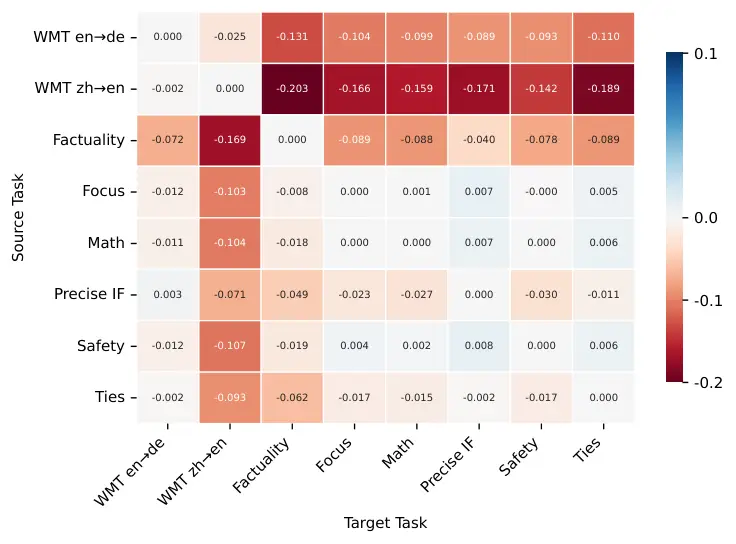
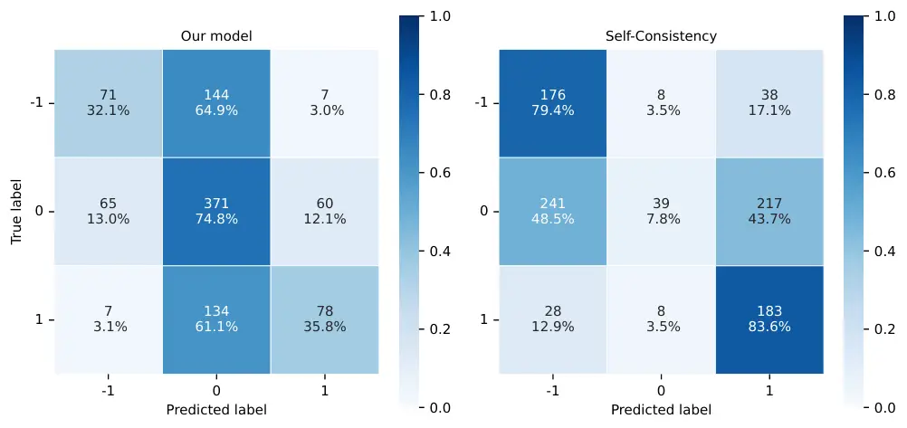
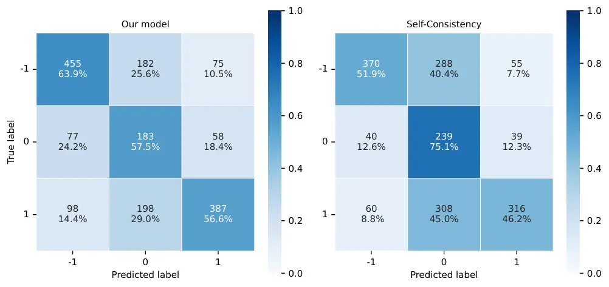

# Distribution-Calibrated Inference Time Compute for Thinking LLM-as-a-Judge

Hamid Dadkhahi Affiliation: Google Correspondence to:
<hdadkhahi@google.com>    Firas Trabelsi Affiliation: Google
Correspondence to: <firast@google.com>    Parker Riley
Affiliation: Google DeepMind    Juraj Juraska Affiliation: Google
DeepMind    Mehdi Mirzazadeh Affiliation: Google Research

###### Abstract

Thinking Large Language Models (LLMs) used as judges for pairwise
preferences remain noisy at the single-sample level, and common
aggregation rules (majority vote, soft self-consistency, or
instruction-based self-aggregation) are inconsistent when ties are
allowed. We study _inference-time compute_ (ITC) for evaluators that
generate $`n`$ independent thinking–rating samples per item, and propose
a principled, distribution-calibrated aggregation scheme. Our method
models three-way preferences with a Bradley–Terry-Davidson formulation
on rating counts, leveraging both _polarity_ (margin among non-ties) and
_decisiveness_ (non-tie rate) to distinguish narrow margins from strong
consensus. Across various evaluation benchmarks, our approach
consistently reduces MAE and increases pairwise accuracy versus standard
baselines, and when evaluated against human-consensus meta-labels,
matches or exceeds individual human raters. These results show that
carefully allocating ITC and aggregating with distribution-aware methods
turns noisy individual model judgments into reliable ratings for
evaluation.

###### Keywords: 

Machine Learning, ICML

^(†)^(†)affiliationnotice: Equal contribution

## 1 Introduction

Thinking large language models (LLMs) are increasingly employed as
automated judges for evaluating the output of other generative systems,
a paradigm known as “Thinking-LLM-as-a-Judge” (Saha et al., 2025). This
approach offers a scalable and cost-effective alternative to human
evaluation, which is often slow and expensive. To mitigate the inherent
stochasticity and noise of single-pass judgments, a common strategy is
to leverage inference-time compute (ITC) (Snell et al., 2025) by
generating multiple independent reasoning and rating samples for each
item being evaluated. However, the reliability of the final judgment
hinges critically on how these multiple outputs are aggregated.

Current aggregation methods, such as majority voting (Self-Consistency)
(Wang et al., 2023) or heuristics based on model confidence scores or
LLM generated aggregators, are often brittle and statistically
suboptimal. These approaches are particularly fragile in the presence of
ties. For instance, a simple majority vote cannot distinguish between a
narrow 5-to-4 decision and a decisive 9-to-0 consensus, discarding
valuable information about the strength of evidence contained within the
full distribution of votes. This insensitivity to evidential strength
leads to less reliable and robust evaluations.

In this work, we argue that the aggregation step is not an afterthought
but a critical component for effectively utilizing ITC. We propose a
principled, Distribution-Calibrated Aggregation scheme that moves beyond
simple vote-counting. Intuitively, instead of applying a rigid majority
rule, we calibrate a probabilistic model on a small set of labeled
examples so it can adapt to the LLM judge’s specific voting
behavior—such as its unique propensity to declare ties or push for
decisive wins. To achieve this, our method operates directly on the full
counts of positive, negative, and tie votes, preserving the full signal
in the sample distribution. Specifically, we model these three-way
preference outcomes using a Bradley-Terry-Davidson (Davidson, 1970)
formulation, which explicitly parametrizes both the preference margin
and the tie propensity. At inference, we apply a decision rule designed
to explicitly minimize our target evaluation metric, Mean Absolute Error
(MAE). By directly aligning the aggregation with this ordinally-aware
metric—penalizing complete preference reversals more heavily than minor
tie disagreements—we avoid loss-metric mismatch and yield more accurate
judgments. Conceptually, this calibration step modifies the decision
boundary compared to simple majority voting, as demonstrated in Figure

1.

Figure 1: Behavior of Different Aggregation Methods with 20 Votes. The
number of ‘Tie’ votes is computed as 20 - (# of A votes) - (# of B
votes). Our proposed method’s behavior is shown using two different
calibrated parameter sets: H1 models a high-tie propensity regime, while
H2 models a tie-averse regime.

We conduct extensive experiments on a diverse set of benchmarks,
including MT (Machine Translation) evaluation (WMT23) (Song et al., 2025) and reward model assessment (Reward Bench 2) (Malik et al., 2025).
Our results show that our distribution-calibrated approach considerably
outperforms a suite of strong self-consistency baselines. By carefully
modeling the entire vote distribution, our method turns noisy individual
model judgments into more reliable ratings, matching or exceeding the
performance of individual human raters when evaluated against a
human-consensus gold standard.

Contributions: Our main contributions are threefold: (1) We show that
the existing aggregation methods for inference time compute for LLM
judges are suboptimal and that a carefully designed aggregation approach
is critical. (2) We propose an Expected Risk Minimization (ERM)-based
Bradley–Terry–Davidson aggregation fit on a small calibration set, and
show that it consistently outperforms existing aggregation methods
across different tasks in both reward benchmarks and MT. (3) For MT in
particular, we adopt a consensus-based meta-evaluation to form
higher-fidelity ground truths where labels are noisy, enabling fair
comparison to human raters and revealing regimes where LLM judges
approach “super-human” evaluation quality.

#### Conflict of Interest Disclosure.

All authors are employed by Google-affiliated organizations. Google
develops the Gemini model family, and this paper evaluates
gemini-2.5-flash (Comanici et al., 2025) as one of the LLM judges. The
proposed aggregation method is model-agnostic, and our experiments also
include non-Google and open-source models.

## 2 Related Work

LLM-as-a-Judge: Recently, Large Language Models (LLMs) have achieved
remarkable success when deployed as “judges” (Zheng et al., 2023) to
evaluate generated text, offering a scalable alternative to traditional
metrics (Gu et al., 2025). This paradigm has demonstrated high
correlation with human judgments across diverse domains. Approaches
vary: some prompt general-purpose LLMs directly (e.g., G-Eval (Liu et
al., 2023); JudgeLM (Zhu et al., 2025)), while others fine-tune
specialized models optimized for evaluation tasks (e.g., Prometheus (Kim
et al., 2024); Auto-J (Li et al., 2024)). While powerful, these
LLM-based approaches face significant challenges, including sensitivity
to prompt design (Gu et al., 2025) and inherent biases, such as
positional bias (favoring a specific candidate order) or verbosity bias
(preferring longer outputs) (Wang et al., 2024b). Moreover, LLM judges
exhibit variability in their decision-making, with some models being
more aggressive than others in breaking subtle distinctions or ties
(Zheng et al., 2023). Our work focuses on mitigating this noise and
improving the reliability of judgments through a principled aggregation.

Thinking in Language Models for Evaluation. The reliability of LLM
judgments is often enhanced when the model is prompted to generate
intermediate reasoning steps before emitting a final verdict, a
technique popularized by Chain-of-Thought (CoT) prompting (Wei et al.,
2022). In the context of evaluation, this thinking process allows the
model to articulate the criteria for judgment and justify its decision,
leading to the Thinking-LLM-as-a-Judge paradigm (Saha et al., 2025).
This explicit reasoning not only improves the accuracy of the judgments
(Zhang et al., 2025) but also increases their interpretability. Our work
leverages the generation of these independent thinking traces and
investigates how to best aggregate the resulting rating samples.

|                  |                        |        |       |             |        |     |      |
| ---------------- | ---------------------- | ------ | ----- | ----------- | ------ | --- | ---- |
|                  | Forced-Choice (No Tie) |        |       | Tie Allowed |        |     |      |
| Model            | First                  | Second | Bias  | First       | Second | Tie | Bias |
| gemini-2.5-flash | 385                    | 287    | 14.5% | 220         | 199    | 253 | 3.1% |
| qwen3-next-80b   | 309                    | 363    | -8.0% | 322         | 318    | 32  | 0.6% |

Table 1: Allowing a ‘Tie’ Option Reduces Positional Bias. The table
compares preferences in a forced-choice setting against one where a
’tie’ is allowed. The bias is computed as (#First - \#Second) /
(#First + \#Second)

|                  |                      |                      |                      |                               |
| ---------------- | -------------------- | -------------------- | -------------------- | ----------------------------- |
| Model            | prompt_1             | prompt_2             | prompt_3             | Model Avg                     |
| gpt-oss-120b     | 19.3% ($`\pm`$ 4.2%) | 24.4% ($`\pm`$ 4.6%) | 21.6% ($`\pm`$ 4.4%) | 21.8% ($`\pm`$ 2.5%)          |
| gemini-2.5-flash | 12.4% ($`\pm`$ 3.5%) | 21.3% ($`\pm`$ 4.4%) | 37.6% ($`\pm`$ 5.2%) | 23.8% ($`\pm`$ 2.6%)          |
| deepseek-v3.1    | 28.9% ($`\pm`$ 4.8%) | 29.6% ($`\pm`$ 4.9%) | 32.6% ($`\pm`$ 5.0%) | 30.4% ($`\pm`$ 2.8%)          |
| Prompt Avg       | 20.2% ($`\pm`$ 2.5%) | 25.1% ($`\pm`$ 2.7%) | 30.6% ($`\pm`$ 2.8%) | Overall: 25.3% ($`\pm`$ 1.5%) |

Table 2: Ties Rates for Different Models and Prompts (in %) with 95%
confidence intervals.

Inference Time Compute and Sample Aggregation: Multiple strategies have
been proposed that leverage inference time compute in reward modeling
and evaluation (Liu et al., 2025). When multiple samples are generated,
an aggregation strategy is required. Self-Consistency (SC) (Wang et al., 2023) aggregates multiple outputs using majority voting. Several
variants incorporate confidence signals. Soft Self-consistency (Soft-SC)
(Wang et al., 2024a) picks the minimum, mean, or product of confidence
scores of items in each category. Confidence-Informed Self-Consistency
(CI-SC) (Taubenfeld et al., 2025) computes a weighted majority vote
based on confidence scores, which are computed as either the
length-normalized probability of the sequence or via prompting an LLM.
Alternatively, some methods leverage the LLM itself for aggregation.
Generative Self-Aggregation (GSA) (Li et al., 2025) asks the LLM to
synthesize a new response based on the context of multiple samples.
Universal Self-Consistency (USC) (Chen et al., 2023) leverages the LLM
to select the most consistent answer among multiple candidates.
Furthermore, Singhi et al. (2025) and Zhang et al. (2025) showed that
one can improve the performance of reasoning-based generative verifiers
via test-time compute, particularly via majority voting. Concurrent to
our work, AtC (Xie et al., 2026) addresses human-centered assessment by
calibrating continuous model scores to an externally derived human
consensus ranking via isotonic regression. By contrast, our method
calibrates a probabilistic aggregator directly for three-way LLM
preference judgments with ties.

Generator Refinement and Verification: A different line of work refines
the generation process. Methods like Mirror-Consistency (Huang et al.,
2024), Self-Contrast (Zhang et al., 2024), and Step-Back Prompting
(Zheng et al., 2024) utilize iterative reflection or diverse
perspectives to produce higher-quality samples, while Self-Check (Miao
et al., 2024) employs step-wise verification to filter errors. Unlike
these approaches, which focus on enhancing the generator (often
incurring sequential computational costs), our work focuses on the
aggregator: we accept the noisy distribution of parallel samples and
apply a calibration layer to robustly estimate the ground truth.

## 3 Motivation: The Tie Dilemma

A critical choice when designing an LLM-as-a-Judge for pairwise
comparisons (Zheng et al., 2023) is whether to allow the judge to
declare a tie or force it to pick a preference. In this section, we
first show that forcing the model to break ties might induce LLM biases.
We then show that the tie decisions are highly sensitive to the judge
parameters, requiring a more robust aggregation method to mitigate.

Ties are important to reduce LLM biases: LLM-as-a-Judge exhibit multiple
types of systematic biases (Ye et al., 2025a). A well-known issue is
positional bias (Shi et al., 2025), where the model’s preference can be
affected by the order in which responses are presented.

To quantify this, we evaluated qwen3-next-80b (Qwen Team, 2025),
gpt-oss-120b (OpenAI, 2025), deepseek-v3.1 (DeepSeek-AI, 2024), and
gemini-2.5-flash (Comanici et al., 2025) on a subset of 336 human-tie
pairs from the WMT23 zh $`\to`$ en dataset (detailed in Section 5). By
evaluating each pair in both orders, we measured positional bias in a
forced-choice setting. Table 1 presents the two models exhibiting
notable bias: gemini-2.5-flash favors the first position by 14.58%,
while qwen3-next-80b favors the second by 8.04%. The remaining models
(gpt-oss-120b and deepseek-v3.1) showed negligible bias ($`<1\%`$) and
are omitted.

The right side of Table 1 shows the results from the same experiment but
with the prompt updated to allow ties. The introduction of this third
choice dramatically reduces positional bias for both models. This
demonstrates that including a tie option is not just a feature for
capturing equivalence, but might be a critical mechanism for debiasing
the evaluation process itself.

Tie decisions are not stable: Our work is motivated by the fact that in
three-way preference tasks, the vote distribution of an LLM-as-a-judge
is highly sensitive to variations in the evaluation setup.

In this section, we demonstrate empirically two major sources of
variability in ratings - (1) the LLM queried and (2) the prompt template
used to get the ratings. We conduct an experiment where we generated
three slight variations of an evaluation prompt as shown in Appendix A.
We then use each of these prompts to judge the same dataset from the
previous section. As shown in Table 2, the results reveal a significant
variance in the rate of ties across prompts and LLMs. To quantify
data-sampling variance, we report 95% confidence intervals. For
instance, using the gemini-2.5-flash model, the percentage of “Ties”
votes fluctuates dramatically, ranging from a high of 37.6% ($`\pm`$
5.2%) with prompt_3 to a low of 12.4% ($`\pm`$ 3.5%) with prompt_1.
Because these confidence bounds do not overlap, this confirms the
prompt-induced shifts are highly statistically significant. We also
observe that deepseek-v3.1 produces an average tie rate of 30.4% across
all prompts, which is significantly higher than gpt-oss-120b’s average
of 21.8%.

This instability is a critical flaw for methods that do not calibrate
for such variations since a simple change in prompt wording can
fundamentally alter the tie likelihood. This underscores the need for a
robust distribution-calibrated aggregation method, which can explicitly
model and adapt to these shifts. Other works have investigated
calibration via finetuning the model (Park et al., 2024) (Ye et al.,
2025b); in this work we focus on mitigation strategies at inference
time.

## 4 Distribution-Calibrated Inference-Time Sample Aggregation

#### Setting.

Given a prompt $`x`$ and a pair of responses $`(A,B)`$, our autorater
queries a Thinking LLM $`n`$ times to obtain independent
reasoning–rating tuples $`\{(z_{j},r_{j})\}_{j=1}^{n}`$, where $`z_{j}`$
is a thinking trace and $`r_{j}\in\{-1,0,+1\}`$ is a discrete vote
($`+1`$: $`A\succ B`$, $`-1`$: $`B\succ A`$, $`0`$: $`A\sim B`$).
Empirically, once a thinking trace $`z_{j}`$ is produced, the
conditional distribution $`p(r_{j}\mid z_{j},\cdot)`$ is sharply peaked
(Wang et al., 2025). In addition, we do not see a high variation in the
normalized probability of the thinking traces. We therefore find that
log-likelihood reweighting adds little signal in practice. Instead, we
operate directly on the vote counts, which preserve the strength of
evidence in the sample distribution. Let
$`c^{+}=\bigl|\{j:r_{j}=+1\}\bigr|,\;\;c^{-}=\bigl|\{j:r_{j}=-1\}\bigr|,\;\;c^{0}=\bigl|\{j:r_{j}=0\}\bigr|,\;\;n=c^{+}+c^{-}+c^{0},`$
and equivalently $`\mathbf{n}=(c^{+},c^{0},c^{-})`$. While majority vote
(the mode of $`\mathbf{n}`$) is common, it is statistically suboptimal:
it is highly sensitive to sampling noise and ignores evidential strength
(e.g., it cannot distinguish $`5`$–to–$`4`$ from $`9`$–to–$`0`$). We
instead aggregate via a parametric model that consumes the full count
distribution and is aligned to our evaluation metric.

#### Evaluation Metric.

For a dataset of $`N`$ items, let $`y_{i}^{\star}\in\{-1,0,+1\}`$ denote
the ground truth and $`\hat{y}_{i}`$ the aggregator’s decision. We
evaluate with mean absolute error (MAE):

```math
\text{MAE}=\frac{1}{N}\sum_{i=1}^{N}\ell(\hat{y}_{i},y_{i}^{\star}),\qquad\ell(a,b)=|a-b|. \tag{1}
```

This ordinally-aware metric is well-suited for the ordered label set
$`\{-1,0,+1\}`$. Unlike standard accuracy, which treats all
misclassifications uniformly, MAE scales penalties by severity: it
penalizes complete preference reversals (error of magnitude 2) more
heavily than tie-related disagreements (error of magnitude 1), thereby
preserving the semantic hierarchy of the preference scale.

#### Count-derived features from votes.

We extract two smoothed features from $`\mathbf{n}`$:

```math
s\;=\;\tfrac{1}{2}\,\log\!\frac{c^{+}+\alpha}{c^{-}+\alpha}, \tag{2}
```

with small $`\alpha>0`$ (we use $`\alpha{=}1`$), capturing the decisive
margin; and a tie-evidence feature

```math
t\;=\;\log\!\frac{c^{0}+\kappa}{n+\kappa}\;\;\leq 0, \tag{3}
```

with $`\kappa>0`$ (we use $`\kappa{=}1`$), which increases (toward
$`0`$) as ties appear more frequently.

#### A Davidson-style model with ties.

We adopt a multinomial logit model inspired by the
Bradley–Terry–Davidson framework for ternary outcomes. For an item with
a latent margin $`u\in\mathbb{R}`$ and a tie logit
$`\eta\in\mathbb{R}`$,

```math
p(+1)=\frac{e^{u}}{Z},\quad p(-1)=\frac{e^{-u}}{Z},\quad p(0)=\frac{e^{\eta}}{Z}, \tag{4}
```

where $`Z=e^{u}+e^{-u}+e^{\eta}`$. We link features to scores linearly
and _jointly_ model both decisive margin and tie propensity:

```math
u\;=\;\beta\,s\quad\text{and}\quad\eta\;=\;\eta_{0}\;+\;\gamma\,t, \tag{5}
```

with parameters $`\theta=(\beta,\eta_{0},\gamma)`$. This single
specification allows a global tie baseline via $`\eta_{0}`$ and
item-specific modulation via $`t`$ with slope $`\gamma`$.

#### MAE-aligned decision rule.

Given $`\theta`$ and an input $`(s,t)`$, we compute probabilities via
Equation 4–Equation 5. The Bayes-optimal action under MAE is the label
$`y\in\{-1,0,+1\}`$ that minimizes the expected risk:

```math
\displaystyle\mathcal{R}(-1) \displaystyle=p(0)+2\,p(+1),
```

```math
\displaystyle\mathcal{R}(0) \displaystyle=p(+1)+p(-1), \tag{6}
```

```math
\displaystyle\mathcal{R}(+1) \displaystyle=2\,p(-1)+p(0).
```

The optimal decision is therefore given by:

```math
\hat{y}\;=\;\arg\min_{y\in\{-1,0,+1\}}\mathcal{R}(y). \tag{7}
```

#### Parameter fitting via The Discrete Ranked Probability Score.

A direct approach is to minimize empirical MAE on a held-out calibration
set $`\mathcal{C}`$:

```math
\hat{\theta}\in\arg\min_{\theta}\;\frac{1}{|\mathcal{C}|}\sum_{i\in\mathcal{C}}\ell\!\bigl(\hat{y}_{i}(\theta),\,y_{i}^{\star}\bigr), \tag{8}
```

where $`\hat{y}_{i}`$ is obtained by computing $`(u_{i},\eta_{i})`$ from
$`(s_{i},t_{i})`$, the Davidson probabilities (Equation 4), and then the
MAE Bayes action (Equation 7). However, Equation 8 is ill-suited for
standard gradient-based methods as predictions change only when a
decision boundary is crossed.

To address this problem, we decouple the model fitting from the decision
rule. We fit the probabilistic model by minimizing the _Discrete Ranked
Probability Score_ (DRPS), a strictly proper scoring rule designed for
ordinal outcomes (Gneiting and Raftery, 2007). Let the ordered label set
be $`\{-1,0,+1\}`$ and define the cumulative probabilities:

```math
\displaystyle F_{-1} \displaystyle\equiv\Pr(Y\leq-1)=p(-1),
```

```math
\displaystyle F_{0} \displaystyle\equiv\Pr(Y\leq 0)=p(-1)+p(0). \tag{9}
```

For an observation $`y^{\star}`$, define the corresponding cumulative
indicators:

```math
\displaystyle H_{-1}(y^{\star}) \displaystyle=\mathbbm{1}\{y^{\star}\leq-1\}
```

```math
\displaystyle H_{0}(y^{\star}) \displaystyle=\mathbbm{1}\{y^{\star}\leq 0\}. \tag{10}
```

where $`\mathbbm{1}`$ denotes the indicator function. The per-item DRPS
is the squared CDF discrepancy:

```math
\displaystyle\mathrm{DRPS}\bigl(p(\cdot\mid s,t),y^{\star}\bigr) \displaystyle=\bigl(F_{-1}-H_{-1}(y^{\star})\bigr)^{2}
```

```math
\displaystyle+\bigl(F_{0}-H_{0}(y^{\star})\bigr)^{2}. \tag{11}
```

We then estimate the parameters $`\theta`$ via empirical risk
minimization on the calibration set $`\mathcal{C}`$:

```math
\hat{\theta}\;\in\;\arg\min_{\theta}\;\frac{1}{|\mathcal{C}|}\sum_{i\in\mathcal{C}}\mathrm{DRPS}\!\left(p_{\theta}(\cdot\mid s_{i},t_{i}),\,y_{i}^{\star}\right). \tag{12}
```

0:  Calibration set $`\mathcal{C}`$, source query $`x`$, response pair
$`(A,B)`$, sampling budget $`n`$, smoothing factors $`(\alpha,\kappa)`$.
\StatexCalibrate parameters (offline, once): \StateFor each
$`i\in\mathcal{C}`$, tally $`(c_{i}^{+},c_{i}^{-},c_{i}^{0})`$ and
compute
$`s_{i}=\tfrac{1}{2}\log\frac{c_{i}^{+}+\alpha}{c_{i}^{-}+\alpha}`$ and
$`t_{i}=\log\frac{c_{i}^{0}+\kappa}{n_{i}+\kappa}`$ (Eqs. 2–3).
\StateFit $`\hat{\theta}=(\hat{\beta},\hat{\eta}_{0},\hat{\gamma})`$ by
minimizing empirical DRPS Equation 12 with L-BFGS-B. \StatexAggregate a
new response pair (online): \StateQuery LLM $`n`$ times to obtain votes
$`\{r_{j}\}_{j=1}^{n}\subset\{-1,0,+1\}`$; tally
$`(c^{+},c^{-},c^{0})`$; compute
$`s=\tfrac{1}{2}\log\frac{c^{+}+\alpha}{c^{-}+\alpha}`$ and
$`t=\log\frac{c^{0}+\kappa}{n+\kappa}`$. \StateForm
$`(u,\eta)=(\hat{\beta}\,s,\;\hat{\eta}_{0}+\hat{\gamma}\,t)`$ and
compute $`p(-1),p(0),p(+1)`$ via Equation 4. \StateCompute risks
$`\mathcal{R}(-1),\mathcal{R}(0),\mathcal{R}(+1)`$ via Equation 6.
\StateOutput $`\hat{y}`$ via the Bayes action Equation 7.

Algorithm 1 Aggregation with calibrated Davidson model

This approach is preferable to direct MAE minimization for three
reasons: (i) Fisher Consistency. As a _strictly proper scoring rule_ for
ordinal outcomes, DRPS is uniquely minimized by the true data-generating
distribution (Gneiting and Raftery, 2007). This guarantees Fisher
consistency—recovery of the true parameters $`\theta`$ in the population
limit. (ii) Alignment with MAE Decision Rule. Our final decision action
is the MAE Bayes rule in Equation 7, which depends on well-calibrated
class probabilities. While MAE is an ordinally-aware metric for point
estimates, the DRPS is its natural generalization to probabilistic
forecasts. Minimizing DRPS produces calibrated, ordinally-aware
probabilities, ensuring that the downstream Bayes action equation 7 is
asymptotically risk-optimal for the MAE metric. (iii) Superior
Optimization Landscape. Unlike the non-smooth ERM–MAE objective
Equation 8, the DRPS objective in Equation 12 is differentiable with
respect to $`\theta`$. This enables efficient estimation using
quasi-Newton methods (e.g., L-BFGS-B) under simple box constraints
(Nocedal and Wright, 2006).

Hence, we fit the model by minimizing the empirical DRPS on a
calibration set and apply the MAE Bayes decision rule at inference time.
This two-stage procedure is summarized in Algorithm 1.

## 5 Experiments

Baselines: In our experiments, we consider the following baselines:

1.  1. 
    Greedy decoding (GD): draws $`n=2`$ samples with reversed order and
    a temperature of zero.
2.  2. 
    Few Shot (FS): draws $`n=2`$ samples (with temperature of zero) with
    reversed order with the labeled calibration set provided in the
    prompt as in-context examples.
3.  3. 
    Self-Consistency (SC) (Wang et al., 2023): aggregates multiple
    outputs using majority voting.
4.  4. 
    Soft Self-Consistency (Soft-SC) (Wang et al., 2024a): picks the
    minimum, mean, or product of confidence scores within each category.
5.  5. 
    Confidence-Informed Self-Consistency (CI-SC) (Taubenfeld et al.,
    2025): computes a weighted majority vote based on confidence scores;
    here we use the length-normalized probability of the sequence
    ($`\in[0,1]`$). Alternatively, one could prompt an LLM for the
    confidence score (Kadavath et al., 2022), but in our experiments the
    LLM was almost always highly confident.
6.  6. 
    Generative Self-Aggregation (GSA) (Li et al., 2025): asks the LLM to
    synthesize a new response based on the context of multiple samples.
7.  7. 
    Universal Self-Consistency (USC) (Chen et al., 2023): leverages the
    LLM to select the most consistent answer among multiple candidates.

In both GD and FS, we aggregate the two responses using a rounded
median, where a pair of $`(0,1)`$ is mapped to 1. Empirically, this
choice leads to better results in both cases. In other baselines, to
overcome the positional bias, we draw $`\tfrac{n}{2}`$ samples in an
A-then-B response order and the remaining $`\tfrac{n}{2}`$ samples via a
B-then-A order. We then aggregate the entire $`n`$ samples. In our
experiments (except for the GD and FS baselines), we use temperature
sampling with $`T=0.5`$ to generate the candidates. As detailed in our
temperature ablation (Appendix G), maintaining this diversity of
reasoning paths is critical; lowering the temperature toward $`T=0`$
collapses the samples to the mode, stripping the BTD aggregator of the
distributional signal it needs to properly calibrate ties. For LLM
aggregation methods, we use greedy decoding in the aggregation stage.

Thinking Models We use the following Thinking LLMs: gemini-2.5-flash
(Comanici et al., 2025), qwen3-next-80b (Qwen Team, 2025), gpt-oss-120b
(OpenAI, 2025). All the LLM calls in this paper are done through
Thinking LLMs with thinking enabled.

Benchmarks We consider two machine translation tasks (Song et al., 2025)
and six tasks from the Reward Bench 2 benchmark (Malik et al., 2025).
See Appendix A for the prompts.

We use the WMT23 (Song et al., 2025) dataset and focus on two tasks for
two different language pairs en $`\to`$ de and zh $`\to`$ en. For each
source sentence and its two possible translations, the dataset contains
six ratings. Three ratings were collected using a simplified
side-by-side task in which raters compare two translations and assign
labels $`\{-1,0,+1\}`$. The other three ratings were collected using
direct assessment with MQM (Multidimensional Quality Metrics) (Lommel et
al., 2013) which we converted to a $`\{-1,0,+1\}`$ by looking at the
difference in absolute score. The WMT en $`\to`$ de set comprises
$`\sim\!500`$ document-level segments rated by 10 human raters, whereas
the WMT zh $`\to`$ en set comprises $`\sim\!1{,}800`$ sentence-level
segments rated by 8 humans. We aggregate the six ratings (per source) by
majority vote to obtain a consensus label, which serves as the gold
standard. We selected this benchmark because it provides multiple
independent human ratings per segment which allows us to benchmark our
approach against individual human raters by performing leave-one-out
comparisons.

The Reward Bench 2 benchmark (Malik et al., 2025) evaluates reward
models across six distinct domains: Factuality, Precise Instruction
Following (IF), Math, Safety, Focus, and Ties. For our evaluation, we
constructed preference pairs by generating all possible pairs from each
task’s source dataset, which contains both accepted and rejected
responses. These pairs are categorized into ‘non-tie’ pairs (pairing one
accepted and one rejected response) and ‘tie’ pairs (pairing two
accepted or two rejected responses). From this comprehensive set, we
then sample 1000 examples for each of the six tasks to form the final
benchmark. We provide a detailed breakdown of the ground truth vote
distributions for each task in Appendix B.

Meta Evaluation Metrics: We report mean absolute error (MAE) on ordinal
labels $`y_{i}^{\star}\in\{-1,0,+1\}`$ using Equation 1. We use MAE for
model selection and ablations. We also report pairwise accuracy,
$`\mathrm{PA}=\frac{1}{N}\sum_{i=1}^{N}\mathbbm{1}[\hat{y}_{i}=y_{i}^{\star}]`$.

Experimental Setup: For a given evaluation dataset $`\mathcal{D}`$, we
randomly sample a subset $`\mathcal{C}`$ of size $`\rho|\mathcal{D}|`$
as the calibration set (used by our method and the FS baseline). The
remaining $`N=|\mathcal{D}|-|\mathcal{C}|`$ samples are used as the
evaluation set across all methods. We report the average results over
100 random calibration-evaluation splits, using a calibration ratio of
$`\rho=5\%`$ for all tasks.

|                   |       |       |       |       |         |       |       |       |       |       |       |       |
| ----------------- | ----- | ----- | ----- | ----- | ------- | ----- | ----- | ----- | ----- | ----- | ----- | ----- |
| Dataset           | Ours  |       | SC    |       | Soft-SC |       | CI-SC |       | USC   |       | GSC   |       |
|                   | 4     | 12    | 4     | 12    | 4       | 12    | 4     | 12    | 4     | 12    | 4     | 12    |
| WMT en $`\to`$ de | 0.591 | 0.588 | 0.671 | 0.648 | 0.664   | 0.673 | 0.667 | 0.652 | 0.728 | 0.765 | 0.723 | 0.755 |
| WMT zh $`\to`$ en | 0.506 | 0.497 | 0.549 | 0.527 | 0.557   | 0.560 | 0.544 | 0.524 | 0.527 | 0.505 | 0.581 | 0.546 |
| RB2-Factuality    | 0.487 | 0.451 | 0.615 | 0.647 | 0.681   | 0.711 | 0.675 | 0.670 | 0.575 | 0.573 | 0.599 | 0.591 |
| RB2-Focus         | 0.332 | 0.287 | 0.394 | 0.403 | 0.397   | 0.370 | 0.415 | 0.415 | 0.424 | 0.423 | 0.439 | 0.441 |
| RB2-Math          | 0.306 | 0.285 | 0.360 | 0.384 | 0.400   | 0.372 | 0.391 | 0.385 | 0.410 | 0.415 | 0.427 | 0.450 |
| RB2-Precise IF    | 0.451 | 0.414 | 0.498 | 0.552 | 0.581   | 0.603 | 0.551 | 0.570 | 0.574 | 0.530 | 0.597 | 0.524 |
| RB2-Safety        | 0.319 | 0.285 | 0.373 | 0.402 | 0.406   | 0.409 | 0.412 | 0.405 | 0.407 | 0.405 | 0.406 | 0.414 |
| RB2-Ties          | 0.094 | 0.081 | 0.155 | 0.158 | 0.177   | 0.177 | 0.178 | 0.165 | 0.226 | 0.221 | 0.208 | 0.197 |
|                   |       |       |       |       |         |       |       |       |       |       |       |       |

Table 3: MAE (lower score is better) over different tasks with different
methods for $`n\in\{4,12\}`$ via gemini-2.5-flash.

|                   |       |       |       |       |         |       |       |       |       |       |       |       |
| ----------------- | ----- | ----- | ----- | ----- | ------- | ----- | ----- | ----- | ----- | ----- | ----- | ----- |
| Dataset           | Ours  |       | SC    |       | Soft-SC |       | CI-SC |       | USC   |       | GSC   |       |
|                   | 4     | 12    | 4     | 12    | 4       | 12    | 4     | 12    | 4     | 12    | 4     | 12    |
| WMT en $`\to`$ de | 0.510 | 0.516 | 0.442 | 0.467 | 0.496   | 0.477 | 0.473 | 0.465 | 0.436 | 0.447 | 0.452 | 0.463 |
| WMT zh $`\to`$ en | 0.583 | 0.607 | 0.515 | 0.539 | 0.528   | 0.529 | 0.530 | 0.545 | 0.561 | 0.590 | 0.512 | 0.550 |
| RB2-Factuality    | 0.536 | 0.566 | 0.450 | 0.424 | 0.410   | 0.399 | 0.409 | 0.411 | 0.472 | 0.475 | 0.445 | 0.461 |
| RB2-Focus         | 0.685 | 0.725 | 0.629 | 0.626 | 0.636   | 0.663 | 0.616 | 0.616 | 0.604 | 0.612 | 0.601 | 0.602 |
| RB2-Math          | 0.709 | 0.723 | 0.658 | 0.635 | 0.626   | 0.654 | 0.632 | 0.634 | 0.616 | 0.619 | 0.609 | 0.605 |
| RB2-Precise IF    | 0.572 | 0.605 | 0.556 | 0.530 | 0.507   | 0.490 | 0.528 | 0.515 | 0.495 | 0.522 | 0.474 | 0.527 |
| RB2-Safety        | 0.691 | 0.723 | 0.650 | 0.630 | 0.635   | 0.633 | 0.626 | 0.629 | 0.619 | 0.623 | 0.625 | 0.618 |
| RB2-Ties          | 0.905 | 0.918 | 0.844 | 0.842 | 0.823   | 0.822 | 0.822 | 0.834 | 0.773 | 0.779 | 0.792 | 0.804 |
|                   |       |       |       |       |         |       |       |       |       |       |       |       |

Table 4: Pairwise accuracy (higher score is better) over different tasks
with different methods for $`n\in\{4,12\}`$ via gemini-2.5-flash

Results: Tables 3 and 4 report MAE and pairwise accuracy for all
aggregation methods using gemini-2.5-flash at $`n\in\{4,12\}`$ across
tasks. After scoring on 100 calibration-evaluation splits, we identify
the _top cluster_ using the procedure of Freitag et al. (2023): sort
aggregation methods by average score and assign rank 1 to consecutive
methods until we encounter the first that is significantly different
from any already included method; all rank 1 methods are bolded in the
tables. Significance is determined via a paired permutation test: for
each pair of aggregation methods, we compare per-item outcomes on each
evaluation set and obtain a $`p`$-value using random resampling (100
resamples per split), with $`\tau=0.05`$.

Our method attains the best scores on all the datasets and sample
counts. Across RB2 tasks, increasing $`n`$ from $`4`$ to $`12`$
consistently improves our method, whereas SC tends to degrade or remain
flat. Other aggregation baselines vary non-monotonically with $`n`$ in a
task-dependent manner. In the majority of tasks, we find that the
evaluation performance plateaus at around $`n=12`$ samples with
RB2-Ties, RB2-Focus, and RB2-Precise IF showing marginal gains at
$`n=20`$ compared to $`n=12`$ (See full $`n=20`$ evaluation results in
Appendix G Table 11).

We compare the behavior of different aggregation methods versus $`n`$
over the RB2-Precise IF task in Figure 2. In this figure, error bars
show $`95\%`$ confidence intervals of the mean over the $`100`$ random
calibration–evaluation splits, computed as
$`\bar{x}\pm 1.96\,\mathrm{SE}`$ for each $`n`$ and method. Note that
Ours is the only method that fits parameters on the calibration set
every time, which injects an extra source of variability to its curve.
For FS, due to its high cost (since we need to regenerate the samples
for every calibration-evaluation split), we averaged the results over
$`10`$ random splits. Our method outperforms all the baselines by a
large margin.

Figure 2: MAE and Pairwise Accuracy versus $`n`$ on RB2-Precise IF task
for different methods. Horizontal dashed lines represent the Greedy
Decoding (GD) and Few-Shot (FS) baselines, which do not scale with the
test-time sampling budget $`n`$.

For WMT zh $`\to`$ en, we conduct an additional meta evaluation
comparing the ITC LLM judge to individual human raters via a
leave-one-out (LOO) protocol. Given ratings from $`k`$ raters
$`R_{1},\dots,R_{k}`$, we iteratively drop $`R_{i}`$, majority-vote the
remaining humans to obtain a ground truth, and compute pairwise accuracy
for both $`R_{i}`$ and the LLM judge against that ground truth on the
same items. This yields an unbiased comparison against the remaining
crowd baseline. Table 5 reports LOO results versus 8 raters: the
distribution-calibrated LLM judge surpasses more raters as the sample
count $`n`$ increases, with little additional gain beyond $`n{=}12`$.
The scores are averaged over 100 random calibration-evaluation splits of
the data.

Results for different Thinking LLMs, gemini-2.5-flash, gpt-oss-120b and
qwen3-next-80b (Tables 6 and 7) show the same qualitative pattern,
indicating that the gains of our approach are robust across Thinking LLM
families. This robustness is important because the underlying judges
exhibit substantially different raw tie propensities, as shown in
Table 2.

|           |           |           |      |           |           |      |           |           |      |            |           |      |
| --------- | --------- | --------- | ---- | --------- | --------- | ---- | --------- | --------- | ---- | ---------- | --------- | ---- |
|           | $`n{=}2`$ |           |      | $`n{=}4`$ |           |      | $`n{=}8`$ |           |      | $`n{=}12`$ |           |      |
| Rater     | Human     | Ours      | Win? | Human     | Ours      | Win? | Human     | Ours      | Win? | Human      | Ours      | Win? |
| $`R_{1}`$ | $`0.546`$ | $`0.457`$ | ✗    | $`0.546`$ | $`0.489`$ | ✗    | $`0.546`$ | $`0.501`$ | ✗    | $`0.546`$  | $`0.511`$ | ✗    |
| $`R_{2}`$ | $`0.567`$ | $`0.536`$ | ✗    | $`0.567`$ | $`0.549`$ | ✗    | $`0.567`$ | $`0.547`$ | ✗    | $`0.567`$  | $`0.573`$ | ✓    |
| $`R_{3}`$ | $`0.606`$ | $`0.585`$ | ✗    | $`0.606`$ | $`0.598`$ | ✗    | $`0.606`$ | $`0.608`$ | ✓    | $`0.606`$  | $`0.609`$ | ✓    |
| $`R_{4}`$ | $`0.530`$ | $`0.499`$ | ✗    | $`0.530`$ | $`0.536`$ | ✓    | $`0.530`$ | $`0.546`$ | ✓    | $`0.530`$  | $`0.549`$ | ✓    |
| $`R_{5}`$ | $`0.504`$ | $`0.516`$ | ✓    | $`0.504`$ | $`0.548`$ | ✓    | $`0.504`$ | $`0.554`$ | ✓    | $`0.504`$  | $`0.554`$ | ✓    |
| $`R_{6}`$ | $`0.497`$ | $`0.518`$ | ✓    | $`0.497`$ | $`0.553`$ | ✓    | $`0.497`$ | $`0.574`$ | ✓    | $`0.497`$  | $`0.570`$ | ✓    |
| $`R_{7}`$ | $`0.511`$ | $`0.563`$ | ✓    | $`0.511`$ | $`0.579`$ | ✓    | $`0.511`$ | $`0.582`$ | ✓    | $`0.511`$  | $`0.589`$ | ✓    |
| $`R_{8}`$ | $`0.503`$ | $`0.562`$ | ✓    | $`0.503`$ | $`0.589`$ | ✓    | $`0.503`$ | $`0.621`$ | ✓    | $`0.503`$  | $`0.624`$ | ✓    |
| wins      |           |           | 4/8  |           |           | 5/8  |           |           | 6/8  |            |           | 7/8  |

Table 5: Per-rater LOO comparison on WMT zh $`\to`$ en in Pairwise
Accuracy. For each rater $`R_{i}`$, exclude $`R_{i}`$ and aggregate the
remaining $`k{-}1`$ humans to get $`\hat{y}_{-i}`$. Report the human’s
PA vs. Ours with $`n\in\{2,4,8,12\}`$ samples. Win? is ✓ if Ours $`>`$
Human, ✗ if Ours $`<`$ Human.

|                |              |       |       |       |                |       |       |       |                  |       |       |       |
| -------------- | ------------ | ----- | ----- | ----- | -------------- | ----- | ----- | ----- | ---------------- | ----- | ----- | ----- |
| Dataset        | gpt-oss-120b |       |       |       | qwen3-next-80b |       |       |       | gemini-2.5-flash |       |       |       |
|                | Ours         |       | SC    |       | Ours           |       | SC    |       | Ours             |       | SC    |       |
|                | 4            | 12    | 4     | 12    | 4              | 12    | 4     | 12    | 4                | 12    | 4     | 12    |
| RB2-Factuality | 0.465        | 0.442 | 0.577 | 0.593 | 0.491          | 0.453 | 0.599 | 0.608 | 0.487            | 0.454 | 0.615 | 0.647 |
| RB2-Focus      | 0.342        | 0.306 | 0.397 | 0.419 | 0.347          | 0.302 | 0.411 | 0.426 | 0.332            | 0.303 | 0.394 | 0.403 |
| RB2-Math       | 0.362        | 0.329 | 0.415 | 0.437 | 0.389          | 0.345 | 0.442 | 0.472 | 0.306            | 0.287 | 0.360 | 0.384 |
| RB2-Precise IF | 0.412        | 0.381 | 0.506 | 0.526 | 0.455          | 0.432 | 0.544 | 0.576 | 0.451            | 0.431 | 0.498 | 0.552 |
| RB2-Safety     | 0.262        | 0.245 | 0.316 | 0.322 | 0.274          | 0.243 | 0.316 | 0.335 | 0.319            | 0.285 | 0.373 | 0.402 |
| RB2-Ties       | 0.170        | 0.118 | 0.277 | 0.308 | 0.200          | 0.133 | 0.300 | 0.339 | 0.094            | 0.081 | 0.155 | 0.158 |

Table 6: MAE for different LLMs with $`n\in\{4,12\}`$; Ours versus
Self-Consistency (SC).

|                |              |       |       |       |                |       |       |       |                  |       |       |       |
| -------------- | ------------ | ----- | ----- | ----- | -------------- | ----- | ----- | ----- | ---------------- | ----- | ----- | ----- |
| Dataset        | gpt-oss-120b |       |       |       | qwen3-next-80b |       |       |       | gemini-2.5-flash |       |       |       |
|                | Ours         |       | SC    |       | Ours           |       | SC    |       | Ours             |       | SC    |       |
|                | 4            | 12    | 4     | 12    | 4              | 12    | 4     | 12    | 4                | 12    | 4     | 12    |
| RB2-Factuality | 0.557        | 0.575 | 0.473 | 0.461 | 0.525          | 0.557 | 0.449 | 0.442 | 0.536            | 0.564 | 0.450 | 0.424 |
| RB2-Focus      | 0.664        | 0.696 | 0.621 | 0.603 | 0.665          | 0.706 | 0.616 | 0.602 | 0.685            | 0.709 | 0.629 | 0.626 |
| RB2-Math       | 0.646        | 0.677 | 0.597 | 0.575 | 0.624          | 0.667 | 0.575 | 0.549 | 0.709            | 0.723 | 0.658 | 0.635 |
| RB2-Precise IF | 0.610        | 0.634 | 0.550 | 0.541 | 0.578          | 0.583 | 0.526 | 0.501 | 0.572            | 0.586 | 0.556 | 0.530 |
| RB2-Safety     | 0.754        | 0.763 | 0.718 | 0.710 | 0.728          | 0.758 | 0.688 | 0.669 | 0.691            | 0.723 | 0.650 | 0.630 |
| RB2-Ties       | 0.830        | 0.882 | 0.723 | 0.692 | 0.800          | 0.867 | 0.700 | 0.661 | 0.905            | 0.918 | 0.844 | 0.842 |

Table 7: Pairwise accuracy for different LLMs with $`n\in\{4,12\}`$;
Ours vs. Self-Consistency (SC).

Transferability: Figure 3 plots, for each source–target pair, the change
in MAE relative to using a task’s own calibration set (blue = better,
red = worse). For the two WMT tasks, we observe an asymmetry:
calibrating on WMT zh $`\to`$ en transfers well to WMT en $`\to`$ de,
whereas calibrating on WMT en $`\to`$ de typically hurts WMT
zh $`\to`$ en. Across RB2 tasks, transfer is generally good: most
off-diagonal RB2 pairs are blue or near zero, but Factuality stands out
as an exception that transfers poorly to other RB2 tasks. Although the
ground truth tie rate for Factuality is roughly 53% (Appendix B), the
LLM is overwhelmingly biased against ties, predicting them only
$`\sim`$6% of the time naturally. Bridging this massive gap forces the
BTD model to learn an extreme calibration parameter, which degrades
performance when transferred to well-behaved tasks like Precise IF by
forcing heavy over-prediction of ties. In contrast, cross-family
transfer between WMT and RB2 tasks is usually weak, with only a few
isolated blue cells where calibrating on an RB2 task gives a small gain
on a WMT en $`\to`$ de target. These patterns suggest that transfer is
governed not just by the marginal label distribution but by the joint
structure of the problem: how often the task induces ambiguous cases
(e.g. as related to ground truth distribution), how frequently the LLM
produces directional vs. tied votes (its inherent tie propensity), and
how those characteristics interact with the MAE-aligned Davidson model.
Some tasks therefore yield smooth, well-behaved calibration landscapes
that export well, while others induce sharper landscapes whose fitted
parameters do not generalize. Designing principled tests to predict when
one task should transfer to another—and to quantify robustness under
stronger distribution shifts or out-of-distribution targets—remains an
interesting direction for future work.



Figure 3: Change in MAE for each source–target pair relative to
in-domain calibration (diagonal), with rows as source tasks and columns
as target tasks.

Calibration Set Size: To study the impact of the calibration set size,
we sweep the size of the calibration set from 20 to 200 examples (with a
step size of 20) while keeping the evaluation split fixed (the remaining
examples in the data set). Figure 4 shows the mean MAE (averaged over
100 random splits) on the evaluation set for two representative tasks,
WMT en $`\to`$ de and RB2-Math: MAE drops sharply when moving from 20 to
about 60–80 examples and then quickly plateaus. Beyond roughly 100
calibration items, changes are below $`0.002`$ MAE. The remaining six
tasks, reported in Appendix C, exhibit a similar behavior, indicating
that our default 5% calibration split (typically around 50 to 100
examples) lies inside this stable regime.

Figure 4: Mean validation MAE vs. calibration set size for two
representative tasks: WMT en $`\to`$ de (left) and RB2-Math (right).
Performance improves rapidly with the first 60–80 calibration examples
and stabilizes thereafter. Note that even a small calibration set of
size $`20`$ is sufficient to outperform Self Consistency by a large
margin (SC is $`0.651`$ and $`0.398`$ for the two tasks, respectively.)

## 6 Future Work

Our analysis (See Appendix D) identifies distinct calibration regimes
defined by the interplay between the judge’s voting patterns and the
ground truth. Future work involves characterizing the conditions of
regime compatibility to predict task transferability. Additionally, we
aim to generalize this framework to broader ordinal and multi-class
outcomes. For instance, to extend to a $`k`$-point Likert scale, the
3-way BTD model can be replaced by a standard Ordered Logit model
fitting $`k-1`$ thresholds instead of a single tie parameter. For
multi-dimensional preferences, our method could be applied independently
per dimension. Finally, extending the BTD formulation to a multi-judge
setting—such as enriching the aggregator with judge-specific parameters
so heterogeneous LLMs can share a common calibrated decision rule while
maintaining their individual tie tendencies—remains an interesting
direction for future work.

## Impact Statement

This work improves LLM-based evaluation by calibrating repeated model
judgments. It can make evaluation cheaper and more reproducible, but may
also increase reliance on automated judges that inherit model biases,
calibration artifacts, or benchmark-specific failures. It should be used
to support, not replace, human review in high-stakes settings.

### Acknowledgments

We thank Dan Deutsch for suggestions about meta evaluation in our
experiments and Jiaming Luo for feedback on the manuscript.

## References

- Chen et al. (2023) X. Chen, R. Aksitov, U. Alon, J. Ren, K. Xiao, P.
  Yin, S. Prakash, C. Sutton, X. Wang, and D. Zhou Universal
  self-consistency for large language model generation. External Links:
  2311.17311, [Link](https://arxiv.org/abs/2311.17311) Cited by: §2,
  item 7. .
- Comanici et al. (2025) G. Comanici, E. Bieber, M. Schaekermann, I.
  Pasupat, N. Sachdeva, I. Dhillon, M. Blistein, O. Ram, D. Zhang, E.
  Rosen, et al. Gemini 2.5: pushing the frontier with advanced
  reasoning, multimodality, long context, and next generation agentic
  capabilities. arXiv preprint arXiv:2507.06261. Cited by: §1, §3, §5.
- Davidson (1970) R. R. Davidson On extending the bradley-terry model to
  accommodate ties in paired comparison experiments. Journal of the
  American Statistical Association 65, pp. 317–328. External Links:
  [Link](https://api.semanticscholar.org/CorpusID:121759206) Cited by:
  §1.
- DeepSeek-AI (2024) DeepSeek-AI DeepSeek-v3 technical report. External
  Links: 2412.19437, [Link](https://arxiv.org/abs/2412.19437) Cited by:
  §3.
- Freitag et al. (2023) M. Freitag, N. Mathur, C. Lo, E. Avramidis, R.
  Rei, B. Thompson, T. Kocmi, F. Blain, D. Deutsch, C. Stewart, C.
  Zerva, S. Castilho, A. Lavie, and G. Foster Results of WMT23 metrics
  shared task: metrics might be guilty but references are not innocent.
  In Proceedings of the Eighth Conference on Machine Translation, P.
  Koehn, B. Haddow, T. Kocmi, and C. Monz (Eds.), Singapore,
  pp. 578–628. External Links:
  [Link](https://aclanthology.org/2023.wmt-1.51/),
  [Document](https://dx.doi.org/10.18653/v1/2023.wmt-1.51) Cited by: §5.
- Gneiting and Raftery (2007) T. Gneiting and A. E. Raftery Strictly
  proper scoring rules, prediction, and estimation. Journal of the
  American Statistical Association 102 (477), pp. 359–378. External
  Links: [Document](https://dx.doi.org/10.1198/016214506000001437),
  [Link](https://doi.org/10.1198/016214506000001437),
  https://doi.org/10.1198/016214506000001437 Cited by: §4, §4.
- Gu et al. (2025) J. Gu, X. Jiang, Z. Shi, H. Tan, X. Zhai, C. Xu, W.
  Li, Y. Shen, S. Ma, H. Liu, S. Wang, K. Zhang, Y. Wang, W. Gao, L. Ni,
  and J. Guo A survey on LLM-as-a-judge. External Links: 2411.15594,
  [Link](https://arxiv.org/abs/2411.15594) Cited by: §2.
- Huang et al. (2024) S. Huang, Z. Ma, J. Du, C. Meng, W. Wang, and Z.
  Lin Mirror-consistency: harnessing inconsistency in majority voting.
  In Findings of the Association for Computational Linguistics: EMNLP
  2024, Miami, Florida, USA, pp. 2408–2420. External Links:
  [Link](https://aclanthology.org/2024.findings-emnlp.135/),
  [Document](https://dx.doi.org/10.18653/v1/2024.findings-emnlp.135)
  Cited by: §2.
- Kadavath et al. (2022) S. Kadavath, T. Conerly, A. Askell, T.
  Henighan, D. Drain, E. Perez, N. Schiefer, Z. Hatfield-Dodds, N.
  DasSarma, E. Tran-Johnson, S. Johnston, S. El-Showk, A. Jones, N.
  Elhage, T. Hume, A. Chen, Y. Bai, S. Bowman, S. Fort, D. Ganguli, D.
  Hernandez, J. Jacobson, J. Kernion, S. Kravec, L. Lovitt, K.
  Ndousse, C. Olsson, S. Ringer, D. Amodei, T. Brown, J. Clark, N.
  Joseph, B. Mann, S. McCandlish, C. Olah, and J. Kaplan Language models
  (mostly) know what they know. External Links: 2207.05221,
  [Link](https://arxiv.org/abs/2207.05221) Cited by: item 5. .
- Kim et al. (2024) S. Kim, J. Shin, Y. Cho, J. Jang, S. Longpre, H.
  Lee, S. Yun, S. Shin, S. Kim, J. Thorne, and M. Seo Prometheus:
  inducing fine-grained evaluation capability in language models. In The
  Twelfth International Conference on Learning Representations, External
  Links: [Link](https://openreview.net/forum?id=8euJaTveKw) Cited by:
  §2.
- Li et al. (2024) J. Li, S. Sun, W. Yuan, R. Fan, H. Zhao, and P. Liu
  Generative judge for evaluating alignment. In The Twelfth
  International Conference on Learning Representations, External Links:
  [Link](https://openreview.net/forum?id=gtkFw6sZGS) Cited by: §2.
- Li et al. (2025) Z. Li, X. Feng, Y. Cai, Z. Zhang, T. Liu, C.
  Liang, W. Chen, H. Wang, and T. Zhao LLMs can generate a better answer
  by aggregating their own responses. External Links: 2503.04104,
  [Link](https://arxiv.org/abs/2503.04104) Cited by: §2, item 6. .
- Liu et al. (2023) Y. Liu, D. Iter, Y. Xu, S. Wang, R. Xu, and C. Zhu
  G-eval: NLG evaluation using gpt-4 with better human alignment. In
  Proceedings of the 2023 Conference on Empirical Methods in Natural
  Language Processing, Singapore. External Links:
  [Link](https://aclanthology.org/2023.emnlp-main.153/) Cited by: §2.
- Liu et al. (2025) Z. Liu, P. Wang, R. Xu, S. Ma, C. Ruan, P. Li, Y.
  Liu, and Y. Wu Inference-time scaling for generalist reward modeling.
  External Links: 2504.02495, [Link](https://arxiv.org/abs/2504.02495)
  Cited by: §2.
- Lommel et al. (2013) A. R. Lommel, A. Burchardt, and H. Uszkoreit
  Multidimensional quality metrics: a flexible system for assessing
  translation quality. In Proceedings of Translating and the Computer
  35, London, UK. External Links:
  [Link](https://aclanthology.org/2013.tc-1.6/) Cited by: §5.
- Malik et al. (2025) S. Malik, V. Pyatkin, S. Land, J. Morrison, N. A.
  Smith, H. Hajishirzi, and N. Lambert RewardBench 2: advancing reward
  model evaluation. External Links: 2506.01937,
  [Link](https://arxiv.org/abs/2506.01937) Cited by: §1, §5, §5.
- Miao et al. (2024) N. Miao, Y. W. Teh, and T. Rainforth SelfCheck:
  using LLMs to zero-shot check their own step-by-step reasoning. In
  International Conference on Learning Representations, B. Kim, Y.
  Yue, S. Chaudhuri, K. Fragkiadaki, M. Khan, and Y. Sun (Eds.), Vol.
  2024, pp. 56556–56571. External Links:
  [Link](https://proceedings.iclr.cc/paper_files/paper/2024/file/fa1edbc195336e29893cdae0939e495f-Paper-Conference.pdf)
  Cited by: §2.
- Nocedal and Wright (2006) J. Nocedal and S. J. Wright Numerical
  optimization. 2. ed. edition, Springer series in operations research
  and financial engineering, Springer, New York, NY. Cited by: §4.
- OpenAI (2025) OpenAI GPT-OSS-120b & GPT-OSS-20b model card. External
  Links: 2508.10925, [Link](https://arxiv.org/abs/2508.10925) Cited by:
  §3, §5.
- Park et al. (2024) J. Park, S. Jwa, R. Meiying, D. Kim, and S. Choi
  OffsetBias: leveraging debiased data for tuning evaluators. In
  Findings of the Association for Computational Linguistics: EMNLP 2024,
  Miami, Florida, USA. External Links:
  [Link](https://aclanthology.org/2024.findings-emnlp.57/) Cited by: §3.
- Qwen Team (2025) Qwen Team Qwen3 technical report. External Links:
  2505.09388, [Link](https://arxiv.org/abs/2505.09388) Cited by: §3, §5.
- Saha et al. (2025) S. Saha, X. Li, M. Ghazvininejad, J. E. Weston,
  and T. Wang Learning to plan & reason for evaluation with
  thinking-LLM-as-a-judge. In Forty-second International Conference on
  Machine Learning, External Links:
  [Link](https://openreview.net/forum?id=PNRznmmWP7) Cited by: §1, §2.
- Shi et al. (2025) L. Shi, C. Ma, W. Liang, X. Diao, W. Ma, and S.
  Vosoughi Judging the judges: a systematic study of position bias in
  LLM-as-a-judge. In Proceedings of the 14th International Joint
  Conference on Natural Language Processing and the 4th Conference of
  the Asia-Pacific Chapter of the Association for Computational
  Linguistics, Mumbai, India. External Links:
  [Link](https://aclanthology.org/2025.ijcnlp-long.18/) Cited by: §3.
- Singhi et al. (2025) N. Singhi, H. Bansal, A. Hosseini, A. Grover, K.
  Chang, M. Rohrbach, and A. Rohrbach When to solve, when to verify:
  compute-optimal problem solving and generative verification for LLM
  reasoning. In Second Conference on Language Modeling, External Links:
  [Link](https://openreview.net/forum?id=R7qRUFHGTx) Cited by: §2.
- Snell et al. (2025) C. V. Snell, J. Lee, K. Xu, and A. Kumar Scaling
  LLM test-time compute optimally can be more effective than scaling
  parameters for reasoning. In The Thirteenth International Conference
  on Learning Representations, External Links:
  [Link](https://openreview.net/forum?id=4FWAwZtd2n) Cited by: §1.
- Song et al. (2025) Y. Song, P. Riley, D. Deutsch, and M. Freitag
  Enhancing human evaluation in machine translation with comparative
  judgement. In Proceedings of the 63rd Annual Meeting of the
  Association for Computational Linguistics (Volume 1: Long Papers),
  Vienna, Austria. External Links:
  [Link](https://aclanthology.org/2025.acl-long.1002/) Cited by: §1, §5,
  §5.
- Taubenfeld et al. (2025) A. Taubenfeld, T. Sheffer, E. Ofek, A.
  Feder, A. Goldstein, Z. Gekhman, and G. Yona Confidence improves
  self-consistency in LLMs. In Findings of the Association for
  Computational Linguistics: ACL 2025, pp. 20090–20111. External Links:
  [Link](http://dx.doi.org/10.18653/v1/2025.findings-acl.1030),
  [Document](https://dx.doi.org/10.18653/v1/2025.findings-acl.1030)
  Cited by: §2, item 5. .
- Wang et al. (2024a) H. Wang, A. Prasad, E. Stengel-Eskin, and M.
  Bansal Soft self-consistency improves language model agents. In
  Proceedings of the 62nd Annual Meeting of the Association for
  Computational Linguistics (Volume 2: Short Papers), Cited by: §2,
  item 4. .
- Wang et al. (2024b) P. Wang, L. Li, L. Chen, Z. Cai, D. Zhu, B.
  Lin, Y. Cao, L. Kong, Q. Liu, T. Liu, and Z. Sui Large language models
  are not fair evaluators. In Proceedings of the 62nd Annual Meeting of
  the Association for Computational Linguistics (Volume 1: Long Papers),
  Bangkok, Thailand. External Links:
  [Link](https://aclanthology.org/2024.acl-long.511/) Cited by: §2.
- Wang et al. (2025) V. Wang, M. J. Zhang, and E. Choi Improving
  LLM-as-a-judge inference with the judgment distribution. In Findings
  of the Association for Computational Linguistics: EMNLP 2025, Suzhou,
  China. External Links:
  [Link](https://aclanthology.org/2025.findings-emnlp.1259/) Cited by:
  §4.
- Wang et al. (2023) X. Wang, J. Wei, D. Schuurmans, Q. V. Le, E. H.
  Chi, S. Narang, A. Chowdhery, and D. Zhou Self-consistency improves
  chain of thought reasoning in language models. In The Eleventh
  International Conference on Learning Representations, External Links:
  [Link](https://openreview.net/forum?id=1PL1NIMMrw) Cited by: §1, §2,
  item 3. .
- Wei et al. (2022) J. Wei, X. Wang, D. Schuurmans, M. Bosma, B.
  Ichter, F. Xia, E. Chi, Q. Le, and D. Zhou Chain-of-thought prompting
  elicits reasoning in large language models. Advances in Neural
  Information Processing Systems 35, pp. 24824–24837. Cited by: §2.
- Xie et al. (2026) Z. Xie, X. Li, G. Wang, and D. Zhang AtC:
  aggregate-then-calibrate for human-centered assessment. In The
  Fourteenth International Conference on Learning Representations,
  External Links: [Link](https://openreview.net/forum?id=XNbVoi9mfr)
  Cited by: §2.
- Ye et al. (2025a) J. Ye, Y. Wang, Y. Huang, D. Chen, Q. Zhang, N.
  Moniz, T. Gao, W. Geyer, C. Huang, P. Chen, N. V. Chawla, and X. Zhang
  Justice or prejudice? quantifying biases in LLM-as-a-judge. In The
  Thirteenth International Conference on Learning Representations,
  External Links: [Link](https://openreview.net/forum?id=3GTtZFiajM)
  Cited by: §3.
- Ye et al. (2025b) Z. Ye, X. Li, Q. Li, Q. Ai, Y. Zhou, W. Shen, D.
  Yan, and Y. LIU Learning LLM-as-a-judge for preference alignment. In
  The Thirteenth International Conference on Learning Representations,
  External Links: [Link](https://openreview.net/forum?id=HZVIQE1MsJ)
  Cited by: §3.
- Zhang et al. (2025) L. Zhang, A. Hosseini, H. Bansal, M. Kazemi, A.
  Kumar, and R. Agarwal Generative verifiers: reward modeling as
  next-token prediction. In The Thirteenth International Conference on
  Learning Representations, External Links:
  [Link](https://openreview.net/forum?id=Ccwp4tFEtE) Cited by: §2, §2.
- Zhang et al. (2024) W. Zhang, Y. Shen, L. Wu, Q. Peng, J. Wang, Y.
  Zhuang, and W. Lu Self-contrast: better reflection through
  inconsistent solving perspectives. In Proceedings of the 62nd Annual
  Meeting of the Association for Computational Linguistics (Volume 1:
  Long Papers), Bangkok, Thailand, pp. 3602–3622. External Links:
  [Link](https://aclanthology.org/2024.acl-long.197/) Cited by: §2.
- Zheng et al. (2024) H. S. Zheng, S. Mishra, X. Chen, H. Cheng, E. H.
  Chi, Q. V. Le, and D. Zhou Take a step back: evoking reasoning via
  abstraction in large language models. In The Twelfth International
  Conference on Learning Representations, External Links:
  [Link](https://openreview.net/forum?id=3bq3jsvcQ1) Cited by: §2.
- Zheng et al. (2023) L. Zheng, W. Chiang, Y. Sheng, S. Zhuang, Z.
  Wu, Y. Zhuang, Z. Lin, Z. Li, D. Li, E. Xing, H. Zhang, J. E.
  Gonzalez, and I. Stoica Judging LLM-as-a-judge with MT-bench and
  chatbot arena. In Thirty-seventh Conference on Neural Information
  Processing Systems Datasets and Benchmarks Track, External Links:
  [Link](https://openreview.net/forum?id=uccHPGDlao) Cited by: §2, §3.
- Zhu et al. (2025) L. Zhu, X. Wang, and X. Wang JudgeLM: fine-tuned
  large language models are scalable judges. In The Thirteenth
  International Conference on Learning Representations, External Links:
  [Link](https://openreview.net/forum?id=xsELpEPn4A) Cited by: §2.

## Appendix A Prompt templates

In our ablations in Section 3, we used the prompt templates in Figures
5, 6, and 7.

Across our experiments in Section 5, we use a fixed prompt for WMT tasks
(See Figure 8) and a fixed prompt for RB2 tasks (See Figure 9).


Figure 5: Variation one of the prompt used for evaluation of MT
datasets.


Figure 6: Variation two of the prompt used for evaluation of MT
datasets.


Figure 7: Variation three of the prompt used for evaluation of MT
datasets.


Figure 8: The fixed prompt used for WMT tasks.


Figure 9: The fixed prompt used for RB2 tasks.

## Appendix B Dataset Distribution

The distribution of datasets used in Section 5 is shown in Figure 10 and
Table 8.

Figure 10: The ground truth vote distribution of different datasets

|                     |               |                 |     |     |                |       |      |
| ------------------- | ------------- | --------------- | --- | --- | -------------- | ----- | ---- |
| Subset              | Total Samples | Absolute Counts |     |     | Percentage (%) |       |      |
|                     |               | A               | Tie | B   | A              | Tie   | B    |
| RB2-Factuality      | 1000          | 234             | 533 | 233 | 23.4           | 53.30 | 23.3 |
| RB2-Focus           | 1000          | 244             | 495 | 261 | 24.4           | 49.5  | 26.1 |
| RB2-Math            | 1000          | 255             | 498 | 247 | 25.5           | 49.8  | 24.7 |
| RB2-Precise IF      | 960           | 212             | 480 | 268 | 22.0           | 50.0  | 27.9 |
| RB2-Safety          | 1000          | 233             | 498 | 269 | 23.3           | 49.8  | 26.9 |
| RB2-Ties            | 1000          | 135             | 716 | 149 | 13.5           | 71.6  | 14.9 |
| WMT23 zh $`\to`$ en | 1835          | 760             | 336 | 739 | 41.4           | 18.3  | 40.2 |
| WMT23 en $`\to`$ de | 510           | 175             | 121 | 214 | 34.3           | 23.7  | 41.9 |

Table 8: The ground truth vote distribution of different datasets

## Appendix C Calibration Set Size Ablation

The behavior of different tasks as we increase the size of the
calibration set from 20 to 200 examples is shown in Figure 11. The
remaining examples are utilized as a fixed validation set (i.e. total
number of examples minus 200).

Figure 11: Validation MAE (mean over splits) versus calibration set size
(number of samples) for different tasks.

## Appendix D Analysis of Confusion Matrices

To investigate whether the BTD model’s optimization objective introduces
a systematic bias toward predicting ties, we analyzed the confusion
matrices and predicted label distributions across two tasks with
distinct ground truth characteristics: RB2-Factuality (high ground-truth
tie rate) and WMT zh $`\to`$ en (low ground-truth tie rate).

Figures 12, 13, 14, and 15 compare the behavior of our BTD aggregation
against the Self-Consistency (SC) baseline.

The RB2-Factuality benchmark has a ground truth tie rate of $`53.3\%`$.
SC fails to capture this ambiguity, predicting ties in only $`\sim 6\%`$
of cases (Figure 13). It effectively forces a binary decision, leading
to significant miscalibration as seen in the confusion matrix
(Figure 12). Our method, on the other hand, correctly predicts a
distribution that closely matches the ground truth (Figure 13).



Figure 12: RB2-Factuality (High-Tie Task) Confusion Matrices: Comparison
of Our Model vs. Self-Consistency. SC (right) collapses to binary
choices, severely under-predicting ties. Our model (left) correctly
captures the high tie probability. Values represent averages over 20
random splits; each cell shows the mean example count and the empirical
conditional probability $`P(\text{predicted}\mid\text{true})`$ in
percentages.

Figure 13: RB2-Factuality (High-Tie Task) Label Distributions: The
ground truth (blue) is tie-heavy. SC (green) almost never predicts ties,
whereas our model (orange) tracks the ground truth distribution closely.
Values represent averages over 20 random splits.

The WMT zh $`\to`$ en benchmark has a low ground truth tie rate of
$`18.3\%`$. SC exhibits the opposite failure mode, significantly
over-predicting ties ($`\sim 49\%`$) compared to the ground truth
($`\sim 18\%`$), as shown in Figure 15. Our method, on the other hand,
adapts to this task, reducing its tie prediction rate to $`\sim 33\%`$
(Figure 14) to better approximate the ground truth distribution.



Figure 14: WMT zh $`\to`$ en (Low-Tie Task) Confusion Matrices:
Comparison of Our Model vs. Self-Consistency. In this task, our model
scales back tie predictions compared to the high-uncertainty setting.
Values represent averages over 20 random splits; each cell shows the
mean example count and the empirical conditional probability
$`P(\text{predicted}\mid\text{true})`$ in percentages.

Figure 15: WMT zh $`\to`$ en (Low-Tie Task) Label Distributions: The
ground truth (blue) is tie-sparse. Here, SC (green) over-predicts ties
significantly. Our model (orange) tracks the ground truth much closer
than the baseline. Values represent averages over 20 random splits.

These results demonstrate that the BTD model does not rely on a fixed
bias toward ties. Instead, it forces the predicted distribution to track
the true underlying distribution of the task. In contrast, SC is
erratic, under-predicting ties in ambiguous tasks while over-predicting
them in other tasks.

## Appendix E Analysis of Fitted Parameters

In this Section, We analyze the fitted hyperparameters
$`\theta=(\beta,\nu,\gamma)`$ (where $`\nu=\exp(\eta_{0})`$ represents
the baseline tie propensity) across tasks, and draw some connections to
the transferability results (Figure 3). These parameters act as a
calibration bridge between the LLM’s inherent voting distribution and
the Ground Truth (GT) label distribution. In our experiments, we
utilized L-BFGS-B optimization with the following box constraints:
$`\beta\in[10^{-3},5.0]`$, $`\nu\in[10^{-4},10^{3}]`$, and
$`\gamma\in[-10,10]`$.

As shown in Table 9, we identify three distinct calibration regimes that
could explain transfer outcomes:

1.  1.  High-Correction Regime: Tasks such as RB2-Math, RB2-Focus,
        RB2-Safety, and RB2-Ties exhibit saturated $`\nu`$ values (often
        hitting the 1000 bound) and high $`\gamma`$. Here, the LLM is
        overconfident (picks directional votes) relative to a tie-heavy
        ground truth ($`>50\%`$ ties). The BTD model learns to aggressively
        force ties, allowing these tasks to transfer well among themselves.
2.  2.  Low-Correction Regime: WMT tasks and RB2-Precise-IF show low $`\nu`$
        and moderate $`\gamma`$. Notably, RB2-Precise-IF falls into this
        regime despite having a $`50\%`$ GT tie rate. This indicates the LLM
        is naturally well-calibrated for this task and does not require a
        strong prior to force ties.
3.  3.  Mismatched Regime: RB2-Factuality is an outlier. The LLM fails to
        predict ties ($`\sim 6\%`$) against a high GT rate ($`53\%`$),
        leading to intermediate parameters ($`\nu\approx 33`$) that
        generalize poorly to other tasks.

These findings demonstrate that the calibration process is critical for
identifying the correct correction regime for the specific LLM-Task
pair.

|                |                                |                 |                                   |                 |                                    |                 |
| -------------- | ------------------------------ | --------------- | --------------------------------- | --------------- | ---------------------------------- | --------------- |
| Task           | $`\beta`$ (Margin Sensitivity) |                 | $`\nu`$ (Baseline Tie Propensity) |                 | $`\gamma`$ (Tie Count Sensitivity) |                 |
|                | Mean                           | IQR             | Mean                              | IQR             | Mean                               | IQR             |
| WMT EN-DE      | $`0.62`$                       | $`[0.41,0.85]`$ | $`1.40`$                          | $`[0.70,1.27]`$ | $`0.50`$                           | $`[0.23,0.73]`$ |
| WMT ZH-EN      | $`0.87`$                       | $`[0.73,0.95]`$ | $`0.47`$                          | $`[0.37,0.64]`$ | $`0.56`$                           | $`[0.22,0.54]`$ |
| RB2-Precise IF | $`1.19`$                       | $`[0.83,1.33]`$ | $`14.3`$                          | $`[4.0,9.2]`$   | $`0.52`$                           | $`[0.26,0.62]`$ |
| RB2-Factuality | $`1.07`$                       | $`[0.72,1.11]`$ | $`412.7`$                         | $`[8.7,1000]`$  | $`1.22`$                           | $`[0.40,2.20]`$ |
| RB2-Math       | $`2.07`$                       | $`[1.05,3.12]`$ | $`653.6`$                         | $`[317,1000]`$  | $`1.63`$                           | $`[1.29,2.23]`$ |
| RB2-Focus      | $`1.74`$                       | $`[1.05,2.21]`$ | $`766.2`$                         | $`[778,1000]`$  | $`1.82`$                           | $`[1.34,2.44]`$ |
| RB2-Safety     | $`1.41`$                       | $`[0.92,1.39]`$ | $`686.7`$                         | $`[217,1000]`$  | $`1.94`$                           | $`[1.37,2.51]`$ |
| RB2-Ties       | $`2.85`$                       | $`[1.48,3.87]`$ | $`960.5`$                         | $`[1000,1000]`$ | $`2.20`$                           | $`[1.19,2.59]`$ |

Table 9: Fitted BTD hyperparameters (Mean and IQR over 20 splits). High
$`\nu`$ indicates an aggressive tie-prior regime.

## Appendix F Positional Bias Mitigation with Flipping Orders

In this Section, we evaluate the performance of gemini-2.5-flash using a
consistent sample size of 12 votes for every evaluation. The results
demonstrate the importance of balancing the votes by flipping the order
of candidates A and B to overcome the positional bias.

- •
  First Order: All 12 votes sampled using the ”A then B” structure.
- •
  Second Order: All 12 votes sampled using the ”B then A” structure.
- •
  Balanced: Mitigates bias by combining 6 votes from the First Order and
  6 from the Second Order.

From Table 10, we see that the Balanced strategy achieves the lowest MAE
on both WMT tasks.

|           |                   |                    |                |
| --------- | ----------------- | ------------------ | -------------- |
| Task      | First Order (MAE) | Second Order (MAE) | Balanced (MAE) |
| WMT-En2De | 0.5813            | 0.5792             | 0.5517         |
| WMT-Zh2En | 0.5349            | 0.5327             | 0.5271         |

Table 10: Impact of Positional Bias; Mitigation with gemini-2.5-flash.
Comparing MAE across fixed prompt orders versus a balanced approach. All
experiments utilize a total of 12 votes.

## Appendix G Ablation over Different Temperatures

In this Section, we measure the performance of BTD across different
sampling temperatures and different RB2 tasks. The results (averaged
over 20 random calibration-evaluation splits) are shown in Table 11. For
most tasks (RB2-Ties is the only exception which seems fairly
temperature agnostic), lower temperatures of $`0.3`$ and especially
$`0.1`$ leads to inferior results. Intuitively, although BTD’s
calibration attempts to adapt to the change in the behavior of samples,
a low temperature reduces the diversity of the generated reasoning
paths. Our distribution-calibrated aggregation relies on this diversity
to identify the true signal. When $`T\to 0`$, the samples collapse to
the mode, reducing the effective sample size toward $`n=1`$ and limiting
the information available for calibration.

|                |     |       |       |       |       |       |
| -------------- | --- | ----- | ----- | ----- | ----- | ----- |
| Task           | n   | T=0.1 | T=0.3 | T=0.5 | T=0.7 | T=0.9 |
| RB2-Factuality | 4   | 0.486 | 0.482 | 0.487 | 0.481 | 0.480 |
|                | 12  | 0.466 | 0.455 | 0.451 | 0.451 | 0.449 |
|                | 20  | 0.458 | 0.439 | 0.448 | 0.434 | 0.435 |
| RB2-Focus      | 4   | 0.332 | 0.335 | 0.332 | 0.324 | 0.331 |
|                | 12  | 0.299 | 0.298 | 0.287 | 0.291 | 0.284 |
|                | 20  | 0.287 | 0.281 | 0.277 | 0.283 | 0.270 |
| RB2-Math       | 4   | 0.318 | 0.321 | 0.306 | 0.311 | 0.321 |
|                | 12  | 0.283 | 0.279 | 0.285 | 0.279 | 0.280 |
|                | 20  | 0.280 | 0.275 | 0.273 | 0.271 | 0.268 |
| RB2-Precise IF | 4   | 0.473 | 0.463 | 0.451 | 0.451 | 0.459 |
|                | 12  | 0.442 | 0.438 | 0.421 | 0.430 | 0.428 |
|                | 20  | 0.436 | 0.425 | 0.418 | 0.421 | 0.424 |
| RB2-Safety     | 4   | 0.349 | 0.326 | 0.319 | 0.325 | 0.337 |
|                | 12  | 0.303 | 0.299 | 0.285 | 0.290 | 0.292 |
|                | 20  | 0.290 | 0.291 | 0.272 | 0.278 | 0.278 |
| RB2-Ties       | 4   | 0.089 | 0.091 | 0.094 | 0.093 | 0.089 |
|                | 12  | 0.078 | 0.075 | 0.081 | 0.074 | 0.075 |
|                | 20  | 0.073 | 0.074 | 0.073 | 0.072 | 0.072 |

Table 11: Ablation study on sampling temperature ($`T`$) for our
proposed BTD aggregation. Results report Mean Absolute Error (MAE);
lower is better.

## Appendix H Calibration Effect Under Prompt Variations

To further validate the robustness of our method, we evaluate the
performance on the WMT zh $`\to`$ en task using an alternative prompt
structure (detailed in Figure 5; henceforth referred to as Prompt 2)
that differs significantly from the primary prompt (detailed in Figure
8; henceforth referred to as Prompt 1 in this Section) used in the main
experiments.

MAE Stability: Table 12 compares the MAE for $`n=12`$ samples. We
observe that BTD consistently outperforms the Self-Consistency (SC)
baseline. In both cases, BTD reduces the error by approximately 0.04.
The fact that BTD improves over the baseline in both settings—despite
the underlying voting distributions being drastically
different—demonstrates the method’s ability to normalize prompt-induced
shifts.

Voting Distribution Analysis: As illustrated in Figure 16, the two
prompts induce opposite biases. The Prompt 2 is ”tie-averse”
(under-predicting ties vs. ground truth), while the Prompt 1 is
”tie-biased” (over-predicting ties). The BTD optimization adapts to
these shifts, calibrating the tie-averse prompt upwards and the
tie-biased prompt downwards.

It is worth noting that the final calibrated MAE is not identical across
prompts (0.497 vs 0.5070). This indicates that calibration does not
render prompt engineering obsolete; rather, prompt engineering and
distribution calibration function as orthogonal axes of improvement.
Optimizing the prompt improves the intrinsic quality of the votes and
reasoning traces, while calibration ensures that the aggregation of
those votes is statistically aligned with the ground truth.

|                          |          |          |          |          |
| ------------------------ | -------- | -------- | -------- | -------- |
|                          | n=4      |          | n=12     |          |
| Method                   | Prompt 1 | Prompt 2 | Prompt 1 | Prompt 2 |
| Self-Consistency (SC)    | 0.549    | 0.557    | 0.537    | 0.542    |
| Ours (BTD)               | 0.506    | 0.517    | 0.497    | 0.503    |
| Improvement ($`\Delta`$) | -0.043   | -0.040   | -0.040   | -0.039   |

Table 12: MAE comparison between Self-Consistency (SC) and our
Distribution-Calibrated method (BTD). Prompt 1 corresponds to the prompt
used in Section 5 for WMT zh $`\to`$ en; Prompt 2 is the alternative
prompt from Figure 5. BTD consistently outperforms the baseline across
both prompts and sample sizes.

\(a\) Prompt 1 (Tie-Biased)

\(b\) Prompt 2 (Tie-Averse)

Figure 16: Comparison of voting distributions under two different
prompts. While Self-Consistency (blue) fluctuates wildly—over-predicting
ties in (a) and under-predicting in (b)—our BTD method (orange)
consistently calibrates the distribution towards the Ground Truth
(grey).

## Appendix I The Use of Large Language Models (LLMs)

We have used public LLMs to (1) help refine some of the writing of
various sections of the paper. All the content has been carefully
reviewed by the authors. (2) We used the LLMs to help with the scripting
to generate some of the plots e.g. Figure 1 and Figure 2.
