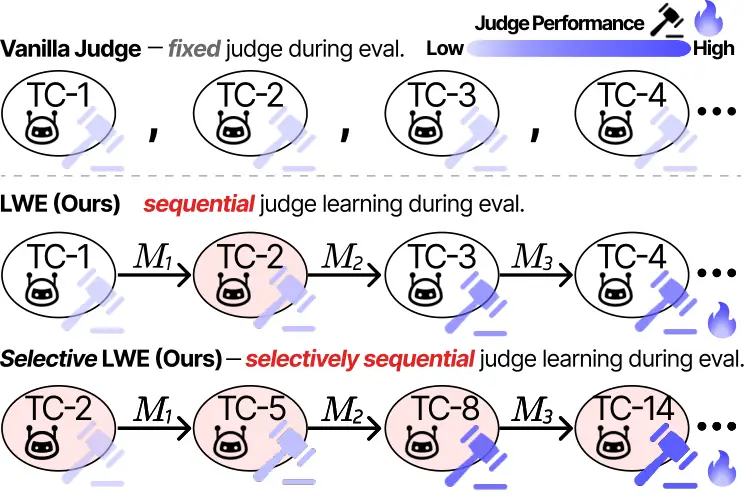
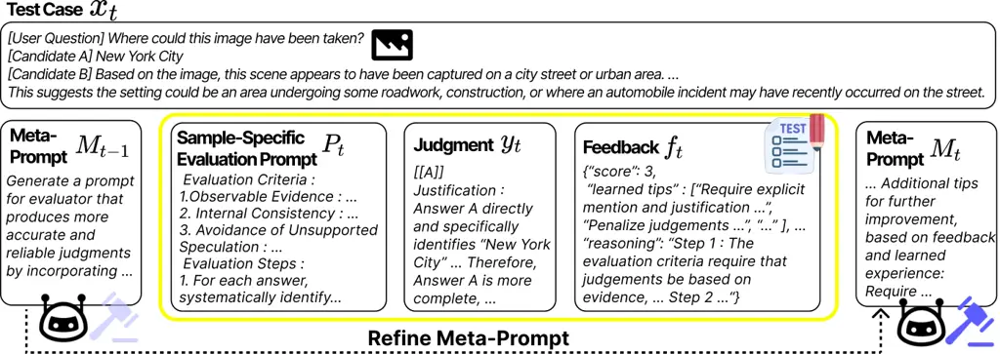

# Becoming Experienced Judges: Selective Test-Time Learning for Evaluators

Seungyeon Jwa    Daechul Ahn    Reokyoung Kim    Dongyeop Kang
Affiliation:  Seoul National University University of Minnesota
{amyj97,daechulahn,reokyoungkim,jonghyunchoi}@snu.ac.kr dongyeop@umn.edu
   Jonghyun Choi

###### Abstract

Automatic evaluation with large language models, commonly known as
_LLM-as-a-judge_, is now standard across reasoning and alignment tasks.
Despite evaluating many samples in deployment, these evaluators
typically (i) treat each case independently, missing the opportunity to
accumulate experience, and (ii) rely on a single fixed prompt for all
cases, neglecting the need for sample-specific evaluation criteria. We
introduce Learning While Evaluating (LWE), a framework that allows
evaluators to improve sequentially at inference time without requiring
training or validation sets. LWE maintains an evolving _meta-prompt_
that (i) produces sample-specific evaluation instructions and (ii)
refines itself through self-generated feedback. Furthermore, we propose
Selective LWE, which updates the meta-prompt only on self-inconsistent
cases, focusing computation where it matters most. This selective
approach retains the benefits of sequential learning while being far
more cost-effective. Across two pairwise comparison benchmarks,
Selective LWE outperforms strong baselines, empirically demonstrating
that evaluators can improve during sequential testing with a simple
selective update—learning most from the cases they struggle with.

Figure 1: Comparison of three evaluation approaches. A vanilla judge
evaluates each test case (TC) independently using a fixed prompt
throughout evaluation (eval.). LWE (ours) employs a _meta-prompt_ (M)
that evolves sequentially as the evaluator progresses through test
cases, enabling sample-specific tailoring and continual improvement
during evaluation. Selective LWE (ours) further enhances efficiency by
updating the meta-prompt only on challenging cases (_e.g_., the
red-highlighted TCs 2, 5, 8, 14), preserving performance gains while
substantially reducing computational overhead. The color gradient
illustrates progressive improvement of the judge’s performance over
time.

## 1 Introduction

Large language models (LLMs) and vision-language models (VLMs) are
increasingly used as automatic evaluators, commonly referred to as
(V)LLM-as-a-judge Zheng et al. (2023), in both training and inference
stages. They guide training as reward models aligning model behavior
with human preferences or support iterative model-improvement Bai et al.
(2022); Ouyang et al. (2022), and continue to operate at inference time
as automated judges that assess data quality Grattafiori et al. (2024),
steer model behavior in inference-time scaling or agentic
workflows Shinn et al. (2023).

Despite their growing importance, current evaluators remain surprisingly
rigid: they treat test samples independently and typically rely on a
single fixed prompt, as illustrated in Figure 1. This rigidity prevents
two desirable capabilities: tailoring the evaluation criteria to each
test case, and improving the evaluator’s judgment quality through use
after deployment. This motivates our research question: can evaluators
adapt and improve during testing? Achieving this would provide a highly
practical deployment-time capability—evaluators that become better
purely through use, without any additional training or external
supervision.

Humans routinely exhibit such test-time improvement. A student taking an
exam refines their strategy as they progress, and a judge becomes more
reliable as they accumulate experience across diverse cases Flavell
(1979); Sternberg (1985). Recent test-time scaling approaches move in a
similar direction by allocating more inference computation per sample,
but the extended reasoning they produce is discarded immediately
afterward, leaving the thought process inherently sample-independent.
Thus, current automatic evaluators cannot retain or refine their
reasoning across cases, raising a methodological question: how can we
enable evaluators to learn from their evaluation experience?

To support such learning, an evaluator must be able to retain and use
experience from one case to the next. Recent progress in non-evaluation
settings Wang et al. (2024b); Liu et al. (2025); Chen et al. (2025)
demonstrates that models can improve through sequential inference based
on gained information across test cases. In particular, Suzgun et al.
(2025) introduce a memory prompt that reflects on similar past and
current examples to generate the adaptive memory.

These approaches highlight the value of leveraging self-generated
insights accumulated during sequential problem solving. However,
evaluation requires a different form of knowledge: an evaluator should
maintain stable, general evaluation principles while also adapting its
judging criteria to each sample. To address this, we introduce a
_meta-prompt_ that explicitly separates general evaluation principles
from sample-specific prompts that adapt these principles to each case.

We propose Learning While Evaluating (LWE), a framework that enables
evaluators to maintain and continually refine their evaluation insights
as they process test cases. At the core of LWE, a meta-prompt serves as
a persistent repository of evaluation insights discovered during testing
and generates customized evaluation criteria and steps for each new case
(Sec. 3.1). Through self-feedback mechanisms, LWE continually improves
and expands its meta-prompt during testing, enabling evaluators to
learn—rather than merely repeat—their evaluation behavior (Fig. 2).

Furthermore, while LWE enables evaluators to learn from experience,
updating every sample is computationally expensive and often
unnecessary, since some test cases are already straightforward and can
be accurately judged without additional reasoning. To focus updates on
cases where more refined evaluation criteria are actually needed, we
exploit a test-time–accessible signal that indicates when the
evaluator’s fixed judging criteria are insufficient. Prior work Zheng
et al. (2023); Shi et al. (2024); Koo et al. (2024) reports that
positional bias can lead a model to give different judgments depending
on which answer is presented first, revealing uncertainty or conflict in
its internal criteria. Leveraging this inconsistency as a test-time
signal, we propose Selective LWE, which updates the meta-prompt only on
such inconsistent cases, retaining the benefits of sequential learning
while substantially reducing computational overhead (Sec. 3.2).

Experiments on two pairwise comparison benchmarks Li et al. (2025a);
Yasunaga et al. (2025) show that our framework improves accuracy and
consistency over strong baselines while reducing inference cost.
Overall, we demonstrate that evaluators need not remain static: they can
also learn from experience, especially from the cases that challenge
them the most.

Figure 2: Overview of Learning While Evaluating (LWE). Given a test case
$`x_{t}`$, the meta-prompt $`M_{t-1}`$ generates a sample-specific
evaluation prompt $`P_{t}`$, which the evaluator uses to produce a
judgment $`y_{t}`$. The evaluator then reflects on its decision to
produce self-feedback $`f_{t}`$, which is incorporated into the
meta-prompt to form $`M_{t}`$ for subsequent cases.

## 2 Related Work

### 2.1 LLM-as-a-Judge

LLM-as-a-judge Zheng et al. (2023) has become a standard alternative to
human evaluation, supporting improvements in model behavior during
training Glaese et al. (2022); Bai et al. (2022); Ouyang et al. (2022);
Lee et al. (2023); Yuan et al. (2024) as well as inference Madaan et al.
(2023); Shinn et al. (2023); Zhang et al. (2024). Beyond textual
settings, VLM-as-a-judge plays a role in the automatic evaluation of
multimodal tasks, including image–text alignment Chen et al. (2024).

Pitfalls of LLM-as-a-judge have also been reported, including
sensitivity to prompt permutations and various forms of bias, most
notably position bias Zheng et al. (2023); Shi et al. (2024); Koo et al.
(2024); Park et al. (2024); Zhao et al. (2025); Bavaresco et al. (2025).
To improve evaluation capability, existing approaches often rely on
training Kim et al. (2023); Vu et al. (2024); Yu et al. (2025);
Whitehouse et al. (2025); Chan et al. (2025); Lee et al. (2024); Zang
et al. (2025); Wang et al. (2025a) or inference-time schemes with
multiple models Jung et al. (2025); Li et al. (2025b). Related lines
that learn meta-reward models or meta-reasoning procedures Kim et al.
(2025); Saha et al. (2025) aim to generate case-specific evaluation
criteria or reasoning steps, but they also rely on additional training.
In contrast, we pursue an inference-only approach that avoids any
further training and requires no additional models, making it readily
deployable in real-world settings.

### 2.2 Prompt Optimization

Prompt optimization aims to discover task-specific prompts that enhance
model performance Yang et al. (2023); Guo et al. (2024); Khattab et al.
(2024); Fernando et al. (2023); Wang et al. (2024a); Yuksekgonul et al.
(2025); Xu et al. (2025). These methods iteratively refine prompts using
validation sets or external feedback, after which a single optimized
prompt is fixed and applied uniformly to all test samples. This paradigm
is effective, yet inherently _static_: it cannot adapt to
sample-specific variations during evaluation. Moreover, the reliance on
pre-constructed validation sets for optimization can be impractical in
real-world evaluation scenarios where constructing labeled data is
costly or infeasible. To address these limitations, our framework
performs meta-prompt evolution without any validation data and generates
sample-specific prompts based on the evolving meta-prompt.

### 2.3 Test-Time Scaling

#### Per-instance test-time scaling.

Recent studies report that allocating more computation at inference time
can substantially enhance reasoning quality by increasing deliberation
depth, exploring multiple sampled traces, or performing structured
search Snell et al. (2024); Muennighoff et al. (2025); Shen et al.
(2025); Wang et al. (2025b). However, these approaches operate on a
_per-instance_ basis: once an instance is completed, its intermediate
reasoning is discarded, limiting the model’s ability to leverage
accumulated experience across test cases.

#### Sequential test-time scaling.

Beyond per-instance compute, several works explore how models can _learn
across_ test cases by accumulating and reusing experience during
inference time Wang et al. (2024b); Liu et al. (2025); Chen et al.
(2025); Suzgun et al. (2025); Huang et al. (2025). These methods show
that models can refine and reuse task-specific heuristics to improve
future predictions. We instantiate this idea for LLM-as-a-judge through
an evolving meta-prompt that stores insights for tailoring
sample-specific evaluation instructions and refines itself via
self-feedback. To further improve sequential methods, our approach
allocates inference-time computation _selectively_, guided by a
label-free signal (order-swap inconsistency), achieving stronger
cost-effectiveness without sacrificing accuracy.

Input: A base LLM LLM, a test set
$`D_{\text{test}}=\{x_{t}\}_{t=1}^{T}`$, an initial meta-prompt
$`M_{0}`$ and batch size $`b`$  
Output: A set of evaluated results $`S`$ and a final meta-prompt $`M`$

1:  $`M\leftarrow M_{0}`$ $`\triangleright`$ Initialize a meta-prompt.

2:  $`S\leftarrow\emptyset`$ $`\triangleright`$ Initialize a set of
evaluated results.

3:  $`F\leftarrow\emptyset`$ $`\triangleright`$ Buffer for feedback
within a batch.

4:  for $`t=1`$ to $`T`$ do

5:   $`x_{t}\leftarrow D_{\text{test}}[t]`$

6:   $`P_{t}\leftarrow\texttt{BuildEvalPrompt}_{\texttt{LLM}}(M,x_{t})`$

7:   $`y_{t}\leftarrow\texttt{Judge}_{\texttt{LLM}}(P_{t},x_{t})`$

8:
  $`f_{t}\leftarrow\texttt{Feedback}_{\texttt{LLM}}(M,P_{t},x_{t},y_{t})`$

9:   $`S\leftarrow S\cup\{(x_{t},y_{t})\}`$

10:   $`F\leftarrow F\cup\{f_{t}\}`$

11:   if $`|F|=b`$ or $`t=T`$ then

12:    $`M\leftarrow\texttt{RefineMetaPrompt}_{\texttt{LLM}}(M,F)`$
$`\triangleright`$ Update the meta-prompt using batch feedback.

13:    $`F\leftarrow\emptyset`$

14:   end if

15:  end for

16:  return $`S,M`$

Algorithm 1 Learning While Evaluating (LWE)

Input: A base LLM LLM, a test set $`D_{\text{test}}`$, a vanilla prompt
$`P`$, an initial meta-prompt $`M_{0}`$ and batch size $`b`$  
Output: A set of evaluated results $`S`$ and a final meta-prompt $`M`$

1:  $`S\leftarrow\emptyset`$ $`\triangleright`$ Initialize a set of
evaluation results.

2:  $`I\leftarrow\emptyset`$ $`\triangleright`$ Initialize a set of
inconsistent cases.

3:  for $`x\in D_{\text{test}}`$ do

4:   $`y^{(AB)}\leftarrow\texttt{Judge}_{\texttt{LLM}}(P,x)`$

5:   $`x^{\prime}\leftarrow`$ $`x`$ with the response order swapped

6:   $`y^{(BA)}\leftarrow\texttt{Judge}_{\texttt{LLM}}(P,x^{\prime})`$

7:   if $`y^{(AB)}=y^{(BA)}`$ then

8:    $`S\leftarrow S\cup\{(x,y^{(AB)})\}`$ $`\triangleright`$
Consistent case; skip the update.

9:   else

10:    $`I\leftarrow I\cup\{x\}`$ $`\triangleright`$ Collect
inconsistent cases.

11:   end if

12:  end for

13:  $`(S^{\prime},M)\leftarrow\texttt{LWE}(\texttt{LLM},I,M_{0},b)`$

14:  $`S\leftarrow S\cup S^{\prime}`$

15:  return $`S,M`$

Algorithm 2 Selective Learning While Evaluating

## 3 Approach

We propose that evaluators could benefit from insights accumulated
across test cases. In this work, we focus on the pairwise evaluation
setup, where the judge compares two candidate responses and identifies
the better one. To this end, we introduce Learning While Evaluating
(LWE), a test-time learning framework that allows evaluators to
accumulate and draw on experience from earlier cases during evaluation,
ultimately improving their decision-making.

### 3.1 Learning While Evaluating

Figure 2 and Algorithm 1 outline the overall procedure of LWE. Unlike
traditional approaches that evaluate each sample independently, LWE
processes samples _sequentially_, accumulating insights from previous
judgments. It maintains an evolving meta-prompt that (i) produces
sample-specific evaluation prompts and (ii) integrates self-generated
feedback to improve subsequent evaluations.

Sequential meta-prompt evolution. Let
$`\mathcal{D}=\{x_{1},x_{2},\dots,x_{T}\}`$ denote a set of pairwise
comparison cases. Starting from an initial meta-prompt $`M_{0}`$, the
evaluator sequentially updates its meta-prompt based on observed test
cases. For each test sample $`x_{t}`$, the current meta-prompt $`M`$
generates a sample-specific prompt $`P_{t}`$ (BuildEvalPrompt) to
produce a judgment $`y_{t}`$ (selecting the better response) (Judge).
The evaluator then reflects on this decision to generate feedback
$`f_{t}`$ (Feedback) for refining $`M`$ (RefineMetaPrompt). These steps
are all realized via LLM prompting.

To prevent overfitting to individual samples, we update the meta-prompt
once per batch of $`b`$ samples (with $`b=4`$ in our experiments). We
analyze the effect of different batch sizes in Figure 7. Through this
sequential process, the meta-prompt captures transferable evaluation
heuristics and progressively refines its evaluation strategy across the
test set.

### 3.2 _Selective_ Learning While Evaluating

While sequential updates allow leveraging experience across samples,
updating the meta-prompt on every sample incurs non-trivial
computational overhead. Moreover, not all samples require the same level
of deliberation—straightforward comparisons are already judged
accurately by the vanilla evaluator and thus gain little from additional
information, whereas challenging cases demand extra guidance for
reliable evaluation.

Motivated by prior observations that LLM judges are sensitive to
position bias Zheng et al. (2023); Shi et al. (2024); Koo et al. (2024),
we turn this vulnerability into a _test-time signal_: we treat
order-swap _inconsistency_ (_i.e_., disagreement between
A $`\emph{vs}.\hbox{}`$ B and B $`\emph{vs}.\hbox{}`$ A judgments) as a
label-free proxy for evaluator uncertainty.

This choice is attractive for three reasons: (i) it is _available at
test time_ without ground-truth labels; (ii) it is _instance-specific_,
flagging precisely those cases where the current evaluation policy is
confused; and (iii) it _targets compute_ to the examples that most need
additional guidance, avoiding wasted updates on straightforward cases
that already yield consistent decisions.

Concretely, as formalized in Algorithm 2, for each sample $`x`$, the
evaluator makes two vanilla judgments with the response order swapped,
and an update is triggered only if the two judgments disagree. This
selective mechanism bypasses samples with consistent judgments and
focuses computational resources on ambiguous cases, improving efficiency
without sacrificing accuracy, as we show empirically in Sec. 5.

## 4 Experimental Setup

### 4.1 Baselines

We compare our proposed methods LWE and Selective LWE against
representative inference approaches.

Fixed prompting. Vanilla applies a fixed prompt for all test cases.
Chain-of-Thought (CoT) Wei et al. (2022) augments the vanilla prompt
with an explicit “step-by-step reasoning” instruction. Majority Voting
takes the majority label from five independent stochastic judgments of
the vanilla prompt (temperature 0.7). TextGrad (Yuksekgonul et al., 2025) iteratively modifies its prompt based on validation sets. The
optimized prompt is then fixed and applied uniformly to all test cases.
Among all baselines, it is the only method that requires additional
labeled data prior to test-time evaluation.

Adaptive prompting. Dynamic Cheatsheet (Suzgun et al., 2025) (DC)
maintains a memory prompt that is sequentially updated during test-time.
We use the strongest variant, DC-RS, which retrieves similar examples
and curates a memory prompt that conditions the model’s response
generation. It is a strong baseline but does not explicitly generate
sample-specific evaluation prompts, and it performs updates on every
sample unconditionally. Sample-Specific Prompt generates a tailored
evaluation prompt for each test case from a fixed meta-prompt. Although
it applies different prompts per sample, its fixed meta-prompt
configuration provides a baseline that isolates the effect of
sequence-level meta-prompt updates in our method.

We use gpt-4.1-2025-04-14 OpenAI (2025) (gpt-4.1) as a base evaluator
for experiments.

### 4.2 Benchmarks

We evaluate our method on two multimodal pairwise comparison benchmarks,
where the evaluator selects the better response between two candidates.

VL-RewardBench (VLRewardBench, VL) Li et al. (2025a) and Multimodal
RewardBench (MMRewardBench, MM) Yasunaga et al. (2025) each provide an
image, a question, and two textual responses, and the evaluator must
determine which response is better. Following prior work Suzgun et al.
(2025), we use representative subsets where necessary due to API budget
constraints: we evaluate on the full 1,247 examples of VLRewardBench,
and 1,000 out of 4,711 examples from MMRewardBench.

### 4.3 Evaluation Metrics

We consider four metrics. Accuracy is measured on a single random
ordering of the two responses. It reflects single-pass performance
without accounting for position-bias effects. Consistency measures
stability under response-order swapping. Pair Accuracy, a stricter
metric than Accuracy, requires both the original and swapped predictions
to be correct and therefore reflects robustness to position bias. This
metric is particularly important for assessing the reliability of judge
models, as it captures whether their decisions remain stable under input
permutations. Relative Inference Cost computes the total character
length of input and output normalized to the vanilla baseline, providing
a quality–cost trade-off measure. All metrics are macro-averaged across
benchmarks.

|                        |                     |                      |                         |                     |                      |                         |                                      |
| ---------------------- | ------------------- | -------------------- | ----------------------- | ------------------- | -------------------- | ----------------------- | ------------------------------------ |
| Method                 | VLRewardBench       |                      |                         | MMRewardBench       |                      |                         | Relative Inference Cost              |
|                        | Acc. ($`\uparrow`$) | Cons. ($`\uparrow`$) | PairAcc. ($`\uparrow`$) | Acc. ($`\uparrow`$) | Cons. ($`\uparrow`$) | PairAcc. ($`\uparrow`$) | Input & Output Text ($`\downarrow`$) |
| Vanilla                | 0.629               | 0.801                | 0.529                   | 0.808               | 0.863                | 0.747                   | $`1.0\times`$                        |
| CoT                    | 0.651               | 0.808                | 0.553                   | 0.808               | 0.874                | 0.749                   | $`1.2\times`$                        |
| Majority Voting        | 0.627               | 0.810                | 0.537                   | 0.828               | 0.891                | 0.769                   | $`5.0\times`$                        |
| TextGrad^(\*)          | 0.730               | 0.749                | 0.615                   | 0.821               | 0.836                | 0.741                   | $`4.4\times`$                        |
| Dynamic Cheatsheet     | 0.698               | 0.868                | 0.629                   | 0.811               | 0.901                | 0.764                   | $`12.9\times`$                       |
| Sample-Specific Prompt | 0.661               | 0.727                | 0.529                   | 0.815               | 0.865                | 0.742                   | $`2.5\times`$                        |
| LWE (Ours)             | 0.745               | 0.805                | 0.646                   | 0.799               | 0.846                | 0.727                   | $`10.9\times`$                       |
| Selective LWE (Ours)   | 0.676               | 0.940                | 0.648                   | 0.836               | 0.947                | 0.808                   | $`3.9\times`$                        |

Table 1: Performance of various inference strategies across benchmarks.
We evaluate two vision–language benchmarks (VLRewardBench and
MMRewardBench), reporting accuracy (Acc.), consistency (Cons.), and pair
accuracy (PairAcc.). The rightmost column shows the relative inference
cost, measured by total input and output character length normalized to
the vanilla baseline. Since LWE and Selective LWE are inherently
order-sensitive, we report averaged results over three random-order runs
(see Appendix H for full results). Bold indicates the best result among
methods that operate without external supervision. TextGrad^(\*) is
included for reference; it relies on gold-labeled validation data and
thus operates under a more favorable setting than the other methods (see
Appendix B).

Figure 3: Cumulative accuracy over test cases. Curves are computed on
the vanilla-inconsistent subsets of each benchmark, where Selective LWE
performs updates. Selective LWE maintains consistently higher accuracy
than both the vanilla baseline and the Sample-Specific Prompt baseline
as evaluation progresses, illustrating the benefits of sequential
learning and the model’s capacity to integrate insights acquired during
evaluation. Gray-shaded areas indicate confidence intervals for the
vanilla baseline, computed at each point using the binomial proportion
method with significance level $`\alpha=0.05`$.

## 5 Results

Across our experiments, Selective LWE consistently improves evaluation
quality while operating at substantially lower inference cost than
existing adaptive methods.

Figure 4: Effect of inconsistency ratio on meta-prompt updates. We
evaluate LWE on subsets containing different proportions of inconsistent
samples, where inconsistency is computed based on vanilla predictions.
As the inconsistency ratio increases, LWE shows larger performance gains
over the vanilla baseline (purple _vs_. gray), highlighting its
effectiveness in handling inconsistent cases. For each benchmark, the
total number of samples is fixed: 248 for VLRewardBench and 137 for
MMRewardBench.

Figure 5: Illustration of how the meta-prompt evolves after a single
refinement step. Red and blue text denotes instructions removed and
added during the update, reflecting the shift from loosely specified
checks to clearer, more structured heuristics under LWE. The full
meta-prompts are provided in Appendix F.

#### Main results.

Table 1 presents the overall results on the two benchmarks using
gpt-4.1. Selective LWE not only matches or exceeds most baselines in
accuracy but also achieves the highest consistency and pair accuracy
across all benchmarks, operating at a substantially lower inference
cost. Notably, Selective LWE delivers these gains with only
$`3.9\times`$ relative inference cost, compared to higher costs for
other adaptive methods, _i.e_., $`4.4\times`$ for TextGrad and
$`12.9\times`$ for DC.

#### Learning during evaluation.

Figure 3 visualizes the cumulative accuracy on the vanilla-inconsistent
subsets of the two benchmarks. First, the Sample-Specific Prompt already
outperforms the vanilla baseline, demonstrating the benefit of tailoring
the evaluation criteria to each case. Building on this, Selective LWE
achieves even larger gains. These results suggest that, as Selective LWE
progressively refines its meta-prompt through targeted updates, it
accumulates evaluation heuristics that extend beyond individual
instances, yielding overall improvements in accuracy throughout the
evaluation trajectory.

#### Full updates vs. Selective updates.

As shown in Table 1, the inference strategies with updating for all test
cases, _i.e_., DC and LWE, generally improve all three metrics but
require substantially higher inference costs, $`12.9\times`$ and
$`10.9\times`$ respectively, compared to the vanilla method. In
contrast, Selective LWE preserves most of these gains, often even
surpassing the full sequential variant, while operating at only
$`3.9\times`$ the inference cost (approximately 36% of LWE). This
$`3.9\times`$ budget reflects two vanilla passes for consistency
checking and an additional $`1.9\times`$ for the LWE process. This
demonstrates that not every test sample requires equal inference effort:
focusing updates on confusing cases provides a more cost-effective path
to improved evaluation quality, achieving superior performance and
efficiency compared to uniform test-time scaling that updates every
sample indiscriminately.

#### Reliability of judgments.

By focusing updates on inconsistent cases, Selective LWE gains a
substantial increase in consistency (up to 0.947), while also yielding a
large margin of pair accuracy. This improvement in pair accuracy is
particularly meaningful, as it reflects position-invariant evaluation
behavior. In real-world evaluation, judges typically assess responses in
a random order, so higher pair accuracy implies that such one-shot
judgments are more reliable.

## 6 Analysis

We further analyze the mechanisms underlying the effectiveness of
Selective LWE, examining whether its selective sequential updates
identify informative cases and how robust the resulting behavior is
across settings.

#### Validity of the selection signal.

We first examine whether the inconsistency-based signal reliably
identifies beneficial samples for meta-prompt updates. As shown in
Figure 4, the performance gains of LWE over the vanilla baseline
increase monotonically with the proportion of inconsistent samples.
Notably, LWE maintains stable performance even on subsets where the
vanilla evaluator’s pair accuracy is zero. This reveals an interesting
pattern: the evaluator benefits most from the samples that confuse it,
making inconsistency an effective guide for updates. Consequently, the
Selective mechanism allocates computation where refinement is most
impactful.

#### What the meta-prompt learns.

To understand how selective updates improve evaluator behavior, we
qualitatively examine how the meta-prompt changes during refinement.
Figure 5 shows that, rather than accumulating ad-hoc advice, updates
progressively distill more structured evaluation principles and sharper
criteria for distinguishing subtle differences between responses. For
example, directing the evaluator not only to detect errors but to
compare cases where both answers contain issues, assess the impact of
overstatements or omissions, and weigh these factors to reach a more
balanced and fair judgment. This indicates that the meta-prompt is
internalizing reliable and portable guidance for future evaluations. See
Appendix E for evaluation examples.

#### Robustness to sample ordering.

Since LWE performs sequential updates, we test sensitivity to sample
ordering by evaluating each method on three random permutations of each
test set. As shown in Figure 6, results remain consistent across three
runs with small standard deviations; on MMRewardBench, the variance of
pair accuracy for LWE is effectively zero and nearly zero for Selective
LWE. This result suggests that learning effects arise from accumulated
experience, rather than incidental ordering artifacts. The complete
results are provided in Appendix H.

| Model             | Method        | VLRewardBench       |                      |                         | MMRewardBench       |                      |                         | Relative Inference Cost              |
| ----------------- | ------------- | ------------------- | -------------------- | ----------------------- | ------------------- | -------------------- | ----------------------- | ------------------------------------ |
|                   |               | Acc. ($`\uparrow`$) | Cons. ($`\uparrow`$) | PairAcc. ($`\uparrow`$) | Acc. ($`\uparrow`$) | Cons. ($`\uparrow`$) | PairAcc. ($`\uparrow`$) | Input & Output Text ($`\downarrow`$) |
| gemini-2.5-pro    | Vanilla       | 0.754               | 0.888                | 0.696                   | 0.858               | 0.925                | 0.820                   | $`1.0\times`$                        |
|                   | Selective LWE | 0.768               | 0.955                | 0.744                   | 0.865               | 0.969                | 0.852                   | $`3.2\times`$                        |
| claude-sonnet-4.5 | Vanilla       | 0.473               | 0.490                | 0.327                   | 0.540               | 0.482                | 0.419                   | $`1.0\times`$                        |
|                   | Selective LWE | 0.703               | 0.881                | 0.648                   | 0.823               | 0.879                | 0.771                   | $`15.2\times`$                       |

Table 2: Generalization across evaluators. Results on gemini-2.5-pro and
claude-sonnet-4.5 show that Selective LWE consistently improves
evaluation performance across evaluators. The results of Selective LWE
are averaged over three random-order runs (see Appendix H for full
results).

Figure 6: Ablation on test case ordering. We evaluate the sensitivity of
LWE to input ordering using three random permutations of each test set.
Bars report mean ± standard deviation across permutations. Selective LWE
exhibits stable performance across different orderings.

#### Effect of batching.

We analyze the number of samples processed per update ($`b`$), as this
hyperparameter directly influences two key factors of LWE: evaluation
performance and inference cost. Figure 7 shows that updating after every
sample ($`b{=}1`$) incurs the highest computational cost, mirroring the
overhead of DC, and does not necessarily yield the best performance.
Conversely, overly large batches ($`b{=}8`$) degrade performance because
the context used for meta-prompt updates becomes excessively long,
making the refinement unstable. A moderate batch size ($`b{=}4`$)
provides the best balance, sustaining strong accuracy while keeping
inference cost relatively low, and we therefore adopt $`b{=}4`$ as the
default configuration of LWE.

Figure 7: Effect of batch size ($`b`$) on accuracy and inference cost.
We observe that a moderate batch size ($`b{=}4`$) yields the best
balance between accuracy and inference cost. Experiments are conducted
on vanilla-inconsistent subsets of each benchmark. Inference cost is
measured as the ratio of total input and output character counts,
normalized to the cost of batch size 4.

#### Generalization across evaluators.

Lastly, we assess whether the benefits of Selective LWE extend across
different backbone models. As shown in Table 2, with
gemini-2.5-pro Comanici et al. (2025), which already achieves strong
vanilla performance, Selective LWE still yields measurable gains,
indicating that the selective updates extract additional signal even
when the base evaluator is already competent.

On the other hand, claude-sonnet-4.5 Anthropic (2025) shows
substantially larger improvements. This is explained by Selective LWE ’s
strength on vanilla-inconsistent cases: claude-sonnet-4.5 produces a
large number of such confusing instances (over 50% of the test sets),
allowing the method to intervene more often and correct failures where
the vanilla evaluator struggles. Its elevated inference cost
($`15.2\times`$) naturally follows from this higher frequency of
selective updates.

Despite these model-specific differences, the results reveal a
consistent pattern of improvement, positioning our method as a readily
deployable inference strategy across diverse generative evaluators.

## 7 Conclusion

In this work, we study sequential test-time learning for evaluators and
ask whether they can _learn while testing_. We introduce Learning While
Evaluating (LWE), a framework that maintains an evolving meta-prompt to
generate sample-specific evaluation instructions and refine itself via
self-generated feedback. We further propose Selective LWE, which updates
only on samples exhibiting self-inconsistency. Across two pairwise
comparison benchmarks, we show that Selective LWE achieves strong
evaluation performance at only a fraction of the token cost required by
full sequential updates. These results demonstrate that focusing compute
on confusing cases yields reliable and cost-efficient evaluation,
without training or external supervision. We hope our work encourages a
shift from static judges that rely on a single fixed prompt for all
samples toward _learning evaluators_ that improve _during_
evaluation—accumulating experience as they progress through test cases,
tailoring sample-specific criteria, and delivering more reliable
judgments within practical inference budgets.

## Limitations

Our method relies on the base capability of the underlying model, making
it less effective for relatively weak models. When applied to the open
model Qwen3-VL-235B-A22B-Instruct Qwen team, Alibaba Cloud (2025), which
achieves competent vanilla performance, the model often fails to produce
valid evaluation prompts under meta-prompt updates.

We perform two rounds of inference over the entire test set and leverage
internal inconsistency to identify cases for updates. However, some
“consistent but wrong” cases remain indistinguishable without access to
ground-truth labels, which we leave for future investigation.

Finally, while our study focuses on pairwise comparisons, the proposed
LWE can extend to direct assessment and other evaluation settings.

## Acknowledgments

We thank the members of SNUMPR, especially Seongwon Cho, San Kim, and
Hyeonbeom Choi, for their valuable comments and support.

## References

- Anthropic (2025) Anthropic. 2025. [Claude sonnet 4.5 system
  card](https://assets.anthropic.com/m/12f214efcc2f457a/original/Claude-Sonnet-4-5-System-Card.pdf).
  Technical report, Anthropic PBC. Accessed: 2025-11-17.
- Bai et al. (2022) Yuntao Bai, Andy Jones, Kamal Ndousse, Amanda
  Askell, Anna Chen, Nova DasSarma, Dawn Drain, Stanislav Fort, Deep
  Ganguli, Tom Henighan, and 1 others. 2022. Training a helpful and
  harmless assistant with reinforcement learning from human feedback.
  _arXiv preprint arXiv:2204.05862_.
- Bavaresco et al. (2025) Anna Bavaresco, Raffaella Bernardi, Leonardo
  Bertolazzi, Desmond Elliott, Raquel Fernández, Albert Gatt, Esam
  Ghaleb, Mario Giulianelli, Michael Hanna, Alexander Koller, and 1
  others. 2025. Llms instead of human judges? a large scale empirical
  study across 20 nlp evaluation tasks. In _Proceedings of the 63rd
  Annual Meeting of the Association for Computational Linguistics
  (Volume 2: Short Papers)_, pages 238–255.
- Chan et al. (2025) Chi-Min Chan, Chunpu Xu, Jiaming Ji, Zhen Ye,
  Pengcheng Wen, Chunyang Jiang, Yaodong Yang, Wei Xue, Sirui Han, and
  Yike Guo. 2025. J1: Exploring simple test-time scaling for
  llm-as-a-judge. _arXiv preprint arXiv:2505.11875_.
- Chen et al. (2024) Dongping Chen, Ruoxi Chen, Shilin Zhang, Yaochen
  Wang, Yinuo Liu, Huichi Zhou, Qihui Zhang, Yao Wan, Pan Zhou, and
  Lichao Sun. 2024. Mllm-as-a-judge: Assessing multimodal llm-as-a-judge
  with vision-language benchmark. In _Forty-first International
  Conference on Machine Learning_.
- Chen et al. (2025) Peter Baile Chen, Yi Zhang, Dan Roth, Samuel
  Madden, Jacob Andreas, and Michael Cafarella. 2025. Log-augmented
  generation: Scaling test-time reasoning with reusable computation.
  _arXiv preprint arXiv:2505.14398_.
- Comanici et al. (2025) Gheorghe Comanici, Eric Bieber, Mike
  Schaekermann, Ice Pasupat, Noveen Sachdeva, Inderjit Dhillon, Marcel
  Blistein, Ori Ram, Dan Zhang, Evan Rosen, and 1 others. 2025. Gemini
  2.5: Pushing the frontier with advanced reasoning, multimodality, long
  context, and next generation agentic capabilities. _arXiv preprint
  arXiv:2507.06261_.
- Fernando et al. (2023) Chrisantha Fernando, Dylan Sunil Banarse,
  Henryk Michalewski, Simon Osindero, and Tim Rocktäschel. 2023.
  Promptbreeder: Self-referential self-improvement via prompt evolution.
  In _Forty-first International Conference on Machine Learning_.
- Flavell (1979) John H. Flavell. 1979. [Metacognition and cognitive
  monitoring: A new area of cognitive-developmental
  inquiry](https://doi.org/10.1037/0003-066X.34.10.906). _American
  Psychologist_, 34(10):906–911.
- Glaese et al. (2022) Amelia Glaese, Nat McAleese, Maja Trębacz, John
  Aslanides, Vlad Firoiu, Timo Ewalds, Maribeth Rauh, Laura Weidinger,
  Martin Chadwick, Phoebe Thacker, and 1 others. 2022. Improving
  alignment of dialogue agents via targeted human judgements. _arXiv
  preprint arXiv:2209.14375_.
- Grattafiori et al. (2024) Aaron Grattafiori, Abhimanyu Dubey, Abhinav
  Jauhri, Abhinav Pandey, Abhishek Kadian, Ahmad Al-Dahle, Aiesha
  Letman, Akhil Mathur, Alan Schelten, Alex Vaughan, and 1 others. 2024.
  The llama 3 herd of models. _arXiv preprint arXiv:2407.21783_.
- Guo et al. (2024) Qingyan Guo, Rui Wang, Junliang Guo, Bei Li, Kaitao
  Song, Xu Tan, Guoqing Liu, Jiang Bian, and Yujiu Yang. 2024.
  [Connecting large language models with evolutionary algorithms yields
  powerful prompt
  optimizers](https://openreview.net/forum?id=ZG3RaNIsO8). In _The
  Twelfth International Conference on Learning Representations_.
- Huang et al. (2025) Tenghao Huang, Kinjal Basu, Ibrahim Abdelaziz,
  Pavan Kapanipathi, Jonathan May, and Muhao Chen. 2025. R2d2:
  Remembering, replaying and dynamic decision making with a reflective
  agentic memory. In _Proceedings of the 63rd Annual Meeting of the
  Association for Computational Linguistics (Volume 1: Long Papers)_,
  pages 30318–30330.
- Jung et al. (2025) Jaehun Jung, Faeze Brahman, and Yejin Choi. 2025.
  [Trust or escalate: LLM judges with provable guarantees for human
  agreement](https://openreview.net/forum?id=UHPnqSTBPO). In _The
  Thirteenth International Conference on Learning Representations_.
- Khattab et al. (2024) Omar Khattab, Arnav Singhvi, Paridhi Maheshwari,
  Zhiyuan Zhang, Keshav Santhanam, Saiful Haq, Ashutosh Sharma, Thomas T
  Joshi, Hanna Moazam, Heather Miller, and 1 others. 2024. Dspy:
  Compiling declarative language model calls into state-of-the-art
  pipelines. In _The Twelfth International Conference on Learning
  Representations_.
- Kim et al. (2023) Seungone Kim, Jamin Shin, Yejin Cho, Joel Jang,
  Shayne Longpre, Hwaran Lee, Sangdoo Yun, Seongjin Shin, Sungdong Kim,
  James Thorne, and 1 others. 2023. Prometheus: Inducing fine-grained
  evaluation capability in language models. In _The Twelfth
  International Conference on Learning Representations_.
- Kim et al. (2025) Zae Myung Kim, Chanwoo Park, Vipul Raheja, Suin Kim,
  and Dongyeop Kang. 2025. [Toward evaluative thinking: Meta policy
  optimization with evolving reward
  models](https://arxiv.org/abs/2504.20157). _Preprint_,
  arXiv:2504.20157.
- Koo et al. (2024) Ryan Koo, Minhwa Lee, Vipul Raheja, Jong Inn Park,
  Zae Myung Kim, and Dongyeop Kang. 2024. Benchmarking cognitive biases
  in large language models as evaluators. In _Findings of the
  Association for Computational Linguistics ACL 2024_, pages 517–545.
- Lee et al. (2023) Harrison Lee, Samrat Phatale, Hassan Mansoor, Thomas
  Mesnard, Johan Ferret, Kellie Ren Lu, Colton Bishop, Ethan Hall,
  Victor Carbune, Abhinav Rastogi, and 1 others. 2023. Rlaif vs. rlhf:
  Scaling reinforcement learning from human feedback with ai feedback.
  In _Forty-first International Conference on Machine Learning_.
- Lee et al. (2024) Seongyun Lee, Seungone Kim, Sue Park, Geewook Kim,
  and Minjoon Seo. 2024. Prometheus-vision: Vision-language model as a
  judge for fine-grained evaluation. In _Findings of the association for
  computational linguistics ACL 2024_, pages 11286–11315.
- Li et al. (2025a) Lei Li, Yuancheng Wei, Zhihui Xie, Xuqing Yang,
  Yifan Song, Peiyi Wang, Chenxin An, Tianyu Liu, Sujian Li, Bill Yuchen
  Lin, Lingpeng Kong, and Qi Liu. 2025a. Vl-rewardbench: A challenging
  benchmark for vision-language generative reward models. In _CVPR_.
- Li et al. (2025b) Yuran Li, Jama Hussein Mohamud, Chongren Sun, Di Wu,
  and Benoit Boulet. 2025b. Leveraging llms as meta-judges: A
  multi-agent framework for evaluating llm judgments. _arXiv preprint
  arXiv:2504.17087_.
- Liu et al. (2025) Yitao Liu, Chenglei Si, Karthik Narasimhan, and
  Shunyu Yao. 2025. Contextual experience replay for self-improvement of
  language agents. _arXiv preprint arXiv:2506.06698_.
- Madaan et al. (2023) Aman Madaan, Niket Tandon, Prakhar Gupta, Skyler
  Hallinan, Luyu Gao, Sarah Wiegreffe, Uri Alon, Nouha Dziri, Shrimai
  Prabhumoye, Yiming Yang, and 1 others. 2023. Self-refine: Iterative
  refinement with self-feedback. _Advances in Neural Information
  Processing Systems_, 36:46534–46594.
- Muennighoff et al. (2025) Niklas Muennighoff, Zitong Yang, Weijia Shi,
  Xiang Lisa Li, Li Fei-Fei, Hannaneh Hajishirzi, Luke Zettlemoyer,
  Percy Liang, Emmanuel Candès, and Tatsunori Hashimoto. 2025. s1:
  Simple test-time scaling. _arXiv preprint arXiv:2501.19393_.
- OpenAI (2023) OpenAI. 2023. Openai evals repository.
  [https://github.com/openai/evals](https://github.com/openai/evals).
  Accessed: 2025-10-05.
- OpenAI (2025) OpenAI. 2025.
  [GPT-4.1-2025-04-14](https://platform.openai.com/docs/models/gpt-4.1).
  Accessed: 2025-10-05.
- Ouyang et al. (2022) Long Ouyang, Jeffrey Wu, Xu Jiang, Diogo Almeida,
  Carroll Wainwright, Pamela Mishkin, Chong Zhang, Sandhini Agarwal,
  Katarina Slama, Alex Ray, and 1 others. 2022. Trainfing language
  models to follow instructions with human feedback. _Advances in neural
  information processing systems_, 35:27730–27744.
- Park et al. (2024) Junsoo Park, Seungyeon Jwa, Ren Meiying, Daeyoung
  Kim, and Sanghyuk Choi. 2024. Offsetbias: Leveraging debiased data for
  tuning evaluators. In _Findings of the Association for Computational
  Linguistics: EMNLP 2024_, pages 1043–1067.
- Qwen team, Alibaba Cloud (2025) Qwen team, Alibaba Cloud. 2025.
  Qwen3-vl.
  [https://github.com/QwenLM/Qwen3-VL](https://github.com/QwenLM/Qwen3-VL).
  Accessed: 2025-10-05.
- Saha et al. (2025) Swarnadeep Saha, Xian Li, Marjan Ghazvininejad,
  Jason Weston, and Tianlu Wang. 2025. [Learning to plan & reason for
  evaluation with
  thinking-llm-as-a-judge](https://arxiv.org/abs/2501.18099).
  _Preprint_, arXiv:2501.18099.
- Shen et al. (2025) Junhong Shen, Hao Bai, Lunjun Zhang, Yifei Zhou,
  Amrith Setlur, Shengbang Tong, Diego Caples, Nan Jiang, Tong Zhang,
  Ameet Talwalkar, and 1 others. 2025. Thinking vs. doing: Agents that
  reason by scaling test-time interaction. _arXiv preprint
  arXiv:2506.07976_.
- Shi et al. (2024) Lin Shi, Chiyu Ma, Wenhua Liang, Xingjian Diao,
  Weicheng Ma, and Soroush Vosoughi. 2024. Judging the judges: A
  systematic study of position bias in llm-as-a-judge. _arXiv preprint
  arXiv:2406.07791_.
- Shinn et al. (2023) Noah Shinn, Federico Cassano, Ashwin Gopinath,
  Karthik Narasimhan, and Shunyu Yao. 2023. Reflexion: Language agents
  with verbal reinforcement learning. _Advances in Neural Information
  Processing Systems_, 36:8634–8652.
- Snell et al. (2024) Charlie Snell, Jaehoon Lee, Kelvin Xu, and Aviral
  Kumar. 2024. [Scaling llm test-time compute optimally can be more
  effective than scaling model
  parameters](https://arxiv.org/abs/2408.03314). _Preprint_,
  arXiv:2408.03314.
- Sternberg (1985) Robert J. Sternberg. 1985. _Beyond IQ: A triarchic
  theory of human intelligence_. Cambridge University Press, New York.
- Suzgun et al. (2025) Mirac Suzgun, Mert Yuksekgonul, Federico Bianchi,
  Dan Jurafsky, and James Zou. 2025. Dynamic cheatsheet: Test-time
  learning with adaptive memory. _arXiv preprint arXiv:2504.07952_.
- Vu et al. (2024) Tu Vu, Kalpesh Krishna, Salaheddin Alzubi, Chris Tar,
  Manaal Faruqui, and Yun-Hsuan Sung. 2024. Foundational autoraters:
  Taming large language models for better automatic evaluation. In
  _Proceedings of the 2024 Conference on Empirical Methods in Natural
  Language Processing_, pages 17086–17105.
- Wang et al. (2024a) Xinyuan Wang, Chenxi Li, Zhen Wang, Fan Bai,
  Haotian Luo, Jiayou Zhang, Nebojsa Jojic, Eric Xing, and Zhiting Hu.
  2024a. [Promptagent: Strategic planning with language models enables
  expert-level prompt
  optimization](https://openreview.net/forum?id=22pyNMuIoa). In _The
  Twelfth International Conference on Learning Representations_.
- Wang et al. (2025a) Yibin Wang, Yuhang Zang, Hao Li, Cheng Jin, and
  Jiaqi Wang. 2025a. Unified reward model for multimodal understanding
  and generation. _arXiv preprint arXiv:2503.05236_.
- Wang et al. (2025b) Yutong Wang, Pengliang Ji, Chaoqun Yang, Kaixin
  Li, Ming Hu, Jiaoyang Li, and Guillaume Sartoretti. 2025b.
  [Mcts-judge: Test-time scaling in llm-as-a-judge for code correctness
  evaluation](https://arxiv.org/abs/2502.12468). _Preprint_,
  arXiv:2502.12468.
- Wang et al. (2024b) Zora Zhiruo Wang, Jiayuan Mao, Daniel Fried, and
  Graham Neubig. 2024b. Agent workflow memory. _arXiv preprint
  arXiv:2409.07429_.
- Wei et al. (2022) Jason Wei, Xuezhi Wang, Dale Schuurmans, Maarten
  Bosma, brian ichter, Fei Xia, Ed H. Chi, Quoc V Le, and Denny
  Zhou. 2022. [Chain of thought prompting elicits reasoning in large
  language models](https://openreview.net/forum?id=_VjQlMeSB_J). In
  _Advances in Neural Information Processing Systems_.
- Whitehouse et al. (2025) Chenxi Whitehouse, Tianlu Wang, Ping Yu, Xian
  Li, Jason Weston, Ilia Kulikov, and Swarnadeep Saha. 2025. J1:
  Incentivizing thinking in llm-as-a-judge via reinforcement learning.
  _arXiv preprint arXiv:2505.10320_.
- Xu et al. (2025) Guowei Xu, Mert Yuksekgonul, Carlos Guestrin, and
  James Zou. 2025. metatextgrad: Learning to learn with language models
  as optimizers. In _Adaptive Foundation Models: Evolving AI for
  Personalized and Efficient Learning_.
- Yang et al. (2023) Chengrun Yang, Xuezhi Wang, Yifeng Lu, Hanxiao Liu,
  Quoc V Le, Denny Zhou, and Xinyun Chen. 2023. Large language models as
  optimizers. In _The Twelfth International Conference on Learning
  Representations_.
- Yasunaga et al. (2025) Michihiro Yasunaga, Luke Zettlemoyer, and
  Marjan Ghazvininejad. 2025. [Multimodal rewardbench: Holistic
  evaluation of reward models for vision language
  models](https://arxiv.org/abs/2502.14191). _Preprint_,
  arXiv:2502.14191.
- Yu et al. (2025) Yue Yu, Zhengxing Chen, Aston Zhang, Liang Tan,
  Chenguang Zhu, Richard Yuanzhe Pang, Yundi Qian, Xuewei Wang, Suchin
  Gururangan, Chao Zhang, and 1 others. 2025. Self-generated critiques
  boost reward modeling for language models. In _Proceedings of the 2025
  Conference of the Nations of the Americas Chapter of the Association
  for Computational Linguistics: Human Language Technologies (Volume 1:
  Long Papers)_, pages 11499–11514.
- Yuan et al. (2024) Weizhe Yuan, Richard Yuanzhe Pang, Kyunghyun Cho,
  Xian Li, Sainbayar Sukhbaatar, Jing Xu, and Jason E Weston. 2024.
  Self-rewarding language models. In _Forty-first International
  Conference on Machine Learning_.
- Yuksekgonul et al. (2025) Mert Yuksekgonul, Federico Bianchi, Joseph
  Boen, Sheng Liu, Pan Lu, Zhi Huang, Carlos Guestrin, and James
  Zou. 2025. Optimizing generative ai by backpropagating language model
  feedback. _Nature_, 639:609–616.
- Zang et al. (2025) Yuhang Zang, Xiaoyi Dong, Pan Zhang, Yuhang Cao,
  Ziyu Liu, Shengyuan Ding, Shenxi Wu, Yubo Ma, Haodong Duan, Wenwei
  Zhang, and 1 others. 2025. Internlm-xcomposer2. 5-reward: A simple yet
  effective multi-modal reward model. _arXiv preprint arXiv:2501.12368_.
- Zhang et al. (2024) Jiayi Zhang, Jinyu Xiang, Zhaoyang Yu, Fengwei
  Teng, Xiong-Hui Chen, Jiaqi Chen, Mingchen Zhuge, Xin Cheng, Sirui
  Hong, Jinlin Wang, and 1 others. 2024. Aflow: Automating agentic
  workflow generation. In _The Thirteenth International Conference on
  Learning Representations_.
- Zhao et al. (2025) Yulai Zhao, Haolin Liu, Dian Yu, Sunyuan Kung,
  Meijia Chen, Haitao Mi, and Dong Yu. 2025. One token to fool
  llm-as-a-judge. _arXiv preprint arXiv:2507.08794_.
- Zheng et al. (2023) Lianmin Zheng, Wei-Lin Chiang, Ying Sheng, Siyuan
  Zhuang, Zhanghao Wu, Yonghao Zhuang, Zi Lin, Zhuohan Li, Dacheng Li,
  Eric Xing, and 1 others. 2023. Judging llm-as-a-judge with mt-bench
  and chatbot arena. _Advances in neural information processing
  systems_, 36:46595–46623.

## Appendix

## Appendix A Implementation Details

For meta-prompt updates, only one-sided judgments are utilized. The
swapped counterparts are excluded to avoid nearly doubling the context
length and to maintain inference efficiency.

As evaluation progresses, the meta-prompt accumulates insights and can
grow excessively long. Empirically, we observe that beyond a certain
length, additional content becomes redundant and yields only marginal
performance gains. To address this, we periodically summarize the
meta-prompt once it exceeds a predefined length threshold (10,000
characters in our experiments).

For Multimodal RewardBench, we subsampled 1,000 cases from the 4,711
samples, excluding the 500 samples from the “Hateful Memes” subset. This
subset was included in the original paper but not provided in the
benchmark’s official implementation, so we used the data available in
the official release.

For a fair comparison, Dynamic Cheatsheet, which is fully sequential,
was evaluated using the same test-case order as LWE (run0 in
Appendix H).

All experiments with gpt-4.1, gemini-2.5-pro, and claude-sonnet-4.5 were
conducted with temperature set to 0, except for the majority-voting
baseline for gpt-4.1, which used temperature 0.7.

## Appendix B TextGrad Implementation Details

Since TextGrad requires a validation set for prompt optimization, we
used 10 samples for training and 10 samples for validation on
VLRewardBench. The reported results on VLRewardBench are based on the
remaining 1,227 samples (out of 1,247), as the entire test set was used
for other methods.

For Multimodal RewardBench, from the remaining 3,711 samples, we
randomly selected 40 examples and split them into 20 for training and 20
for validation.

Following the default configuration used in the official TextGrad
examples, we trained for 3 epochs with a batch size of 3. We then
selected the prompts that achieved the highest validation scores for
each benchmark and applied the corresponding final prompts uniformly to
their test sets.

For TextGrad, the relative inference cost includes both test-time
inference and the additional inference required during its training
stage.

## Appendix C Prompt Templates

Figures 9–15 are prompt templates that are used for our experiments.

## Appendix D Function for Extracting Answers

def extract_judgment(judgment):

if "\[\[A\]\]" in judgment and "\[\[B\]\]" in judgment:

return "Not judged in the proper format. \[\[A,B\]\]"

if "\[\[A\]\]" in judgment:

return "A"

elif "\[\[B\]\]" in judgment:

return "B"

elif "\[A\]" in judgment:

return "A"

elif "\[B\]" in judgment:

return "B"

else:

return "Not judged in the proper format."

Code 1: A function used to extract judgments from model-generated
responses. This version slightly modifies the original Multimodal
RewardBench code, adding stricter formatting requirements.

## Appendix E Examples from the Vanilla Baseline and Selective LWE

Figures 16–22 illustrate the actual prompts generated while evaluating a
test case hallucination_pair-4608 from VLRewardBench. The corresponding
input image is shown in Figure 8. While the Vanilla baseline incorrectly
selects response A, Selective LWE correctly identifies response B as the
better answer.

Figure 8: Image of the test case hallucination_pair-4608 from
VLRewardBench.

## Appendix F Full Meta-Prompts from Figure 5

Figures 23 and 24 present the full meta-prompts corresponding to
Figure 5. These examples illustrate how the meta-prompt is refined after
a single update step, transitioning from an earlier version (Figure 23)
to the updated version (Figure 24).

## Appendix G Pseudocode of Evaluation Methods

Algorithms 3 and  4 present the pseudocode of the Vanilla and
Sample-Specific Prompt baselines. All procedures (Judge and
BuildEvalPrompt) are implemented through LLM prompting.

Input: A base LLM LLM, a test set $`D_{\text{test}}`$, and a vanilla
prompt $`P`$  
Output: A set of evaluated results $`S`$

1:  $`S\leftarrow\emptyset`$ $`\triangleright`$ Initialize a set of
evaluation results.

2:  for $`x\in D_{\text{test}}`$ do

3:   $`y\leftarrow\texttt{Judge}_{\texttt{LLM}}(P,x)`$

4:   $`S\leftarrow S\cup\{(x,y)\}`$

5:  end for

6:  return $`S`$

Algorithm 3 Vanilla

Input: A base LLM LLM, a test set $`D_{\text{test}}`$, and an initial
meta-prompt $`M_{0}`$  
Output: A set of evaluated results $`S`$

1:  $`S\leftarrow\emptyset`$ $`\triangleright`$ Initialize a set of
evaluated results.

2:  for $`x\in D_{\text{test}}`$ do

3:   $`P\leftarrow\texttt{BuildEvalPrompt}_{\texttt{LLM}}(M_{0},x)`$

4:   $`y\leftarrow\texttt{Judge}_{\texttt{LLM}}(P,x)`$

5:   $`S\leftarrow S\cup\{(x,y)\}`$

6:  end for

7:  return $`S`$

Algorithm 4 Sample-Specific Prompt

## Appendix H Test Case Ordering Results

Tables 5–8 show the results of LWE and Selective LWE with gpt-4.1 on
each benchmark with three random orders of test cases. Tables 9–12
provide the corresponding Selective LWE results using gemini-2.5-pro and
claude-sonnet-4.5 on each benchmark.

## Appendix I LWE on Inconsistent _vs_. Consistent Subsets

We investigate why LWE achieves higher accuracy than Selective LWE on
VLRewardBench. An inspection of the inconsistent and consistent subsets
shows that VLRewardBench contains a relatively large number of
vanilla-consistent but incorrect examples (999 - 659 = 340 examples)
compared to that of MMRewardBench (863 - 746 = 117 examples) (Table 4).
We hypothesize that updates on these cases provide additional
supervisory signal for the meta-prompt, which may contribute to the
higher accuracy observed for LWE.

However, this effect appears to impact accuracy only, not pair accuracy.
Across both benchmarks, Selective LWE consistently achieves higher pair
accuracy, which reliably measures the evaluator’s ability and robustness
to position bias. Moreover, LWE exhibits substantially larger
improvements on the vanilla-inconsistent subsets (Table 3) compared to
the consistent subsets (Table 4). Taken together, these patterns suggest
that, despite the presence of consistent but wrong cases, the vanilla
inconsistency signal remains a useful and reliable criterion for
determining when updates should be applied.

| Method        | VLRewardBench   | MMRewardBench  |
| ------------- | --------------- | -------------- |
| Vanilla       | 0.504 (125/248) | 0.453 (62/137) |
| Selective LWE | 0.762 (189/248) | 0.672 (92/137) |

Table 3: Accuracy on the inconsistent subsets. Selective LWE leads to
more accurate judgments. Results correspond to a single run (run 0) from
Tables 7 and  8.

| Method  | VLRewardBench   | MMRewardBench   |
| ------- | --------------- | --------------- |
| Vanilla | 0.660 (659/999) | 0.864 (746/863) |
| LWE     | 0.734 (733/999) | 0.846 (730/863) |

Table 4: Accuracy on the consistent subsets. As an ablation, we apply
LWE to consistent examples; the resulting performance gains are modest
compared to those observed on inconsistent cases.

## Appendix J Comparison with Previous Works

Table 13 summarizes the comparison with previous studies.

## Appendix K Data Licensing

We use publicly available datasets under research-only and permissive
licenses. VLRewardBench is released for research use only. Multimodal
RewardBench is licensed under the Creative Commons
Attribution-NonCommercial (CC BY-NC)¹¹ 1
[https://creativecommons.org/licenses/by-nc/4.0/](https://creativecommons.org/licenses/by-nc/4.0/),
Copyright (c) Meta Platforms, Inc. and affiliates. TextGrad and Dynamic
Cheatsheet are released under the MIT License²² 2
[https://opensource.org/licenses/mit](https://opensource.org/licenses/mit).
All datasets and codebases were used solely for non-commercial, academic
research in compliance with their respective licenses.

| LWE      | run0  | run1  | run2  | mean  | std.  |
| -------- | ----- | ----- | ----- | ----- | ----- |
| Acc.     | 0.746 | 0.713 | 0.776 | 0.745 | 0.031 |
| Cons.    | 0.808 | 0.789 | 0.818 | 0.805 | 0.015 |
| PairAcc. | 0.650 | 0.610 | 0.677 | 0.646 | 0.033 |

Table 5: Performance of LWE under different orderings of VLRewardBench.
The table reports the mean and standard deviation across three
independent runs.

| LWE      | run0  | run1  | run2  | mean  | std.  |
| -------- | ----- | ----- | ----- | ----- | ----- |
| Acc.     | 0.803 | 0.806 | 0.789 | 0.799 | 0.009 |
| Cons.    | 0.839 | 0.850 | 0.850 | 0.846 | 0.006 |
| PairAcc. | 0.727 | 0.727 | 0.727 | 0.727 | 0.000 |

Table 6: Performance of LWE under different orderings of MMRewardBench.
The table reports the mean and standard deviation across three
independent runs.

| Selective LWE | run0  | run1  | run2  | mean  | std.  |
| ------------- | ----- | ----- | ----- | ----- | ----- |
| Acc.          | 0.680 | 0.674 | 0.674 | 0.676 | 0.003 |
| Cons.         | 0.945 | 0.938 | 0.937 | 0.940 | 0.004 |
| PairAcc.      | 0.653 | 0.649 | 0.642 | 0.648 | 0.006 |

Table 7: Performance of Selective LWE under different orderings of
VLRewardBench. The table reports the mean and standard deviation across
three independent runs.

| Selective LWE | run0  | run1  | run2  | mean  | std.  |
| ------------- | ----- | ----- | ----- | ----- | ----- |
| Acc.          | 0.838 | 0.837 | 0.832 | 0.836 | 0.003 |
| Cons.         | 0.940 | 0.954 | 0.946 | 0.947 | 0.007 |
| PairAcc.      | 0.806 | 0.813 | 0.805 | 0.808 | 0.004 |

Table 8: Performance of Selective LWE under different orderings of
MMRewardBench. The table reports the mean and standard deviation across
three independent runs.

| Selective LWE | run0  | run1  | run2  | mean  | std.  |
| ------------- | ----- | ----- | ----- | ----- | ----- |
| Acc.          | 0.770 | 0.767 | 0.767 | 0.768 | 0.001 |
| Cons.         | 0.955 | 0.964 | 0.946 | 0.955 | 0.009 |
| PairAcc.      | 0.746 | 0.748 | 0.739 | 0.744 | 0.005 |

Table 9: Performance of Selective LWE under different orderings of
VLRewardBench with gemini-2.5-pro. The table reports the mean and
standard deviation across three independent runs.

| Selective LWE | run0  | run1  | run2  | mean  | std.  |
| ------------- | ----- | ----- | ----- | ----- | ----- |
| Acc.          | 0.865 | 0.862 | 0.868 | 0.865 | 0.003 |
| Cons.         | 0.975 | 0.959 | 0.972 | 0.969 | 0.009 |
| PairAcc.      | 0.857 | 0.846 | 0.853 | 0.852 | 0.006 |

Table 10: Performance of Selective LWE under different orderings of
MMRewardBench with gemini-2.5-pro. The table reports the mean and
standard deviation across three independent runs.

| Selective LWE | run0  | run1  | run2  | mean  | std.  |
| ------------- | ----- | ----- | ----- | ----- | ----- |
| Acc.          | 0.705 | 0.704 | 0.701 | 0.703 | 0.002 |
| Cons.         | 0.878 | 0.885 | 0.881 | 0.881 | 0.003 |
| PairAcc.      | 0.646 | 0.647 | 0.650 | 0.648 | 0.002 |

Table 11: Performance of Selective LWE under different orderings of
VLRewardBench with claude-sonnet-4.5. The table reports the mean and
standard deviation across three independent runs.

| Selective LWE | run0  | run1  | run2  | mean  | std.  |
| ------------- | ----- | ----- | ----- | ----- | ----- |
| Acc.          | 0.841 | 0.837 | 0.791 | 0.823 | 0.028 |
| Cons.         | 0.912 | 0.893 | 0.831 | 0.879 | 0.042 |
| PairAcc.      | 0.795 | 0.782 | 0.736 | 0.771 | 0.031 |

Table 12: Performance of Selective LWE under different orderings of
MMRewardBench with claude-sonnet-4.5. The table reports the mean and
standard deviation across three independent runs.

| Method             | Updates Text        | Selectively Updates Text | Tests Sequentially | Explicitly Generates Sample-specific Prompts |
| ------------------ | ------------------- | ------------------------ | ------------------ | -------------------------------------------- |
| TextGrad           | on a validation set | ✗                        | ✗                  | ✗                                            |
| Dynamic Cheatsheet | on a test set       | ✗                        | ✓                  | ✗                                            |
| Selective LWE      | on a test set       | ✓                        | partially ✓        | ✓                                            |

Table 13: Comparison with previous works.

Figure 9: Vanilla evaluation prompt. We follow the prompt of Yasunaga
et al. (2025).

Figure 10: Chain-of-Thought (CoT) evaluation prompt. We adopt the
Chain-of-Thought (CoT) evaluation prompt from the OpenAI Evals
repository (OpenAI, 2023).

Figure 11: Initial meta prompt. We use this prompt as the static meta
prompt in Sample-Specific Prompt and the initial meta prompt in LWE and
Selective LWE (BuildEvalPrompt).

Figure 12: Prompt for feedback generation (Feedback).

Figure 13: Prompt template for refining a meta prompt
(RefineMetaPrompt). Each “batch” includes the current evaluation
prompts, examples, judgments, and feedback.

Figure 14: Example placeholder. The above placeholder with an example is
appended at the end of each evaluation prompt to ensure stable
generation.

Figure 15: Summarization prompt. As described in Appendix A, when a meta
prompt exceeds a predefined length, it is summarized by the model
itself.

Figure 16: Example with the vanilla evaluation prompt used for pairwise
judgment.

Figure 17: Example of a vanilla judgment by the prompt in Figure 16.

Figure 18: Example of a meta prompt (Part 1).

Figure 19: Example of a meta prompt (Part 2).

Figure 20: Example of a sample-specific evaluation prompt generated by
the meta prompt in Figure 19 (Part 1).

Figure 21: Example of a sample-specific evaluation prompt generated by
the meta prompt in Figure 19 (Part 2).

Figure 22: Example of a judgment generated by the sample-specific
evaluation prompt in Figure 20.

Figure 23: Example of a meta prompt before an update from Figure 5.

Figure 24: Example of a meta prompt after an update from Figure 5.
