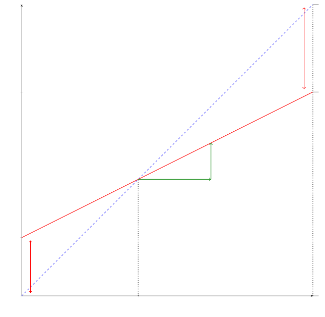

# Balanced Accuracy: The Right Metric for Evaluating LLM Judges Explained through Youden’s J statisticThanks: A preprint of this work is available on [arXiv](https://arxiv.org/abs/2512.08121).

Stephane Collot Affiliation: Meta Superintelligence Labs    Colin Fraser
Affiliation: Meta    Justin Zhao Affiliation: Meta Superintelligence
Labs    William F. Shen Affiliation: Meta Superintelligence Labs
Affiliation: University of Cambridge
Correspondence:[collot@meta.com](mailto:collot@meta.com)    Timon Willi
Affiliation: Meta Superintelligence Labs    Ilias Leontiadis
Affiliation: Meta Superintelligence Labs

###### Abstract

Rigorous evaluation of large language models (LLMs) relies on comparing
models by the prevalence of desirable or undesirable behaviors, such as
task pass rates or policy violations. These prevalence estimates are
produced by a classifier, either an LLM-as-a-judge or human annotators,
making the choice of classifier central to trustworthy evaluation.
Common metrics used for this choice, such as Accuracy, Precision, and
F1, are sensitive to class imbalance and to arbitrary choices of
positive class, and can favor judges that distort prevalence estimates.
We show that Youden’s $`J`$ statistic is theoretically aligned with
choosing the best judge to compare models, and that Balanced Accuracy is
an equivalent linear transformation of $`J`$. Through both analytical
arguments and empirical examples and simulations, we demonstrate how
selecting judges using Balanced Accuracy leads to better, more robust
classifier selection.

## 1 Introduction

Evaluating large language models (LLMs) is a cornerstone of their
development cycle. Standard practice involves running models on
benchmark datasets of user prompts and estimating the prevalence of key
behaviors in their responses such as task pass rates, safety violations,
or false refusals. Prevalence estimates rely on another classifier,
typically an LLM, a fine-tuned model, or human annotators. We refer to
this classifier as a _judge_ Gu et al. (2024); Liu et al. (2023); Li et
al. (2024b); Li et al. (2024a); Zheng et al. (2023). Because prevalence
measurements feed directly into ablation studies, capabilities
assessments, and release decisions, the quality of this judge critically
determines the validity of the resulting model comparisons.

However, despite widespread use of LLM-as-a-judge pipelines, there is
less consensus on how to evaluate the judges themselves. We raise a
central methodological question: Which metric best evaluates judges for
the downstream task of comparing models on prevalence?

In this position paper, we identify and advocate for a principled best
practice grounded in the statistical structure of prevalence estimation,
with a focus on judge-quality metrics measured on a golden set. We show
that widely used metrics such as Accuracy, Precision, Recall, F1, and
Macro-F1 are prevalence-dependent: they change as a function of the
underlying class distribution, causing judges to be over- or
under-valued depending on the dataset imbalance. As a result, these
metrics less reliably reflect a judge’s ability to detect true
differences between evaluated models.

We argue instead for Balanced Accuracy (equivalently, Macro-Recall) as
the primary metric for judge selection. Balanced Accuracy is independent
of class prevalence, assigns equal importance to both classes, extends
naturally to multi-class settings, and most directly captures the key
property needed for prevalence comparison: how well a judge
distinguishes positive from negative instances. We formalize this by
grounding the argument in Youden’s $`J`$ statistic Youden (1950),
historically used in diagnostic testing to measure a classifier’s
ability to separate classes. We show that $`J`$ is theoretically aligned
with detecting prevalence differences and that Balanced Accuracy is a
simple monotonic linear transformation of it. We provide geometric
intuition through ROC analysis and empirical examples demonstrating that
Balanced Accuracy leads to more reliable judge selection and more
trustworthy downstream evaluation.

## 2 Preliminaries

This work focuses on _pointwise_ evaluation, where each model response
is judged independently. This differs from _pairwise_ evaluation, where
responses are compared head-to-head; pairwise settings produce
inherently balanced labels, making metrics like Accuracy suitable for
evaluating preference models Malik et al. (2025).

We describe two datasets in our setup:

- 1.  Benchmark: A dataset of prompts used to elicit responses from the
      evaluated LLMs, whose behavior prevalence we aim to compare.
- 2.  Golden set: A dataset of prompts, responses, and gold labels used to
      evaluate the judges themselves.

An ideal golden set is balanced across classes to enable precise
measurement of judge performance. In practice, this is difficult to
obtain: ground-truth labels are unknown during dataset construction;
rare behaviors (e.g., safety violations) are costly to collect; and a
high-quality set must include responses from multiple models to capture
model-specific biases. Downsampling wastes expensive gold labels, while
upsampling introduces artificial distribution shifts. Consequently,
golden sets are typically imbalanced, underscoring the need for judge
metrics, such as Balanced Accuracy, that remain valid under class
imbalance.

## 3 The Pitfalls of Traditional Metrics

When comparing multiple judges, we need a single, principled metric that
reflects how well each judge will support the downstream task of
estimating behavior prevalence across LLMs. A suitable judge metric
should satisfy three core criteria:

- 1.  Prevalence independence: It should not change when the class
      distribution of the golden set changes.
- 2.  Label symmetry: Flipping which class is designated “positive” should
      not alter the metric’s meaning.
- 3.  Balanced class treatment: It should capture a judge’s ability to
      correctly identify both positive and negative instances, since both
      directly affect prevalence estimation.

This section outlines the key issues with commonly used metrics.

### 3.1 Precision and Recall vs. Sensitivity and Specificity

Precision and Recall are widely used for evaluating binary classifiers,
but they have structural properties that make them unsuited for judge
selection.

Lack of label symmetry. Precision and Recall treat the “positive” class
as privileged. When we flip class labels—for example, defining “safe”
instead of “violating” as the positive class—Recall simply becomes
Recall for the other class, but Precision does _not_: it turns into
Negative Predictive Value (NPV). This asymmetry creates inconsistencies
across datasets or benchmarks that use different labeling conventions.
In contrast, Sensitivity and Specificity (true positive rate and true
negative rate) form a _label-symmetric_ pair: swapping class labels
simply swaps the two metrics. This makes them a more principled basis
for judge evaluation.

Prevalence dependence. Precision is dependent on class prevalence
because it conditions on predicted positives. When positives are rare,
even a few false positives can drastically reduce Precision, regardless
of how well the judge performs on negatives. As golden sets are
typically unbalanced and expensive to construct, a metric sensitive to
prevalence is undesirable. Sensitivity and Specificity measure
conditional accuracy within each class and therefore remain stable
across datasets with different class ratios.

Why not keep a pair of metrics? Although Sensitivity and Specificity
form a robust and prevalence-independent pair, comparing judges using
two numbers invites ambiguity: one judge may have higher Sensitivity
while another has higher Specificity. This motivates a _single_ summary
statistic such as Youden’s $`J`$ that combines them without sacrificing
the desirable properties of symmetry and prevalence independence.

The same reasoning applies to AUC metrics: PR-AUC inherits Precision’s
prevalence dependence, while ROC-AUC — built from Sensitivity and
Specificity — is prevalence-independent and label-symmetric, making it
more relevant for our task. PR-based summaries can also exhibit high
statistical uncertainty under small test sets, particularly in the
low-recall regime where the joint uncertainty becomes highly non-linear
Urlus et al. (2023).

### 3.2 Issues with the F1 Score

The F1 score (also called binary F1 score, or micro average F1 score in
binary classification) combines Precision and Recall into a single
metric, but it inherits the same prevalence dependence and label
asymmetry issues as its constituent metrics.

```math
\displaystyle F_{1} \displaystyle=\frac{2}{\text{recall}^{-1}+\text{precision}^{-1}}
```

```math
\displaystyle=2\frac{\text{precision}\cdot\text{recall}}{\text{precision}+\text{recall}}
```

```math
\displaystyle=\frac{2\text{TP}}{2\text{TP}+\text{FP}+\text{FN}}
```

Most critically, F1 completely ignores True Negatives (TNs), depending
only on TP, FP, and FN. A judge that performs poorly on negatives but
excellent on positives can still achieve a high F1 score, even though
prevalence estimation requires balanced performance on both classes. For
tasks where both false positives and false negatives directly influence
model comparison, ignoring TNs is a fatal flaw.

### 3.3 Issues with the Macro-Averaged F1 Score

Macro-F1 averages the F1 scores of the positive and negative classes and
is therefore label symmetric:

```math
\mathrm{Macro\text{-}F1}=\tfrac{1}{2}\,(F1_{\text{positive}}+F1_{\text{negative}}).
```

```math
\displaystyle\mathrm{Macro\text{-}F1} \displaystyle=\frac{\mathrm{TP}}{2\,\mathrm{TP}+\mathrm{FP}+\mathrm{FN}}
```

```math
\displaystyle+\frac{\mathrm{TN}}{2\,\mathrm{TN}+\mathrm{FP}+\mathrm{FN}}
```

However, it retains a deeper problem: each class-specific F1 score is
still prevalence dependent, and its value is highly dependent on the
class prevalence of the golden set.

For example, the $`F1_{\text{positive}}`$ score is the harmonic mean of
prevalence-independent
$`\mathrm{Recall_{\text{positive}}}=\frac{\mathrm{TP}}{\mathrm{TP}+\mathrm{FN}}`$
and highly prevalence-dependent
$`\mathrm{Precision_{\text{positive}}}=\frac{\mathrm{TP}}{\mathrm{TP}+\mathrm{FP}}`$.

When the positive class is rare,
$`\mathrm{Precision_{\text{positive}}}`$ is especially unstable. Even a
handful of errors on the majority class can drastically change Macro-F1,
making it less reliable across golden sets with different class ratios.
This instability is problematic for judge selection, where we want a
metric that remains meaningful across datasets constructed from
different models or sampling distributions.

### 3.4 Issues with Accuracy

Accuracy, defined as
$`\frac{\text{TP}+\text{TN}}{\text{TP}+\text{TN}+\text{FP}+\text{FN}}`$,
is perhaps the most widely used metric. In heavily imbalanced golden
sets, which are common in safety evaluations, for example, a classifier
can achieve high Accuracy simply by predicting the majority class. This
makes Accuracy ill-suited for our goal of selecting judges who perform
well across both classes Dorner et al. (2025b).

### 3.5 Issues with Agreement Metrics

Agreement measures such as Cohen’s kappa Cohen (1960), Scott’s Pi Scott
(1955), and Krippendorff’s alpha Krippendorff (2004) are frequently used
in human annotation settings. Similarly, correlation-based metrics such
as Pearson correlation are used to measure alignment between judge
scores and human ratings in pointwise rubric-based evaluation Kim et al.
(2024). However, these metrics measure the wrong quantity for our
purposes.

Agreement metrics quantify _inter-rater reliability_: the degree to
which two annotators label items consistently, adjusting for chance
agreement. But for judge selection, our goal is _accuracy against ground
truth_, not consistency with another label source. Correcting for chance
is irrelevant when the ground truth is known.

Agreement metrics also suffer from prevalence dependence. When one class
is rare, their chance-correction terms can cause the metric to collapse
toward zero, even when a classifier performs well on the minority class.

## 4 Youden’s J: A Metric Theoretically Aligned

The shortcomings of traditional metrics suggest that we should instead
evaluate judges using a measure that (i) is independent of class
prevalence, (ii) treats both classes symmetrically, and (iii) reflects
how well the judge preserves true differences in prevalence between
models. Youden’s $`J`$ statistic Powers (2011) satisfies all three
criteria and emerges naturally from the structure of the
prevalence-estimation problem. Youden’s $`J`$ is defined for any binary
classifier as:

```math
J=\text{Sensitivity}+\text{Specificity}-1
```

where Sensitivity (TPR) captures performance on the positive class and
Specificity (TNR) captures performance on the negative class. Because
both TPR and TNR are conditional measures, they are unaffected by the
underlying class distribution, making $`J`$ prevalence independent and
symmetric under class-label swaps. This expression can be written
equivalently as:

```math
J=\text{Positive Recall}+\text{Negative Recall}-1
```

```math
J=\text{TPR}+\text{TNR}-1
```

```math
J=\text{TPR}-\text{FPR}
```

```math
J=\frac{TP\times TN-FP\times FN}{(TP+FN)(TN+FP)}
```

Its alternative names include “Net Detection Rate” (as the formula
$`\text{TPR}-\text{FPR}`$ can be interpreted as the rate of true
detections net of false detections), “Informedness”, “Bookmaker
Informedness”, and “$`\Delta P^{\prime}`$”.

The value of $`J`$ ranges from $`-1`$ to $`1`$, with $`0`$ corresponding
to random guessing, positive values indicating better-than-chance
classification, and negative values indicating systematic
misclassification (which could be corrected by flipping the classifier’s
output).

### 4.1 The Natural Emergence of Youden’s J: The Classifier Slope

To understand how $`J`$ naturally emerges from our evaluation goal,
consider how a judge distorts prevalence estimates. Let the true
prevalence of a behavior be $`x`$, and let $`y`$ be the prevalence
measured by a judge with true-positive rate TPR and false-positive rate
FPR. Under pointwise classification, the measured prevalence is:

```math
y=\text{TPR}\cdot x+\text{FPR}\cdot(1-x)
```

Now, consider two models with a true prevalence difference of
$`\Delta x`$. The judge will measure a difference of:

```math
\Delta y=(\text{TPR}-\text{FPR})\cdot\Delta x
```

This expression shows that the judge acts as a linear filter: it
preserves the true difference but scales it by a factor of
$`(\text{TPR}-\text{FPR})`$, which is exactly Youden’s $`J`$. A judge
with a higher $`J`$ more faithfully preserves the magnitude of true
prevalence differences and produces stronger, more reliable signals when
comparing models. This relationship is illustrated in Figure 1, which
shows how an imperfect classifier affects prevalence estimation.



Figure 1: Illustration of how an imperfect classifier affects prevalence
estimation. The red line shows the relationship
$`y\!=\!\beta\!+\!(\alpha\!-\!\beta)x`$ between actual prevalence $`x`$
and estimated prevalence $`y`$ for a classifier with sensitivity
$`\alpha`$ and specificity $`(1\!-\!\beta)`$. The slope is
$`(\alpha\!-\!\beta)\!=\!J`$, showing that Youden’s $`J`$ directly
measures the classifier’s ability to preserve true prevalence
differences.

### 4.2 Relationship to ROC Analysis

Youden’s $`J`$ also has a clear geometric interpretation in ROC space
Fawcett (2006). Each threshold of a classifier corresponds to a point
(FPR, TPR) on the ROC curve, and $`J`$ is the vertical distance between
this point and the diagonal chance line ($`y=x`$). (Figure 2).

A key practical advantage of Youden’s $`J`$ over ROC AUC is that it does
not require predicted probabilities from the judge; it can be computed
directly from binary labels. This makes it equally applicable to LLM
judges (where logits might be available) and single-review human
annotations (where they are not).


Figure 2: The relationship between Youden’s $`J`$ and the ROC curve. J
is the vertical distance between a point on the ROC curve for a given
threshold and the diagonal chance line. The optimal threshold needs to
balance sensitivity and specificity, and is represented by the point on
the curve that maximizes this vertical distance.

Remarks on calibration: When calibrating the decision threshold, we
should select the threshold that maximizes Youden’s $`J`$. This requires
labeled data to tune the threshold in addition to the golden set to
prevent overfitting. In this paper we estimate prevalence by taking the
mean of binary labels. Alternatively, one could estimate prevalence by
taking the mean of the predicted score (a less common practice), in
which case a metric like the Kuiper statistic Kuiper (1960), which
assesses calibration across the entire range of predicted probabilities,
is relevant.

In empirical analyses on our datasets, we observe that $`J`$ is highly
correlated with ROC AUC (0.88), consistent with their shared reliance on
TPR and FPR. By contrast, the correlation between $`J`$ and F1 is
substantially weaker (0.56), reflecting F1’s dependence on Precision and
hence on class prevalence. These observations support the theoretical
distinction between prevalence-independent and prevalence-dependent
metrics. More broadly, recent work has shown that the geometry of the
ROC curve also determines the scaling behavior of test-time methods such
as Best-of-N and rejection sampling when using LLM judges as verifiers
Dorner et al. (2025a).

## 5 Balanced Accuracy: A Practical and Aligned Metric

While Youden’s $`J`$ provides the theoretical foundation for selecting
an optimal judge, we recommend using Balanced Accuracy as the primary
metric for reporting and comparing judge quality in practice. Balanced
Accuracy captures exactly the same information as $`J`$, but presents it
on the familiar and intuitive $`0-1`$ scale, making it easier to
communicate and interpret in evaluation contexts.

Balanced Accuracy is defined as the arithmetic mean of Sensitivity and
Specificity, or equivalently of positive and negative recall:

```math
\text{Balanced Accuracy}=\frac{\text{Sensitivity}+\text{Specificity}}{2}
```

```math
\text{Balanced Accuracy}=\frac{\text{Recall}_{\text{pos}}+\text{Recall}_{\text{neg}}}{2}
```

Balanced Accuracy is linearly related to Youden’s $`J`$:

```math
\text{Balanced Accuracy}=\frac{\text{Youden\textquoteright s $J$}+1}{2}
```

```math
\text{Youden\textquoteright s $J$}=2\times\text{Balanced Accuracy}-1
```

Because this transformation is monotonic, Balanced Accuracy and $`J`$
rank judges identically and share all the theoretical advantages
previously established for $`J`$: independence from class prevalence,
symmetry under class label swapping, and alignment with our goal of
detecting true differences in prevalence between models.

From a practical standpoint, Balanced Accuracy benefits from being easy
to interpret, bounded in $`[0,1]`$, and supported in common libraries
(e.g., scikit-learn). Its similarity to standard accuracy makes it easy
to communicate. In the case of a perfectly balanced golden set, Balanced
Accuracy and Accuracy are equal.

### 5.1 Multi-Class Generalization

Balanced Accuracy extends naturally to multi-class classification by
averaging recall uniformly across all classes:

```math
\text{Balanced Accuracy}=\frac{1}{n}\sum_{i=1}^{n}\text{Recall}_{i}
```

This generalization preserves the key properties from the binary case:
each class is treated symmetrically and classes are weighted equally,
which avoids distortions caused by class imbalance. Balanced Accuracy
remains appropriate for evaluating multi-class judges when the task
involves comparing prevalence across multiple behavior categories or
their ability to detect relative prevalence differences.

Youden’s $`J`$ can also be extended to multi-class settings—typically by
computing a one-vs-rest $`J`$ value for each class and taking the
macro-average (Macro $`J`$). Balanced Accuracy and Macro $`J`$ remain
linearly related in the multi-class case. For example, for $`n`$
classes:

```math
\text{Balanced Accuracy}=\left(\frac{n-1}{n}\right)\!\times\!\text{Macro J}+\left(\frac{1}{n}\right)
```

## 6 Empirical Studies

We present three empirical studies to illustrate how the choice of
metric directly affects judge selection and downstream evaluation
quality. First, we analyze two real-world scenarios—one involving safety
violation detection and another involving response-format
compliance—where two candidate judges are compared on their respective
golden sets. Although the underlying datasets are proprietary, the
intuitions do not depend on the specifics of these benchmarks. Finally,
we present a large-scale simulation study that systematically quantifies
how metric choice influences a judge’s ability to correctly rank
candidate assistant models by prevalence.

### 6.1 Case 1: Precision, Recall, and Specificity trade-offs

Two judges are evaluated on a golden set with a violation prevalence of
8.3%. Judge A has much higher Recall, while Judge B has better Precision
and Specificity, this is a common trade-off. As shown in Table 1, F1,
Macro-F1, and Accuracy all favor Judge B. However, Balanced Accuracy
correctly identifies Judge A as superior due to its better balance of
TPR and FPR.

| Judge   | Precision | Recall | Specificity | Youden’s J |
| ------- | --------- | ------ | ----------- | ---------- |
| Judge A | 0.32      | 0.76   | 0.85        | 0.61       |
| Judge B | 0.41      | 0.57   | 0.92        | 0.49       |

| Judge   | F1   | Macro-F1 | Accuracy | Balanced Accuracy |
| ------- | ---- | -------- | -------- | ----------------- |
| Judge A | 0.45 | 0.68     | 0.85     | 0.81              |
| Judge B | 0.47 | 0.71     | 0.90     | 0.75              |

| Judge   | Prevalence | TP/FP/TN/FN   |
| ------- | ---------- | ------------- |
| Judge A | 0.083      | 63/133/784/20 |
| Judge B | 0.083      | 47/69/848/36  |

Table 1: Case 1: Performance metrics for two judges evaluated on a
golden set with 8.3% prevalence (1000 samples). While Balanced Accuracy
correctly identifies Judge A as better, the metrics F1, Macro-F1, and
Accuracy would have picked the wrong Judge B.

### 6.2 Case 2: Perfect Precision and Specificity vs. Balanced Performance

Two judges are evaluated on a golden set with 20% prevalence. As shown
in Table 2, Judge B has perfect Precision (1.00) and Specificity (1.00)
but lower Recall (0.20), making it overly conservative and missing many
true positives. Judge A has higher Recall (0.25) but lower Specificity
(0.975) and lower Precision (0.71), resulting in more balanced
performance. Balanced Accuracy captures this difference, identifying
Judge A as better, while Accuracy favors Judge B due to its perfect
specificity and low positive class prevalence.

| Judge   | Precision | Recall | Specificity | Youden’s J |
| ------- | --------- | ------ | ----------- | ---------- |
| Judge A | 0.71      | 0.25   | 0.975       | 0.225      |
| Judge B | 1.00      | 0.20   | 1.00        | 0.20       |

| Judge   | F1   | Macro-F1 | Accuracy | Balanced Accuracy |
| ------- | ---- | -------- | -------- | ----------------- |
| Judge A | 0.37 | 0.64     | 0.83     | 0.61              |
| Judge B | 0.33 | 0.62     | 0.84     | 0.60              |

| Judge   | Prevalence | TP/FP/TN/FN   |
| ------- | ---------- | ------------- |
| Judge A | 0.20       | 50/20/780/150 |
| Judge B | 0.20       | 40/0/800/160  |

Table 2: Case 2: Performance metrics for two judges evaluated on a
golden set with 20% prevalence (1000 samples). While Balanced Accuracy
correctly identifies Judge A as better, the metric Accuracy would have
picked the wrong Judge B.

### 6.3 Simulated Judge Selection for Model Ranking

To evaluate how metric choice affects downstream ranking of candidate
assistant models, we simulate 100,000 scenarios in a Monte-Carlo
fashion. In each scenario, we generate three candidate judges with
$`(\mathrm{TPR},\mathrm{FPR})`$ sampled from $`\mathrm{Uniform}(0,1)`$,
and five assistant models with true violation prevalences sampled from
$`\mathrm{Uniform}(0.01,0.5)`$. For each judge, we measure its _true_
quality by applying it to 200 benchmark samples per model and computing
its pairwise model-ranking accuracy (RankAcc). Separately, each judge is
evaluated on a golden set of 800 labeled examples, from which we compute
four scalar metrics: Balanced Accuracy, Accuracy, F1, and Macro-F1, and
select the top-scoring judge under each metric.

Table 3 reports two outcomes: (i) the probability that each metric
selects the RankAcc-best judge and (ii) the average degradation in
RankAcc when it does not. Balanced Accuracy attains the highest success
rate ($`75.2\%`$) and the smallest ranking-accuracy loss ($`0.033`$),
substantially outperforming Accuracy ($`67.5\%`$), F1 ($`61.7\%`$), and
Macro-F1 ($`70.7\%`$). Selecting judges with Accuracy or F1 produces
roughly 30–50% more ranking error compared to selecting with Balanced
Accuracy.

| Metric            | Success Rate | Avg Rank Gap |
| ----------------- | ------------ | ------------ |
| Balanced Accuracy | 0.752        | 0.033        |
| Macro-F1          | 0.707        | 0.049        |
| Accuracy          | 0.675        | 0.067        |
| F1                | 0.617        | 0.094        |

Table 3: Ranking simulation results across 100,000 scenarios with 3
judges and 5 models. Success rate measures how often each metric
selected the rank-optimal judge. Avg rank gap measures the average loss
in ranking accuracy when the metric’s selected judge differs from the
rank-optimal judge.

In ablations on golden set prevalence, golden set size, and model
evaluation size, we find that Balanced Accuracy is consistently the
scalar metric most aligned with the practical goal of choosing judges
that preserve the true ordering of assistant models of varying
prevalence (Appendix A).

## 7 Conclusion

In the industrial setting of evaluating large language models, selecting
appropriate metrics for assessing judges is essential for producing
trustworthy prevalence estimates and, ultimately, for making good model
development and release decisions. In this paper, we have shown that
Balanced Accuracy offers a principled and practical choice for
benchmarking judges. It captures the same theoretical foundations as
Youden’s $`J`$ including prevalence independence, symmetry under class
label definitions, and balanced treatment of errors, all while
presenting results on a familiar $`0-1`$ scale that is easier to
interpret and communicate.

Our empirical studies demonstrate that relying on commonly used metrics
such as Accuracy or F1 can misrepresent judge quality, particularly in
imbalanced settings, and can lead to selecting judges that distort true
differences in model behavior. Balanced Accuracy, by contrast,
consistently preserves these differences and supports more reliable
downstream comparisons.

We hope that adopting Balanced Accuracy as a standard metric for judge
evaluation will contribute to more robust assessment practices for LLMs.

## Limitations

While we recommend Balanced Accuracy as a principled and practical
primary metric for evaluating judges, it is not without limitations.

First, Balanced Accuracy summarizes performance through TPR and TNR, but
it does not fully characterize a judge’s error profile. A judge with a
higher Balanced Accuracy may still have lower precision, higher
false-positive rates, or other operational characteristics that matter
for specific applications (e.g., safety teams may prioritize very high
recall on violation classes), while statistical debiasing approaches
require high correlation between judge and ground truth scores to
provide meaningful sample efficiency gains dorner2024limits. As with any
scalar metric, Balanced Accuracy should be complemented with inspection
of the underlying confusion matrix and class-specific error rates.

Second, our analysis assumes that a judge’s error rates (TPR and FPR)
remain stable across the assistant models being compared. If a judge
exhibits model-specific bias such as the self-preference and
family-preference effects observed when LLM judges evaluate outputs from
related models Wataoka et al. (2024); Zheng et al. (2023); Dorner et al.
(2025b); Chen et al. (2024), then prevalence estimates may be distorted
regardless of the metric used. Detecting and mitigating this form of
judge bias is an essential but orthogonal challenge that must accompany
any metric-based judge selection.

Third, in multi-class settings, Balanced Accuracy weights each class
equally, which may be inappropriate for tasks with long-tailed label
distributions. Rare classes with sparse or noisy annotations can
disproportionately influence the metric, making the overall score more
volatile and potentially misaligned with evaluation priorities. In such
settings, practitioners may prefer variants that reweight classes.

Finally, Balanced Accuracy does not eliminate the need for task-specific
judgment. For high-stakes domains, qualitative inspection, secondary
metrics (e.g., raw TPR/FPR), and bias analyses remain essential for
judge selection. Balanced Accuracy provides a strong and reliable
foundation, but it is best viewed as part of a broader evaluation
toolkit.

## References

- Chen et al. (2024) G. H. Chen, S. Chen, Z. Liu, F. Jiang, and B. Wang
  Humans or llms as the judge? a study on judgement biases. In
  Proceedings of the 2024 Conference on Empirical Methods in Natural
  Language Processing, External Links:
  [Link](https://arxiv.org/abs/2402.10669) Cited by: Limitations.
- Cohen (1960) J. Cohen A coefficient of agreement for nominal scales.
  Educational and psychological measurement 20 (1), pp. 37–46. Cited by:
  §3.5.
- Dorner et al. (2025a) F. E. Dorner, Y. Chen, A. F. Cruz, and F. Yang
  ROC-n-reroll: how verifier imperfection affects test-time scaling.
  arXiv preprint arXiv:2507.12399. External Links:
  [Link](https://arxiv.org/abs/2507.12399) Cited by: §4.2.
- Dorner et al. (2025b) F. E. Dorner, V. Y. Nastl, and M. Hardt Limits
  to scalable evaluation at the frontier: LLM as judge won’t beat twice
  the data. In The Thirteenth International Conference on Learning
  Representations, External Links:
  [Link](https://openreview.net/forum?id=NO6Tv6QcDs) Cited by: §3.4,
  Limitations.
- Fawcett (2006) T. Fawcett An introduction to roc analysis. Pattern
  recognition letters 27 (8), pp. 861–874. Cited by: §4.2.
- Gu et al. (2024) J. Gu, X. Jiang, Z. Shi, H. Tan, X. Zhai, C. Xu, W.
  Li, Y. Shen, S. Ma, H. Liu, S. Wang, K. Zhang, Y. Wang, W. Gao, L. Ni,
  and J. Guo A survey on llm-as-a-judge. External Links: 2411.15594,
  [Link](https://arxiv.org/abs/2411.15594) Cited by: §1.
- Kim et al. (2024) S. Kim, J. Shin, Y. Cho, J. Jang, S. Longpre, H.
  Lee, S. Yun, S. Shin, S. Kim, J. Thorne, and M. Seo Prometheus:
  inducing fine-grained evaluation capability in language models. In The
  Twelfth International Conference on Learning Representations, External
  Links: [Link](https://openreview.net/forum?id=8euJaTveKw) Cited by:
  §3.5.
- Krippendorff (2004) K. Krippendorff Content analysis: an introduction
  to its methodology. Sage Publications. Cited by: §3.5.
- Kuiper (1960) N. H. Kuiper Tests concerning random points on a circle.
  Proceedings of the Koninklijke Nederlandse Akademie van Wetenschappen,
  Series A 63, pp. 38–47. Cited by: §4.2.
- Li et al. (2024a) D. Li, C. Shui, W. Jiao, Z. Wang, Y. Geng, M.
  Zhao, H. Sun, D. K. W. Chiu, Y. Li, Z. Xu, B. Ye, Z. Zhang, X.
  Wang, B. Hui, X. Han, Y. Lin, L. Hou, and J. Li From generation to
  judgment: opportunities and challenges of llm-as-a-judge. arXiv
  preprint arXiv:2411.16594. Cited by: §1.
- Li et al. (2024b) H. Li, Q. Dong, J. Chen, H. Su, Y. Zhou, Q. Ai, Z.
  Ye, and Y. Liu LLMs-as-judges: a comprehensive survey on llm-based
  evaluation methods. arXiv preprint arXiv:2412.05579. External Links:
  [Link](https://arxiv.org/abs/2412.05579) Cited by: §1.
- Liu et al. (2023) Y. Liu, D. Iter, Y. Xu, S. Wang, R. Xu, and C. Zhu
  G-eval: NLG evaluation using GPT-4 with better human alignment. In
  Proceedings of the 2023 Conference on Empirical Methods in Natural
  Language Processing, Singapore, pp. 2511–2522. External Links:
  [Link](https://aclanthology.org/2023.emnlp-main.153/),
  [Document](https://dx.doi.org/10.18653/v1/2023.emnlp-main.153) Cited
  by: §1.
- Malik et al. (2025) S. Malik, V. Pyatkin, S. Land, J. Morrison, N. A.
  Smith, H. Hajishirzi, and N. Lambert RewardBench 2: advancing reward
  model evaluation. External Links: 2506.01937,
  [Link](https://arxiv.org/abs/2506.01937) Cited by: §2.
- Powers (2011) D. M. W. Powers Evaluation: from precision, recall and
  f-measure to roc, informedness, markedness & correlation. Journal of
  Machine Learning Technologies 2 (1), pp. 37–63. Cited by: §4.
- Scott (1955) W. A. Scott Reliability of content analysis: the case of
  nominal scale coding. Public opinion quarterly 19 (3), pp. 321–325.
  Cited by: §3.5.
- Urlus et al. (2023) R. E.Q. Urlus, M. Baak, S. Collot, and I. Fridman
  Rojas Pointwise sampling uncertainties on the precision-recall curve.
  In Proceedings of The 26th International Conference on Artificial
  Intelligence and Statistics, F. Ruiz, J. Dy, and J. van de Meent
  (Eds.), Proceedings of Machine Learning Research, pp. 8211–8232.
  External Links:
  [Link](https://proceedings.mlr.press/v206/urlus23a.html) Cited by:
  §3.1.
- Wataoka et al. (2024) K. Wataoka, T. Takahashi, and R. Ri
  Self-preference bias in llm-as-a-judge. arXiv preprint
  arXiv:2410.21819. External Links:
  [Link](https://arxiv.org/abs/2410.21819) Cited by: Limitations.
- Youden (1950) W. J. Youden Index for rating diagnostic tests. Cancer 3
  (1), pp. 32–35. Cited by: §1.
- Zheng et al. (2023) L. Zheng, J. Ye, S. Hallinan, H. Liu, T. Zhang, H.
  Tang, S. S. Abu-El-Haija, E. P. Xing, J. M. Alvarez, S. Zhang, S.
  Chen, S. Xu, X. Hu, Y. Sun, J. Whang, Y. Qian, Y. Song, X. Liu, H.
  Liu, Q. Wang, Y. Tang, T. Li, Z. Zhang, Z. Zhang, S. Ren, Y. Bai, W.
  Zeng, H. Mei, Z. Wang, Z. Liu, A. H. Chan, Y. Wang, T. Zhao, and E.
  Wallace Judging llm-as-a-judge with mt-bench and chatbot arena. arXiv
  preprint arXiv:2306.05685. Cited by: §1, Limitations.

## Appendix A Ranking Accuracy Simulation Details

### A.1 Simulation procedure

To compare different scalar metrics for judge selection, we construct a
synthetic evaluation environment in which we can directly observe each
judge’s true downstream utility and how reliably each metric identifies
that judge from finite data. Each simulation scenario proceeds as
follows.

Judges and models. We sample $`K`$ assistant models, each with a
ground-truth violation prevalence
$`p_{k}\sim\mathrm{Uniform}(0.01,0.5)`$ (sorted so that the true ranking
is defined). We also sample $`J`$ candidate judges, each parameterized
by a sensitivity–specificity pair
$`(\mathrm{TPR}_{j},\mathrm{FPR}_{j})`$ drawn independently from
$`\mathrm{Uniform}(0,1)`$. A judge therefore outputs “violation” on a
model-$`k`$ example with probability:

```math
q_{jk}=p_{k}\cdot\mathrm{TPR}_{j}+(1-p_{k})\cdot\mathrm{FPR}_{j}
```

True downstream ranking quality. Each judge $`j`$ is applied to
$`n_{\text{eval}}`$ independent samples from each model, producing
estimated violation rates $`\hat{p}_{jk}`$. We compute the judge’s
_pairwise model-ranking accuracy_ (RankAcc):

```math
\mathrm{RankAcc}_{j}=\frac{\#\{(a,b):\mathrm{sign}(p_{b}-p_{a})=\mathrm{sign}(\hat{p}_{jb}-\hat{p}_{ja})\}}{\#\text{model pairs}}
```

The judge with the highest RankAcc is taken to be the _ground-truth best
judge_ for the scenario.

Golden-set evaluation and metric-based selection. Independently of model
evaluation, we simulate a golden set of size $`n_{\text{golden}}`$ with
prevalence $`p_{\text{golden}}`$. We draw
$`n_{\text{pos}}\sim\mathrm{Binomial}(n_{\text{golden}},p_{\text{golden}})`$
and $`n_{\text{neg}}=n_{\text{golden}}-n_{\text{pos}}`$. For each judge,
we sample the corresponding TP/FP/FN/TN counts using its
$`(\mathrm{TPR}_{j},\mathrm{FPR}_{j})`$, and compute four scalar
metrics: Balanced Accuracy, Accuracy, positive-class F1, and Macro-F1.
For a given metric $`m`$, we select the judge with the highest score.

Outcome measures. Across $`N`$ simulated scenarios (typically 10k–20k),
we evaluate each metric $`m`$ using:

1. Selection correctness:

```math
\Pr\!\left(m\text{ selects the same judge as }\arg\max_{j}\mathrm{RankAcc}_{j}\right)
```

2. Expected ranking loss:

```math
\mathbb{E}\!\left[\mathrm{RankAcc}_{\text{best}}-\mathrm{RankAcc}_{\text{chosen by }m}\right]
```

These quantities measure how often metric-based selection recovers the
rank-optimal judge and how much downstream ranking quality is lost when
it does not.

### A.2 Results

Over 100k scenarios (with default settings $`K=5`$ models, $`J=3`$
judges, $`n_{\text{eval}}=2{,}000`$ model-eval samples per model and
$`n_{\text{golden}}=2{,}000`$), we obtain Table 3 in the main paper.

Figure 3: Balanced Accuracy is more robust to imbalance compared to
other selection metrics across different prevalence regimes. Its ranking
loss increases only slightly as the behavior becomes rarer.

Balanced Accuracy not only picks the rank-optimal judge more often than
any competing metric, but when it does mis-select, the resulting judge
is still much closer to optimal. Relative to Accuracy, using Balanced
Accuracy instead cuts the ranking-accuracy loss by roughly 51% (from
0.067 to 0.033); relative to Macro-F1 and F1, the reduction is around
33–65%.

#### Effect of golden-set prevalence.

We next vary the class prevalence in the golden set, sampling
$`p_{\text{golden}}`$ from three regimes:

- •
  Balanced: $`p_{\text{golden}}\in[0.3,0.7]`$
- •
  Mildly rare: $`p_{\text{golden}}\in[0.05,0.2]`$
- •
  Very rare: $`p_{\text{golden}}\in[0.005,0.05]`$

Balanced Accuracy is consistently the best or tied-best metric in terms
of selection probability, and it always yields the smallest average
ranking loss (Figure 3).

By contrast, Accuracy’s ranking loss more than doubles from the balanced
to very-rare regime, and it becomes the worst-performing metric in both
selection probability and ranking loss. The more imbalanced or rare the
behavior, the more one “pays” for using Accuracy (or Macro-F1) instead
of Balanced Accuracy as the judge-selection criterion.

#### Effect of golden-set size.

We vary the size of the golden set, $`n_{\text{golden}}`$ from 25 to
51,000 samples, while holding $`n_{\text{eval}}`$ fixed.

We observe diminishing returns in $`n_{\text{golden}}`$. Going from 25
to a few thousand labeled examples reduces ranking loss for all metrics,
but beyond about 1,000–2,000 labels the curves largely plateau.

Balanced Accuracy dominates for all $`n_{\text{golden}}`$. It
consistently has the highest probability of selecting the rank-optimal
judge and the smallest average RankAcc gap, with a particularly large
margin over Accuracy. At large golden-set sizes, BA’s ranking loss is
less than half that of Accuracy (Figure 4).

Collecting a moderately sized golden set is helpful, but once past the
low-data regime, metric choice becomes more important than squeezing out
a few extra labels.

Figure 4: Going from 25 to a few thousand labeled examples reduces
ranking loss for all metrics, but beyond about 1,000–2,000 labels the
curves largely plateau. Balanced Accuracy is the clear winning metric
for selecting a rank-optimal judge.

#### Effect of model-evaluation sample size.

Finally, we vary the number of model-eval samples per assistant model,
$`n_{\text{eval}}`$ from 25 to 51,000 samples, while holding the
golden-set size fixed.

As $`n_{\text{eval}}`$ increases, the RankAcc of each judge is estimated
more accurately, and all metrics benefit: the average RankAcc gap
between the metric-selected judge and the rank-optimal judge drops
monotonically. Across all sample sizes, however, Balanced Accuracy is
uniformly best (Figure 5).

Figure 5: Across all model evaluation sample sizes, Balanced Accuracy’s
selection probability curve is the highest, typically sitting 2–5
percentage points above F1/Macro-F1 and 10+ points above Accuracy at
moderate to large $`n_{\text{eval}}`$.
