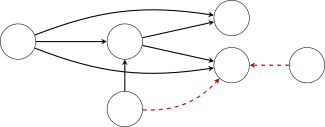
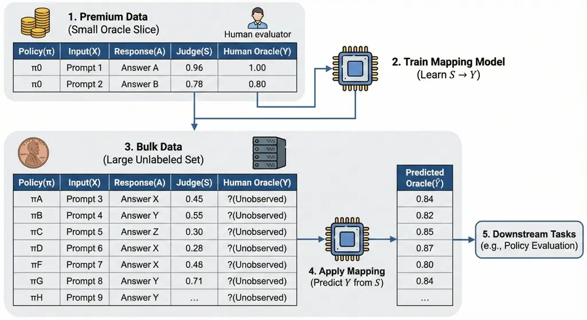
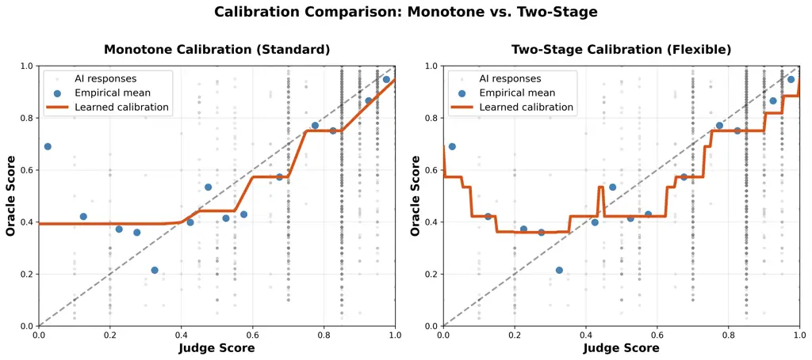
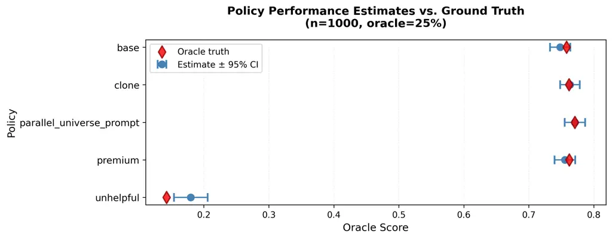
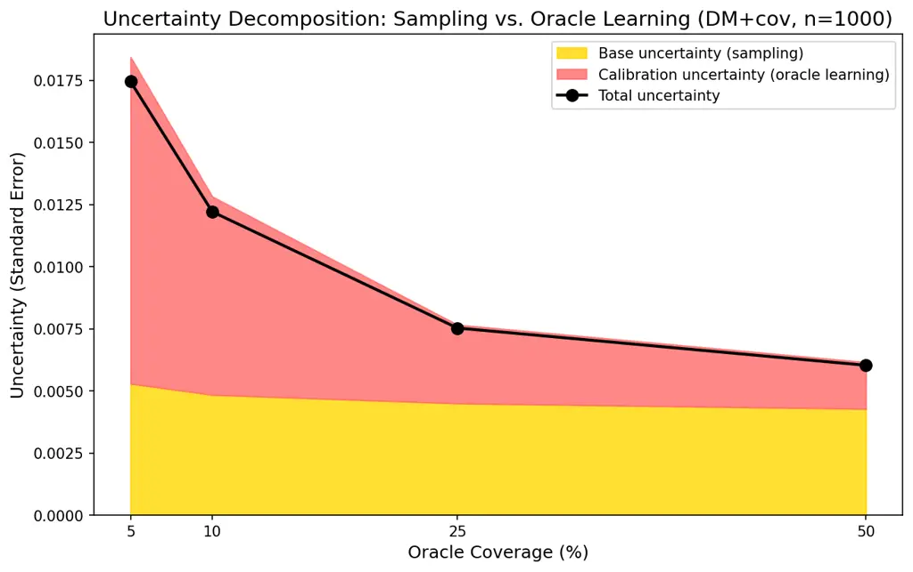
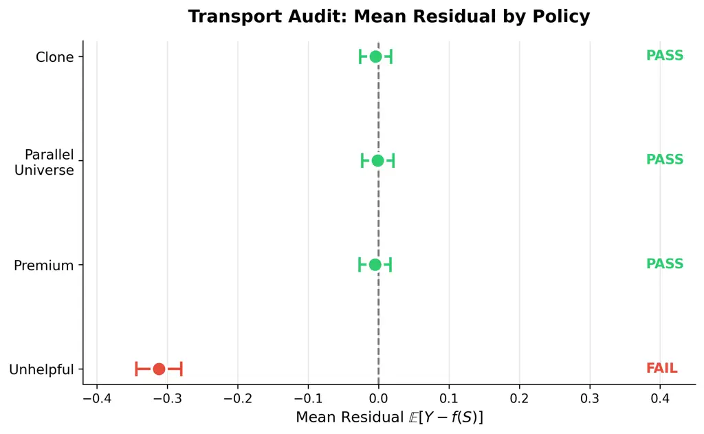
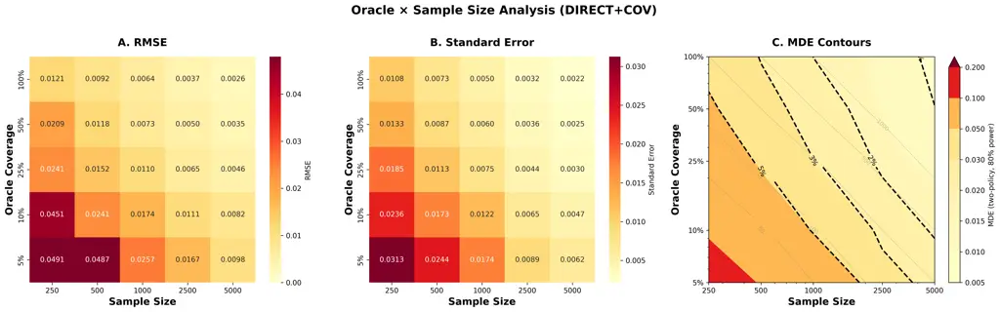
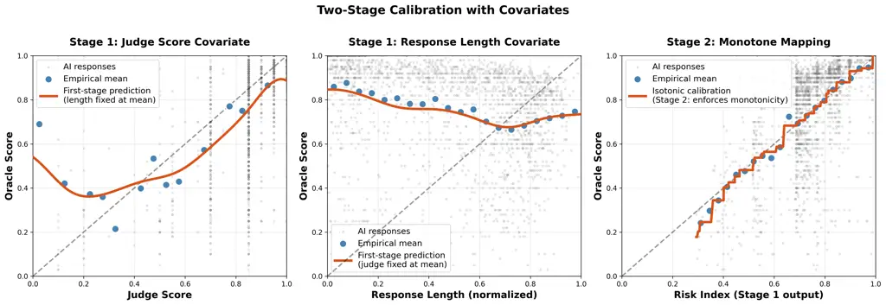
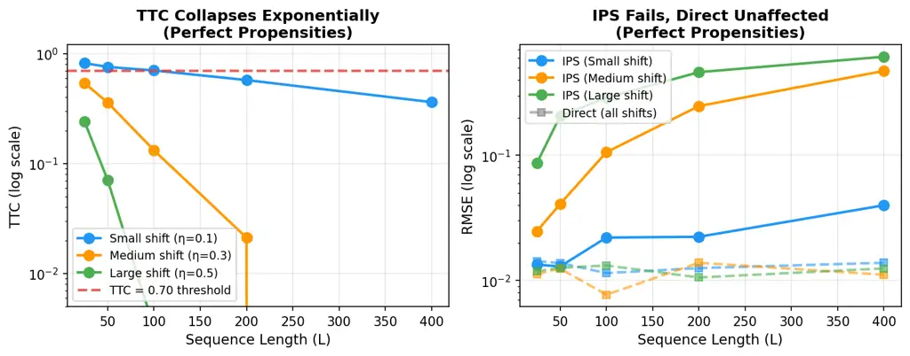
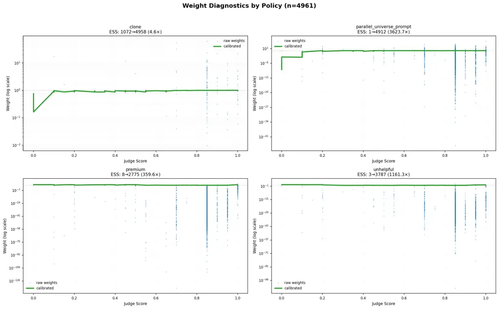

# Causal Judge Evaluation: Calibrated Surrogate Metrics for LLM Systems

Eddie Landesberg ^(†)^(†)thanks: edward.landesberg@gmail.com    Manjari
Narayan

###### Abstract

Measuring long-run LLM outcomes (user satisfaction, expert judgment,
downstream KPIs) is expensive. Teams default to cheap LLM judges, but
uncalibrated proxies can invert rankings entirely. Causal Judge
Evaluation (CJE) makes it affordable to aim at the right target:
calibrate cheap scores against a small oracle slice, then evaluate at
scale with valid uncertainty. We treat surrogate validity as
_auditable_: for each policy or deployment context, a small oracle
sample tests whether calibration remains unbiased, turning an
uncheckable identification condition into a falsifiable diagnostic. On
4,961 Arena prompts with 5 policies and a 16$`\times`$ oracle/judge cost
ratio: at 5% oracle fraction, CJE achieves 99% pairwise ranking accuracy
at 14$`\times`$ lower cost; across all configurations (5–50% oracle,
varying $`n`$), accuracy averages 94%. An adversarial policy fails the
transport audit and is correctly flagged. CJE refuses level claims
rather than reporting biased estimates. Key findings: naive confidence
intervals on raw judge scores achieve 0% coverage (CJE: $`{\sim}`$95%);
importance-weighted estimators fail despite 90%+ effective sample size;
the Coverage-Limited Efficiency (CLE) bound and its TTC diagnostic
explain why.

|     |
| --- |
|     |

## 1 Introduction

Many teams now choose between system configurations (models, prompts,
parameters, tools) by generating outputs and scoring them with an LLM
judge. This is fast, and often wrong in a systematic way. Consider a
common failure: you compared configuration A to B, the judge said A
wins, you shipped A, and users hated it. The mechanism: verbosity and
style bias. Judges frequently reward longer, more elaborate responses
independent of actual quality; optimizing against the judge selected the
wrong configuration. The standard workaround (reserve oracle labels for
a small validation slice and hope the correlation holds) is ubiquitous
in practice but statistically unsound.

CJE is a simple protocol: calibrate the judge to a small set of oracle
labels, then audit whether that calibration remains valid for each
target policy. When the audit fails, we do not “hope correlation holds”;
we either recalibrate or refuse level claims.

Quick start for practitioners:

- •
  Use Direct + two-stage calibration. For open-ended generation under
  nontrivial policy shifts, logs-only OPE is impractical: target-typical
  trajectories receive little logger mass (low TTC), yielding a
  coverage-limited precision floor that weight stabilization cannot
  overcome.
- •
  Audit transport for high-stakes decisions (mean residual test per
  policy).
- •
  Gate on TTC $`\geq 0.70`$ before relying on logged data; in our
  benchmark, only near-clone policies pass this threshold.

#### Three systematic failures.

Uncalibrated “LLM-as-judge” evaluation exhibits three failure modes that
compound in production:

1.  1.  Rankings can invert. Judge scores $`S`$ are treated as if they were
        rewards $`Y`$ on the same scale. They are not. Without calibration,
        higher $`S`$ can predict _lower_ $`Y`$, inverting rankings entirely.
        This is the “surrogate paradox” in a new guise: surrogates can
        mislead catastrophically when the surrogate-target relationship
        shifts across contexts (Fleming & DeMets, 1996). The “You’re
        absolutely right!” phenomenon illustrates the cost: sycophantic
        responses score high on cheap proxies but low on actual user value.
        Teams know they should evaluate against long-term outcomes, but
        oracle labels are expensive, so they settle for proxies that may
        point the wrong direction.
2.  2.  Standard confidence intervals fail catastrophically. Naive CIs on
        uncalibrated judge scores achieve near-zero coverage: their 95% CIs
        capture the true value in 0/50 seeds. Bootstrap inference with
        bias-corrected estimation restores coverage to $`{\sim}`$95% for
        Direct mode. (Figure 5: at 5% oracle fraction, calibration
        uncertainty contributes $`{\sim}`$90% of total variance.)
3.  3.  Importance sampling fails despite healthy ESS. When evaluating
        target policies $`\pi^{\prime}`$ using logged data from $`\pi_{0}`$,
        importance-weighted estimators (inverse propensity scoring, IPS;
        self-normalized IPS, SNIPS) fail even after weight stabilization
        boosts effective sample size (ESS) from degenerate ($`<1\%`$) to
        healthy ($`>80\%`$) regimes. The problem is not weight concentration
        but _coverage_: the logger rarely visits regions where the target
        policy concentrates. We formalize this via the Coverage-Limited
        Efficiency (CLE) diagnostic, which explains why IPS-style estimation
        hits a precision floor under limited overlap. (Table 4: TTC ranges
        19–49% with CLE factors of 24–61$`\times`$.)

_Why logs-only OPE fails for open-ended generation._ Off-policy
evaluation requires the logger to have visited regions where the target
concentrates. In autoregressive text generation, the “action” is an
entire response—a trajectory through a space of $`|\mathcal{V}|^{T}`$
possible token sequences. Two issues compound: (i) teacher-forcing
propensities are empirically unreliable (even our clone policy achieves
only 26% raw ESS vs. theoretical 100%), and (ii) for meaningfully
different policies, TTC is 19–49%, indicating the logger rarely visits
target-typical regions. Even with perfect propensities, CLE implies a
hard precision floor when TTC is low. In constrained settings (short
outputs, near-clone shifts, tool-choice bandits), OPE may remain viable;
for open-ended generation under nontrivial policy shifts, Direct
sidesteps these issues entirely.

#### Related work.

Recent work recognizes that LLM judges require calibration (Lee et al.,
2025), and concurrent work (Chen et al., 2026) develops
semiparametrically efficient, calibration-aware inference for mean
parameters in the standard “large judge-labeled test + small
human-labeled calibration” design. Guerdan et al. (2025) use doubly
robust methods to address external validity when LLM judges are prompted
with demographic personas. Our focus is complementary: we study
multi-policy ranking under policy/deployment shift, introduce auditable
transport diagnostics (policy-wise mean residual tests), and provide
overlap/coverage diagnostics (CLE) and weight stabilization for
off-policy evaluation, components not addressed by mean-parameter-only
treatments. CJE fills this gap.

#### Auditable assumptions.

The core insight of CJE is to replace an uncheckable surrogacy
assumption with a _policy-wise moment restriction_ that we can audit. In
causal inference, negative controls and proxy variables provide a
template for this move: they turn untestable identification conditions
into checkable diagnostics using auxiliary data (Lipsitch et al., 2010;
Tchetgen Tchetgen et al., 2024). CJE applies this philosophy to LLM
evaluation by budgeting a small oracle slice to test whether the
judge-to-oracle calibration remains valid in each target context. The
protocol is: calibrate on $`\pi_{0}`$, then _audit transport_ on each
$`\pi^{\prime}`$ (or time window, user segment, or task population) with
a small oracle sample. Pass $`\to`$ reuse calibration; fail $`\to`$
recalibrate or refuse level claims for that cell. This transforms a
brittle identification assumption into a standardized audit with an
explicit decision rule.

#### Causal Judge Evaluation (CJE).

We introduce CJE, a framework that addresses all three failures.¹¹ 1
Library: pip install cje-eval
([https://github.com/cimo-labs/cje](https://github.com/cimo-labs/cje));
experiments:
[https://github.com/cimo-labs/cje-arena-experiments](https://github.com/cimo-labs/cje-arena-experiments)
CJE casts offline evaluation as calibrated surrogate estimation with
three core components:

- •
  Reward calibration: mean-preserving isotonic regression from judge
  score $`S`$ to oracle labels $`Y`$, with a two-stage option for
  covariate-dependent bias (e.g., response length).
- •
  Weight stabilization: variance-optimal stacking of monotone weight
  candidates, stabilizing importance weights for improved effective
  sample size.
- •
  Calibration-aware inference: bootstrap with bias correction that
  propagates calibration uncertainty into confidence intervals,
  achieving near-nominal coverage.

Conceptually, CJE adopts the _surrogate index_ move (Athey et al.,
2019), learning $`f(S,X)\approx\mathbb{E}[Y\mid S,X]`$ from cheap
proxies to expensive outcomes, and applies it to LLM evaluation with
auditable transport diagnostics. These components instantiate a single
design rule: encode justified knowledge as model restrictions (closed
convex sets) and project onto them. Building on established
semiparametric theory, we show that such restrictions can only reduce
variance (Theorem 2); with cross-fitting, our estimators attain the
surrogate information bound. (Component names and technical details in
Section 3.)

Beyond variance control, CJE includes a mean transport test that
operationalizes the auditable assumption protocol: for each target
policy $`\pi^{\prime}`$ or time period, we test whether the mean
residual $`\mathbb{E}[Y-f(S,X)]`$ is zero. In our Arena benchmark, the
base-trained calibration transports cleanly to clone, premium, and
prompt-engineered policies, but fails for an adversarial “unhelpful”
policy, where mean residuals reveal a $`-0.31`$ level shift. When the
test fails, the failure is _visible and actionable_: either recalibrate
with policy-specific data or refuse absolute value claims for that cell.

#### The Arena benchmark.

We validate CJE on a large-scale benchmark: 4,961 Chatbot Arena prompts,
five LLM policies (including an adversarial “unhelpful” policy), 13
estimators, and gpt-5-2025-08-07 as oracle. Key findings:

- •
  Calibration works. The Direct Method with two-stage calibration
  achieves 94% pairwise ranking accuracy on average (vs. 38% for SNIPS).
  Naive CIs on uncalibrated scores achieve 0% coverage; bootstrap
  inference with $`\hat{\theta}_{\mathrm{aug}}`$ improves coverage to
  $`{\sim}`$95% (Direct and stacked doubly-robust).
- •
  OPE fails unexpectedly. We expected weight stabilization to enable
  OPE; it did not. Despite weight stabilization boosting ESS from
  $`<1\%`$ to $`>80\%`$, calibrated IPS remains near-random (47%
  pairwise). CLE explains why: high ESS is necessary but not sufficient
  when the logger rarely visits target-typical regions.
- •
  Doubly-robust (DR) does not dominate. We expected DR to outperform
  Direct by combining logged data with fresh draws. Instead, Direct
  slightly outperforms DR (94.4% vs. 94.1%): under low overlap, DR’s IPS
  component adds noise rather than information.

#### Contributions.

1.  1.  Framework: CJE unifies calibration, weight stabilization, and
        uncertainty quantification for surrogate-based LLM evaluation.
2.  2.  Methods: Mean-preserving reward calibration, weight stabilization
        for improved ESS, and calibration-aware bootstrap inference.
3.  3.  Theory: CJE adapts the surrogate index framework to LLM evaluation
        with a key innovation: transportability becomes auditable rather
        than assumed via the mean transport test. Inference is grounded in
        the efficient influence function for missing-outcome estimation,
        explaining why bootstrap with $`\hat{\theta}_{\mathrm{aug}}`$
        achieves $`{\sim}`$95% coverage where naive methods achieve 0%. The
        CLE bound provides a novel explanation for OPE failure despite high
        ESS, formalizing a precision floor under limited overlap.
4.  4.  Validation: A 13-estimator benchmark on $`{\sim}5`$k Arena prompts:
        at 5% oracle fraction, 99% pairwise ranking accuracy; across all
        configurations, 94% average. Cost reduction of 14$`\times`$ (for 5
        policies) with near-nominal CI coverage ($`{\sim}`$95% for both
        Direct and stacked DR).
5.  5.  Operations: A closed-form Square Root Law for optimal budget
        allocation (Appendix F), enabling practitioners to minimize variance
        subject to cost constraints by balancing evaluation and calibration
        uncertainty.

Readers primarily interested in deployment can focus on Section 3
(pipeline overview), Section 5.4 (seven practical rules), and Table 7
(estimator selection guide).

## 2 Background and Setup

#### Setup & notation.

We observe i.i.d. logs $`(X_{i},A_{i},S_{i})`$ under a fixed logger
$`\pi_{0}(\cdot\mid X)`$; $`S=s(X,A)`$ is a scalar judge score on every
row, and a small i.i.d. oracle slice provides labels $`Y`$. For a
candidate policy $`\pi^{\prime}`$, the sequence-level importance ratio
is

```math
W_{\pi^{\prime},i}\;=\;\frac{\pi^{\prime}(A_{i}\mid X_{i})}{\pi_{0}(A_{i}\mid X_{i})}\;=\;\exp\!\big\{\log p_{\pi^{\prime}}(A_{i}\mid X_{i})-\log p_{\pi_{0}}(A_{i}\mid X_{i})\big\},
```

computed via teacher forcing (TF). The target is the counterfactual
value $`V(\pi^{\prime})=\mathbb{E}[Y(\pi^{\prime})]`$. We use
self-normalized importance sampling (SNIPS), which produces
sample-mean-one weights, when helpful.

#### The LLM evaluation regime.

Standard off-policy evaluation (OPE) assumes the target policy _cannot_
be executed. LLM evaluation operates in a different regime: generating
text is cheap, but grading it with oracle labels (human experts,
downstream KPIs) is expensive. This creates three evaluation modes: (i)
logs-only (IPS/SNIPS), when we cannot re-run the model; (ii) fresh draws
(Direct), when we generate new responses but score them with a
calibrated surrogate; and (iii) hybrid (DR), combining both. All three
share the core challenge: learning $`S\to Y`$ calibration from a small
oracle slice collected under $`\pi_{0}`$, then applying it to evaluate
$`\pi^{\prime}`$. The calibration is always _off-policy_; the actions
may or may not be.

#### Two operating modes: ranking vs. levels.

CJE supports two use cases with different requirements:

- •
  Ranking: Determine which policy is better
  ($`V(\pi_{1})>V(\pi_{2})`$?). Requires calibration to preserve order
  across policies. If calibration bias differs by policy (e.g.,
  overestimates sycophantic responses), rankings can invert even without
  level claims.
- •
  Absolute levels: Report actual policy values
  ($`V(\pi^{\prime})=0.72`$) or make deployment decisions based on
  thresholds. Requires mean-unbiasedness:
  $`\mathbb{E}_{\pi^{\prime}}[Y-f(S,X)]=0`$.

The transport audit catches both failure modes: policy-specific bias
that inverts rankings and level shifts that bias absolute values. For
low-stakes exploratory analysis, the audit may be deferred; for
high-stakes decisions (deployment, cross-time comparisons, or when
policy differences are small), run the audit.

#### CJE as surrogate index for LLM evaluation.

Conceptually, CJE adopts the _surrogate index_ move (Athey et al.,
2019): learn a mapping $`f(S,X)\approx\mathbb{E}[Y\mid S,X]`$ from cheap
proxies to expensive outcomes, then use it for downstream estimation.
For policy value estimation, we require only mean transport:
$`\mathbb{E}_{\pi^{\prime}}[Y-f(S,X)]=0`$, which we treat as auditable
via a small oracle slice in each target context (Proposition 4). We
additionally impose monotonicity and mean-preservation as model
restrictions. These are not identification assumptions, but deliberate
regularization choices that stabilize calibration and prevent preference
inversions.

Athey et al.’s framework addresses cross-sample comparability when
surrogates are learned in one environment and applied in another. CJE
faces two analogous cross-environment challenges: (i) calibration
transport (does $`f`$ learned under $`\pi_{0}`$ remain mean-unbiased
under $`\pi^{\prime}`$?), addressed by the mean residual test; and (ii)
action-space coverage (does the logger visit regions where
$`\pi^{\prime}`$ concentrates?), addressed by CLE/TTC diagnostics. The
key difference: we _budget oracle labels in each target context_ to
audit transport rather than assume it, making CJE an evaluation protocol
with explicit failure detection rather than a brittle identification
claim.

#### OPE basics.

IPS/SNIPS estimate $`V(\pi^{\prime})`$ by reweighting logged outcomes
(Horvitz & Thompson, 1952; Hájek, 1964; Li et al., 2011; Swaminathan &
Joachims, 2015). The direct method (DM) plugs in
$`g(x)=\sum_{a}\pi^{\prime}(a\mid x)\,\hat{m}(x,a)`$. Doubly robust (DR)
estimators combine IPS and DM (Bang & Robins, 2005) and, with
sample–splitting and cross–fitting, admit $`\sqrt{n}`$ inference under
the standard one–of–two $`n^{-1/4}`$ product–rate condition (Bickel
et al., 1993; van der Vaart & Wellner, 2000; Kosorok, 2008; Jiang & Li,
2016; Chernozhukov et al., 2018; van der Laan & Rose, 2011; Kallus &
Uehara, 2020). Teacher forcing (TF) provides sequence–level
propensities/ratios, so these forms apply to sequence policies in
principle; however, TF reliability depends on API implementation details
(see Limitations).

#### Variance, overlap, and stabilization.

IPS variance scales with $`\mathbb{E}[W_{\pi^{\prime}}^{2}]`$ and
deteriorates under limited overlap (Crump et al., 2009). We monitor
stability with the effective sample size (ESS),

```math
\mathrm{ESS}(W)=\frac{\big(\sum_{i}W_{i}\big)^{2}}{\sum_{i}W_{i}^{2}},\qquad\frac{\mathrm{ESS}(W)}{n}=\frac{1}{1+\mathrm{CV}^{2}(W)}\ \ \text{when }\bar{W}=1\ \text{(global mean–one/SNIPS)}.
```

We also track tail behavior via diagnostics (Hill, 1975; Liu, 2001;
Owen, 2013). Common stabilizers include truncation/clipping (Ionides,
2008), overlap weighting (Li et al., 2018), balancing objectives
(Kallus, 2018), and covariate–shift reweighting (Shimodaira, 2000;
Sugiyama et al., 2007).

#### The Coverage-Limited Efficiency (CLE) problem.

High ESS indicates that weights are not dominated by a few extreme
observations, but it does not guarantee that the logger has meaningful
_coverage_ in regions where the target policy concentrates. Let
$`\mathcal{T}\subset\mathcal{X}\times\mathcal{A}`$ be a target-relevant
region with $`\alpha=P_{\pi^{\prime}}(\mathcal{T})`$ (target mass) and
$`\beta=P_{\pi_{0}}(\mathcal{T})`$ (logger mass). For any IPS-style
estimator based on importance-weighted outcomes,

```math
\mathrm{SE}(\hat{\Psi}_{\mathrm{IPS}})\;\geq\;\frac{\sigma_{\mathcal{T}}\,\alpha}{\sqrt{\beta\,n}}\sqrt{1+\chi^{2}\!\big(\pi^{\prime}_{\mathcal{T}}\,\|\,\pi_{0,\mathcal{T}}\big)}, \tag{1}
```

where
$`\sigma_{\mathcal{T}}^{2}:=\mathrm{ess\,inf}_{(x,a)\in\mathcal{T}}\mathrm{Var}(Y\mid X{=}x,A{=}a)`$
is the minimal outcome noise in $`\mathcal{T}`$, and
$`\chi^{2}(\pi^{\prime}_{\mathcal{T}}\|\pi_{0,\mathcal{T}})`$ measures
shape mismatch inside $`\mathcal{T}`$ (proof in Appendix C.12). The
bound has three multiplicative factors: (i) the coverage penalty
$`\alpha/\sqrt{\beta}`$, which explodes when the logger rarely visits
target-typical regions; (ii) the shape mismatch $`\sqrt{1+\chi^{2}}`$,
inflating the floor even with good coverage; and (iii) the standard
noise term $`\sigma_{\mathcal{T}}/\sqrt{n}`$.

_Implication._ When $`\beta`$ is small (poor logger coverage), the CLE
floor is prohibitive regardless of weight stabilization. This explains
our empirical finding that calibrated IPS fails despite ESS$`{}>90\%`$
(Section 5): high ESS indicates no weight concentration, but low
$`\beta`$ (poor coverage in target-typical regions) sets a hard
precision floor that logs-only methods cannot beat. This is a
_structural_ limitation: even with perfect propensities, $`\beta`$
collapses exponentially with sequence length (Proposition 6).

#### Diagnostics for CLE.

The CLE bound decomposes into two factors, each with a corresponding
diagnostic:

- •
  Coverage penalty ($`\alpha/\sqrt{\beta}`$): Measured by TTC
  (Target-Typicality Coverage) $`=\hat{\beta}`$, the estimated logger
  mass on $`\mathcal{T}`$. We define the target-typical region
  $`\mathcal{T}`$ via a surprisal threshold: let
  $`\ell_{\pi^{\prime}}(x,a)=-\log p_{\pi^{\prime}}(a\mid x)`$ be the
  total negative log-likelihood under the target policy (from teacher
  forcing), and let
  $`\bar{\ell}_{\pi^{\prime}}(x,a)=\ell_{\pi^{\prime}}(x,a)/|a|`$ be the
  mean per-token surprisal. Set
  $`\mathcal{T}=\{(x,a):\bar{\ell}_{\pi^{\prime}}(x,a)\leq q_{0.9}\}`$,
  where $`q_{0.9}`$ is the 90th percentile of
  $`\bar{\ell}_{\pi^{\prime}}`$ under $`\pi^{\prime}`$. Then
  $`\alpha=P_{\pi^{\prime}}(\mathcal{T})=0.9`$ by construction, and TTC
  $`=\hat{\beta}=\hat{P}_{\pi_{0}}(\mathcal{T})`$ is the empirical
  fraction of logged samples falling in $`\mathcal{T}`$. If
  TTC$`{}<0.7`$, logs-only IPS will _fail_, meaning the CLE lower bound
  implies standard errors too large to distinguish realistic policy
  differences, even under ideal calibration and weight stabilization;
  prefer Direct or DR methods. (Threshold calibrated for MDE
  $`{\approx}0.02`$ at $`n{\approx}5\text{k}`$; see App. D.7.)
  _Applicability:_ TTC requires sampling from or computing surprisal
  under $`\pi^{\prime}`$ (as we do via teacher forcing). When
  $`\pi^{\prime}`$-access is unavailable, fall back to conservative
  rules (e.g., always prefer Direct over IPS) or use proxy distributions
  to approximate TTC.
- •
  Shape mismatch ($`\sqrt{1+\chi^{2}}`$): Measured by Bhattacharyya
  affinity
  $`A_{B}=\int\sqrt{p_{S|\pi^{\prime}}(s)\,p_{S|\pi_{0}}(s)}\,ds`$ in
  the surrogate space. Low affinity ($`A_{B}<0.5`$) indicates severe
  shape mismatch; the gate threshold ($`A_{B}\geq 0.85`$; Table 9)
  ensures adequate overlap for reliable IPS.

Both diagnostics are complementary: TTC checks if the logger visits
target-typical regions (action space); Bhattacharyya affinity checks
overall alignment of judge score distributions across policies
(surrogate space).

#### Calibration for OPE.

Calibration enforces identities under $`\pi_{0}`$: outcome calibration
de-biases $`g(X)`$; ratio calibration enforces
$`\mathbb{E}_{\pi_{0}}[W_{\pi^{\prime}}]=1`$ and
$`\mathbb{E}_{\pi_{0}}[W_{\pi^{\prime}}h]=\mathbb{E}_{\pi^{\prime}}[h]`$
for a test class $`h`$; orthogonal moments enable honest inference
(Chernozhukov et al., 2018). Recent work gives projection-based IPS/DR
with stability guarantees (van der Laan et al., 2025; van der Laan
et al., 2024). For DR, IF orthogonality renders small calibration error
second order (Bickel et al., 1993; Chernozhukov et al., 2018; van der
Laan & Rose, 2011).

#### Shape constraints (isotonic).

Isotonic regression is the Euclidean projection onto the cone of
monotone functions (PAVA) (Ayer et al., 1955; Barlow et al., 1972); it
avoids extrapolation and _weakly reduces dispersion_ by majorization
(Hardy et al., 1952; Marshall et al., 2011). CJE exploits this via
mean-preserving isotonic projections for both reward calibration and
weight stabilization (Section 3).

#### Judges as surrogates.

Automatic judges (LLM-as-judge or preference models) provide scalable
scoring (Ouyang et al., 2022; Bai et al., 2022; Zheng et al., 2023; Kim
et al., 2024; Kocmi & Federmann, 2023) but are correlational and may
drift (Dietz et al., 2025). Viewing $`S`$ as a _surrogate_ connects to
surrogate endpoints and mediation (Prentice, 1989; Robins & Greenland,
1992; Frangakis & Rubin, 2002; Pearl, 2012; VanderWeele, 2015). The
_surrogate paradox_, wherein a policy improves $`S`$ and $`S`$
correlates with $`Y`$ yet the policy harms $`Y`$, can arise even with
high correlation (VanderWeele, 2013); our transport test (Proposition 4)
provides a necessary check. Calibrating $`R=f(S)`$ enables unbiased
estimation of $`V(\pi^{\prime})`$ when the _transport condition_ holds:
$`\mathbb{E}_{\pi^{\prime}}[Y-f(S,X)]=0`$ (Proposition 4). _Mean
sufficiency_ ($`\mathbb{E}[Y\mid X,A,S]=\mu(S)`$) is one sufficient
condition guaranteeing transport; in CJE, level claims are gated by a
per-policy transport audit. Without that audit, transport must be
assumed. The surrogate also supplies a one-dimensional index that
stabilizes weights.



Figure 1: Judge-as-surrogate under policy and environment shift. $`X`$:
prompt; $`A`$: response; $`S`$: judge score; $`Y`$: oracle label;
$`\pi`$: policy; $`E`$: environment. $`S`$ and $`Y`$ are parallel
measurements of the response. Solid arrows: causal structure
($`\pi\to A`$: policy determines response). Dashed red arrows:
_mechanism-shift edges_ indicating the $`S`$-$`Y`$ calibration may
differ across policies or environments; these are not causal effects of
$`\pi`$ or $`E`$ on $`Y`$ holding $`(X,A)`$ fixed. Plain English:
Different policies generate different response styles, and the judge may
be biased toward certain styles (e.g., verbosity). CJE’s transport test
catches this via $`\mathbb{E}[Y-f(S,X)]=0`$.

#### Surrogate interpretation.

We use the judge score $`S`$ as a _surrogate measurement_ for the
expensive outcome $`Y`$, not as a causal mediator. Given a calibration
function $`f`$ learned on an oracle slice, define the residual
$`\varepsilon:=Y-f(S,X)`$. For any target policy $`\pi^{\prime}`$, the
value estimation error decomposes exactly as

```math
\mathbb{E}_{\pi^{\prime}}[Y]-\mathbb{E}_{\pi^{\prime}}[f(S,X)]\;=\;\mathbb{E}_{\pi^{\prime}}[\varepsilon]. \tag{2}
```

Thus, surrogate-only evaluation is mean-unbiased for policy
$`\pi^{\prime}`$ if and only if the mean residual transports:
$`\mathbb{E}_{\pi^{\prime}}[\varepsilon]=0`$. We treat this as an
_auditable_ assumption rather than an identification axiom: we estimate
and test $`\mathbb{E}_{\pi^{\prime}}[\varepsilon]`$ on a small oracle
audit slice per policy (or time window), and re-anchor calibration (or
refuse level estimates) when the test fails (Proposition 4).

This mean-transport condition is strictly weaker than Prentice-style
surrogacy, which requires $`Y\perp\pi^{\prime}\mid(S,X)`$; it suffices
for unbiased _mean value_ estimation but does not guarantee conditional
calibration within subgroups or at distribution tails. When finer
guarantees are needed, the audit can be strengthened from a single mean
to decile-binned residual checks, detecting compensating errors that
cancel in the overall mean.

Transport Failure $`\neq`$ Distribution Shift  
Distribution shift: The prompts change between training and deployment.
Transport failure: Prompts can be _identical_, but your policy changes
the kinds of responses it generates, and the judge’s bias interacts with
that (style, verbosity, self-preference). The mapping $`S\to Y`$ changes
even though $`X`$ doesn’t. CJE tests this directly: for each target
policy $`\pi^{\prime}`$, we check whether
$`\mathbb{E}_{\pi^{\prime}}[Y-f(S,X)]=0`$. If not, the calibration
doesn’t transport—either recalibrate or refuse level claims.

#### Calibration-aware uncertainty & influence-function stacking.

Treating learned $`R=\hat{f}(S)`$ as fixed understates uncertainty when
the oracle slice is small. CJE addresses this via calibration-aware
inference, which propagates calibration uncertainty into confidence
intervals using a delete-one-fold jackknife (Efron & Stein, 1981; Bickel
et al., 1993). For ensemble estimation, CJE stacks multiple estimators
by minimizing IF covariance over the simplex (Wolpert, 1992; van der
Laan et al., 2007). Details in Section 3.

## 3 Methods

The CJE pipeline has three components: reward calibration to prevent
preference inversion, weight stabilization for importance-weighted
estimators, and uncertainty-aware inference for valid CI coverage. For
open-ended generation under nontrivial policy shifts, reward calibration
and inference are the essential components; weight stabilization
addresses IPS/DR variance but faces coverage limitations when TTC is low
(Section 1). Figure 2 provides an overview.



Figure 2: CJE pipeline overview. A small oracle slice (5–25%) provides
expensive oracle labels to train a calibration model ($`S\to Y`$). The
learned mapping is then applied to bulk evaluation data where oracle
labels are unavailable, enabling policy evaluation at a fraction of the
cost. (In experiments, the oracle is gpt-5-2025-08-07; in production
this would typically be human raters or downstream KPIs.)

CJE encodes justified knowledge as model restrictions: (i) monotonicity
and mean-preservation for reward calibration, (ii) mean-one constraint
with $`S`$-monotonicity for weights, (iii) nuisance-orthogonality for
estimators, and (iv) convex combination for stacking. All learners are
_cross-fitted_; by the _Efficiency via Model Restriction_ theorem, these
restrictions lower the efficiency bound (see Section 4).

### 3.1 Reward calibration (two-stage isotonic)

On the oracle slice $`\{(S_{i},Y_{i})\}`$, fit a _mean-preserving_
calibrator $`R=f(Z(S))`$ with $`K`$-fold cross-fitting:

- •
  Two-stage mode (recommended): Fit a smooth index $`Z(S,X)=g(S,X)`$
  (splines+ridge), map to mid-ranks $`U=\mathrm{ECDF}\{Z(S,X)\}`$, then
  fit isotonic $`\hat{h}_{\uparrow}(U)`$. Predictions are
  $`R=\hat{h}_{\uparrow}(\mathrm{ECDF}\{g(S,X)\})`$.
- •
  Monotone-only mode: Isotonic regression directly on $`S`$:
  $`\hat{f}_{\uparrow}\in\arg\min_{f\in\mathcal{M}_{\uparrow}}\sum_{i\in O}\big(Y_{i}-f(S_{i})\big)^{2}`$.
  PAVA preserves the slice mean exactly. Use when covariates $`X`$ are
  unavailable.

_Remark (covariate flexibility)._ The terminal isotonic step preserves
mean-honesty regardless of the first-stage model, so $`g`$ can be _any_
cross-fitted learner (splines, random forests, gradient boosting) and
can incorporate covariates $`X`$ beyond $`S`$. In our experiments,
including response length as a first-stage covariate improves ranking
accuracy: LLM judges often favor longer responses independent of
quality, and conditioning on length removes this confounder from the
$`S\to Y`$ mapping. Let $`R^{\mathrm{OOF}}`$ denote OOF predictions used
along the IF path; the point estimate may use the pooled fit. The
terminal isotonic step makes the calibrator _mean-honest_ in either
mode. We treat $`\hat{f}`$ as learned and propagate its uncertainty via
calibration-aware inference (Section 3.5).



Figure 3: Reward calibration: monotone vs. two-stage. Left:
monotone-only isotonic regression enforces monotonicity but cannot
capture non-monotonic patterns in $`\mathbb{E}[Y\mid S]`$. Right:
two-stage calibration (spline index $`\to`$ isotonic) can fit flexible
patterns while preserving the mean.

### 3.2 Weight stabilization (unit-mean ratios via OOF stacking of $`S`$-monotone candidates)

_Scope and practical relevance:_ Weight stabilization applies only to
IPS and DR estimators. For open-ended generation under nontrivial policy
shifts, coverage sparsity (low TTC) limits the utility of logged data
(Section 1); in such regimes, Direct is preferred. Weight stabilization
remains valuable in constrained settings (short outputs, near-clone
shifts, tool-choice bandits) where TTC $`\geq 0.70`$, or when combining
logged data with fresh draws via DR. The Direct method—which generates
fresh responses under $`\pi^{\prime}`$—requires no importance weights.

Let $`W_{\pi^{\prime}}^{\mathrm{m1}}`$ be the self-normalized (SNIPS)
baseline. For each fold $`k`$:

1.  1.  Monotone projections (train on $`I_{\neg k}`$): Fit increasing and
        decreasing isotonic maps on $`S`$ (the latter by running PAVA on
        $`-S`$), rescale each to mean one on $`I_{\neg k}`$, and predict OOF
        candidates on $`I_{k}`$: $`W_{\uparrow}^{\mathrm{OOF}}`$,
        $`W_{\downarrow}^{\mathrm{OOF}}`$; optionally include an identity
        candidate $`W_{\mathrm{base}}^{\mathrm{OOF}}\equiv 1`$.
2.  2.  OOF stacking (variance-aware): Define residuals $`\Delta_{i}`$ used
        by the downstream estimator: $`\Delta_{i}{=}R_{i}`$ for IPS and
        $`\Delta_{i}{=}R_{i}-\hat{m}(X_{i},A_{i})`$ for DR (with
        $`\hat{m}{=}\hat{q}`$ below). Let
        $`U_{c}=W_{c}^{\mathrm{OOF}}\Delta`$ for
        $`c\in\{\mathrm{base},\uparrow,\downarrow\}`$ and compute
        $`\hat{\Sigma}_{cd}=\mathrm{cov}(U_{c},U_{d})`$ (tiny ridge if
        needed). Choose simplex weights

    ```math
    \hat{\beta}\in\arg\min_{\beta\in\Delta_{3}}\ \beta^{\top}\hat{\Sigma}\,\beta,\qquad W^{\mathrm{stack}}=\sum_{c}\hat{\beta}_{c}\,W_{c}^{\mathrm{OOF}},
    ```

    then renormalize $`W^{\mathrm{stack}}`$ to mean one.

3.  3.  Light variance guard (optional; $`\rho{=}1`$ by default): Cap
        variance at absolute threshold $`\rho`$:

    ```math
    \alpha=\min\!\Big\{1,\ \sqrt{\frac{\rho}{\operatorname{Var}(W^{\mathrm{stack}})}}\Big\},\quad W^{\mathrm{blend}}=1+\alpha\,(W^{\mathrm{stack}}-1),\quad\hat{W}_{\pi^{\prime}}=W^{\mathrm{blend}}/\bar{W}^{\mathrm{blend}}.
    ```

    Each step preserves (or restores) the sample mean. _Note:_ The
    theoretical guarantee (Lemma 5) uses a _relative_ bound
    $`\operatorname{Var}(\hat{W})\leq\rho\,\operatorname{Var}(W^{\mathrm{m1}})`$;
    the implementation’s absolute cap is more conservative when
    $`\operatorname{Var}(W^{\mathrm{m1}}){>}1`$.

_Remark (transport view)._ In the continuous case the ideal component is
$`m^{\star}(s)=p_{S\mid\pi^{\prime}}(s)/p_{S\mid\pi_{0}}(s)`$; weight
stabilization stacks increasing and decreasing $`S`$-monotone candidates
to minimize IF variance, yielding approximately monotone weights when
one direction dominates. When $`m^{\star}(S)`$ is not approximately
monotone, isotonic projection trades bias for variance; in the
low-overlap regimes where this matters most, we recommend Direct over
IPS/DR (see CLE bound, Section 2). (Weight stabilization visualization
in Section D.9.)

### 3.3 Estimators: Direct, Calibrated IPS, and Calibrated DR

Let $`\hat{q}(z)\approx\mathbb{E}[R\mid Z{=}z]`$ be the cross-fitted
calibrator (in experiments, $`\hat{q}=\hat{f}^{(-k)}(Z)`$; we do not fit
a separate text-conditioned reward model). Define
$`\hat{g}_{\pi^{\prime}}(x)=\mathbb{E}_{\pi^{\prime}}[\hat{q}(Z)\mid X{=}x]`$;
all nuisances are cross-fitted and OOF predictions are used inside IFs.

#### Direct (fresh responses under $`\pi^{\prime}`$; no overlap needed).

When responses can be generated under the target policy, the Direct
estimator uses calibrated rewards without importance weighting:

```math
\widehat{V}_{\mathrm{Direct}}(\pi^{\prime})=\frac{1}{n}\sum_{i=1}^{n}R_{i}=\frac{1}{n}\sum_{i=1}^{n}\hat{f}(Z_{i}).
```

For inference, the bias-corrected augmented estimator
$`\hat{\theta}_{\mathrm{aug}}`$ (Equation 3) achieves $`{\sim}`$95%
coverage by correcting for calibration uncertainty. Direct requires no
overlap assumption and is the recommended default when fresh generation
is feasible (Table 7).

#### Calibrated IPS.

```math
\widehat{V}_{\mathrm{IPS}}(\pi^{\prime})=\frac{1}{n}\sum_{i=1}^{n}\hat{W}_{\pi^{\prime},i}\,R_{i},\qquad\phi^{\mathrm{IPS}}_{i}=\hat{W}_{\pi^{\prime},i}\,R^{\mathrm{OOF}}_{i}-\widehat{V}_{\mathrm{IPS}}.
```

#### Calibrated DR (doubly robust with calibrated rewards).

```math
\widehat{V}_{\mathrm{DR}}(\pi^{\prime})=\frac{1}{n}\sum_{i=1}^{n}\Big\{\hat{g}_{\pi^{\prime}}(X_{i})+\hat{W}_{\pi^{\prime},i}\big(R_{i}-\hat{q}(Z_{i})\big)\Big\},\quad\phi^{\mathrm{DR}}_{i}=\hat{g}_{\pi^{\prime}}(X_{i})+\hat{W}_{\pi^{\prime},i}\big(R^{\mathrm{OOF}}_{i}-\hat{q}^{\mathrm{OOF}}_{i}\big)-\widehat{V}_{\mathrm{DR}}.
```

_Remark (DR vs Direct)._ DR combines an outcome model with a weighted
residual correction. Under good overlap, the IPS component can improve
efficiency; under poor overlap (TTC $`<0.7`$), it adds noise. In our
experiments, DR effectively reduces to its outcome model, and Direct
achieves the same accuracy without requiring logprobs (Section 5, Q3).

### 3.4 Influence-function stacking (variance-optimal convex ensembling)

For a small library $`\mathcal{E}`$ of regular estimators (e.g.,
DR/TMLE/MRDR variants, capped IPS), form the matrix of centered IF
columns $`\Phi=[\phi^{(e)}]_{e\in\mathcal{E}}`$ (computed OOF on the
same folds), estimate
$`\hat{\Sigma}=\tfrac{1}{n}\Phi^{\top}\Phi+\lambda I`$, and solve the
simplex QP

```math
\hat{\alpha}\in\arg\min_{\alpha\in\Delta}\ \alpha^{\top}\hat{\Sigma}\,\alpha,\qquad\widehat{V}_{\mathrm{stack}}=\sum_{e\in\mathcal{E}}\hat{\alpha}_{e}\,\widehat{V}^{(e)},\quad\phi^{\mathrm{stack}}=\sum_{e\in\mathcal{E}}\hat{\alpha}_{e}\,\phi^{(e)}.
```

### 3.5 Calibration-aware inference

Standard CIs treat the calibration function $`\hat{f}`$ as fixed,
ignoring first-stage estimation error. When the oracle slice is small,
this understates total variance and produces severely narrow intervals.
In our experiments, naive CIs on uncalibrated scores achieve 0%
coverage; bootstrap inference with bias-corrected estimation achieves
$`{\sim}`$95% coverage for Direct mode.

#### Variance decomposition.

Total variance decomposes into two components:

```math
\operatorname{Var}_{\text{total}}(\widehat{V})=\operatorname{Var}_{\text{eval}}(\widehat{V}\mid\hat{f})+\operatorname{Var}_{\text{cal}}(\hat{f}),
```

where $`\operatorname{Var}_{\text{eval}}`$ is the standard evaluation
variance (estimated via the IF) and $`\operatorname{Var}_{\text{cal}}`$
is the variance due to calibration uncertainty.

#### Delete-one-fold jackknife.

We estimate $`\operatorname{Var}_{\text{cal}}`$ via a
delete-one-oracle-fold jackknife:

1.  1.  Partition the oracle slice into $`K`$ folds.
2.  2.  For each fold $`k\in\{1,\ldots,K\}`$, refit calibration omitting
        fold $`k`$: $`\hat{f}^{(-k)}`$.
3.  3.  Compute the leave-one-fold-out estimate:
        $`\widehat{V}^{(-k)}=\widehat{V}(\hat{f}^{(-k)})`$.
4.  4.  Estimate calibration variance:

    ```math
    \widehat{\operatorname{Var}}_{\text{cal}}=\frac{K-1}{K}\sum_{k=1}^{K}\big(\widehat{V}^{(-k)}-\bar{V}\big)^{2},\quad\bar{V}=\frac{1}{K}\sum_{k}\widehat{V}^{(-k)}.
    ```

#### Calibration-aware confidence intervals.

```math
\widehat{\operatorname{Var}}_{\text{total}}=\widehat{\operatorname{Var}}_{\text{eval}}+\widehat{\operatorname{Var}}_{\text{cal}},\qquad\text{CI}_{95\%}=\widehat{V}\pm 1.96\sqrt{\widehat{\operatorname{Var}}_{\text{total}}}.
```

The calibration uncertainty share
$`\widehat{\operatorname{Var}}_{\text{cal}}/\widehat{\operatorname{Var}}_{\text{total}}`$
ranges from 0% (100% oracle fraction, where no calibration is needed) to
over 50% (5% oracle fraction), explaining why ignoring it produces
catastrophically narrow CIs.

#### Bootstrap with bias-corrected estimation.

While the jackknife captures variance, it does not correct for bias in
the plug-in estimator $`\widehat{V}=n^{-1}\sum_{i}\hat{f}(S_{i})`$. This
bias arises because $`\hat{f}`$ is fit on the oracle slice and applied
to all samples, creating a covariance between the calibration function
and the evaluation samples. We address this with the one-step estimator
derived from the efficient influence function for missing-outcome
estimation (Section C.14; see also Chen et al. (2026) for the
LLM-as-judge instantiation):

```math
\hat{\theta}_{\mathrm{aug}}=\frac{1}{n}\sum_{i=1}^{n}\hat{f}(S_{i})+\frac{1}{|L|}\sum_{i\in L}\big(Y_{i}-\hat{f}^{(-i)}(S_{i})\big), \tag{3}
```

where $`\hat{f}`$ is the full calibrator, $`\hat{f}^{(-i)}`$ is the
calibrator trained on folds excluding sample $`i`$’s cluster, and $`L`$
is the oracle slice. The first term uses the full calibrator for lower
variance; the second term uses cluster-out-of-fold predictions to avoid
overfitting in the residual correction. If oracle sampling is
non-uniform (e.g., oversampling uncertain prompts), replace the constant
$`|L|/n`$ with sample-specific inclusion probabilities $`e(Z_{i})`$ in
the general AIPW form (Section C.14). Combined with bootstrap (refitting
the calibrator in each replicate), this achieves $`{\sim}`$95% coverage
across oracle fractions (Table 3), compared to 70–89% for jackknife-only
variance estimation.

#### Computational cost.

Bootstrap with $`\hat{\theta}_{\mathrm{aug}}`$ requires $`B`$ refits of
the reward calibrator (we use $`B{=}2{,}000`$). Since isotonic
regression is $`O(n\log n)`$, the overhead remains modest relative to
the cost of teacher forcing and response generation. The full bootstrap
procedure (Algorithm 7) uses prompt-level cluster resampling to preserve
within-prompt dependence (Cameron et al., 2008), with a
resample-until-valid loop ensuring each replicate has sufficient oracle
labels.

## 4 Theory: EIF, Model Restriction, and Efficiency

This section explains why the projections in CJE are not heuristics but
information-optimal. We show: (i) using a judge as a surrogate can only
reduce variance, (ii) encoding justified restrictions like monotonicity
and mean-one weights tightens efficiency bounds, and (iii) our
estimators attain these bounds under standard conditions. Proofs and
technical lemmas are deferred to the appendix.

#### Surrogate model and EIF.

Let $`R^{\star}=\mathbb{E}[Y\mid S]`$ and
$`m^{\star}(S)=\mathbb{E}[W_{\pi^{\prime}}\mid S]`$. Under _mean
sufficiency_ $`\mathbb{E}[Y\mid X,A,S]=R^{\star}(S)`$,

```math
V(\pi^{\prime})=\mathbb{E}\!\big[m^{\star}(S)\,R^{\star}(S)\big],\qquad\phi_{\mathrm{sur}}(O;\pi^{\prime})\;=\;g^{\star}_{\pi^{\prime},R}(X)\;+\;m^{\star}(S)\!\big(R^{\star}-q^{\star}_{R}(X,A)\big)\;-\;V(\pi^{\prime}),
```

with $`q^{\star}_{R}(x,a)=\mathbb{E}[R^{\star}\mid X{=}x,A{=}a]`$ and
$`g^{\star}_{\pi^{\prime},R}(x)=\sum_{a}\pi^{\prime}(a\mid x)\,q^{\star}_{R}(x,a)`$.

###### Theorem 1 (Surrogate EIF and variance reduction).

Let $`\phi_{\mathrm{uncon}}`$ be the canonical gradient in the
nonparametric model that does not use $`S`$. Then
$`\phi_{\mathrm{sur}}`$ is the canonical gradient in the surrogate
model, and
$`\operatorname{Var}(\phi_{\mathrm{sur}})\leq\operatorname{Var}(\phi_{\mathrm{uncon}})`$,
with strict inequality unless $`W_{\pi^{\prime}}`$ is
$`\sigma(S)`$-measurable and $`R^{\star}`$ is degenerate.

_In plain terms:_ If the judge carries any information about the oracle,
using it can only help variance and never hurt it. Coarser judges
(garblings) are strictly worse. (This variance reduction from
conditioning is a standard result; we state it to establish the
foundation for subsequent results.)

#### Efficiency via Model Restriction.

We now formalize a standard principle from semiparametric efficiency
theory and show how it unifies the CJE projections. Let $`L^{2}_{0}`$ be
the mean-zero Hilbert space with inner product
$`\langle f,g\rangle=\mathbb{E}[fg]`$. Let $`\mathcal{M}`$ be a baseline
semiparametric model with tangent space $`T(P)`$ and canonical gradient
(EIF) $`\phi^{\star}`$. When justified knowledge defines a restricted
model $`\mathcal{M}_{\mathcal{C}}\subset\mathcal{M}`$ (e.g., mean
sufficiency in $`S`$, monotonicity of conditional expectations), the
restricted tangent space $`T_{\mathcal{C}}(P)\subseteq T(P)`$ yields a
new canonical gradient $`\phi^{\star}_{\mathcal{C}}`$.

###### Theorem 2 (Efficiency via Model Restriction).

_(i) Efficiency improvement._ The canonical gradient in the restricted
model satisfies
$`\|\phi^{\star}_{\mathcal{C}}\|_{2}^{2}\leq\|\phi^{\star}\|_{2}^{2}`$,
with equality iff $`T_{\mathcal{C}}(P)=T(P)`$. If
$`T_{\mathcal{C}_{1}}(P)\supseteq T_{\mathcal{C}_{2}}(P)`$ (i.e.,
$`\mathcal{C}_{2}`$ imposes stronger restrictions), then
$`\|\phi^{\star}_{\mathcal{C}_{2}}\|_{2}^{2}\leq\|\phi^{\star}_{\mathcal{C}_{1}}\|_{2}^{2}`$.
_(ii) Attainability._ One-step/TMLE estimators with cross-fitting attain
the efficiency bound $`\operatorname{Var}(\phi^{\star}_{\mathcal{C}})`$
in the restricted model $`\mathcal{M}_{\mathcal{C}}`$.

_In plain terms:_ Every justified assumption we encode as a model
restriction is “free variance reduction”: we shrink the tangent space
without changing the estimand. If a restriction is violated, projection
introduces bias; our diagnostics and gates (Sections 2 and 6) detect the
regimes where this matters.

_Remark (prior art and novelty)._ The efficiency improvement from model
restriction is well-known in semiparametric theory (Newey, 1990; Bickel
et al., 1993). Our contribution is not the principle itself but its
systematic application: we show that reward calibration, weight
stabilization, and influence-function stacking are all instances of
model restriction, and we provide the operational machinery (transport
audit, CLE bound and TTC/AB diagnostics, calibration-aware inference)
that makes the theory usable for LLM evaluation.

#### Consequences for CJE

\(i\) _Conditioning:_ taking
$`\mathcal{C}=\{f:\,f=\mathbb{E}[f\mid S]\}`$ recovers Theorem 1. (ii)
_Mean-one monotone weights:_ restricting the weight component to
$`\{w:\mathbb{E}[w]=1,\;w\uparrow S\}`$ motivates weight stabilization;
the exact $`\mathrm{IsoMeanOne}_{S}`$ projection weakly reduces
dispersion in finite samples by majorization. (iii) _Stacking:_
restricting to the convex hull of candidate IF columns gives the
variance-optimal convex ensemble.

#### Direct mode: missing-data estimation.

When fresh responses can be generated under $`\pi^{\prime}`$, evaluation
becomes a missing-data problem: we observe cheap surrogate predictions
$`\hat{\mu}(Z)`$ for all samples but expensive oracle labels $`Y`$ only
for a labeled subset $`L`$.

###### Proposition 1 (Direct: EIF and one-step estimator).

Let $`\theta:=\mathbb{E}_{\pi^{\prime}}[Y]`$ be the policy value. Under
MAR ($`L\perp Y\mid Z`$) with $`e(z):=\Pr(L{=}1\mid Z{=}z)`$, the
efficient influence function is

```math
\phi_{\mathrm{Direct}}(O)=\mu(Z)-\theta+\frac{L}{e(Z)}\big(Y-\mu(Z)\big),
```

where $`\mu(z)=\mathbb{E}[Y\mid Z{=}z]`$. Under approximately uniform
labeling ($`e\approx|L|/n`$), the one-step estimator is
$`\hat{\theta}_{\mathrm{aug}}`$ (Equation 3), which attains the
semiparametric efficiency bound.

_In plain terms:_ Direct is the recommended default when fresh
generation is feasible. It requires no overlap assumption and achieves
optimal efficiency for missing-data estimation. (Proof in Section C.14.)

#### OPE mode: reweighting logged data.

When fresh generation is unavailable, importance-weighted estimators
reweight logged data from $`\pi_{0}`$ to estimate $`V(\pi^{\prime})`$.
The following results apply to this regime.

###### Proposition 2 (Cal-IPS: mean correctness and dispersion control).

Let $`R=\hat{f}(Z(S))`$ be the reward calibrator (monotone in $`S`$ or
two-stage index; cross-fitted), and let
$`W^{\mathrm{m1}}_{\pi^{\prime}}\!\triangleq W_{\pi^{\prime}}/\bar{W}_{n}`$
denote the self-normalized (SNIPS) ratios, where
$`\bar{W}_{n}=n^{-1}\sum_{i}W_{\pi^{\prime},i}`$. Let
$`\hat{W}_{\pi^{\prime}}`$ be stabilized weights (OOF stack $`+`$
variance guard $`\rho\geq 1`$). Then
$`\widehat{V}_{\mathrm{IPS}}=\tfrac{1}{n}\sum_{i}\hat{W}_{\pi^{\prime},i}R_{i}\to_{p}V(\pi^{\prime})`$.
Under the exact $`\mathrm{IsoMeanOne}_{S}`$ projection (see App. A.3),
$`\operatorname{Var}_{n}(\hat{W}_{\pi^{\prime}})\leq\rho\,\operatorname{Var}_{n}(W^{\mathrm{m1}}_{\pi^{\prime}})`$
and
$`\mathrm{ESS}(\hat{W}_{\pi^{\prime}})\geq\mathrm{ESS}(W^{\mathrm{m1}}_{\pi^{\prime}})`$;
the reference implementation uses a simpler normalization that
empirically yields similar ESS gains.

###### Theorem 3 (Calibrated DR: $`\sqrt{n}`$ limits and efficiency).

Assume mean sufficiency, suitable tails/moments, and cross-fitted
nuisances satisfying the one-of-two rate condition
$`\|\hat{q}-q^{\star}_{R}\|_{2}\cdot\|\hat{W}_{\pi^{\prime}}-m^{\star}\|_{2}=o_{p}(n^{-1/2})`$
(e.g., either factor $`=o_{p}(n^{-1/4})`$). Then

```math
\sqrt{n}\big(\widehat{V}_{\mathrm{DR}}-V(\pi^{\prime})\big)\ \leadsto\ \mathcal{N}\!\big(0,\operatorname{Var}(\phi_{\mathrm{sur}})\big),
```

i.e., calibrated DR attains the surrogate efficiency bound. (Efficiency
attainment under the product-rate condition is a standard property of DR
estimators (Bang & Robins, 2005; Chernozhukov et al., 2018); our
contribution is verifying that the CJE construction satisfies these
conditions.)

#### Additional results (in appendix).

The budgeted information bound (Theorem 4) formalizes variance caps on
importance weights: limiting weight variance ($`\rho`$) trades a bit of
asymptotic efficiency for much better finite-sample behavior.
Influence-function stacking (Theorem 5) shows that variance-optimal
convex combinations of estimators achieve variance no worse than the
best component. Both results apply to OPE regimes (IPS/DR); Direct mode
does not use weights and is unaffected. Full statements and proofs are
in Section C.18.

###### Proposition 3 (Calibration-aware jackknife variance estimation).

Let $`\widehat{V}(\hat{f})`$ be any CJE estimator that uses
$`R=\hat{f}(S)`$ (cross-fitted along the IF path). Under
$`L^{2}(P_{S})`$-consistency of $`\hat{f}`$ and non-overlapping folds,
the delete-one-oracle-fold jackknife provides a variance estimate for
the calibration-induced component, so that
$`\widehat{\operatorname{Var}}_{\mathrm{total}}=\widehat{\operatorname{Var}}_{\mathrm{main}}+\widehat{\operatorname{Var}}_{\mathrm{cal}}`$
estimates total variance. Theoretical consistency requires regularity
conditions on the functional $`f\mapsto\widehat{V}(f)`$; isotonic
regression’s non-smoothness complicates formal guarantees. Empirically,
we verify valid coverage across 50 seeds (Section 5).

#### Policy-wise mean transport test.

Let $`f(S,X)`$ be a calibration function learned on the oracle slice
under the logging policy $`\pi_{0}`$. For a target policy
$`\pi^{\prime}`$, define the oracle and surrogate values
$`V_{\pi^{\prime}}^{\mathrm{oracle}}:=\mathbb{E}_{\pi^{\prime}}[Y]`$ and
$`V_{\pi^{\prime}}^{\mathrm{sur}}:=\mathbb{E}_{\pi^{\prime}}[f(S,X)]`$,
and the residual $`\varepsilon_{\pi^{\prime}}:=Y-f(S,X)`$.

###### Proposition 4 (Mean transport equivalence).

$`V_{\pi^{\prime}}^{\mathrm{oracle}}-V_{\pi^{\prime}}^{\mathrm{sur}}=\mathbb{E}_{\pi^{\prime}}[\varepsilon_{\pi^{\prime}}]`$.
Therefore, the null hypothesis
$`H_{0,\pi^{\prime}}:\mathbb{E}_{\pi^{\prime}}[\varepsilon_{\pi^{\prime}}]=0`$
is equivalent to mean-unbiasedness of the surrogate for policy
$`\pi^{\prime}`$:
$`H_{0,\pi^{\prime}}\iff V_{\pi^{\prime}}^{\mathrm{oracle}}=V_{\pi^{\prime}}^{\mathrm{sur}}`$.

_Remark._ The mean residual decomposes into a _transportability gap_
(failure of S2:
$`\mathbb{E}_{\pi^{\prime}}[\mu_{\pi^{\prime}}(S,X)-\mu_{\pi_{0}}(S,X)]`$)
and _calibration estimation error_
($`\mathbb{E}_{\pi^{\prime}}[\mu_{\pi_{0}}(S,X)-f(S,X)]`$). The latter
vanishes as the oracle slice grows, so the test asymptotically isolates
transportability failures. This test is strictly weaker than full
transportability (S2): it guarantees mean-unbiasedness for policy-wise
values but does not rule out conditional miscalibration within subgroups
or at tails.

_Data requirement._ Applying this test requires a small oracle slice
_under each target policy $`\pi^{\prime}`$_ (or per evaluation
environment, e.g., time window or subgroup). We recommend collecting a
modest audit sample ($`{\sim}50`$–$`200`$ labels per policy) to validate
that the base-trained calibrator can be safely reused; if a policy fails
the test, either recalibrate with policy-specific data or fall back to
oracle-only evaluation for that cell.

#### Discussion.

CJE addresses two distinct statistical problems: (i) _missing-data
estimation_ (Direct mode, Proposition 1), where fresh responses are
generated under $`\pi^{\prime}`$ and the only missing data are oracle
labels; and (ii) _off-policy evaluation_ (IPS/DR modes), where logged
data from $`\pi_{0}`$ must be reweighted to estimate
$`V(\pi^{\prime})`$. Direct is the recommended default when fresh
generation is feasible: it requires no overlap assumption, achieves the
semiparametric efficiency bound for missing-data estimation, and attains
the best ranking accuracy in our experiments. For OPE regimes, Theorem 2
formalizes the model restriction principle: encoding justified knowledge
(conditioning on $`S`$, monotone weights, convex IF combinations)
tightens efficiency bounds. The budgeted bound and IF stacking theorems
(Section C.18) provide additional variance control for IPS/DR. In finite
samples, the exact $`\mathrm{IsoMeanOne}_{S}`$ projection additionally
_majorizes_ dispersion (Lemma 2), explaining the ESS gains delivered by
weight stabilization.

#### Scope and limitations.

_(i) Mean sufficiency and transport._ The EIF derivations (Theorems 1
and 3) assume mean sufficiency
($`\mathbb{E}[Y\mid X,A,S]=R^{\star}(S)`$), a structural assumption
enabling the efficiency theory. For valid estimation, the fundamental
requirement is transport ($`\mathbb{E}_{\pi^{\prime}}[Y-f(S,X)]=0`$),
which is strictly weaker: mean sufficiency implies transport, but
transport can hold (and be verified via audit) without it. The two-stage
calibration mode uses a learned index $`Z(S,X)`$; the theory generalizes
by replacing $`S`$ with $`Z(S,X)`$ throughout, provided $`Z`$ is
consistently estimated. _(ii) Double robustness and weight
misspecification._ Theorem 3 assumes at least one nuisance converges at
rate $`n^{-1/4}`$. When teacher-forced weights are unreliable (as in
high-overlap-failure regimes), DR remains consistent via the outcome
model alone; however, the efficiency bound
$`\operatorname{Var}(\phi_{\mathrm{sur}})`$ is attained only when both
nuisances are well-specified. In practice, when IPS fails due to poor
coverage, DR effectively reduces to the Direct Method, which achieves
the same consistency without the variance penalty from unstable weights
(see Section 5, Q3). _(iii) Weight stabilization convergence._ Theorem 4
assumes weight stabilization converges to $`m^{\star}_{\rho}`$; this
holds under standard regularity conditions for isotonic regression and
cross-validated stacking (see, e.g., van der Laan et al. (2007)).

## 5 Experiments

We evaluate CJE on a large-scale benchmark. We initially expected doubly
robust methods to dominate by combining logged data with fresh draws.
Instead, we found two surprises: (i) OPE fails catastrophically even
after weight stabilization boosts ESS above 90%, and (ii) DR provides no
advantage over Direct under low overlap, effectively reducing to the
outcome model alone. These findings motivated the CLE bound and its
TTC/AB diagnostics, which explain why high ESS is insufficient.

Our experiments address three questions:

1.  1.  Does calibration work? Reward calibration should reduce RMSE,
        improve ranking accuracy, and with calibration-aware inference
        restore valid CI coverage.
2.  2.  Why does OPE fail despite high ESS? We expected IPS to work after
        stabilization; CLE predicts failure when TTC is low.
3.  3.  Why doesn’t DR dominate? Under low overlap, DR’s IPS component
        contributes noise rather than information.

### 5.1 Experimental design

#### Data.

We started with 5,000 prompts from Chatbot Arena (Zheng et al., 2023), a
crowdsourced platform where users chat with anonymous LLMs. Prompts were
randomly selected from first-turn English conversations; after filtering
for teacher-forcing reliability, $`n{=}4{,}961`$ samples remain with
complete data for all policies (see Limitations, Section 6).

#### Policies.

Five LLM configurations, each generating responses to all prompts:

- •
  base: Llama 3.3 70B with standard system prompt (logging policy
  $`\pi_{0}`$)
- •
  clone: Same model and prompt as base, different seed (TF reliability
  test)
- •
  premium: Llama 3.1 405B (model size effect)
- •
  parallel_universe_prompt: Llama 3.3 70B with modified system prompt
  (prompt engineering test)
- •
  unhelpful: Deliberately low-quality, confusing responses (adversarial
  stress test)

Total: $`{\sim}25`$k responses ($`{\sim}`$5k prompts $`\times`$ 5
policies; $`n{=}4{,}961`$ after filtering).

#### Oracle and judge.

Oracle $`Y`$: gpt-5-2025-08-07 (OpenAI, 2025) quality scores (0–100,
normalized to $`[0,1]`$) collected for every response. Judge $`S`$:
gpt-4.1-nano-2025-04-14 scores on all responses (temperature 0);
approximately $`16\times`$ cheaper than oracle.²² 2 Pricing as of
November 2025 via OpenAI API. _Note:_ The oracle model operates at
temperature 1.0 (temperature 0 was not available for this model at
experiment time), introducing stochasticity in oracle labels; we did not
repeat-score responses, so coverage results may be conservative. All
estimators except naive-direct calibrate judge scores using reward
calibration. Base variants use monotone-only calibration ($`Z{=}S`$);
+cov variants use two-stage calibration with response length as a
covariate ($`Z{=}g(S,\text{length})`$). For DR methods, rewards
$`R=\hat{f}_{\mathrm{all}}(Z)`$ use the full calibrator while the
outcome model $`\hat{q}=\hat{f}^{(-k)}(Z)`$ uses cross-fitted
(leave-one-fold-out) predictions; the difference $`R-\hat{q}`$ captures
residual information for the IPS correction.

#### Experimental grid.

We cross 13 estimators $`\times`$ 5 oracle fractions (5%, 10%, 25%, 50%,
100%) $`\times`$ 5 sample sizes (500, 1k, 2k, 3k, 5k) $`\times`$ 50
random seeds = 16,250 total runs (1,250 per estimator). Reported metrics
are means across seeds within each (oracle fraction, sample size) cell.

#### Metrics.

_Ranking:_ Pairwise accuracy
($`\text{PairAcc}=\binom{P}{2}^{-1}\sum_{j<k}\mathbf{1}\{(\hat{V}_{j}-\hat{V}_{k})(V^{\star}_{j}-V^{\star}_{k})>0\}`$,
the fraction of correctly ordered policy pairs), Top-1 accuracy,
Kendall’s $`\tau`$. _Magnitude:_ RMSE^(d) (oracle-noise-debiased):
$`\mathrm{RMSE}^{d}=\sqrt{\max(0,\,\mathrm{MSE}-\widehat{\operatorname{Var}}(\bar{Y}))}`$,
where $`\widehat{\operatorname{Var}}(\bar{Y})`$ is the variance of the
oracle mean estimate (conservatively bounded by $`0.25/n`$ per policy).
This isolates estimator error from irreducible oracle sampling noise.
_Uncertainty:_ Coverage (95% CI capture rate). _Note:_ Accuracy and
uncertainty metrics exclude the unhelpful policy (which intentionally
violates transportability); ranking metrics include all five policies to
test whether estimators correctly identify the adversarial policy as
worst.

### 5.2 Results

|                       |                                               |                                    |          |        |      |      |        |      |
| --------------------- | --------------------------------------------- | ---------------------------------- | -------- | ------ | ---- | ---- | ------ | ---- |
| Estimator             | $`\mathrm{RMSE}^{\mathrm{d}}`$ $`\downarrow`$ | IS (interval score) $`\downarrow`$ | Coverage |        |      |      |        |      |
| naive-direct          | 0.0828                                        | 2.9580                             | 0.0      | 0.0039 | 90.9 | 79.6 | 0.817  | 0.4  |
| direct                | 0.0223                                        | 0.0542                             | 85.0     | 0.0068 | 91.8 | 84.1 | 0.837  | 0.7  |
| direct+cov            | 0.0256                                        | 0.0568                             | 86.1     | 0.0074 | 94.4 | 89.5 | 0.888  | 1.6  |
| SNIPS                 | 0.1596                                        | 0.7379                             | 98.3     | 0.1815 | 38.3 | 8.7  | -0.235 | 0.3  |
| SNIPS+cov             | 0.1842                                        | 0.7544                             | 97.8     | 0.1842 | 37.4 | 6.4  | -0.252 | 0.3  |
| calibrated-ips        | 0.0246                                        | 0.5727                             | 99.1     | 0.0963 | 47.1 | 19.0 | -0.059 | 0.3  |
| calibrated-ips+cov    | 0.0262                                        | 0.6084                             | 99.2     | 0.1027 | 46.5 | 20.5 | -0.070 | 0.4  |
| dr-cpo                | 0.0459                                        | 0.2203                             | 99.2     | 0.0371 | 78.3 | 46.3 | 0.566  | 3.1  |
| dr-cpo+cov            | 0.0570                                        | 0.2657                             | 99.4     | 0.0449 | 79.1 | 50.1 | 0.581  | 9.6  |
| calibrated-dr-cpo     | 0.0224                                        | 0.1357                             | 99.5     | 0.0230 | 90.9 | 81.0 | 0.818  | 3.2  |
| calibrated-dr-cpo+cov | 0.0260                                        | 0.1398                             | 99.3     | 0.0236 | 94.1 | 87.7 | 0.882  | 9.7  |
| stacked-dr            | 0.0224                                        | 0.0788                             | 95.6     | 0.0125 | 91.9 | 83.1 | 0.838  | 8.9  |
| stacked-dr+cov        | 0.0281                                        | 0.0806                             | 96.1     | 0.0128 | 92.1 | 84.8 | 0.842  | 38.2 |

$`\downarrow`$: lower is better, $`\uparrow`$: higher is better,
$`\to 95`$: target is 95%. Bold: best (closest to target for Coverage
%), underlined: second-best. Metrics averaged across all regimes.

Table 1: Accuracy & Uncertainty Metrics

#### Q1: Does calibration work?

Yes, for both accuracy and inference. Table 1 shows calibration improves
accuracy across method families. For Direct: uncalibrated naive-direct
achieves 90.9% pairwise vs. calibrated direct+cov at 94.4%. For DR:
raw-weight dr achieves 78.3% pairwise ($`\tau{=}0.57`$) vs.
weight-stabilized calibrated-dr at 90.9% ($`\tau{=}0.82`$), a 12.6
percentage point gain (both use reward calibration; the gain is from
weight stabilization). For inference: uncalibrated CIs (naive-direct)
achieve 0% coverage: nominal 95% CIs capture the true value in 0/50
seeds, a failure mode independently replicated by Chen et al. (2026),
who observe 0% coverage for naive estimation under judge bias. Bootstrap
inference with bias-corrected estimation
($`\hat{\theta}_{\mathrm{aug}}`$) restores coverage: Direct achieves
$`{\sim}`$95% across oracle fractions (Table 3), as does stacked-DR. The
calibration uncertainty share of total variance ranges from 0% (100%
oracle) to over 50% (5% oracle), explaining why ignoring calibration
uncertainty produces catastrophically narrow CIs (Figure 5).



Figure 4: CJE output: policy value estimates at $`n{=}1000`$, 25%
oracle. Red diamonds show oracle ground truth; blue circles show CJE
estimates with 95% CIs. CIs capture the true value for policies
satisfying transportability; unhelpful (which violates transportability)
shows slight miscoverage, a failure mode flagged by the transportability
test (Figure 6).

#### Q2: Why does OPE fail despite high ESS?

This was our main surprise. Despite weight stabilization boosting ESS
from $`<1\%`$ to $`>80\%`$ for target policies, calibrated IPS ranking
performance remains near-random: 47% pairwise accuracy vs. 50% chance
baseline. We expected weight stabilization to be sufficient; it was not.

OPE faces two compounding challenges in this setting. _First_,
teacher-forcing logprobs are empirically unreliable: even for the clone
policy (identical to logger), raw ESS is 26% rather than the expected
$`{\sim}`$100% (Table 4), suggesting propensity estimates are corrupted
by tokenization mismatches, API nondeterminism, or distribution shift
between sampling and scoring. *Second*, even with stabilized weights,
coverage-limited efficiency sets a hard precision floor: TTC ranges from
0.19 to 0.49 for non-clone policies, all below the 0.7 threshold,
indicating the logger rarely visits target-typical regions. The
resulting CLE factors (24–61$`\times`$) inflate standard errors beyond
what any estimator can overcome.

#### Q3: Why doesn’t DR dominate?

We expected DR to outperform Direct by combining logged data with fresh
draws. Instead, direct+cov slightly outperforms calibrated-dr+cov (94.4%
vs. 94.1%). The explanation: under low overlap, DR’s IPS component
contributes noise rather than information. DR estimators are consistent
if _either_ the propensity model _or_ the outcome model is correct.
Given IPS’s failure, DR effectively relies _entirely_ on the outcome
model $`\hat{q}(Z)`$, not the propensities. This is exactly the regime
CLE identifies: TTC is low, so logged data contributes little. DR
$`\approx`$ Direct $`+`$ extra variance from unstable weights.
_Implication:_ When teacher forcing is unreliable, prefer Direct over
DR; it achieves the same accuracy without requiring logprobs.

|                                     |          |          |                    |
| ----------------------------------- | -------- | -------- | ------------------ |
| Configuration                       | RMSE^(d) | Coverage | $`\Delta`$RMSE^(d) |
| Effect of Reward Calibration        |          |          |                    |
| Direct, no calibration              | 0.083    | 0%       | —                  |
| Direct + reward calibration         | 0.023    | 95%      | –72%               |
| Effect of Weight Stabilization      |          |          |                    |
| SNIPS (raw weights)                 | 0.160    | 98%      | —                  |
| Calibrated-IPS (+ stabilization)    | 0.025    | 99%      | –84%               |
| Combined Effect on DR               |          |          |                    |
| Calibrated DR, raw weights          | 0.046    | 99%      | —                  |
| Calibrated DR + stabilization       | 0.023    | 100%     | –50%               |
| Calibrated DR + stabilization + cov | 0.026    | 99%      | –43%               |
| Recommended Configuration           |          |          |                    |
| Direct + reward calibration + cov   | 0.026    | 95%      | –69%               |

Key findings: Reward calibration reduces RMSE by 72% and restores
coverage (0%→95% with bootstrap). Weight stabilization reduces IPS RMSE
by 84%. Both contribute additively.

Table 2: Ablation: marginal contribution of CJE components. Metrics
averaged over 5 sample sizes $`\times`$ 5 oracle fractions $`\times`$ 50
seeds. CI coverage = % of 95% CIs containing truth (using bootstrap +
$`\hat{\theta}_{\mathrm{aug}}`$ for Direct).

|                          | Analytic       |                     | Bootstrap   |              |
| ------------------------ | -------------- | ------------------- | ----------- | ------------ |
| Regime                   | Cluster-Robust | Cal-Aware Jackknife | $`B{=}500`$ | $`B{=}2000`$ |
| $`n{=}250`$, 5% oracle   | 21             | 85                  | 94          | 93           |
| $`n{=}250`$, 25% oracle  | 43             | 86                  | 95          | 97           |
| $`n{=}500`$, 5% oracle   | 28             | 89                  | 96          | 97           |
| $`n{=}500`$, 25% oracle  | 40             | 84                  | 98          | 99           |
| $`n{=}1000`$, 5% oracle  | 21             | 75                  | 95          | 95           |
| $`n{=}1000`$, 25% oracle | 35             | 83                  | 95          | 95           |
| $`n{=}2500`$, 5% oracle  | 15             | 70                  | 97          | 97           |
| $`n{=}2500`$, 25% oracle | 52             | 85                  | 98          | 99           |

Red: $`<90\%`$ (undercoverage). Bootstrap with
$`\hat{\theta}_{\mathrm{aug}}`$ recommended.

Table 3: Coverage by UQ Method (target: 95%). Bootstrap with calibrator
refit achieves near-nominal coverage; cluster-robust and jackknife-only
methods undercover.

#### Component ablation.

Table 2 isolates the marginal contribution of each CJE component. Reward
calibration reduces RMSE by 72% and is necessary to avoid catastrophic
undercoverage: without it, 0% of CIs contain the true value; with
bootstrap inference, coverage improves to $`{\sim}`$95%. Weight
stabilization reduces IPS RMSE by 84% while maintaining coverage,
validating the $`S`$-monotone projection approach. Table 3 compares UQ
methods for Direct mode: naive cluster-robust SEs achieve only 15–52%
coverage; calibration-aware jackknife improves to 70–89%; bootstrap with
$`\hat{\theta}_{\mathrm{aug}}`$ (AIPW-style residual augmentation)
achieves $`{\sim}`$95% by correcting both variance and bias from
calibration uncertainty.

|                |         |       |                 |         |       |                |
| -------------- | ------- | ----- | --------------- | ------- | ----- | -------------- |
|                | ESS (%) |       | Tail $`\alpha`$ |         |       |                |
| Policy         | SNIPS   | Stab. | SNIPS           | Stab.   | TTC   | CLE            |
| Clone          | 26.2    | 99.0  | 1.08            | $`>`$10 | 79.6% | 1.9$`\times`$  |
| Parallel Univ. | 0.6     | 95.4  | 0.56            | $`>`$10 | 49.4% | 60.5$`\times`$ |
| Premium        | 0.7     | 82.1  | 0.32            | $`>`$10 | 19.0% | 23.8$`\times`$ |
| Unhelpful      | 0.4     | 84.6  | 0.13            | $`>`$10 | 25.6% | 37.6$`\times`$ |

TTC = Target-Typicality Coverage; CLE = coverage-limited efficiency
factor. Tail $`\alpha<2`$ indicates infinite variance.

Table 4: Weight Diagnostics: Weight Stabilization. Raw SNIPS weights
have catastrophic ESS ($`<1\%`$) and heavy tails ($`\alpha<2`$); weight
stabilization recovers ESS $`>80\%`$ with light tails.

#### Weight diagnostics.

Table 4 quantifies the effect of weight stabilization and CLE
diagnostics. The mean-one isotonic projection reduces dispersion,
yielding large ESS uplifts (e.g., from 0.6% to 95% for Parallel
Universe), and tail relief (Hill $`\alpha>2`$). Yet ranking performance
does not improve. Note that even the clone policy—identical to
logger—has raw ESS of only 26%, far below the theoretical 100%,
reflecting teacher-forcing brittleness (see Limitations, Section 6). For
non-clone policies, TTC ranges from 19–49% with CLE factors of
24–61$`\times`$, indicating the logger rarely visits target-typical
regions. Together, TF unreliability and CLE explain why high stabilized
ESS does not translate to accurate ranking: propensity estimates are
corrupted, and even perfect propensities would face a hard precision
floor.



Figure 5: Uncertainty decomposition at $`n{=}1000`$ for direct+cov.
Yellow: base sampling uncertainty (constant $`{\sim}`$0.005). Orange:
calibration uncertainty (dominates at low oracle fractions, contributing
$`{\sim}`$90% of total variance at 5% oracle; shrinks to $`{\sim}`$30%
at 100% because the estimator still fits a calibrator).



Figure 6: Policy-wise mean transport test at 25% oracle fraction.
Testing $`H_{0,\pi^{\prime}}:\mathbb{E}_{\pi^{\prime}}[Y-f(S,X)]=0`$ per
policy (Bonferroni-corrected $`\alpha{=}0.0125`$). Clone, Parallel
Universe, and Premium pass (residuals centered at zero). Unhelpful fails
(mean residual $`=-0.31`$): the surrogate overestimates oracle scores
for adversarial responses by $`+0.31`$ in absolute level.

#### Calibration transportability.

Figure 6 applies the policy-wise mean transport test (Proposition 4) to
validate whether the base-trained calibration can be reused across
target policies. We test
$`H_{0,\pi^{\prime}}:\mathbb{E}_{\pi^{\prime}}[Y-f(S,X)]=0`$ for each
policy with Bonferroni correction ($`\alpha{=}0.0125`$). Clone, Parallel
Universe, and Premium all pass: their residual distributions are
centered at zero, implying that Direct + calibrated surrogate remains
mean-unbiased for these policies. Unhelpful fails (mean residual
$`-0.31`$, $`p<0.001`$). By Proposition 4, this implies
$`V^{\mathrm{oracle}}_{\pi^{\prime}}-V^{\mathrm{sur}}_{\pi^{\prime}}\approx-0.31`$:
the surrogate systematically _overestimates_ oracle quality for
adversarial responses. This flags a failure of mean transportability:
absolute value estimates for this policy are biased, triggering the
REFUSE-LEVEL gate (App. D.6). Because Unhelpful’s bias ($`-0.31`$) does
not invert its rank relative to other policies (corrected value
$`{\approx}0.48`$ remains well below $`{\sim}0.75`$), rankings remain
valid; only absolute levels are refused. _Practical implication:_ This
test decides whether a single calibration can be safely reused across
policies; if a policy fails, either recalibrate with policy-specific
oracle data or fall back to oracle-only evaluation for that cell.
_Remark (transport correction)._ When transport fails, the estimated
mean residual $`\hat{\Delta}`$ from the audit slice can serve as an
intercept correction:
$`\hat{V}_{\mathrm{corr}}=\hat{V}_{\mathrm{sur}}+\hat{\Delta}`$.
However, we recommend refusing level claims by default, as the
correction only fixes the mean and policy-specific recalibration is
preferable when feasible.

#### Judge-policy confound.

When a model judges its own outputs, transport can fail due to
self-preference bias. On MBPP code generation (Appendix G), GPT-4o-mini
judging its own outputs showed a significant mean residual ($`-0.065`$,
$`p{=}0.006`$). Never judge a model with itself without auditing
transport; this failure mode cannot be fixed by calibration alone.

### 5.3 Comparison to Misclassification Correction

A natural alternative to continuous calibration is misclassification
correction (Rogan & Gladen, 1978), recently adapted for LLM judges
by Lee et al. (2025). Both approaches are calibration-based; they differ
in what signal they use (continuous vs. thresholded) and in how
uncertainty propagates. Lee et al. assume _confusion-matrix
stability_—that $`\Pr(\hat{Z}\mid Z)`$ is constant across
distributions—analogous to our transport condition.

#### Setup.

This comparison uses a separate experiment from the main benchmark,
designed for an apples-to-apples evaluation with Lee et al.’s binary
setting. We test on 9,999 Arena preference pairs (50.5% A-wins), the
most favorable domain for binary methods: mean Youden’s $`J=0.41`$
across policies, compared to $`J=0.05`$ on code correctness where binary
estimation is ill-conditioned. Both methods are evaluated on the same 3
target policies (verbose, terse, contrarian) with identical oracle
budgets, test splits, seeds, and judge model (gpt-4o-mini). Confidence
intervals follow Lee et al. (2025) Eq. 6 with Agresti-Coull adjustment.

| Method                              | RMSE               | 95% CI Coverage | CI Half-Width      |
| ----------------------------------- | ------------------ | --------------- | ------------------ |
| CJE (direct)                        | $`\mathbf{0.004}`$ | 96.4%           | $`\mathbf{0.015}`$ |
| Rogan-Gladen ($`\tau{=}0.5`$)       | $`0.063`$          | 95.6%           | 0.135              |
| Rogan-Gladen ($`\tau{=}0.6`$, best) | $`0.061`$          | 98.9%           | 0.136              |

_Setup:_ 9,999 Arena preference pairs (50.5% A-wins); 3 target policies
(verbose, terse, contrarian); identical oracle budgets per cell. CIs
follow Lee et al. (2025) Eq. 6. Threshold $`\tau`$ binarizes the
continuous judge score; $`\tau{=}0.5`$ is the natural argmax,
$`\tau{=}0.6`$ is optimal from a sweep over $`\{0.3,0.4,0.5,0.6,0.7\}`$.

Table 5: Misclassification correction vs. continuous calibration on
Arena preferences (mean Youden’s $`J\approx 0.41`$). Both methods
achieve near-nominal 95% CI coverage, but CJE produces $`9\times`$
narrower confidence intervals while achieving 93% lower RMSE even when
Rogan-Gladen uses the optimal threshold.

#### Results.

Table 5 shows both methods achieve near-nominal coverage. However, even
with the optimal threshold ($`\tau{=}0.6`$), CJE achieves 93% lower RMSE
(0.004 vs. 0.061) and $`9\times`$ narrower confidence intervals
(half-width 0.015 vs. 0.136).

#### Why the gap?

Two factors explain the efficiency difference: (1) *Ill-conditioning*:
the Rogan-Gladen estimator $`\hat{\theta}=(\hat{p}+\widehat{Sp}-1)/J`$
has standard error scaling like $`1/J`$; at $`J\approx 0.44`$, small
errors in $`(\hat{p},\widehat{Se},\widehat{Sp})`$ amplify into large
errors in $`\hat{\theta}`$. (2) *Information loss*: binary thresholding
discards the continuous probability signal that CJE exploits. We swept
thresholds $`\tau\in\{0.3,0.4,0.5,0.6,0.7\}`$ to rule out suboptimal
binarization; the best ($`\tau{=}0.6`$) is shown in the table.

#### Implication.

Even when misclassification correction is numerically well-conditioned
($`J`$ well above zero), continuous calibration remains substantially
more sample-efficient. Both approaches require transportability
diagnostics: Lee et al.’s method relies on confusion-matrix stability;
CJE relies on score transport. The key difference is that CJE makes
diagnostics _actionable_—we gate the calibrated estimator on transport
passing, preventing calibration from damaging estimates when the
assumption fails. CJE also generalizes beyond preferences: on MBPP code
generation with unit-test ground truth, calibration reduces RMSE by
32–84% for transport-valid policies at 10%+ oracle fraction
(Appendix G).

#### Distribution shift robustness.

Lee et al. (2025) emphasize that their estimator is robust to shifts in
$`\Pr(Z)`$ between calibration and test sets (their Section 7), since
confusion-matrix parameters $`\Pr(\hat{Z}\mid Z)`$ do not depend on
$`\Pr(Z)`$. We tested this claim by varying the calibration-set class
balance while holding the test set at its natural rate
($`\Pr(Z{=}1)\approx 0.51`$). Results confirm their prediction:
Rogan-Gladen bias remains near zero across all shifts (mean
$`|\mathrm{bias}|<0.007`$), while CJE bias scales linearly with the
calibration–test mismatch ($`-0.14`$ at
$`\Pr(Z{=}1)_{\mathrm{calib}}{=}0.30`$, $`+0.14`$ at $`0.70`$). This is
a genuine advantage of confusion-matrix methods: when practitioners
cannot control the calibration distribution, misclassification
correction provides robustness that continuous calibration lacks.
However, when calibration and test distributions match—the typical
experimental design—CJE’s efficiency advantage dominates (RMSE $`0.009`$
vs. $`0.032`$ at no shift).

#### Sample size planning.

Figure 7 shows MDE contours for the Direct Method: the smallest true
policy difference detectable at 80% power, 5% two-sided significance.
Key observation: for a fixed label budget
$`m=n\times\text{oracle fraction}`$, larger $`n`$ with lower oracle
fraction outperforms smaller $`n`$ with higher oracle fraction,
suggesting _spread labels across more samples_ as a practical rule.
_Practical guidance:_ For new domains, oversample the first batch (e.g.,
$`n{=}2{,}000`$ with 25% oracle fraction) to generate a domain-specific
MDE plot, then use it to select the minimal viable
$`(n,\text{oracle fraction})`$ for future experiments.



Figure 7: Sample size planning for direct+cov. (A) RMSE by sample size
and oracle fraction. (B) Standard errors including calibration
uncertainty. (C) MDE contours showing the smallest effect detectable at
80% power. Dashed lines show common detection thresholds; cells with MDE
$`<0.02`$ enable detecting 2-point quality differences. For a fixed
label budget, spread labels across more samples (larger $`n`$, lower
oracle %) rather than concentrating labels on fewer samples.

#### Cost analysis.

Table 6 quantifies the cost-accuracy tradeoff. CJE with 5% oracle
calibration achieves 99% pairwise ranking accuracy at $`n{=}5{,}000`$
(98.7% averaged over 50 seeds) at 14$`\times`$ lower total cost than
pure oracle labeling (for all 5 policies). Oracle labels cost
approximately $`16\times`$ more than judge scores, so total cost scales
primarily with oracle fraction. At 5% oracle fraction, this yields an
8.8$`\times`$ cost reduction for a single policy. With amortization
across 5 policies, this becomes 14$`\times`$ (see below), enabling
scaling to production workloads where pure oracle labeling is
prohibitive. Amortization improves further: calibrating once on a shared
oracle slice enables evaluating multiple policies at marginal judge-only
cost, approaching the 16$`\times`$ cost ratio as $`P`$ grows.
_Sensitivity:_ At smaller $`n`$ or higher oracle fractions, the cost
advantage shrinks; at 25% oracle fraction the reduction is
3.5$`\times`$. Ranking accuracy depends on policy gaps and transport
validity: the 94% average across all configurations (Table 1) is more
representative than the 99% peak.

| Method             | Oracle Cost | Judge Cost | Total   | Pairwise % |
| ------------------ | ----------- | ---------- | ------- | ---------- |
| Pure oracle (100%) | \$55.00     | –          | \$55.00 | 100%       |
| CJE (5% oracle)    | \$0.55      | \$3.50     | \$4.05  | 99%        |

^($`\dagger`$)Costs exclude one-time calibration audits
(transportability tests, residual diagnostics). These add
$`{\sim}`$10–20% overhead initially but amortize across subsequent
evaluations on the same domain.

Table 6: Cost-accuracy tradeoff for $`n{=}5{,}000`$ prompts $`\times`$ 5
policies (rounded for cost arithmetic; experiments use $`n{=}4{,}961`$
after filtering). CJE achieves near-oracle accuracy at 14$`\times`$
lower cost.^($`\dagger`$)

| Estimator      | Fresh | Logprobs | Overlap  | When to Use                  |
| -------------- | ----- | -------- | -------- | ---------------------------- |
| Direct         | ✓     | –        | –        | Default for LLM eval         |
| IPS/SNIPS      | –     | ✓        | Required | Small policy changes only    |
| Calibrated IPS | –     | ✓        | Required | + weight stabilization       |
| DR             | ✓     | ✓        | Helpful  | Logs + fresh draws available |
| Stacked-DR     | ✓     | ✓        | Helpful  | Production ensemble          |

Table 7: Estimator Selection Guide. Requirements and recommended use
cases for each estimator family.

### 5.4 Practical takeaways

1.  1.  Default to Direct + two-stage calibration. For open-ended generation
        under nontrivial policy shifts, logs-only OPE faces two compounding
        issues: TF brittleness and coverage sparsity. Direct requires no
        overlap assumption and achieves the best ranking accuracy in our
        benchmark (Table 7).
2.  2.  Audit transport for high-stakes decisions. When reporting absolute
        values or making deployment decisions, run the mean transport test
        on a small oracle slice per target policy (or time window). Pass
        $`\to`$ reuse calibration; fail $`\to`$ recalibrate with
        policy-specific data or refuse level claims for that cell. For
        exploratory analysis or ranking-only comparisons, the audit can be
        deferred.
3.  3.  Gate on TTC before relying on logged data. If TTC $`<0.70`$, CLE
        implies a precision floor that weight stabilization cannot overcome;
        in our benchmark, only near-clone policies pass this threshold. For
        constrained settings (short outputs, near-clone shifts), OPE may
        remain viable; verify with diagnostics before trusting logged-data
        estimates.
4.  4.  Always use bootstrap inference with $`\hat{\theta}_{\mathrm{aug}}`$.
        Standard CIs severely under-cover (15–52%); calibration-aware
        jackknife improves but still falls short (70–89%); bootstrap with
        bias correction achieves near-nominal coverage ($`{\sim}`$95%).
5.  5.  Use calibration uncertainty share to guide resource allocation. The
        fraction
        $`\widehat{\mathrm{Var}}_{\mathrm{cal}}/\widehat{\mathrm{Var}}_{\mathrm{total}}`$
        identifies bottlenecks: if calibration uncertainty share $`>50\%`$,
        collect more oracle labels; if calibration uncertainty share
        $`<20\%`$, collect more evaluation prompts (Figure 5).
6.  6.  Covariates matter. Response length as a calibration covariate (not a
        reweighting covariate) improves ranking across all methods.
7.  7.  Optimize the budget ratio. How many oracle labels do you need? The
        optimal ratio of labels ($`m`$) to scores ($`n`$) follows a
        square-root law based on costs and variances (Appendix F). Check the
        calibration uncertainty share $`\omega`$ to equalize marginal
        utility: if
        $`\frac{\omega}{1-\omega}>\frac{\mathrm{Spend}_{\mathrm{oracle}}}{\mathrm{Spend}_{\mathrm{surrogate}}}`$,
        the experiment is under-investing in oracle labels.

## 6 Limitations

#### Oracle alignment (scope).

We assume the operational oracle $`Y`$ aligns with stakeholder values;
oracle selection itself is a governance question outside the scope of
this work (Assumption A0 in App. C.15).

#### Overlap (positivity).

IPS requires support overlap between $`\pi_{0}`$ and each
$`\pi^{\prime}`$; DR benefits from overlap but remains consistent via
its outcome model when overlap is poor; Direct requires no overlap (it
generates fresh responses under $`\pi^{\prime}`$). When overlap is poor,
raw ratios are heavy-tailed and uncertainty inflates. _Mitigations:_
Weight stabilization reduces dispersion and raises $`\mathrm{ESS}`$; if
tails persist we (i) gate on $`\mathrm{ESS}`$ and Hill indices, (ii) use
overlap weighting or cohort restriction, and (iii) run an online check
when $`\widehat{\alpha}_{\text{Hill}}{<}1`$ or single–row dominance
persists (App. D).

#### Judge assumptions (surrogate validity).

Our calibration model uses a monotone single-index restriction
(J2-M/J2-SI) as a stability/regularization choice. Correctness of level
claims across policies is governed by _mean transport_
($`\mathbb{E}_{\pi^{\prime}}[Y-f(S,X)]=0`$), which we audit; when the
audit fails or evidence is weak, we widen/refresh the oracle slice or
refuse level claims. _Mitigations:_ (i) With audit: run the mean
transport test per policy (Proposition 4); fail $`\to`$ recalibrate or
refuse levels. (ii) Without audit: surface reliability curves as
indirect evidence; when evidence is weak, target labels where error
concentrates.

#### Calibration failure modes.

Reward calibration can fail in three distinct ways, each with observable
signatures:

1.  1.  Policy-specific calibration: The $`S\to Y`$ mapping differs across
        policies. _Signature:_ Within-policy rankings accurate, cross-policy
        comparisons fail. _Test:_ Policy-wise mean transport test
        (Proposition 4). If $`\mathbb{E}_{\pi^{\prime}}[Y-f(S,X)]\neq 0`$,
        surrogate values are biased for that policy.
2.  2.  Extrapolation beyond range: Target policy produces $`S`$ values
        outside the calibration range. _Signature:_ Boundary flatness;
        OutOfRange $`>5\%`$. _Test:_ Coverage diagnostic (App. D).
3.  3.  Temporal drift: The $`S\to Y`$ mapping changes over time.
        _Signature:_ Recent residuals larger than historical; calibration
        accuracy degrades. _Test:_ Periodic mean transport test on fresh
        oracle batches.

#### Scope of the mean transport test.

The policy-wise mean transport test (Proposition 4) is a _necessary but
not sufficient_ condition for full surrogate transportability (S2): it
guarantees that the surrogate is unbiased for policy-wise mean values,
but does not rule out conditional miscalibration within subgroups or at
the tails of the score distribution. _Mitigations:_ perform
subgroup-specific transport tests when fairness concerns apply; monitor
reliability diagrams for regional deviations; use richer moment
conditions for stronger tests (see remark after Proposition 4).

#### Calibration coverage (identification).

If a $`\pi^{\prime}`$ pushes $`S`$ outside the labeled range, isotonic
calibration flattens at the boundary and levels are not
point–identified. _Mitigations:_ flag Limited Calibration Support and
set Refuse-Level (report rankings and partial–ID bounds) until targeted
labels cover the uncovered $`S`$ region (App. D).

#### Approximate sufficiency (bias modulus).

When $`\mathbb{E}[Y\mid X,A,S]\neq\mu(S)`$, the residual
$`\Delta(X,A,S)`$ induces bias proportional to calibration error.
_Mitigations:_ by Cauchy–Schwarz,
$`|\mathrm{Bias}|\leq\|m-W_{\pi^{\prime}}\|_{2}\,\|\Delta\|_{2}`$;
weight stabilization shrinks $`\|m-W_{\pi^{\prime}}\|_{2}`$, so bias is
second order when either calibration is tight or the violation small; we
surface this via diagnostics and invoke Refuse-Level when unbounded.

#### Temporal dependence and logger drift.

Non–stationarity (launches, safety updates) can bias or widen intervals.
_Mitigations:_ report dependence–robust SEs (block/stationary
bootstrap), shorten analysis windows, and monitor judge drift via
rank–based/residual change detection with FDR control.

#### Oracle independence and leakage.

Calibration-aware inference assumes the oracle slice is i.i.d. with
non-overlapping folds. _Mitigations:_ reuse deterministic folds across
modules, de–duplicate the slice, and periodically refresh it.

#### Selection and multiplicity.

Scanning many $`\pi^{\prime}`$ inflates winner’s curse. _Mitigations:_
use FDR control (BH/BY), optionally an outer split for
influence-function stacking to reduce selection optimism, and emphasize
pre–specified contrasts.

#### Teacher forcing and API drift.

Accurate propensities require deterministic, chat–native TF (stable
tokenizer/template) with additivity/conditionality invariants;
missing/invalid TF corrupts ratios. In our experiments, 39 of 5,000
prompts (0.8%) were filtered: 11 due to base-policy TF conformance
failures, and 28 due to missing target-policy logprobs. While small, we
report this explicitly: practitioners should expect some data loss from
TF gaps, and filtering should always be logged for reproducibility. This
also highlights the current state of TF support from LLM providers:
major closed-source providers (OpenAI, Anthropic, Google) do not
currently support teacher forcing for chat models, and among open-weight
hosting providers, Fireworks AI was the only service we found with
reliable TF support. Even for our TF reliability test (clone = base with
different seed), raw ESS is 26% rather than the theoretical 100%,
reflecting API-level non-determinism and floating-point divergence in
log-probability summation; weight stabilization restores this to 99%
(Table 4). This 26% is substantially higher than other policies
(0.4–0.7%), confirming TF captures real distributional similarity, but
it is far from the theoretical 100% and suggests propensity estimates
carry meaningful error even before overlap considerations. OPE failure
in our experiments reflects two compounding issues: (i) TF brittleness
corrupts propensity estimates, and (ii) CLE limits precision even with
perfect propensities. We cannot cleanly separate their contributions,
but both matter: if TF were the only problem, weight stabilization
should improve ranking more than it does; if CLE were the only problem,
clone should have ESS $`\approx`$ 100%. _Mitigations:_ enforce
schema/conformance checks, ledger failures, and treat results as
conditional on TF quality (App. E).

#### Subgroups and fairness.

Calibration quality and ESS gains may differ across subgroups.
_Mitigations:_ provide subgroup diagnostics (ESS, reliability) and, when
feasible, use subgroup–specific calibration/weights or constrained
pooling.

#### Judge informativeness (garbling).

Coarser judges raise the surrogate information bound and widen CIs.
_Mitigations:_ prefer richer rubrics (multi–dimensional $`S`$ with
stable aggregation) and validate with coarsening ablations (empirical
Blackwell monotonicity).

#### Compute.

Calibrated DR adds one rollout + judge per $`(X,\pi^{\prime})`$; reward
calibration refits for calibration-aware inference add modest overhead.
We amortize via TF caches, shared folds, and a small stacking library.

Ethics Statement. We analyze retrospective logs that may include
sensitive content. Diagnostics/gates prevent overconfident claims under
poor overlap/coverage and surface judge drift. When identification
fails, we report rankings only (Refuse-Level) and recommend targeted
labeling or online checks. Any deployment should assess subgroup
reliability and adopt privacy safeguards for logs.

Reproducibility Statement. Exact prompts, schema, TF contract,
pseudocode, and numerics appear in the appendices. Code and data are
available at
[https://github.com/cimo-labs/cje-arena-experiments](https://github.com/cimo-labs/cje-arena-experiments);
the CJE library is available via pip install cje-eval
([https://github.com/cimo-labs/cje](https://github.com/cimo-labs/cje)).

## 7 Conclusion

Uncalibrated LLM-as-judge evaluation is the default practice, and it
produces rankings that can be inverted, confidence intervals with
near-zero coverage, and OPE estimates that fail silently. These are not
edge cases; they are the norm when calibration is ignored.

We introduced CJE, a framework that makes it affordable to aim at the
right target. By calibrating cheap judges against a small oracle slice,
teams no longer need to choose between expensive labels and proxies that
may point the wrong direction. CJE fixes all three failures, built
around a single principle: encode justified assumptions as model
restrictions. Restrictions to _subspaces_ (nuisance-orthogonal scores),
_monotone cones_ (mean-preserving reward/weight calibration), and
_simplices_ (variance-hedged stacking) preserve the estimand while
_weakly reducing variance_.

Concretely, _reward calibration_ learns a mean-preserving surrogate
$`R=f(Z(S))`$; _weight stabilization_ stacks $`S`$-monotone candidates
to produce unit-mean ratios with empirical $`\mathrm{ESS}`$ gains via
OOF stacking and a variance guard; _calibrated DR_ delivers $`\sqrt{n}`$
inference under cross-fitting; _influence-function stacking_ minimizes
plug-in IF variance; and _calibration-aware inference_ with bootstrap
and bias-corrected estimation ($`\hat{\theta}_{\mathrm{aug}}`$) achieves
near-nominal CI coverage.

Theoretically, the _Efficiency via Model Restriction_ result, applying
established semiparametric principles to surrogate-based evaluation,
explains why encoding justified knowledge as model restrictions lowers
the efficiency bound, which is _attainable_ with projection-designed
estimators and cross-fitting. Two design corollaries follow: (_i_)
_Blackwell–efficiency monotonicity_: richer judges (finer
$`\sigma`$-fields) strictly help; (_ii_) under the exact
$`\mathrm{IsoMeanOne}_{S}`$ projection, isotonic mean-one calibration
weakly reduces weight dispersion (the reference implementation uses a
simpler normalization that empirically yields similar $`\mathrm{ESS}`$
gains). Empirically, on Arena-derived logs, weight stabilization turns
near-degenerate ratios into stable weights (large $`\mathrm{ESS}`$
gains), stacked-DR achieves near-nominal coverage and near-$`\sqrt{n}`$
scaling, and stacking improves ordering; when calibration support is
limited, CJE _flags_ the issue and reports robust _rankings_ with
conservative uncertainty (Refuse-Level).

#### Takeaways.

\(i\) _Default to Direct_: For open-ended generation under nontrivial
policy shifts, logs-only OPE faces two compounding issues—TF brittleness
and coverage sparsity (low TTC)—that together create a precision floor
weight stabilization cannot overcome. In constrained settings or
near-clone regimes, OPE may remain viable; gate on TTC $`\geq 0.70`$
before relying on logged data.  
(ii) _Always use bootstrap inference with
$`\hat{\theta}_{\mathrm{aug}}`$_: naive CIs achieve 0% coverage;
bootstrap with bias correction achieves $`{\sim}`$95%.  
(iii) _Validate transportability_: the mean transport test catches real
failures (e.g., adversarial policies).

#### Future work.

Selection-aware inference over large policy sets; robust/DP isotonic
calibration (mirror/Bregman projections) for heavy tails; active oracle
budgeting via shadow prices; sequential/agent evaluations with
prefix-aware weight stabilization and stepwise DR; and subgroup-aware
constraints with fairness diagnostics.

## 8 Related Work

CJE draws on four research threads: surrogate-assisted causal inference,
LLM evaluation, probability calibration, and off-policy evaluation. We
position our contributions by first clarifying three regimes of
surrogacy that organize the literature.

#### Three regimes of surrogacy.

Surrogate-assisted estimation admits three regimes with increasing
assumptions and decreasing oracle burden:

1.  1.  Surrogates for efficiency only (Kallus & Mao, 2020): The surrogate
        $`S`$ improves estimation efficiency (e.g., as features in outcome
        models) but does not identify treatment effects. Oracle labels $`Y`$
        are required in every evaluation context. This is the fallback when
        stronger surrogacy assumptions fail.
2.  2.  Local surrogacy (Athey et al., 2019; Prentice, 1989): Surrogate
        sufficiency (S1) holds within a single environment $`g^{\star}`$:
        $`\mathbb{E}[Y\mid X,A,S]=f(S,X)`$ in $`g^{\star}`$. Calibrate once
        per environment; evaluate many policies within that environment
        using only $`S`$.
3.  3.  Reusable calibration with audit (CJE): Attempt to reuse calibration
        $`f`$ across environments, but budget oracle labels in each target
        context to audit transport rather than assume it. When the mean
        transport test fails, flag the policy/context and either recalibrate
        or fall back to oracle-only evaluation.

CJE targets Regime 3 subject to audit. Unlike Kallus & Mao (surrogates
for efficiency only) and Athey et al. (surrogate index in a single
environment), CJE attempts cross-environment reuse, but treats
transportability as auditable rather than assumed. The benefit is
amortization when transport holds; the cost is budgeting a small oracle
slice per target context. Our diagnostics (mean residual test, TTC,
Bhattacharyya affinity) detect when transport fails, making CJE an
evaluation protocol with explicit failure detection rather than a
brittle identification claim. The key difference from Athey et al.: in
their two-sample setting, $`Y`$ is often missing in the experimental
arm, so surrogacy and comparability must be _assumed_. CJE explicitly
budgets oracle labels in each target environment, allowing us to _audit_
(and if needed, correct) the transport gap
$`\mathbb{E}_{\pi^{\prime}}[\varepsilon]`$ rather than assume it away
(Figure 1, Equation 2).

#### Auditable assumptions via negative controls and proxies.

CJE’s approach to transportability draws on a broader principle in
causal inference: turning untestable identification conditions into
checkable diagnostics using auxiliary data. Negative controls provide a
canonical example: variables known to have no causal relationship with
treatment or outcome can detect residual confounding when associations
appear (Lipsitch et al., 2010). Proximal causal inference extends this
idea, using proxy variables to construct testable restrictions that
support identification under weaker assumptions (Tchetgen Tchetgen
et al., 2024). CJE applies a similar philosophy: rather than assuming
global surrogacy, we budget oracle labels in each target context to test
a _policy-wise moment restriction_
($`\mathbb{E}_{\pi^{\prime}}[Y-f(S,X)]=0`$). The contribution is
operational: we provide an evaluation protocol with explicit pass/fail
criteria and decision rules (reuse calibration vs. recalibrate vs.
refuse level claims), making the assumption _auditable_ rather than
hoping it holds. CJE is not a negative-control estimator; the parallel
is conceptual and design-oriented, not methodological.

#### LLM-as-judge evaluation.

Automatic judges (LLMs scoring other LLMs) are now standard for scalable
evaluation (Zheng et al., 2023; Kim et al., 2024; Kocmi & Federmann,
2023). Benchmarks like AlpacaEval (Dubois et al., 2024) and RewardBench
(Lambert et al., 2024) systematically compare judge quality, revealing
biases (verbosity, position, self-preference) and drift under
distribution shift (Dietz et al., 2025). These works focus on _ranking_
judges by correlation with human labels; CJE addresses the orthogonal
problem of _calibrating_ a fixed judge to produce unbiased point
estimates and calibration-aware confidence intervals for policy value.
Recent work like CalibraEval (Li et al., 2025) addresses position and
token bias via label-free calibration; CJE is complementary, providing
oracle-grounded calibration with transportability guarantees and
uncertainty quantification.

#### Misclassification correction.

Rogan & Gladen (1978) introduced prevalence estimation under measurement
error; Lee et al. (2025) adapt this for LLM judges, providing confidence
intervals that account for calibration uncertainty. Their approach
assumes _confusion-matrix stability_—that sensitivity and specificity
transfer from calibration to test—analogous to our transport condition.
We compare directly in Section 5.3 and find continuous calibration
$`13\times`$ more sample-efficient, even when binary correction is
numerically well-conditioned (mean $`J=0.41`$). The efficiency gap
arises from ill-conditioning (the Rogan-Gladen estimator’s standard
error scales like $`1/J`$) and information loss from binary
thresholding.

#### EIF-based debiasing.

Concurrent work by Chen et al. (2026) formalizes LLM-as-judge debiasing
through efficient influence functions (EIF), unifying Rogan–Gladen-style
measurement error correction with PPI/PPI++-style calibration. They
derive the EIF for mean estimation with a surrogate and labeled subset,
showing that naive judge-based CIs can achieve 0% coverage under bias
while EIF-based estimators maintain nominal coverage with substantially
narrower intervals than confusion-matrix methods. Their framing—learning
$`\mu(\hat{Y})=\mathbb{E}[Y\mid\hat{Y}]`$ on a small calibration set and
using residual augmentation—is closely aligned with CJE’s reward
calibration. CJE extends this to continuous scores, policy/deployment
shift (via the mean transport test), and off-policy evaluation with
weight stabilization.

#### Probability calibration.

Platt scaling (Platt, 1999), isotonic regression (Zadrozny & Elkan,
2002; Niculescu-Mizil & Caruana, 2005), and temperature scaling (Guo
et al., 2017) are standard post-hoc calibration methods for
classification. Our reward calibration applies isotonic regression not
for classification confidence but for _reward calibration_: mapping a
continuous judge score $`S`$ to an expected oracle outcome
$`\mathbb{E}[Y\mid S]`$. The mean-preserving property (Lemma 1) ensures
the expected value of calibrated rewards matches the oracle under the
logging distribution.

#### Off-policy evaluation (OPE).

IPS (Horvitz & Thompson, 1952; Hájek, 1964) and doubly robust estimators
(Bang & Robins, 2005; Jiang & Li, 2016; Kallus & Uehara, 2020) are
foundational. Weight stabilization via clipping (Ionides, 2008),
balancing (Kallus, 2018), and overlap weighting (Li et al., 2018; Crump
et al., 2009) address variance inflation. Most relevant is recent work
on isotonic-calibrated IPW (van der Laan et al., 2025) and DR inference
via calibration (van der Laan et al., 2024). Our weight stabilization
extends this by projecting importance weights onto the cone of
_judge-score-monotone_ functions, exploiting surrogate structure absent
in generic OPE.

#### Ensemble methods for estimation.

Super Learner (van der Laan et al., 2007) provides a powerful framework
for combining candidate algorithms by minimizing cross-validated
prediction risk. Recent work extends ensemble ideas to semiparametric
estimation (Shin et al., 2020), combining efficient estimators derived
from factored likelihoods. Our influence-function stacking (Theorem 5)
takes a complementary approach: instead of combining predictions to
minimize MSE, we combine estimators by minimizing the asymptotic
variance of their combined influence function. This provides a general
formulation that directly targets efficiency, is not tied to specific
likelihood factorizations, and is explicitly framed as optimization in
the Hilbert space of influence functions.

#### Transportability.

Generalizing from source to target populations is formalized by the
selection diagram framework (Bareinboim & Pearl, 2013a; Bareinboim &
Pearl, 2013b; Pearl & Bareinboim, 2014), which uses selection variables
$`\mathbf{S}`$ to encode mechanisms that differ between domains. A
quantity is transportable when selection nodes can be “blocked” by
conditioning (graphically, when $`\mathbf{S}\perp\!\!\perp Y\mid(X,Z)`$
in the manipulated graph). Our transport assumption instantiates this:
calibration transports when no selection mechanism points into $`Y`$
given $`(X,A,S)`$. The dashed red edges in Figure 1 represent potential
transport failures: policy shift ($`\pi\to Y`$) or environment shift
($`E\to Y`$) can break the $`S`$-$`Y`$ calibration, and the transport
test detects when this occurs. Covariate shift methods (Shimodaira,
2000; Sugiyama et al., 2007) address the special case where selection
affects only covariates ($`E\to X`$), not outcomes directly. The CLE
bound (Section 2) formalizes a complementary failure mode: even with
valid transportability, logs-only estimation fails under poor coverage,
motivating Direct or DR methods.

## Acknowledgements

We thank Kevin Zielnicki, Molly Davies, Sven Schmit, Brad Klingenberg,
Chris Rinaldi, Viridiana Lourdes, Izzy Farley, Sudhish Kasaba Ramesh,
Sean Kelly, Adith Swaminathan, Jasmine Nettiksimmons, Winston Chou, and
Tom Cunningham for helpful discussions and feedback on earlier drafts of
this work.

## References

- Athey et al. (2019) Susan Athey, Raj Chetty, Guido W. Imbens, and
  Hyunseung Kang. The surrogate index: Combining short-term proxies to
  estimate long-term treatment effects more rapidly and precisely.
  Working Paper 26463, National Bureau of Economic Research, 2019. URL
  [https://www.nber.org/papers/w26463](https://www.nber.org/papers/w26463).
- Austin et al. (2021) Jacob Austin, Augustus Odena, Maxwell Nye,
  Maarten Bosma, Henryk Michalewski, David Dohan, Ellen Jiang, Carrie
  Cai, Michael Terry, Quoc Le, and Charles Sutton. Program synthesis
  with large language models. _arXiv preprint arXiv:2108.07732_, 2021.
  URL
  [https://arxiv.org/abs/2108.07732](https://arxiv.org/abs/2108.07732).
- Ayer et al. (1955) Miriam Ayer, H. D. Brunk, G. M. Ewing, W. T. Reid,
  and Edward Silverman. An empirical distribution function for sampling
  with incomplete information. _The Annals of Mathematical Statistics_,
  26(4):641–647, 1955.
- Bai et al. (2022) Yuntao Bai, Saurav Kadavath, Sandipan Kundu, Amanda
  Askell, Jason Kernion, Andy Jones, Anna Chen, Anna Goldie, Azalia
  Mirhoseini, Brian McKinnon, Carol Chen, Catherine Olsson, Daniel
  Brown, El Mahdi El-Mhamdi, Ethan Perez, Ilya Tolstikhin, Ishita
  Ganguli, Tom Henighan, Jared Carter, Shauna Kravec, Scott Johnston,
  Tim Shlegeris, Kamal Ndousse, Chitwan Saharia, Elizabeth Barnes, Ellie
  Soros, Hai Tieu, Jared Kaplan, Jan Leike, Geoffrey Irving, and Dario
  Amodei. Training a helpful and harmless assistant with reinforcement
  learning from human feedback. _arXiv_, 2022. URL
  [https://arxiv.org/abs/2204.05862](https://arxiv.org/abs/2204.05862).
- Banerjee (2001) Moulinath Banerjee. Likelihood ratio inference in
  regular models with a convex parameter space. _Annals of Statistics_,
  29(1):169–200, 2001.
- Bang & Robins (2005) Heejung Bang and James M. Robins. Doubly robust
  estimation in missing data and causal inference models. _Biometrics_,
  61(4):962–973, 2005. doi: 10.1111/j.1541-0420.2005.00377.x.
- Bareinboim & Pearl (2013a) Elias Bareinboim and Judea Pearl. A general
  algorithm for deciding transportability of experimental results.
  _Journal of Causal Inference_, 1(1):107–134, 2013a. doi:
  10.1515/jci-2012-0004.
- Bareinboim & Pearl (2013b) Elias Bareinboim and Judea Pearl.
  Meta-transportability of causal effects: A formal approach. In
  _Proceedings of the Sixteenth International Conference on Artificial
  Intelligence and Statistics_, volume 31 of _Proceedings of Machine
  Learning Research_, pp. 135–143, Scottsdale, Arizona, USA, 2013b.
  PMLR. URL
  [https://proceedings.mlr.press/v31/bareinboim13a.html](https://proceedings.mlr.press/v31/bareinboim13a.html).
- Barlow et al. (1972) Richard E. Barlow, David J. Bartholomew, John M.
  Bremner, and Herman D. Brunk. _Statistical Inference under Order
  Restrictions_. Wiley, 1972.
- Bauschke & Combettes (2017) Heinz H. Bauschke and Patrick L.
  Combettes. _Convex Analysis and Monotone Operator Theory in Hilbert
  Spaces_. Springer, 2 edition, 2017.
- Bickel et al. (1993) Peter J. Bickel, Chris A. J. Klaassen, Ya’acov
  Ritov, and Jon A. Wellner. _Efficient and Adaptive Estimation for
  Semiparametric Models_. Johns Hopkins University Press, 1993.
- Blackwell (1953) David Blackwell. Equivalent comparisons of
  experiments. _The Annals of Mathematical Statistics_,
  24(2):265–272, 1953. doi: 10.1214/aoms/1177729032.
- Cameron et al. (2008) A. Colin Cameron, Jonah B. Gelbach, and
  Douglas L. Miller. Bootstrap-based improvements for inference with
  clustered errors. _The Review of Economics and Statistics_,
  90(3):414–427, 2008. doi: 10.1162/rest.90.3.414.
- Chen et al. (2026) Yiqun T. Chen, Sizhu Lu, Sijia Li, Moran Guo, and
  Shengyi Li. Efficient inference for noisy LLM-as-a-judge
  evaluation, 2026. URL
  [https://arxiv.org/abs/2601.05420](https://arxiv.org/abs/2601.05420).
- Chernozhukov et al. (2018) Victor Chernozhukov, Denis Chetverikov,
  Mert Demirer, Esther Duflo, Christian Hansen, Whitney K. Newey, and
  James M. Robins. Double/debiased machine learning for treatment and
  structural parameters. _The Econometrics Journal_, 21(1):C1–C68, 2018.
  doi: 10.1111/ectj.12097.
- Crump et al. (2009) Richard K. Crump, V. Joseph Hotz, Guido W. Imbens,
  and Oscar A. Mitnik. Dealing with limited overlap in estimation of
  average treatment effects. _Biometrika_, 96(1):187–199, 2009.
- Dietz et al. (2025) Laura Dietz, Oleg Zendel, Peter Bailey, Charles
  L. A. Clarke, Ellese Cotterill, Jeff Dalton, Faegheh Hasibi, Mark
  Sanderson, and Nick Craswell. Principles and guidelines for the use of
  llm judges. In _Proceedings of the 2025 International ACM SIGIR
  Conference on Innovative Concepts and Theories in Information
  Retrieval (ICTIR)_, ICTIR ’25, pp. 218–229, New York, NY, USA, 2025.
  Association for Computing Machinery. ISBN 9798400718618. doi:
  10.1145/3731120.3744588. URL
  [https://doi.org/10.1145/3731120.3744588](https://doi.org/10.1145/3731120.3744588).
- Dubois et al. (2024) Yann Dubois, Xuechen Li, Rohan Taori, Tianyi
  Zhang, Ishaan Gulrajani, Jimmy Ba, Carlos Guestrin, Percy Liang, and
  Tatsunori B. Hashimoto. Length-controlled AlpacaEval: A simple way to
  debias automatic evaluators. In _First Conference on Language Modeling
  (COLM)_, 2024. URL
  [https://openreview.net/forum?id=lEzXIFQG8c](https://openreview.net/forum?id=lEzXIFQG8c).
- Efron & Stein (1981) Bradley Efron and Charles Stein. The jackknife
  estimate of variance. _The Annals of Statistics_, 9(3):586–596, 1981.
  doi: 10.1214/aos/1176345462.
- Fleming & DeMets (1996) Thomas R. Fleming and David L. DeMets.
  Surrogate end points in clinical trials: Are we being misled? _Annals
  of Internal Medicine_, 125(7):605–613, 1996. doi:
  10.7326/0003-4819-125-7-199610010-00011.
- Frangakis & Rubin (2002) Constantine E. Frangakis and Donald B. Rubin.
  Principal stratification in causal inference. _Biometrics_,
  58(1):21–29, 2002.
- Guerdan et al. (2025) Luke Guerdan, Justin Whitehouse, Kimberly
  Truong, Kenneth Holstein, and Zhiwei Steven Wu. Doubly-robust
  llm-as-a-judge: Externally valid estimation with imperfect
  personas, 2025. URL
  [https://arxiv.org/abs/2509.22957](https://arxiv.org/abs/2509.22957).
- Guo et al. (2017) Chuan Guo, Geoff Pleiss, Yu Sun, and Kilian Q.
  Weinberger. On calibration of modern neural networks. In _Proceedings
  of the 34th International Conference on Machine Learning (ICML)_, pp.
  1321–1330, 2017.
- Hájek (1964) Jaroslav Hájek. Asymptotic theory of rejective sampling
  with varying probabilities from a finite population. _Annals of
  Mathematical Statistics_, 35(4):1491–1523, 1964. doi:
  10.1214/aoms/1177700375.
- Hardy et al. (1952) G. H. Hardy, J. E. Littlewood, and G. Pólya.
  _Inequalities_. Cambridge University Press, 2 edition, 1952.
- Hill (1975) Bruce M. Hill. A simple general approach to inference
  about the tail of a distribution. _Annals of Statistics_,
  3(5):1163–1174, 1975. doi: 10.1214/aos/1176343247.
- Horvitz & Thompson (1952) Daniel G. Horvitz and Donovan J. Thompson. A
  generalization of sampling without replacement from a finite universe.
  _Journal of the American Statistical Association_,
  47(260):663–685, 1952. doi: 10.1080/01621459.1952.10483446.
- Ionides (2008) Edward L. Ionides. Truncated importance sampling.
  _Journal of Computational and Graphical Statistics_,
  17(2):295–311, 2008. doi: 10.1198/106186008X320456.
- Jiang & Li (2016) Nan Jiang and Lihong Li. Doubly robust off-policy
  value evaluation for reinforcement learning. In Maria Florina Balcan
  and Kilian Q. Weinberger (eds.), _Proceedings of the 33rd
  International Conference on Machine Learning (ICML)_, volume 48 of
  _Proceedings of Machine Learning Research_, pp. 652–661. PMLR, 2016.
  URL
  [https://proceedings.mlr.press/v48/jiang16.html](https://proceedings.mlr.press/v48/jiang16.html).
- Kallus (2018) Nathan Kallus. Balanced policy evaluation and learning.
  In _Advances in Neural Information Processing Systems
  (NeurIPS)_, 2018.
- Kallus & Mao (2020) Nathan Kallus and Xiaojie Mao. On the role of
  surrogates in the efficient estimation of treatment effects with
  limited outcome data. _arXiv_, 2020.
- Kallus & Uehara (2020) Nathan Kallus and Masatoshi Uehara. Double
  reinforcement learning for efficient off-policy evaluation in markov
  decision processes. _Journal of Machine Learning Research_,
  21(167):1–63, 2020. URL
  [http://jmlr.org/papers/v21/19-827.html](http://jmlr.org/papers/v21/19-827.html).
- Kim et al. (2024) Hyung Won Kim et al. Prometheus: Towards trainable
  LLM-as-a-judge for evaluating LLMs. In _Proceedings of the Twelfth
  International Conference on Learning Representations (ICLR)_, 2024.
- Kocmi & Federmann (2023) Tom Kocmi and Christian Federmann. Large
  language models are state-of-the-art evaluators of translation
  quality. _arXiv_, 2023. URL
  [https://arxiv.org/abs/2302.14520](https://arxiv.org/abs/2302.14520).
  WMT 2023.
- Kosorok (2008) Michael R. Kosorok. _Introduction to Empirical
  Processes and Semiparametric Inference_. Springer, 2008.
- Künsch (1989) Hans R. Künsch. The jackknife and the bootstrap for
  general stationary observations. _The Annals of Statistics_,
  17(3):1217–1241, 1989.
- Lambert et al. (2024) Nathan Lambert, Valentina Pyatkin, Jacob
  Morrison, LJ Miranda, Bill Yuchen Lin, Khyathi Chandu, Nouha Dziri,
  Sachin Kumar, Tom Zick, Yejin Choi, Noah A. Smith, and Hannaneh
  Hajishirzi. RewardBench: Evaluating reward models for language
  modeling. In _Proceedings of the 62nd Annual Meeting of the
  Association for Computational Linguistics (ACL)_, 2024. URL
  [https://arxiv.org/abs/2403.13787](https://arxiv.org/abs/2403.13787).
- Lee et al. (2025) Chungpa Lee, Thomas Zeng, Jongwon Jeong, Jy-yong
  Sohn, and Kangwook Lee. How to correctly report LLM-as-a-judge
  evaluations. _arXiv_, 2025. URL
  [https://arxiv.org/abs/2511.21140](https://arxiv.org/abs/2511.21140).
- Li et al. (2018) Fan Li, Kari Lock Morgan, and Alan M. Zaslavsky.
  Balancing covariates via propensity score weighting. _Journal of the
  American Statistical Association_, 113(521):390–400, 2018.
- Li et al. (2025) Haitao Li, Junjie Chen, Qingyao Ai, Zhumin Chu, Yujia
  Zhou, Qian Dong, and Yiqun Liu. CalibraEval: Calibrating prediction
  distribution to mitigate selection bias in LLMs-as-judges. In
  _Proceedings of the 63rd Annual Meeting of the Association for
  Computational Linguistics (ACL)_, 2025.
- Li et al. (2011) Lihong Li, Wei Chu, John Langford, and Robert E.
  Schapire. Unbiased offline evaluation of contextual-bandit
  performance. In _Proceedings of the Fourth ACM International
  Conference on Web Search and Data Mining (WSDM)_, 2011.
- Lipsitch et al. (2010) Marc Lipsitch, Eric Tchetgen Tchetgen, and Ted
  Cohen. Negative controls: A tool for detecting confounding and bias in
  observational studies. _Epidemiology_, 21(3):383–388, 2010. doi:
  10.1097/EDE.0b013e3181d61eeb.
- Liu (2001) Jun S. Liu. _Monte Carlo Strategies in Scientific
  Computing_. Springer, 2001.
- Marshall et al. (2011) Albert W. Marshall, Ingram Olkin, and Barry C.
  Arnold. _Inequalities: Theory of Majorization and Its Applications_.
  Springer, 2 edition, 2011.
- Newey (1990) Whitney K. Newey. Semiparametric efficiency bounds.
  _Journal of Applied Econometrics_, 5(2):99–135, 1990.
- Niculescu-Mizil & Caruana (2005) Alexandru Niculescu-Mizil and Rich
  Caruana. Predicting good probabilities with supervised learning. In
  _Proceedings of the 22nd International Conference on Machine Learning
  (ICML)_, 2005.
- OpenAI (2025) OpenAI. GPT-5 system card.
  [https://openai.com/index/gpt-5-system-card/](https://openai.com/index/gpt-5-system-card/), 2025.
  Accessed: 2025-12-01.
- Ouyang et al. (2022) Long Ouyang, Jeff Wu, Xu Jiang, Diogo Almeida,
  Carroll L. Wainwright, Pamela Mishkin, Chong Zhang, Sandhini Agarwal,
  Katarina Slama, Alex Ray, John Schulman, Jacob Hilton, Luke Kelton,
  Fraser Miller, Maddie Simens, Amanda Askell, Peter Welinder, Paul
  Christiano, Jan Leike, and Ryan Lowe. Training language models to
  follow instructions with human feedback. _arXiv_, 2022. URL
  [https://arxiv.org/abs/2203.02155](https://arxiv.org/abs/2203.02155).
- Owen (2013) Art B. Owen. _Monte Carlo Theory, Methods and Examples_. 2013. Monograph, available at
  [https://artowen.su.domains/mc/](https://artowen.su.domains/mc/).
- Pearl (2012) Judea Pearl. The causal mediation formula—a guide to the
  assessment of pathways and mechanisms. _Prevention Science_,
  13(4):426–436, 2012. doi: 10.1007/s11121-011-0270-1.
- Pearl & Bareinboim (2014) Judea Pearl and Elias Bareinboim. External
  validity: From do-calculus to transportability across populations.
  _Statistical Science_, 29(4):579–595, 2014. doi: 10.1214/14-STS486.
- Platt (1999) John C. Platt. Probabilistic outputs for support vector
  machines and comparisons to regularized likelihood methods. In
  _Advances in Large Margin Classifiers_, 1999.
- Politis & Romano (1994) Dimitris N. Politis and Joseph P. Romano. The
  stationary bootstrap. _Journal of the American Statistical
  Association_, 89(428):1303–1313, 1994.
- Prentice (1989) Ross L. Prentice. Surrogate endpoints in clinical
  trials: Definition and operational criteria. _Statistics in Medicine_,
  8(4):431–440, 1989.
- Robertson et al. (1988) Tim Robertson, F. T. Wright, and R. L.
  Dykstra. _Order Restricted Statistical Inference_. Wiley, 1988.
- Robins & Greenland (1992) James M. Robins and Sander Greenland.
  Identifiability and exchangeability for direct and indirect effects.
  _Epidemiology_, 3(2):143–155, 1992.
- Rogan & Gladen (1978) William J. Rogan and Beth Gladen. Estimating
  prevalence from the results of a screening test. _American Journal of
  Epidemiology_, 107(1):71–76, 1978. doi:
  10.1093/oxfordjournals.aje.a112510.
- Shimodaira (2000) Hidetoshi Shimodaira. Improving predictive inference
  under covariate shift by weighting the log-likelihood function.
  _Journal of Statistical Planning and Inference_, 90(2):227–244, 2000.
- Shin et al. (2020) Sangwook Shin, Yufeng Liu, Stephen R. Cole, and
  Jason P. Fine. Ensemble estimation and variable selection with
  semiparametric regression models. _Biometrika_, 107(2):433–448, 2020.
  doi: 10.1093/biomet/asz073.
- Sugiyama et al. (2007) Masashi Sugiyama, Matthias Krauledat, and
  Klaus-Robert Müller. Covariate shift adaptation by importance weighted
  cross validation. _Journal of Machine Learning Research_,
  8:985–1005, 2007.
- Swaminathan & Joachims (2015) Adith Swaminathan and Thorsten Joachims.
  Counterfactual risk minimization: Learning from logged bandit
  feedback. In _Proceedings of the 32nd International Conference on
  Machine Learning (ICML)_, pp. 814–823, 2015.
- Tchetgen Tchetgen et al. (2024) Eric J. Tchetgen Tchetgen, Andrew
  Ying, Yifan Cui, Xu Shi, and Wang Miao. An introduction to proximal
  causal inference. _Statistical Science_, 39(3):375–390, 2024. doi:
  10.1214/23-STS911.
- Tsiatis (2006) Anastasios A. Tsiatis. _Semiparametric Theory and
  Missing Data_. Springer, 2006.
- van der Laan et al. (2024) Lars van der Laan, Alex Luedtke, and Marco
  Carone. Doubly robust inference via calibration. _arXiv_, 2024. doi:
  10.48550/arXiv.2411.02771. URL
  [https://arxiv.org/abs/2411.02771](https://arxiv.org/abs/2411.02771).
- van der Laan et al. (2025) Lars van der Laan, Ziming Lin, Marco
  Carone, and Alex Luedtke. Stabilized inverse probability weighting via
  isotonic calibration. In _Proceedings of the Fourth Conference on
  Causal Learning and Reasoning (CLeaR)_, volume 275 of _Proceedings of
  Machine Learning Research_, pp. 139–173. PMLR, 2025. URL
  [https://proceedings.mlr.press/v275/laan25a.html](https://proceedings.mlr.press/v275/laan25a.html).
- van der Laan & Rose (2011) Mark J. van der Laan and Sherri Rose.
  _Targeted Learning: Causal Inference for Observational and
  Experimental Data_. Springer, 2011.
- van der Laan et al. (2007) Mark J. van der Laan, Eric C. Polley, and
  Alan E. Hubbard. Super learner. _Statistical Applications in Genetics
  and Molecular Biology_, 6(1):Article 25, 2007.
- van der Vaart & Wellner (2000) Aad W. van der Vaart and Jon A.
  Wellner. _Weak Convergence and Empirical Processes_. Springer, 2000.
- VanderWeele (2013) Tyler J. VanderWeele. Surrogate measures and
  consistent surrogates. _Biometrics_, 69(3):561–581, 2013.
- VanderWeele (2015) Tyler J. VanderWeele. _Explanation in Causal
  Inference: Methods for Mediation and Interaction_. Oxford University
  Press, 2015.
- Wolpert (1992) David H. Wolpert. Stacked generalization. _Neural
  Networks_, 5(2):241–259, 1992.
- Zadrozny & Elkan (2002) Bianca Zadrozny and Charles Elkan.
  Transforming classifier scores into accurate multiclass probability
  estimates. In _Proceedings of the Eighth ACM SIGKDD International
  Conference on Knowledge Discovery and Data Mining (KDD)_, 2002.
- Zheng et al. (2023) Lianmin Zheng, Wei-Lin Chiang, Ying Sheng, Siyuan
  Zhuang, Zhanghao Wu, Yonghao Zhuang, Zi Lin, Zhuohan Li, Dacheng Li,
  Eric P. Xing, Joseph E. Gonzalez, Matei Zaharia, and Ion Stoica.
  Judging LLM-as-a-judge with MT-Bench and Chatbot Arena. In _Advances
  in Neural Information Processing Systems (NeurIPS)_, volume 36, pp.
  46595–46623, 2023.

## Appendix A Notation and Formal Setup

#### Observed data and policies.

We observe i.i.d. logs

```math
O_{i}=(X_{i},A_{i},S_{i},Y^{\mathrm{obs}}_{i},L_{i}),\qquad i=1,\dots,n,
```

generated under a fixed logger $`A_{i}\sim\pi_{0}(\cdot\mid X_{i})`$. A
scalar judge $`S_{i}=s(X_{i},A_{i})`$ is available on _all_ rows. The
label indicator $`L_{i}\in\{0,1\}`$ marks inclusion in the oracle slice;
when $`L_{i}=1`$ we observe $`Y^{\mathrm{obs}}_{i}=Y_{i}`$, otherwise
$`Y^{\mathrm{obs}}_{i}`$ is missing. For a candidate policy
$`\pi^{\prime}`$, define the sequence-level importance ratio

```math
W_{\pi^{\prime},i}\;=\;\frac{\pi^{\prime}(A_{i}\mid X_{i})}{\pi_{0}(A_{i}\mid X_{i})}\;=\;\exp\!\Big\{\log p_{\pi^{\prime}}(A_{i}\!\mid\!X_{i})-\log p_{\pi_{0}}(A_{i}\!\mid\!X_{i})\Big\},
```

computed via teacher forcing (TF) with the model’s own
tokenizer/rendering. Write

```math
W^{\mathrm{m1}}_{\pi^{\prime},i}\;=\;\frac{W_{\pi^{\prime},i}}{\tfrac{1}{n}\sum_{j=1}^{n}W_{\pi^{\prime},j}}
```

for the sample–mean–one (SNIPS) baseline (global normalization over the
evaluation cohort).

#### Estimand.

Let $`Y(\pi^{\prime})`$ denote the outcome under the counterfactual draw
$`A\sim\pi^{\prime}(\cdot\mid X)`$. The target is

```math
V(\pi^{\prime})=\mathbb{E}\!\big[Y(\pi^{\prime})\big].
```

### A.1 Assumptions (compact)

(D1) Fixed logger & i.i.d. $`(X_{i},A_{i},S_{i})`$ are i.i.d. under
$`\pi_{0}`$; TF log-likelihoods are stable and well-defined.

(D2) Overlap (positivity). $`\pi_{0}(a\mid x)>0`$ whenever
$`\pi^{\prime}(a\mid x)>0`$, and
$`\mathbb{E}_{\pi_{0}}[W_{\pi^{\prime}}^{2}]<\infty`$.

(D3) Judge coverage & stability. $`S`$ is well-defined under both
$`\pi_{0}`$ and $`\pi^{\prime}`$; the Radon–Nikodym derivative on
$`\sigma(S)`$ exists; the judge/rubric is stable on the analysis window.

(J1) Oracle slice. There exists an i.i.d. subsample $`O=\{i:L_{i}=1\}`$
with $`m=|O|\ll n`$ on which $`Y`$ is observed.

(J2-M) Mean sufficiency (monotone). $`\mathbb{E}[Y\mid X,A,S]=\mu(S)`$
with $`\mu`$ weakly nondecreasing. This structural assumption enables
the EIF derivations (Theorem 1); it is _sufficient_ for transport (T1)
but not required when transport is verified via audit. (J2-SI)
Single-index fallback. There exist
$`g^{\star}:\mathcal{S}\times\mathcal{X}\!\to\!\mathbb{R}`$ and
nondecreasing $`\mu^{\star}`$ such that
$`\mathbb{E}[Y\mid X,A,S]=\mu^{\star}\!\big(g^{\star}(S,X)\big)`$. When
$`g^{\star}`$ depends only on $`S`$, this reduces to J2-M; when
covariates $`X`$ (e.g., response length) are included in $`g`$, the
target remains $`V(\pi^{\prime})`$ and the estimand is preserved
provided the index is consistently estimated.

(T1) Transport. $`\mathbb{E}_{\pi^{\prime}}[Y-f(S,X)]=0`$. Calibration
learned under $`\pi_{0}`$ is mean-unbiased under $`\pi^{\prime}`$. This
is the _fundamental requirement_ for valid surrogate-only policy value
estimation. With an audit slice under $`\pi^{\prime}`$, T1 is testable
(Proposition 4); without audit, T1 must be assumed (e.g., via J2-M/J2-SI
or domain knowledge). See the assumption hierarchy in Section C.15.

(R1) Tails/moments. $`\mathbb{E}[Y^{2}]<\infty`$,
$`\mathbb{E}[S^{2}]<\infty`$, and
$`\mathbb{E}_{\pi_{0}}[W_{\pi^{\prime}}^{2}]<\infty`$. Under the exact
$`\mathrm{IsoMeanOne}_{S}`$ projection with relative variance bound
$`\rho\geq 1`$,
$`\operatorname{Var}_{n}(\hat{W}_{\pi^{\prime}})\leq\rho\,\operatorname{Var}_{n}(W^{\mathrm{m1}}_{\pi^{\prime}})`$
(i.e., variance at most $`\rho`$ times the SNIPS baseline).

(R2) Calibration consistency. Reward calibration satisfies
$`\|\hat{f}(Z)-\mathbb{E}[Y\mid Z]\|_{L^{2}(P_{Z})}=o_{p}(1)`$, where
$`Z=S`$ in monotone mode and $`Z=g(S,X)`$ (learned index) in two-stage
mode. Weight stabilization satisfies
$`\|\hat{W}_{\pi^{\prime}}-m^{\star}_{\rho}\|_{L^{2}(P)}=o_{p}(1)`$,
where $`m^{\star}_{\rho}`$ is the $`S`$-monotone, mean-one,
variance-capped projection of $`W_{\pi^{\prime}}`$ (see Section A.3);
when $`\mathbb{E}[W_{\pi^{\prime}}\mid S]`$ is itself monotone and
satisfies the variance constraint,
$`m^{\star}_{\rho}=\mathbb{E}[W_{\pi^{\prime}}\mid S]`$.

(R3) One-of-two rates with cross-fitting. With nuisances
$`\hat{q}(x,a)\approx\mathbb{E}[R\mid x,a]`$ and
$`\hat{W}_{\pi^{\prime}}`$,

```math
\|\hat{q}-q^{\star}_{R}\|_{L^{2}(P)}\cdot\|\hat{W}_{\pi^{\prime}}-m^{\star}\|_{L^{2}(P)}\;=\;o_{p}(n^{-1/2}),
```

e.g., either factor is $`o_{p}(n^{-1/4})`$ with the other consistent.

### A.2 Cross-fitting and folds

Let $`F:\{1,\dots,n\}\!\to\!\{1,\dots,K\}`$ be a deterministic fold map
(e.g., a hash of $`x\_id`$). For any learner $`\mathcal{L}`$, train
$`\hat{\eta}^{(-k)}=\mathcal{L}`$ on $`\{i:F(i)\neq k\}`$ and use
out-of-fold predictions
$`\hat{\eta}^{\mathrm{OOF}}_{i}=\hat{\eta}^{(-F(i))}(O_{i})`$ in
influence-function (IF) calculations. The same folds are reused across
reward calibration, weight stabilization, and DR nuisances.

### A.3 Projection operators used by CJE

Monotone cone.
$`\mathcal{M}_{\uparrow}=\{f:\mathbb{R}\!\to\!\mathbb{R}\text{ nondecreasing}\}`$.
The isotonic projector (PAVA) $`\Pi_{\mathcal{M}_{\uparrow}}`$ enjoys:
(i) $`L^{2}`$ optimality; (ii) _mean preservation_ on the training
sample; (iii) _dispersion reduction_ by majorization.

Mean-one cone for weights. For $`w\in\mathbb{R}^{n}`$ ordered by $`S`$,
define the mean-one isotonic projection

```math
\mathrm{IsoMeanOne}_{S}(w)\;=\;\mathop{\mathrm{arg\,min}}\limits_{u}\ \sum_{i}(u_{i}-w_{i})^{2}\quad\text{s.t.}\quad u\in\mathcal{M}_{\uparrow}(S),\ \tfrac{1}{n}\sum_{i}u_{i}=1,
```

where $`\mathcal{M}_{\uparrow}(S)`$ denotes vectors nondecreasing in the
$`S`$-order. This preserves the sample mean and weakly reduces empirical
variance; hence $`\mathrm{ESS}`$ weakly increases (deterministically, by
majorization).

Simplex hull. For centered IF columns
$`\{\phi^{(e)}\}_{e\in\mathcal{E}}`$, let $`\Phi=[\phi^{(e)}]`$ and
$`\Delta=\{\alpha:\alpha_{e}\geq 0,\ \sum_{e}\alpha_{e}=1\}`$.
Influence-function stacking solves
$`\min_{\alpha\in\Delta}\alpha^{\top}\hat{\Sigma}\,\alpha`$ with
$`\hat{\Sigma}=(1/n)\Phi^{\top}\Phi+\lambda I`$.

### A.4 Reward calibration and weight stabilization primitives

Reward calibration. On $`O=\{i:L_{i}=1\}`$, fit $`R=\hat{f}(Z(S))`$ via:
(i) _two-stage_ (recommended): $`Z(S,X)=\mathrm{ECDF}\{g(S,X)\}`$ with a
spline $`g`$, or (ii) _monotone-only_: $`Z(S)=S`$ when covariates are
unavailable. Use OOF predictions $`R^{\mathrm{OOF}}`$ along IF paths;
the point estimate may use a pooled fit. A terminal isotonic step
enforces _slice-mean preservation_.



Figure 8: Two-stage calibration with covariates. Left: first-stage
spline on judge score (response length fixed at mean). Center:
first-stage effect of response length (judge score fixed). Right:
second-stage isotonic mapping on the risk index (Stage 1 output)
enforces monotonicity while preserving flexibility from the first stage.

Weight stabilization. (Per fold) Fit up/down isotonic maps on $`S`$ to
obtain $`W^{\mathrm{OOF}}_{\uparrow},W^{\mathrm{OOF}}_{\downarrow}`$;
optionally include $`W^{\mathrm{OOF}}_{\mathrm{base}}\equiv 1`$. Define
residuals $`\Delta_{i}`$ (IPS: $`R_{i}`$; DR:
$`R_{i}-\hat{q}(X_{i},A_{i})`$). Choose
$`\hat{\beta}\in\arg\min_{\beta\in\Delta_{3}}\beta^{\top}\hat{\Sigma}\,\beta`$
where $`\hat{\Sigma}`$ is the covariance of
$`U_{c}=W^{\mathrm{OOF}}_{c}\Delta`$. Form
$`W^{\mathrm{stack}}=\sum_{c}\hat{\beta}_{c}W^{\mathrm{OOF}}_{c}`$,
renormalize to mean one (global, over the evaluation cohort), optionally
apply the _absolute variance guard_

```math
\alpha=\min\!\Big\{1,\ \sqrt{\frac{\rho}{\operatorname{Var}(W^{\mathrm{stack}})}}\Big\},\qquad W^{\mathrm{blend}}=1+\alpha\,(W^{\mathrm{stack}}-1),
```

and normalize to mean one:
$`\hat{W}_{\pi^{\prime}}=W^{\mathrm{blend}}/\bar{W}^{\mathrm{blend}}`$.
(The theoretical Lemma 5 uses a relative bound.)

### A.5 DR nuisances and sequence value

Let $`\hat{q}(x,a)\approx\mathbb{E}[R\mid x,a]`$ and define
$`\hat{g}_{\pi^{\prime}}(x)=\sum_{a}\pi^{\prime}(a\mid x)\,\hat{q}(x,a)`$.
For sequences, approximate $`\hat{g}_{\pi^{\prime}}(x)`$ with one
(default) rollout $`A^{\prime}\!\sim\!\pi^{\prime}(\cdot\mid x)`$ and
$`R^{\prime}=\hat{f}\!\big(s(x,A^{\prime})\big)`$; a light smoother
(e.g., ridge over $`(x,z)`$ features) can reduce Monte Carlo noise.
Cross-fitting is used throughout.

### A.6 Influence functions and variance

Let $`\{\phi_{i}\}_{i=1}^{n}`$ denote the (approximately) centered
influence–function contributions of $`\hat{\psi}`$, computed with
cross–fitted/OOF nuisances and $`R^{\mathrm{OOF}}`$ along the IF path,
so that $`\frac{1}{n}\sum_{i=1}^{n}\phi_{i}\approx 0`$. Under standard
regularity conditions,

```math
\sqrt{n}\,\bigl(\hat{\psi}-\psi\bigr)\ \overset{d}{\longrightarrow}\ \mathcal{N}\!\left(0,\ \operatorname{Var}(\phi)\right),\quad\text{hence}\quad\operatorname{Var}(\hat{\psi})\approx\frac{\operatorname{Var}(\phi)}{n}.
```

Since $`\mathbb{E}[\phi]=0`$, we have
$`\operatorname{Var}(\phi)\approx\frac{1}{n}\sum_{i=1}^{n}\phi_{i}^{2}`$.
We estimate the variance of $`\hat{\psi}`$ (not $`\phi`$) and the total
variance (including the oracle addition) by

```math
\widehat{\operatorname{Var}}_{\mathrm{main}}\;=\;\frac{1}{n^{2}}\sum_{i=1}^{n}\phi_{i}^{2},\qquad\widehat{\operatorname{Var}}_{\mathrm{total}}\;=\;\widehat{\operatorname{Var}}_{\mathrm{main}}+\widehat{\operatorname{Var}}_{\mathrm{cal}},
```

and report the $`(1-\alpha)`$ Wald interval

```math
\mathrm{CI}_{1-\alpha}:\ \hat{\psi}\ \pm\ z_{1-\alpha/2}\,\sqrt{\widehat{\operatorname{Var}}_{\mathrm{total}}}\,.
```

When serial or cluster dependence is a concern, we additionally report
dependence–robust SEs (e.g., cluster–robust sandwich or block/stationary
bootstrap) as a sensitivity analysis.

### A.7 Calibration-aware jackknife

Partition $`O`$ into $`K`$ oracle folds $`\{O_{k}\}_{k=1}^{K}`$. For
each $`k`$, refit reward calibration on $`O\setminus O_{k}`$, recompute
$`R^{(-k)}`$, and rerun the full pipeline to obtain
$`\hat{\psi}^{(-k)}`$. Then

```math
\bar{\psi}=\tfrac{1}{K}\sum_{k=1}^{K}\hat{\psi}^{(-k)},\qquad\widehat{\operatorname{Var}}_{\mathrm{cal}}=\frac{K-1}{K}\sum_{k=1}^{K}\big(\hat{\psi}^{(-k)}-\bar{\psi}\big)^{2}.
```

(With unequal fold sizes, use the standard _weighted_ delete-one-group
formula.)

### A.8 Diagnostics (definitions)

ESS. $`\mathrm{ESS}(W)=\big(\sum_{i}W_{i}\big)^{2}/\sum_{i}W_{i}^{2}`$;
we report the fraction $`\mathrm{ESS}/n`$. Under global mean-one
normalization (SNIPS), $`\sum_{i}W_{i}=n`$ and

```math
\frac{\mathrm{ESS}(W)}{n}\;=\;\frac{1}{1+\mathrm{CV}^{2}(W)}\quad\text{with}\quad\mathrm{CV}^{2}(W)=\operatorname{Var}(W)\ \text{(since }\mathbb{E}[W]=1\text{)}.
```

Unless stated otherwise, diagnostics use the global (not per-fold)
mean-one scaling.

Max-weight share. $`\max_{i}W_{i}\big/\sum_{j}W_{j}`$.

Tail index (Hill). For top-$`k`$ order statistics
$`W_{(1)}\geq\cdots\geq W_{(k)}`$,
$`\hat{\alpha}^{-1}=\tfrac{1}{k}\sum_{j=1}^{k}\log\!\big(W_{(j)}/W_{(k)}\big)`$
(we sweep $`k`$ over a stability grid and report the plateau).

Bhattacharyya affinity in $`S`$.
$`A_{B}=\int\sqrt{p_{S|\pi^{\prime}}(s)\,p_{S|\pi_{0}}(s)}\,ds`$
(discrete: sum over bins); $`D_{B}=-\log A_{B}`$.

DR orthogonality score.
$`n^{-1}\sum_{i}\hat{W}_{\pi^{\prime},i}\big(R^{\mathrm{OOF}}_{i}-\hat{q}^{\mathrm{OOF}}(X_{i},A_{i})\big)`$
with a Wald CI.

Coverage badge. Plug-in estimate of
$`\Pr_{\pi^{\prime}}\!\big(S\notin[S_{\min}^{\mathrm{orc}},S_{\max}^{\mathrm{orc}}]\big)`$;
large out-of-range mass with near-flat boundaries triggers Limited
Calibration Support and Refuse-Level.

### A.9 Symbol glossary

| Symbol                                           | Meaning                                                     |
| ------------------------------------------------ | ----------------------------------------------------------- |
| $`X,A`$                                          | Context, action (sequence)                                  |
| $`S=s(X,A)`$                                     | Judge score (scalar)                                        |
| $`Y`$                                            | Ground-truth outcome (on oracle slice)                      |
| $`\pi_{0},\pi^{\prime}`$                         | Logger and candidate policies                               |
| $`W_{\pi^{\prime}}`$                             | Importance ratio $`\pi^{\prime}(A\mid X)/\pi_{0}(A\mid X)`$ |
| $`W^{\mathrm{m1}}_{\pi^{\prime}}`$               | Mean-one (SNIPS) baseline                                   |
| $`R=\hat{f}(Z(S))`$                              | Calibrated reward (monotone or two-stage)                   |
| $`\hat{W}_{\pi^{\prime}}`$                       | Stabilized, unit-mean, $`S`$-monotone weights               |
| $`\hat{q},\ \hat{g}_{\pi^{\prime}}`$             | Outcome and policy–value nuisances for DR                   |
| $`\phi`$                                         | Per-row centered influence-function contribution            |
| $`\widehat{\operatorname{Var}}_{\mathrm{main}}`$ | Estimator variance $`n^{-2}\sum_{i}\phi_{i}^{2}`$           |
| $`\widehat{\operatorname{Var}}_{\mathrm{cal}}`$  | Calibration variance (oracle jackknife)                     |
| $`\mathrm{ESS}(W)`$                              | Effective sample size                                       |

## Appendix B Algorithms (extended)

This appendix gives compact, cross-fitted pseudocode for CJE modules:
reward calibration, weight stabilization, estimators (calibrated IPS,
calibrated DR), influence-function stacking, calibration-aware variance
estimation, and cluster bootstrap for Direct mode. We reuse the same
$`K`$-fold map $`F(i)\!\in\!\{1{:}K\}`$ across all modules. “OOF”
denotes _out-of-fold_ predictions used along the IF path.

1:  Inputs: Oracle pairs $`\{(S_{i},Y_{i}):L_{i}{=}1\}`$; optional
covariates $`\{X_{i}\}`$; folds $`F(\cdot)`$; smooth index class
$`g(\cdot)`$

2:  Outputs: Calibrated rewards $`R_{i}`$ and OOF
$`R^{\mathrm{OOF}}_{i}`$

3:  for $`k=1`$ to $`K`$ do

4:   Train set $`O_{\neg k}\!=\!\{i:L_{i}{=}1,\,F(i)\neq k\}`$; test set
$`O_{k}\!=\!\{i:L_{i}{=}1,\,F(i)=k\}`$

5:   *Monotone candidate:*
$`\hat{f}^{(-k)}_{\uparrow}\!\in\!\arg\min_{f\in\mathcal{M}_{\uparrow}}\sum_{i\in O_{\neg k}}(Y_{i}-f(S_{i}))^{2}`$;
set
$`R^{\mathrm{OOF}}_{\uparrow,i}\!=\!\hat{f}^{(-k)}_{\uparrow}(S_{i})`$
for $`i\!\in\!O_{k}`$

6:   *Two-stage candidate:* fit $`g^{(-k)}(S,X)`$ on $`O_{\neg k}`$;
ranks $`U_{i}\!=\!\mathrm{ECDF}_{O_{\neg k}}(g^{(-k)}(S_{i},X_{i}))`$;
fit
$`\hat{h}^{(-k)}_{\uparrow}\!\in\!\arg\min_{h\in\mathcal{M}_{\uparrow}}\sum_{i\in O_{\neg k}}(Y_{i}-h(U_{i}))^{2}`$;
set $`R^{\mathrm{OOF}}_{2s,i}\!=\!\hat{h}^{(-k)}_{\uparrow}(U_{i})`$ for
$`i\!\in\!O_{k}`$

7:  end for

8:  Default: use two-stage mode (recommended when covariates like
response length are available); use monotone-only as fallback

9:  Refit the selected mode on the full oracle slice to obtain _global_
$`R_{i}`$ for all $`i\in\{1{:}n\}`$; retain $`R^{\mathrm{OOF}}_{i}`$ per
fold for IFs

10:  Note: The terminal isotonic step preserves the oracle-slice mean
exactly.

Algorithm 1 Reward-Calibration: mean-preserving calibration
(cross-fitted; automatic two-stage fallback)

1:  Inputs: Baseline mean-one ratios $`W^{\mathrm{m1}}_{\pi^{\prime}}`$;
scores $`S`$; residuals $`\Delta`$ (_IPS:_ $`\Delta{=}R`$; _DR:_
$`\Delta{=}R-\hat{q}`$); folds $`F(\cdot)`$; variance cap
$`\rho\!\geq\!1`$ (default $`1`$)

2:  Output: Calibrated weights $`\hat{W}_{\pi^{\prime}}`$ (mean-one,
approximately $`S`$-monotone)

3:  for $`k=1`$ to $`K`$ do

4:   Train $`I_{\neg k}=\{i:F(i)\neq k\}`$; test $`I_{k}=\{i:F(i)=k\}`$
{OOF candidate projections}

5:   Fit isotonic regression of $`W^{\mathrm{m1}}_{\pi^{\prime}}`$ on
$`S`$ over $`I_{\neg k}`$: increasing $`m^{(-k)}_{\uparrow}(S)`$ and
decreasing $`m^{(-k)}_{\downarrow}(S)`$ (via $`-S`$); rescale each to
mean one on $`I_{\neg k}`$

6:   Predict on $`I_{k}`$:
$`W^{\mathrm{OOF}}_{\uparrow}=m^{(-k)}_{\uparrow}(S)`$,
$`W^{\mathrm{OOF}}_{\downarrow}=m^{(-k)}_{\downarrow}(S)`$, and
optionally include $`W^{\mathrm{OOF}}_{\mathrm{base}}\equiv 1`$

7:  end for

8:  OOF stacking (variance-aware). Form
$`U_{c}=W^{\mathrm{OOF}}_{c}\,\Delta`$ for
$`c\in\{\mathrm{base},\uparrow,\downarrow\}`$; compute
$`\hat{\Sigma}_{cd}=\mathrm{cov}(U_{c},U_{d})+\lambda\mathbf{1}_{c=d}`$

9:  Choose
$`\hat{\beta}\in\arg\min_{\beta\in\Delta_{3}}\beta^{\top}\hat{\Sigma}\,\beta`$;
set
$`W^{\mathrm{stack}}=\sum_{c}\hat{\beta}_{c}\,W^{\mathrm{OOF}}_{c}`$;
renormalize $`W^{\mathrm{stack}}`$ to sample mean one

10:  Light variance guard (optional).
$`\alpha=\min\!\left\{1,\ \sqrt{\rho/\operatorname{Var}(W^{\mathrm{stack}})}\right\}`$;
set $`W^{\mathrm{blend}}=1+\alpha\,(W^{\mathrm{stack}}-1)`$

11:  Mean normalization.
$`\hat{W}_{\pi^{\prime}}\leftarrow W^{\mathrm{blend}}/\bar{W}^{\mathrm{blend}}`$
(_restores sample mean one_)

Algorithm 2 Weight-Stabilization: surrogate-indexed, unit-mean monotone
calibration (OOF project $`\to`$ stack $`\to`$ cap $`\to`$ normalize)

1:  Inputs: Calibrated rewards $`R,R^{\mathrm{OOF}}`$ (Alg. 1);
calibrated weights $`\hat{W}_{\pi^{\prime}}`$ (Alg. 2)

2:  Outputs: $`\widehat{V}_{\mathrm{IPS}}`$ and IF
$`\phi^{\mathrm{IPS}}`$

3:
 $`\displaystyle\widehat{V}_{\mathrm{IPS}}=\frac{1}{n}\sum_{i=1}^{n}\hat{W}_{\pi^{\prime},i}\,R_{i}`$,
 $`\phi^{\mathrm{IPS}}_{i}=\hat{W}_{\pi^{\prime},i}\,R^{\mathrm{OOF}}_{i}-\widehat{V}_{\mathrm{IPS}}`$

Algorithm 3 Cal-IPS: calibrated importance sampling

1:  Inputs: $`\hat{W}_{\pi^{\prime}}`$; $`R`$ and $`R^{\mathrm{OOF}}`$
from Alg. 1; folds $`F(\cdot)`$

2:  Outputs: $`\widehat{V}_{\mathrm{DR}}`$ and IF $`\phi^{\mathrm{DR}}`$

3:  for $`k=1`$ to $`K`$ do

4:   Train $`\hat{q}^{(-k)}(x,a)\!\approx\!\mathbb{E}[R\mid x,a]`$ on
$`\{i:F(i)\neq k\}`$; predict OOF
$`\hat{q}^{\mathrm{OOF}}_{i}=\hat{q}^{(-k)}(X_{i},A_{i})`$ for
$`i\in I_{k}`$

5:   Approximate
$`\hat{g}^{(-k)}_{\pi^{\prime}}(x)=\mathbb{E}_{A\sim\pi^{\prime}(\cdot\mid x)}[\hat{q}^{(-k)}(x,A)]`$
via one rollout $`A^{\prime}\sim\pi^{\prime}(\cdot\mid X)`$ and optional
smoothing; obtain OOF $`g^{\mathrm{OOF}}_{\pi^{\prime},i}`$ for
$`i\in I_{k}`$

6:  end for

7:
 $`\displaystyle\widehat{V}_{\mathrm{DR}}=\frac{1}{n}\sum_{i=1}^{n}\left\{\hat{g}_{\pi^{\prime}}(X_{i})+\hat{W}_{\pi^{\prime},i}\big(R_{i}-\hat{q}(X_{i},A_{i})\big)\right\}`$

8:
 $`\displaystyle\phi^{\mathrm{DR}}_{i}=\hat{g}_{\pi^{\prime}}(X_{i})+\hat{W}_{\pi^{\prime},i}\big(R^{\mathrm{OOF}}_{i}-\hat{q}^{\mathrm{OOF}}_{i}\big)-\widehat{V}_{\mathrm{DR}}`$

Algorithm 4 Calibrated-DR: sequence-aware doubly robust estimator
(cross-fitted)

1:  Inputs: Candidates
$`\{\widehat{V}^{(e)},\phi^{(e)}\}_{e\in\mathcal{E}}`$ (centered IFs;
same folds); ridge $`\lambda`$

2:  Outputs: $`\widehat{V}^{(\hat{\alpha})}`$ and
$`\phi^{(\hat{\alpha})}`$

3:  Form $`\Phi=[\phi^{(e)}]_{e\in\mathcal{E}}`$;
$`\hat{\Sigma}=(1/n)\Phi^{\top}\Phi+\lambda I`$

4:  Solve
$`\hat{\alpha}\in\arg\min_{\alpha\in\Delta}\alpha^{\top}\hat{\Sigma}\,\alpha`$

5:
 $`\widehat{V}^{(\hat{\alpha})}=\sum_{e\in\mathcal{E}}\hat{\alpha}_{e}\,\widehat{V}^{(e)}`$, $`\phi^{(\hat{\alpha})}=\sum_{e\in\mathcal{E}}\hat{\alpha}_{e}\,\phi^{(e)}`$

6:  Optional outer split: learn $`\hat{\alpha}`$ on one half; apply to
the other to reduce selection optimism

7:  Support note (Carathéodory). If $`\mathrm{rank}(\Phi)=r`$, the
variance-optimal stack uses at most $`r{+}1`$ base estimators.

Algorithm 5 Influence-Function Stacking: variance-optimal convex
ensembling in influence-function space

1:  Inputs: Oracle folds $`\{O_{k}\}_{k=1}^{K}`$; end-to-end estimator
$`\widehat{V}(\cdot)`$

2:  Outputs: $`\widehat{\operatorname{Var}}_{\mathrm{cal}}`$ and
$`\widehat{\operatorname{Var}}_{\mathrm{total}}=\widehat{\operatorname{Var}}_{\mathrm{main}}+\widehat{\operatorname{Var}}_{\mathrm{cal}}`$

3:  for $`k=1`$ to $`K`$ do

4:   Refit reward calibration on $`O\setminus O_{k}`$; recompute
$`R^{(-k)}`$ and all downstream nuisances & weights; run the full
pipeline to get $`\widehat{V}^{(-k)}`$

5:  end for

6:
 $`\displaystyle\bar{V}=\tfrac{1}{K}\sum_{k}\widehat{V}^{(-k)}`$, $`\widehat{\operatorname{Var}}_{\mathrm{cal}}=\frac{K-1}{K}\sum_{k}\big(\widehat{V}^{(-k)}-\bar{V}\big)^{2}`$

7:  Return:
$`\widehat{\operatorname{Var}}_{\mathrm{total}}=\widehat{\operatorname{Var}}_{\mathrm{main}}+\widehat{\operatorname{Var}}_{\mathrm{cal}}`$

Algorithm 6 Cal-Aware-Jackknife: calibration-uncertainty-aware variance
addition

1:  Inputs: Eval data $`\{(X_{i},S_{i},Y_{i},C_{i})\}_{i=1}^{n}`$ with
cluster IDs $`C_{i}\in\{1,\ldots,M\}`$; calibrator mode $`m`$ (fixed
from full-data selection); oracle mask $`L`$; replicates $`B{=}2000`$;
min oracle count $`n_{\min}{=}30`$

2:  Outputs: Point estimates $`\{\hat{\theta}_{p}\}`$, 95% CIs for each
policy $`p`$

3:  Fit calibrator $`\hat{f}`$ on oracle slice; compute
$`\hat{\theta}_{p}^{\mathrm{aug}}`$ for each policy via Equation 3

4:  for $`b=1`$ to $`B`$ do

5:   repeat

6:    Draw $`M`$ clusters with replacement:
$`\{C_{1}^{*},\ldots,C_{M}^{*}\}`$

7:    Form bootstrap sample
$`\mathcal{D}^{*}=\bigcup_{j=1}^{M}\{i:C_{i}=C_{j}^{*}\}`$

8:   until $`|L\cap\mathcal{D}^{*}|\geq n_{\min}`$
{Resample-until-valid}

9:   Refit calibrator $`\hat{f}^{(b)}`$ on
$`\{(S_{i},Y_{i}):i\in L\cap\mathcal{D}^{*}\}`$ with mode $`m`$

10:   Compute $`\hat{\theta}_{p}^{(b)}`$ for each policy using
$`\hat{f}^{(b)}`$ and $`\hat{\theta}_{\mathrm{aug}}`$ on
$`\mathcal{D}^{*}`$

11:  end for

12:  Percentile CIs:
$`[\hat{\theta}_{p}^{\mathrm{lo}},\hat{\theta}_{p}^{\mathrm{hi}}]=[\hat{\theta}_{p}^{(0.025B)},\hat{\theta}_{p}^{(0.975B)}]`$

Algorithm 7 Bootstrap-Direct: cluster bootstrap with calibrator refit
for Direct mode

#### Complexity notes.

PAVA is $`O(n)`$ after a shared sort by $`S`$. Weight stabilization is
linear-time per fold; the stacking QP is $`3{\times}3`$ (weights) or a
small $`|\mathcal{E}|{\times}|\mathcal{E}|`$ system. Calibrated DR adds
one rollout + judge per $`(X,\pi^{\prime})`$. The calibration-aware
jackknife refits the calibrator $`K`$ times and reruns the pipeline.
Bootstrap-Direct requires $`B{=}2{,}000`$ refits of the reward
calibrator; since isotonic regression is $`O(n\log n)`$, total cost is
$`O(Bn\log n)`$. TF caches and precomputed features amortize cost.

## Appendix C Proofs and Technical Lemmas

We collect standing identities, shape-constrained facts, and proofs for
the results in Section 4. Unless stated otherwise, expectations are
under the logging law $`P_{\pi_{0}}`$; $`L^{2}`$ norms are with respect
to the relevant marginal (e.g., $`L^{2}(P)`$ or $`L^{2}(P_{S})`$). We
reuse the fold map $`F(\cdot)`$ from Section A.2 and the projection
operators from Section A.3.

### C.1 Standing identities and tools

#### Change of measure.

For any integrable $`h(X,A,S,Y)`$ and any candidate $`\pi^{\prime}`$,

```math
\mathbb{E}\!\big[W_{\pi^{\prime}}\,h(X,A,S,Y)\big]\;=\;\mathbb{E}_{\pi^{\prime}}\!\big[h(X,A,S,Y)\big],\qquad\mathbb{E}[W_{\pi^{\prime}}]=1. \tag{4}
```

#### Doob–Dynkin / conditional expectation as $`L^{2}`$ projection.

Let $`\mathcal{G}=\sigma(S)`$. Then
$`m^{\star}(S):=\mathbb{E}[W_{\pi^{\prime}}\mid\mathcal{G}]`$ is the
$`L^{2}`$ projection of $`W_{\pi^{\prime}}`$ onto the closed subspace
$`L^{2}(\mathcal{G})\subset L^{2}(P)`$, i.e.,

```math
\mathbb{E}\!\big[(W_{\pi^{\prime}}-U(S))^{2}\big]=\mathbb{E}\!\big[(W_{\pi^{\prime}}-m^{\star}(S))^{2}\big]+\mathbb{E}\!\big[(m^{\star}(S)-U(S))^{2}\big], \tag{5}
```

for all $`U(S)\in L^{2}(\mathcal{G})`$. In particular,
$`\operatorname{Var}(W_{\pi^{\prime}}U)\geq\operatorname{Var}(m^{\star}(S)U)`$
for any $`U(S)\in L^{2}(\mathcal{G})`$.

#### Pythagoras in Hilbert spaces.

Let $`L^{2}_{0}(P)`$ be the mean-zero Hilbert space with inner product
$`\langle f,g\rangle=\mathbb{E}[fg]`$. For a nonempty closed convex set
$`\mathcal{C}\subset L^{2}_{0}`$ and any $`z\in L^{2}_{0}`$, denote by
$`\Pi_{\mathcal{C}}(z)`$ the metric projection. If
$`\mathcal{C}_{1}\subseteq\mathcal{C}_{2}`$ then
$`\mathrm{dist}(z,\mathcal{C}_{2})\leq\mathrm{dist}(z,\mathcal{C}_{1})`$.

### C.2 Isotonic regression: mean preservation and majorization

###### Lemma 1 (Mean preservation; PAVA).

Let
$`\hat{f}\in\arg\min_{f\in\mathcal{M}_{\uparrow}}\sum_{i\in I}(y_{i}-f(s_{i}))^{2}`$
be the isotonic fit (PAVA) on indices $`I`$. Then
$`\frac{1}{|I|}\sum_{i\in I}\hat{f}(s_{i})=\frac{1}{|I|}\sum_{i\in I}y_{i}`$.

###### Lemma 2 (Dispersion reduction by majorization).

After sorting by $`s`$, the isotonic fitted vector $`\hat{u}`$ is a
mean-preserving _adjacent pooling_ of $`y`$; hence for any convex
$`\phi`$, $`\sum_{i}\phi(\hat{u}_{i})\leq\sum_{i}\phi(y_{i})`$ (Hardy
et al., 1952; Marshall et al., 2011). In particular, with sample mean
one, $`\operatorname{Var}_{n}(\hat{u})\leq\operatorname{Var}_{n}(y)`$
and $`\mathrm{ESS}(\hat{u})\geq\mathrm{ESS}(y)`$.

Proofs are standard; see Ayer et al. (1955); Barlow et al. (1972);
Robertson et al. (1988); Banerjee (2001).

### C.3 Proof of Theorem 1 (surrogate EIF & variance drop)

Let $`R^{\star}=\mathbb{E}[Y\mid S]`$ and
$`m^{\star}(S)=\mathbb{E}[W_{\pi^{\prime}}\mid S]`$. Under
mean-sufficiency $`\mathbb{E}[Y\mid X,A,S]=R^{\star}(S)`$,

```math
V(\pi^{\prime})=\mathbb{E}\!\big[W_{\pi^{\prime}}R^{\star}\big]=\mathbb{E}\!\big[m^{\star}(S)R^{\star}(S)\big]. \tag{6}
```

Standard semiparametric calculations (projecting the unconstrained score
onto the tangent space of the surrogate model) yield

```math
\phi_{\mathrm{sur}}(O;\pi^{\prime})=g^{\star}_{\pi^{\prime},R}(X)+m^{\star}(S)\big(R^{\star}-q^{\star}_{R}(X,A)\big)-V(\pi^{\prime}), \tag{7}
```

with $`q^{\star}_{R}(x,a)=\mathbb{E}[R^{\star}\mid x,a]`$ and
$`g^{\star}_{\pi^{\prime},R}(x)=\mathbb{E}_{A\sim\pi^{\prime}(\cdot\mid x)}[q^{\star}_{R}(x,A)]`$
(Bickel et al., 1993; van der Vaart & Wellner, 2000). Since
$`m^{\star}`$ is the $`L^{2}`$ projection of $`W_{\pi^{\prime}}`$ onto
$`L^{2}(\sigma(S))`$, Pythagoras (or (5)) implies
$`\operatorname{Var}(\phi_{\mathrm{sur}})\leq\operatorname{Var}(\phi_{\mathrm{uncon}})`$,
strictly unless $`W_{\pi^{\prime}}\in L^{2}(\sigma(S))`$ and
$`R^{\star}`$ is degenerate.

### C.4 Proof of Theorem 2 (Efficiency via Model Restriction)

Let $`\mathcal{M}`$ be a baseline semiparametric model with tangent
space $`T(P)`$ and canonical gradient $`\phi^{\star}`$. Let
$`\mathcal{M}_{\mathcal{C}}\subset\mathcal{M}`$ be a restricted model
with tangent space $`T_{\mathcal{C}}(P)\subseteq T(P)`$ and canonical
gradient $`\phi^{\star}_{\mathcal{C}}`$.

The canonical gradient is defined as the projection of the pathwise
derivative onto the tangent space. Since
$`T_{\mathcal{C}}(P)\subseteq T(P)`$, we can decompose:

```math
\phi^{\star}=\phi^{\star}_{\mathcal{C}}+\phi^{\perp},
```

where $`\phi^{\perp}\in T(P)\cap T_{\mathcal{C}}(P)^{\perp}`$ (the
orthogonal complement of $`T_{\mathcal{C}}(P)`$ within $`T(P)`$).

By the Pythagorean theorem in Hilbert spaces:

```math
\|\phi^{\star}\|_{2}^{2}=\|\phi^{\star}_{\mathcal{C}}\|_{2}^{2}+\|\phi^{\perp}\|_{2}^{2}\geq\|\phi^{\star}_{\mathcal{C}}\|_{2}^{2},
```

with equality iff $`\phi^{\perp}=0`$, i.e., $`T_{\mathcal{C}}(P)=T(P)`$
(no actual restriction).

Monotonicity for nested restrictions follows: if
$`T_{\mathcal{C}_{1}}(P)\supseteq T_{\mathcal{C}_{2}}(P)`$ (i.e.,
$`\mathcal{C}_{2}`$ imposes stronger restrictions, yielding a smaller
tangent space), then
$`\|\phi^{\star}_{\mathcal{C}_{2}}\|_{2}^{2}\leq\|\phi^{\star}_{\mathcal{C}_{1}}\|_{2}^{2}`$.

For attainability, standard semiparametric arguments apply: one-step
corrections or TMLE with cross-fitting yield regular estimators
achieving the restricted efficiency bound (Bickel et al., 1993; van der
Vaart & Wellner, 2000; van der Laan & Rose, 2011).

### C.5 Proof of Corollary 1

If $`\sigma(S_{2})\subseteq\sigma(S_{1})`$, then
$`L^{2}(\sigma(S_{2}))\subseteq L^{2}(\sigma(S_{1}))`$. The surrogate
model using $`S_{1}`$ has tangent space $`T(S_{1})`$, and the model
using $`S_{2}`$ has $`T(S_{2})\subseteq T(S_{1})`$ when
$`\sigma(S_{2})\subseteq\sigma(S_{1})`$. By Theorem 1 and the
nested-tangent-space argument in Theorem 2, the canonical gradient in
the smaller tangent space has variance no larger than in the larger one:
$`\operatorname{Var}(\phi_{\mathrm{sur}}(S_{1}))\leq\operatorname{Var}(\phi_{\mathrm{sur}}(S_{2}))`$.
Strictness fails only if the finer knowledge already holds, i.e., if
$`W_{\pi^{\prime}}`$ is $`\sigma(S_{2})`$-measurable and $`R^{\star}`$
is degenerate.

### C.6 Proof of Proposition 2 (Cal-IPS)

Write

```math
\widehat{V}_{\mathrm{IPS}}-V(\pi^{\prime})=(P_{n}-P)\!\big[m^{\star}(S)R^{\star}\big]+P\!\big[(\hat{W}_{\pi^{\prime}}-m^{\star})R^{\star}\big]+P\!\big[m^{\star}(\hat{f}(Z(S))-R^{\star})\big]+\mathrm{rem},
```

where $`\mathrm{rem}`$ collects second-order sample-splitting terms. The
empirical process term is $`O_{p}(n^{-1/2})`$; the second and third
vanish by $`L^{2}`$-consistency of weight stabilization and reward
calibration (monotone or two-stage) and Cauchy–Schwarz; the remainder is
$`o_{p}(1)`$ by cross-fitting. Finite-sample dispersion control follows
from Lemma 2 and, if used, the blend cap $`\rho\geq 1`$; under the exact
$`\mathrm{IsoMeanOne}_{S}`$ projection,
$`\mathrm{ESS}(\hat{W}_{\pi^{\prime}})\geq\mathrm{ESS}(W_{\pi^{\prime}}^{\mathrm{m1}})`$.

### C.7 Proof of Theorem 3 (Calibrated DR $`\sqrt{n}`$ limits)

With cross-fitted nuisances and $`R^{\mathrm{OOF}}`$ along the IF path,

```math
\widehat{V}_{\mathrm{DR}}-V(\pi^{\prime})=(P_{n}-P)\!\big[\phi_{\mathrm{sur}}\big]+P\!\big[(\hat{W}_{\pi^{\prime}}-m^{\star})\{q^{\star}_{R}-\hat{q}\}\big]+o_{p}(n^{-1/2}).
```

The second term is $`o_{p}(n^{-1/2})`$ by the one-of-two product-rate
condition
$`\|\hat{W}_{\pi^{\prime}}-m^{\star}\|_{2}\cdot\|\hat{q}-q^{\star}_{R}\|_{2}=o_{p}(n^{-1/2})`$
and cross-fitting; the central limit theorem yields the limit variance
$`\operatorname{Var}(\phi_{\mathrm{sur}})`$.

### C.8 Proof of Theorem 4 (budgeted bound)

Let
$`\mathcal{W}_{\rho}=\{m:\mathbb{E}[m]=1,\ m\uparrow S,\ \mathbb{E}[(m-1)^{2}]\leq\rho\,\mathbb{E}[(m^{\star}-1)^{2}]\}`$.
Intersecting the surrogate tangent space with the linear span induced by
$`m\in\mathcal{W}_{\rho}`$ replaces $`m^{\star}`$ by its
$`L^{2}(P_{S})`$ projection
$`m^{\star}_{\rho}=\Pi_{\mathcal{W}_{\rho}}(m^{\star})`$ in
$`\phi_{\mathrm{sur}}`$, giving $`\phi^{(\rho)}`$. Monotonicity in
$`\rho`$ follows from nested convex sets
$`\mathcal{W}_{\rho_{1}}\subseteq\mathcal{W}_{\rho_{2}}`$ for
$`\rho_{1}\leq\rho_{2}`$, and
$`\lim_{\rho\to\infty}\phi^{(\rho)}=\phi_{\mathrm{sur}}`$. If weight
stabilization converges to $`m^{\star}_{\rho}`$ (with the same cap),
calibrated DR attains $`\operatorname{Var}(\phi^{(\rho)})`$ by the same
one-of-two rate argument.

### C.9 Proof of Theorem 5 (influence-function stacking) and Corollary 2

Let $`\{\widehat{V}^{(e)}\}`$ be regular and asymptotically linear with
centered IFs $`\{\phi^{(e)}\}`$. Set $`\Phi=[\phi^{(e)}]`$ and
$`\hat{\Sigma}=(1/n)\Phi^{\top}\Phi+\lambda I`$. A uniform law of large
numbers on the simplex $`\Delta`$ yields $`\hat{\Sigma}\to\Sigma`$
uniformly; by argmin continuity,
$`\hat{\alpha}\to\alpha^{\star}\in\arg\min_{\alpha\in\Delta}\alpha^{\top}\Sigma\,\alpha`$.
Hence $`\widehat{V}^{(\hat{\alpha})}`$ is asymptotically linear with IF
$`\phi^{(\alpha^{\star})}=\sum_{e}\alpha^{\star}_{e}\phi^{(e)}`$ and
variance
$`\min_{\alpha\in\Delta}\alpha^{\top}\Sigma\,\alpha\leq\min_{e}\Sigma_{ee}`$.
For Corollary 2: if $`\mathrm{rank}(\Phi)=r`$, then the feasible IF
combinations lie in an $`r`$-dimensional affine subspace; by
Carathéodory’s theorem, any point in $`\mathrm{conv}\{\phi^{(e)}\}`$
admits a representation using at most $`r{+}1`$ extreme points.

### C.10 Proof of Proposition 3 (calibration-aware jackknife)

Let $`\widehat{V}(\hat{f})`$ be a regular estimator that depends on
$`f`$ only through $`R=\hat{f}(T(S))`$, with $`f\mapsto\widehat{V}(f)`$
Hadamard-differentiable at $`f^{\star}`$ in $`L^{2}(P_{S})`$. Using a
delta-method expansion and cross-fitting (so that oracle folds are
asymptotically independent of the IF path), the delete-one-oracle-fold
jackknife (Bickel et al., 1993; Künsch, 1989; Politis & Romano, 1994)
consistently estimates the variance contribution from first-stage
calibration. Therefore
$`\widehat{\operatorname{Var}}_{\mathrm{total}}=\widehat{\operatorname{Var}}_{\mathrm{main}}+\widehat{\operatorname{Var}}_{\mathrm{oracle}}`$
is consistent for $`\operatorname{Var}(\widehat{V})`$.

### C.11 Auxiliary lemmas used in the main proofs

###### Lemma 3 (OOF mean preservation for reward calibration).

Let $`K`$ be fixed and let
$`R^{\mathrm{OOF}}_{i}=\hat{f}^{(-F(i))}(Z(S_{i}))`$ be OOF predictions
from reward calibration (either mode). Then
$`P_{n}[R^{\mathrm{OOF}}]-P_{n}[Y]=o_{p}(1)`$ and
$`P[R^{\mathrm{OOF}}-R^{\star}]=o_{p}(1)`$ under
$`L^{2}(P_{S})`$-consistency of $`\hat{f}`$.

###### Lemma 4 (Second-order remainder for DR with cross-fitting).

Let $`\widehat{V}_{\mathrm{DR}}`$ be calibrated DR with cross-fitted
$`(\hat{q},\hat{g}_{\pi^{\prime}})`$ and calibrated
$`\hat{W}_{\pi^{\prime}}`$. Then

```math
\widehat{V}_{\mathrm{DR}}-V(\pi^{\prime})-(P_{n}-P)\phi_{\mathrm{sur}}=P\!\big[(\hat{W}_{\pi^{\prime}}-m^{\star})(q^{\star}_{R}-\hat{q})\big]+o_{p}(n^{-1/2}),
```

and the bracketed term is $`o_{p}(n^{-1/2})`$ under
$`\|\hat{W}_{\pi^{\prime}}-m^{\star}\|_{2}\cdot\|\hat{q}-q^{\star}_{R}\|_{2}=o_{p}(n^{-1/2})`$.

###### Lemma 5 (Guard stability).

Let $`W^{\mathrm{stack}}`$ be the OOF-stacked candidate and
$`W^{\mathrm{m1}}_{\pi^{\prime}}`$ the mean-one baseline. For
$`\rho\geq 1`$, define
$`\alpha=\min\!\big\{1,\sqrt{\rho\,\operatorname{Var}(W^{\mathrm{m1}}_{\pi^{\prime}})/\operatorname{Var}(W^{\mathrm{stack}})}\big\}`$
and $`W^{\mathrm{blend}}=1+\alpha(W^{\mathrm{stack}}-1)`$. Then
$`\operatorname{Var}(W^{\mathrm{blend}})=\alpha^{2}\operatorname{Var}(W^{\mathrm{stack}})\leq\rho\,\operatorname{Var}(W^{\mathrm{m1}}_{\pi^{\prime}})`$,
and the subsequent mean-one isotonic projection cannot increase
empirical variance by Lemma 2.

_Implementation note._ The reference implementation uses a simpler
absolute-cap formula
$`\alpha=\min\{1,\sqrt{\rho/\operatorname{Var}(W^{\mathrm{stack}})}\}`$
and omits the final isotonic re-projection (normalizing to mean one
instead). This relaxation empirically yields similar ESS improvements
but does not carry the deterministic guarantee of Lemma 5.

###### Lemma 6 (Firm non-expansiveness of projections).

Metric projections onto closed convex sets in Hilbert spaces are firmly
non-expansive:
$`\|\Pi_{\mathcal{C}}(x)-\Pi_{\mathcal{C}}(y)\|^{2}\leq\langle\Pi_{\mathcal{C}}(x)-\Pi_{\mathcal{C}}(y),\,x-y\rangle`$.
Hence compositions of projection modules (reward, weight, IF-space
projections) are non-expansive. See, e.g., Bauschke & Combettes (2017,
Prop. 4.16).

#### Remarks on dependence.

If logs exhibit serial or cluster dependence, the IF CLTs can be
replaced by block/stationary bootstrap arguments; our reported intervals
can include a dependence-robust alternative (App. A.8).

### C.12 Coverage-Limited Efficiency (CLE) bound

We derive the CLE bound stated in Equation 1. Let
$`\mathcal{T}\subset\mathcal{X}\times\mathcal{A}`$ be a target-relevant
region with $`\alpha=P_{\pi^{\prime}}(\mathcal{T})`$ and
$`\beta=P_{\pi_{0}}(\mathcal{T})`$.

###### Lemma 7 (Weight second moment on $`\mathcal{T}`$).

For the normalized conditional distributions
$`\pi^{\prime}_{\mathcal{T}}`$ and $`\pi_{0,\mathcal{T}}`$,

```math
\mathbb{E}_{\pi_{0}}\!\big[W_{\pi^{\prime}}^{2}\,\mathbf{1}_{\mathcal{T}}\big]=\frac{\alpha^{2}}{\beta}\bigl(1+\chi^{2}(\pi^{\prime}_{\mathcal{T}}\|\pi_{0,\mathcal{T}})\bigr).
```

###### Proof.

By definition of $`\chi^{2}`$ divergence for the normalized
conditionals:
$`\chi^{2}(\pi^{\prime}_{\mathcal{T}}\|\pi_{0,\mathcal{T}})=\int_{\mathcal{T}}\frac{(d\pi^{\prime}_{\mathcal{T}})^{2}}{d\pi_{0,\mathcal{T}}}-1=\frac{\beta}{\alpha^{2}}\int_{\mathcal{T}}\frac{(d\pi^{\prime})^{2}}{d\pi_{0}}-1=\frac{\beta}{\alpha^{2}}\mathbb{E}_{\pi_{0}}[W_{\pi^{\prime}}^{2}\mathbf{1}_{\mathcal{T}}]-1`$.
Rearranging gives the stated identity. ∎

###### Proposition 5 (CLE bound for IPS-style estimators).

For any IPS-style estimator $`\hat{\Psi}_{\mathrm{IPS}}`$ of
$`V(\pi^{\prime})=\mathbb{E}_{\pi^{\prime}}[Y]`$ based on
importance-weighted outcomes,

```math
\operatorname{SE}(\hat{\Psi}_{\mathrm{IPS}})\;\geq\;\frac{\sigma_{\mathcal{T}}\,\alpha}{\sqrt{\beta\,n}}\,\sqrt{1+\chi^{2}(\pi^{\prime}_{\mathcal{T}}\|\pi_{0,\mathcal{T}})},
```

where
$`\sigma_{\mathcal{T}}^{2}:=\mathrm{ess\,inf}_{(x,a)\in\mathcal{T}}\operatorname{Var}(Y\mid X{=}x,A{=}a)`$
is the minimal outcome noise in $`\mathcal{T}`$.

###### Proof.

We lower bound $`\operatorname{Var}_{\pi_{0}}(W_{\pi^{\prime}}Y)`$ using
the Law of Total Variance, conditioning on $`(X,A)`$:

```math
\operatorname{Var}_{\pi_{0}}(W_{\pi^{\prime}}Y)=\mathbb{E}_{\pi_{0}}[\operatorname{Var}(W_{\pi^{\prime}}Y\mid X,A)]+\operatorname{Var}_{\pi_{0}}(\mathbb{E}[W_{\pi^{\prime}}Y\mid X,A]).
```

Since $`W_{\pi^{\prime}}`$ is $`(X,A)`$-measurable:

```math
\displaystyle\operatorname{Var}(W_{\pi^{\prime}}Y\mid X,A) \displaystyle=W_{\pi^{\prime}}^{2}\operatorname{Var}(Y\mid X,A),
```

```math
\displaystyle\mathbb{E}[W_{\pi^{\prime}}Y\mid X,A] \displaystyle=W_{\pi^{\prime}}\mathbb{E}[Y\mid X,A].
```

Dropping the non-negative second term:

```math
\operatorname{Var}_{\pi_{0}}(W_{\pi^{\prime}}Y)\geq\mathbb{E}_{\pi_{0}}[W_{\pi^{\prime}}^{2}\operatorname{Var}(Y\mid X,A)].
```

Restricting to $`\mathcal{T}`$ (non-negative integrand) and applying
$`\operatorname{Var}(Y\mid X,A)\geq\sigma_{\mathcal{T}}^{2}`$ on
$`\mathcal{T}`$:

```math
\mathbb{E}_{\pi_{0}}[W_{\pi^{\prime}}^{2}\operatorname{Var}(Y\mid X,A)]\geq\sigma_{\mathcal{T}}^{2}\mathbb{E}_{\pi_{0}}[W_{\pi^{\prime}}^{2}\mathbf{1}_{\mathcal{T}}].
```

Applying Lemma 7:

```math
\operatorname{Var}_{\pi_{0}}(W_{\pi^{\prime}}Y)\geq\frac{\sigma_{\mathcal{T}}^{2}\alpha^{2}}{\beta}(1+\chi^{2}).
```

The asymptotic variance of IPS is
$`\operatorname{Var}_{\pi_{0}}(W_{\pi^{\prime}}Y)/n`$; taking square
roots yields the stated bound. ∎

#### Interpretation.

The CLE bound has three multiplicative factors: (i) the coverage penalty
$`\alpha/\sqrt{\beta}`$, which explodes when the logger rarely visits
target-typical regions ($`\beta\ll\alpha`$); (ii) the shape mismatch
$`\sqrt{1+\chi^{2}}`$, which inflates the floor even with good coverage
if the target concentrates differently within $`\mathcal{T}`$; (iii) the
standard noise term $`\sigma_{\mathcal{T}}/\sqrt{n}`$.

#### Corollary (ESS form).

Using
$`\mathrm{ESS}(W_{\pi^{\prime}})=n/(1+\operatorname{CV}^{2}(W_{\pi^{\prime}}))`$
and the relationship between $`\chi^{2}`$ and ESS on $`\mathcal{T}`$:

```math
\operatorname{SE}(\hat{\Psi})\;\geq\;\frac{\sigma_{\mathcal{T}}}{\sqrt{\mathrm{ESS}_{\mathcal{T}}}},
```

where $`\mathrm{ESS}_{\mathcal{T}}`$ is the effective sample size
_restricted to_ $`\mathcal{T}`$. This shows that high global ESS is
insufficient: what matters is ESS in target-relevant regions.

### C.13 TTC collapse with sequence length (structural coverage sparsity)

Even with _perfect_ propensity estimates (no teacher-forcing noise),
logger coverage collapses exponentially with sequence length. This
formalizes why logs-only OPE is fundamentally impractical for open-ended
generation, independent of TF brittleness.

###### Proposition 6 (Exponential collapse of logger coverage).

Let $`q`$ and $`p`$ be token-level distributions with
$`\mathrm{KL}(p\|q)=\delta>0`$ per token. For i.i.d. sequences of length
$`L`$, the trajectory-level KL divergence is $`L\delta`$, and

```math
\mathrm{TTC}:=P_{\pi_{0}}(\text{target-typical region})\;\leq\;\exp\bigl(-\Omega(L\delta)\bigr).
```

When $`L\delta\gg 1`$, logger coverage is exponentially small in $`L`$.

###### Sketch.

Under the product measure, trajectory log-likelihood ratios concentrate
around $`L\cdot\mathbb{E}_{p}[\log(p/q)]=L\delta`$. By standard
large-deviation arguments (Sanov’s theorem), the probability that a
logger-sampled trajectory falls in the target-typical region decays as
$`\exp(-L\cdot D)`$ for some $`D>0`$ depending on $`\delta`$. ∎

#### Simulation verification.

Figure 9 demonstrates this collapse empirically. We simulate sequences
of length $`L\in\{25,50,100,200,400\}`$ with Zipf-distributed tokens
($`V{=}1000`$, $`\alpha{=}1.2`$) and reward-tilted target policies
($`\eta\in\{0.1,0.3,0.5\}`$, corresponding to small/medium/large
shifts). Outcomes $`Y=u_{a_{0}}+\varepsilon`$ depend on the first
token’s utility (modeling a judge score with constant variance
regardless of response length). Even with _exact_ importance weights (no
TF noise), TTC collapses from $`>0.8`$ at $`L=25`$ to $`<0.01`$ at
$`L=400`$ for $`\eta\geq 0.3`$. For medium and large shifts, IPS RMSE
grows 20–50$`\times`$ with sequence length (from $`{\sim}0.02`$ to
$`{\sim}0.5`$); for small shifts where TTC remains above 0.70, IPS stays
closer to Direct. Direct RMSE remains flat at $`{\sim}0.01`$ regardless
of sequence length or policy shift.



Figure 9: TTC collapse with sequence length—even with perfect
propensities. Left: TTC decreases exponentially with $`L`$ for all
policy shifts $`\eta>0`$; only the smallest shift ($`\eta{=}0.1`$) stays
above the 0.70 threshold beyond $`L{=}100`$. Right: For medium/large
shifts, IPS RMSE (solid) grows 20–50$`\times`$ with $`L`$; for small
shifts where TTC $`{\geq}0.70`$, IPS stays closer to Direct. Direct RMSE
(dashed) remains flat at $`{\sim}0.01`$ regardless of $`L`$. This
demonstrates that coverage sparsity is a _structural_ limitation of
autoregressive trajectory spaces, not a bug in propensity estimation.

_Implication._ For open-ended LLM generation with typical response
lengths ($`L\approx 100`$–$`500`$ tokens), even tiny per-token KL
divergence ($`\delta\approx 0.03`$ nats) yields negligible TTC. This is
not a TF bug—it is the geometry of high-dimensional trajectory spaces.
Logs-only OPE faces a _structural_ precision floor that no estimator can
overcome.

### C.14 EIF derivation for Direct mode

Direct mode estimates $`\theta:=\mathbb{E}[Y]`$ when oracle labels are
observed only for a subset $`L\subset[n]`$. Let $`L_{i}\in\{0,1\}`$
indicate oracle observation, and assume missing at random (MAR):
$`\Pr(L_{i}=1\mid Z_{i},Y_{i})=\Pr(L_{i}=1\mid Z_{i})=:e(Z_{i})`$, where
$`Z_{i}`$ is the calibration index. Under this model, the efficient
influence function for $`\theta`$ is (Tsiatis, 2006; Bang & Robins,
2005):

```math
\phi(O_{i})=\mu(Z_{i})-\theta+\frac{L_{i}}{e(Z_{i})}\bigl(Y_{i}-\mu(Z_{i})\bigr),
```

where $`\mu(z):=\mathbb{E}[Y\mid Z=z]`$. Averaging this EIF with
estimated $`(\hat{\mu},\hat{e})`$ yields the one-step estimator. In our
setting, oracle inclusion is approximately uniform, so
$`\hat{e}(Z_{i})\approx|L|/n`$, giving:

```math
\hat{\theta}_{\mathrm{aug}}=\frac{1}{n}\sum_{i=1}^{n}\hat{\mu}(Z_{i})+\frac{1}{|L|}\sum_{i\in L}\bigl(Y_{i}-\hat{\mu}^{(-i)}(Z_{i})\bigr),
```

which matches Equation 3. The cross-fit predictions $`\hat{\mu}^{(-i)}`$
avoid overfitting bias in the residual term.

_Remark (TMLE equivalence)._ The cross-fitted augmented estimator
$`\hat{\theta}_{\mathrm{aug}}`$ is the one-step/AIPW estimator for the
EIF above, specializing to $`e(Z)\approx|L|/n`$ under approximately
uniform oracle sampling. A TMLE that targets $`\hat{\mu}`$ via a
logistic fluctuation using clever covariate $`H(O)=L/e(Z)`$
(equivalently, $`H(Z)=1/e(Z)`$ on labeled rows) solves the EIF
estimating equation and is asymptotically equivalent to
$`\hat{\theta}_{\mathrm{aug}}`$, yielding the same influence function
and achieving the semiparametric efficiency bound for $`\theta`$ in the
MAR model (van der Laan & Rose, 2011).

### C.15 Assumptions and what CJE relaxes

CJE’s key innovation is replacing untestable identification assumptions
with auditable diagnostics. We organize assumptions into four
categories, with mean transport as the fundamental identification
requirement.

#### A0 (Bridge Assumption).

$`\mathbb{E}[Y^{*}\mid X,A]=\mathbb{E}[Y\mid X,A]`$. The operational
oracle $`Y`$ is sufficiently aligned with the idealized deliberation
oracle $`Y^{*}`$ such that optimizing for $`Y`$ approximates optimizing
for $`Y^{*}`$. This is a governance question outside the statistical
framework—oracle selection requires domain expertise and construct
validity audits.

#### Category A: Design/missingness requirements (always needed).

- •
  Oracle MAR (L1): $`L\perp Y\mid(X,A,S)`$. Oracle labeling is ignorable
  conditional on observed data.
- •
  Oracle positivity (L2): $`P(L=1\mid X,A,S)>0`$ on the support where
  calibration will be applied.

#### Category B: Identification for surrogate-only mean claims (the fundamental requirement).

The requirement for valid policy value estimation is mean transport:

```math
\mathbb{E}_{\pi^{\prime}}[Y-f(S,X)]=0.
```

This is exactly the condition tested by the mean residual audit
(Proposition 4). CJE treats transport as testable rather than assumed:

- •
  With audit ($`{\sim}50`$–$`200`$ oracle labels per $`\pi^{\prime}`$):
  Test transport directly. Pass $`\to`$ reuse calibration; fail $`\to`$
  recalibrate or refuse level claims.
- •
  Without audit: Transport must be assumed. In our experiments,
  calibration transported well across comparable policies (clone,
  premium, prompt-engineered) but failed for adversarial ones. How
  aggressively you audit depends on context—stakes, policy similarity,
  and historical transport stability.

#### Category C: Structural assumptions (sufficient for transport, not required).

The following are _sufficient conditions_ that imply transport. CJE does
not require them when transport is verified via audit:

- •
  Prentice-style surrogacy: $`Y\perp A\mid(X,S)`$ (distributional
  stability across policies).
- •
  Mean sufficiency / single-index (J2-M, J2-SI):
  $`\mathbb{E}[Y\mid X,A,S]=\mu(g(S,X))`$ for some monotone $`\mu`$ and
  index $`g`$.

These structural assumptions also enable the efficiency theory
(Theorems 1 and 3), but are not required for consistent estimation when
transport is audited. Mean sufficiency implies transport (if it holds
globally), but transport can hold without it—errors may cancel in
expectation even when the structural assumption fails.

#### Category D: Estimator-dependent requirements.

Overlap (S3): $`\pi^{\prime}(a\mid x)>0\Rightarrow\pi_{0}(a\mid x)>0`$.
Required for IPS and DR estimators. The Direct method requires no
overlap—it generates fresh responses under $`\pi^{\prime}`$.

_Diagnostic:_ Target-Typicality Coverage (TTC). If TTC $`<0.7`$,
logs-only IPS will fail due to coverage-limited efficiency; prefer
Direct.

### C.16 Additional corollaries

###### Corollary 1 (Blackwell-efficiency monotonicity).

If $`S_{2}`$ is a garbling of $`S_{1}`$ (i.e.,
$`\sigma(S_{2})\subseteq\sigma(S_{1})`$), then
$`\operatorname{Var}\!\big(\phi_{\mathrm{sur}}(S_{1})\big)\leq\operatorname{Var}\!\big(\phi_{\mathrm{sur}}(S_{2})\big)`$,
with strict inequality unless $`W_{\pi^{\prime}}`$ is already
$`\sigma(S_{2})`$-measurable and $`R^{\star}`$ is degenerate. This is a
statistical analog of Blackwell’s theorem on experiment comparisons
(Blackwell, 1953): finer information structures dominate coarser ones.

###### Corollary 2 (Carathéodory sparsity).

If $`\Phi=[\phi^{(e)}]`$ has empirical rank $`r`$, the variance-optimal
convex combination uses at most $`r{+}1`$ base estimators.

### C.17 What the bounds do not include

The surrogate and budgeted information bounds describe _model_ limits:
they do not include (i) finite-sample dispersion control from the sample
cap (we encode it population-wise via $`\rho`$) or (ii) the oracle
first-stage uncertainty (added separately by calibration-aware
inference).

### C.18 Budgeted bound and IF stacking (OPE-specific results)

The following results apply to off-policy evaluation (IPS and DR
estimators). Direct mode does not use importance weights and is
unaffected by these bounds.

#### Budgeted bound (variance cap).

For $`\rho\geq 1`$, define

```math
\mathcal{W}_{\rho}\;=\;\Big\{m:\ \mathbb{E}[m]=1,\;m\uparrow S,\;\mathbb{E}\big[(m-1)^{2}\big]\leq\rho\,\mathbb{E}\big[(m^{\star}-1)^{2}\big]\Big\},
```

and let $`m^{\star}_{\rho}`$ be the $`L^{2}(P_{S})`$ projection of
$`m^{\star}`$ onto $`\mathcal{W}_{\rho}`$. Define the budgeted gradient
$`\phi^{(\rho)}=g^{\star}_{\pi^{\prime},R}(X)+m^{\star}_{\rho}(S)\big(R^{\star}-q^{\star}_{R}(X,A)\big)-V(\pi^{\prime})`$.

###### Theorem 4 (Budgeted information bound).

The optimal asymptotic variance under the cap $`\rho`$ equals
$`\operatorname{Var}(\phi^{(\rho)})`$, which is nonincreasing in
$`\rho`$ and satisfies
$`\lim_{\rho\to\infty}\operatorname{Var}(\phi^{(\rho)})=\operatorname{Var}(\phi_{\mathrm{sur}})`$.
If weight stabilization converges to $`m^{\star}_{\rho}`$ (with the
guard), then calibrated DR attains
$`\operatorname{Var}(\phi^{(\rho)})`$.

_In plain terms:_ This formalizes “don’t let weights explode.” Limiting
weight variance ($`\rho`$) trades a bit of asymptotic efficiency for
much better finite-sample behavior.

###### Theorem 5 (Influence-function stacking).

Let $`\{\widehat{V}^{(e)}\}_{e\in\mathcal{E}}`$ be regular,
asymptotically linear estimators with centered IFs $`\{\phi^{(e)}\}`$,
and let
$`\hat{\alpha}\in\arg\min_{\alpha\in\Delta}\alpha^{\top}\hat{\Sigma}\,\alpha`$
with $`\hat{\Sigma}`$ the empirical IF covariance. If
$`\hat{\Sigma}\to\Sigma`$ uniformly on $`\Delta`$, then the stacked
estimator $`\widehat{V}^{(\hat{\alpha})}`$ is asymptotically linear with
IF $`\phi^{(\alpha^{\star})}`$ and variance
$`\min_{\alpha\in\Delta}\alpha^{\top}\Sigma\,\alpha\leq\min_{e}\Sigma_{ee}`$.
An outer split leaves the limit unchanged. (This extends ensemble
learning from prediction, where Super Learner (van der Laan et al., 2007) combines algorithms to minimize cross-validated risk, to
asymptotic efficiency: we combine estimators by minimizing the variance
of their combined influence function.)

## Appendix D Diagnostics, Gates, and Reporting (details)

This appendix formalizes the diagnostics used in CJE, the associated
_ship/stop_ gates, and the reporting ledger. The main text shows a
compact panel per policy; here we provide precise formulas, defaults,
and recommended thresholds. Unless stated otherwise, expectations and
variances are empirical over the evaluation cohort (global SNIPS
normalization).

### D.1 Weight behavior & overlap

#### Effective sample size (ESS).

For nonnegative weights,

```math
\mathrm{ESS}(W)=\frac{\big(\sum_{i}W_{i}\big)^{2}}{\sum_{i}W_{i}^{2}}.
```

Under global mean-one normalization (SNIPS), $`\sum_{i}W_{i}=n`$, so

```math
\frac{\mathrm{ESS}(W)}{n}=\frac{1}{1+\mathrm{CV}^{2}(W)},\qquad\mathrm{CV}^{2}(W)=\operatorname{Var}(W)\ \text{when }\mathbb{E}[W]=1.
```

Report the _ESS fraction_ $`\mathrm{ESS}(W)/n`$ and the multiplicative
_uplift_
$`\mathrm{ESS}(\hat{W}_{\pi^{\prime}})/\mathrm{ESS}(W^{\mathrm{m1}}_{\pi^{\prime}})`$.

#### Max-weight share.

$`\max_{i}W_{i}\big/\sum_{j}W_{j}`$ flags single-row dominance; display
alongside the empirical 99.5th percentile of $`W`$.

#### Tail index (Hill) and CCDF.

For the top-$`k`$ order statistics $`W_{(1)}\geq\cdots\geq W_{(k)}`$,

```math
\hat{\alpha}^{-1}(k)=\frac{1}{k}\sum_{j=1}^{k}\log\!\left(\frac{W_{(j)}}{W_{(k)}}\right),\qquad k\in\mathcal{K},
```

swept over a stability grid $`\mathcal{K}`$ (e.g., 1–5% of $`n`$). Plot
$`\hat{\alpha}(k)`$ with a band over the plateau region (median and IQR
over $`\mathcal{K}`$), and the empirical CCDF of $`W`$ on a log–log
scale.

#### Overlap in judge space.

Let $`p_{S|\pi_{0}}`$ and $`p_{S|\pi^{\prime}}`$ denote the (binned)
densities of $`S`$ under $`\pi_{0}`$ and $`\pi^{\prime}`$:

```math
A_{B}=\sum_{b}\sqrt{p_{b}(\pi_{0})\,p_{b}(\pi^{\prime})},\qquad D_{B}=-\log A_{B}.
```

Overlay an $`S`$-binned heatmap of $`\log W`$ to localize regions of
poor overlap.

### D.2 Judge calibration, coverage, and drift

#### Reliability diagram.

Partition $`S`$ into $`B`$ bins; for bin $`b`$, plot the bin mean of
$`R=\hat{f}(Z(S))`$ against the oracle mean of $`Y`$, with 95% binomial
intervals. Report a Brier-style _reliability_ term and the OOF RMSE.

#### Coverage badge.

Estimate the fraction of evaluation mass outside the oracle $`S`$ range:

```math
\texttt{OutOfRange}=\widehat{\Pr}_{\pi^{\prime}}\!\big(S<S_{\min}^{\text{orc}}\ \text{or}\ S>S_{\max}^{\text{orc}}\big).
```

Also report _boundary flatness_ (slope of $`\hat{f}`$ in the
lowest/highest oracle decile). Large OutOfRange together with flat
boundaries triggers Limited Calibration Support and the REFUSE-LEVEL
gate.

#### Rank drift (optional anchor).

Given a fixed anchor set of $`(X,A)`$ pairs scored over time, compute
Kendall’s $`\tau`$ between historical and current judge rankings with a
permutation $`p`$-value. Change detection on residuals can be monitored
via CUSUM/EWMA with FDR control across anchors.

### D.3 DR orthogonality and decomposition

#### Orthogonality score.

Let
$`U_{i}=\hat{W}_{\pi^{\prime},i}\big(R^{\mathrm{OOF}}_{i}-\hat{q}^{\mathrm{OOF}}(X_{i},A_{i})\big)`$
and $`\bar{U}=n^{-1}\sum_{i}U_{i}`$. Form a Wald CI for $`\bar{U}`$
using the standard error $`\sqrt{\widehat{\operatorname{Var}}(U)/n}`$
(or a cluster-/block-robust analogue). Report $`\bar{U}`$ and its CI;
near-zero indicates successful orthogonality.

#### DM–IPS decomposition.

Display
$`\widehat{V}_{\mathrm{DM}}=n^{-1}\sum_{i}\hat{g}_{\pi^{\prime}}(X_{i})`$
and $`\widehat{V}_{\mathrm{Aug}}=n^{-1}\sum_{i}U_{i}`$, with CIs and the
empirical correlation between their per-row contributions.

### D.4 Uncertainty: IF variance and calibration uncertainty addition

For any estimator with centered IF contributions
$`\{\phi_{i}\}_{i=1}^{n}`$,

```math
\widehat{\operatorname{Var}}_{\mathrm{main}}=\frac{1}{n}\,\widehat{\operatorname{Var}}(\phi_{i}),\qquad\widehat{\operatorname{Var}}_{\mathrm{total}}=\widehat{\operatorname{Var}}_{\mathrm{main}}+\widehat{\operatorname{Var}}_{\mathrm{cal}},
```

with $`\widehat{\operatorname{Var}}_{\mathrm{cal}}`$ from the oracle
jackknife (App. A.7). Report the _calibration uncertainty share_
$`\widehat{\operatorname{Var}}_{\mathrm{cal}}/\widehat{\operatorname{Var}}_{\mathrm{total}}`$
and, optionally, a dependence-robust alternative (below).

#### Dependence-robust SEs.

When time/cluster dependence is suspected, also report: (i)
_cluster-robust_ sandwich SEs when a cluster id (e.g., session/user) is
available; and (ii) _block/stationary bootstrap_ intervals (block length
chosen by a simple variance-stability sweep) (Künsch, 1989; Politis &
Romano, 1994).

#### Bootstrap with bias-corrected estimation.

For Direct mode, we recommend bootstrap inference with
$`\hat{\theta}_{\mathrm{aug}}`$ (see Section 3.5). Table 8 compares UQ
methods across oracle fractions, showing that bootstrap with
$`\hat{\theta}_{\mathrm{aug}}`$ achieves $`{\sim}`$95% coverage by
correcting both variance and bias.

| Oracle | Method                                      | Coverage | $`\bar{Z}`$ | SD$`(Z)`$ |
| ------ | ------------------------------------------- | -------- | ----------- | --------- |
| 5%     | Cluster-Robust                              | 22%      | $`+1.52`$   | 9.01      |
|        | Cal-Aware Jackknife                         | 80%      | $`+0.48`$   | 3.11      |
|        | Bootstrap + $`\hat{\theta}_{\mathrm{aug}}`$ | 95%      | $`+0.10`$   | 0.98      |
| 10%    | Cluster-Robust                              | 30%      | $`+1.12`$   | 6.34      |
|        | Cal-Aware Jackknife                         | 80%      | $`+0.40`$   | 2.52      |
|        | Bootstrap + $`\hat{\theta}_{\mathrm{aug}}`$ | 96%      | $`+0.15`$   | 0.98      |
| 25%    | Cluster-Robust                              | 42%      | $`+0.36`$   | 3.46      |
|        | Cal-Aware Jackknife                         | 84%      | $`+0.18`$   | 2.09      |
|        | Bootstrap + $`\hat{\theta}_{\mathrm{aug}}`$ | 97%      | $`+0.08`$   | 0.95      |
| 50%    | Cluster-Robust                              | 56%      | $`-0.07`$   | 2.63      |
|        | Cal-Aware Jackknife                         | 87%      | $`-0.05`$   | 1.96      |
|        | Bootstrap + $`\hat{\theta}_{\mathrm{aug}}`$ | 97%      | $`+0.11`$   | 0.92      |

$`Z=(\hat{\theta}-\theta)/\widehat{\mathrm{SE}}`$ is the normalized
error. $`N{=}600`$ experiments per cell (4 sample sizes $`\times`$ 50
seeds $`\times`$ 3 policies). $`\hat{\theta}_{\mathrm{aug}}`$ corrects
the plug-in bias via AIPW-style residual augmentation.

Table 8: UQ diagnostics for Direct mode. Coverage, centering
($`\bar{Z}`$), and calibration (SD$`(Z)`$) across oracle fractions.
Well-calibrated intervals have coverage $`\approx 95\%`$,
$`\bar{Z}\approx 0`$, and SD$`(Z)\approx 1`$.

### D.5 Multiplicity for many-policy comparisons

For contrasts
$`\Delta_{p}=\widehat{V}(\pi^{\prime}_{p})-\widehat{V}(\pi^{\star})`$,
compute Wald $`p`$-values and apply BH at level $`q\in[0.05,0.2]`$; BY
can be used under strong dependence. Provide a _pairwise win matrix_
with FDR marks and Kendall’s $`\tau`$ over policy means (all policies).

### D.6 Policy-wise mean transport diagnostic

For each target policy $`\pi^{\prime}`$ (or more generally, each
evaluation environment such as a time period or subgroup), we test
whether the calibration function $`f(S,X)`$ learned on the base policy
remains mean-unbiased.

#### Test procedure.

Given an oracle slice under policy $`\pi^{\prime}`$, compute the
residual $`\varepsilon_{\pi^{\prime}}=Y-f(S,X)`$ and test

```math
H_{0,\pi^{\prime}}:\mathbb{E}_{\pi^{\prime}}[\varepsilon_{\pi^{\prime}}]=0\quad\text{vs}\quad H_{1,\pi^{\prime}}:\mathbb{E}_{\pi^{\prime}}[\varepsilon_{\pi^{\prime}}]\neq 0
```

using a one-sample $`t`$-test. When testing multiple policies, apply
Bonferroni or BH correction across environments.

#### Interpretation (Proposition 4).

By Proposition 4, $`H_{0,\pi^{\prime}}`$ holds if and only if the
surrogate-estimated policy value equals the oracle value:
$`\mathbb{E}_{\pi^{\prime}}[f(S,X)]=\mathbb{E}_{\pi^{\prime}}[Y]`$.
Rejecting $`H_{0,\pi^{\prime}}`$ implies that surrogate-only evaluation
is systematically biased for policy $`\pi^{\prime}`$: the calibration
does not transport.

#### Calibration-uncertainty-corrected inference.

To account for uncertainty in estimating $`f`$, the confidence interval
for the mean residual should incorporate calibration uncertainty
(Section 3.5). In practice, we refit $`f^{(-k)}`$ omitting each oracle
fold and compute residuals under each refit, propagating calibration
uncertainty into the test statistic.

#### Actions on failure.

If a policy fails the mean transport test: (i) flag surrogate-only value
estimates for that policy as biased; (ii) report the estimated bias
($`\hat{\Delta}=\bar{\varepsilon}_{\pi^{\prime}}`$) and its direction;
(iii) either recalibrate using policy-specific oracle data or fall back
to oracle-only evaluation for that cell; (iv) rankings across policies
that all pass may still be valid even if absolute levels are not.

### D.7 Gates: thresholds and actions

| Gate           | Default                                                                                                                                                    | Action if failed                                                                                                                                                                             |
| -------------- | ---------------------------------------------------------------------------------------------------------------------------------------------------------- | -------------------------------------------------------------------------------------------------------------------------------------------------------------------------------------------- | ---- | ------------------------------------------------------------- |
| Overlap        | $`\mathrm{ESS}/n\geq 0.30`$ ($`{\leq}3.3{\times}`$ var); Hill $`\hat{\alpha}\geq 2`$ (finite var); $`A_{B}\geq 0.85`$ ($`H{\leq}0.39`$); TTC $`\geq 0.70`$ | Use overlap weights or cohort restriction; if TTC$`{}<0.70`$, prefer Direct over IPS; report with warning if $`\hat{\alpha}\in[1,2)`$; do not ship offline conclusions if $`\hat{\alpha}<1`$ |
| Judge          | Reliability band covers diagonal at knots; no persistent drift alarms                                                                                      | Refresh/extend oracle slice; switch to two-stage index; re-validate                                                                                                                          |
| Identification | OutOfRange $`\leq\eta`$ (default $`\eta{=}5\%`$; worst-case bias $`{\leq}\eta`$) or non-flat boundaries                                                    | Flag Limited Calibration Support; set REFUSE-LEVEL: report rankings + partial-ID only                                                                                                        |
| DR             | Orthogonality CI includes $`0`$; no NaNs; residual tails acceptable                                                                                        | Strengthen nuisances/cross-fitting; fall back to stabilized IPS as a diagnostic                                                                                                              |
| Multiplicity   | FDR control applied when $`                                                                                                                                | \Pi^{\prime}                                                                                                                                                                                 | >5`$ | Report adjusted $`p`$-values; avoid uncorrected winner claims |
| Cap            | Guard rarely engaged; CI width not sensitive to $`\rho`$                                                                                                   | If guard active on $`>50\%`$ folds or sensitivity high, show cap curve and prefer overlap weights/restriction                                                                                |

Table 9: Default gates (suggested; tighten for high-stakes launches).

#### Threshold calibration.

The defaults in Table 9 are operationally calibrated for typical LLM
evaluation regimes ($`n\approx 5{,}000`$, MDE $`\approx 0.02`$).
Practitioners may derive context-specific values: (i) ESS$`/n\geq f`$
bounds variance inflation to $`1/f`$ (e.g.,
$`f{=}0.30\Rightarrow{\leq}3.3{\times}`$); (ii) Hill $`\alpha>2`$
ensures finite weight variance, a CLT precondition; (iii) $`A_{B}`$ maps
to Hellinger distance via $`H=\sqrt{1-A_{B}}`$;
(iv) OutOfRange$`{\leq}\eta`$ bounds worst-case bias by $`\eta`$ under
bounded outcomes. For high-stakes applications, tighten thresholds or
derive them from target MDE using the CLE bound (Equation 1).

#### REFUSE-LEVEL procedure.

When Identification fails: (i) gray-out level estimates; (ii) highlight
OutOfRange and boundary flatness; (iii) report rank-only conclusions
with conservative relative CIs; (iv) recommend targeted labeling in
uncovered $`S`$ regions.

| Assumption              | Applies To             | How to Test                                                                            | If Violated                                                                                  |
| ----------------------- | ---------------------- | -------------------------------------------------------------------------------------- | -------------------------------------------------------------------------------------------- |
| Overlap (positivity)    | IPS, DR                | ESS$`/n\geq 0.30`$; Hill $`\hat{\alpha}\geq 2`$; $`A_{B}\geq 0.85`$; TTC $`\geq 0.70`$ | Overlap weights; cohort restriction; if TTC$`{}<0.70`$, use Direct                           |
| Transport (T1)          | All (for valid levels) | Mean residual test: $`\mathbb{E}_{\pi^{\prime}}[Y-f(S,X)]=0`$ per policy               | _Fundamental requirement_; test with audit; recalibrate or refuse levels if fail             |
| Mean sufficiency (J2-M) | Reward calibration     | Reliability diagram; regional residuals centered at zero                               | _Structural_, sufficient for transport; two-stage fallback; not required if transport passes |
| Monotonicity in $`S`$   | Reward calibration     | OOF RMSE comparison                                                                    | Default to two-stage; use monotone-only if covariates unavailable                            |
| Calibration coverage    | All                    | OutOfRange $`\leq 5\%`$ (worst-case bias $`{\leq}5\%`$); non-flat boundaries           | REFUSE-LEVEL; targeted labeling in uncovered regions                                         |
| Shared prompts          | Direct                 | Paired design check (same prompt set across policies)                                  | Cannot use Direct; must use OPE methods                                                      |

Table 10: Assumptions Ledger: Quick Reference. For each assumption, we
list the estimators it applies to, how to test it, and recommended
mitigations if violated.

_Assumption hierarchy._ Transport (T1) is the fundamental requirement
for valid surrogate-only level claims. Mean sufficiency (J2-M) and
Prentice-style surrogacy are _sufficient conditions_ that imply
transport, but transport can hold without them—errors may cancel in
expectation. With an audit slice, test transport directly; structural
assumptions become optional. See Section C.15 for details.

### D.8 Planner: MDE and label/log budgets

Given two independent estimates with equal SE $`\widehat{\mathrm{SE}}`$,
the two-sided 95% test at 80% power has

```math
\mathrm{MDE}_{80\%}=(z_{0.8}+z_{0.975})\sqrt{2}\;\widehat{\mathrm{SE}}.
```

We tabulate $`\widehat{\mathrm{SE}}`$ versus $`(n,\,m/n)`$ (labels per
log) using _Stacked-DR_ with calibration-aware variance and annotate
”iso-cost” lines for the label budget.

### D.9 Weight Stabilization Visualization

Figure 10 illustrates the effect of weight stabilization on importance
weight distributions across target policies.



Figure 10: Weight stabilization across Arena policies ($`n{=}4{,}961`$
samples with complete logprobs for all four target policies). Raw
importance weights (blue dots) span $`10^{-130}`$ to $`10^{2}`$;
$`S`$-monotone projection (green line) stabilizes weights while
preserving unit-mean. ESS improvements range from 4.6$`\times`$ (clone)
to $`>`$3000$`\times`$ (parallel_universe_prompt). The premium policy
shows weights spanning 130 orders of magnitude before stabilization.
Takeaway: Weight stabilization recovers ESS from degenerate ($`<`$1%) to
healthy ($`>`$80%), but high ESS alone doesn’t guarantee ranking
accuracy—coverage (TTC/CLE) is the binding constraint.

### D.10 Reporting ledger (per policy/cohort)

Persist: (i) calibrator mode, OOF risk by tertiles, knots/levels (hash);
(ii) weight stabilization maps, stacking weights $`\hat{\beta}`$, guard
$`\rho`$ and blend $`\alpha`$; (iii) ESS fraction, max-weight share,
Hill index band, $`A_{B}`$; (iv) DR orthogonality score and CI; DM–IPS
split; (v) calibration uncertainty trace $`\{\widehat{V}^{(-k)}\}`$ and
variance breakdown; (vi) filter counts (e.g., TF gaps) and an inclusion
manifest of $`x`$-ids; (vii) multiplicity control (family, $`q`$,
adjusted $`p`$).

### D.11 Visualization primitives (for reproducible panels)

- •
  ESS/tails strip: bars for ESS fraction (baseline vs. weight
  stabilization); dot for max-weight share; Hill band.
- •
  $`S`$-overlap heatmap: density of $`S`$ under $`\pi_{0}`$ vs.
  $`\pi^{\prime}`$ with overlaid $`\log W`$; annotate $`A_{B}`$.
- •
  Reliability panel: bin means of $`(R,Y)`$ with 95% CIs; mode card
  (monotone vs. two-stage; OOF RMSE).
- •
  Orthogonality panel: point/CI for $`\bar{U}`$; DM–IPS bars with CIs
  and correlation.
- •
  Uncertainty ring: pie of
  $`\widehat{\operatorname{Var}}_{\mathrm{cal}}/\widehat{\operatorname{Var}}_{\mathrm{total}}`$
  (calibration uncertainty share).

### D.12 Optional: dependence–robust implementation details

_Cluster-robust SEs:_ if a cluster id $`c(i)`$ is available,
$`\widehat{\operatorname{Var}}_{\mathrm{CR}}=n^{-2}\sum_{c}\big(\sum_{i\in c}\phi_{i}\big)\big(\sum_{i\in c}\phi_{i}\big)^{\!\top}`$,
with finite-sample correction. *Stationary bootstrap:* sample blocks of
geometric length $`\ell\sim\mathrm{Geom}(p)`$ glued to length $`n`$;
form the bootstrap distribution of $`\hat{\psi}`$ (or of
$`n^{-1/2}\sum\phi_{i}`$) and report percentile or $`t`$-based bands.

### D.13 Compact gate pseudo-logic

1:  Compute weight/tail metrics: ESS fraction, max-share, Hill band;
compute $`A_{B}`$; judge reliability/coverage; orthogonality score;
calibration uncertainty share

2:  if $`\mathrm{ESS}/n<0.30`$ or median Hill$`<2`$ or $`A_{B}<0.85`$
then

3:   Flag Overlap (warn; restrict or use overlap weights)

4:  end if

5:  if OutOfRange$`>\eta`$ and boundary slopes $`{\approx}\,0`$ then

6:   REFUSE-LEVEL $`\leftarrow`$ TRUE

7:  end if

8:  if Orthogonality CI excludes $`0`$ then

9:   Flag DR; strengthen nuisances/cross-fitting

10:  end if

11:  if Cap engaged on $`>50\%`$ folds or CI sensitivity to $`\rho`$
high then

12:   Show cap–sensitivity; prefer overlap weights/restriction

13:  end if

14:  Apply multiplicity control (BH/BY) when $`|\Pi^{\prime}|>5`$

Algorithm 8 Gate logic (per policy)

## Appendix E Implementation, Engineering, and Reproducibility

This appendix enumerates the concrete artifacts needed to reproduce CJE
end–to–end: a minimal logging schema, a teacher–forcing (TF) contract
with conformance checks, fold construction, numerics, persisted outputs,
and a lightweight resource model. No packages beyond the ICLR style file
are required.

### E.1 Minimal logging schema (storage–agnostic)

Each row corresponds to one prompt–continuation pair under the fixed
logger $`\pi_{0}`$. We persist only what is necessary to reconstruct
SNIPS/IPS weights and judge scores.

| Field        | Type         | Description                                                     |
| ------------ | ------------ | --------------------------------------------------------------- |
| x_id         | string       | Stable identifier (hash of normalized prompt $`+`$ cohort)      |
| prompt       | bytes/string | Canonicalized $`X`$ (tokenizer $`+`$ normalization recorded)    |
| continuation | bytes/string | Realized $`A`$ under $`\pi_{0}`$ (full sequence)                |
| tokens       | int\[\]      | Token ids for $`A`$ under each model’s TF tokenizer             |
| logp_pi0     | float\[\]    | Per–token $`\log p_{\pi_{0}}(a_{t}\!\mid\!h_{t})`$ across $`A`$ |
| judge_S      | float/json   | Scalar judge score $`S=s(X,A)`$ (or struct of sub–scores)       |
| judge_cfg    | json         | Judge rubric, decoding params, model snapshot hash              |
| run_cfg      | json         | $`\pi_{0}`$ engine tag, decoding params, checkpoint hash, seed  |
| fold_id      | int          | Deterministic fold ($`F(x\_id)`$; see §E.3)                     |
| cohort       | string       | Optional slice label (time window, traffic source, etc.)        |

Table 11: Columns required for CJE. Columnar formats (Parquet) are
convenient but not required.

#### TF cache (per target $`\pi^{\prime}`$).

A separate table stores, for each $`(x\_id,\pi^{\prime})`$:
logp*pi_prime, logW$`=\log p*{\pi^{\prime}}-\log p*{\pi*{0}}`$, and

```math
W^{\mathrm{m1}}_{\pi^{\prime}}\;=\;\exp\!\Big(\texttt{logW}-\mathrm{logsumexp}(\texttt{logW})+\log n\Big),
```

i.e., a single global denominator that enforces sample–mean–one. Rows
with missing/invalid TF are filtered and recorded in a ledger.

### E.2 Teacher forcing: contract and conformance

We require a _single–call, chat–native_ TF API that returns per–token
and summed $`\log p_{\pi}(A\!\mid\!X)`$ under a fixed template,
tokenizer, and snapshot. Client–side checks:

- •
  Determinism. $`k`$ identical calls for the same
  $`(X,A,\pi@\text{SNAPSHOT},\text{template})`$ must be bit–identical
  (tolerance $`<10^{-7}`$).
- •
  Additivity. Also return $`\log p_{\pi}(X)`$ and
  $`\log p_{\pi}(X{+}A)`$ and verify
  $`\log p_{\pi}(X{+}A)\approx\log p_{\pi}(X)+\log p_{\pi}(A\!\mid\!X)\leq\log p_{\pi}(X)`$.
  Violation $`\Rightarrow`$ discard row (and log it).
- •
  Template/tokenizer provenance. Return immutable hashes; reject moving
  aliases.
- •
  Masking. If safety masks are applied, return mask bits and a
  renormalized flag; prefer an evaluation–only path without hidden
  renormalization.

Conformance snippet (pseudo).

```ltx_verbatim
lp = TF(model_id, template_id, X, A)
assert same_bits(lp.sum, sum(lp.per_token), tol)
lpX, lpXA = TF_logp(X), TF_logp(X+A)
assert abs(lpXA - (lpX + lp.sum)) < eps and lp.sum <= 0
```

### E.3 Folds and cross–fitting

We use $`K{=}5`$ folds by default. The fold map $`F(i)`$ is a stable
hash of x*id modulo $`K`$, ensuring that all modules (reward
calibration, weight stabilization, DR nuisances) share identical OOF
boundaries. Oracle folds are derived by intersecting $`F(i)`$ with
$`L*{i}{=}1`$. The hash rule is
$`F(x_id){=}\mathrm{hash}(x_id)\bmod 5`$.

### E.4 Numerics and stability

- •
  Ratios in log–space. Keep $`\log W`$ until forming the global mean–one
  normalization; use a single logsumexp for the denominator.
- •
  Center residuals. For stacking objectives and covariances, center
  $`\Delta`$ and drop NaNs/inf at ingestion.
- •
  Variance estimates. Use Welford’s online formulas for high dynamic
  range; add a tiny ridge ($`\lambda\!\in\![10^{-10},10^{-6}]`$) to
  covariance matrices.
- •
  PAVA. Run once per fold after sorting by $`S`$. The reference
  implementation enforces mean-one via _multiplicative rescaling_
  ($`W/\bar{W}`$), which preserves nonnegativity but may slightly
  distort isotonicity at extremes. _Note:_ The exact constrained
  projection $`\mathrm{IsoMeanOne}_{S}`$ defined in Section A.3
  preserves both monotonicity and mean-one simultaneously; the
  deterministic majorization guarantee strictly applies only to that
  exact operator. We empirically observe similar ESS improvements with
  multiplicative rescaling.
- •
  Guard (absolute variance cap). Default $`\rho{=}1`$; compute
  $`\alpha=\min\!\big\{1,\,\sqrt{\rho/\operatorname{Var}(W^{\mathrm{stack}})}\big\}`$;
  blend and normalize to mean–one. Persist whether the guard engaged.
  _Note:_ This is an absolute cap ($`\operatorname{Var}\leq\rho`$); the
  theoretical Lemma 5 uses a relative bound
  ($`\operatorname{Var}\leq\rho\cdot\operatorname{Var}(W^{\mathrm{m1}})`$).

_Reference code note._ A minimal reference implementation uses _global_
isotonic fits and computes the stacking covariance on those same
_in-sample_ fits (no OOF); production code should use cross-fitting as
described above.

### E.5 Persisted artifacts (per policy/cohort)

- •
  Calibrator: mode (monotone vs. two–stage), OOF RMSE (overall $`+`$
  tertiles), knots/levels (hash), OOF vs. pooled predictions.
- •
  Weights: isotonic merge metadata, $`S`$ orientation (up/down),
  _stacking weights $`\hat{\beta}`$ including the identity/baseline
  candidate_, guard $`\rho`$ and blend $`\alpha`$, final mean–one check.
- •
  Estimators: point estimates, centered IF vectors’ hashes,
  $`\widehat{\operatorname{Var}}_{\mathrm{main}}`$, orthogonality score
  and CI, dependence–robust SEs (if used).
- •
  Calibration-aware inference: $`\{\widehat{V}^{(-k)}\}_{k=1}^{K}`$,
  $`\widehat{\operatorname{Var}}_{\mathrm{cal}}`$,
  $`\widehat{\operatorname{Var}}_{\mathrm{total}}`$.
- •
  Diagnostics: ESS fraction, max–weight share, Hill band, $`S`$–overlap
  ($`A_{B}`$), coverage badge, gate statuses.
- •
  Ledger: counts by filter reason (TF gaps, moderation, timeouts), x_id
  inclusion manifest.

### E.6 Reference run order (pseudocode)

```ltx_verbatim
# 0) Build TF cache for each pi’ (one pass per policy)
build_tf_cache --policies <list> --dataset logs.parquet \
               --out tf_cache.parquet

# 1) Reward calibration (cross-fitted; auto monotone vs two-stage)
autocal_r --oracle oracle.parquet --folds 5 --out rewards.parquet

# 2) Weight stabilization per policy
#    (OOF project -> stack -> cap -> translate-to-mean-one)
weight_stabilize --tf-cache tf_cache.parquet --scores S.parquet \
                 --rho 1.0 --folds 5 --out weights.parquet

# 3) Estimation + IFs (Calibrated-IPS / Calibrated-DR)
estimate --rewards rewards.parquet --weights weights.parquet \
         --folds 5 --out estimates.parquet

# 4) Influence-function stacking (optional)
stack --estimates estimates.parquet --out stacked.parquet

# 5) Calibration-aware jackknife
cal_jackknife --oracle-folds 5 --pipeline-config cfg.yaml \
              --out variance.parquet

# 6) Report (diagnostics, gates, CIs)
report --inputs *.parquet --figs figs/ --out report.html
```

### E.7 Compute and resource model

Let $`n`$ be prompts, $`\bar{T}`$ the mean continuation length, and
$`|\Pi^{\prime}|`$ the number of candidate policies.

- •
  TF cache. $`O(|\Pi^{\prime}|\,n\,\bar{T})`$ forward tokens; microbatch
  by length; near–linear scaling across GPUs.
- •
  Weight stabilization. $`O(n\log n)`$ for sort $`+`$ $`O(n)`$ for PAVA
  per fold; covariance/stacking are tiny ($`3{\times}3`$).
- •
  Calibrated DR. If $`\hat{g}_{\pi^{\prime}}`$ uses one rollout per
  $`(X,\pi^{\prime})`$, add $`O(|\Pi^{\prime}|\,n\,\bar{T}^{\prime})`$
  tokens once; a light smoother amortizes Monte Carlo noise.
- •
  Calibration-aware inference. $`K`$ refits of reward calibration and
  re–runs of the pipeline; cache features to avoid recomputation.

### E.8 Determinism, versioning, and privacy

Determinism: fix seeds at engine, dataloader, and sampler; record random
states in run_cfg; serialize fold maps (internal).  
Versioning: record immutable hashes for model weights, tokenizer, and
template; pin checkpoints.  
Privacy: encrypt prompts/continuations at rest; hash x_id with salt;
public artifacts include only aggregates/diagnostics and redacted IDs.

### E.9 Exact prompts used in experiments

#### Policy system prompts.

All policies use Llama 3.3 70B except premium (Llama 3.1 405B), served
via Fireworks AI ([https://fireworks.ai](https://fireworks.ai)).
Temperature = 0.7 for all; no top-$`p`$/top-$`k`$ truncation, so TF
logprobs represent the exact sampling distribution.

- •
  base, clone, premium: “You are a helpful assistant.”
- •
  parallel_universe_prompt: “Imagine parallel universes where you vary
  your responses and can observe which one improves the user’s life the
  most. Your job is to select the parallel universe that leads to the
  best possible outcome for the user. Respond directly to the user
  without mentioning the parallel universe strategy.”
- •
  unhelpful: “You are an unhelpful assistant that deliberately confuses
  and misleads the user.”

#### Judge and oracle evaluation prompts.

Both the judge (gpt-4.1-nano-2025-04-14) and oracle (gpt-5-2025-08-07)
use identical prompts; the only difference is the underlying model.
Temperature = 0.0 for judge, 1.0 for oracle (temperature 0 was not
available for gpt-5-2025-08-07 at experiment time).

System prompt: “You are an AI evaluator. Rate responses from 0 to 100.
Always provide a score, even if the response is incomplete or
truncated.”

User prompt template:

```ltx_verbatim
<task>
Evaluate the quality of the AI assistant’s response to the user’s question.
Score from 0-100 based on relevance, helpfulness, clarity, and completeness.
If the response is truncated, score based on what is provided.
</task>

<exchange>
<question>{prompt}</question>
<answer>{response}</answer>
</exchange>

<instruction>
Provide your evaluation score (0-100):
</instruction>
```

## Appendix F Efficient Budget Allocation

While CJE provides calibration-aware confidence intervals for any sample
configuration, practitioners often face a constrained optimization
problem: minimizing estimation error subject to a fixed financial or
latency budget. Here we derive the optimal allocation between cheap
surrogate scores ($`n`$) and expensive oracle labels ($`m`$).

###### Proposition 7 (Square Root Allocation Law).

Let $`c_{S}`$ and $`c_{Y}`$ be the marginal costs of surrogate scoring
and oracle labeling, respectively. Assume the variance decomposes as

```math
V_{\mathrm{total}}(n,m)\;\approx\;\frac{\sigma^{2}_{\mathrm{eval}}}{n}+\frac{\sigma^{2}_{\mathrm{cal}}}{m},\qquad B=c_{S}n+c_{Y}m.
```

The allocation $`(n^{*},m^{*})`$ minimizing $`V_{\mathrm{total}}`$
subject to budget $`B`$ satisfies:

```math
\boxed{\frac{m^{*}}{n^{*}}=\sqrt{\frac{c_{S}}{c_{Y}}}\cdot\sqrt{\frac{\sigma^{2}_{\mathrm{cal}}}{\sigma^{2}_{\mathrm{eval}}}}}
```

with the feasibility constraint $`m^{*}\leq n^{*}`$ (the oracle slice is
a subset of scored examples). If the unconstrained optimum exceeds
$`n`$, set $`m^{*}=n`$.

_Note:_ This first-order approximation assumes additive variance
components with $`O(1/m)`$ calibration variance. While isotonic
regression has nonparametric rates for _function estimation_, the _mean
functional_ $`\mathbb{E}[f(S)]`$ typically achieves $`\sqrt{m}`$ rates
under smoothness. In practice, estimate
$`\sigma^{2}_{\mathrm{cal}}\approx m\cdot\widehat{\operatorname{Var}}_{\mathrm{cal}}`$
and
$`\sigma^{2}_{\mathrm{eval}}\approx n\cdot\widehat{\operatorname{Var}}_{\mathrm{eval}}`$
from the calibration-aware variance decomposition, then apply the
formula.

#### Closed-form solution.

Solving the constrained optimization yields:

```math
n^{*}=\frac{B\,\sqrt{\sigma^{2}_{\mathrm{eval}}/c_{S}}}{\sqrt{c_{S}\sigma^{2}_{\mathrm{eval}}}+\sqrt{c_{Y}\sigma^{2}_{\mathrm{cal}}}},\qquad m^{*}=\frac{B\,\sqrt{\sigma^{2}_{\mathrm{cal}}/c_{Y}}}{\sqrt{c_{S}\sigma^{2}_{\mathrm{eval}}}+\sqrt{c_{Y}\sigma^{2}_{\mathrm{cal}}}}.
```

###### Proof.

We form the Lagrangian $`\mathcal{L}`$ for minimizing variance subject
to cost $`B`$:

```math
\mathcal{L}(n,m,\lambda)=\frac{\sigma^{2}_{\mathrm{eval}}}{n}+\frac{\sigma^{2}_{\mathrm{cal}}}{m}+\lambda(c_{S}n+c_{Y}m-B)
```

Taking partial derivatives with respect to $`n`$ and $`m`$ yields the
first-order conditions:

```math
\frac{\partial\mathcal{L}}{\partial n}=-\frac{\sigma^{2}_{\mathrm{eval}}}{n^{2}}+\lambda c_{S}=0\implies\lambda=\frac{\sigma^{2}_{\mathrm{eval}}}{c_{S}n^{2}}
```

```math
\frac{\partial\mathcal{L}}{\partial m}=-\frac{\sigma^{2}_{\mathrm{cal}}}{m^{2}}+\lambda c_{Y}=0\implies\lambda=\frac{\sigma^{2}_{\mathrm{cal}}}{c_{Y}m^{2}}
```

Equating the expressions for $`\lambda`$:

```math
\frac{\sigma^{2}_{\mathrm{eval}}}{c_{S}n^{2}}=\frac{\sigma^{2}_{\mathrm{cal}}}{c_{Y}m^{2}}\implies\frac{m^{2}}{n^{2}}=\frac{\sigma^{2}_{\mathrm{cal}}}{\sigma^{2}_{\mathrm{eval}}}\cdot\frac{c_{S}}{c_{Y}}
```

Taking the square root yields the ratio result. Substituting into the
budget constraint and solving gives the closed-form expressions. ∎

#### The Calibration Uncertainty Marginal Utility Diagnostic.

The optimality condition implies that resources are allocated
efficiently when the marginal variance reduction per dollar is equal
across both channels. We can express this in terms of the observed
calibration uncertainty share
$`\omega=\operatorname{Var}_{\mathrm{cal}}/\operatorname{Var}_{\mathrm{total}}`$.
At the optimum, the Spend-Balance Rule holds:

```math
\omega\;=\;\frac{c_{Y}m}{c_{S}n+c_{Y}m}\;=\;\frac{\text{Spend}_{\mathrm{oracle}}}{\text{Spend}_{\mathrm{total}}}.
```

That is, the variance share from calibration should equal the budget
share spent on oracle labels. Deviations diagnose inefficiency:

- •
  Under-labeled (Invest in $`m`$): If
  $`\omega>\frac{c_{Y}m}{c_{S}n+c_{Y}m}`$, calibration uncertainty
  dominates relative to its share of the budget. _Action:_ Shift budget
  to acquire more oracle labels.
- •
  Over-labeled (Invest in $`n`$): If
  $`\omega<\frac{c_{Y}m}{c_{S}n+c_{Y}m}`$, evaluation sampling noise
  dominates. _Action:_ Shift budget to evaluate more prompts with the
  surrogate.

#### Worked Example (Arena Benchmark).

Using costs from our experiments: the gpt-4.1-nano-2025-04-14 judge is
approximately $`16\times`$ cheaper than the gpt-5-2025-08-07 oracle,
giving a cost ratio $`c_{S}/c_{Y}\approx 0.064`$. At $`n=1000`$ prompts
with $`m=50`$ oracle labels (5% oracle fraction), the observed
calibration uncertainty share is $`\omega\approx 90\%`$.

To find the intrinsic variance ratio, note that
$`\omega=\frac{\sigma^{2}_{\mathrm{cal}}/m}{\sigma^{2}_{\mathrm{cal}}/m+\sigma^{2}_{\mathrm{eval}}/n}`$,
which implies:

```math
\frac{\sigma^{2}_{\mathrm{cal}}}{\sigma^{2}_{\mathrm{eval}}}=\frac{\omega\cdot m}{(1-\omega)\cdot n}=\frac{0.90\times 50}{0.10\times 1000}=0.45
```

Applying the Square Root Law:

```math
\frac{m^{*}}{n^{*}}=\sqrt{0.064}\times\sqrt{0.45}\approx 0.25\times 0.67=17\%
```

The variance-optimal oracle fraction is $`{\sim}17\%`$, substantially
higher than the empirical 5%. This indicates the study under-invested in
oracle labels relative to the variance-optimal allocation. However, the
5% allocation was chosen for cost efficiency: it achieves 94% ranking
accuracy at 14$`\times`$ lower cost than pure oracle labeling, trading
some precision for substantial cost savings.

#### Extension: Multi-Policy Amortization.

When calibrating once to evaluate $`P`$ policies on the same prompt set,
surrogate costs scale as $`c_{S}\cdot P\cdot n`$ while oracle costs
remain $`c_{Y}\cdot m`$. The optimal ratio becomes
$`m^{*}/n=\sqrt{P\cdot c_{S}\cdot\sigma^{2}_{\mathrm{cal}}/(c_{Y}\cdot\sigma^{2}_{\mathrm{eval}})}`$,
favoring larger oracle slices as $`P`$ grows (calibration cost amortizes
across policies, making it relatively cheaper per evaluation).

## Appendix G Code Generation Experiment (MBPP)

To validate that CJE generalizes beyond preference judgments, we
evaluated on MBPP code generation (Austin et al., 2021), where ground
truth is objective: unit tests either pass or fail.

#### Setup.

We use 257 MBPP problems (974 samples across 5 epochs) with five
policies: base (GPT-4o standard, 87.4% pass rate, used for calibration),
enhanced (GPT-4o with expert prompting, 87.2%), terse (GPT-4o with
minimal prompting, 87.4%), mini (GPT-4o-mini, 80.9%), and unhelpful
(deliberately buggy, 56.0%). The judge is GPT-4o-mini predicting pass
probability (0–100, normalized to 0–1). Oracle labels are actual unit
test results. Unlike Arena (where response length confounds judge
scores), MBPP has no strong covariate effects, so we use monotone-only
calibration.

#### Transport validation.

We apply the mean transport test (Proposition 4) to each target policy.
Two policies fail:

- •
  mini: Mean residual $`-0.065`$ ($`p{=}0.006`$). The judge model
  (GPT-4o-mini) is identical to this policy, creating a judge–policy
  confound that violates transport.
- •
  unhelpful: Mean residual $`-0.280`$ ($`p{<}0.001`$). Low-support
  saturation: 31% of samples score below base’s 10th percentile, where
  calibrator training density is sparse.

Both policies are excluded from RMSE computation; including them would
bias results.

#### Results.

Table 12 shows CJE performance across oracle fractions for the two
transport-valid policies (enhanced, terse) at full sample size
($`n{=}974`$). Calibration provides consistent RMSE reduction across all
oracle fractions: even at 5% oracle ($`{\sim}50`$ labels), CJE achieves
18% improvement over naive estimation (raw judge scores without
calibration). At 10%+ oracle, improvements reach 32–84%.

| Oracle % | \# Labels | CJE   | Naive (uncalib.) | Improvement |
| -------- | --------- | ----- | ---------------- | ----------- |
| 5%       | 49        | 0.039 | 0.048            | +18%        |
| 10%      | 97        | 0.033 | 0.048            | +32%        |
| 25%      | 244       | 0.019 | 0.048            | +60%        |
| 50%      | 487       | 0.014 | 0.048            | +70%        |
| 100%     | 974       | 0.008 | 0.048            | +84%        |

Table 12: CJE on MBPP code generation: oracle fraction tradeoff. RMSE
computed over two transport-valid policies (enhanced, terse) at
$`n{=}974`$. Unlike Arena where 5% oracle suffices for ranking, MBPP
shows diminishing returns: 10% oracle captures most of the benefit.

#### Comparison to Arena.

Both experiments validate the oracle fraction tradeoff, but with
different thresholds:

- •
  _Arena_: 5% oracle achieves 94% ranking accuracy; calibration benefit
  plateaus early.
- •
  _MBPP_: 5% oracle provides 18% RMSE reduction; 10% provides 32%;
  benefit continues scaling to 84% at full oracle.

The difference likely reflects task structure: Arena evaluates
preferences (ordinal, high variance) while MBPP evaluates correctness
(binary, low variance). Binary oracles require more labels to stabilize
calibration.

#### Judge–policy confound.

The mini transport failure highlights a methodological risk: when a
model judges its own outputs, self-preference or style-alignment biases
can corrupt calibration. Practitioners should use external judges or
validate transport explicitly.

#### Takeaway.

CJE successfully transfers to code generation with objective ground
truth. The oracle fraction tradeoff generalizes: more labels enable
larger gains. Transport validation is essential—without it, confounded
policies inflate RMSE by 2–3$`\times`$.
