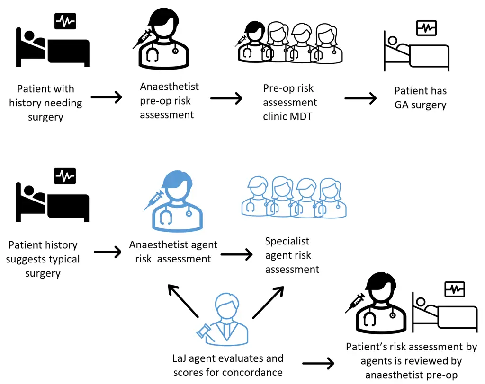
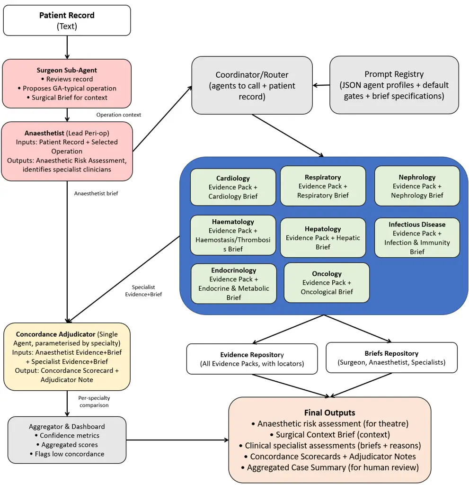
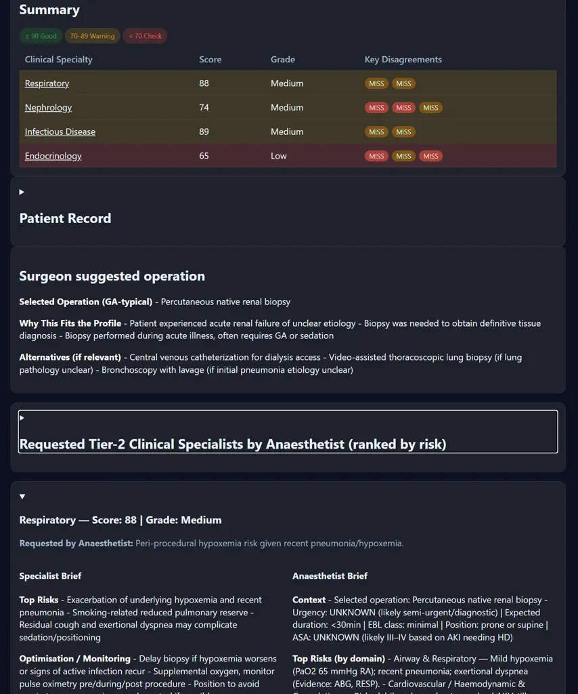

# Evaluating Metrics for Safety with LLM-as-Judges

Kester Clegg Affiliation: Centre for Assuring Autonomy, University of
York, York, UK E-mail [{kester.clegg, richard.hawkins,
ibrahim.habli}@york.ac.uk](mailto:%7Bkester.clegg,%20richard.hawkins,%20ibrahim.habli%7D@york.ac.uk)
   Richard Hawkins Affiliation: Centre for Assuring Autonomy, University
of York, York, UK E-mail [{kester.clegg, richard.hawkins,
ibrahim.habli}@york.ac.uk](mailto:%7Bkester.clegg,%20richard.hawkins,%20ibrahim.habli%7D@york.ac.uk)
   Ibrahim Habli Affiliation: Centre for Assuring Autonomy, University
of York, York, UK E-mail [{kester.clegg, richard.hawkins,
ibrahim.habli}@york.ac.uk](mailto:%7Bkester.clegg,%20richard.hawkins,%20ibrahim.habli%7D@york.ac.uk)
   Tom Lawton Affiliation: Bradford Royal Infirmary, Bradford, UK
E-mail <Tom.Lawton@bthft.nhs.uk>

###### Abstract

LLMs (Large Language Models) are increasingly used in text processing
pipelines to intelligently respond to a variety of inputs and generation
tasks. This raises the possibility of replacing human roles that
bottleneck existing information flows, either due to insufficient staff
or process complexity. However, LLMs make mistakes and some processing
roles are safety critical. For example, triaging post-operative care to
patients based on hospital referral letters, or updating site access
schedules in nuclear facilities for work crews. If we want to introduce
LLMs into critical information flows that were previously performed by
humans, how can we make them safe and reliable? Rather than make
performative claims about augmented generation frameworks or graph-based
techniques, this paper argues that the safety argument should focus on
the type of evidence we get from evaluation points in LLM processes,
particularly in frameworks that employ LLM-as-Judges (LaJ) evaluators.
This paper argues that although we cannot get deterministic evaluations
from many natural language processing tasks, by adopting a basket of
weighted metrics it may be possible to lower the risk of errors within
an evaluation, use context sensitivity to define error severity and
design confidence thresholds that trigger human review of critical LaJ
judgments when concordance across evaluators is low.

## 1 Background

### 1.1 Assessing the performance of LLMs

Productivity gains from using LLMs in domains such as safety analysis
are hard to quantify due to the context dependence when assessing
performance. Prior work using LLMs for fault tree analysis \[3\] showed
that both qualitative and quantitative assessments are challenging due
to the reliance on subjective expert opinion and the variable contexts
of failure modes within a system. For example, is omitting a base event
in a fault logic tree more critical than applying incorrect failure
logic at a conjunction? Context dependence can mean that not all errors
in the output are of equal severity even when they are of the same type,
i.e. where the error occurs (its context) may be as critical as the
error type. Understanding how to evaluate LLM outputs in a robust,
context-sensitive manner lies at the heart of whether we can deploy LLMs
to process information flows in critical scenarios.

If we want to argue that an LLM deployment will not contribute to a
known hazard, we need convincing evidence about safeguarding output
quality from the model, i.e. can errors be detected and handled, and if
not, can they be mitigated? For critical tasks, there may be limited or
even no prior data on the types of errors that can be made, or their
severity, as critical tasks tend to be performed by suitably qualified
or experienced personnel (SQEP) who ensure high quality standards. But
when we try to evaluate LLM performance against what good looks like, we
need to do more than simply compare LLM outputs to human performance, we
need to ensure we can also detect and handle errors that are unique to
LLMs. The context sensitivity problem means that detecting these sorts
of errors might require greater contextual understanding than the model
can be provided with as part of its inputs or prompt for the task,
therefore additional safeguards are necessary. The ‘burden of proof’
moves to the robustness of the evaluation points in the process,
regardless of whether that evaluation is by machine or human. By safer
in this context, we are not talking about an intrinsic quality of the
model itself, i.e. how well it aligns to guardrails or is able to resist
jailbreaks. We are interested in whether we can trust an LLM to do a
task safely, given the context and requirements of that task, and what
evidence would give us the confidence to argue that.

Building additional processing ‘scaffolding’ around an LLM is now
commonplace to try to meet performance guarantees. Techniques like
Retrieval Augmented Generation (RAG), knowledge graphs, fine tuning or
over-fitting on local domain data, agentic frameworks, prompt and
context engineering have all been claimed to reduce model hallucination
and errors. However, there is little agreement on how to evaluate these
claims, and due to the context sensitivity problem, generic performance
benchmarks carry no weight in most safety critical contexts (see
references in \[11\]). To some extent the method chosen to achieve the
quality of performance needed is irrelevant, provided that evidence from
evaluations demonstrates that the LLM is safe to use for the specific
task under consideration in its particular usage context.

However, many of the architectural proposals can be affected by or hide
unexpected complexity in their evaluations. For example, sparse exposure
to training data (typical of restricted private domains) can mean LLM
outputs show higher variance on the same task and small changes in task
complexity can have a disproportionately adverse effect on output
quality. But ‘complexity’ across different text processing tasks has no
recognised metric¹¹ 1 I am excluding human linguistic or cognitive
performance measures, such as syntactic depth or semantic / pragmatic
loads, as there is no evidence these apply in the same way to LLMs., and
given that simply increasing input token lengths results in greater
misalignment \[9\], how can we assess the likelihood and probable error
severity for a given task? As Chen et al. argue, context is essential
for judging LLM performance \[2\], but can we argue that we have
sufficient confidence in the evaluation metrics to be able to replace
human oversight for a critical task?

#### RAG and Knowledge Graphs in Safety-Critical Domains

In an extensive survey of the capabilities of LLMs to generate safety
cases, Odu et al. \[15\] used a combination of linguistic and
vector-based metrics to try and assess the LLMs responses’ proximity to
ground truth. The first was a simple one-to-one token match, the second
used BLEU (Bilingual Evaluation Understudy) score \[17\], which is a
metric used to evaluate the quality of machine-translated text by
comparing it to human-translated reference text, and thirdly cosine
similarity, which is a measure used to compare vector embeddings for
words in LLMs. There are weaknesses with all of these metrics, as they
do not measure ‘meaning’ as understood by humans with respect to a
ground truth. Secondly, such measures do not measure missing information
that should have been included in an output, i.e. where an LLM has
omitted relevant information (sometimes referred to as the Gricean maxim
of quantity). Omission remains an outstanding problem for LLM
evaluation, and despite recent work by Microsoft \[13\] to date the only
means to check for omission is to go back to the source material and
review it against the LLM output by hand.

Many of the concerns around factual accuracy have been explicitly raised
in a recent technical memorandum from NASA looking at the use of LLMs to
assess or process safety assurance cases \[7\]. The report cites a
heavily publicised paper from the University of Glasgow that was the
first to describe LLMs as “bullshitters \[sic\]” \[8\], based on the
philosopher Harry Frankfurt’s definition of someone who has “no concern
for truth or how things really are” \[5\]. Despite the fact that LLMs
are poor at reasoning and “there is no concept of truth in the LLM
training process” \[7\], LLMs often attempt to reason without any
understanding of what is true or warning the user that their knowledge
of the domain is poor. The NASA report further questions the interactive
and repetitive mechanisms employed by many researchers to either improve
LLM answers or deal with variance in the LLM output. For example they
cite the example of \[15\] who asked the same query of an LLM five times
and took an average of the answers using a BLEU score in order to deal
with output variance. They questioned how this approach could be deemed
an efficient or even realistic way to evaluate outputs in production.

Breaking up large tasks into subtasks is a common tactic to improve
outputs from LLMs, and recent developments have seen the providers of
frontier models recognise this by developing agentic frameworks \[10\].
Agentic frameworks permit tasks to be allocated to individual agents,
and each of those agents can be prompted using system instructions to
adopt a specific role, and potentially even fine-tuned to give expertise
in a specific context. Model Context Protocol (MCP) developed by
Anthropic²² 2 https://docs.anthropic.com/en/docs/agents-and-tools/mcp
takes this a step further by using a common interface that standardises
how applications provide context to LLMs, allowing LLM agents to start
applications to provide input and outputs to the LLM. MCP and similar
frameworks often rely on JSON schemas to ensure data is correctly
formatted between the LLM and associated applications. This has lead to
some vendors providing APIs that guarantee correctly structured JSON
output by limiting token outputs from a restricted set³³ 3
https://platform.openai.com/docs/guides/structured-outputs. While being
correctly structured does not mean the content is correct with respect
to a ground truth, it could help in certain contexts by ensuring all
agents use the same vocabulary when passing information between them.

Recent work (2021–2025) on retrieval-augmented generation (RAG) and
knowledge graphs (KGs) in high-assurance domains highlights
domain-specific performance challenges and evaluation difficulties. In
healthcare, there are claims that RAG can boost accuracy and reduce
hallucinations by grounding LLM outputs in vetted literature or
guidelines \[18\]. For example, a local radiology RAG system eliminated
all hallucinated contrast-dosing suggestions present in an LLM’s output
(reducing errors from 8% to 0%). However, the performance of RAG in such
specialized settings hinges on the quality and relevance of the
retrieved knowledge base. If the retrieval corpus is outdated or
imprecise, RAG may surface irrelevant or low-quality information
(“retrieval noise”) that degrades output fidelity \[14\]. Domain
specificity also poses challenges: models can falter when faced with
institution-specific terminology or shifting guidelines (a form of
domain shift) \[14\]. Indeed, integrating newly updated clinical
protocols into RAG systems remains non-trivial, and few studies have
tested RAG in time-sensitive clinical decision support scenarios \[18\].
One recent radiology study showed that even with RAG improvements, a
local 11B parameter model still lagged behind larger cloud LLMs on
overall performance metrics \[18\], underlining the difficulty of
closing the gap in critical tasks.

Evaluating RAG-driven systems in safety-critical contexts is itself a
major challenge. As previously mentioned, standard NLP metrics e.g.
BLEU, ROUGE (Recall-Oriented Understudy for Gisting Evaluation), often
fail to capture the nuanced requirements of domains like medicine.
Research has found that such automatic scores align poorly with human
expert judgments \[6\]. For instance, in a nuclear medicine Q&A system,
string-based metrics (ROUGE / Levenshtein distance) did not correlate
with radiologists’ assessments of answer quality \[6\]. An LLM-based
evaluation metric (RAGAS) achieved more consistent rankings with the
experts, but still only modestly correlated to manual scores, implying
that expert oversight remains essential. More broadly, RAG evaluation in
high-stakes settings often requires task-specific criteria (e.g. factual
correctness, clinical relevance, reasoning transparency) and
domain-expert panels to judge outputs. The literature points to
inconsistent definitions (e.g. what constitutes a “hallucination” and
can it be formally defined? \[4\]) and the lack of heterogeneous
evaluation protocols across studies \[14\], complicating comparisons.

Researchers have explored knowledge graphs as a tool to enhance
reliability and interpretability of AI in safety-critical systems. KGs
offer a structured representation of verified facts, which can be used
to constrain or inform an LLM’s generation. In complex domains (like
aerospace or nuclear operations), this approach aims to enforce logical
consistency and provide explainable reasoning paths \[14\]. In medical
decision support, graph-augmented RAG pipelines have shown gains in
precision and factual accuracy by linking patient queries to trusted
knowledge bases of clinical relationships \[14\]. By guiding the model’s
logic via graph relations rather than unconstrained text, these systems
can reduce spurious reasoning and increase interpretability, a critical
advantage for high-assurance use.

Despite these benefits, the use of KGs introduces its own performance
challenges. A knowledge graph must be comprehensive, current, and
correct — properties that are hard to guarantee in domains that rely on
synchronous real-time data of the type typical in medical settings. In
practice, graph-augmented models struggle if the underlying structure is
incomplete or out-of-date \[14\]. Given the scale of proprietary
domains, the graph relations are often automatically extracted by LLMs.
Maintaining and validating such KGs is labour-intensive, and any
mistakes in the graph can propagate to model outputs. There are also
other scalability concerns: integrating graph queries with neural
generation can be computationally heavy and complex to engineer\[14\].
These constraints pose questions about the generalizability and
real-time use of KG-based methods in critical environments.

Finally, evaluating KG-augmented systems is challenging because success
must be measured not just by output accuracy, but by the soundness of
the reasoning. This is often done using ‘chain-of-thought’ judgements by
LLMs, despite widespread recognition of LLMs’ poor reasoning
capabilities cited earlier. Traditional metrics may not capture whether
an answer was arrived at via valid, trustable knowledge. Domain experts
often need to review the provenance of the model’s decisions (e.g. which
graph nodes were used) to concretely assess safety. This is reflected in
recent medical studies where expert panels conducted multi-factor
evaluations (correctness, justification quality, safety implications)
for graph-informed LLM outputs \[14\].

In summary, the methods discussed bring stringent requirements for
knowledge quality, and they expose limitations in our current evaluation
methods. Particularly in critical sectors like healthcare (where patient
safety is at stake), even minor performance lapses can have serious
consequences. There is a clear gap in fully understanding how these
systems perform on edge cases and how to guarantee their reliability
over time as the augmentation context is updated \[14\]. While RAG and
KGs can mitigate some weaknesses of stand-alone LLMs, the challenge of
rigorously evaluating and assuring their performance in safety-critical
contexts remains a significant problem.

#### LLM-as-Judge in Safety-Critical Contexts

The problems associated with evaluation bottlenecks needing human review
has led to proposals to use LLMs as automated evaluators (LLM-as-Judge
or LaJ). Machine evaluation has implications in safety-critical
contexts. In addition to what has already been discussed, LaJs may be
prone to issues of bias, reproducibility, and variance in their
judgments, and there is the issue of ‘who judges the judge?’. While
LLM-based evaluators have been tested as surrogates for expert panels in
healthcare and safety assurance, studies consistently show low
reliability when domain expertise is required \[6\]\[21\], which means
some mechanism is required to flag when human review is required to
check the model’s output. For instance, in nuclear medicine QA tasks,
LLM-judged metrics only partially correlated with radiologists’
assessments, raising concerns about entrusting judgment to models that
cannot fully grasp context-specific error severity \[6\]. Bias
amplification is a recurring issue: evaluators inherit the training data
biases of the underlying LLM, leading to uneven scoring across
subdomains \[21\]. The problem is compounded by instability under prompt
variations and adversarial phrasing, which undermines reproducibility of
evaluations in regulated domains \[16\]. Even when LLMs provide
rationales for their judgments, these rationales are often post-hoc and
cannot be trusted as causal explanations, limiting their use in
assurance arguments for critical systems \[12\] (see also our later
discussion on evaluating metrics for safety in Section 3).

The use of LaJ extends to classification type automated evaluations. For
example, in \[11\] an LLM is used to identify safety relevant dialogues
with patients by validating against expert clinician annotations. While
this study claims the best LLMs “out performed clinicians in a blinded
assessment of 240 dialogues”, LaJ-based systems such as this require a
rigorous evaluation of the LLM as judge to make the safety case
sufficient, and these may rely on properties intrinsic to the model.
Such properties can be difficult to verify, especially for large models
and limited amounts of testing. It is worth mentioning that most of the
LaJ use cases that report adequate performance in safety critical
contexts tend to be classification type tasks, and as such do not
involve risks of omission. Where omission is a substantial risk, the use
of RAG or LaJ based augmented evaluation remains insufficient. For
example, in \[19\] they found that even with an extensive augmentation
framework (RAGuard and SafetyClamp) around the LLM, the risks of
omission in the LLM outputs remained despite being substantially
reduced. The assurance argument in these cases rests on whether exposure
to the risk of omission is low, or if the exposure is high (i.e. it
could occur in many contexts), then the safety case should argue that an
omission will not contribute to known hazards. This implies that a
method for detecting the omission in LLM output can be assured.

Finally we would draw attention to work on why chain-of-thought
reasoning (including LLM-as-a-judge evaluation) fails in medical text
understanding \[20\]. Pertinent to our work, they developed an error
taxonomy (hallucination, omission, incompleteness) evaluated via an
LLM-as-a-Judge framework with clinician review, offering actionable
guidance for safer use of chain-of-thought (CoT) in clinical contexts.
They used ROUGE averages and Jacquard index (see also our discussion on
this metric for LaJ evaluation in Section 3) to assess tasks like
summarisation. What is imporant to note is that they found
“LLM-as-a-Judge framework with expert review also highlights the
hallucination and information omission as dominant failure modes of CoT”
and that they “observe that numbers, units, and measurement-related
tokens are overrepresented among CoT-incorrect traces (e.g., pt, ct,
numeric values), as are abbreviations for laboratory and physiologic
assessments such as plt (platelet count) and pft (pulmonary function
test)”. As we show later, these are exactly the types of text items we
are trying to assure in our experiment (see Section 2.2). However, in
our case we are not testing model performance. Our purpose is to
evaluate what arguments can be put forward for assuring the safety of
LaJ use in a critical setting. Whether such arguments are deemed
sufficient will depend on what type of evidence is presented to back up
those claims and who is making the safety assessment.

Having discussed the literature on methods to ground LLMs in domain data
and some of the issues associated with LaJ evaluations, we will now use
an illustrative implementation of an agentic framework and examine in
detail how LaJ evaluations could provide evidence for assurance. We
provide a worked example of the metrics typically used in evaluation
points, how they can be composed and discuss what design decisions could
be made to assure the output from a safety perspective.

## 2 LaJ Use Case: An agentic framework for Peri-operative Risk Assessment

Our objective is to determine what is required from evaluation points to
demonstrate to stakeholders (patients, health trusts), users (clinical
care professionals) and developers that an LLM-based application is safe
to use for a safety-related task. To explore this we use an example of a
realistic text processing task within a critical setting. The aim is not
to present the assurance of a fully implemented system, but to discuss
how a LaJ based agentic system could use evaluation points to argue that
the application is safe. To illustrate the problem of context
sensitivity described earlier, we chose the medical domain where the
error severity is dependent on its context. The patient’s condition and
treatment can provide multiple overlapping contexts for risk assessment
and much of the information that is stored is text based.

The medical domain is composed of multi-disciplinary teams that come
together to work on a patient’s surgical or other care needs in what are
termed ‘clinics’. This type of team work, comprising of domain
specialists and a co-ordinator is a good fit for an agentic LLM
workflow. For these reasons we decided to implement a simple agentic
framework, with help from a clinical lead for critical care and
anaesthesia, for peri-operative risk assessment clinic that could
demonstrate a realistic LaJ task in a safety critical context.

### 2.1 Patient safety under anaesthetic



Figure 1: Top diagram shows the workflow for pre-operative risk
assessment clinic. Bottom diagram shows our imaginary agentic use case.
The surgical context for the patient is provided by the surgeon, or
surgeon agent (see Fig. 2).

We first discuss how a patient might be harmed in our chosen context. If
a surgeon recommends surgical intervention for a patient, they will call
on an anaesthetic pre-assessment clinic to prepare an initial risk
assessment based on the patient context, surgery type, estimated blood
loss, length of operation, etc. At the clinic, staff will examine the
patient record and prepare an initial risk assessment or brief. If
needed, they may call on a consultant anaesthetist or other specialist
clinician to advise on any unusual or complex conditions that present
risks to the patient during surgery. However, it is possible for the
clinic to miss some aspect of the patient’s condition or underestimate a
complex risk scenario. An example of this is a patient who has, at some
point in the past, received bleomycin (a chemotherapy agent). Once a
patient has been exposed to bleomycin, their lungs may remain sensitised
indefinitely and at risk of pulmonary fibrosis if exposed to high levels
of oxygen. During general anaesthesia, patients are routinely
pre-oxygenated and maintained on inspired oxygen fractions much higher
than room air. In patients with a bleomycin history, exposure to high
FiO₂ (Fraction of Inspired Oxygen) can precipitate or accelerate
oxygen-induced pulmonary fibrosis, even years after the chemotherapy was
given. Clinically, this may manifest as acute respiratory distress,
progressive hypoxaemia, and long-term loss of lung function. Mortality
in reported cases is high \[1\].

Critical information like this can be difficult to find in the patient’s
record. Our anaesthetist advisor cites a previous practice of putting a
sticker on the front of the patient notes as a visible warning, but in
the digital era this often takes the form of one of a multitude of
‘flags’. While clinical policies vary, the anaesthetist’s risk
assessment on the morning of surgery is usually considered the primary
check, but pre-operative assessment nurses, surgeons, and oncologists
are key safety nets. If bleomycin exposure is missed by the
anaesthetist, the most likely prevention would be at the earlier pre-op
clinic (by nurses or consultant anaesthetist reviewing the record) or by
the oncologist’s treatment summary being reviewed pre-surgery. For
oncology patients in particular, MDT (multi-disciplinary team)
discussions (oncologist, surgeon, anaesthetist, specialist nurses) may
bring prior bleomycin exposure into focus, especially if lung
complications are already suspected.

For our use case, we wanted the LLM to role-play the initial pre-op
anaesthetist in preparing a risk assessment brief for a particular
patient. For the sake of examining how LaJ agents could improve or even
verify LLM outputs, we created an imaginary scenario whereby an
anaesthetist agent’s risk assessment is checked against a set of
clinical specialist agents, each of which has been asked to prepare a
similar risk brief (see Fig. 1 and 2). Although this does not mirror
clinical practice in hospitals, it serves as a realistic context in
which we can assess LaJ evaluations in terms of their safety
implications. As part of this imaginary scenario, we envisaged a human
anaesthetist using the agentic framework to provide an initial risk
assessment, knowing it is backed up by LaJ adjudicated comparisons
between the anaesthetist agent and specialist agents. The human
anaesthetist might assume this combination means that the agentic risk
assessment will have no critical errors or omissions. In this case study
we consider the argument and evidence that might be put forward to
support a safety claim regarding a patient risk assessment generated by
LLM agents, given that if the risk assessment were to miss a condition
like bleomycin exposure, serious harm to the patient could occur.

### 2.2 Implementation



Figure 2: The workflow for peri-operative risk assessment clinic
performed by LLM agents.

The agentic framework we created uses individual system prompts based on
profiles for clinical roles. Each agent has this stored as JSON file, in
which there are explicit instructions relating to quality gate
assessments, risk brief profiles and evidence briefs (verbatim extracts
from the patient records).

Our main purpose in implementing this agentic framework was to look at a
real-world example of context sensitivity for error types and detection,
and how evaluations by LaJs require careful composition in order to
lower the risks of unsafe judgments by the LaJ adjudicator. The LaJ
evaluation described below is not intended to generate debate on whether
these are the most suitable metrics for this task. Rather, we are
interested in how these types of evaluation points can be assured, or
help assure the safety of the final outputs. We do not present
statistical results of how often errors were detected in an agent’s
output or how often the anaesthetist’s brief was found to have missed
critical contexts, as these are model dependent. Instead we discuss how
to make evaluation metrics evidence-based and traceable, and whether
non-deterministic or ‘soft’ metrics based on LLM judgements can be
trustworthy.

We generated risk categories for the peri-operative risk assessment
framework by collecting a small set of patient records and extracting
clinical risk factors.⁴⁴ 4 Patient record set from huggingface:
https://huggingface.co/datasets/jung1230/patient_info_and_summary/viewer/default/train?views\\5B\\5D=train&row=35.
Each patient was individually assessed for risk assuming a common
surgical procedure for that patient profile that would require a general
anaesthetic. These risks were grouped into a minimal set of common
peri-operative risk categories (e.g. cardiovascular / haemodynamic,
airway / respiratory, renal, infectious / immunological). This taxonomy
provided a consistent way to capture and compare risks across different
patients and specialist contexts, ensuring that the categories were
consistent and risks could be linked to categorised domains rather than
left as free text extractions.

Having ranked and classified the risks, we could identify the clinical
specialists that an anaesthetists might call upon for specialist advice
or input in a peri-operative meeting. Our framework implements the
simple agentic workflow shown in Fig. 2. The Surgeon agent suggests a
plausible surgical intervention appropriate to the patient profile; the
Anaesthetist agent then reviews the patient record and proposed
operation, producing a structured risk brief and identifying which
clinical specialist agents should be consulted. Each specialist agent
(e.g. Cardiologist, Respiratory, Nephrologist, Haematology, etc) has a
defined profile and prompt tailored to its domain, ensuring that its
output is a focused summary of the most critical risks for that
speciality together with supporting evidence extracted verbatim from the
patient’s record.

The Adjudicator agent (i.e. LaJ) then compares the Anaesthetist agent’s
risk assessment with that from each of the specialist agents. The
Adjudicator’s role is to evaluate concordance by checking coverage of
risks, correctness, prioritisation, and actionability, with special
attention to predefined quality gates (critical domain-specific safety
rules). Each gate is checked against the evidence and the Anaesthetist
agent’s brief; missed gates cap the relevant sub score (potentially
triggering human review). Sub scores across the risk categories are
weighted and aggregated to produce an overall confidence score (0–100)
together with a grade band (High, Medium, Low, Very Low). The
adjudicator outputs both a machine-readable scorecard (JSON: sub scores,
agreements, disagreements, gate checks) and a short explanatory note, in
theory giving a human and machine auditable measure of how well the
Anaesthetist agent’s risk assessment aligns with specialist agents’
expertise.

#### Agent profiles

Each of the agent’s system prompts is defined by a JSON file so that
they can be altered and examined outside the program code and structured
outputs are easier to generate. Agent profiles can be extensive in real
world applications. We reproduce a brief extract from the Cardiology
agent system prompt below, as the full profile for this clinical
specialist is much longer. It should be noted that in the implementation
we had to shorten most of the specialist profiles to prevent agents
misaligning during their tasks. This seems to be a case of “context
poisoning”, i.e. where a lengthy contextual input starts to confuse an
agent. However, we believe this limitation could be overcome with
greater development effort. The evidence packs and risk briefs are
defined separately.

#### EVIDENCE PACK Line Structure example (JSONL; one object per extracted item)

- •
  source_id: string (e.g. file name or document id)
- •
  locator: string (e.g. page/section/line or timestamp) — be specific
- •
  extract_text: string (VERBATIM; no edits)
- •
  tag: one of \["CAD/ACS","HF", "VALVE", "ARRHYTHMIA", "PULM_HTN",
  "AORTA", "ANTITHROMBOSIS", "FUNCTION", "INVESTIGATION", "LABS",
  "COMORBID"\]
- •
  comment: string, $`\leq 12`$ words

Example line:

```ltx_verbatim
    {"source_id":"preop_note.pdf",
     "locator":"p3 §2 lines 12–18",
     "extract_text":"Severe aortic stenosis… AVA 0.7 cm²,
        mean gradient 45 mmHg.",
     "tag":"VALVE",
     "comment":"critical AS metrics"}

```

#### Extract from Cardiology Risk Brief

1.  1.  Top Risks (CVS Context) 5–8 bullets, highest-impact first.
2.  2.  Immediate Actions / Optimisation Concrete steps (e.g., arterial line
        on induction, hold clopidogrel 5 days if safe, consider bridging per
        haematology).
3.  3.  Go / Delay Triggers Explicit criteria that should delay surgery
        (e.g., decompensated HF, ongoing troponin rise, critical AS without
        plan).
4.  4.  Monitoring / Adjuncts e.g., intra-operative TEE, invasive
        monitoring, device magnet policy, post-operative ICU/HDU plan.
5.  5.  Risk Scoring (if data available) e.g., EuroSCORE II / STS (cardiac);
        procedure-specific vascular risk; otherwise state “UNKNOWN”.

#### Quality Gates (before finalisation)

- •
  Re-check numbers digit-by-digit and units.
- •
  Confirm that every brief bullet is supported by at least one Evidence
  Pack line.
- •
  No clinical instruction conflicts (e.g., holding antiplatelet in
  recent stent without plan) — flag conflicts in “Go/Delay Triggers”.

#### Additional Quality Gates (Cardiology)

- •
  ACS / ongoing ischaemia: if symptoms _or_ rising troponin
  $`\Rightarrow`$ list as first Top Risk; for non-emergent vascular
  surgery include a delay trigger; for cardiac surgery, specify
  revascularisation/operative strategy as per evidence.
- •
  Stents / DAPT: Evidence Pack must include stent type + date +
  indication + all antiplatelets with last doses. Brief must state
  peri-operative antiplatelet plan or MDT decision if within high-risk
  window (BMS $`<`$30 d; DES $`<`$3–6 mo)  
  …(remainder cut short)

The definition of these agent profiles could be worked out with the
peri-operative team. In particular, the quality gates could be defined
to suit local patient profiles. We shortened the list of critical
quality gates in our implementation to allow the LaJ evaluations to be
more easily inspected. For example for Nephrology, this was reduced to:
gates=\[K+ $`\geq 6.0`$ or ECG changes → delay/correct first”,
”Platelets ¡100×10⁹/L or INR ¿1.5 → correct before procedure”\]. Keeping
the list of safety critical quality gates to minimal lengths greatly
helped the consistency of the specialist agents’ risk briefs.

The adjudicator agent evaluates agreement between the anaesthetist’s
brief and each specialist brief using a structured rubric. Inputs
include the ANAESTHETIST_BRIEF, SPECIALIST_BRIEF, supporting verbatim
extracts (ANAESTHETIST \_EVIDENCE_JSONL, SPECIALIST_EVIDENCE_JSONL), and
specialist QUALITY_GATES.

#### Dimensions of Comparison

The adjudicator computes sub scores (0–1) across five dimensions
(weighting in brackets):

1.  1.  Coverage (30%) — proportion of specialist risk items also present in
        the anaesthetist brief. This is a Jacquard Index overlap
        calculation. _Example:_ 8 of 10 items matched $`\Rightarrow`$
        coverage = 0.8.
2.  2.  Critical Items (30%) — hard rules defined by QUALITY_GATES. If a
        gate is supported by evidence but absent in the anaesthetist brief,
        the subscore is capped:
    - •
      One major miss: $`\leq 0.40`$
    - •
      Multiple major misses: $`\leq 0.20`$

    _Example:_ LVEF 35% (gate requires invasive monitoring); if omitted,
    critical_items $`\leq 0.4`$.

3.  3.  Correctness & Specificity (20%) — penalises contradictions or vague
        statements. _Example:_ Evidence: SpO₂ 88% RA; anaesthetist states
        “respiratory function stable” $`\Rightarrow`$ reduced specificity.
4.  4.  Prioritisation Alignment (10%) — compares ordering of top risks.
        _Example:_ Specialist places hypoxaemia as \#1, anaesthetist places
        it last $`\Rightarrow`$ subscore reduced.
5.  5.  Actionability Alignment (10%) — compares monitoring, optimisation,
        and delay triggers. _Example:_ Specialist: “Delay if
        K$`{}^{+}\geq 6.0`$” vs anaesthetist: “Monitor potassium” (no
        threshold) $`\Rightarrow`$ reduced score.

#### Disagreements and Quality Gates

Disagreements in our implementation tended to be mostly misses (in
clinical practice, actual disagreements would be rare), but are
categorised as:

- •
  MISS — absent in anaesthetist brief but present in specialist
  evidence.
- •
  OVERCALL — asserted without evidence.
- •
  CONFLICT — direct contradiction.
- •
  AMBIGUOUS — insufficient evidence, should be marked “unknown”.

Each disagreement is recorded with a severity (minor / moderate /
major). Critical gates act as hard caps: if a major gate is missed (e.g.
“Acute LRTI $`\Rightarrow`$ delay elective”), the overall score is
capped at $`\leq 69`$ and the case is flagged for human review. In
theory this prevents superficial agreement from obscuring dangerous
omissions (however, see discussion in Section 3). The key disagreements
are shown as coloured badges in the dashboard summary (shown on the RHS
of Fig. 3).

#### Grading

The overall score is a weighted sum that is mapped to a concordance
grade as follows: High: $`\geq 90`$; Medium: 70–89; Low: 40–69; Very
Low: $`<40`$. Fig. 3 shows a dashboard display of the concordance
scores, in a summary table with one row per specialist, coloured
according to the concordance grade (from green (high agreement), to
amber, to red (low or capped)).



Figure 3: Adjudicator results are summarised via a simple dashboard for
Peri-Operative Risk Assessment Clinic.

#### Dashboard summary

The web-based dashboard (Fig. 3) summarises our imaginary peri-operative
risk assessment clinic for a patient undergoing surgery under general
anaesthetic. The interface displays the patient record, the surgeon
agent’s suggested operation, and the anaesthetist agent’s requested
specialist reviews (ranked in order of clinical risk). Comparisons are
shown in drop down cards, with each card containing the specialist
agent’s brief, the anaesthetist agent’s brief, structured evidence
extracts, and an adjudicator-generated scorecard for each of the
dimensions listed above. The summary table at the top provides
traffic-light colour coding of agreement scores and clickable links to
specific disagreements. Traceability of assessment judgments can be
accessed through verbatim evidence links and structured sub scores,
therefore every claim in the briefs maps back to verbatim extracted
JSONL lines from the patient record (source id + locator + extract
text). However, in practice the verbatim extracts were not found easy to
match with the briefs due to the complex text sometimes present in a
patient’s record, meaning that human reviews could take time to confirm
the assessment was correct.

## 3 Evaluating metrics for safety

We have described how the risk categories and agent profiles were
developed, and have shown examples of how the concordance scores made by
the Adjudicator LaJ claim to be calculated. However, we have not
considered the Adjudicator’s evaluations from the perspective of safety.
If this were a real-world implementation, it would be classified as a
medical device and have to undergo a full safety audit. The question we
want to pose is whether the concordance scores could lead to harm for
the patient, i.e. could a high concordance score still miss a critical
factor in the patient record, like exposure to bleomycin, leading to
patient harm under anaesthetic care?

When assuring LaJ based applications, it is essential to know what the
limits of the LLMs are with regard to evidence, and what is claimed as
part of the evaluation. For example, if we take a metric like coverage
of critical risk factors using the quality gates comparison, and decide
the Jacquard Index is an adequate measure, we need to ensure a) that the
LLM implements this metric correctly, and b) where could errors in that
metric occur and could they be detected? There is a risk if the LLM is
asked to create the metric, it will propose it but not declare it
explicitly in the prompt. Thus in the explanation of how the coverage
figure is determined, the LLM claims: coverage = (specialist items
matched) / (total specialist items). But when we examine the LLM derived
prompt, it does not make this explicit: COVERAGE (0.30): % of
Speciality’s salient risks present in BRIEF_S that BRIEF_A also captures
(allow synonymous phrasing). Of course, we can explicitly prompt it to
follow the maths, but will it actually execute that? Does it pass it on
to a deterministic calculator (external tool or generated code) rather
than relying on next token prediction?

But even if we insist on the maths to use and force it to deploy a
calculator or executable program code, are we sure that the specialist
risk items are being correctly identified and matched? Medical
abbreviations or chemical symbols are common in specialist domains but
their usage varies \[20\]. For example, instead of quoting verbatim from
the patient record, the anaesthetist’s brief rewrote “arterial oxygen
saturation” as $`SpO_{2}`$. This is one of several possible variants for
this synonym in the patient records. What evidence can be provided that
all variants will be identified as synonyms? Perhaps this last issue
brings us back to deploying a common list of quality gates agreed by
clinical specialists so that agents deploy from a restrictive JSON
schema under the STRICT output flag. This would guarantee a level of
conformance to one vocabulary by the agents, but not necessarily over
the input (i.e. the patient record). A list of possible synonyms might
give greater assurance over input variance, but you have to demonstrate
that the LLM will use that list by testing against the full range of
possible inputs. The evidence-based arguments for coverage apply equally
to the identification of critical items, including how errors might be
generated by the LLM or the adjudicator agent when calculating the
score.

Softer metrics, like correctness & specificity need additional care if
used in evaluations. Although an LLM may claim it is performing
something that looks deterministic, closer examination proves this has
little clarity. When asked to provide examples of correctness it gave
the following: If anaesthetist says “stable CAD, no DES” but specialist
evidence shows a DES → penalise. But the prompt states: CORRECTNESS &
SPECIFICITY (0.20): Are statements in BRIEF_A factually supported by
EVIDENCE_PACK_A (and not contradicted by EVIDENCE_PACK_S)? Penalise
overcalls and inaccuracies. There is no definition of what “penalise”
means in terms of quantity, the range of contexts it could apply and
whether it is proportional to the contextual risk. Likewise, no evidence
can be obtained about what “factually supported” means in terms of the
metric. The LaJ is generating a numerical score based on vaguely defined
judgements that directly affect the concordance grade, which is intended
to be a safety assured metric.

For specificity the model gave the example: If anaesthetist says “low
oxygen” without numbers, while evidence gives $`SpO_{2}`$ = 88%→
penalise specificity. While we do not claim that specificity per se is a
poor metric to use, we would raise the question about whether it is a
good metric in every context. The anaesthetist’s assessment of low
oxygen in this context is correct and knows what that means for the
surgical procedure. Increasing the specificity does not lower risk for
the patient in this context. Instead it might raise false positives for
poor concordance causing unnecessary human review. In terms of safety
however, this metric is presented as part of basket of measures that
assure the quality of the risk assessment comparison. But perfect
specificity only means for those risks identified, there was close
agreement. Risks that are not identified would not have the metric
applied (i.e. an undetected error), giving a false impression about the
quality of the risk assessment comparison. The safeguard of capping a
concordance score if a critical risk has been missed by the anaesthetist
agent only partially mitigates this, if both miss the error would be
undetected.

When composing a basket of measures, including soft metrics, it is
important from a safety perspective to understand whether the weight of
one metric could lessen the weight of a more important metric that
directly relates to a harmful outcome for the patient. Weighted metrics
need to have accompanying evidence that explains the rationale behind
the weighting, and an argument verifying that high or low scores in one
metric (even if correct) will not undermine the overall safety of the
LaJ judgement.

## 4 Conclusions

We have presented an example of a composable, weighted metric of the
type typically used to argue that a LaJ-based evaluation can be trusted.
The metric seems well designed for a safety critical context: it is
risk-based, context sensitive and can be adjusted to align with local
clinical policies or patient intake.

However, parts of the scoring rubric remain shrouded in mystery. We can
ask an LLM how it calculates coverage, but that is insufficient evidence
to use in a safety claim. An LLM can produce a chain-of-thought
explanation of how it arrives at a score, but that does not guarantee
what it is doing ‘under the hood’. We can only get that type of evidence
if the calculation is passed to an external tool or program code whose
calculations we can trace. Unfortunately there are aspects of text based
comparisons, for example gaining assurance that synonyms will be
recognised equally, or the use of unquantified criteria like “factually
supported” that are dependent on LLM judgments and which will remain
difficult to assure. The value of soft metrics such as these should be
questioned, even if it can be shown they are reliably consistent in
deployment, so that their contribution to the concordance score is well
understood in terms of overall risk. While assigning weighted scores is
good practice in LaJ judgements, the reasoning behind the weighting
should align with where the greatest risk is for that patient.

Despite attempting to mitigate risks by using evaluation points on the
LLM outputs, risks of hallucination, omission and incompleteness by the
LaJ itself remain, particularly in medical settings \[20\]. LaJ is
touted as the only way to scale agentic system throughput, as
human-in-the-loop agentic workflows quickly bottleneck around the human
reviews. However, as we have argued, LaJ based assurance of LLM outputs
need to have greater determinism from their metrics if they are to be
used in safety critical environments. They need explicit instruction on
the quantification of the metric, traceable evidence of what they use
and proof of deterministic calculations before we can argue that their
judgements can be assured.

## References

- \[1\] N. Allan, C. Siller, and A. Breen (2012) Anaesthetic
  implications of chemotherapy. Continuing Education in Anaesthesia
  Critical Care & Pain 12 (2), pp. 52–56. External Links: ISSN
  1743-1816,
  [Document](https://dx.doi.org/https%3A//doi.org/10.1093/bjaceaccp/mkr055),
  [Link](https://www.sciencedirect.com/science/article/pii/S1743181617301695)
  Cited by: §2.1.
- \[2\] X. Chen, R. A. Chi, X. Wang, and D. Zhou (2024) Premise order
  matters in reasoning with large language models. arxiv.org:
  10.48550/arXiv.2402.08939. External Links:
  [Document](https://dx.doi.org/) Cited by: §1.1.
- \[3\] K. Clegg, I. Habli, and J. McDermid (2024) Using GPT-4 to
  Generate Failure Logic. In Computer Safety, Reliability, and Security.
  SAFECOMP 2024 Workshops, Cham, pp. 148–159. External Links: ISBN
  978-3-031-68738-9 Cited by: §1.1.
- \[4\] M. Cossio (2025) A comprehensive taxonomy of hallucinations in
  large language models. arXiv: arxiv.org/abs/2508.01781. External
  Links: [Link](https://arxiv.org/abs/2508.01781) Cited by: §1.1.
- \[5\] H. Frankfurt (2005) On bullshit. Princeton. Cited by: §1.1.
- \[6\] Y. Fukui, Y. Kawata, K. Kobashi, Y. Nagatani, and H.
  Iguchi (2025) Evaluation of a retrieval-augmented generation system
  using a japanese institutional nuclear medicine manual and large
  language model-automated scoring. Radiological Physics and Technology
  18 (3), pp. 861–876. External Links:
  [Document](https://dx.doi.org/10.1007/s12194-025-00941-y) Cited by:
  §1.1, §1.1.
- \[7\] M. S. Graydon and S. M. Lehman (2025) Examining proposed uses of
  LLMs to produce or assess assurance arguments. Technical Memorandum
  Technical Report NASA/TM-20250001849, NASA Langley Research Center,
  Hampton, United States. Note: Document ID: 20250001849; Public Use
  Permitted External Links:
  [Link](https://ntrs.nasa.gov/api/citations/20250001849/downloads/NASA-TM-20250001849.pdf)
  Cited by: §1.1.
- \[8\] M. T. Hicks, J. Humphries, and J. Slater (2024) ChatGPT is
  bullshit. Ethics and Information Technology 26 (2), pp. 38–. External
  Links: [Document](https://dx.doi.org/10.1007/s10676-024-09775-5) Cited
  by: §1.1.
- \[9\] Levy, M. et al (2024) The impact of input length on the
  reasoning performance of large language models. arxiv.org:
  10.48550/arXiv.2402.14848. External Links:
  [Document](https://dx.doi.org/) Cited by: §1.1.
- \[10\] X. Li (2024) A review of prominent paradigms for llm-based
  agents: tool use (including rag), planning, and feedback learning.
  arXiv: arxiv.org/abs/2406.05804. External Links: 2406.05804,
  [Link](https://arxiv.org/abs/2406.05804) Cited by: §1.1.
- \[11\] E. Lim, Y. V. He, J. Joselowitz, K. Preston, M. Chowdhury, and
  et al (2025) MATRIX: Multi-Agent simulaTion fRamework for safe
  Interactions and conteXtual clinical conversational evaluation. arXiv:
  arxiv.org/abs/2508.19163. External Links: 2508.19163,
  [Link](https://arxiv.org/abs/2508.19163) Cited by: §1.1, §1.1.
- \[12\] Y. Liu, J. Wei, P. Chen, et al. (2023) Trustworthy ai: a survey
  and future directions. In Proceedings of the Thirty-Second
  International Joint Conference on Artificial Intelligence (IJCAI),
  pp. 7465–7472. Cited by: §1.1.
- \[13\] D. Metropolitansky and J. Larson (2025) Towards effective
  extraction and evaluation of factual claims. In ACL 2025 Main
  Conference, External Links:
  [Link](https://www.microsoft.com/en-us/research/publication/towards-effective-extraction-and-evaluation-of-factual-claims/)
  Cited by: §1.1.
- \[14\] F. Neha, D. Bhati, and D. K. Shukla (2025) Retrieval-augmented
  generation (rag) in healthcare: a comprehensive review. AI 6 (9),
  pp. 226. External Links:
  [Document](https://dx.doi.org/10.3390/ai6090226) Cited by: §1.1, §1.1,
  §1.1, §1.1, §1.1, §1.1.
- \[15\] Odu, O. et al (2024) Automatic instantiation of assurance cases
  from patterns using large language models. arXiv:
  arxiv.org/abs/2410.05488. External Links: 2410.05488,
  [Link](https://arxiv.org/abs/2410.05488) Cited by: §1.1, §1.1.
- \[16\] P. Ammanabrolu et al (2024) Evaluating evaluation: a survey of
  evaluation methods for large language models. arxiv.org:
  arXiv:2402.00100. Cited by: §1.1.
- \[17\] Papineni, K. et al (2002) BLEU: a method for automatic
  evaluation of machine translation. In Proc.of 40th Annual Meeting on
  Association for Computational Linguistics, ACL ’02, pp. 311–318.
  External Links: [Link](https://doi.org/10.3115/1073083.1073135),
  [Document](https://dx.doi.org/10.3115/1073083.1073135) Cited by: §1.1.
- \[18\] A. Wada, Y. Tanaka, M. Nishizawa, A. Yamamoto, T. Akashi, A.
  Hagiwara, Y. Hayakawa, J. Kikuta, K. Shimoji, K. Sano, K. Kamagata, A.
  Nakanishi, and S. Aoki (2025) Retrieval-augmented generation elevates
  local llm quality in radiology contrast media consultation. npj
  Digital Medicine 8 (1), pp. 395. External Links:
  [Document](https://dx.doi.org/10.1038/s41746-025-01802-z) Cited by:
  §1.1.
- \[19\] C. Walker, K. Aslansefat, M. N. Akram, and Y.
  Papadopoulos (2025) RAGuard: a novel approach for in-context safe
  retrieval augmented generation for llms. arXiv:
  arxiv.org/abs/2509.03768. External Links: 2509.03768,
  [Link](https://arxiv.org/abs/2509.03768) Cited by: §1.1.
- \[20\] Z. Wu, K. Xie, B. Gu, N. Krüger, K. J. Lin, and J. Yang (2025)
  Why chain of thought fails in clinical text understanding. arXiv
  preprint, arXiv:2arXiv.2509.21933. Cited by: §1.1, §3, §4.
- \[21\] T. Zhang, Y. Gu, J. Gonzalez, and M. I. Jordan (2024) On the
  reliability of large language models as evaluators. arXiv preprint,
  arXiv:2403.12015. Cited by: §1.1.
