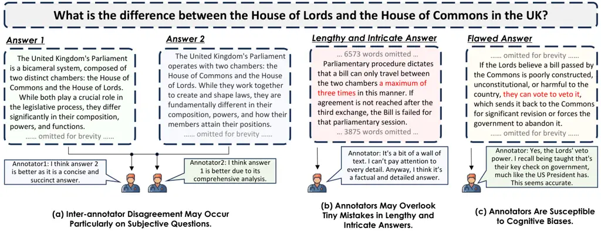
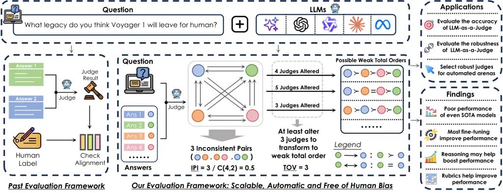
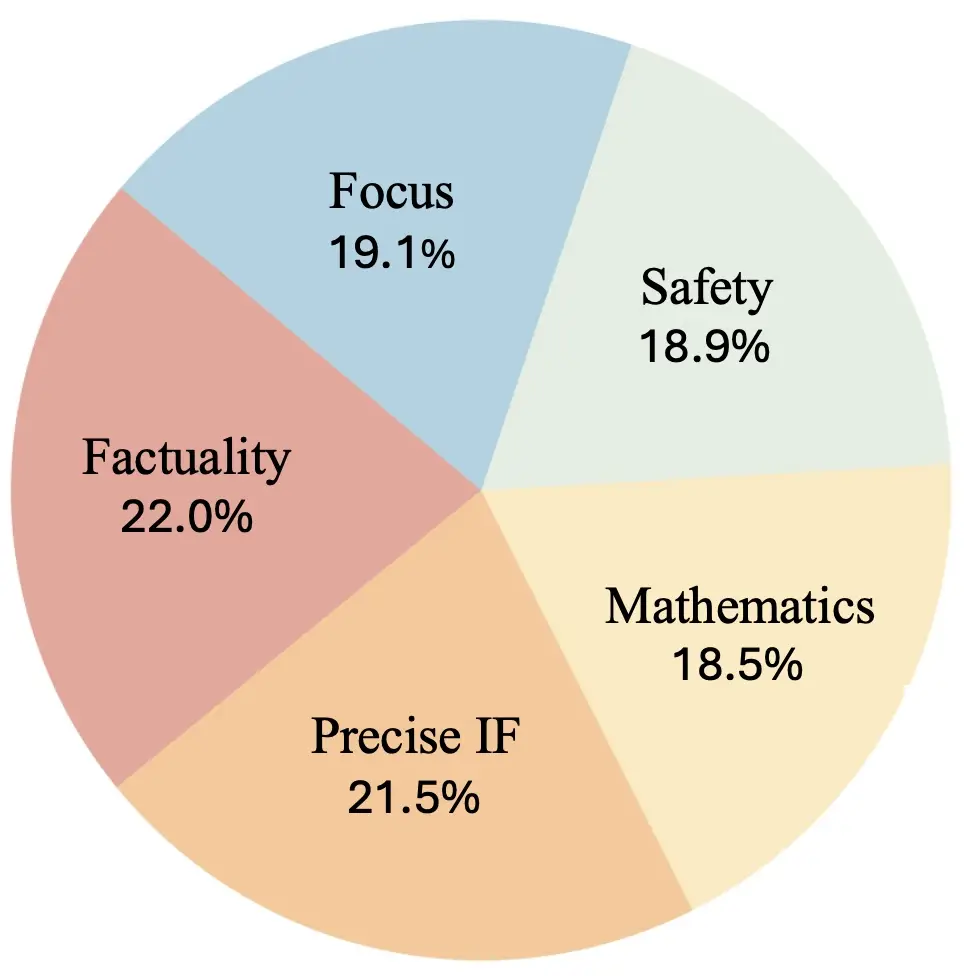
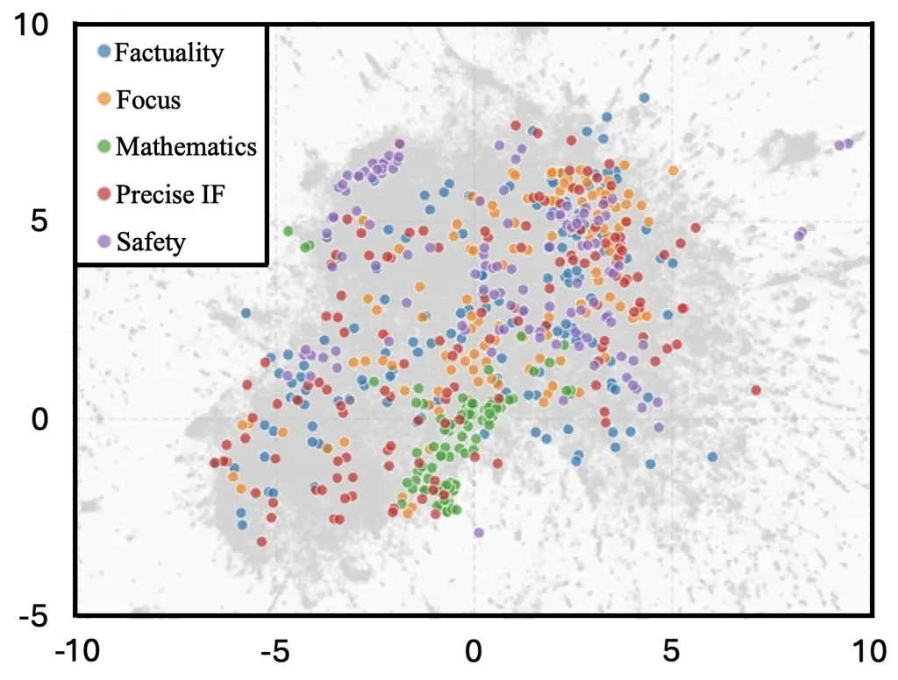
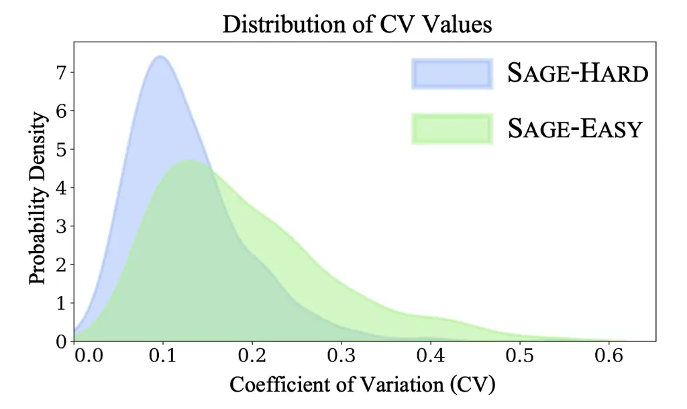
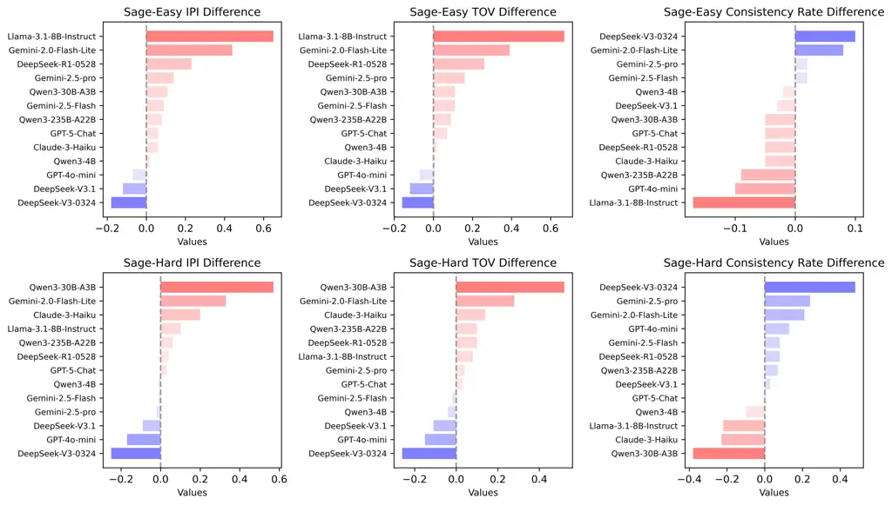
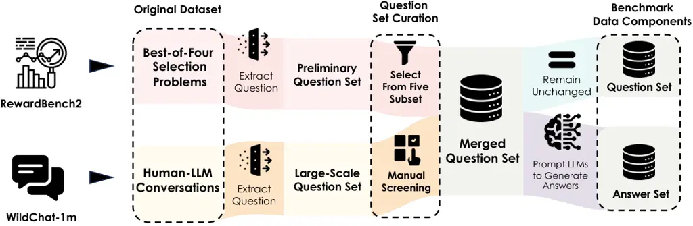

# Are We on the Right Way to Assessing LLM-as-a-Judge?

Yuanning Feng^($`*`$) Affiliation: Huazhong University of Science and
Technology    Sinan Wang^($`*`$) Affiliation: Huazhong University of
Science and Technology    Zhengxiang Cheng Affiliation: Huazhong
University of Science and Technology    Yao Wan^($`\dagger`$)
Affiliation: Huazhong University of Science and Technology    Dongping
Chen^($`\ddagger`$) Corresponding author: Yao Wan: wanyao@hust.edu.cn,
Dongping Chen: dongping@umd.edu Affiliation: University of Maryland

###### Abstract

LLM-as-a-Judge has been widely adopted as an evaluation method and
served as supervised rewards in model training. However, existing
benchmarks for LLM-as-a-Judge are mainly relying on human-annotated
ground truth, which introduces human bias that undermines the assessment
of reliability and imposes scalability constraints. To overcome these
limitations, we introduce Sage, a novel evaluation suite that assesses
the quality of LLM judges without necessitating _any_ human annotation.
Inspired by axioms of rational choice theory, Sage introduces two new
lenses for measuring LLM-as-a-Judge: local self-consistency (pair-wise
preference stability) and global logical consistency (transitivity
across a full set of preferences). We curate a dataset of 650 questions
by combining structured benchmark problems with real-world user queries.
Our experiments demonstrate both the stability of our metrics and their
high correlation with supervised benchmarks like LLMBar and
RewardBench2, confirming Sage’s reliability as an evaluation suite for
the robustness and accuracy of LLM-as-a-Judge. Based on Sage, we reveal
that current _state-of-the-art_ LLMs exhibit significant reliability
problems when acting as judges in both scoring and pairwise settings;
even the top-performing models, Gemini-2.5-Pro and GPT-5, fail to
maintain consistent preferences in nearly a quarter of difficult cases.
We attribute this to a new phenomenon called situational preference,
which explains why explicit rubrics or criteria can help the model judge
consistently across answer pairs. Our further analysis shows that
finetuned LLM-as-a-Judge is a feasible method to boost performance, and
the panel-based judge as well as deep reasoning can enhance the judging
consistency. We also find substantial inconsistency in human judgments,
which indicates that human annotation may not be a reliable gold
standard. We hope our experiments and findings bring insights to the
community towards a more stable and reliable system of generative models
as metrics.

[https://entroplay.ai/research/rethinking-llm-as-a-judge](https://entroplay.ai/research/rethinking-llm-as-a-judge)

## 1 Introduction

The LLM-as-a-Judge paradigm (Zheng et al., 2023) uses a large language
model (LLM) to evaluate AI system outputs, offering a scalable and
efficient alternative to costly and time-consuming human evaluation.
Furthermore, beyond merely assessing performance, these evaluators are
instrumental in refining models. During training, an LLM-as-a-Judge acts
as a scalable reward model to enhance models’ performance through
automated feedback (Bai et al., 2022, Ouyang et al., 2022, Yuan et al.,
2024, Luo et al., 2024). At inference time, it also serves as a
test-time scaling module for real-time filtering to select the best
response (Lightman et al., 2023, Faria and Smith, 2025).

However, the LLM-as-a-Judge paradigm is undermined by inherent flaws.
Judge models are susceptible to biases such as positional (Shi et al.,
2024), verbosity (Saito et al., 2023), and self-enhancement (Wataoka et
al., 2024), which skew evaluation results and call the paradigm’s
reliability into question. In response, various benchmarks have been
developed to assess the judges themselves (Zheng et al., 2023, Chiang et
al., 2023, Gera et al., 2025, Pu et al., 2025). Yet, the construction of
these benchmarks universally relies on human-annotated ground truth,
suffering from the bias and inconsistency due to human data,
particularly on subjective questions, which leads to two problems:



Figure 1: Human-annotated preference may not be reliable. We find three
key challenges with relying on human annotators for evaluating
LLM-as-a-Judge systems. (a) Inter-annotator Disagreement: Different
annotators can have conflicting preferences, especially for subjective
questions, leading to noisy and inconsistent data. (b) Overlooking
Nuances: Annotators may miss subtle errors or inaccuracies in lengthy
and complex answers, leading to flawed evaluations. (c) Cognitive
Biases: Human evaluators are susceptible to cognitive biases, such as
favoring an answer that confirms their false beliefs, which can further
compromise the objectivity of the assessment.

- •
  First, the acquisition of human annotations is a notoriously expensive
  and labor-intensive process, limiting the scale and diversity of
  datasets (Horych et al., 2024, Liao et al., 2025).
- •
  Second, and more fundamentally, assuming human judgment as a gold
  standard is precarious, a “bitter lesson” where human-induced biases
  compromise AI evaluation (Sutton, 2019). As illustrated in Figure 1,
  this reliance is problematic. Persistent inter-annotator disagreement
  creates noisy data (Zhang et al., 2024), demonstrated by low agreement
  shown in AlpacaFarm (66%, Dubois et al. (2023)) and MT-Bench (63%,
  Zheng et al. (2023)). This problem is compounded when lengthy answers
  tax human cognitive capacity. Furthermore, human evaluators are
  susceptible to cognitive biases (Zheng et al., 2023, Chen et al.,
  2024a, Wu and Aji, 2025), favoring answers that match their false
  beliefs, making human annotations an unreliable foundation.

To address this challenge, we introduce Sage (Self-Assessing Gauge for
Evaluators), a novel evaluation suite for assessing LLM-as-a-Judge
robustness without any human annotation. Our approach is grounded in
fundamental principles of rational decision-making, which posit that a
reliable judge must exhibit consistent and coherent preferences. For
example, a robust judge’s preference between two answers should not flip
simply because their presentation order is swapped. Furthermore, its
judgments should adhere to the principle of transitivity, maintaining a
logical and consistent order across a full set of preferences (Ouyang et
al., 2022, Song et al., 2024, Hou et al., 2024, Hu et al., 2024, Liu et
al., 2024). A breakdown in this coherence suggests the model lacks a
consistent internal gauging principle for the question, leading to
unreliable situational preferences.

Based on these principles, we propose two metrics to quantify this
robustness: Intra-Pair Instability (IPI) and Weak Total Order Violation
(TOV). IPI directly measures the local, pairwise consistency by
detecting instabilities caused by positional bias, as in the first
example. TOV, on the other hand, assesses the global logical coherence
of a judge’s complete set of preferences, identifying systemic
contradictions like the violation of transitivity described.

For the evaluation, we curate a diverse dataset of 650 questions by
combining selections from RewardBench2 (Gureja et al., 2025) and the
large-scale WildChat-1m corpus (Zhao et al., 2024) to ensure broad
coverage of real-world user queries. On this dataset, we conduct a
comprehensive evaluation of thirteen prominent LLMs. We validate the
soundness of our metrics by demonstrating both their intrinsic stability
through consistent checking and a distribution-free error bounding
method that yields minuscule variance on the order of $`10^{-5}`$, and
their external alignment with established supervised benchmarks like
LLMBar (Zeng et al., 2023) and RewardBench2, confirming Sage ’s
reliability as an evaluation suite for LLM-as-a-Judge.

Based on Sage, we evaluate a wide range of LLM-as-a-Judge systems in
both scoring and pairwise settings, including state-of-the-art LLMs,
fine-tuned judges, and multi-agent as juries. All judge models degrade
when encountering candidate answers that are in a closer gap, with
approximately 200% more inconsistency, highlighting the potential
problem in using LLM-as-a-Judge in RL-based training and test-time
scaling. Our findings reveal that current models exhibit significant
robustness deficiencies and most specialized fine-tuning brings about
improvement. Our findings also show that multi-agent panels can improve
performance by up to 15% and that increasing a model’s reasoning depth
can only bring about a minor enhancement. Notably, prompting for
self-generated rubrics to avoid situational preference yields an even
greater performance boost, reducing IPI (local inconsistency) and TOV
(global inconsistency) by 16.1% and 11.0%, respectively. In our further
analysis, we investigate the alignment between different evaluation
formats. We also demonstrate Sage’s practical utility in selecting
stable evaluators for automated arenas and its cost advantage over human
annotation. Finally, we apply Sage to human evaluators and reveal the
fragility of human “gold standards”, where IPI reaches 0.332 and TOV
surges to 6.523 on complex tasks. We will release all source code,
curated dataset at
[https://github.com/plafle/LLMasaJudgeAssessment](https://github.com/plafle/LLMasaJudgeAssessment).

## 2 Assessing LLM-as-a-Judge with Sage

This section details the foundational methodology of our proposed
framework, Sage. We begin by formally defining the evaluation problem
and introducing a symmetrized protocol. Building on this, we then
present our two novel metrics: Intra-Pair Instability (IPI) to assess
local, pairwise consistency, and Weak Total Order Violation (TOV) to
measure global, logical coherence.



Figure 2: Sage uses a symmetrized, round-robin protocol to conduct
pairwise comparisons on a set of candidate answers. From these
judgments, Sage quantifies performance using two metrics: IPI, which
measures local consistency by tracking preference reversals (_e.g._, 3
inconsistent pairs result in an IPI of 0.5), and TOV, which assesses
global logical coherence by calculating the minimum alterations required
for a consistent ranking (_e.g._, 3 alternations required). This
methodology scalably diagnoses logical deficiencies to help identify and
select more reliable LLM evaluators.

### 2.1 Problem Formulation

Let $`M`$ be the LLM under evaluation, referred to as the judge model.
Our evaluation is based on a set of questions $`\mathcal{Q}`$. For any
given question $`Q\in\mathcal{Q}`$, we generate a set of $`n`$ candidate
answers, denoted as $`A_{Q}=\{A_{1},A_{2},\dots,A_{n}\}`$. The core task
of the judge model $`M`$ is to perform a pairwise comparison between any
two answers, $`A_{i}`$ and $`A_{j}`$, from the set $`A_{Q}`$. We define
a function $`J_{M}`$:

```math
y_{ij}=J_{M}(Q,A_{i},A_{j})\in\{-1,0,1\} \tag{1}
```

where the outcome $`y_{ij}`$ is interpreted as:

- •
  $`y_{ij}=1`$: $`M`$ judges $`A_{i}`$ to be superior to $`A_{j}`$
  ($`A_{i}\succ A_{j}`$).
- •
  $`y_{ij}=-1`$: $`M`$ judges $`A_{i}`$ to be inferior to $`A_{j}`$
  ($`A_{i}\prec A_{j}`$).
- •
  $`y_{ij}=0`$: $`M`$ judges $`A_{i}`$ and $`A_{j}`$ to be of equal
  quality ($`A_{i}=A_{j}`$).

For each question $`Q`$, we conduct a full round-robin evaluation,
assessing all $`\binom{n}{2}`$ unique pairs of answers, to establish a
complete set of pairwise judgments for our subsequent coherence
analysis.

### 2.2 Symmetrized Evaluation Protocol

A naive single-pass evaluation is susceptible to positional bias, where
the order of presentation influences the outcome. To substantiate that
positional bias does exist in Sage, we sample 1120 answer pairs and
measure the inconsistency rate for Llama3-8B-Instruct (Dubey and et al.,
2024), Gemini-2.5-Flash-Lite (Comanici and et al., 2025), and
Qwen3-4B-Instruct-2507 (Team, 2025).

|                         |                        |
| ----------------------- | ---------------------- |
| Model                   | Inconsistency $`(\%)`$ |
| Llama3-8B-Instruct      | 76.2                   |
| Gemini-2.5-Flash-Lite   | 25.3                   |
| Qwen-3-4B-Instruct-2507 | 44.4                   |

Table 1: Local inconsistency (_i.e._, Positional Bias) across
LLM-as-a-Judge.

We define this rate as the frequency of judgments that are not the
logical inverse when the answer order is reversed (i.e.,
$`J_{M}(Q,A_{i},A_{j})\neq-J_{M}(Q,A_{j},A_{i})`$). The results in Table
1 confirm the presence of bias. To tackle this issue, we adopt a
symmetrized evaluation protocol. For each unordered pair of answers
$`\{A_{i},A_{j}\}`$, we query the judge model twice:

Forward pass: $`y_{ij}\leftarrow J_{M}(Q,A_{i},A_{j})`$; Reversed pass:
$`y_{ji}\leftarrow J_{M}(Q,A_{j},A_{i})`$.

This protocol provides a direct way to measure and account for
first-order positional bias.

### 2.3 Two Evaluation Metrics

We propose two metrics to quantify the robustness of an LLM judge,
targeting two distinct failure modes: local inconsistency on a single
pair and global logical incoherence across a set of answers.

Intra-Pair Instability (IPI). This metric assesses robustness from an
atomic, local level. It quantifies inconsistencies arising from both
systematic positional bias and the inherent stochasticity of the judge
model. Under the symmetrized protocol, a perfectly consistent judge
would always produce opposite scores for reversed pairs (i.e.,
$`y_{ij}=-y_{ji}`$). The IPI score for a given question $`Q`$ quantifies
the deviation from this ideal by calculating the average disagreement
across all unique pairs:

```math
\text{IPI}(Q)=\frac{1}{\binom{n}{2}}\sum_{1\leq i<j\leq n}\mathbb{I}(y_{ij}\neq-y_{ji}) \tag{2}
```

A higher IPI score indicates a greater degree of local inconsistency of
the judge model.

Weak Total Order Violation (TOV). This metric assesses robustness from a
global, systematic level. Specifically, it measures the logical
coherence of the judge’s full set of preferences for a question. A
rational judge’s preferences should be transitive and form a weak total
order (i.e., a total order that allows ties). Let
$`\mathbf{J}_{Q}=\{y_{ij}\}_{1\leq i,j\leq n,i\neq j}`$ be the set of
derived preferences from the symmetrized evaluation for a question
$`Q`$. Let $`\mathcal{O}_{n}`$ be the set of all possible valid weak
total orders on $`n`$ items. For any order $`O\in\mathcal{O}_{n}`$, we
can represent it as a corresponding set of pairwise relations
$`\mathbf{P}_{O}=\{p_{ij}\}`$, where $`p_{ij}\in\{-1,0,1\}`$ denotes the
pairwise relationship between items $`i`$ and $`j`$ with the order
$`O`$. Specifically, $`p_{ij}=1`$ if $`i`$ is preferred to $`j`$,
$`p_{ij}=-1`$ if $`j`$ is preferred to $`i`$, and $`p_{ij}=0`$ if they
are tied. The TOV score is defined as the minimum number of preference
changes required to transform the judge’s observed preferences
$`\mathbf{P}_{Q}`$ into any valid weak total order:

```math
\text{TOV}(Q)=\min_{O\in\mathcal{O}_{n}}\sum_{1\leq i,j\leq n,i\neq j}\mathbb{I}(y_{ij}\neq p_{ij}) \tag{3}
```

A higher TOV score signifies more severe logical contradictions in the
judge’s reasoning.

To summarize a judge model’s overall performance, we compute aggregate
scores for both IPI and TOV. The aggregate IPI and TOV scores are the
arithmetic mean of the per-question scores over the entire set of
questions $`\mathcal{Q}`$ in Sage, calculated as
$`\text{IPI}=(1/|\mathcal{Q}|)\sum_{Q\in\mathcal{Q}}\text{IPI}(Q)`$ and
$`\text{TOV}=(1/|\mathcal{Q}|)\sum_{Q\in\mathcal{Q}}\text{TOV}(Q)`$. The
stability of these metrics is validated empirically in Section 4 and
supported by the theoretical analysis in Appendix A.

## 3 The Construction of Sage

We source the question set $`\mathcal{Q}`$ from five RewardBench2
(Gureja et al., 2025) categories and the large-scale WildChat-1M corpus
(Zhao et al., 2024) to better reflect real-world user interactions. The
resulting question set consists of 650 questions, and its category
composition is shown in Figure 3a. To validate its semantic diversity,
we use a t-SNE visualization (van der Maaten and Hinton, 2008) to
project our questions against a background of 500k English questions
from WildChat1M. As shown in Figure 3b, our questions spread broadly
across the embedding space, confirming the dataset’s representativeness
and wide topical coverage. Further details are provided in Appendix B.1.



(a) Category Composition



(b) Semantic Coverage of Question Set



(c) Distribution of CV Values

Figure 3: We provide statistics and analysis of our selected queries and
answers within Sage. Distribution of CV values shows the varied
difficulty among our two subsets.

For each of the 650 questions, we generate a set of $`n=6`$ candidate
answers for the LLM judge to evaluate, which were used to construct two
distinct tiers: Sage-Easy and Sage-Hard.

- •
  Sage-Easy: the six answers are generated by a diverse lineup of six
  models with a clear capability gradient: Gemini-2.5-Pro and
  Gemini-2.5-Flash (Comanici and et al., 2025); Qwen3-32B (Team, 2025),
  Claude-3-Haiku (Anthropic, 2024), Llama-3.2-3B-Instruct, and
  Llama-3.2-1B-Instruct (Meta, 2024b). These models, which have a
  well-documented performance gap on the LMSYS Chatbot Arena leaderboard
  (LMSYS, 2025), produce a set of answers with a wide variance in
  quality, making the pairwise comparison task relatively simple for a
  competent judge. Crucially, Sage-Easy reflects the general-purpose
  task of comparing different models of varying capabilities, which is
  largely used in automated judges like MT-Bench and Arena-Hard-Auto.
- •
  Sage-Hard: all six answers for each question are generated by a single
  capable model, Gemini-2.5-Flash. Since the answers originate from the
  same model, their quality is expected to be much more homogeneous.
  This setup presents a more challenging task, requiring the judge to
  make finer-grained distinctions between subtly different responses.
  Crucially, Sage-Hard models the judge’s role in applications like
  model-based reinforcement learning and rejection sampling. In these
  scenarios, the judge must distinguish between subtly varied outputs
  from a single capable model.

To quantitatively confirm the difference in quality diversity between
these two tiers, a state-of-the-art reward model, QRM-Gemma-2-27B
(Dorka, 2024), is employed to score each of the six answers for every
question. For each question, the Coefficient of Variation (CV) of the
six reward scores is then calculated. The CV, defined as the ratio of
the standard deviation to the mean $`(\sigma/\mu)`$, is a normalized
measure of dispersion. As shown in Figure 3c, the CV distribution for
Sage-Hard is markedly shifted towards lower values, empirically
confirming that the answers within its sets are more similar in quality
and thus present a more formidable challenge for LLM judges. We also
conduct a controlled study regarding human cognitive load to verify the
difficulty disparity. We recruit 20 graduate-level researchers to
perform pairwise comparisons on a sample of 50 questions from our
dataset. We record the average time required to complete a single
judgment for both subsets. The results reveal a significant disparity in
difficulty: annotators required an average of 7.3 minutes per pairwise
comparison on Sage-Easy, whereas this duration increased to 10.4 minutes
on Sage-Hard. This substantial 42% increase in adjudication time
indicates a much higher cognitive load for human experts, and further
proves the difficulty disparity between Sage-Easy and Sage-Hard.

## 4 Experiment and Analysis

We first conduct a series of validation experiments to prove the
internal consistency and external validity of our metrics in Section 4.1
and 4.2. We then employ Sage to evaluate a diverse set of thirteen
_popular_ LLMs-as-a-Judge, six specialized fine-tuned judges, and
multi-agent configurations. The results highlight significant robustness
challenges in _state-of-the-art_ LLMs, especially on difficult,
fine-grained distinction tasks (Figure 9). Our in-depth analysis reveals
that fine-tuning can improve robustness and that multi-agent judges may
boost performance. Through further experiment, we attribute the
inconsistent judgments to a new phenomenon we discover, situational
preference, which can be mitigated by deep reasoning and self-generated
rubrics for a more consistent modeling of the question.

### 4.1 Validating Metric Stability and Robustness

A critical aspect of a reliable framework is the stability of its
evaluation metrics against the inherent stochasticity of models. To
validate that our proposed metrics are not unduly influenced by random
sampling variations, we analyze their stability from both an empirical
and a theoretical standpoint. Furthermore, we demonstrate that
temperature settings wouldn’t threaten the robustness of Sage.

Theoretical Guarantees. Our argument proceeds in three stages. First,
using principles from Conformal Prediction (Angelopoulos and Bates,
2021), we establish a probabilistic guarantee that any single pairwise
judgment, $`y_{\text{new}}`$, is highly stable and matches its most
probable outcome, $`y_{\text{new}}^{*}`$, with high confidence:

```math
P(y_{\text{new}}=y_{\text{new}}^{*})\geq 1-\alpha. \tag{4}
```

Second, we use this result to derive an upper bound on the variance of
the per-question metrics. For IPI, the score is a fraction of
inconsistent pairs out of $`N=\binom{6}{2}=15`$ unique pairs. The
deviation from the stable score, $`\Delta_{\text{IPI}}(Q)`$, is bounded
by the number of unstable judgments $`X`$. This allows us to bound the
variance as:

```math
\text{Var}(\text{IPI}(Q))\leq\mathbb{E}[\Delta_{\text{IPI}}(Q)^{2}]\leq\frac{1}{N^{2}}\mathbb{E}[X^{2}]\leq\frac{1.683}{15^{2}}\approx 0.0075. \tag{5}
```

Finally, we show that this variance diminishes over the aggregate
evaluation suite. Assuming the per-question scores are independent and
identically distributed over our diverse set of $`|\mathcal{Q}|=650`$
questions, the variance of the final aggregate IPI score is given by:

```math
\text{Var}(\text{IPI})=\frac{\text{Var}(\text{IPI}(Q))}{|\mathcal{Q}|}\leq\frac{0.0075}{650}\approx 1.15\times 10^{-5}. \tag{6}
```

A similar derivation establishes an upper bound for
$`\text{Var}(\text{TOV})`$ which is
$`\text{Var}(\text{TOV})\leq 2.59\times 10^{-3}`$. These theoretical
results align perfectly with our empirical findings, confirming that the
final reported scores are highly stable. The full derivation of this
analysis is available in Appendix A.

|               |                       |                       |
| ------------- | --------------------- | --------------------- |
| Model         | IPI Variance          | TOV Variance          |
| Qwen3-4B      | $`2.2\times 10^{-6}`$ | $`6.5\times 10^{-4}`$ |
| Qwen3-30B-A3B | $`6.7\times 10^{-6}`$ | $`1.5\times 10^{-3}`$ |

Table 2: Variance across 10 independent runs for LLM-as-a-Judge
consistency checking.

Empirical Analysis. We select two representative models,
Qwen3-4B-Instruct-2507 and Qwen3-30B-A3B-Instruct-2507, and evaluate
each 10 times. We then calculate the variance of the IPI and TOV scores
across these 10 independent runs. As presented in Table 2, the observed
variances are exceptionally low, which provides strong empirical
evidence that our metrics are highly reproducible and capture the
fundamental reasoning patterns of the judge model rather than ephemeral
artifacts of its generative process.

Consistency across Temperatures. We evaluate model performance across
various temperature settings. The resulting IPI and TOV scores
demonstrate remarkable consistency, indicating that our metrics
effectively capture the fundamental reasoning capabilities of the models
rather than superficial sampling artifacts. For all models and metrics
tested, the variance is small, which further substantiates the
reliability of our framework. The results regarding temperature
sensitivity are presented in Appendix D.1.

### 4.2 Validating Sage as a Proxy for Robustness and Accuracy

Correlation with LLMBar. To establish the credibility of Sage as a new
evaluation framework, we first validate its external alignment with
existing methodologies by comparing our robustness metrics against
LLMBar (Zeng et al., 2023), an established benchmark that evaluates
LLM-as-a-Judge using human-annotated ground truth. We focus on the
adversarial subset of LLMBar, which is designed to stress-test the
robustness of judge models. This subset contains instances where one
response is correct while the other is adversarially crafted to be
superficially appealing, thus challenging a judge’s ability to remain
robust against deceptive quality.

|        |       |              |       |
| ------ | ----- | ------------ | ----- |
| LLMBar |       | RewardBench2 |       |
| IPI    | TOV   | IPI          | TOV   |
| 0.802  | 0.791 | 0.890        | 0.879 |

Table 3: Spearman Correlation Coefficients between Sage metrics and
external benchmarks. P-values are less than 0.001.

Because of the coarse-grained quality difference in LLMBar, we test the
same thirteen models evaluated in Section 4.3 on both Sage-Easy and the
LLMBar adversarial subset. As shown in Table 3, the results reveal a
strong positive correlation between the models’ error rates on LLMBar
and our proposed metrics.

|                               |                   |                   |                   |                   |                   |                   |                   |                   |                   |                   |                   |                   |
| ----------------------------- | ----------------- | ----------------- | ----------------- | ----------------- | ----------------- | ----------------- | ----------------- | ----------------- | ----------------- | ----------------- | ----------------- | ----------------- |
| Models                        | Factuality        |                   | Precise IF        |                   | Mathematics       |                   | Safety            |                   | Focus             |                   | Overall           |                   |
|                               | IPI$`\downarrow`$ | TOV$`\downarrow`$ | IPI$`\downarrow`$ | TOV$`\downarrow`$ | IPI$`\downarrow`$ | TOV$`\downarrow`$ | IPI$`\downarrow`$ | TOV$`\downarrow`$ | IPI$`\downarrow`$ | TOV$`\downarrow`$ | IPI$`\downarrow`$ | TOV$`\downarrow`$ |
| Performance on Sage-Easy      |                   |                   |                   |                   |                   |                   |                   |                   |                   |                   |                   |                   |
| Gemini-2.5-Pro                | 0.059             | 0.900             | 0.084             | 1.266             | 0.060             | 0.924             | 0.100             | 1.512             | 0.058             | 0.863             | 0.072             | 1.091             |
| Gemini-2.5-Flash              | 0.077             | 1.163             | 0.111             | 1.679             | 0.075             | 1.175             | 0.097             | 1.504             | 0.071             | 1.081             | 0.087             | 1.326             |
| Qwen3-235B-A22B-Instruct-2507 | 0.076             | 1.134             | 0.130             | 1.959             | 0.098             | 1.505             | 0.103             | 1.557             | 0.086             | 1.295             | 0.098             | 1.485             |
| DeepSeek-R1-0528              | 0.095             | 1.436             | 0.142             | 2.183             | 0.141             | 2.254             | 0.124             | 1.857             | 0.087             | 1.300             | 0.115             | 1.759             |
| Qwen3-4B-Instruct-2507        | 0.101             | 1.532             | 0.175             | 2.662             | 0.126             | 1.933             | 0.124             | 1.943             | 0.102             | 1.532             | 0.126             | 1.919             |
| Gemini-2.0-Flash-Lite         | 0.105             | 1.587             | 0.152             | 2.321             | 0.161             | 2.433             | 0.147             | 2.650             | 0.102             | 1.524             | 0.133             | 2.091             |
| GPT-5-Chat                    | 0.120             | 1.818             | 0.232             | 3.489             | 0.104             | 1.622             | 0.121             | 1.820             | 0.127             | 1.902             | 0.143             | 2.158             |
| DeepSeek-V3-0324              | 0.130             | 1.985             | 0.185             | 2.783             | 0.147             | 2.290             | 0.173             | 2.612             | 0.146             | 2.200             | 0.157             | 2.380             |
| Qwen3-30B-A3B-Instruct-2507   | 0.136             | 2.056             | 0.208             | 3.113             | 0.123             | 1.900             | 0.171             | 2.569             | 0.173             | 2.597             | 0.162             | 2.448             |
| DeepSeek-V3.1                 | 0.134             | 2.022             | 0.189             | 2.920             | 0.146             | 2.449             | 0.204             | 3.097             | 0.132             | 2.017             | 0.160             | 2.485             |
| GPT-4o-mini                   | 0.150             | 2.294             | 0.202             | 3.085             | 0.164             | 2.522             | 0.107             | 1.667             | 0.182             | 2.733             | 0.164             | 2.496             |
| Llama-3.1-8B-Instruct         | 0.204             | 3.203             | 0.229             | 3.506             | 0.260             | 4.000             | 0.230             | 3.493             | 0.179             | 2.755             | 0.221             | 3.410             |
| Claude-3-Haiku                | 0.208             | 3.177             | 0.253             | 3.822             | 0.367             | 6.046             | 0.337             | 5.691             | 0.253             | 3.856             | 0.279             | 4.430             |
| Performance on Sage-Hard      |                   |                   |                   |                   |                   |                   |                   |                   |                   |                   |                   |                   |
| Gemini-2.5-Pro                | 0.240             | 3.769             | 0.291             | 4.586             | 0.193             | 3.661             | 0.268             | 4.439             | 0.250             | 3.903             | 0.250             | 4.079             |
| Gemini-2.5-Flash              | 0.265             | 4.175             | 0.320             | 5.007             | 0.257             | 4.457             | 0.228             | 3.732             | 0.267             | 4.331             | 0.269             | 4.350             |
| Qwen3-235B-A22B-Instruct-2507 | 0.347             | 5.326             | 0.357             | 5.585             | 0.256             | 4.404             | 0.268             | 4.124             | 0.420             | 6.409             | 0.331             | 5.183             |
| Qwen3-4B-Instruct-2507        | 0.376             | 5.734             | 0.405             | 6.215             | 0.376             | 6.254             | 0.346             | 5.653             | 0.433             | 6.573             | 0.388             | 6.078             |
| DeepSeek-R1-0528              | 0.410             | 6.397             | 0.451             | 7.067             | 0.276             | 5.032             | 0.398             | 6.404             | 0.434             | 6.828             | 0.396             | 6.362             |
| Qwen3-30B-A3B-Instruct-2507   | 0.424             | 6.458             | 0.393             | 6.059             | 0.337             | 5.625             | 0.379             | 6.065             | 0.530             | 7.968             | 0.413             | 6.435             |
| Gemini-2.0-Flash-Lite         | 0.434             | 6.594             | 0.376             | 5.764             | 0.451             | 7.417             | 0.336             | 5.919             | 0.480             | 7.282             | 0.415             | 6.571             |
| GPT-5-Chat                    | 0.433             | 6.563             | 0.571             | 8.619             | 0.287             | 4.850             | 0.286             | 4.431             | 0.583             | 8.764             | 0.436             | 6.700             |
| DeepSeek-V3-0324              | 0.455             | 7.146             | 0.455             | 7.060             | 0.490             | 8.286             | 0.403             | 6.331             | 0.533             | 8.492             | 0.467             | 7.446             |
| Claude-3-Haiku                | 0.522             | 8.442             | 0.507             | 7.985             | 0.292             | 5.213             | 0.352             | 6.171             | 0.610             | 10.161            | 0.464             | 7.687             |
| DeepSeek-V3.1                 | 0.513             | 8.630             | 0.585             | 9.171             | 0.214             | 3.893             | 0.438             | 7.235             | 0.523             | 9.470             | 0.460             | 7.756             |
| GPT-4o-mini                   | 0.546             | 8.261             | 0.478             | 7.276             | 0.452             | 7.803             | 0.353             | 5.755             | 0.661             | 9.974             | 0.502             | 7.865             |
| Llama-3.1-8B-Instruct         | 0.559             | 8.507             | 0.496             | 7.600             | 0.653             | 10.254            | 0.581             | 9.246             | 0.608             | 9.265             | 0.573             | 8.869             |

Table 4: The performance of thirteen LLMs on Sage, with lower scores
indicating greater robustness. A clear trend emerges where advanced
models like Gemini-2.5-Pro demonstrate superior robustness.

Proxy for Accuracy. Beyond robustness, we argue that Sage can also
function as an effective proxy for judging accuracy. Theoretically, TOV
quantifies the minimum number of pairwise judgments that must be altered
for the entire set to become logically coherent. Since logical coherence
is a prerequisite for correctness, the total number of errors in a set
of judgments must be at least as large as the minimum alterations needed
to resolve its logical contradictions. Therefore, TOV establishes a
lower bound on the error rate. To empirically substantiate this claim,
we leverage a 599-question subset of our evaluation suite for which
ground-truth preference labels are available from the RewardBench2. We
evaluate the same thirteen LLMs, calculating each model’s error rate
against the provided ground-truth and comparing it with their TOV scores
from Sage. As shown in Table 3, we see a significantly high Spearman
Correlation between the models’ ground-truth error rates and their TOV
scores, proving that Sage can serve as a robust proxy for judgment
accuracy.

### 4.3 Evaluating LLM-as-a-Judge with Sage

We benchmark thirteen popular LLMs with the aforementioned settings,
including six proprietary models (_i.e._ Gemini-2.5-Pro and
Gemini-2.5-Flash (Comanici and et al., 2025); Gemini-2.0-Flash-Lite
(Google, 2025), GPT-5-Chat (OpenAI, 2025), GPT-4o-mini (OpenAI, 2024)
and Claude-3-Haiku (Anthropic, 2024)) and seven open source models
(_i.e._ Qwen3-235B-A22B-Instruct-2507, Qwen3-30B-A3B-Instruct-2507 and
Qwen3-4B-Instruct-2507 (Team, 2025); DeepSeek-R1-0528 (DeepSeek-AI,
2025a), DeepSeek-V3 (DeepSeek-AI and et al., 2024), DeepSeek-V3.1
(DeepSeek-AI, 2025b), Llama-3.1-8B-Instruct (Meta, 2024a)). The results
are shown in Table 4. All evaluations are conducted at the default
temperature to ensure a fair and consistent comparison.

Our comprehensive benchmarking reveals significant robustness
deficiencies in current state-of-the-art LLMs. A clear trend emerges
where leading models, such as Gemini-2.5-Pro, consistently demonstrate
superior robustness with the lowest IPI and TOV scores, indicating
stronger local self-consistency and global logical coherence. Crucially,
all models show a marked degradation in performance from Sage-Easy to
Sage-Hard with an approximately 200% increase on IPI and TOV scores.
This gap underscores a key limitation: while models may appear
relatively reliable when judging answers of clearly different quality,
their adjudicative abilities falter when faced with subtle distinctions,
posing a serious threat to their effectiveness in inference-time
enhancement techniques like rejection sampling or Monte Carlo Tree
Search. These findings highlight that fundamental consistency remains a
substantial challenge for LLMs acting as judges.

### 4.4 In-depth Analysis

Unjust Judges or Situational Preference? We argue that a robust
LLM-as-a-Judge should first model the question internally regardless of
how the answers vary. However, the extremely high IPI and TOV scores
across even _state-of-the-art_ models raise the concern of whether
models are incapable of providing just judgments, or whether their
judgments are merely situational preferences (Laine et al., 2024,
Needham et al., 2025), _i.e._, inconsistent judging criteria
encountering different answers under the same question. To validate this
hypothesis, we investigate whether an LLM can improve its evaluation by
first explicitly articulating its judging rubrics and then using the
rubrics to judge the answers across different judging pairs under the
same question. Crucially, this rubric is generated only once per
question and serves as a fixed standard for all answer pairs, a method
designed to mitigate situational preferences by preventing the judge’s
evaluation criteria from shifting between comparisons. Figure 5 shows
that this approach yields a notable performance boost, reducing IPI and
TOV scores by 16.1% and 11.0%. This gap demonstrates that current
LLM-as-a-Judge systems indeed exhibit extreme situational preferences
when encountering different answer pairs, and that explicit judging
rubrics can substantially mitigate this.

Do fine-tuned judges make better judgments? In most cases, yes. A
fine-tuned judge is an LLM trained on a preference dataset to improve
their evaluation. We benchmark six fine-tuned judges (_i.e._
Prometheus-7B-V2.0 (Kim et al., 2024), Skywork-Critic-Llama-3.1-8B (Tu
et al., 2024), M-Prometheus-3/7B (Pombal et al., 2025), and
JudgeLRM-3/7B (Chen et al., 2025)) and their corresponding base models.
The results are shown in Table 5. Additional results of their
performance on Sage-Easy are available in Appendix D.2. Our results
demonstrate that fine-tuning is generally an effective strategy for
enhancing evaluation robustness, as evidenced by the consistent gains in
Skywork-Critic and the Prometheus family. However, the JudgeLRM series
exhibits a divergence based on model capacity: while the 7B model
manages to improve, the 3B variant suffers a regression. We hypothesize
that the larger model possesses sufficient reasoning capabilities to
navigate noisy data, whereas the smaller model is more vulnerable to
overfitting to specific data artifacts. We attribute the degradation in
JudgeLRM to biases inherited from the training datasets, which can cause
the model to learn and amplify flawed judgment patterns, compromising
its objectivity. See Appendix E.7 for the examples of human biases in
training data.

|                              |                   |                   |                   |                   |                   |                   |                   |                   |                   |                   |                          |                          |
| ---------------------------- | ----------------- | ----------------- | ----------------- | ----------------- | ----------------- | ----------------- | ----------------- | ----------------- | ----------------- | ----------------- | ------------------------ | ------------------------ |
| Models                       | Factuality        |                   | Precise IF        |                   | Mathematics       |                   | Safety            |                   | Focus             |                   | Overall                  |                          |
|                              | IPI$`\downarrow`$ | TOV$`\downarrow`$ | IPI$`\downarrow`$ | TOV$`\downarrow`$ | IPI$`\downarrow`$ | TOV$`\downarrow`$ | IPI$`\downarrow`$ | TOV$`\downarrow`$ | IPI$`\downarrow`$ | TOV$`\downarrow`$ | IPI$`\downarrow`$        | TOV$`\downarrow`$        |
| Qwen2.5-3B-Instruct (Base)   | 0.758             | 11.951            | 0.677             | 10.791            | 0.539             | 9.833             | 0.650             | 10.984            | 0.795             | 12.395            | 0.687                    | 11.211                   |
| M-Prometheus-3B              | 0.497             | 7.763             | 0.418             | 7.622             | 0.512             | 8.233             | 0.465             | 7.365             | 0.492             | 7.725             | 0.490(↓29%)              | 7.745(↓31%)              |
| JudgeLRM-3B                  | 0.909             | 13.667            | 0.765             | 11.504            | 0.533             | 8.342             | 0.618             | 9.451             | 0.930             | 13.952            | 0.757($`\uparrow 10\%`$) | 11.471($`\uparrow 2\%`$) |
| Qwen2.5-7B-Instruct (Base)   | 0.847             | 12.713            | 0.765             | 11.507            | 0.712             | 11.583            | 0.840             | 12.740            | 0.911             | 13.686            | 0.815                    | 12.435                   |
| M-Prometheus-7B              | 0.564             | 8.671             | 0.516             | 8.014             | 0.491             | 7.825             | 0.451             | 7.008             | 0.613             | 9.323             | 0.528(↓35%)              | 8.183(↓34%)              |
| JudgeLRM-7B                  | 0.765             | 11.902            | 0.695             | 10.976            | 0.404             | 6.673             | 0.502             | 8.517             | 0.811             | 12.856            | 0.643(↓21%)              | 10.291(↓13%)             |
| Mistral-7B-Instruct (Base)   | 0.793             | 11.963            | 0.651             | 9.889             | 0.813             | 12.455            | 0.753             | 11.302            | 0.821             | 12.357            | 0.765                    | 11.566                   |
| Prometheus-7B-V2.0           | 0.616             | 9.634             | 0.546             | 8.773             | 0.602             | 10.000            | 0.553             | 9.186             | 0.652             | 10.105            | 0.592(↓23%)              | 9.509(↓18%)              |
| Llama-3.1-8B-Instruct (Base) | 0.559             | 8.507             | 0.496             | 7.600             | 0.653             | 10.254            | 0.581             | 9.246             | 0.608             | 9.265             | 0.573                    | 8.869                    |
| Skywork-Critic-Llama-3.1-8B  | 0.491             | 7.378             | 0.421             | 6.379             | 0.371             | 5.583             | 0.371             | 5.667             | 0.539             | 8.081             | 0.440(↓23%)              | 6.642(↓25%)              |

Table 5: Fine-tuning serves as an effective strategy for enhancing
robustness, with the majority of specialized judges showing significant
improvement on Sage-Hard.

Do Multi-agent Debates or Panels Judge Better? Panels usually help, but
debates often hurt. In our evaluation, we also explore the effectiveness
of multi-agent judge systems, an approach intended to reduce bias and
improve evaluation robustness. We investigate two distinct
methodologies: a panel-based approach inspired by POLL (Verga et al.,
2024), which leverages a diverse jury of different LLMs, and a
debate-based framework, ChatEval (Chan et al., 2023), which utilizes
multiple agents derived from a single LLM. The results are shown in
Table 6. For the panel approach, we construct two separate juries: the
first comprised of powerful models (Gemini-2.5-Pro, Gemini-2.5-Flash,
and Qwen3-235B-A22B-Instruct-2507), while the second uses weaker models
(Gemini-2.0-Flash-Lite, GPT-4o-mini, and DeepSeek-V3.1). For the POLL
method, the aggregated judgments in the majority of cases surpass the
performance of the best individual model within each respective group,
demonstrating a clear performance boost. Conversely, debate-based
ChatEval framework fails to yield an improvement in evaluation quality,
demonstrating less robust performance. To further prove that the
negative ChatEval result is not configuration-dependent, we conduct
ablation experiments on the ChatEval framework. We investigated the
impact of three key hyperparameters (num-rounds, argument exchange
format, judge selection):

- •
  Number of Rounds: Vary the num-rounds configuration from 2 rounds down
  to 1 round.
- •
  Judge Selection: Change the judge selection mechanism from our
  original \[Critic, Psychologist, Scientist\] to \[Critic, General
  Public, Scientist\].
- •
  Argument Exchange Format: Change the exchange format from One-by-One
  to Simultaneous-Talk.

Our results show that all alternative configurations still performed
significantly worse than the non-debate baseline, yielding higher
(worse) scores for both IPI and TOV. The results are shown in Figure 4.
A detailed case study explaining why the degradation happens is
available in Appendix E.6.

|                           |                         |                         |                         |                         |
| ------------------------- | ----------------------- | ----------------------- | ----------------------- | ----------------------- |
| Method                    | IPI-Easy $`\downarrow`$ | TOV-Easy $`\downarrow`$ | IPI-Hard $`\downarrow`$ | TOV-Hard $`\downarrow`$ |
| Panel 1 (Powerful Models) |                         |                         |                         |                         |
| Best Indi.                | 0.072                   | 1.091                   | 0.250                   | 4.079                   |
| Aggregate                 | 0.067                   | 1.022                   | 0.245                   | 3.897                   |
|                           | (↓7%)                   | (↓6%)                   | (↓2%)                   | (↓4%)                   |
| Panel 2 (Weaker Models)   |                         |                         |                         |                         |
| Best Indi.                | 0.133                   | 2.091                   | 0.415                   | 6.571                   |
| Aggregate                 | 0.116                   | 1.769                   | 0.400                   | 6.448                   |
|                           | (↓13%)                  | (↓15%)                  | (↓4%)                   | (↓2%)                   |

|                             |                         |                         |                         |                         |
| --------------------------- | ----------------------- | ----------------------- | ----------------------- | ----------------------- |
| Method                      | IPI-Easy $`\downarrow`$ | TOV-Easy $`\downarrow`$ | IPI-Hard $`\downarrow`$ | TOV-Hard $`\downarrow`$ |
| Qwen3-4B-Instruct-2507      |                         |                         |                         |                         |
| Baseline                    | 0.129                   | 1.952                   | 0.386                   | 5.849                   |
| ChatEval                    | 0.334                   | 5.105                   | 0.651                   | 10.050                  |
|                             | (↑158%)                 | (↑162%)                 | (↑69%)                  | (↑72%)                  |
| Qwen3-30B-A3B-Instruct-2507 |                         |                         |                         |                         |
| Baseline                    | 0.180                   | 2.715                   | 0.649                   | 9.780                   |
| ChatEval                    | 0.261                   | 4.080                   | 0.518                   | 8.395                   |
|                             | (↑45%)                  | (↑50%)                  | (↓20%)                  | (↓14%)                  |

Table 6: Performance comparison of multi-agent systems: POLL panels
(left) and ChatEval debates (right). For POLL, “Best Indi.” refers to
the best individual model in the panel.

Figure 4: Ablation results for ChatEval showing performance degradation
across all configuration variants (lower scores are better).

Does deep reasoning lead to better performance? Generally yes. We
analyze the distinct effects of a model’s intrinsic reasoning depth. For
this experiment, we employ gpt-oss-120b (Agarwal et al., 2025), for its
configurable reasoning modes: low, medium and high. As illustrated in
Figure 5, the results show an improvement as the reasoning mode is
intensified from low to high.

Figure 5: We discover high IPI and TOV scores in Sage-Hard due to the
situational preference phenomenon in LLM-as-a-Judge, while deep thinking
and explicit rubrics can mitigate this.

What is the practical application of Sage? Selecting robust judges for
automated arenas. Here we explore the practical utility of our framework
in selecting robust evaluators for large-scale, automated model ranking
systems like Arena-Hard-Auto (Chiang et al., 2024). In such systems,
models are ranked using Elo ratings derived from pairwise comparisons.
The confidence interval of a model’s Elo rating serves as a crucial
indicator of its judgment stability; a smaller interval suggests more
reliable evaluation performance. Our investigation reveals a positive
correlation between our metrics and the Elo rating confidence intervals
from Arena-Hard-Auto. Our IPI and TOV scores show Spearman correlations
of 0.6374 and 0.6044, respectively, with the confidence intervals. This
alignment demonstrates that Sage can effectively identify more stable
judges, making it a valuable tool for selecting high-quality evaluators
to enhance the reliability of automated arena rankings.

Is Sage sensitive to prompt design? Not materially. We investigate the
impact of prompt variations on the judge’s consistency by using
additional distinct prompts to test Qwen3-4B-Instruct-2507 on our
benchmark. The results are shown in Figure 6. The full content of the
different prompts used in this experiment are provided in Appendix E.4.

Figure 6: Distribution of performance spread, measured as maximum
absolute percentage changed in metric. The stability of rankings across
different prompt styles demonstrates the reliability of our evaluation
framework.

Model-Agnostic Nature of Benchmark Difficulty. A potential concern
regarding the validity of Sage-Hard is whether the observed high
inconsistency stems from specific generative patterns of the source
model (Gemini-2.5-Flash) rather than the intrinsic difficulty of
distinguishing between high-quality, homogeneous responses. To address
this, we validate the model-agnostic nature of the benchmark’s
difficulty by switching the answer generator. We construct a parallel
version of Sage-Hard by replacing the answer generator with
Qwen3-235B-A22B, whose capability is proximate to Gemini-2.5-Flash. We
then evaluated the judge model’s consistency on this new set. As shown
in Table 7, the judge’s performance exhibits minimal deviation when the
source model is changed. These negligible variations confirm that the
robustness challenges revealed by Sage-Hard are not artifacts of a
specific model’s writing style.

|                               |                           |                           |
| ----------------------------- | ------------------------- | ------------------------- |
| Dataset                       | IPI-Score($`\downarrow`$) | TOV-Score($`\downarrow`$) |
| Sage-Hard generated by Gemini | 0.388                     | 6.078                     |
| Sage-Hard generated by Qwen   | 0.386($`\downarrow`$0.5%) | 6.109($`\uparrow`$0.5%)   |

Table 7: Validation of Model-Agnostic Difficulty. When switching the
answer generator from Gemini to Qwen, the judge’s performance exhibits
minimal deviation, with IPI and TOV scores shifting by only 0.5%.

Human Consistency Baseline. To contextualize the performance of LLM
judges, we conduct a study to measure the consistency of human
evaluation using our metrics. We recruited 20 graduate-level students to
evaluate a sampled set of 50 questions from both Sage-Easy and
Sage-Hard. To ensure the validity of our metrics, we enforced two
rigorous constraints. First, for any unordered pair $`\{A_{i},A_{j}\}`$,
the forward pass ($`A_{i}`$ vs $`A_{j}`$) and the reversed pass
($`A_{j}`$ vs $`A_{i}`$) were assigned to different annotators to
eliminate self-consistency based on memory. Second, we implemented a
spacing constraint where no annotator was allowed to evaluate pairs
belonging to the same question consecutively; instead, these tasks were
interleaved with inquiries from other questions. This design mitigates
short-term memory bias and context priming, ensuring that the metric
captures the true stability of human consensus. The results, presented
in Table 8, reveal that human judgment is far from perfect. These
findings empirically substantiate the “noisy and inconsistent data”
challenge illustrated in Figure 1. The high inconsistency rates
demonstrate that even qualified human evaluators struggle to maintain
consistent preferences and logical transitivity when facing complex,
high-quality responses. This underscores the precariousness of treating
human annotation as an absolute gold standard and highlights the
necessity of intrinsic consistency checks like Sage.

|           |                           |                           |
| --------- | ------------------------- | ------------------------- |
| Benchmark | IPI-Score($`\downarrow`$) | TOV-Score($`\downarrow`$) |
| Sage-Easy | 0.145                     | 2.239                     |
| Sage-Hard | 0.332                     | 6.523                     |

Table 8: The performance of human annotators on Sage. The results show
significant inconsistency, particularly on the harder subset, confirming
that human judgment is susceptible to noise and lacks strict
transitivity.

##### Cost Effectiveness and Scalability.

Our claim of “without human effort” specifically targets the elimination
of the annotation bottleneck. Sage converts this prohibitive human
resource cost into a negligible computational expense. A complete
evaluation cycle for a single dataset involves 650 questions with 6
candidate answers ($`\binom{6}{2}=15`$ pairs). Under our symmetrized
protocol, this necessitates $`650\times 15\times 2=19,500`$ distinct
judgments. Leveraging efficient commercial models (priced at
$`\approx\$0.15`$/1M input tokens), a full Sage run costs less than \$7
USD and completes in under one hour with moderate concurrency. In stark
contrast, the time and cost for humans to replicate this scale is
immense. On Sage-Hard, the average input length reaches 1911 tokens.
According to Wang et al. (2021) and Xu et al. (2025), the cost for human
labeling is $`0.0022\$`$ per token and the average time consumption is
260 token per minute. Consequently, replicating the consistency checks
performed by Sage with human experts would demand approximately \$81981
USD and 100 days. Furthermore, the modality-agnostic nature of Sage
allows for seamless extension to multimodal tasks. The same consistency
metrics can be directly applied to assess the judgments on multimodal
understanding as well as image generation, offering a scalable solution
to the subjectivity challenges inherent in multimodal assessment.

|                                |                        |                   |                         |                        |                    |                     |
| ------------------------------ | ---------------------- | ----------------- | ----------------------- | ---------------------- | ------------------ | ------------------- |
| Models                         | Factuality$`\uparrow`$ | Focus$`\uparrow`$ | Mathematics$`\uparrow`$ | Precise IF$`\uparrow`$ | Safety$`\uparrow`$ | Overall$`\uparrow`$ |
| Consistency Rates on Sage-Easy |                        |                   |                         |                        |                    |                     |
| GPT-5-Chat                     | 0.843                  | 0.837             | 0.735                   | 0.799                  | 0.654              | 0.777               |
| GPT-4o-mini                    | 0.723                  | 0.686             | 0.730                   | 0.693                  | 0.671              | 0.702               |
| Qwen3-235B-A22B-Instruct-2507  | 0.808                  | 0.774             | 0.720                   | 0.773                  | 0.384              | 0.695               |
| Gemini-2.5-Pro                 | 0.785                  | 0.748             | 0.719                   | 0.802                  | 0.344              | 0.685               |
| DeepSeek-R1-0528               | 0.750                  | 0.695             | 0.714                   | 0.712                  | 0.511              | 0.679               |
| DeepSeek-V3.1                  | 0.725                  | 0.686             | 0.679                   | 0.724                  | 0.532              | 0.673               |
| Gemini-2.5-Flash               | 0.756                  | 0.727             | 0.690                   | 0.767                  | 0.307              | 0.652               |
| Qwen3-30B-A3B-Instruct-2507    | 0.728                  | 0.704             | 0.673                   | 0.710                  | 0.321              | 0.631               |
| Llama-3.1-8B-Instruct          | 0.669                  | 0.585             | 0.583                   | 0.657                  | 0.555              | 0.615               |
| Qwen3-4B-Instruct-2507         | 0.694                  | 0.677             | 0.643                   | 0.637                  | 0.358              | 0.605               |
| Gemini-2.0-Flash-Lite          | 0.641                  | 0.531             | 0.600                   | 0.666                  | 0.295              | 0.552               |
| DeepSeek-V3-0324               | 0.567                  | 0.458             | 0.612                   | 0.613                  | 0.392              | 0.531               |
| Claude-3-Haiku                 | 0.503                  | 0.459             | 0.450                   | 0.420                  | 0.477              | 0.462               |
| Consistency Rates on Sage-Hard |                        |                   |                         |                        |                    |                     |
| GPT-5-Chat                     | 0.434                  | 0.350             | 0.480                   | 0.416                  | 0.392              | 0.415               |
| DeepSeek-V3.1                  | 0.383                  | 0.431             | 0.500                   | 0.359                  | 0.360              | 0.405               |
| Llama-3.1-8B-Instruct          | 0.403                  | 0.343             | 0.356                   | 0.471                  | 0.404              | 0.403               |
| Claude-3-Haiku                 | 0.346                  | 0.330             | 0.448                   | 0.299                  | 0.526              | 0.384               |
| DeepSeek-R1-0528               | 0.351                  | 0.313             | 0.374                   | 0.377                  | 0.341              | 0.351               |
| GPT-4o-mini                    | 0.282                  | 0.277             | 0.396                   | 0.391                  | 0.349              | 0.338               |
| Qwen3-235B-A22B-Instruct-2507  | 0.300                  | 0.260             | 0.539                   | 0.345                  | 0.235              | 0.332               |
| Gemini-2.5-Pro                 | 0.241                  | 0.209             | 0.507                   | 0.390                  | 0.294              | 0.325               |
| Gemini-2.5-Flash               | 0.273                  | 0.205             | 0.484                   | 0.384                  | 0.236              | 0.315               |
| Gemini-2.0-Flash-Lite          | 0.232                  | 0.184             | 0.417                   | 0.312                  | 0.444              | 0.313               |
| Qwen3-30B-A3B-Instruct-2507    | 0.232                  | 0.215             | 0.500                   | 0.300                  | 0.205              | 0.288               |
| Qwen3-4B-Instruct-2507         | 0.238                  | 0.200             | 0.412                   | 0.286                  | 0.308              | 0.286               |
| DeepSeek-V3-0324               | 0.142                  | 0.102             | 0.329                   | 0.193                  | 0.258              | 0.202               |

Table 9: Consistency rates between direct scoring and pairwise
comparison on Sage. All models exhibit widespread inconsistency,
particularly on Sage-Hard.

Inconsistency Between Direct Scoring and Pairwise Comparison. Another
critical dimension of a judge’s reliability is its consistency across
different evaluation formats, specifically between direct scoring
(assigning an absolute score to a single answer) and pairwise comparison
(choosing the better of two answers). To quantify this, we measure the
consistency rate. For direct scoring, we prompt an LLM judge to score
each answer twice and then average the results to get a final score. A
judgment is consistent if the answer that receives the higher average
direct score is also the one preferred in the head-to-head pairwise
comparison. As shown in Table 9, this inconsistency is widespread,
although leading models like GPT-5-Chat are more consistent, but its
performance on Sage-Hard is still poor. This framing effect likely stems
from direct scoring’s reliance on a poorly-calibrated internal quality
scale, in contrast to the more grounded context provided by pairwise
comparison.



Figure 7: The difference of IPI, TOV and Consistency Rates when
prompting models to directly output verdicts in comparison to the
original conditions. Red bars indicate degradation and blue bars
indicate improvement.

The Influence of Reasoning on Judgment Consistency. To understand the
influence of explicit reasoning, we conduct a comparative experiment. In
our main experiments, the LLM-as-a-Judge was prompted to generate a
detailed explanation before delivering its final verdict. Our follow-up
study utilized a modified prompt that strictly instructed the judge
models to output their final decision directly, without any accompanying
rationale. As shown in Figure 7, removing reasoning leads to widespread
degradation on both Sage-Easy and Sage-Hard. This confirms that explicit
reasoning serves as a necessary sanity check for clear-cut comparisons.
However, Sage-Hard reveals a capability-dependent divergence: while
weaker models (e.g., Qwen3-30B) suffer instability (52% degradation)
without reasoning, top-tier models (e.g., DeepSeek-V3) demonstrate
resilience or even improved robustness.This pattern is also reflected in
the consistency between direct scoring and pairwise comparison. As shown
in Figure 7, removing reasoning generally reduces alignment on Sage-Easy
(including many strong models), while on Sage-Hard the effect becomes
high-variance: weaker models often degrade substantially, whereas a few
top-tier models remain stable or even improve slightly. The
comprehensive results are available in Appendix D.3.

## 5 Related Work

##### LLM-as-a-Judge.

LLM-as-a-Judge (Zheng et al., 2023) has emerged as a scalable and
cost-effective alternative to human evaluation for assessing the quality
of generative AI outputs. This approach utilizes a powerful LLM to judge
the responses of other models, addressing the limitations of traditional
metrics like BLEU and ROUGE that often fail to capture deeper semantic
qualities such as coherence, factual accuracy, and relevance.

However, the reliability of LLM-as-a-Judge is a significant concern,
with numerous studies (Zheng et al., 2023, Chen et al., 2024a, Wu and
Aji, 2025) highlighting its susceptibility to various biases. These
include verbosity bias, where longer answers are favored irrespective of
their quality; position bias, a preference for the first or last
presented response; and self-enhancement bias, where a model tends to
rate its own outputs more favorably. Research (Chen et al., 2024a) has
also identified other distorting influences, such as authority bias,
where an LLM may favor answers containing citations even if they are
fabricated. These identified biases underscore the necessity for
continued investigation and validation of the reliability of
LLM-as-a-Judge.

##### Benchmark for LLM-as-a-Judge.

Following the recognition of these potential biases of LLM-as-a-Judge,
researchers have focused on developing specialized benchmarks to
systematically evaluate the reliability and behavior of LLM judges.
Unlike general-purpose LLM benchmarks that assess broad capabilities,
these targeted frameworks are designed specifically to scrutinize the
adjudicative performance of models. For instance, foundational
benchmarks such as MT-Bench and Chatbot Arena (Zheng et al., 2023) are
introduced to verify the agreement between LLM judges and human
preferences on open-ended, multi-turn questions. Subsequent works like
Tan et al. (2025) and Gera et al. (2025) continue to follow this
paradigm, primarily assessing the capability of LLM judges by measuring
the correlation between their assessments and human preference
judgments.

However, this reliance on human judgment as the definitive “gold
standard” is unreliable for three key reasons: First, human annotators
are susceptible to inherent biases (Zheng et al., 2023, Wu and Aji,
2025), including authority bias and misinformation oversight bias (Chen
et al., 2024a). In addition, Chen et al. (2024a) shows that human
evaluators of LLMs can be more biased than the models themselves.
Second, there is a persistent issue of inter-annotator disagreement
(Zhang et al., 2024). Different human evaluators often provide
inconsistent assessments, particularly for tasks that are subjective or
nuanced. This lack of consensus means that the “ground truth” data used
for benchmarking is often noisy and unreliable. Finally, as AI models
advance, they are beginning to surpass human capabilities in specialized
domains. When AI generates highly complex or lengthy outputs, human
annotators might struggle to accurately assess their quality (Tan et
al., 2025). In such scenarios, human annotations may no longer be a
reliable ground truth.

##### Fine-tuned Judge.

In the pursuit of improving automated evaluation accuracy, one prevalent
strategy involves specializing a model using preference datasets,
resulting in a fine-tuned “judge” model (Kim et al., 2024, Wang et al.,
2024b, Wang et al., 2024a, He et al., 2024, Zhu et al., 2025). These
datasets generally comprise a series of prompts, each followed by
multiple model-generated responses, with evaluators providing labels to
indicate the superior response. By leveraging this data, the judge model
is trained to predict human evaluative behaviors, enabling it to
autonomously score or rank new model outputs. The fine-tuning process
allows the judge to learn nuanced patterns in human preferences, such as
understanding which aspects of a response are prioritized. As a result,
the judge can offer an automated alternative to human evaluation, making
it invaluable for large-scale applications where human assessment may be
time-consuming or impractical. However, this approach is not without its
limitations (Huang et al., 2024a, Huang et al., 2024b). For those judge
models that are fine-tuned on datasets derived from human evaluations,
they inevitably inherit the biases and inconsistencies present in the
human labeling process. Human annotators, despite their best efforts,
may display subjective tendencies, varying interpretation of
instructions, or inconsistencies in rating, which can be subtly
reflected in the model’s predictions (Chen et al., 2024b). As a
consequence, the fine-tuned judge may sometimes generate evaluations
that do not align with a broader, more objective standard (Gao et al.,
2023). Given these challenges, the reliability and fairness of
fine-tuned judge models as objective evaluators must be subjected to
thorough scrutiny. It becomes crucial to investigate the degree to which
these models mirror human biases and assess their robustness across
diverse contexts and response types.

## 6 Conclusion

We introduce Sage, a novel framework for evaluating LLM-as-a-Judge
without human annotation or _any_ extrinsic information by measuring
local and global logical consistency. We validate that our metrics are
exceptionally stable and can serve as a strong proxy for accuracy. Our
experiments reveal significant robustness deficiencies in current
state-of-the-art models. We attribute these inconsistent judgments to a
newly identified phenomenon called situational preference where models
fail to maintain a stable internal gauging principle across different
contexts. To address this, we demonstrate that implementing
self-generated rubrics effectively mitigates situational preference and
boosts judgment consistency. We also investigate the impact of
fine-tuning and explanatory reasoning on evaluation performance.
Crucially, we apply Sage to human evaluators and reveal the fragility of
human judgment. The significant instability observed in our human
baseline proves that human annotation is an unreliable gold standard.
Consequently, Sage provides a scalable, reliable, and cost-effective
tool to diagnose and improve LLM evaluators, paving the way for more
consistent and rational AI systems.

## 7 Acknowledgements

We are profoundly grateful to Tianyi Zhou for his valuable insight and
feedback on this paper.

## Reproducibility Statement

To ensure the reproducibility of our research, we will release all
source code, the curated dataset, and the collected model responses. The
foundational methodology of our framework, including the formal problem
definition, the symmetrized evaluation protocol, and the definitions of
our IPI and TOV metrics, is detailed in Section 2. The comprehensive
process for curating our 650-question dataset is described in Section 3,
with further implementation details provided in Appendix B.1. For our
theoretical claims, a complete derivation of the variance bounds for our
metrics is available in Appendix A. Furthermore, all detailed
experimental setups, including descriptions of the models evaluated
(Appendix B.4) and the exact prompts used in our experiments, are
provided in Appendix E to facilitate the replication of our results.

## References

- Agarwal et al. (2025) S. Agarwal, L. Ahmad, J. Ai, S. Altman, A.
  Applebaum, E. Arbus, R. K. Arora, Y. Bai, B. Baker, H. Bao, et al.
  Gpt-oss-120b & gpt-oss-20b model card. arXiv preprint
  arXiv:2508.10925. Cited by: §4.4.
- Angelopoulos and Bates (2021) A. N. Angelopoulos and S. Bates A gentle
  introduction to conformal prediction and distribution-free uncertainty
  quantification. CoRR abs/2107.07511. External Links:
  [Link](https://arxiv.org/abs/2107.07511), 2107.07511 Cited by: §A.1,
  §4.1.
- Anthropic (2024) Anthropic Claude 3 haiku: our fastest model yet.
  Note:
  [https://www.anthropic.com/news/claude-3-haiku](https://www.anthropic.com/news/claude-3-haiku)Accessed:
  2025-09-08 Cited by: 10th item, 1st item, §4.3.
- Bai et al. (2022) Y. Bai, A. Jones, K. Ndousse, A. Askell, A. Chen, N.
  DasSarma, D. Drain, S. Fort, D. Ganguli, T. Henighan, et al. Training
  a helpful and harmless assistant with reinforcement learning from
  human feedback. arXiv preprint arXiv:2204.05862. Cited by: §1.
- Chan et al. (2023) C. Chan, W. Chen, Y. Su, J. Yu, W. Xue, S.
  Zhang, J. Fu, and Z. Liu Chateval: towards better llm-based evaluators
  through multi-agent debate. arXiv preprint arXiv:2308.07201. Cited by:
  1st item, §4.4.
- Chen et al. (2024a) G. Chen, S. Chen, Z. Liu, F. Jiang, and B. Wang
  Humans or llms as the judge? A study on judgement bias. In Proceedings
  of the 2024 Conference on Empirical Methods in Natural Language
  Processing, EMNLP 2024, Miami, FL, USA, November 12-16, 2024, Y.
  Al-Onaizan, M. Bansal, and Y. Chen (Eds.), pp. 8301–8327. External
  Links: [Link](https://doi.org/10.18653/v1/2024.emnlp-main.474),
  [Document](https://dx.doi.org/10.18653/V1/2024.EMNLP-MAIN.474) Cited
  by: 2nd item, §5, §5.
- Chen et al. (2024b) G. H. Chen, S. Chen, Z. Liu, F. Jiang, and B. Wang
  Humans or llms as the judge? A study on judgement biases. CoRR
  abs/2402.10669. External Links:
  [Link](https://doi.org/10.48550/arXiv.2402.10669),
  [Document](https://dx.doi.org/10.48550/ARXIV.2402.10669), 2402.10669
  Cited by: §5.
- Chen et al. (2025) N. Chen, Z. Hu, Q. Zou, J. Wu, Q. Wang, B. Hooi,
  and B. He Judgelrm: large reasoning models as a judge. arXiv preprint
  arXiv:2504.00050. Cited by: 5th item, 6th item, §4.4.
- Chiang et al. (2023) W. Chiang, Z. Li, Z. Lin, Y. Sheng, Z. Wu, H.
  Zhang, L. Zheng, S. Zhuang, Y. Zhuang, J. E. Gonzalez, et al. Vicuna:
  an open-source chatbot impressing gpt-4 with 90%\* chatgpt quality.
  See https://vicuna. lmsys. org (accessed 14 April 2023) 2 (3), pp. 6.
  Cited by: §1.
- Chiang et al. (2024) W. Chiang, L. Zheng, Y. Sheng, A. N.
  Angelopoulos, T. Li, D. Li, B. Zhu, H. Zhang, M. Jordan, J. E.
  Gonzalez, et al. Chatbot arena: an open platform for evaluating llms
  by human preference. In Forty-first International Conference on
  Machine Learning, Cited by: §C.1, §4.4.
- Comanici and et al. (2025) G. Comanici and et al. Gemini 2.5: pushing
  the frontier with advanced reasoning, multimodality, long context, and
  next generation agentic capabilities. CoRR abs/2507.06261. External
  Links: [Link](https://doi.org/10.48550/arXiv.2507.06261),
  [Document](https://dx.doi.org/10.48550/ARXIV.2507.06261), 2507.06261
  Cited by: 5th item, 6th item, §C.1, §2.2, 1st item, §4.3.
- DeepSeek-AI and et al. (2024) DeepSeek-AI and et al. DeepSeek-v3
  technical report. CoRR abs/2412.19437. External Links:
  [Link](https://doi.org/10.48550/arXiv.2412.19437),
  [Document](https://dx.doi.org/10.48550/ARXIV.2412.19437), 2412.19437
  Cited by: 2nd item, §4.3.
- DeepSeek-AI (2025a) DeepSeek-AI DeepSeek-r1-0528 release. Note:
  [https://api-docs.deepseek.com/news/news250528](https://api-docs.deepseek.com/news/news250528)Accessed:
  2025-09-08 Cited by: 1st item, §4.3.
- DeepSeek-AI (2025b) DeepSeek-AI DeepSeek-v3.1 release. Note:
  [https://api-docs.deepseek.com/news/news250821](https://api-docs.deepseek.com/news/news250821)Accessed:
  2025-09-08 Cited by: 3rd item, §4.3.
- Dorka (2024) N. Dorka Quantile regression for distributional reward
  models in rlhf. arXiv preprint arXiv:2409.10164. Cited by: §3.
- Dubey and et al. (2024) A. Dubey and et al. The llama 3 herd of
  models. CoRR abs/2407.21783. External Links:
  [Link](https://doi.org/10.48550/arXiv.2407.21783),
  [Document](https://dx.doi.org/10.48550/ARXIV.2407.21783), 2407.21783
  Cited by: §2.2.
- Dubois et al. (2023) Y. Dubois, C. X. Li, R. Taori, T. Zhang, I.
  Gulrajani, J. Ba, C. Guestrin, P. S. Liang, and T. B. Hashimoto
  Alpacafarm: a simulation framework for methods that learn from human
  feedback. Advances in Neural Information Processing Systems 36,
  pp. 30039–30069. Cited by: 2nd item.
- Efron (1992) B. Efron Bootstrap methods: another look at the
  jackknife. In Breakthroughs in statistics: Methodology and
  distribution, pp. 569–593. Cited by: §C.3.
- Faria and Smith (2025) G. Faria and N. A. Smith Sample, don’t search:
  rethinking test-time alignment for language models. arXiv preprint
  arXiv:2504.03790. Cited by: §1.
- Gao et al. (2023) L. Gao, J. Schulman, and J. Hilton Scaling laws for
  reward model overoptimization. In International Conference on Machine
  Learning, pp. 10835–10866. Cited by: §5.
- Gera et al. (2025) A. Gera, O. Boni, Y. Perlitz, R. Bar-Haim, L. Eden,
  and A. Yehudai JuStRank: benchmarking LLM judges for system ranking.
  In Proceedings of the 63rd Annual Meeting of the Association for
  Computational Linguistics (Volume 1: Long Papers), ACL 2025, Vienna,
  Austria, July 27 - August 1, 2025, W. Che, J. Nabende, E. Shutova,
  and M. T. Pilehvar (Eds.), pp. 682–712. External Links:
  [Link](https://aclanthology.org/2025.acl-long.34/) Cited by: §1, §5.
- Google (2025) Google Gemini 2.0: flash, flash-lite and pro. Note:
  [https://developers.googleblog.com/en/gemini-2-family-expands/](https://developers.googleblog.com/en/gemini-2-family-expands/)Accessed:
  2025-09-08 Cited by: 4th item, §4.3.
- Gureja et al. (2025) S. Gureja, L. J. V. Miranda, S. B. Islam, R.
  Maheshwary, D. Sharma, G. T. Winata, N. Lambert, S. Ruder, S. Hooker,
  and M. Fadaee M-rewardbench: evaluating reward models in multilingual
  settings. In Proceedings of the 63rd Annual Meeting of the Association
  for Computational Linguistics (Volume 1: Long Papers), ACL 2025,
  Vienna, Austria, July 27 - August 1, 2025, W. Che, J. Nabende, E.
  Shutova, and M. T. Pilehvar (Eds.), pp. 43–58. External Links:
  [Link](https://aclanthology.org/2025.acl-long.3/) Cited by: §1, §3.
- He et al. (2024) Y. He, Y. Kang, L. Fan, and Q. Yang Fedeval-llm:
  federated evaluation of large language models on downstream tasks with
  collective wisdom. arXiv preprint arXiv:2404.12273. Cited by: §5.
- Horych et al. (2024) T. Horych, C. Mandl, T. Ruas, A.
  Greiner-Petter, B. Gipp, A. Aizawa, and T. Spinde The promises and
  pitfalls of llm annotations in dataset labeling: a case study on media
  bias detection. arXiv preprint arXiv:2411.11081. Cited by: 1st item.
- Hou et al. (2024) Y. Hou, J. Zhang, Z. Lin, H. Lu, R. Xie, J. McAuley,
  and W. X. Zhao Large language models are zero-shot rankers for
  recommender systems. In European Conference on Information Retrieval,
  pp. 364–381. Cited by: §1.
- Hu et al. (2024) Z. Hu, J. Zhang, Z. Xiong, A. Ratner, H. Xiong,
  and R. Krishna Language model preference evaluation with multiple weak
  evaluators. arXiv preprint arXiv:2410.12869. Cited by: §1.
- Huang et al. (2024a) H. Huang, X. Bu, H. Zhou, Y. Qu, J. Liu, M.
  Yang, B. Xu, and T. Zhao An empirical study of llm-as-a-judge for llm
  evaluation: fine-tuned judge model is not a general substitute for
  gpt-4. arXiv preprint arXiv:2403.02839. Cited by: §5.
- Huang et al. (2024b) H. Huang, Y. Qu, H. Zhou, J. Liu, M. Yang, B. Xu,
  and T. Zhao On the limitations of fine-tuned judge models for llm
  evaluation. arXiv preprint arXiv:2403.02839. Cited by: §5.
- Jiang et al. (2023) A. Q. Jiang, A. Sablayrolles, A. Mensch, C.
  Bamford, D. S. Chaplot, D. de Las Casas, F. Bressand, G. Lengyel, G.
  Lample, L. Saulnier, L. R. Lavaud, M. Lachaux, P. Stock, T. L.
  Scao, T. Lavril, T. Wang, T. Lacroix, and W. E. Sayed Mistral 7b. CoRR
  abs/2310.06825. External Links:
  [Link](https://doi.org/10.48550/arXiv.2310.06825),
  [Document](https://dx.doi.org/10.48550/ARXIV.2310.06825), 2310.06825
  Cited by: 16th item.
- Kim et al. (2024) S. Kim, J. Shin, Y. Choi, J. Jang, S. Longpre, H.
  Lee, S. Yun, S. Shin, S. Kim, J. Thorne, and M. Seo Prometheus:
  inducing fine-grained evaluation capability in language models. In The
  Twelfth International Conference on Learning Representations, ICLR
  2024, Vienna, Austria, May 7-11, 2024, External Links:
  [Link](https://openreview.net/forum?id=8euJaTveKw) Cited by: 1st item,
  §4.4, §5.
- Laine et al. (2024) R. Laine, B. Chughtai, J. Betley, K. Hariharan, M.
  Balesni, J. Scheurer, M. Hobbhahn, A. Meinke, and O. Evans Me, myself,
  and ai: the situational awareness dataset (sad) for llms. Advances in
  Neural Information Processing Systems 37, pp. 64010–64118. Cited by:
  §4.4.
- Li et al. (2024) T. Li, W. Chiang, E. Frick, L. Dunlap, T. Wu, B.
  Zhu, J. E. Gonzalez, and I. Stoica From crowdsourced data to
  high-quality benchmarks: arena-hard and benchbuilder pipeline. arXiv
  preprint arXiv:2406.11939. Cited by: §C.1.
- Liao et al. (2025) H. W. Liao, C. Klugmann, D. Kondermann, and R.
  Mahmood Minority reports: balancing cost and quality in ground truth
  data annotation. arXiv preprint arXiv:2504.09341. Cited by: 1st item.
- Lightman et al. (2023) H. Lightman, V. Kosaraju, Y. Burda, H.
  Edwards, B. Baker, T. Lee, J. Leike, J. Schulman, I. Sutskever, and K.
  Cobbe Let’s verify step by step. In The Twelfth International
  Conference on Learning Representations, Cited by: §1.
- Liu et al. (2023) Y. Liu, D. Iter, Y. Xu, S. Wang, R. Xu, and C. Zhu
  G-eval: nlg evaluation using gpt-4 with better human alignment. arXiv
  preprint arXiv:2303.16634. Cited by: §C.1.
- Liu et al. (2024) Y. Liu, H. Zhou, Z. Guo, E. Shareghi, I. Vulić, A.
  Korhonen, and N. Collier Aligning with human judgement: the role of
  pairwise preference in large language model evaluators. arXiv preprint
  arXiv:2403.16950. Cited by: §1.
- LMSYS (2025) LMSYS Leaderboard overview. Note:
  [https://lmarena.ai/leaderboard](https://lmarena.ai/leaderboard)Accessed:
  2025-09-08 Cited by: 1st item.
- Luo et al. (2024) H. Luo, Q. Sun, C. Xu, P. Zhao, Q. Lin, J. Lou, S.
  Chen, Y. Tang, and W. Chen Arena learning: build data flywheel for
  llms post-training via simulated chatbot arena. arXiv preprint
  arXiv:2407.10627. Cited by: §1.
- Meta (2024a) Meta Introducing llama 3.1: our most capable models to
  date. Note:
  [https://ai.meta.com/blog/meta-llama-3-1/](https://ai.meta.com/blog/meta-llama-3-1/)Accessed:
  2025-09-08 Cited by: 9th item, §4.3.
- Meta (2024b) Meta Llama 3.2: revolutionizing edge ai and vision with
  open, customizable models. Note:
  [https://ai.meta.com/blog/llama-3-2-connect-2024-vision-edge-mobile-devices/](https://ai.meta.com/blog/llama-3-2-connect-2024-vision-edge-mobile-devices/)Accessed:
  2025-09-08 Cited by: 1st item.
- Needham et al. (2025) J. Needham, G. Edkins, G. Pimpale, H. Bartsch,
  and M. Hobbhahn Large language models often know when they are being
  evaluated. arXiv preprint arXiv:2505.23836. Cited by: §4.4.
- Newman (2023) M. E. Newman Efficient computation of rankings from
  pairwise comparisons. Journal of Machine Learning Research 24 (238),
  pp. 1–25. Cited by: §C.1.
- OpenAI (2024) OpenAI GPT-4o mini: advancing cost-efficient
  intelligence. Note:
  [https://openai.com/index/gpt-4o-mini-advancing-cost-efficient-intelligence/](https://openai.com/index/gpt-4o-mini-advancing-cost-efficient-intelligence/)Accessed:
  2025-09-08 Cited by: 7th item, §4.3.
- OpenAI (2025) OpenAI Introducing gpt-5. Note:
  [https://openai.com/index/introducing-gpt-5/](https://openai.com/index/introducing-gpt-5/)Accessed:
  2025-09-08 Cited by: 8th item, §4.3.
- Ouyang et al. (2022) L. Ouyang, J. Wu, X. Jiang, D. Almeida, C.
  Wainwright, P. Mishkin, C. Zhang, S. Agarwal, K. Slama, A. Ray, et al.
  Training language models to follow instructions with human feedback.
  Advances in neural information processing systems 35, pp. 27730–27744.
  Cited by: §1, §1.
- Pombal et al. (2025) J. Pombal, D. Yoon, P. Fernandes, I. Wu, S.
  Kim, R. Rei, G. Neubig, and A. F. T. Martins M-prometheus: a suite of
  open multilingual llm judges. External Links: 2504.04953,
  [Link](https://arxiv.org/abs/2504.04953) Cited by: 2nd item, 3rd item,
  §4.4.
- Pu et al. (2025) S. Pu, Y. Wang, D. Chen, Y. Chen, G. Wang, Q. Qin, Z.
  Zhang, Z. Zhang, Z. Zhou, S. Gong, Y. Gui, Y. Wan, and P. S. Yu Judge
  anything: MLLM as a judge across any modality. CoRR abs/2503.17489.
  External Links: [Link](https://doi.org/10.48550/arXiv.2503.17489),
  [Document](https://dx.doi.org/10.48550/ARXIV.2503.17489), 2503.17489
  Cited by: §1.
- Saito et al. (2023) K. Saito, A. Wachi, K. Wataoka, and Y. Akimoto
  Verbosity bias in preference labeling by large language models. arXiv
  preprint arXiv:2310.10076. Cited by: §1.
- Shi et al. (2024) L. Shi, C. Ma, W. Liang, W. Ma, and S. Vosoughi
  Judging the judges: a systematic investigation of position bias in
  pairwise comparative assessments by llms. Cited by: §C.1, §1.
- Song et al. (2024) F. Song, B. Yu, M. Li, H. Yu, F. Huang, Y. Li,
  and H. Wang Preference ranking optimization for human alignment. In
  Proceedings of the AAAI Conference on Artificial Intelligence, Vol.
  38, pp. 18990–18998. Cited by: §1.
- Sutton (2019) R. Sutton The bitter lesson. Incomplete Ideas (blog) 13
  (1), pp. 38. Cited by: 2nd item.
- Tan et al. (2025) S. Tan, S. Zhuang, K. Montgomery, W. Y. Tang, A.
  Cuadron, C. Wang, R. Popa, and I. Stoica JudgeBench: a benchmark for
  evaluating llm-based judges. In The Thirteenth International
  Conference on Learning Representations, Cited by: §5, §5.
- Team (2024) Q. Team Qwen2.5: a party of foundation models!. Note:
  [https://qwenlm.github.io/blog/qwen2.5/](https://qwenlm.github.io/blog/qwen2.5/)Accessed:
  2025-09-08 Cited by: 14th item, 15th item.
- Team (2025) Q. Team Qwen3 technical report. External Links:
  2505.09388, [Link](https://arxiv.org/abs/2505.09388) Cited by: 11st
  item, 12nd item, 13rd item, §2.2, 1st item, §4.3.
- Tu et al. (2024) S. Tu, Z. Liang, C. Y. Liu, L. Zeng, and Y. Liu
  Skywork critic model series. Note:
  [https://huggingface.co/Skywork](https://huggingface.co/Skywork)
  External Links: [Link](https://huggingface.co/Skywork) Cited by: 4th
  item, §4.4.
- van der Maaten and Hinton (2008) L. van der Maaten and G. Hinton
  Visualizing data using t-sne. Journal of Machine Learning Research 9
  (86), pp. 2579–2605. External Links:
  [Link](http://jmlr.org/papers/v9/vandermaaten08a.html) Cited by: §3.
- Verga et al. (2024) P. Verga, S. Hofstatter, S. Althammer, Y. Su, A.
  Piktus, A. Arkhangorodsky, M. Xu, N. White, and P. Lewis Replacing
  judges with juries: evaluating llm generations with a panel of diverse
  models. arXiv preprint arXiv:2404.18796. Cited by: 2nd item, §4.4.
- Wang et al. (2021) S. Wang, Y. Liu, Y. Xu, C. Zhu, and M. Zeng Want to
  reduce labeling cost? gpt-3 can help. arXiv preprint arXiv:2108.13487.
  Cited by: §4.4.
- Wang et al. (2024a) T. Wang, I. Kulikov, O. Golovneva, P. Yu, W.
  Yuan, J. Dwivedi-Yu, R. Y. Pang, M. Fazel-Zarandi, J. Weston, and X.
  Li Self-taught evaluators. arXiv preprint arXiv:2408.02666. Cited by:
  §5.
- Wang et al. (2024b) Y. Wang, Z. Yu, W. Yao, Z. Zeng, L. Yang, C.
  Wang, H. Chen, C. Jiang, R. Xie, J. Wang, X. Xie, W. Ye, S. Zhang,
  and Y. Zhang PandaLM: an automatic evaluation benchmark for LLM
  instruction tuning optimization. In The Twelfth International
  Conference on Learning Representations, ICLR 2024, Vienna, Austria,
  May 7-11, 2024, External Links:
  [Link](https://openreview.net/forum?id=5Nn2BLV7SB) Cited by: §5.
- Wataoka et al. (2024) K. Wataoka, T. Takahashi, and R. Ri
  Self-preference bias in llm-as-a-judge. arXiv preprint
  arXiv:2410.21819. Cited by: §1.
- Wu and Aji (2025) M. Wu and A. F. Aji Style over substance: evaluation
  biases for large language models. In Proceedings of the 31st
  International Conference on Computational Linguistics, COLING 2025,
  Abu Dhabi, UAE, January 19-24, 2025, O. Rambow, L. Wanner, M.
  Apidianaki, H. Al-Khalifa, B. D. Eugenio, and S. Schockaert (Eds.),
  pp. 297–312. External Links:
  [Link](https://aclanthology.org/2025.coling-main.21/) Cited by: 2nd
  item, §5, §5.
- Xu et al. (2025) Y. Xu, T. Chakraborty, E. Kıcıman, B. Aryal, E.
  Rodrigues, S. Sharma, R. Estevao, M. A. d. L. Balaguer, J. Wolk, R.
  Padilha, et al. Rlthf: targeted human feedback for llm alignment.
  arXiv preprint arXiv:2502.13417. Cited by: §4.4.
- Yuan et al. (2024) W. Yuan, R. Y. Pang, K. Cho, S. Sukhbaatar, J. Xu,
  and J. Weston Self-rewarding language models. arXiv preprint
  arXiv:2401.10020 3. Cited by: §1.
- Zeng et al. (2023) Z. Zeng, J. Yu, T. Gao, Y. Meng, T. Goyal, and D.
  Chen Evaluating large language models at evaluating instruction
  following. arXiv preprint arXiv:2310.07641. Cited by: §1, Table 3.
- Zhang et al. (2024) M. J. Q. Zhang, Z. Wang, J. D. Hwang, Y. Dong, O.
  Delalleau, Y. Choi, E. Choi, X. Ren, and V. Pyatkin Diverging
  preferences: when do annotators disagree and do models know?. CoRR
  abs/2410.14632. External Links:
  [Link](https://doi.org/10.48550/arXiv.2410.14632),
  [Document](https://dx.doi.org/10.48550/ARXIV.2410.14632), 2410.14632
  Cited by: 2nd item, §5.
- Zhao et al. (2024) W. Zhao, X. Ren, J. Hessel, C. Cardie, Y. Choi,
  and Y. Deng WildChat: 1m chatgpt interaction logs in the wild. In The
  Twelfth International Conference on Learning Representations, ICLR
  2024, Vienna, Austria, May 7-11, 2024, External Links:
  [Link](https://openreview.net/forum?id=Bl8u7ZRlbM) Cited by: §1, §3.
- Zheng et al. (2023) L. Zheng, W. Chiang, Y. Sheng, S. Zhuang, Z.
  Wu, Y. Zhuang, Z. Lin, Z. Li, D. Li, E. P. Xing, H. Zhang, J. E.
  Gonzalez, and I. Stoica Judging llm-as-a-judge with mt-bench and
  chatbot arena. In Advances in Neural Information Processing Systems
  36: Annual Conference on Neural Information Processing Systems 2023,
  NeurIPS 2023, New Orleans, LA, USA, December 10 - 16, 2023, A. Oh, T.
  Naumann, A. Globerson, K. Saenko, M. Hardt, and S. Levine (Eds.),
  External Links:
  [Link](http://papers.nips.cc/paper%5C_files/paper/2023/hash/91f18a1287b398d378ef22505bf41832-Abstract-Datasets%5C_and%5C_Benchmarks.html)
  Cited by: §C.1, 2nd item, §1, §1, §5, §5, §5, §5.
- Zhu et al. (2025) L. Zhu, X. Wang, and X. Wang JudgeLM: fine-tuned
  large language models are scalable judges. In The Thirteenth
  International Conference on Learning Representations, ICLR 2025,
  Singapore, April 24-28, 2025, External Links:
  [Link](https://openreview.net/forum?id=xsELpEPn4A) Cited by: §5.

## Ethics Statement

Our dataset is curated from established public research sources: the
RewardBench2 benchmark and the WildChat-1M corpus. To mitigate ethical
risks, such as the potential inclusion of private information or
inappropriate content from real-world user logs, we conducted a rigorous
curation process (see Appendix B.1). This process involved both
large-scale automated filtering and a thorough manual review of every
selected question. This ensures that the final dataset is appropriate
for research use and aligns with the data-sharing and privacy standards
of the original sources.

## The Use of Large Language Models (LLMs)

The use of large language models (LLMs) in this work is strictly limited
to auxiliary text editing, such as correcting spelling and improving
grammar, and dataset generation. Our study is about LLM-as-a-Judge,
therefore we also test various LLMs for this task. All conceptual and
technical contributions are the original work of the authors. We are
transparent about this limited usage.

## Appendix A Theoretical Analysis of Metric Stability

In this section, we provide a theoretical analysis to substantiate the
empirical stability of our proposed metrics, Intra-Pair Instability
(IPI) and Weak Total Order Violation (TOV), as presented in 4.1. The
core of our analysis is to demonstrate that the variance of these
metrics is exceptionally low, thereby ensuring their reliability against
the inherent stochasticity of LLM judges.

The foundational source of any potential instability in our evaluation
framework stems from the stochastic nature of the LLM judge,
$`\mathcal{M}`$. When queried multiple times with the identical input
triplet $`(Q,A_{i},A_{j})`$, the model’s judgment,
$`y_{ij}=J_{\mathcal{M}}(Q,A_{i},A_{j})`$, may fluctuate. Our analysis
proceeds in three stages: first, we certify the stability of a single
pairwise judgment; second, we bound the variance of the per-question
metrics; and third, we establish the stability of the final, aggregate
benchmark scores.

### A.1 Certifying Single-Pair Judgment Stability via Conformal Prediction

To formally quantify the stability of individual judgments, we adopt
principles from Conformal Prediction (Angelopoulos and Bates, 2021). We
posit that for any given question-answer pair, there exists a “stable
judgment,” which represents the most stable outcome if the model were to
be sampled repeatedly. We approximate this stable judgment by the modal
outcome over a large number of trials.

We construct a large-scale calibration set, $`\mathcal{C}`$, by
selecting $`N=800`$ distinct question-answer pairs. For each pair
$`k\in\{1,\dots,N\}`$, we prompt the LLM judge $`T=20`$ times, yielding
a total of $`N\times T=16,000`$ individual judgments. For each pair
$`k`$, we define its stable judgment, $`y_{k}^{*}`$, as the most
frequently observed outcome:

```math
y_{k}^{*}=\argmax_{y\in\{-1,0,1\}}\sum_{t=1}^{T}\mathbb{I}(y_{k}^{(t)}=y)
```

where $`y_{k}^{(t)}`$ is the outcome of the $`t`$-th judgment for the
$`k`$-th pair.

We can now use the $`n=16,000`$ judgments in $`\mathcal{C}`$ to build a
calibration set for a new judgment. Let the non-conformity score for a
given judgment $`y_{k}^{(t)}`$ be its disagreement with the stable
judgment: $`s(y_{k}^{(t)})=\mathbb{I}(y_{k}^{(t)}\neq y_{k}^{*})`$. By
applying the conformal prediction framework to this large calibration
set of scores, we can construct a prediction interval for a new, unseen
judgment. Our empirical analysis on this calibration set reveals that
the fraction of judgments deviating from their stable counterpart is
exceedingly small. Following the standard procedure for conformal
calibration, we can formally certify that for any new judgment
$`y_{new}`$, the probability of it matching its corresponding stable
judgment $`y_{new}^{*}`$ is bounded with high confidence. Specifically,
for a desired miscoverage rate $`\alpha=0.03`$, the procedure yields the
following guarantee:

```math
P(y_{new}=y_{new}^{*})\geq 1-\alpha=0.97
```

This result provides a strong probabilistic guarantee that any single
pairwise comparison performed by the judge is highly likely to be
stable.

### A.2 Bounding the Variance of Per-Question Metrics

For each question in our benchmark, the calculation of IPI and TOV
scores relies on a set of pairwise comparisons. Given that we generate
$`n=6`$ candidate answers, a full round-robin evaluation under our
symmetrized protocol requires $`M=2\times\binom{6}{2}=30`$ individual
judgments. Our objective is to establish a rigorous, high-confidence
upper bound for the variance of the per-question metric,
$`\text{Var}(\text{TOV}(Q))`$, which arises from the LLM judge’s
inherent stochasticity.

By definition, the variance of the measured score $`\text{TOV}(Q)`$ is
the expected squared difference from its mean:

```math
\text{Var}(\text{TOV}(Q))=\mathbb{E}\left[(\text{TOV}(Q)-\mathbb{E}[\text{TOV}(Q)])^{2}\right] \tag{7}
```

A fundamental property of variance is that it represents the minimum
possible expected squared error. For any constant $`c`$, the following
inequality holds:
$`\text{Var}(\text{TOV}(Q))\leq\mathbb{E}\left[(\text{TOV}(Q)-c)^{2}\right]`$.
We can leverage this property by strategically choosing a constant. Let
us choose the deterministic stable score, $`\text{TOV}^{*}(Q)`$, as our
constant $`c`$. This yields this inequality:

```math
\text{Var}(\text{TOV}(Q))\leq\mathbb{E}\left[(\text{TOV}(Q)-\text{TOV}^{*}(Q))^{2}\right] \tag{8}
```

Let the deviation from the stable score be
$`\Delta_{\text{TOV}}(Q)=\text{TOV}(Q)-\text{TOV}^{*}(Q)`$. Equation 8
can be rewritten as:

```math
\text{Var}(\text{TOV}(Q))\leq\mathbb{E}[\Delta_{\text{TOV}}(Q)^{2}] \tag{9}
```

Our task now simplifies to finding an upper bound for the second moment
of this deviation.

Let $`X`$ be the random variable for the total number of unstable
judgments among the $`M=30`$ trials. As established in Section B.1, the
probability $`p`$ of any single judgment being unstable is bounded by
$`p\leq\alpha=0.03`$. Assuming independence across judgments, $`X`$
follows a Binomial distribution, $`X\sim\mathcal{B}(M,p)`$.

A direct, deterministic relationship connects the score deviation to the
number of unstable judgments. Since the TOV score is the minimum number
of edge modifications required to resolve all logical contradictions,
$`X`$ unstable judgments can alter the final score by at most $`X`$.
This gives the inequality $`|\Delta_{\text{TOV}}(Q)|\leq X`$, which
implies:

```math
\Delta_{\text{TOV}}(Q)^{2}\leq X^{2} \tag{10}
```

By taking the expectation, we can chain the inequalities together:

```math
\text{Var}(\text{TOV}(Q))\leq\mathbb{E}[\Delta_{\text{TOV}}(Q)^{2}]\leq\mathbb{E}[X^{2}] \tag{11}
```

The second moment of a binomial random variable is given by
$`\mathbb{E}[X^{2}]=\text{Var}(X)+(\mathbb{E}[X])^{2}=Mp(1-p)+(Mp)^{2}`$.
Using $`M=30`$ and the upper bound $`p=0.03`$, we compute:

```math
\displaystyle\mathbb{E}[X] \displaystyle=30\times 0.03=0.9 \tag{12}
```

```math
\displaystyle\text{Var}(X) \displaystyle=30\times 0.03\times(1-0.03)=0.873 \tag{13}
```

Therefore, the second moment of $`X`$ is:

```math
\mathbb{E}[X^{2}]=0.873+(0.9)^{2}=1.683 \tag{14}
```

This directly provides a tight and rigorously derived upper bound for
the variance of the per-question TOV score:

```math
\text{Var}(\text{TOV}(Q))\leq 1.683 \tag{15}
```

This result formally demonstrates that the variance of the per-question
scores is exceptionally small, confirming that our metrics are highly
robust to the inherent stochasticity of LLM judges.

An identical argument holds for the IPI score, yielding a similarly
small per-question variance. The IPI score for a question,
$`\text{IPI}(Q)`$, is the fraction of inconsistent pairs. It is
calculated over $`N=\binom{6}{2}=15`$ unique pairs of answers. Each
inconsistent pair contributes 1 to a sum, which is then normalized by
$`N`$. An unstable judgment can affect the consistency of at most one
pair, thus changing the sum by at most 1. Therefore, $`X`$ unstable
judgments can change the sum of inconsistent pairs by at most $`X`$. The
deviation of the normalized IPI score, $`\Delta_{\text{IPI}}(Q)`$, is
thus bounded by:

```math
|\Delta_{\text{IPI}}(Q)|\leq\frac{X}{N} \tag{16}
```

It is worth noting that this inequality can be tightened; since the IPI
score is bounded in $`[0,1]`$, the maximal deviation is 1, making the
true bound $`|\Delta_{\text{IPI}}(Q)|\leq\min(X/N,1)`$. By proceeding
with the analytically simpler $`X/N`$, we are establishing a
conservative overestimate for the variance, which strengthens our claim
of stability. Following the same logic, we can bound its variance:

```math
\text{Var}(\text{IPI}(Q))\leq\mathbb{E}[\Delta_{\text{IPI}}(Q)^{2}]\leq\mathbb{E}\left[\left(\frac{X}{N}\right)^{2}\right]=\frac{1}{N^{2}}\mathbb{E}[X^{2}] \tag{17}
```

Substituting $`N=15`$ and our previously calculated value for
$`E[X^{2}]`$:

```math
\text{Var}(\text{IPI}(Q))\leq\frac{1.683}{15^{2}}=\frac{1.683}{225}\approx 0.0075 \tag{18}
```

These results formally demonstrate that the variances of both
per-question TOV and IPI scores are exceptionally small, confirming that
our metrics are highly robust to the inherent stochasticity of LLM
judges.

### A.3 Stability of Aggregate Benchmark Scores

The final Sage metrics are the aggregate scores, IPI and TOV, which are
the arithmetic means of the per-question scores over the entire set of
$`|\mathcal{Q}|=650`$ questions:

```math
\text{TOV}=\frac{1}{|\mathcal{Q}|}\sum_{Q\in\mathcal{Q}}\text{TOV}(Q)\quad\text{and}\quad\text{IPI}=\frac{1}{|\mathcal{Q}|}\sum_{Q\in\mathcal{Q}}\text{IPI}(Q) \tag{19}
```

Assuming the scores for each question are independent and identically
distributed (i.i.d.) random variables—a standard assumption for a
diverse benchmark—the variance of the mean is the per-question variance
divided by the number of questions.

Using the upper bound for the per-question TOV variance derived in
Section A.2, we can bound the variance of the final aggregate TOV score:

```math
\text{Var}(\text{TOV})=\frac{\text{Var}(\text{TOV}(Q))}{|\mathcal{Q}|}\leq\frac{1.683}{650}\approx 2.59\times 10^{-3} \tag{20}
```

Similarly, using the upper bound for the per-question IPI variance, we
can bound the variance of the final aggregate IPI score:

```math
\text{Var}(\text{IPI})=\frac{\text{Var}(\text{IPI}(Q))}{|\mathcal{Q}|}\leq\frac{0.0075}{650}\approx 1.15\times 10^{-5} \tag{21}
```

These resulting variances for both aggregate metrics are exceptionally
small, indicating that the final reported scores are highly concentrated
around their expected values.

In conclusion, this theoretical analysis, grounded in first principles
and basic statistical properties, formally demonstrates the robustness
of our evaluation framework. The high stability of individual judgments
propagates through the metric calculation, resulting in aggregate scores
for both IPI and TOV with minimal variance. This theoretical finding is
in strong alignment with the empirical results presented in Table 2,
confirming that Sage provides a consistent and reliable methodology for
assessing the reasoning capabilities of LLM judges.

## Appendix B Detailed Experiment Setups

### B.1 Dataset Curation

The curation process for our benchmark’s dataset is meticulously
designed to ensure both diversity and representativeness, as illustrated
in Figure 8. We began by drawing questions from two distinct,
high-quality sources. First, we extracted questions from five core
categories within the RewardBench2 dataset—namely Factuality, Focus,
Precise Instruction Following, Mathematics, and Safety—to establish a
foundation of structured evaluation problems. These questions are
manually selected to ensure semantic uniqueness. To complement this and
incorporate more natural, real-world user interactions, we also sourced
a large volume of queries from the WildChat-1m corpus, which contains
logs of human-LLM conversations. These queries underwent a rigorous
screening process, including both large-scale automated filtering and
manual review, to select for relevance and clarity. The questions from
both sources are then merged to form the final, comprehensive set of 650
questions. This dual-source approach ensures that our benchmark covers a
wide semantic space, balancing formal assessment criteria with the
unpredictability of genuine user inquiries, which is essential for a
robust evaluation of LLM judges.



Figure 8: Curation of our dataset.

### B.2 Spearman Rank Correlation Coefficient

The Spearman Rank Correlation Coefficient, commonly denoted by $`\rho`$
or $`r_{s}`$, is a non-parametric measure of rank correlation
(statistical dependence between the rankings of two variables). It
assesses how well the relationship between two variables can be
described using a monotonic function. Unlike the Pearson correlation,
which assumes a linear relationship and normally distributed data,
Spearman’s correlation evaluates the monotonic relationship, making it
more robust to outliers and non-linear associations commonly found in
LLM evaluation scores. The coefficient’s value is constrained to the
interval $`[-1,1]`$.

#### B.2.1 Interpretation of the Coefficient

The value of the Spearman correlation coefficient ($`r_{s}`$) is
interpreted as follows:

- •
  $`r_{s}=+1`$: Indicates a perfect positive monotonic relationship. As
  the rank of one variable increases, the rank of the other variable
  increases consistently. This implies that the judge model’s ranking of
  answers perfectly matches the reference ranking, even if the absolute
  score intervals differ.
- •
  $`r_{s}=-1`$: Indicates a perfect negative monotonic relationship. As
  the rank of one variable increases, the rank of the other variable
  decreases consistently.
- •
  $`r_{s}=0`$: Indicates no monotonic tendency between the two
  variables. The rankings are essentially random with respect to one
  another.

The magnitude of $`|r_{s}|`$ indicates the strength of the association.

#### B.2.2 Mathematical Formulation

The Spearman correlation coefficient is defined as the Pearson
correlation coefficient between the rank variables.

For a sample of size $`n`$, the $`n`$ raw scores $`X_{i}`$ and $`Y_{i}`$
are converted to ranks $`rg(X_{i})`$ and $`rg(Y_{i})`$. If there are
tied ranks, the average of the ranks that would have been assigned to
all the tied values is assigned to each value. The formula is given by:

```math
r_{s}=\frac{\text{cov}(rg_{X},rg_{Y})}{\sigma_{rg_{X}}\sigma_{rg_{Y}}} \tag{22}
```

where:

- •
  $`rg_{X}`$ and $`rg_{Y}`$ represent the rank variables of the raw data
  $`X`$ and $`Y`$.
- •
  $`\text{cov}(rg_{X},rg_{Y})`$ is the covariance of the rank variables.
- •
  $`\sigma_{rg_{X}}`$ and $`\sigma_{rg_{Y}}`$ are the standard
  deviations of the rank variables.

### B.3 Coefficient of Variation

The Coefficient of Variation (CV) is a standardized statistical measure
of the relative dispersion of a data distribution. Unlike the standard
deviation, which quantifies absolute variability, the CV expresses the
standard deviation as a fraction of the arithmetic mean. This
normalization renders the CV a dimensionless quantity, thereby
facilitating the comparison of variability across datasets with
different units of measurement or significantly different means.

For a population, the Coefficient of Variation is defined as the ratio
of the standard deviation ($`\sigma`$) to the mean ($`\mu`$), provided
that the mean is non-zero:

```math
\text{CV}=\frac{\sigma}{|\mu|}
```

For a sample, the CV is estimated using the sample standard deviation
($`s`$) and the sample mean ($`\bar{x}`$):

```math
c_{v}=\frac{s}{|\bar{x}|}
```

The absolute value of the mean is often used in the denominator to
ensure the CV remains non-negative and is well-defined for negative
means, preserving its interpretation as a measure of variability
magnitude.

The primary utility of the CV lies in its capacity to provide a relative
measure of consistency or homogeneity. A lower CV indicates less
variability relative to the mean, suggesting greater consistency within
the data. Conversely, a higher CV signifies greater relative dispersion.
This property is particularly advantageous when comparing the degree of
variation between two or more groups of data. For instance, comparing
the standard deviation of prices in two different currencies is not
directly meaningful; however, their Coefficients of Variation can be
compared to determine which currency’s price level is relatively more
stable, as it is a unit-free metric.

### B.4 Models

Large Language Models. An LLM is an advanced AI model, typically using a
Transformer architecture, trained on massive text data to understand and
generate natural language by predicting the next token. Pre-trained on
broad datasets, they can be fine-tuned for specific tasks. Their large
scale, with billions of parameters, results in strong generalization and
emergent abilities for diverse tasks like text generation,
summarization, translation, and question answering. The detailed
information about the models we used in our experiments is as follows:

- •
  DeepSeek-R1-0528 (DeepSeek-AI, 2025a): DeepSeek-R1-0528 is a 671B
  sparse Mixture-of-Experts (MoE) model with 37B active parameters and a
  128K context length. Built upon DeepSeek-V3-Base, it is trained using
  reinforcement learning to enhance its capabilities in complex
  reasoning, mathematics, and coding.
- •
  DeepSeek-V3-0324 (DeepSeek-AI and et al., 2024): DeepSeek-V3-0324 is a
  671B Mixture-of-Experts (MoE) model with 37B active parameters per
  token. Trained on a 14.8T-token dataset, it uses optimized attention
  and advanced expert routing to enhance performance on complex
  reasoning and coding tasks with computational efficiency.
- •
  DeepSeek-V3.1 (DeepSeek-AI, 2025b): DeepSeek-V3.1 is a 671B
  Mixture-of-Experts (MoE) model that activates 37B parameters per
  token. It features a hybrid architecture for reasoning and fast
  responses, supports a 128K context window, and is post-trained for
  tool-calling and agentic tasks.
- •
  Gemini-2.0-Flash-Lite (Google, 2025): Gemini-2.0-Flash-Lite is a
  lightweight, multimodal Google model for high-speed, high-volume tasks
  where latency and cost are critical. This smaller, faster variant
  excels at summarization and chat, ideal for scalable services and
  on-device applications requiring rapid, resource-efficient inference.
- •
  Gemini-2.5-Flash (Comanici and et al., 2025): Gemini-2.5-Flash is a
  cost-efficient, multimodal foundation model by Google DeepMind with a
  1 million context window. It uses a sparse Mixture-of-Experts (MoE)
  architecture to balance performance, cost, and latency, and is
  optimized for speed in reasoning and multimodal tasks.
- •
  Gemini-2.5-Pro (Comanici and et al., 2025): Gemini-2.5-Pro is Google
  DeepMind’s top-tier ”thinking” multimodal model optimized for advanced
  reasoning, coding, science, and long-form tasks. It supports text,
  images, audio, video, and even code repository inputs, with a very
  large context window of 1 million tokens and default maximum output
  around 65,535 tokens. The architecture is a sparse Mixture-of-Experts
  transformer, dynamically routing tokens to experts so capacity is
  decoupled from inference compute. It leads many benchmarks in
  mathematics, science, and coding, offering high accuracy but at
  greater computational cost and latency than lighter variants.
- •
  GPT-4o-Mini (OpenAI, 2024): GPT-4o-Mini is a compact, cost-efficient
  variant of OpenAI’s GPT-4o model, released in July 2024. It offers
  strong language and vision capabilities with lower latency and
  supports a 128K token context window for handling long inputs.
- •
  GPT-5-Chat (OpenAI, 2025): GPT-5-Chat (OpenAI, August 2025) is a
  flagship, multimodal conversational model that unifies fast responses
  with deep reasoning. It supports long context and multi-step tool
  calling, featuring improved code quality, reduced hallucinations, and
  enhanced steerability.
- •
  Llama-3.1-8B-Instruct (Meta, 2024a): Llama-3.1-8B-Instruct is an
  8-billion-parameter multilingual instruction-tuned autoregressive
  transformer released by Meta. It features a 128K token context window
  and is fine-tuned for instruction following, dialogue, reasoning, and
  translation.
- •
  Claude-3-Haiku (Anthropic, 2024): Claude-3-Haiku, part of Anthropic’s
  Claude 3 family, is optimized for speed and cost-effectiveness in
  lighter tasks. It supports a 200K token context window for text and
  image inputs, delivering fast, responsive generation, though its
  benchmark scores are lower than the more capable Sonnet or Opus
  models.
- •
  Qwen3-4B-Instruct-2507 (Team, 2025): Qwen3-4B-Instruct-2507 is a
  compact language model with 4 billion parameters, optimized for
  instruction-following and multilingual tasks. It supports a 256K token
  context window and provides fast, efficient responses for real-time
  applications.
- •
  Qwen3-30B-A3B-Instruct-2507 (Team, 2025): Qwen3-30B-A3B-Instruct-2507
  is a sparse Mixture-of-Experts (MoE) instruction-tuned model with
  30.5B total and 3.3B active parameters. It uses 128 experts (8 active
  per token), supports a 262,144-token context window, and is tuned for
  instruction following, multilingual understanding, reasoning, coding,
  and tool use.
- •
  Qwen3-235B-A22B-Instruct-2507 (Team, 2025):
  Qwen3-235B-A22B-Instruct-2507 is a 235B parameter Mixture-of-Experts
  (MoE) instruction-tuned model that activates 22B parameters per
  inference. It supports a 256K context length, features 128 experts
  (activating 8 per token), and uses Grouped-Query Attention. The model
  is improved for instruction-following, reasoning, math, and coding.
- •
  Qwen2.5-3B-Instruct (Team, 2024): Qwen2.5-3B-Instruct is a
  3.09B-parameter, instruction-tuned causal language model. It features
  a 36-layer transformer with Grouped-Query Attention, RoPE, SwiGLU, and
  RMSNorm. This multilingual model supports a 32k-token context and
  shows strengths in instruction following, structured output,
  mathematics, and coding.
- •
  Qwen2.5-7B-Instruct (Team, 2024): Qwen2.5-7B-Instruct is a
  7.6B-parameter instruction-tuned causal transformer from Alibaba. It
  features RoPE, SwiGLU, and GQA, with a context window of up to 131k
  tokens. The model is multilingual and excels in instruction following,
  coding, and math.
- •
  Mistral-7B-Instruct-V0.3 (Jiang et al., 2023):
  Mistral-7B-Instruct-V0.3 is a 7.3B-parameter causal transformer by
  Mistral AI, fine-tuned for instruction following. It features a v3
  tokenizer, a 32k token vocabulary, a 32k token context window, and
  supports function calling, delivering fast inference.

Fine-tuned Judges. A fine-tuned judge is a Large Language Model
specialized to evaluate text quality. It is further trained on a dataset
containing generated text and corresponding human preference labels,
such as comparisons or scores. This process aligns the model with human
evaluators’ standards, allowing it to learn the nuances and criteria
they value. Consequently, a fine-tuned Judge serves as a more reliable
automated evaluation tool, producing judgments that more closely
resemble those of human experts than a general-purpose model.

- •
  Prometheus-7B-V2.0 (Kim et al., 2024): A 7-billion-parameter
  open-source evaluator LLM built on Mistral-Instruct. Trained on 100K
  “Feedback Collection” examples and 200K preference/ranking pairs, it
  supports both absolute grading (direct assessment) and relative
  grading (pairwise ranking) tasks.
- •
  M-Prometheus-3B (Pombal et al., 2025): M-Prometheus-3B is a
  3-billion-parameter multilingual LLM evaluator from Unbabel, built
  upon the Qwen2.5-3B architecture. Trained on 480K instances of
  multilingual data, it provides both direct assessment and pairwise
  comparison feedback. The model has demonstrated superior performance
  on multilingual meta-evaluation benchmarks and in literary translation
  evaluation.
- •
  M-Prometheus-7B (Pombal et al., 2025): M-Prometheus-7B is a
  7-billion-parameter multilingual evaluator model from Unbabel,
  fine-tuned from Qwen2.5-Instruct. Trained on 480,000 instances of
  multilingual assessment and comparison data, it supports both absolute
  and relative grading.
- •
  Skywork-Critic-Llama-3.1-8B (Tu et al., 2024):
  Skywork-Critic-Llama-3.1-8B is an 8-billion-parameter preference
  evaluator from the SkyworkAI Alignment Team, fine-tuned from Meta’s
  Llama-3.1-8B-Instruct. Trained on a curated dataset, it evaluates the
  relative quality of text responses for data improvement, evaluation,
  and reward modeling.
- •
  JudgeLRM-3B (Chen et al., 2025): JudgeLRM-3B is a 3-billion-parameter,
  judgment-oriented language model. Built on a Qwen2.5-3B-Instruct base
  and trained with reinforcement learning (GRPO), it is designed for
  complex reasoning tasks. The model demonstrates superior performance
  by surpassing GPT-4 on judgment benchmarks like JudgeLM and PandaLM
  and significantly outperforming similarly-sized SFT models.
- •
  JudgeLRM-7B (Chen et al., 2025): JudgeLRM-7B is a language model built
  upon Qwen2.5-7B-Instruct. It utilizes Group Relative Policy
  Optimization (GRPO), a reinforcement learning method, to enhance
  complex reasoning. The model demonstrates superior performance on
  reasoning benchmarks, outperforming GPT-4 on specific tasks and
  significantly surpassing other similarly-sized models.

Multi-Agent Judges. Multi-Agent Judges is an evaluation framework using
multiple autonomous Large Language Models (LLMs) to assess text quality.
Instead of a single LLM, this method involves either a group of LLM
agents debating to form a collective judgment or independently scoring
an output, with the scores then aggregated. The goal is to reduce the
bias and variance of single-agent evaluation, aiming for more robust and
reliable assessments that better align with human preferences.

- •
  ChatEval (Chan et al., 2023): ChatEval is a debate-based framework
  using a “referee team” of multiple LLM agents to simulate human
  collaborative evaluation. Each agent is assigned a unique persona to
  ensure diverse perspectives. These agents autonomously debate the
  quality of a text over multiple turns, guided by communication
  strategies. The final evaluation aggregates individual judgments after
  the debate, such as by majority vote or averaging scores, rather than
  forcing a consensus.
- •
  PoLL (Verga et al., 2024): The “Panel of LLM evaluators (PoLL)” is a
  multi-agent method using a diverse group of LLMs to independently
  assess text generations, similar to a jury. The individual scores are
  then aggregated into a final judgment. This approach aims to reduce
  the bias, cost, and variance of using a single LLM for evaluation.

## Appendix C Arena Hard Auto

### C.1 Evaluation Process

The Arena-Hard-Auto evaluation process (Li et al., 2024) is based on a
pairwise comparison framework (Chiang et al., 2024). For every prompt in
the benchmark, the response from the model being evaluated is compared
against the response from a fixed, strong baseline model (Zheng et al.,
2023, Liu et al., 2023). In our experiment we use the Gemini-2.5-Pro
(Comanici and et al., 2025) as the baseline model. This comparison is
mediated by an LLM-as-a-Judge. To ensure a high-quality and consistent
assessment, the judge model is first prompted to generate its own ideal
solution directly. It then evaluates the two models’ responses, rating
the preference on a 5-point Likert scale to capture the degree of
superiority (Newman, 2023). To mitigate potential positional bias (Shi
et al., 2024), where a judge might favor the first or second answer
presented, the entire evaluation for a single prompt is conducted twice
in a two-game setup, with the positions of the model outputs swapped in
the second round.

### C.2 Scores Calculation

After collecting all pairwise judgments, the Bradley-Terry model is
employed to compute a final, continuous score for each model. This
statistical model aggregates the outcomes of thousands of individual
head-to-head comparisons against the baseline. It works by estimating a
latent “strength” parameter for each model, effectively converting the
discrete win/loss/tie results from the Likert scale judgments into a
single, comprehensive score. This score represents the model’s overall
performance and capability across the diverse and challenging prompts of
the benchmark, allowing for a quantitative and ordered ranking of all
evaluated models.

### C.3 Model Performance Evaluation

To precisely quantify the final score and its range of uncertainty for
each evaluated model, a bootstrapping methodology is employed. This
statistical process involves repeatedly resampling the entire set of
pairwise judgments with replacement to create thousands of new,
simulated datasets. For each of these bootstrapped datasets, a win-rate
against the baseline is recalculated for every model. This generates a
distribution of potential win-rates, from which a final average score
and a 95% confidence interval is derived (Efron, 1992). This confidence
interval represents the “floating range” of the model’s performance,
indicating the score’s stability and statistical reliability.  
Furthermore, in our experiments, this process is extended to assess and
compare the robustness of different models when they serve as the judge.
To achieve this, a specific model is designated as the judge and is used
to evaluate a standard set of other models against the baseline. The
bootstrapping process is then carried out to determine the confidence
interval for each of the evaluated models. We then calculate the average
size (or width) of all these resulting confidence intervals. This value,
the “average confidence interval,” serves as a single metric to quantify
the judge’s consistency. A smaller average confidence interval indicates
that the judge model is more stable and reliable, as its evaluations
produce less variance and lead to more precise performance estimates.

## Appendix D Additional Result

Figure 9: Comparison of radar charts for different models.

### D.1 Metric Consistency across Temperatures

As discussed in the main text, we conduct experiments to verify the
stability of our proposed metrics against the stochasticity inherent in
LLM outputs. Table 10 details the performance of two models,
Qwen3-4B-Instruct-2507 and Qwen3-30B-A3B-Instruct-2507, under five
different temperature settings.

The results show that both the Intra-Pair Instability (IPI) and Weak
Total Order Violation (TOV) scores remain stable across all
temperatures. This low variance demonstrates the robustness of our
evaluation framework, confirming that the metrics capture consistent
aspects of a model’s judgment capabilities rather than random artifacts
of the generation process.

|                                |           |        |       |       |       |       |       |
| ------------------------------ | --------- | ------ | ----- | ----- | ----- | ----- | ----- |
| Models                         | Benchmark | Metric | T=0.1 | T=0.3 | T=0.5 | T=0.7 | T=0.9 |
| Qwen3-4B- Instruct-2507        | Sage-Easy | IPI    | 0.123 | 0.133 | 0.126 | 0.129 | 0.127 |
|                                |           | TOV    | 1.890 | 2.019 | 1.917 | 1.970 | 1.928 |
|                                | Sage-Hard | IPI    | 0.379 | 0.378 | 0.379 | 0.378 | 0.379 |
|                                |           | TOV    | 5.954 | 5.929 | 5.970 | 5.933 | 5.980 |
| Qwen3-30B- A3B- Instruct- 2507 | Sage-Easy | IPI    | 0.160 | 0.161 | 0.164 | 0.164 | 0.162 |
|                                |           | TOV    | 2.410 | 2.425 | 2.463 | 2.470 | 2.437 |
|                                | Sage-Hard | IPI    | 0.405 | 0.414 | 0.409 | 0.412 | 0.415 |
|                                |           | TOV    | 6.302 | 6.427 | 6.376 | 6.421 | 6.439 |

Table 10: IPI and TOV scores at varying temperatures on Sage. (T for
temperature)

### D.2 The performance of Fine-tuned Judges on Sage-Easy

Table 11 demonstrates the performance of fine-tuned judges on Sage-Easy,
which shows that fine-tuning does enhance judgment robustness.

|                              |                   |                   |                   |                   |                   |                   |                   |                   |                   |                   |                   |                   |
| ---------------------------- | ----------------- | ----------------- | ----------------- | ----------------- | ----------------- | ----------------- | ----------------- | ----------------- | ----------------- | ----------------- | ----------------- | ----------------- |
| Models                       | Factuality        |                   | Precise IF        |                   | Mathematics       |                   | Safety            |                   | Focus             |                   | Overall           |                   |
|                              | IPI$`\downarrow`$ | TOV$`\downarrow`$ | IPI$`\downarrow`$ | TOV$`\downarrow`$ | IPI$`\downarrow`$ | TOV$`\downarrow`$ | IPI$`\downarrow`$ | TOV$`\downarrow`$ | IPI$`\downarrow`$ | TOV$`\downarrow`$ | IPI$`\downarrow`$ | TOV$`\downarrow`$ |
| Qwen2.5-3B-Instruct (Base)   | 0.562             | 8.518             | 0.504             | 7.686             | 0.450             | 7.025             | 0.468             | 7.382             | 0.661             | 10.000            | 0.530             | 8.131             |
| M-Prometheus-3B              | 0.253             | 3.844             | 0.256             | 3.926             | 0.249             | 3.848             | 0.243             | 3.727             | 0.220             | 3.313             | 0.245(↓54%)       | 3.735(↓54%)       |
| JudgeLRM-3B                  | 0.640             | 9.596             | 0.498             | 7.493             | 0.323             | 4.915             | 0.313             | 4.943             | 0.778             | 11.669            | 0.515(↓3%)        | 7.798(↓4%)        |
| Qwen2.5-7B-Instruct (Base)   | 0.440             | 6.601             | 0.361             | 5.414             | 0.359             | 5.475             | 0.373             | 5.610             | 0.617             | 9.250             | 0.429             | 6.455             |
| M-Prometheus-7B              | 0.228             | 3.427             | 0.192             | 2.943             | 0.203             | 3.092             | 0.199             | 3.073             | 0.244             | 3.661             | 0.213(↓50%)       | 3.239(↓50%)       |
| JudgeLRM-7B                  | 0.385             | 5.828             | 0.316             | 4.792             | 0.367             | 5.746             | 0.283             | 4.513             | 0.490             | 7.373             | 0.369(↓14%)       | 5.642(↓13%)       |
| Mistral-7B-Instruct (Base)   | 0.442             | 6.644             | 0.376             | 5.733             | 0.492             | 7.435             | 0.226             | 3.431             | 0.450             | 6.754             | 0.399             | 6.027             |
| Prometheus-7B-V2.0           | 0.338             | 5.236             | 0.373             | 5.824             | 0.421             | 6.673             | 0.337             | 5.258             | 0.398             | 6.066             | 0.368(↓8%)        | 5.718(↓5%)        |
| Llama-3.1-8B-Instruct (Base) | 0.204             | 3.203             | 0.229             | 3.506             | 0.260             | 4.000             | 0.230             | 3.493             | 0.179             | 2.755             | 0.221             | 3.410             |
| Skywork-Critic-Llama-3.1-8B  | 0.118             | 1.776             | 0.171             | 2.564             | 0.086             | 1.283             | 0.127             | 1.959             | 0.115             | 1.718             | 0.125(↓43%)       | 1.879(↓45%)       |

Table 11: The performance of fine-tuned models and their base models on
Sage-Easy.

### D.3 Comprehensive Results of the Performance of LLM Judges under a Direct Judgment protocol

|                               |                   |                   |                   |                   |                   |                   |                   |                   |                   |                   |                             |                             |
| ----------------------------- | ----------------- | ----------------- | ----------------- | ----------------- | ----------------- | ----------------- | ----------------- | ----------------- | ----------------- | ----------------- | --------------------------- | --------------------------- |
| Models                        | Factuality        |                   | Precise IF        |                   | Mathematics       |                   | Safety            |                   | Focus             |                   | Overall                     |                             |
|                               | IPI$`\downarrow`$ | TOV$`\downarrow`$ | IPI$`\downarrow`$ | TOV$`\downarrow`$ | IPI$`\downarrow`$ | TOV$`\downarrow`$ | IPI$`\downarrow`$ | TOV$`\downarrow`$ | IPI$`\downarrow`$ | TOV$`\downarrow`$ | IPI$`\downarrow`$           | TOV$`\downarrow`$           |
| Performance on Sage-Easy      |                   |                   |                   |                   |                   |                   |                   |                   |                   |                   |                             |                             |
| Gemini-2.5-Pro                | 0.064             | 0.993             | 0.091             | 1.367             | 0.071             | 1.135             | 0.123             | 1.942             | 0.062             | 0.927             | 0.082 ($`\uparrow 14\%`$)   | 1.265 ($`\uparrow 16\%`$)   |
| Gemini-2.5-Flash              | 0.077             | 1.175             | 0.133             | 2.043             | 0.082             | 1.305             | 0.105             | 1.667             | 0.075             | 1.137             | 0.095 ($`\uparrow 9\%`$)    | 1.471 ($`\uparrow 11\%`$)   |
| Qwen3-235B-A22B-Instruct-2507 | 0.077             | 1.175             | 0.117             | 1.761             | 0.150             | 2.310             | 0.101             | 1.626             | 0.091             | 1.374             | 0.106 ($`\uparrow 8\%`$)    | 1.626 ($`\uparrow 9\%`$)    |
| Qwen3-4B-Instruct-2507        | 0.110             | 1.664             | 0.151             | 2.288             | 0.166             | 2.492             | 0.130             | 1.992             | 0.090             | 1.347             | 0.129 ($`\uparrow 2\%`$)    | 1.952 ($`\uparrow 2\%`$)    |
| DeepSeek-V3-0324              | 0.105             | 1.601             | 0.141             | 2.108             | 0.194             | 3.058             | 0.115             | 1.821             | 0.094             | 1.417             | 0.129 ($`\downarrow 18\%`$) | 1.989 ($`\downarrow 16\%`$) |
| DeepSeek-V3.1                 | 0.107             | 1.645             | 0.160             | 2.425             | 0.172             | 2.780             | 0.159             | 2.451             | 0.109             | 1.683             | 0.141 ($`\downarrow 12\%`$) | 2.182 ($`\downarrow 12\%`$) |
| DeepSeek-R1-0528              | 0.114             | 1.725             | 0.189             | 2.914             | 0.147             | 2.421             | 0.154             | 2.424             | 0.104             | 1.593             | 0.142 ($`\uparrow 23\%`$)   | 2.222 ($`\uparrow 26\%`$)   |
| GPT-5-Chat                    | 0.111             | 1.671             | 0.226             | 3.389             | 0.132             | 2.108             | 0.132             | 2.008             | 0.157             | 2.379             | 0.152 ($`\uparrow 6\%`$)    | 2.319 ($`\uparrow 7\%`$)    |
| GPT-4o-mini                   | 0.114             | 1.706             | 0.144             | 2.179             | 0.239             | 3.600             | 0.184             | 2.959             | 0.088             | 1.331             | 0.152 ($`\downarrow 7\%`$)  | 2.323 ($`\downarrow 7\%`$)  |
| Qwen3-30B-A3B-Instruct-2507   | 0.135             | 2.035             | 0.125             | 1.893             | 0.190             | 2.850             | 0.332             | 5.008             | 0.135             | 2.024             | 0.180 ($`\uparrow 11\%`$)   | 2.715 ($`\uparrow 11\%`$)   |
| Gemini-2.0-Flash-Lite         | 0.152             | 2.280             | 0.179             | 2.686             | 0.224             | 3.375             | 0.247             | 3.878             | 0.164             | 2.460             | 0.191 ($`\uparrow 44\%`$)   | 2.906 ($`\uparrow 39\%`$)   |
| Claude-3-Haiku                | 0.225             | 3.392             | 0.342             | 5.138             | 0.323             | 4.908             | 0.396             | 5.984             | 0.201             | 3.048             | 0.296 ($`\uparrow 6\%`$)    | 4.468 ($`\uparrow 1\%`$)    |
| Llama-3.1-8B-Instruct         | 0.360             | 5.640             | 0.353             | 5.625             | 0.406             | 6.475             | 0.341             | 5.261             | 0.358             | 5.554             | 0.364 ($`\uparrow 65\%`$)   | 5.710 ($`\uparrow 67\%`$)   |
| Performance on Sage-Hard      |                   |                   |                   |                   |                   |                   |                   |                   |                   |                   |                             |                             |
| Gemini-2.5-Pro                | 0.277             | 4.490             | 0.290             | 4.600             | 0.133             | 2.517             | 0.249             | 4.276             | 0.317             | 5.169             | 0.244 ($`\downarrow 2\%`$)  | 4.239 ($`\uparrow 4\%`$)    |
| Gemini-2.5-Flash              | 0.269             | 4.091             | 0.316             | 4.864             | 0.223             | 3.983             | 0.233             | 3.984             | 0.278             | 4.420             | 0.266 ($`\downarrow 1\%`$)  | 4.280 ($`\downarrow 2\%`$)  |
| DeepSeek-V3-0324              | 0.381             | 5.921             | 0.351             | 5.393             | 0.277             | 4.740             | 0.309             | 4.901             | 0.418             | 6.484             | 0.349 ($`\downarrow 25\%`$) | 5.504 ($`\downarrow 26\%`$) |
| Qwen3-235B-A22B-Instruct-2507 | 0.382             | 6.126             | 0.325             | 4.986             | 0.285             | 4.824             | 0.297             | 5.211             | 0.457             | 7.282             | 0.350 ($`\uparrow 6\%`$)    | 5.691 ($`\uparrow 10\%`$)   |
| Qwen3-4B-Instruct-2507        | 0.388             | 5.846             | 0.372             | 5.586             | 0.324             | 5.083             | 0.390             | 5.886             | 0.455             | 6.855             | 0.386 ($`\downarrow 1\%`$)  | 5.849 ($`\downarrow 4\%`$)  |
| GPT-4o-mini                   | 0.436             | 6.993             | 0.458             | 7.086             | 0.337             | 5.375             | 0.358             | 5.724             | 0.487             | 7.992             | 0.417 ($`\downarrow 17\%`$) | 6.665 ($`\downarrow 15\%`$) |
| DeepSeek-V3.1                 | 0.486             | 7.979             | 0.522             | 8.093             | 0.174             | 3.250             | 0.382             | 6.309             | 0.489             | 8.460             | 0.417 ($`\downarrow 9\%`$)  | 6.905 ($`\downarrow 11\%`$) |
| GPT-5-Chat                    | 0.467             | 7.196             | 0.581             | 8.800             | 0.191             | 3.250             | 0.352             | 5.650             | 0.615             | 9.331             | 0.447 ($`\uparrow 3\%`$)    | 6.928 ($`\uparrow 3\%`$)    |
| DeepSeek-R1-0528              | 0.432             | 7.200             | 0.493             | 8.157             | 0.203             | 3.757             | 0.408             | 6.813             | 0.501             | 8.618             | 0.413 ($`\uparrow 4\%`$)    | 6.993 ($`\uparrow 10\%`$)   |
| Gemini-2.0-Flash-Lite         | 0.656             | 9.902             | 0.565             | 8.521             | 0.443             | 6.842             | 0.318             | 5.236             | 0.745             | 11.371            | 0.550 ($`\uparrow 33\%`$)   | 8.437 ($`\uparrow 28\%`$)   |
| Claude-3-Haiku                | 0.552             | 8.469             | 0.578             | 8.797             | 0.551             | 9.183             | 0.539             | 8.545             | 0.574             | 8.734             | 0.559 ($`\uparrow 20\%`$)   | 8.736 ($`\uparrow 14\%`$)   |
| Llama-3.1-8B-Instruct         | 0.555             | 8.706             | 0.518             | 7.907             | 0.706             | 10.725            | 0.789             | 11.968            | 0.586             | 9.040             | 0.625 ($`\uparrow 10\%`$)   | 9.588 ($`\uparrow 8\%`$)    |
| Qwen3-30B-A3B-Instruct-2507   | 0.647             | 9.699             | 0.440             | 6.614             | 0.637             | 9.775             | 0.785             | 11.772            | 0.765             | 11.476            | 0.649 ($`\uparrow 57\%`$)   | 9.780 ($`\uparrow 52\%`$)   |

Table 12: Performance of LLM judges under a direct judgment protocol, it
can be seen that while removing explanatory reasoning generally degrades
robustness on Sage-Easy (increasing IPI/TOV), the impact on Sage-Hard is
mixed: weaker models suffer significant instability, whereas some
state-of-the-art models maintain or even slightly improve their
consistency without explicit reasoning.

|                                |                        |                        |                         |                    |                   |                                   |
| ------------------------------ | ---------------------- | ---------------------- | ----------------------- | ------------------ | ----------------- | --------------------------------- |
| Models                         | Factuality$`\uparrow`$ | Precise IF$`\uparrow`$ | Mathematics$`\uparrow`$ | Safety$`\uparrow`$ | Focus$`\uparrow`$ | Overall$`\uparrow`$               |
| Consistency Rates on Sage-Easy |                        |                        |                         |                    |                   |                                   |
| GPT-5-Chat                     | 0.823                  | 0.772                  | 0.718                   | 0.546              | 0.803             | 0.736$`(\downarrow 5\%)`$         |
| Gemini-2.5-Pro                 | 0.807                  | 0.807                  | 0.743                   | 0.353              | 0.750             | 0.699$`(\uparrow 2\%)`$           |
| Gemini-2.5-Flash               | 0.770                  | 0.753                  | 0.717                   | 0.328              | 0.715             | 0.662($`\uparrow 2\%)`$           |
| DeepSeek-V3.1                  | 0.700                  | 0.710                  | 0.664                   | 0.480              | 0.679             | 0.650$`(\downarrow 3\%)`$         |
| DeepSeek-R1-0528               | 0.707                  | 0.687                  | 0.715                   | 0.495              | 0.599             | 0.644$`(\downarrow 5\%)`$         |
| Qwen3-235B-A22B-Instruct-2507  | 0.732                  | 0.677                  | 0.702                   | 0.396              | 0.651             | 0.634$`(\downarrow 9\%)`$         |
| GPT-4o-mini                    | 0.678                  | 0.656                  | 0.688                   | 0.513              | 0.604             | 0.630$`(\downarrow 10\%)`$        |
| Qwen3-30B-A3B-Instruct-2507    | 0.677                  | 0.646                  | 0.646                   | 0.343              | 0.662             | 0.599$`(\downarrow 5\%)`$         |
| Gemini-2.0-Flash-Lite          | 0.662                  | 0.685                  | 0.593                   | 0.425              | 0.586             | 0.595$`(\uparrow 8\%)`$           |
| Qwen3-4B-Instruct-2507         | 0.657                  | 0.642                  | 0.633                   | 0.386              | 0.630             | 0.593$`(\downarrow 2\%)`$         |
| DeepSeek-V3-0324               | 0.641                  | 0.639                  | 0.639                   | 0.458              | 0.522             | 0.583$`(\uparrow 10\%)`$          |
| Llama-3.1-8B-Instruct          | 0.564                  | 0.550                  | 0.511                   | 0.397              | 0.519             | 0.511$`(\downarrow 17\%)`$        |
| Claude-3-Haiku                 | 0.473                  | 0.406                  | 0.411                   | 0.459              | 0.440             | 0.438$`(\downarrow 5\%)`$         |
| Consistency Rates on Sage-Hard |                        |                        |                         |                    |                   |                                   |
| DeepSeek-V3.1                  | 0.373                  | 0.341                  | 0.529                   | 0.410              | 0.455             | 0.418$`(\uparrow 3\%)`$           |
| GPT-5-Chat                     | 0.373                  | 0.392                  | 0.534                   | 0.398              | 0.404             | 0.417$`(\uparrow 5\perthousand)`$ |
| Gemini-2.5-Pro                 | 0.322                  | 0.440                  | 0.610                   | 0.432              | 0.234             | 0.404$`(\uparrow 24\%)`$          |
| GPT-4o-mini                    | 0.267                  | 0.312                  | 0.528                   | 0.532              | 0.300             | 0.381$`(\uparrow 13\%)`$          |
| DeepSeek-R1-0528               | 0.317                  | 0.348                  | 0.517                   | 0.381              | 0.356             | 0.378$`(\uparrow 8\%)`$           |
| Gemini-2.0-Flash-Lite          | 0.246                  | 0.273                  | 0.546                   | 0.619              | 0.246             | 0.378$`(\uparrow 21\%)`$          |
| Qwen3-235B-A22B-Instruct-2507  | 0.305                  | 0.260                  | 0.489                   | 0.383              | 0.366             | 0.356$`(\uparrow 7\%)`$           |
| Gemini-2.5-Flash               | 0.275                  | 0.429                  | 0.522                   | 0.271              | 0.208             | 0.340$`(\uparrow 8\%)`$           |
| Llama-3.1-8B-Instruct          | 0.326                  | 0.381                  | 0.315                   | 0.219              | 0.322             | 0.315$`(\downarrow 22\%)`$        |
| DeepSeek-V3-0324               | 0.218                  | 0.238                  | 0.528                   | 0.363              | 0.169             | 0.298 $`(\uparrow 48\%)`$         |
| Claude-3-Haiku                 | 0.267                  | 0.284                  | 0.335                   | 0.336              | 0.270             | 0.297$`(\downarrow 23\%)`$        |
| Qwen3-4B-Instruct-2507         | 0.189                  | 0.260                  | 0.519                   | 0.117              | 0.213             | 0.256$`(\downarrow 10\%)`$        |
| Qwen3-30B-A3B-Instruct-2507    | 0.133                  | 0.241                  | 0.272                   | 0.110              | 0.137             | 0.178 $`(\downarrow 38\%)`$       |

Table 13: Consistency Rates Between Direct Scoring and Pairwise
Comparison Under a Direct Judgment Protocol. Compared to the standard
setting with explanatory reasoning (Table 9), removing reasoning
generally reduces the alignment between the two evaluation formats on
Sage-Easy, while leading to high variance on Sage-Hard.

## Appendix E Prompts and Case Study

### E.1 Prompt of Main Experiment


### E.2 Prompt of RewardBench2


### E.3 Prompt of Arena Hard Auto


### E.4 Additional Prompt


### E.5 Prompt of Main Experiment Under a Direct Protocol


### E.6 Case Study and Explanation of the Degradation of ChatEval

we would like to add on some possible reasons why a debate would make
judgments less robust:

Persuasive Hallucinations. One agent might excel in Judgment Accuracy
but be less powerful in Persuasiveness. Conversely, an agent might
possess strong persuasive abilities while its initial judgment is biased
or based on incomplete evidence. In the debate process, agents with
stronger rhetorical power, more structured expression, or a more
dominant tone are more likely to influence others through plausible but
fallacious arguments (e.g., appeal to authority, hasty generalization,
or emotive language). This forces other agents to converge on a
conclusion that is not robust. This convergence is driven by rhetorical
pressure rather than logical consensus.

Anchoring Effect. If a core argument in the debate (regardless of its
accuracy) is introduced early and reinforced repeatedly, other agents
tend to structure their discussion around this anchor rather than
fundamentally re-evaluating the underlying assessment criteria. The
debate thus regresses from seeking the optimal judgment to entrenching
the first persuasive argument.

Information Redundancy. The iterative steps of debate interaction
generate a large volume of intermediate text, potentially filled with
redundant arguments and noisy reasoning paths. This high-dimensional,
noisy information stream makes it difficult for agents to clearly
extract the most accurate judgment in the final step, thereby reducing
the robustness of the final decision.

We found some cases that can support this claim:


In this case, the correct answer is that assistant A’s answer is better,
and the debate finally leads to a wrong result. By reviewing the chat
log, we can find both persuasive hallucination and anchoring effect in
this case:

- •
  Persuasive Hallucination: Alice initiates the discussion with a highly
  confident but scientifically inaccurate assertion, claiming that
  “there is no scientific evidence that Chicxulub produced tektites” and
  using authoritative phrasing such as “violate empirical standards” and
  “scientifically invalid.” Despite this statement being a hallucination
  (as the Chicxulub impact is widely linked to tektite formation in
  geological science), the other agents do not flag the error. Instead,
  swayed by Alice’s dominant and professional tone, agents Bob and Carol
  immediately validate her premise.
- •
  Anchoring Effect: The dialogue demonstrates the anchoring effect by
  showing how the first speaker’s judgment restricts the scope and
  direction of the entire subsequent debate. Once Alice sets the initial
  “anchor” by labeling Assistant A’s response as factually flawed, this
  judgment effectively becomes the ground truth for the rest of the
  conversation. The subsequent agents, Bob and Carol, do not attempt to
  independently verify the geological claims; instead, they align their
  reasoning to fit Alice’s established anchor, merely adding
  supplementary justifications like “human cognition” or “nuance” to
  support the pre-determined conclusion. By the second round of the
  debate, the group has not engaged in critical re-evaluation but has
  rather entrenched themselves in the initial error, proving that the
  debate format often devolves into an echo chamber where early inputs
  disproportionately shape the final outcome.


By reviewing the chat log, we can find information redundancy in this
case:

- •
  Information Redundancy: As the conversation progresses, particularly
  in the latter half (Turns 4, 5, and 6), the agents cease to introduce
  new evidence or perspectives and instead merely rephrase established
  points. Agent Alice in Turn 4 restates the specific benchmark figures
  already discussed; Agent Bob in Turn 5 agrees with himself (“I agree
  with Bob”) and repeats his earlier “emotional arc” argument; and Agent
  Carol in Turn 6 recycles the “As a Scientist” template to reiterate
  the exact conclusion from Turn 3. This recursive generation of
  “agreement noise” dilutes the signal-to-noise ratio, making it
  difficult for the final adjudication mechanism to distinguish between
  legitimate reinforcement of facts and mere hallucinated repetition.

### E.7 Biases in Training Dataset

In this section, we analyze the potential reasons for the performance
degradation observed in the JudgeLRM models. Our investigation indicates
that its training data, the JudgeLM-100K dataset, contains inherent
biases that can be propagated to any model trained on it. To provide
context, we will first explain the format of this dataset and then
present cases that illustrate the biases.

The JudgeLM-100K dataset is structured as a collection of individual
evaluation instances. Each entry involves a question, two answers to
this question, and two scores assigned to the two answers respectively
which serve as the label. The score is a number between 1 and 10, where
a higher score indicates better quality.

Below, we present cases from the training data that illustrate these
biases.


Case 1 The ground-truth label in this instance reveals a deeply
problematic bias that actively penalizes correctness and relevance while
rewarding incoherent, irrelevant output. Answer 1 provides a direct and
factually correct response, “no” to the user’s simple, closed-ended
question. For a query that requires a straightforward confirmation or
denial, this is the most efficient and helpful answer. However, it is
assigned an unjustifiably low score of 2. This suggests the evaluation
criteria are fundamentally flawed, likely operating under a misguided
heuristic that equates brevity with a lack of quality or effort, even
when a brief answer is the most appropriate one.

Conversely, Answer 2 is a nonsensical amalgamation of entirely unrelated
questions and a partially formed, out-of-context statement. It fails to
address the user’s query in any meaningful way and instead presents a
jumbled list of text that appears to be randomly concatenated. Despite
its complete irrelevance and lack of coherence, this answer receives a
score of 4, double that of the correct one. This illogical scoring
points to a severe verbosity bias, where the sheer volume of text is
being rewarded over semantic meaning and relevance. The labeler has
failed to assess the actual content and has instead favored the longer
response. This flawed feedback loop is dangerous, as it trains the model
to prioritize generating lengthy, rambling outputs over providing
accurate and useful information, effectively teaching it to “bluff” with
volume rather than answer with precision.


Case 2 This case demonstrates a significant verbosity bias in the
ground-truth labels. Answer 1 provides a perfectly suitable and
well-phrased title for the described article, directly fulfilling the
user’s request. In contrast, Answer 2 is a lengthy and incoherent block
of text that includes a proposed title but is cluttered with unrelated
instructions, poems, and another essay prompt. Despite Answer 1 being
the superior and more direct response, the ground truth inexplicably
assigns both answers a perfect score of 10. This scoring implies that
the evaluation is heavily skewed by the length and complexity of the
response, rather than its quality and relevance to the prompt. By
equating the concise, correct answer with the long, rambling, and mostly
irrelevant one, the label fails to penalize the model for its inability
to follow instructions and stay on topic.


Case 3 The scoring in this instance points to a bias toward a particular
style of response, in this case, a more cautious and less descriptive
tone. Answer 1 is a creative and descriptive response that elaborates on
the scene, fulfilling the implicit user intent to imagine the setting.
It is detailed, well-written, and directly engages with the prompt.
Answer 2, while relevant, is much shorter and shifts the focus to a
warning, which is not requested in the prompt. Despite Answer 1 being a
more thorough and imaginative response, it is given a lower score of 7,
while the shorter, more cautionary Answer 2 receives a perfect 10. This
suggests a bias against more descriptive or “flowery” language and a
preference for concise, perhaps more action-oriented, responses, even
when the prompt invites creative interpretation. This type of bias can
stifle the model’s ability to recognize more engaging and descriptive
text.
