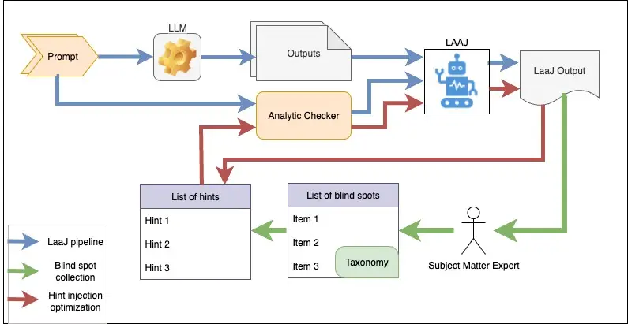
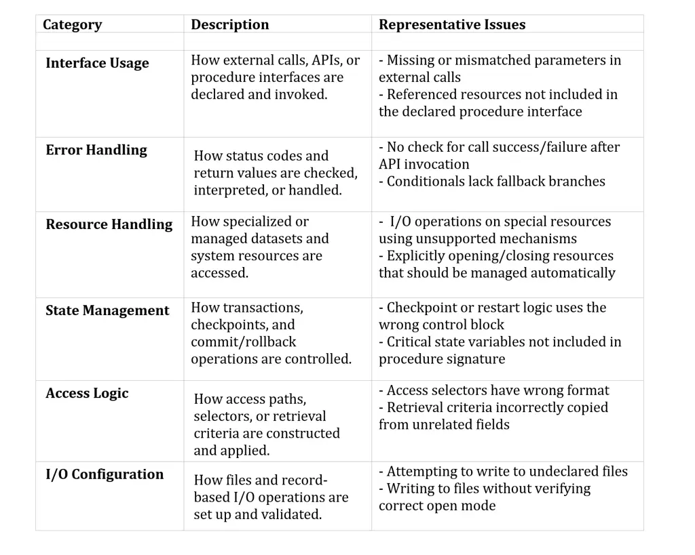
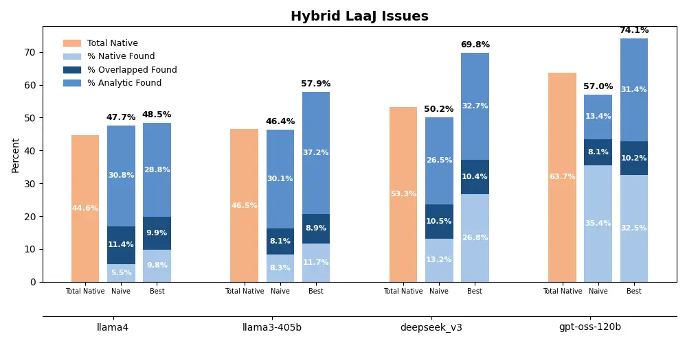
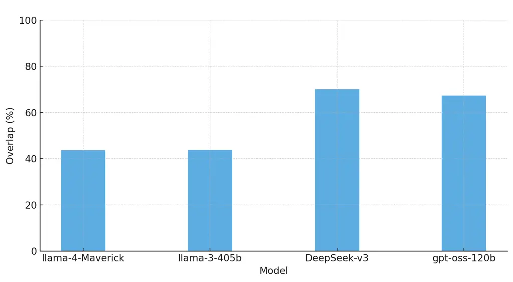

# Beyond Blind Spots: Analytic Hints for Mitigating LLM-Based Evaluation Pitfalls

Ora Nova Fandina    Eitan Farchi    Shmulik Froimovich    Raviv Gal
Affiliation: Wesam Ibraheem, Rami Katan, Alice Podolsky

###### Abstract

Large Language Models are increasingly deployed as judges (LaaJ) in code
generation pipelines. While attractive for scalability, LaaJs tend to
overlook domain-specific issues raising concerns about their reliability
in critical evaluation tasks. To better understand these limitations in
practice, we examine LaaJ behavior in a concrete industrial use case:
legacy code modernization via COBOL code generation. In this setting, we
find that even production-deployed LaaJs can miss domain-critical
errors, revealing consistent blind spots in their evaluation
capabilities.

To better understand these blind spots, we analyze generated COBOL
programs and associated LaaJs judgments, drawing on expert knowledge to
construct a preliminary taxonomy. Based on this taxonomy, we develop a
lightweight analytic checker tool that flags over 30 domain-specific
issues observed in practice. We use its outputs as analytic hints,
dynamically injecting them into the judge’s prompt to encourage LaaJ to
revisit aspects it may have overlooked.

Experiments on a test set of 100 programs using four production-level
LaaJs show that LaaJ alone detects only about 45-63% of the errors
present in the code (in all judges we tested), while the analytic
checker alone lacks explanatory depth. When combined, the LaaJ+Hints
configuration achieves up to 74% coverage (for the best-performing judge
and injection prompt) and produces qualitatively richer, more accurate
explanations, demonstrating that analytic–LLM hybrids can substantially
enhance evaluation reliability in deployed pipelines. We release the
dataset and all used prompts.

IBM Research, Israel

## Introduction

As code generation systems improve, evaluation must keep pace, not just
in scale but in depth. The ability to assess the correctness, safety,
and relevance of generated code is critical for real-world deployment,
especially in high-stakes domains. Large Language Models (LLMs), when
used as LLM-as-a-Judge offer a scalable alternative to human or
automatic analytic evaluation, particularly for tasks lacking clear
ground truth. While LLMs have demonstrated strong general reasoning
capabilities needed for judgment , prior studies suggest they often
struggle with tasks requiring deep domain knowledge. Our work provides
further empirical support for this observation, focusing on how reliably
LaaJs perform in real-world, domain-specific evaluation scenarios.

We focus on COBOL code generation, a representative task in legacy
system modernization where domain-specific evaluation is especially
challenging. Unlike modern languages, COBOL often involves non-standard
control flow, implicit data handling, and business-specific conventions
that are rarely documented or standardized. These patterns are difficult
for general-purpose LLMs to recognize, especially given COBOL’s
under-representation in training data and the relatively sparse
availability of public benchmarks or test suites.

Figure 1: Full Workflow for improving LLM-as-a-Judge evaluations. The
main pipeline (blue) generates candidate outputs from the LLM and scores
them using a LaaJ. Two refinement loops are overlaid: (1) Blind Spots
Collection (green), where SMEs analyze LaaJ errors and curate a taxonomy
of blind spots, and (2) Hints Optimization (red), where targeted hints
are derived and injected via an Analytic Checker to guide LaaJ
reasoning. This process allows LaaJ evaluations to be continuously
improved by addressing specific weaknesses in model judgment.

In our internal setting, we developed and deployed multiple LaaJ
configurations specifically tailored for COBOL evaluation task. Although
these LaaJs were carefully engineered and refined through
human-in-the-loop testing, we still found that critical domain-specific
issues were often missed. We hypothesized that these failures stem not
merely from insufficient tuning, but from blind spots, recurrent
omissions or reasoning failures that current LaaJs consistently
overlook. These blind spots are often subtle: a missing initialization,
a file operation without proper status checks, or improper use of
restart logic. While each may appear minor in isolation, collectively
they undermine the reliability of model-based evaluation in high-stakes
environments.

To systematically investigate these limitations, we designed a
multi-stage workflow (Figure 1) involving LaaJ error analysis, blind
spot identification, and targeted intervention. We first constructed a
curated dataset of COBOL programs containing realistic, domain-specific
issues, and used production-grade LaaJs to evaluate them. Expert
reviewers then analyzed LaaJ judgments to identify failure modes,
resulting in a structured taxonomy of blind spots. Based on this
taxonomy, we developed an analytic checker that uses a catalog of over
30 issue types to dynamically analyze each generated program. For each
input, it emits concise, structured hints for the detected issues, which
are then injected into the LaaJ prompt to guide the model toward known
blind spots. This approach offers a practical, non-intrusive mechanism
for improving evaluation depth: by dynamically guiding the model’s focus
for each input at inference time, it helps mitigate per-instance
evaluation failures without retraining or fine-tuning, while preserving
auditability and compatibility with existing production pipelines.

Our main contributions are:

- •
  Expert-guided discovery and categorization of LaaJ blind spots in
  COBOL evaluation; the initial taxonomy;
- •
  A rule-based analytic checker that scans the code and outputs analytic
  hints;
- •
  A demonstration that prompt-level analytic hint injection yields
  measurable improvements in LaaJ performance.

We release the dataset, prompts and analytic checker. ¹¹ 1
https://github.com/AlicePod1/analytic-hints-paper

### Related Work

LLMs are increasingly used as automated judges in code generation (Zhuo
2024; Tong and Zhang 2024; Zhao et al. 2024). However, recent studies
have shown that LaaJs often overlook fine-grained errors and struggle to
capture semantic correctness, particularly in complex domains like code
generation (Doddapaneni et al. 2024; Tong and Zhang 2024; Tan et al.
2024). To address these issues, several works proposed enhancing LaaJ
reasoning with prompt-level interventions, such as self-refinement
(Madaan et al. 2023), rationale rewriting (Trivedi et al. 2024), or
tool-assisted evaluation (Schick et al. 2023).

Closest to our approach are hint-injection methods that steer LLM
reasoning with targeted cues, including AutoHint (learned task-specific
hints), Directional Stimulus Prompting (policy-generated stimulus
tokens) (Li et al. 2023), Progressive-Hint Prompting (reusing prior
answers as hints) (Zheng et al. 2023), and Hint-before-Solving
(pre-drafted hints) (Fu et al. 2024).

Unlike these approaches (mostly evaluated on general reasoning/math),
our method injects expert-validated, rule-based analytic hints extracted
directly from the code, yielding interpretable, high-precision guidance
for LaaJ without any auxiliary policy model, self-hinting loop, or
retraining.

## From Failure Analysis to Hint-Guided Evaluation

### Identifying Blind Spots

We constructed a development dataset of 100 COBOL programs deliberately
generated to include realistic, domain-specific errors. The programs
were produced using the mistral-medium-2505 language model with a
carefully crafted instruction prompt. Human experts subsequently
validated that the generated code indeed exhibited the intended faults.

We evaluated the generated COBOL programs using two LaaJ configurations
that were developed and deployed as part of our production pipeline for
automated code quality assessment. These configurations are based on the
following LLMs:llama-3-405b, and mistral-medium-2505.

Drawing on domain expertise, we manually analyzed the outputs to
identify and characterize recurring blind spots of the judges. This
analysis was conducted in iterative refinement cycles: experts reviewed
missed issues, updated annotations, and adjusted emerging categories as
patterns became clearer. Over multiple passes, a stable set of recurring
failure types emerged. We distilled these into a structured taxonomy
capturing the most characteristic classes of LaaJ evaluation failure.

### Taxonomy

Below we present an initial taxonomy comprising six categories. Each
reflects a class of domain-specific evaluation challenges that were
frequently missed by LaaJs, even after the rigorous prompt tuning and
human-in-the-loop validation we conducted while developing these
production-level judges.

Figure 2: Taxonomy of domain-specific evaluation issues identified in
COBOL LaaJ failures.

These categories reflect patterns that emerged repeatedly across expert
reviews of LaaJs evaluations. While some relate to syntactic or
structural violations (e.g., missing status fields, undeclared
descriptors), others reveal deeper semantic blind spots that require
non-local reasoning about state, control flow, or implicit conventions
in COBOL-IMS (Information Management System) systems.

These categories, while rooted in COBOL-specific evaluation and the
particular set of base LLM models, reveal broader patterns that may
generalize to other domains and LaaJs. Across categories, we observe
that LaaJs tend to struggle with multi-line reasoning, particularly when
issues depend on non-local context or the interaction between
distributed control structures. Several error types reflect omissions
rather than incorrect content, such as missing status checks, or
initializations, which highlights LaaJ’s difficulty in detecting when
something important is not present. This points to a broader limitation:
foundation models often excel at recognizing what is in the input, but
struggle to reason about what should be there and is missing. Finally,
many errors stem from misunderstanding execution order or control flow,
such as using a file before it is opened or skipping necessary status
checks after a call. These cases suggest that current LaaJs lack the
ability to simulate program semantics or execution state, instead
relying heavily on surface-level patterns. Taken together, these
observations may offer insights into the limitations of current
LLM-based code quality evaluators.

### Analytic Checker and Hints

We developed a lightweight analytic checker that encodes over 30 error
types identified through expert review. The checker uses
pattern-matching to detect the issues in the program and emits short,
human-readable messages, we call analytic hints. These hints are then
dynamically injected into the LaaJ prompt to help overcome its blind
spots, encouraging the model to revisit aspects of the input code it
previously overlooked. While our injection strategy is deliberately
naive, plain-text hints placed at the top of the judge’s prompt, it
already leads to measurable improvements in LaaJ performance. This opens
a path for further refinement: by tuning the phrasing, formatting, or
placement of the hints, developers may unlock additional gains with
minimal overhead.

## Experiments and Results

### Setup

We constructed a test set of 100 fresh synthetic COBOL programs, each
deliberately seeded with multiple subtle errors. This dataset was
reserved exclusively for evaluation and was not used during the taxonomy
construction or tool development phases. The programs were generated
with mistral-medium-2505 using a carefully crafted instruction prompt,
and human experts validated that the intended errors are present.

We evaluated four production LaaJ configurations, based on
_llama-4-Maverick_, _llama-3-405b_, _DeepSeek-v3_, and _gpt-oss-120b_,
from our internal pipeline for automated code quality assessment. All
judges use the same detailed evaluation prompt (not disclosed due to
proprietary constraints), which we refer to as the native prompt in our
experiments.

The hint injection was implemented in two ways. First, in a naïve setup,
per-input hints were inserted by simply appending them to the end of the
native prompt. Second, in a more guided setup, the prompt explicitly
instructed the model to address the provided hints, in a detailed way.
We used these two configurations to demonstrate how prompt design
influences the effectiveness of the hint-injection phase.

### Results

For each judge, we conducted the following experiment. For every sample
COBOL program, we first estimated the total number of issues present.
Since the exact number of true issues is unknown, we approximated it as
the union of errors detected by the analytic tool and by the native
judge, that is the sum of both counts minus their overlap. We then run
the hybrid judges on each sample: naive hint injection prompt and best
hint injection prompt.

Figure 3: Hybrid Laajs detection rates (naive vs optimized hint
injection schemes), with Native Laajs detection rates.

We then evaluated the hybrid judges on each sample using two
configurations: the naïve hint-injection prompt and the optimized (best)
hint-injection prompt. For each configuration, we measured the fraction
of errors detected by the hybrid judge within each error category:
analytic errors, overlapping errors, and errors originally detected by
the native judge, and averaged the results over all 100 programs to
obtain the final coverage rates.

As shown in Figure 3, introducing analytic hints led to consistent gains
across all models. Native judges detected roughly 45–63% of total
issues, whereas hybrid judges reached 48–74.1%, depending on model and
prompt. Most of the improvement stems from capturing analytic-only
errors previously missed by the native judges, while performance on
native-only and overlap categories remained stable or improved slightly.
We observe that the optimized hint injection achieves consistently high
success rates of issues detected with analytic checker and confirmed by
LaaJ, with DeepSeek-v3 and gpt-oss-120b exceeding 90%.

To verify that the hint-augmented judges retained their original
evaluative capabilities (specifically, the ability to rediscover issues
not explicitly listed in the analytic hints) we performed an additional
analysis. We converted the explanations produced by the native judges
into structured lists of issues and then searched for corresponding or
semantically similar issues within the explanations of the
hint-augmented judges. This matching was conducted by a
gpt-oss-120b-based issue finder judge. The results, summarized in Figure
4, show that the hint-augmented judges reproduced approximately 45–70%
of the issues originally identified by their native counterparts. In
particular, DeepSeek-v3 and gpt-oss-120b achieved the highest
rediscovery rates, recovering 70.06% and 67.31% of the native-judge
issues, respectively.

Interestingly, the rediscovery rates varied considerably across models,
indicating that some judges preserved their original evaluative behavior
more effectively than others when augmented with analytic hints. We
propose using this issue-rediscovery rate as an additional diagnostic
metric for assessing evaluator reliability: higher values indicate
models that can integrate new analytic guidance without losing prior
evaluative competence, whereas lower values may reveal instability or
over-dependence on prompt conditioning.

Figure 4: Percent of native judge errors rediscovered by hybrid judges
(with best hint-injection prompt).

## Conclusions

We presented a practical approach for enhancing LaaJs using analytic
hint injection in code evaluation. Grounded in expert analysis of COBOL
evaluation failures, our method couples a taxonomy of blind spots with a
lightweight checker that emits targeted hints. Injecting these hints
into the judge’s prompt refocuses its reasoning toward previously
overlooked issues, yielding significant gains without retraining. Among
all models, the gpt-oss-120b judge with hints achieved the best
performance, addressing 74.1% of errors while retaining 67.31% of those
identified by the native judge. This demonstrates that prompt-level
analytic interventions can substantially improve judgment coverage while
preserving general evaluative capabilities.

Notably, the hint-augmented judges did not fully reproduce all issues
identified by their native counterparts, with rediscovery rates of 45%
and 67%. This drop suggests that the injected hints altered the judges’
focus: by emphasizing analytic issues, they improved detection of these
issues but deprioritized unhinted aspects of the evaluation. Thus, hint
injection improves targeted diagnostic precision but may narrow overall
coverage, highlighting both the promise and the limitation of
analytic-guided evaluation: it can direct the model’s attention where it
matters most but my narrow its coverage if not carefully balanced.

Our study, limited to one task and a small dataset, offers an initial
demonstration that analytic guidance at inference time can substantially
enhance model-based evaluation. This work contributes to the growing
body of research on hybrid evaluation systems that augment foundation
models with structured analytic tools.

## References

- Doddapaneni et al. (2024) S. Doddapaneni, M. S. U. R. Khan, S. Verma,
  and M. M. Khapra Finding blind spots in evaluator llms with
  interpretable checklists. In Proceedings of the 2024 Conference on
  Empirical Methods in Natural Language Processing, pp. 16279–16309.
  External Links:
  [Link](https://aclanthology.org/2024.emnlp-main.911.pdf) Cited by:
  Related Work.
- Fu et al. (2024) J. Fu, S. Huangfu, H. Yan, S. Ng, and X. Qiu
  Hint-before-solving prompting: guiding llms to effectively utilize
  encoded knowledge. ArXiv abs/2402.14310. External Links:
  [Link](https://api.semanticscholar.org/CorpusID:267782546) Cited by:
  Related Work.
- Li et al. (2023) Z. Li, B. Peng, P. He, M. Galley, J. Gao, and X. Yan
  Guiding large language models via directional stimulus prompting. In
  Proceedings of the 37th International Conference on Neural Information
  Processing Systems, NIPS ’23. Cited by: Related Work.
- Madaan et al. (2023) A. Madaan, N. Tandon, P. Gupta, S. Hallinan, L.
  Gao, S. Wiegreffe, U. Alon, N. Dziri, S. Prabhumoye, Y. Yang, S.
  Gupta, B. P. Majumder, K. Hermann, S. Welleck, A. Yazdanbakhsh, and P.
  Clark SELF-refine: iterative refinement with self-feedback. In
  Proceedings of the 37th International Conference on Neural Information
  Processing Systems, NIPS ’23, Red Hook, NY, USA. Cited by: Related
  Work.
- Schick et al. (2023) T. Schick, J. Dwivedi-Yu, R. Dessí, R.
  Raileanu, M. Lomeli, E. Hambro, L. Zettlemoyer, N. Cancedda, and T.
  Scialom Toolformer: language models can teach themselves to use tools.
  In Proceedings of the 37th International Conference on Neural
  Information Processing Systems, NIPS ’23. Cited by: Related Work.
- Tan et al. (2024) S. Tan, S. Zhuang, K. Montgomery, W. Y. Tang, A.
  Cuadron, C. Wang, R. Popa, and I. Stoica JudgeBench: a benchmark for
  evaluating llm-based judges. arXiv preprint arXiv:2410.12784. External
  Links: [Link](https://arxiv.org/abs/2410.12784) Cited by: Related
  Work.
- Tong and Zhang (2024) W. Tong and T. Zhang CodeJudge: evaluating code
  generation with large language models. In Proceedings of the 2024
  Conference on Empirical Methods in Natural Language Processing, Y.
  Al-Onaizan, M. Bansal, and Y. Chen (Eds.), Miami, Florida, USA,
  pp. 20032–20051. External Links:
  [Link](https://aclanthology.org/2024.emnlp-main.1118/),
  [Document](https://dx.doi.org/10.18653/v1/2024.emnlp-main.1118) Cited
  by: Related Work.
- Trivedi et al. (2024) P. Trivedi, A. Gulati, O. Molenschot, M. A.
  Rajeev, R. Ramamurthy, K. Stevens, T. S. Chaudhery, J. Jambholkar, J.
  Zou, and N. Rajani Self-rationalization improves llm as a fine-grained
  judge. arXiv preprint arXiv:2410.05495. Cited by: Related Work.
- Zhao et al. (2024) Y. Zhao, Z. Luo, Y. Tian, H. Lin, W. Yan, A. Li,
  and J. Ma CodeJudge-eval: can large language models be good judges in
  code understanding?. In International Conference on Computational
  Linguistics, External Links:
  [Link](https://api.semanticscholar.org/CorpusID:271909222) Cited by:
  Related Work.
- Zheng et al. (2023) C. Zheng, Z. Liu, E. Xie, Z. Li, and Y. Li
  Progressive-hint prompting improves reasoning in large language
  models. arXiv preprint arXiv:2304.09797. Cited by: Related Work.
- Zhuo (2024) T. Y. Zhuo ICE-score: instructing large language models to
  evaluate code. In Findings of the Association for Computational
  Linguistics: EACL 2024, Y. Graham and M. Purver (Eds.), St. Julian’s,
  Malta, pp. 2232–2242. External Links:
  [Link](https://aclanthology.org/2024.findings-eacl.148/) Cited by:
  Related Work.
