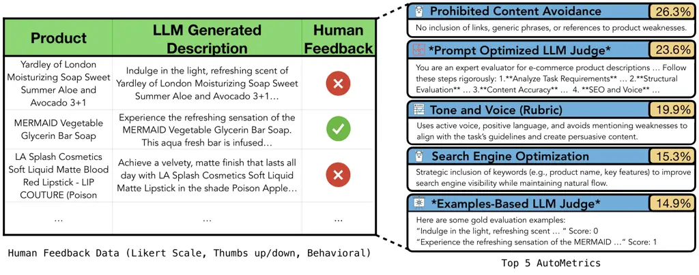
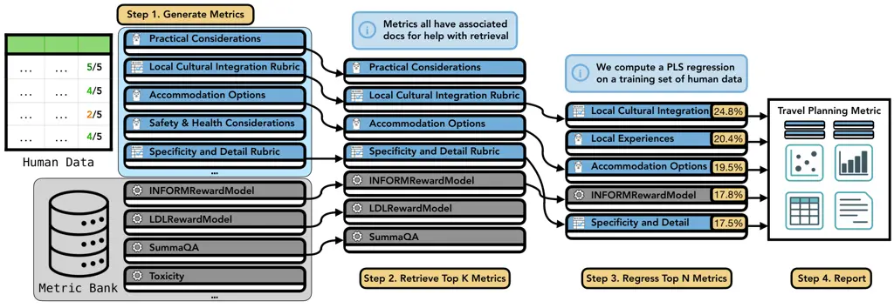
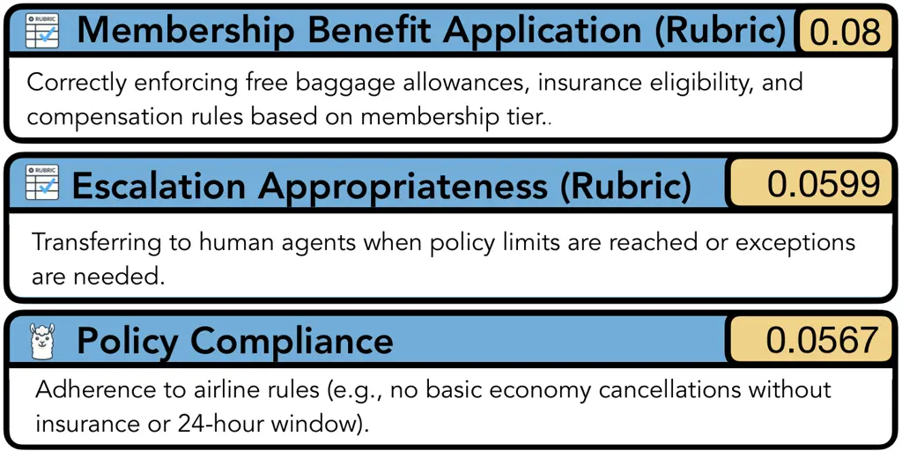

# AutoMetrics: Approximate Human Judgments with Automatically Generated Evaluators

Michael J. Ryan Affiliation: Stanford University Email:
[michaeljryan@stanford.edu](mailto:)    Yanzhe Zhang Affiliation:
Stanford University    Amol Salunkhe Affiliation: American Express    Yi
Chu Affiliation: American Express    Di Xu Affiliation: American Express
   Diyi Yang Affiliation: Stanford University

###### Abstract

Evaluating user-facing AI applications remains a central challenge,
especially in open-ended domains such as travel planning, clinical note
generation, or dialogue. The gold standard is user feedback (e.g.,
thumbs up/down) or behavioral signals (e.g., retention), but these are
often scarce in prototypes and research projects, or too-slow to use for
system optimization. We present AutoMetrics, a framework for
synthesizing evaluation metrics under low-data constraints. AutoMetrics
combines retrieval from MetricBank, a collection of 48 metrics we
curate, with automatically generated LLM-as-a-Judge criteria informed by
lightweight human feedback. These metrics are composed via regression to
maximize correlation with human signal. AutoMetrics takes you from
expensive measures to interpretable automatic metrics. Across 5 diverse
tasks, AutoMetrics improves Kendall correlation with human ratings by up
to 33.4% over LLM-as-a-Judge while requiring fewer than 100 feedback
points. We show that AutoMetrics can be used as a proxy reward to equal
effect as a verifiable reward. We release the full AutoMetrics toolkit
and MetricBank to accelerate adaptive evaluation of LLM applications.

|     |
| --- |
|     |

^(†)^(†)footnotetext: This paper reflects the academic work of the
authors and does not represent or constitute the views, policies,
positions, or practices of American Express or its affiliates.



Figure 1: AutoMetrics takes you from expensive measures to interpretable
automatic metrics. Here AutoMetrics generates useful metrics for
evaluating LLM written product descriptions from user reviews from
EvalGen (Shankar et al., 2024b). Percentages indicate relative
importance of each metric derived from regression coefficients.

## 1 Introduction

Modern AI systems now demonstrate massively multitask capabilities
imparted through extensive pretraining (Radford et al., 2019; Brown et
al., 2020). Practitioners can rapidly prototype new AI-enabled tasks –
from travel planning to code completion – at a pace much faster than the
community can craft domain specific metrics (Papineni et al., 2002; Lin,
2004; Xu et al., 2016). This new era, in which large language models can
be adapted to virtually any domain, places mounting pressure on
evaluation practices. A divide is growing between tasks with easily
verifiable rewards, such as math (Glazer et al., 2024; Shao et al., 2024) and coding (Chen et al., 2021), while subjective and open-ended
tasks such as writing (Gurung and Lapata, 2025) remain difficult to
measure. For these tasks, human evaluation remains the gold standard
(Shankar et al., 2024b; Chiang et al., 2024).

Unfortunately, human evaluation is costly, slow, and not scalable for
every prototype or user population. Reward models offer an alternative
(Mnih et al., 2015; Christiano et al., 2017), but they typically require
thousands of labels. The common alternative is rubric-based
LLM-as-a-Judge methods (Li et al., 2023; Zheng et al., 2023; Liu et al.,
2024), which rely on the assumption that system behavior is clearly
defined and are not guaranteed to follow given rubrics strictly
(Tripathi et al., 2025). In reality, practitioners typically have access
only to non-descriptive human signals (e.g., thumbs up/thumbs down
collected from users). In this setting, the problem is not only
formulating the rubric, but also discovering the underlying criteria
that matter.

This highlights the need for dynamic, task-specific metric learning.
Instead of relying exclusively on human judgment or fixed rubrics,
evaluation itself must become adaptive. Current efforts have emphasized
making LLMs better evaluators of task-specific criteria (Liu et al.,
2024; Kim et al., 2025; Anugraha et al., 2025) or leveraging rubrics to
optimize LLMs (Gunjal et al., 2025; Viswanathan et al., 2025) but
comparatively little work has focused on automatically generating the
rubrics and criteria to be adaptively aligned with human judgment
(Biyani et al., 2024; Ryan et al., 2025; Dunlap et al., 2025). Such
adaptive evaluation is essential not only for easily assessing new tasks
but also for optimizing evaluated systems based on real-time user
feedback.

We introduce AutoMetrics, a method for dynamic metric induction that
turns sparse, non-descriptive human feedback into actionable and
interpretable evaluators (Figure 1). Starting from a task description
and fewer than 100 human signals, AutoMetrics synthesizes candidate
criteria, retrieves and adapts existing metrics, and composes them
through regression into predictive measures of quality. Beyond simply
identifying criteria, AutoMetrics grounds and weighs them, producing
metrics that are both predictive and interpretable. This approach
achieves up to 33.4% higher Kendall correlation with human judgments
than LLM-as-a-Judge baselines (§4), is data-efficient only requiring
$`\sim`$80 feedback points (§4.6), and even matches verifiable rewards
when optimizing downstream AI systems (§5). Beyond accuracy, AutoMetrics
reveals actionable insights into what users value. We release
AutoMetrics as an open-source toolkit¹¹ 1
[https://github.com/SALT-NLP/autometrics](https://github.com/SALT-NLP/autometrics),
offering the community a powerful new way to evaluate and optimize AI
applications at the speed of modern development.

## 2 Related Work

#### Metric Collections

Prior work has organized collections of metrics primarily for the ease
of use on the part of the practitioner. When already using a library
such as PyTorch (Paszke et al., 2019) or Huggingface (Wolf et al., 2020)
it’s simple to utilize TorchMetrics (Nicki Skafte Detlefsen et al., 2022) or HuggingFace lighteval (Fourrier et al., 2023). Scikit Learn
Metrics (Pedregosa et al., 2011) and NLTK metrics (Bird and Loper, 2004)
were created with the same intentions. All text-generation metrics
covered by these collections are also contained in our MetricBank
collection. Beyond integrating with existing open source libraries, some
metric collections are part of ML observability frameworks like
Evidently (EvidentlyAI, 2025), Galileo (Galileo, 2025), Scorecard.io
(Doe and Devireddy, 2024), and DeepEval (ConfidentAI, 2025). Most
metrics are tightly coupled with their observability platform, although
Evidently and DeepEval offer open-source versions. While DeepEval offers
a metric recommendation feature, it is based on a predefined decision
tree of questions like “_Does your LLM application use
Retrieval-Augmented Generation (RAG)?_” and “_Is LLM safety a priority
for you?_”. Most similar to our work is the MetaMetrics collection
(Winata et al., 2025), which computes a regression over multiple
task-specific metrics for tasks like image captioning and summarization
to select the best combination of metrics. We compare our approach with
MetaMetrics in Section 4 and find that our core thesis of adaptive
metric generation is critical for evaluation in the low-data, novel task
settings of interest.

#### LLM Based Evaluation

LLM-as-a-Judge (Zheng et al., 2023) evaluation is increasingly popular
with the frequent improvement of LLM capabilities. Several works devise
task-specific prompts to enable LLM-based evaluation for storytelling
(Chiang and Lee, 2023), summarization (Wang et al., 2023; Hada et al.,
2024; Wu et al., 2023), dialogue (Lin and Chen, 2023; Fu et al., 2024),
knowledge (Bai et al., 2023), translation (Kocmi and Federmann, 2023),
and more (Brake and Schaaf, 2024). Another promising direction is
devising frameworks and general methods for making LLM-as-a-Judge more
reliable. G-Eval (Liu et al., 2023) proposes breaking LLM evaluation
into a step-by-step chain of thought and taking a weighted sum over the
log probabilities of generating different scores. ChatEval (Chan et al., 2024) simulates multiple perspectives by evaluating through multi-agent
debate. SPADE (Shankar et al., 2024a) generates assertions for LLMs to
verify based on labeled good and bad examples. VERDICT (Kalra and Tang, 2025) introduces judge-time scaling by decomposing judgments into
composable units of reasoning, verification, debate, and aggregation
steps. Though we take inspiration from many of these frameworks, the
most directly similar to our LLM-as-a-Judge steps in the AutoMetrics
pipeline are DnA-Eval (Li et al., 2025) and EvalGen (Shankar et al.,
2024b). DnA-Eval (Li et al., 2025) decomposes evaluation into rubric
criteria and aggregates the results across the criteria. EvalGen
(Shankar et al., 2024b) elicits limited human feedback on generated
outputs, proposes criteria for evaluation based on this feedback, and
iteratively refines the criteria with a human-in-the-loop and LLM.

## 3 The AutoMetrics Method



Figure 2: AutoMetrics comprises four steps. (1) _Generate_: create
task-specific candidate metrics (Single criteria, Rubric, Examples,
MIPROv2). (2) _Retrieve_: from the generated candidates plus MetricBank,
use ColBERT to prefilter to $`k^{\prime}`$ metric cards and an LLM to
select the final $`k`$. (3) _Regress_: fit a PLS model on the training
set to weight and select metrics that predict human judgments. (4)
_Report_: produce a writeup with weights and correlations and details to
guide adoption.

The purpose of AutoMetrics is to produce metrics for subjective and
novel AI-enabled tasks. Our goal is to induce metrics that correlate
strongly with human judgments while requiring minimal data collection.
To accomplish this, we present a general pipeline with four stages: (1)
generate, (2) retrieve, (3) regress, and (4) report. These steps are
visualized in Figure 2. Each stage involves design choices among several
alternatives, which we empirically validate (§4.5).

### 3.1 Metric Production

#### Generate

For sufficiently novel settings, generating criteria for LLM-as-a-Judge
evaluation is essential. Broad coverage of evaluation criteria allows us
to later filter down to what matters most. Accordingly, our default
configuration generates 10 Single Criterion LLM Judge metrics, 5 Rubric
LLM-Judge metrics, 1 Example-based optimized LLM-Judge metric (fewshot),
and 1 Prompt-Optimized LLM-Judge metric per run of AutoMetrics²² 2
Design details and ablations are in Appendix E.2; we validate these
choices across nearly 30 settings.. Optimized metrics require more LLM
calls/tokens to produce, while criteria and rubrics are relatively
inexpensive. Unless otherwise specified, we use this configuration
throughout the paper. Empirically, we find this mix of generated metrics
generalizes across diverse domains and tasks. For each metric, we also
generate a Metric Card documenting its description, intended use,
implementation details, and limitations (Appendix B).

#### Retrieve

In addition to generated metrics, we leverage our MetricBank: a
collection of 48 metrics (Appendix Table 4) drawn from the NLP
literature, each implemented and documented with a Metric Card. Directly
evaluating all metrics would be prohibitively expensive, so we instead
use retrieval as a filtering step. We treat Metric Cards as documents,
and use a description of the evaluation setting or task as the search
query. Retrieval is performed using a hybrid ColBERT + LLM approach,³³ 3
We ablate the selection algorithm in Appendix E.1. narrowing the
candidate pool to metrics most relevant to the task at hand.

#### Regress

The filtered pool of candidate metrics must still be combined into a
predictive signal for human judgment. We normalize all metric scores to
their z-scores and fit a Partial Least Squares (PLS) regression model.
Intuitively, PLS projects the metric space onto the direction most
predictive of human labels, then regresses labels along that axis. We
choose PLS regression because it works well under the constraints of our
setting that: (1) the number of predictors (metrics) may be comparable
to or larger than the number of observations (data points), and (2) the
predictors are often highly correlated. Concretely, with a single latent
component, PLS finds a unit weight vector $`w^{\star}\in\mathbb{R}^{d}`$
that maximizes

```math
w^{\star}\;=\;\arg\max_{\lVert w\rVert_{2}=1}\;\operatorname{cov}(Xw,\,y)^{2},
```

where $`X`$ is the matrix of normalized metric scores and $`y`$ is the
vector of human labels. The latent score is $`t=Xw^{\star}`$, and PLS
then regresses the human labels on this latent score, yielding
predictions $`\hat{y}=t\beta`$ with coefficient
$`\beta=\tfrac{t^{\top}y}{t^{\top}t}`$.

We apply this procedure in two stages. In the first stage, we fit PLS
using all candidate metrics and rank them by the magnitude of their
weights in $`w^{\star}`$. We then select the top $`n`$ metrics according
to this ranking. In the second stage, we refit PLS on this reduced set
of $`n`$ metrics to obtain a new projection $`t`$ and corresponding
predictions $`\hat{y}`$. As a final step, we remove negatively
correlated LLM-generated metrics, as they are designed to target
positive correlation. We don’t apply this to existing measures (e.g.,
length can negatively correlate with conciseness).

### 3.2 Metric Evaluation

To evaluate the quality of induced metrics, we draw on concepts of
measurement validity from research (Borsboom et al., 2004) and testing
(American Educational Research Association et al., 2014). We focus on
three forms: “Content Validity”, “Criterion Validity”, and “Construct
Validity”.

Content Validity asks whether a metric represents the construct it is
intended to measure. Although direct quantification is difficult, we
encourage transparency by releasing metric reports. Because our
generated metrics rely on LLM judges, we also expose the reasoning
traces of the judge LLM, allowing users to inspect whether assessments
appear justified. These traces can further aid system optimization with
AutoMetrics (§5).

Criterion Validity Criterion validity measures correlation with a
reference standard. In NLP, correlation with human labels has been the
most widely used criterion (Banerjee and Lavie, 2005; Xu et al., 2016;
Gehrmann et al., 2021). We assess criterion validity by comparing
AutoMetrics to ground-truth human labels. We report Kendall’s $`\tau`$,
which makes no distributional assumptions and simply checks whether the
rank order induced by a metric matches that of human judgments. This
provides a conservative estimate compared to Spearman’s $`\rho`$ or
Pearson’s $`r`$.

Construct Validity measures whether a metric captures an underlying
abstract concept, such as “quality.” Both human judgments and
AutoMetrics attempt to approximate “quality”. We draw from
convergent–discriminant validity (Campbell and Fiske, 1959) and
operationalize construct validity as robustness. A useful metric should
penalize quality degradations (sensitivity) while remaining stable under
equivalent-quality variation. In order to quantify
convergent-discriminant validity, we introduce two measurements:
Sensitivity and Stability. To construct test cases, we use an LLM to
generate strategies for degrading outputs on a given dataset, and apply
these to produce _worse-quality perturbations_. In contrast,
_same-quality perturbations_ are produced from a fixed set of
hand-crafted transformations—such as rephrasing, reordering, synonym
replacement, or stylistic edits—that are designed to preserve the target
evaluation dimension. Prompts are provided in Appendix C.

- •
  Sensitivity measures whether a metric assigns lower scores to degraded
  outputs. Let $`s^{(i)}_{\text{orig}}`$ and $`s^{(i)}_{\text{worse}}`$
  denote the normalized scores for the original and worse-quality
  perturbed outputs of sample $`i`$ from a dataset of size $`|N|`$.
  Sensitivity is defined as:

  ```math
  \text{Sensitivity}=\tfrac{1}{N}\sum_{i=1}^{N}\mathbf{1}\!\left[s^{(i)}_{\text{worse}}<s^{(i)}_{\text{orig}}\right]
  ```

- •
  Stability measures whether a metric produces consistent scores when
  quality should be preserved. Let $`s^{(i)}_{\text{same}}`$ be the
  normalized score for a same-quality perturbation of sample $`i`$ from
  a dataset of size $`|N|`$. Stability is defined as:

  ```math
  \text{Stability}=1-\tfrac{1}{N}\sum_{i=1}^{N}\big|s^{(i)}_{\text{orig}}-s^{(i)}_{\text{same}}\big|.
  ```

High sensitivity indicates strong penalization of degraded outputs,
while high stability indicates invariance to irrelevant variation. Both
are desirable, and together they provide a general-purpose lens for
evaluating how well a metric generalizes.

## 4 Experiments and Evaluations: Showing AutoMetrics are Valid

For our experiments, we focus on showing that our AutoMetrics are valid
across many tasks/domains and that they correlate better with human
judgements than competitive baselines. We showcase AutoMetrics have high
Criterion Validity and Construct Validity across several tasks.

### 4.1 Tasks

|                                                                                                                       |                     |        |         |              |             |      |
| --------------------------------------------------------------------------------------------------------------------- | ------------------- | ------ | ------- | ------------ | ----------- | ---- |
| Dataset (Citation)                                                                                                    | Task                | Domain | \# Data | Feedback     | \# Eval Dim | Refs |
| In-Distribution Tasks: some metrics in our bank were designed to directly evaluate these tasks.                       |                     |        |         |              |             |      |
| SimpEval (Maddela et al., 2023)                                                                                       | Simplification      |        | 360     | 1–100 Likert | 1           | ✓    |
| HelpSteer2 (Wang et al., 2024)                                                                                        | Dialogue            |        | 20,324  | 1–5 Likert   | 5           | ✗    |
| Out-of-Distribution Tasks: no metric is specifically designed for these – tests generalization and metric generation. |                     |        |         |              |             |      |
| EvalGen (Shankar et al., 2024b)                                                                                       | Product description |        | 100     | Binary       | 1           | ✗    |
| RealHumanEval (Mozannar et al., 2025)                                                                                 | Code completion     |        | 5,204   | Behavioral   | 1           | ✗    |
| Co-Gym (Shao et al., 2025)                                                                                            | Travel planning     |        | 72      | 1–5 Likert   | 3           | ✗    |

Table 1: Overview of tasks. Icons: Code Generation; Data-to-Text
Generation; Dialogue/Chat; Education/Readability; Travel Planning.

In order to evaluate our AutoMetrics method, we collect two types of
tasks: In-Distribution Tasks, which are tasks where some of the metrics
in our Metric Bank were designed to directly evaluate the task, and
Out-of-Distribution Tasks, which are tasks where no metric in particular
was designed to assess the task. All of our tasks utilize human feedback
for evaluation, encompassing behavioral feedback, binary feedback
(thumbs up/down), and Likert scale feedback, which is already collected
as part of the dataset. We introduce all tasks in Table 1. In our main
tables we present results for five datasets and a single evaluation
dimension from each: SimpEval (Maddela et al., 2023) (sentence
simplification score 1–100), HelpSteer2 (Wang et al., 2024) (Chatbot
helpfulness 1–5), EvalGen (Shankar et al., 2024b) (Product Review Thumbs
Up/Down), RealHumanEval (Mozannar et al., 2025) (accepted or rejected
code edit), CoGym (Shao et al., 2025) (travel plan outcome rating 1–5).
We report evaluations on more settings in the Appendix results.

### 4.2 Baselines

We include the following baselines: Best Existing Metric, where we run
all 48 metrics (or 19 metrics for reference-free tasks), record their
Kendall correlation on the validation set, and select the best metric to
use for the task based on the validation correlation. MetaMetrics, where
we take all the metrics from the MetaMetrics paper and compute an
XGBoost Regression on the metrics on the trainset (Winata et al., 2025).
Finetuned LLM refers to training a ModernBERT-large (Warner et al., 2024) to predict the human annotation. We implement it by training LoRA
adapters (Hu et al., 2021) with rank $`=16`$ on all the attention, dense
layers, and regression head, using a learning rate of $`5e-5`$ and a
batch size of 16 for three epochs over the training data. For the
LLM-Judge baseline, we use the original human annotation prompt for each
task and provide it to an LLM. We include all of these prompts in
Appendix C. DnA-Eval (Li et al., 2025) involves using an LLM to generate
three dimensions where a user request may benefit from evaluation, along
with weights for how to aggregate these dimensions. Then each of those
dimensions is scored with an LLM-as-a-Judge, and finally aggregated
based on the LLM-generated weights.

### 4.3 Criterion Validity (Correlation)

We report Kendall’s $`\tau`$ of all methods with GPT-4o-mini and
Qwen-3-32B Reasoning in Table 2.

|                                   |                    |                    |                     |                    |                     |
| --------------------------------- | ------------------ | ------------------ | ------------------- | ------------------ | ------------------- |
|                                   | In-Distribution    |                    | Out-of-Distribution |                    |                     |
| Method                            | SimpEval           | HelpSteer2         | EvalGen             | RealHumanEval      | CoGym               |
| Model Agnostic                    |                    |                    |                     |                    |                     |
| Best Existing Metric              | 0.246 $`\pm`$ 0.00 | 0.327 $`\pm`$ 0.00 | 0.193 $`\pm`$ 0.00  | 0.138 $`\pm`$ 0.00 | 0.074 $`\pm`$ 0.00  |
| MetaMetrics (Winata et al., 2025) | 0.127 $`\pm`$ 0.01 | 0.204 $`\pm`$ 0.00 | -0.214 $`\pm`$ 0.01 | 0.025 $`\pm`$ 0.01 | -0.119 $`\pm`$ 0.02 |
| Finetuned LLM                     | 0.076 $`\pm`$ 0.08 | 0.039 $`\pm`$ 0.03 | 0.054 $`\pm`$ 0.05  | 0.049 $`\pm`$ 0.06 | 0.223 $`\pm`$ 0.20  |
| GPT-4o-mini Backbone              |                    |                    |                     |                    |                     |
| LLM-Judge                         | 0.272 $`\pm`$ 0.02 | 0.259 $`\pm`$ 0.01 | 0.161 $`\pm`$ 0.14  | 0.069 $`\pm`$ 0.01 | 0.199 $`\pm`$ 0.13  |
| DnA Eval (Li et al., 2025)        | 0.234 $`\pm`$ 0.03 | 0.255 $`\pm`$ 0.02 | 0.174 $`\pm`$ 0.16  | 0.152 $`\pm`$ 0.01 | 0.185 $`\pm`$ 0.10  |
| AutoMetrics (Ours)                | 0.321 $`\pm`$ 0.04 | 0.324 $`\pm`$ 0.01 | 0.334 $`\pm`$ 0.06  | 0.160 $`\pm`$ 0.00 | -0.034 $`\pm`$ 0.17 |
| Qwen-3-32B Backbone               |                    |                    |                     |                    |                     |
| LLM-Judge                         | 0.294 $`\pm`$ 0.04 | 0.334 $`\pm`$ 0.02 | 0.272 $`\pm`$ 0.13  | 0.025 $`\pm`$ 0.01 | 0.276 $`\pm`$ 0.19  |
| DnA Eval (Li et al., 2025)        | 0.042 $`\pm`$ 0.04 | 0.260 $`\pm`$ 0.02 | 0.232 $`\pm`$ 0.19  | 0.071 $`\pm`$ 0.15 | 0.353 $`\pm`$ 0.25  |
| AutoMetrics (Ours)                | 0.316 $`\pm`$ 0.02 | 0.342 $`\pm`$ 0.01 | 0.382 $`\pm`$ 0.05  | 0.145 $`\pm`$ 0.00 | 0.365 $`\pm`$ 0.08  |

Table 2: Criterion Validity results showing Kendall’s Tau with 95%
confidence intervals over 5 independent runs. AutoMetrics outperforms
the baselines on all five tasks with Qwen3-32B and is within 95%
confidence of the best for 4/5 tasks with GPT-4o-mini. On EvalGen,
AutoMetrics improves performance by 33.4% over the closest baseline (LLM
Judge).

#### AutoMetrics correlates better than all baselines across all five tasks.

We find that AutoMetrics outperforms all other existing baselines on all
five tasks. While the best performing baseline is both inconsistent on
dataset (LLM Judge on

Figure 3: Sensitivity/Stability of AutoMetrics for SimpEval, HelpSteer2,
and CoGym. AutoMetrics are sensitive to negative perturbations and
stable on neutral perturbations.

SimpEval, HelpSteer, EvalGen; DnA Eval on RealHumanEval and CoGym) and
on the underlying model used (Existing Metrics outperform GPT-4o-mini
but not Qwen3-32B). In contrast, AutoMetrics is consistently the best
option regardless of dataset or underlying model. On all datasets
besides HelpSteer and CoGym, the AutoMetrics performance exceeds all
baselines by greater than the 95% confidence interval. In general,
AutoMetrics is the best choice for higher correlation with human
ratings.

### 4.4 Construct Validity (Robustness)

To measure construct validity, we take inspiration from
convergent-discriminant validity and show that AutoMetrics are strong
predictors when output quality degrades and that they are stable under
unimportant perturbations. To do so we introduced Sensitivity and
Stability (§3.2). Sensitivity measures the rate of detection of negative
perturbations and Stability measures the magnitude of score preservation
under meaningless changes. We report Sensitivity and Stability for all
metrics on 30 trials in Figure 3. We compare against a normal
distribution baseline.

#### AutoMetrics are sensitive and stable.

AutoMetrics are sensitive to degradation in output quality in 81.0-97.8%
of cases, depending on the dataset, which is significantly greater than
the 50% baseline. AutoMetrics can be a strong tool for identifying
degradations in output quality. Similarly, AutoMetrics also always
outperforms the baseline for stability by greater than 95% confidence
intervals. Under insignificant modifications to evaluated outputs,
AutoMetrics are consistently stable.

### 4.5 Design Decisions (Hyperparameter Sweeps)

Our sweeps/ablations test three parts of the AutoMetrics method: the
MetricBank, the retrieval step, and the regression step. We report
Kendall’s $`\tau`$ rank correlation across our six main tasks with 95%
confidence intervals over five runs in Table 3. All sweeps and ablations
are instead done on the dev set for all datasets. We never make design
decisions based on runs of our test sets.

|                                  |                    |                    |                     |                    |                    |
| -------------------------------- | ------------------ | ------------------ | ------------------- | ------------------ | ------------------ |
|                                  | In-Distribution    |                    | Out-of-Distribution |                    |                    |
| Method                           | SimpEval           | HelpSteer2         | EvalGen             | RealHumanEval      | CoGym              |
| MetricBank Ablations (k=30; n=5) |                    |                    |                     |                    |                    |
| Existing Metrics Only            | 0.238 $`\pm`$ 0.04 | 0.376 $`\pm`$ 0.00 | 0.389 $`\pm`$ 0.00  | 0.155 $`\pm`$ 0.00 | 0.258 $`\pm`$ 0.00 |
| Generated Metrics Only           | 0.276 $`\pm`$ 0.03 | 0.308 $`\pm`$ 0.01 | 0.503 $`\pm`$ 0.03  | 0.132 $`\pm`$ 0.00 | 0.433 $`\pm`$ 0.04 |
| Full MetricBank                  | 0.275 $`\pm`$ 0.02 | 0.387 $`\pm`$ 0.00 | 0.474 $`\pm`$ 0.03  | 0.152 $`\pm`$ 0.01 | 0.329 $`\pm`$ 0.02 |
| Retrieval Ablations (n=5)        |                    |                    |                     |                    |                    |
| Retrieve k=5                     | 0.257 $`\pm`$ 0.03 | 0.336 $`\pm`$ 0.03 | 0.414 $`\pm`$ 0.12  | 0.124 $`\pm`$ 0.02 | 0.385 $`\pm`$ 0.04 |
| Retrieve k=10                    | 0.245 $`\pm`$ 0.02 | 0.352 $`\pm`$ 0.01 | 0.469 $`\pm`$ 0.06  | 0.128 $`\pm`$ 0.01 | 0.371 $`\pm`$ 0.02 |
| No Metric Cards (k=20)           | 0.281 $`\pm`$ 0.04 | 0.328 $`\pm`$ 0.02 | 0.427 $`\pm`$ 0.09  | 0.134 $`\pm`$ 0.01 | 0.292 $`\pm`$ 0.06 |
| Retrieve k=20                    | 0.286 $`\pm`$ 0.02 | 0.378 $`\pm`$ 0.01 | 0.522 $`\pm`$ 0.02  | 0.141 $`\pm`$ 0.01 | 0.302 $`\pm`$ 0.06 |
| Retrieve k=30                    | 0.275 $`\pm`$ 0.02 | 0.387 $`\pm`$ 0.00 | 0.474 $`\pm`$ 0.03  | 0.152 $`\pm`$ 0.01 | 0.329 $`\pm`$ 0.02 |
| Regression Ablations (k=30)      |                    |                    |                     |                    |                    |
| No Regression (n=1)              | 0.232 $`\pm`$ 0.08 | 0.393 $`\pm`$ 0.00 | 0.353 $`\pm`$ 0.23  | 0.145 $`\pm`$ 0.00 | 0.356 $`\pm`$ 0.00 |
| Regress n=3                      | 0.255 $`\pm`$ 0.02 | 0.389 $`\pm`$ 0.02 | 0.503 $`\pm`$ 0.10  | 0.152 $`\pm`$ 0.01 | 0.302 $`\pm`$ 0.04 |
| Regress n=5                      | 0.275 $`\pm`$ 0.02 | 0.387 $`\pm`$ 0.00 | 0.474 $`\pm`$ 0.03  | 0.152 $`\pm`$ 0.01 | 0.329 $`\pm`$ 0.02 |
| Regress n=10                     | 0.309 $`\pm`$ 0.01 | 0.358 $`\pm`$ 0.01 | 0.461 $`\pm`$ 0.05  | 0.147 $`\pm`$ 0.01 | 0.297 $`\pm`$ 0.05 |
| Regress n=20                     | 0.268 $`\pm`$ 0.03 | 0.350 $`\pm`$ 0.01 | 0.498 $`\pm`$ 0.04  | 0.153 $`\pm`$ 0.01 | 0.361 $`\pm`$ 0.02 |

Table 3: Kendall correlation with 95% confidence intervals on
in-distribution and out-of-distribution datasets over five runs with
Qwen3 32B (Reasoning). The Full MetricBank and Metric Cards prove
useful, and the best settings for retrieval and regression are k=30 and
n=5 respectively.

#### Both Generated and Existing Metrics Help.

In all of our tasks, the Full MetricBank was either the best or
second-best performing setting for the ablations. When it was second
best, it was typically within 95% confidence intervals. The primary
exception is CoGym, where “Full MetricBank” fell 0.104 below “Generated
Metrics Only” and, to a lesser extent, EvalGen, where “Full MetricBank”
was short by 0.029. CoGym and EvalGen are also our smallest training
sets (37 and 57 training samples respectively). We hypothesize this is
because on out-of-distribution tasks, existing metrics tend to be noisy
predictors which can spuriously correlate during the regression.
Generated metrics tend to be less noisy predictors. Larger training sets
provide a more effective filter for identifying useful metrics. We
further explore this hypothesis in our data scaling experiment (§4.6).

#### Metric Cards Help Retrieval and Larger k Is Better.

Across all five tasks, retrieval with Metric Cards (k=20) is better than
retrieval without metric cards (using a single sentence description of
the metric). Furthermore, we see roughly linear growth of correlation
with higher $`k`$ metrics retrieved to run on the train set. The single
exception to this trend is CoGym, which can be attributed to the
noisiness of the small dataset and the generated metrics being less
noisy predictors. The top 5 retrieved metrics are often generated ones,
reducing the risk of recommending spuriously correlated existing metric
on the small dataset. We ran all retrieval experiments by regressing
with $`n=5`$, so it is worth noting that future improvements to the
retrieval algorithm (possibly including historical usage data) mean that
it is feasible for $`k=5`$ numbers to match our $`k=30`$ results, so
long as the proper metrics are recommended.

#### Number to regress to varies from dataset to dataset, but five is a good average case.

The best case for regression only repeats once (with n=20), suggesting
that the number of metrics needed is highly dependent on the complexity
of the evaluation task and domain. Since there is no clear winner, we
select n=5 as a default because it is the second best in two of five
tasks, and it is the cheapest option that still maintains lower variance
from run to run. A higher N means producing more expensive metrics to
run downstream, so n=5 is a useful compromise of cost and performance.

### 4.6 How much data do you need to use AutoMetrics?

To test how much data is needed to use AutoMetrics, we test on three
distinct datasets large enough to be useful in this experiment. We take
a relatively simple In-Distribution dataset, SimpEval, a more
challenging In-Distribution dataset, HelpSteer2, and an
Out-of-Distribution dataset RealHumanEval. We vary the train set size
from N=5, 10, 20, 40, 80, 160, and (for RealHumanEval and Helpsteer2)
320 and 640. We run these settings for both the “Generated Only” Metric
Bank and “Full” Metric Bank (with existing metrics). We plot the
correlation on the full test set in Figure 4.

Figure 4: All correlations plotted for various training set sizes with
“Generated Only” and “Full” Metric Banks. Individual trials are
translucent while average performance at a scale is solid.

#### About 80 samples saturates performance.

Across all three datasets and both settings, performance levels off
after about 80 samples. It is possible with more sophisticated metric
generation/learning methods more data could continue to help, however
with the current architecture between 80-100 examples is all you need.
Below 80 examples most of the lower performance is due to the high
variance of fitting a regression to a small training set.

#### On out-of-distribution datasets “Generated Only” can outperform “Full” with low-resources.

Looking to the RealHumanEval plot we see at training size 10 and 20 the
“Generated Only” metrics outperform the “Full” Bank. Recall back to the
ablations (§4.5) where we observed on the small, out-of-distribution
datasets, CoGym and EvalGen, that “Generated Only” outperformed the
“Full” MetricBank. Since most tasks will be out of distribution by
nature, we default to using “Generated Only” when the user provides less
than 80 training samples. Beyond 80, both “Generated Only” and “Full”
level off, however “Full” asymptotes higher than “Generated Only” on all
datasets. We argue this is a product of the high-p, low-n problem in
regression where having too many weak predictors and not enough
datapoints can lead to spurious correlations. By limiting to generated
metrics for low-n settings we enforce the use of stronger predictor
signals.

## 5 Case Study: AutoMetrics for Optimizing An Agentic Task

A natural extension to using AutoMetrics is to take the limited data one
has available in order to learn a useful set of metrics that can then be
used for optimizing a system. In this way AutoMetrics would operate
similar to the purpose of a Reward Model or a Verifiable Reward. In
order to test if AutoMetrics can be useful in this setting we optimize
an airline assistance agent for $`\tau`$-bench (Yao et al., 2024), a
testbed for tool-use agents to interact with simulated users to
accomplish tasks. We split the 50 $`\tau`$-airline tasks into 25 for
training and 25 for evaluation.

#### Simulating a verifiable reward.

To run AutoMetrics we rollout the 25 training examples 8 times each with
temperatures \[0.0, 0.01, 0.02, 0.03, 0.05, 0.1, 0.15, 0.2\]. Then we
obtain the true reward signal for each of these rollouts. In practice
rather than a verifiable reward this could be a subjective human label.
We run AutoMetrics in ”Generate Only” mode and allocate more resources
to generated metrics (10$`\rightarrow`$20 llm judge metrics;
5$`\rightarrow`$8 rubric metrics). Otherwise we run with default
hyperparameters (k=30; n=5). We show the generated metrics in Figure 6.

AutoMetrics recommends three metrics for Tau-Bench evals: two rubric
based metrics and one single criterion metric. Originally our (n=5)
setting recommended five metrics, however our final filtering step
removed two metrics for having negative coefficients. Since the
trajectories are only derived from 25 examples it is likely that metrics
will begin to learn things about the data itself. This reflects the
importance of both human oversight and our metric filtering.



Figure 5: AutoMetrics produces three metrics for $`\tau`$-Bench.
Regression coefficients in yellow.

Figure 6: $`\tau`$-Bench performance over GEPA optimization steps when
using AutoMetrics.

#### Optimizing without a Verifiable Reward

We implement a simple ReAct (Yao et al., 2023) agent in DSPy (Khattab et
al., 2024) for performing the $`\tau`$-Airline task. Our baseline agent
gets 60% accuracy on the 25 test examples averaged over five trials. We
then run a baseline optimization where we use the DSPy GEPA optimizer
(Agrawal et al., 2025) to optimize an agent on the 25 training tasks
with Verifiable Reward. Next we run optimization with our AutoMetrics as
the metric for GEPA optimization. We show the performance on the test
set after N rollouts in Figure 6. We find that AutoMetrics can match
performance of a verifiable reward. After 2000 rollouts the GEPA
optimization with verifiable reward achieves $`0.680\pm 0.11`$ accuracy
over 5 trials while the AutoMetrics run gets $`0.720\pm 0.06`$.
AutoMetrics statistically significantly exceeds the baseline performance
($`p<0.05`$) of 0.6. This demonstrates that AutoMetrics can match or
exceed Verifiable Rewards as optimization signal.

## 6 Discussion and Conclusion

In this paper, we introduced AutoMetrics, a method for producing metrics
that correlate with human judgments on subjective tasks. Requiring only
$`\sim`$80 human-labeled examples, AutoMetrics achieve high criterion
validity (§4.3) and construct validity. (§4.4). AutoMetrics improve upon
existing baselines by up to 33.4% in Kendall correlation with human
ratings. In a case study on Tau-Bench, AutoMetrics matched or exceeded
gains obtained from optimizing on a verifiable reward (§5).

We draw two key lessons for practitioners. First, data diversity is
critical: while only $`\sim`$80 feedback points suffice for moderate
correlation (§4.6), scaling up synthetic data from limited sources can
produce metrics that reflect dataset artifacts rather than system
quality (§5). Second, human oversight remains essential: domain experts
can help remove spuriously correlated metrics which the automatic
filtering process misses. When using metrics for optimization,
practitioners should monitor metric feedback and improvement with
observability tools (Chavez, 2025).

Overall, AutoMetrics provides a practical first step for exploring data
and guiding optimization when collecting preliminary human evaluation in
new domains. The metrics it produces are interpretable, actionable, and
informative for system improvement. We release AutoMetrics publicly and
invite community contributions of new metrics and methods to strengthen
the framework.

## Reproducibility Statement

AutoMetrics is intended to be an open source library and framework. As
such we take great effort to make the running and evaluation of
AutoMetrics user-friendly. We have attached an anonymized repository for
AutoMetrics with this submission. In addition to the core algorithm, the
repository also contains the python scripts to reproduce all
experimental results in this paper. All of our design decisions,
hyperparameters, and ablations are rigorously documented throughout the
paper across Section 4.5 and Appendix E. We provide system-specs needed
to run the metrics in Table 5. We also share the exact prompts and DSPy
signatures used in calling LLMs in Appendix C. For all main experimental
results (e.g. Table 2 and Table 3) results are reported over five
independent random seeds to ensure findings are robust and statistically
significant.

## Limitations

As a part of the AutoMetrics framework we construct and optimize metrics
with particular LLMs. Because the metric generation process involves
optimizing to a particular model we have found that producing metrics
with one model and running them with another reduces performance. This
suggests that when better models are released it will be important to
reoptimize automatic metrics using AutoMetrics rather than just swap out
the underlying LLM.

AutoMetrics may only generalize as far as the provided data enables it.
Collecting real, diverse human data is still an essential part of
evaluation. The more representative and generalizable the input data is,
the better and more general the AutoMetrics will be. Users should
collect data that is representative of the opinions and population that
they want their evaluation to cover.

AutoMetrics depends on running a regression for many predictors on a
limited number of data points. Although we took this into account with
the design of our Regression step, it is still possible to run into a
high-P low-N regression problem that risks spurious correlations. To
counteract accidental misuse of AutoMetrics leading to poor evaluation,
we add warnings to the metric reports when the significance of the
correlation with human judgments of the recommended metric is low
($`p>0.05`$).

Finally, as a part of this work we do not conduct a formal user study to
demonstrate the adoption of AutoMetrics among practitioners. We have
collected positive feedback on the metrics through informal tests with
AI developers. We hope that by releasing and open sourcing this library,
we will have the opportunity to work with the community to test and
improve AutoMetrics.

## Acknowledgements

This work has been supported in part through the Stanford HAI Corporate
Affiliate Program, with membership funding provided by American Express.
This work was also funded through a grant from the Sloan Foundation. The
authors would like to thank Omar Khattab, William Held, Saurabh Shah,
Aryaman Arora, Ken Liu, David Anugraha, Vishakh Padmakumar, Hao Zhu,
Lakshya Agrawal, Yu Fei, Seungone Kim, and Jonathan Hilgart for their
insightful comments and thoughts at various stages of the project. We
would also like to thank SALT Lab and the Stanford NLP Group for help
with review and revision of the manuscript. Finally we would like to
thank Yijia Shao and Alex Spangher for testing and offering feedback on
the AutoMetrics system.

## References

- Agrawal et al. (2025) L. A. Agrawal, S. Tan, D. Soylu, N. Ziems, R.
  Khare, K. Opsahl-Ong, A. Singhvi, H. Shandilya, M. J. Ryan, M.
  Jiang, C. Potts, K. Sen, A. G. Dimakis, I. Stoica, D. Klein, M.
  Zaharia, and O. Khattab GEPA: reflective prompt evolution can
  outperform reinforcement learning. External Links: 2507.19457,
  [Link](https://arxiv.org/abs/2507.19457) Cited by: §5.
- American Educational Research Association et al. (2014) American
  Educational Research Association, American Psychological Association,
  and National Council on Measurement in Education Standards for
  educational and psychological testing. 7 edition, American Educational
  Research Association, Washington, DC. Note: Prepared by the Joint
  Committee on the Standards for Educational and Psychological Testing
  of AERA, APA, and NCME External Links: ISBN 978-0-935302-35-6 Cited
  by: §3.2.
- Anugraha et al. (2025) D. Anugraha, Z. Tang, L. J. V. Miranda, H.
  Zhao, M. R. Farhansyah, G. Kuwanto, D. Wijaya, and G. I. Winata R3:
  robust rubric-agnostic reward models. External Links: 2505.13388,
  [Link](https://arxiv.org/abs/2505.13388) Cited by: §1.
- Bai et al. (2023) Y. Bai, J. Ying, Y. Cao, X. Lv, Y. He, X. Wang, J.
  Yu, K. Zeng, Y. Xiao, H. Lyu, J. Zhang, J. Li, and L. Hou Benchmarking
  foundation models with language-model-as-an-examiner. In
  Thirty-seventh Conference on Neural Information Processing Systems
  Datasets and Benchmarks Track, External Links:
  [Link](https://openreview.net/forum?id=IiRHQ7gvnq) Cited by: §2.
- Banerjee and Lavie (2005) S. Banerjee and A. Lavie METEOR: an
  automatic metric for MT evaluation with improved correlation with
  human judgments. In Proceedings of the ACL Workshop on Intrinsic and
  Extrinsic Evaluation Measures for Machine Translation and/or
  Summarization, J. Goldstein, A. Lavie, C. Lin, and C. Voss (Eds.), Ann
  Arbor, Michigan, pp. 65–72. External Links:
  [Link](https://aclanthology.org/W05-0909/) Cited by: Table 4, §3.2.
- Bird and Loper (2004) S. Bird and E. Loper NLTK: the natural language
  toolkit. In Proceedings of the ACL Interactive Poster and
  Demonstration Sessions, Barcelona, Spain, pp. 214–217. External Links:
  [Link](https://aclanthology.org/P04-3031/) Cited by: Appendix B, §2.
- Biyani et al. (2024) P. Biyani, Y. Bajpai, A. Radhakrishna, G. Soares,
  and S. Gulwani RUBICON: rubric-based evaluation of domain-specific
  human ai conversations. In Proceedings of the 1st ACM International
  Conference on AI-Powered Software, AIware 2024, New York, NY, USA,
  pp. 161–169. External Links: ISBN 9798400706851,
  [Link](https://doi.org/10.1145/3664646.3664778),
  [Document](https://dx.doi.org/10.1145/3664646.3664778) Cited by: §1.
- Borsboom et al. (2004) D. Borsboom, G. J. Mellenbergh, and J. Van
  Heerden The concept of validity.. Psychological review 111 (4),
  pp. 1061. Cited by: §3.2.
- Brake and Schaaf (2024) N. Brake and T. Schaaf Comparing two model
  designs for clinical note generation; is an LLM a useful evaluator of
  consistency?. In Findings of the Association for Computational
  Linguistics: NAACL 2024, K. Duh, H. Gomez, and S. Bethard (Eds.),
  Mexico City, Mexico, pp. 352–363. External Links:
  [Link](https://aclanthology.org/2024.findings-naacl.25/),
  [Document](https://dx.doi.org/10.18653/v1/2024.findings-naacl.25)
  Cited by: §2.
- Brown et al. (2020) T. B. Brown, B. Mann, N. Ryder, M. Subbiah, J.
  Kaplan, P. Dhariwal, A. Neelakantan, P. Shyam, G. Sastry, A.
  Askell, S. Agarwal, A. Herbert-Voss, G. Krueger, T. Henighan, R.
  Child, A. Ramesh, D. M. Ziegler, J. Wu, C. Winter, C. Hesse, M.
  Chen, E. Sigler, M. Litwin, S. Gray, B. Chess, J. Clark, C. Berner, S.
  McCandlish, A. Radford, I. Sutskever, and D. Amodei Language models
  are few-shot learners. External Links: 2005.14165,
  [Link](https://arxiv.org/abs/2005.14165) Cited by: §1.
- Camacho-collados et al. (2022) J. Camacho-collados, K. Rezaee, T.
  Riahi, A. Ushio, D. Loureiro, D. Antypas, J. Boisson, L. Espinosa
  Anke, F. Liu, and E. Martínez Cámara TweetNLP: cutting-edge natural
  language processing for social media. In Proceedings of the 2022
  Conference on Empirical Methods in Natural Language Processing: System
  Demonstrations, Abu Dhabi, UAE, pp. 38–49. External Links:
  [Link](https://aclanthology.org/2022.emnlp-demos.5) Cited by: Table 4.
- Campbell and Fiske (1959) D. T. Campbell and D. W. Fiske Convergent
  and discriminant validation by the multitrait-multimethod matrix..
  Psychological bulletin 56 (2), pp. 81. Cited by: §3.2.
- Chan et al. (2024) C. Chan, W. Chen, Y. Su, J. Yu, W. Xue, S.
  Zhang, J. Fu, and Z. Liu ChatEval: towards better LLM-based evaluators
  through multi-agent debate. In The Twelfth International Conference on
  Learning Representations, External Links:
  [Link](https://openreview.net/forum?id=FQepisCUWu) Cited by: §2.
- Chavez (2025) R. Chavez LangWatch: the open llm ops platform —
  langwatch/langwatch. LangWatch. Note:
  [https://github.com/langwatch/langwatch](https://github.com/langwatch/langwatch)Accessed:
  2025-09-24 Cited by: §6.
- Chen et al. (2021) M. Chen, J. Tworek, H. Jun, Q. Yuan, H. P. de
  Oliveira Pinto, J. Kaplan, H. Edwards, Y. Burda, N. Joseph, G.
  Brockman, A. Ray, R. Puri, G. Krueger, M. Petrov, H. Khlaaf, G.
  Sastry, P. Mishkin, B. Chan, S. Gray, N. Ryder, M. Pavlov, A.
  Power, L. Kaiser, M. Bavarian, C. Winter, P. Tillet, F. P. Such, D.
  Cummings, M. Plappert, F. Chantzis, E. Barnes, A. Herbert-Voss, W. H.
  Guss, A. Nichol, A. Paino, N. Tezak, J. Tang, I. Babuschkin, S.
  Balaji, S. Jain, W. Saunders, C. Hesse, A. N. Carr, J. Leike, J.
  Achiam, V. Misra, E. Morikawa, A. Radford, M. Knight, M. Brundage, M.
  Murati, K. Mayer, P. Welinder, B. McGrew, D. Amodei, S. McCandlish, I.
  Sutskever, and W. Zaremba Evaluating large language models trained on
  code. External Links: 2107.03374,
  [Link](https://arxiv.org/abs/2107.03374) Cited by: §1.
- Chen et al. (2025) S. Chen, J. Yuan, Y. Zhang, Z. Shi, J. Fan, X.
  Geng, and Y. Rui LDL-reward-gemma-2-27b-v0.1. Note:
  [https://huggingface.co/ShikaiChen/LDL-Reward-Gemma-2-27B-v0.1](https://huggingface.co/ShikaiChen/LDL-Reward-Gemma-2-27B-v0.1)Hugging
  Face Model Repository Cited by: §B.1, Table 4.
- Chiang and Lee (2023) C. Chiang and H. Lee Can large language models
  be an alternative to human evaluations?. In Proceedings of the 61st
  Annual Meeting of the Association for Computational Linguistics
  (Volume 1: Long Papers), A. Rogers, J. Boyd-Graber, and N. Okazaki
  (Eds.), Toronto, Canada, pp. 15607–15631. External Links:
  [Link](https://aclanthology.org/2023.acl-long.870/),
  [Document](https://dx.doi.org/10.18653/v1/2023.acl-long.870) Cited by:
  §2.
- Chiang et al. (2024) W. Chiang, L. Zheng, Y. Sheng, A. N.
  Angelopoulos, T. Li, D. Li, H. Zhang, B. Zhu, M. Jordan, J. E.
  Gonzalez, and I. Stoica Chatbot arena: an open platform for evaluating
  llms by human preference. External Links: 2403.04132,
  [Link](https://arxiv.org/abs/2403.04132) Cited by: §1.
- Christiano et al. (2017) P. F. Christiano, J. Leike, T. B. Brown, M.
  Martic, S. Legg, and D. Amodei Deep reinforcement learning from human
  preferences. In Proceedings of the 31st International Conference on
  Neural Information Processing Systems, NIPS’17, Red Hook, NY, USA,
  pp. 4302–4310. External Links: ISBN 9781510860964 Cited by: §1.
- Colombo et al. (2021) P. Colombo, C. Clave, and P. Piantanida InfoLM:
  a new metric to evaluate summarization & data2text generation. In AAAI
  Conference on Artificial Intelligence, External Links:
  [Link](https://api.semanticscholar.org/CorpusID:244896426) Cited by:
  Table 4.
- ConfidentAI (2025) ConfidentAI DeepEval: open-source llm evaluation
  framework. Note:
  [https://github.com/confident-ai/deepeval](https://github.com/confident-ai/deepeval)Version
  2.7.6, released April 22, 2025. Accessed April 24, 2025. External
  Links: [Link](https://github.com/confident-ai/deepeval) Cited by: §2.
- Dhingra et al. (2019) B. Dhingra, M. Faruqui, A. Parikh, M. Chang, D.
  Das, and W. Cohen Handling divergent reference texts when evaluating
  table-to-text generation. In Proceedings of the 57th Annual Meeting of
  the Association for Computational Linguistics, A. Korhonen, D. Traum,
  and L. Màrquez (Eds.), Florence, Italy, pp. 4884–4895. External Links:
  [Link](https://aclanthology.org/P19-1483/),
  [Document](https://dx.doi.org/10.18653/v1/P19-1483) Cited by: Table 4.
- Doddington (2002) G. Doddington Automatic evaluation of machine
  translation quality using n-gram co-occurrence statistics. In
  Proceedings of the Second International Conference on Human Language
  Technology Research, HLT ’02, San Francisco, CA, USA, pp. 138–145.
  Cited by: Table 4.
- Doe and Devireddy (2024) D. Doe and V. Devireddy Scorecard ai: llm
  evaluation and testing platform. Note:
  [https://pypi.org/project/scorecard-ai/](https://pypi.org/project/scorecard-ai/)Version
  1.1.1, released December 10, 2024. Accessed April 24, 2025. External
  Links: [Link](https://www.scorecard.io/) Cited by: §2.
- Dunlap et al. (2025) L. Dunlap, K. Mandal, T. Darrell, J. Steinhardt,
  and J. E. Gonzalez VibeCheck: discover and quantify qualitative
  differences in large language models. External Links: 2410.12851,
  [Link](https://arxiv.org/abs/2410.12851) Cited by: §1.
- EvidentlyAI (2025) EvidentlyAI Evidently: open-source ml and llm
  evaluation and observability framework. Note:
  [https://github.com/evidentlyai/evidently](https://github.com/evidentlyai/evidently)Version
  0.7.2, released April 21, 2025. Accessed April 24, 2025. External
  Links: [Link](https://www.evidentlyai.com/) Cited by: §2.
- Flesch (1943) R. Flesch Marks of readable style; a study in adult
  education.. Teachers College Contributions to Education 897, pp. ix +
  69–ix + 69. Cited by: Appendix B.
- Fourrier et al. (2023) C. Fourrier, N. Habib, H. Kydlíček, T. Wolf,
  and L. Tunstall LightEval: a lightweight framework for llm evaluation.
  External Links: [Link](https://github.com/huggingface/lighteval) Cited
  by: Appendix B, §B.1, §2.
- Fu et al. (2024) J. Fu, S. Ng, Z. Jiang, and P. Liu GPTScore: evaluate
  as you desire. In Proceedings of the 2024 Conference of the North
  American Chapter of the Association for Computational Linguistics:
  Human Language Technologies (Volume 1: Long Papers), K. Duh, H. Gomez,
  and S. Bethard (Eds.), Mexico City, Mexico, pp. 6556–6576. External
  Links: [Link](https://aclanthology.org/2024.naacl-long.365/),
  [Document](https://dx.doi.org/10.18653/v1/2024.naacl-long.365) Cited
  by: §2.
- Galileo (2025) Galileo Galileo evaluate: promptquality python package.
  Note:
  [https://pypi.org/project/promptquality/](https://pypi.org/project/promptquality/)Version
  1.10.0, released April 24, 2025. Accessed April 24, 2025. External
  Links: [Link](https://pypi.org/project/promptquality/) Cited by: §2.
- Gehrmann et al. (2021) S. Gehrmann, T. Adewumi, K. Aggarwal, P. S.
  Ammanamanchi, A. Aremu, A. Bosselut, K. R. Chandu, M. Clinciu, D.
  Das, K. Dhole, W. Du, E. Durmus, O. Dušek, C. C. Emezue, V. Gangal, C.
  Garbacea, T. Hashimoto, Y. Hou, Y. Jernite, H. Jhamtani, Y. Ji, S.
  Jolly, M. Kale, D. Kumar, F. Ladhak, A. Madaan, M. Maddela, K.
  Mahajan, S. Mahamood, B. P. Majumder, P. H. Martins, A.
  McMillan-Major, S. Mille, E. van Miltenburg, M. Nadeem, S. Narayan, V.
  Nikolaev, A. Niyongabo Rubungo, S. Osei, A. Parikh, L.
  Perez-Beltrachini, N. R. Rao, V. Raunak, J. D. Rodriguez, S.
  Santhanam, J. Sedoc, T. Sellam, S. Shaikh, A. Shimorina, M. A.
  Sobrevilla Cabezudo, H. Strobelt, N. Subramani, W. Xu, D. Yang, A.
  Yerukola, and J. Zhou The GEM benchmark: natural language generation,
  its evaluation and metrics. In Proceedings of the First Workshop on
  Natural Language Generation, Evaluation, and Metrics (GEM), A.
  Bosselut, E. Durmus, V. P. Gangal, S. Gehrmann, Y. Jernite, L.
  Perez-Beltrachini, S. Shaikh, and W. Xu (Eds.), Online, pp. 96–120.
  External Links: [Link](https://aclanthology.org/2021.gem-1.10/),
  [Document](https://dx.doi.org/10.18653/v1/2021.gem-1.10) Cited by:
  §3.2.
- Glazer et al. (2024) E. Glazer, E. Erdil, T. Besiroglu, D.
  Chicharro, E. Chen, A. Gunning, C. F. Olsson, J. Denain, A. Ho, E. de
  Oliveira Santos, O. Järviniemi, M. Barnett, R. Sandler, M. Vrzala, J.
  Sevilla, Q. Ren, E. Pratt, L. Levine, G. Barkley, N. Stewart, B.
  Grechuk, T. Grechuk, S. V. Enugandla, and M. Wildon FrontierMath: a
  benchmark for evaluating advanced mathematical reasoning in ai.
  External Links: 2411.04872, [Link](https://arxiv.org/abs/2411.04872)
  Cited by: §1.
- Gunjal et al. (2025) A. Gunjal, A. Wang, E. Lau, V. Nath, B. Liu,
  and S. Hendryx Rubrics as rewards: reinforcement learning beyond
  verifiable domains. External Links: 2507.17746,
  [Link](https://arxiv.org/abs/2507.17746) Cited by: §E.2, §1.
- Gurung and Lapata (2025) A. Gurung and M. Lapata Learning to reason
  for long-form story generation. External Links: 2503.22828,
  [Link](https://arxiv.org/abs/2503.22828) Cited by: §1.
- Hada et al. (2024) R. Hada, V. Gumma, M. Ahmed, K. Bali, and S.
  Sitaram METAL: towards multilingual meta-evaluation. In Findings of
  the Association for Computational Linguistics: NAACL 2024, K. Duh, H.
  Gomez, and S. Bethard (Eds.), Mexico City, Mexico, pp. 2280–2298.
  External Links:
  [Link](https://aclanthology.org/2024.findings-naacl.148/),
  [Document](https://dx.doi.org/10.18653/v1/2024.findings-naacl.148)
  Cited by: §2.
- Hamming (1950) R. W. Hamming Error detecting and error correcting
  codes. The Bell system technical journal 29 (2), pp. 147–160. Cited
  by: Table 4.
- Heineman et al. (2023) D. Heineman, Y. Dou, M. Maddela, and W. Xu
  Dancing between success and failure: edit-level simplification
  evaluation using SALSA. In Proceedings of the 2023 Conference on
  Empirical Methods in Natural Language Processing, H. Bouamor, J. Pino,
  and K. Bali (Eds.), Singapore, pp. 3466–3495. External Links:
  [Link](https://aclanthology.org/2023.emnlp-main.211/),
  [Document](https://dx.doi.org/10.18653/v1/2023.emnlp-main.211) Cited
  by: §B.1, Table 4.
- Hu et al. (2021) E. J. Hu, Y. Shen, P. Wallis, Z. Allen-Zhu, Y. Li, S.
  Wang, L. Wang, and W. Chen LoRA: low-rank adaptation of large language
  models. External Links: 2106.09685 Cited by: §4.2.
- Iv et al. (2022) R. Iv, A. Passos, S. Singh, and M. Chang FRUIT:
  faithfully reflecting updated information in text. In Proceedings of
  the 2022 Conference of the North American Chapter of the Association
  for Computational Linguistics: Human Language Technologies, M.
  Carpuat, M. de Marneffe, and I. V. Meza Ruiz (Eds.), Seattle, United
  States, pp. 3670–3686. External Links:
  [Link](https://aclanthology.org/2022.naacl-main.269/),
  [Document](https://dx.doi.org/10.18653/v1/2022.naacl-main.269) Cited
  by: Table 4.
- Jaccard (1901) P. Jaccard Étude comparative de la distribution florale
  dans une portion des alpes et des jura. Bull Soc Vaudoise Sci Nat 37,
  pp. 547–579. Cited by: Table 4.
- Jaro (1989) M. A. Jaro Advances in record-linkage methodology as
  applied to matching the 1985 census of tampa, florida. Journal of the
  American Statistical Association 84 (406), pp. 414–420. External
  Links: ISSN 01621459, 1537274X,
  [Link](http://www.jstor.org/stable/2289924) Cited by: Table 4.
- Jelinek et al. (2005) F. Jelinek, R. L. Mercer, L. R. Bahl, and J. K.
  Baker Perplexity—a measure of the difficulty of speech recognition
  tasks. The Journal of the Acoustical Society of America 62 (S1),
  pp. S63–S63. External Links: ISSN 0001-4966,
  [Document](https://dx.doi.org/10.1121/1.2016299),
  [Link](https://doi.org/10.1121/1.2016299),
  https://pubs.aip.org/asa/jasa/article-pdf/62/S1/S63/11558910/s63_5_online.pdf
  Cited by: Table 4.
- Kalra and Tang (2025) N. Kalra and L. Tang Verdict: a library for
  scaling judge-time compute. External Links: 2502.18018,
  [Link](https://arxiv.org/abs/2502.18018) Cited by: §2.
- Khattab et al. (2024) O. Khattab, A. Singhvi, P. Maheshwari, Z.
  Zhang, K. Santhanam, S. Vardhamanan, S. Haq, A. Sharma, T. T.
  Joshi, H. Moazam, H. Miller, M. Zaharia, and C. Potts DSPy: compiling
  declarative language model calls into self-improving pipelines. In The
  Twelfth International Conference on Learning Representations, Cited
  by: §5.
- Kim et al. (2025) S. Kim, J. Suk, J. Y. Cho, S. Longpre, C. Kim, D.
  Yoon, G. Son, Y. Cho, S. Shafayat, J. Baek, S. H. Park, H. Hwang, J.
  Jo, H. Cho, H. Shin, S. Lee, H. Oh, N. Lee, N. Ho, S. J. Joo, M.
  Ko, Y. Lee, H. Chae, J. Shin, J. Jang, S. Ye, B. Y. Lin, S.
  Welleck, G. Neubig, M. Lee, K. Lee, and M. Seo The BiGGen bench: a
  principled benchmark for fine-grained evaluation of language models
  with language models. In Proceedings of the 2025 Conference of the
  Nations of the Americas Chapter of the Association for Computational
  Linguistics: Human Language Technologies (Volume 1: Long Papers), L.
  Chiruzzo, A. Ritter, and L. Wang (Eds.), Albuquerque, New Mexico,
  pp. 5877–5919. External Links:
  [Link](https://aclanthology.org/2025.naacl-long.303/),
  [Document](https://dx.doi.org/10.18653/v1/2025.naacl-long.303), ISBN
  979-8-89176-189-6 Cited by: §1.
- Kim et al. (2024) S. Kim, J. Suk, S. Longpre, B. Y. Lin, J. Shin, S.
  Welleck, G. Neubig, M. Lee, K. Lee, and M. Seo Prometheus 2: an open
  source language model specialized in evaluating other language models.
  External Links: 2405.01535 Cited by: §E.2.
- Kincaid et al. (1975) J. P. Kincaid, R. P. Fishburne Jr, R. L. Rogers,
  and B. S. Chissom Derivation of new readability formulas (automated
  readability index, fog count and flesch reading ease formula) for navy
  enlisted personnel. Cited by: Table 4.
- Kocmi and Federmann (2023) T. Kocmi and C. Federmann Large language
  models are state-of-the-art evaluators of translation quality. In
  Proceedings of the 24th Annual Conference of the European Association
  for Machine Translation, M. Nurminen, J. Brenner, M. Koponen, S.
  Latomaa, M. Mikhailov, F. Schierl, T. Ranasinghe, E.
  Vanmassenhove, S. A. Vidal, N. Aranberri, M. Nunziatini, C. P.
  Escartín, M. Forcada, M. Popovic, C. Scarton, and H. Moniz (Eds.),
  Tampere, Finland, pp. 193–203. External Links:
  [Link](https://aclanthology.org/2023.eamt-1.19/) Cited by: §2.
- Kryscinski et al. (2020) W. Kryscinski, B. McCann, C. Xiong, and R.
  Socher Evaluating the factual consistency of abstractive text
  summarization. In Proceedings of the 2020 Conference on Empirical
  Methods in Natural Language Processing (EMNLP), B. Webber, T. Cohn, Y.
  He, and Y. Liu (Eds.), Online, pp. 9332–9346. External Links:
  [Link](https://aclanthology.org/2020.emnlp-main.750/),
  [Document](https://dx.doi.org/10.18653/v1/2020.emnlp-main.750) Cited
  by: Table 4.
- Lambert et al. (2024) N. Lambert, V. Pyatkin, J. Morrison, L.
  Miranda, B. Y. Lin, K. Chandu, N. Dziri, S. Kumar, T. Zick, Y.
  Choi, N. A. Smith, and H. Hajishirzi RewardBench: evaluating reward
  models for language modeling. External Links: 2403.13787,
  [Link](https://arxiv.org/abs/2403.13787) Cited by: §B.1.
- Lardilleux and Lepage (2017) A. Lardilleux and Y. Lepage CHARCUT:
  human-targeted character-based MT evaluation with loose differences.
  In Proceedings of the 14th International Conference on Spoken Language
  Translation, Tokyo, Japan, pp. 146–153. External Links:
  [Link](https://aclanthology.org/2017.iwslt-1.20) Cited by: Table 4.
- Levenshtein (1966) V. I. Levenshtein Binary codes capable of
  correcting deletions, insertions, and reversals. Soviet Physics
  Doklady 10, pp. 707. Note: English translation of Doklady Akademii
  Nauk SSSR, 163(4):845–848, 1965 Cited by: Table 4, Table 4.
- Li et al. (2016) J. Li, M. Galley, C. Brockett, J. Gao, and B. Dolan A
  diversity-promoting objective function for neural conversation models.
  In Proceedings of the 2016 Conference of the North American Chapter of
  the Association for Computational Linguistics: Human Language
  Technologies, K. Knight, A. Nenkova, and O. Rambow (Eds.), San Diego,
  California, pp. 110–119. External Links:
  [Link](https://aclanthology.org/N16-1014/),
  [Document](https://dx.doi.org/10.18653/v1/N16-1014) Cited by: Table 4.
- Li et al. (2025) M. Li, Z. Liu, S. Deng, S. Joty, N. Chen, and M. Kan
  DnA-eval: enhancing large language model evaluation through
  decomposition and aggregation. In Proceedings of the 31st
  International Conference on Computational Linguistics, O. Rambow, L.
  Wanner, M. Apidianaki, H. Al-Khalifa, B. D. Eugenio, and S. Schockaert
  (Eds.), Abu Dhabi, UAE, pp. 2277–2290. External Links:
  [Link](https://aclanthology.org/2025.coling-main.156/) Cited by: §2,
  §4.2, Table 2, Table 2.
- Li et al. (2023) X. Li, T. Zhang, Y. Dubois, R. Taori, I.
  Gulrajani, C. Guestrin, P. Liang, and T. B. Hashimoto AlpacaEval: an
  automatic evaluator of instruction-following models. GitHub. Note:
  [https://github.com/tatsu-lab/alpaca_eval](https://github.com/tatsu-lab/alpaca_eval)
  Cited by: §1.
- Lin (2004) C. Lin ROUGE: a package for automatic evaluation of
  summaries. In Text Summarization Branches Out, Barcelona, Spain,
  pp. 74–81. External Links: [Link](https://aclanthology.org/W04-1013/)
  Cited by: Table 4, §1.
- Lin and Chen (2023) Y. Lin and Y. Chen LLM-eval: unified
  multi-dimensional automatic evaluation for open-domain conversations
  with large language models. In Proceedings of the 5th Workshop on NLP
  for Conversational AI (NLP4ConvAI 2023), Y. Chen and A. Rastogi
  (Eds.), Toronto, Canada, pp. 47–58. External Links:
  [Link](https://aclanthology.org/2023.nlp4convai-1.5/),
  [Document](https://dx.doi.org/10.18653/v1/2023.nlp4convai-1.5) Cited
  by: §2.
- Liu et al. (2023) Y. Liu, D. Iter, Y. Xu, S. Wang, R. Xu, and C. Zhu
  G-eval: NLG evaluation using gpt-4 with better human alignment. In
  Proceedings of the 2023 Conference on Empirical Methods in Natural
  Language Processing, H. Bouamor, J. Pino, and K. Bali (Eds.),
  Singapore, pp. 2511–2522. External Links:
  [Link](https://aclanthology.org/2023.emnlp-main.153/),
  [Document](https://dx.doi.org/10.18653/v1/2023.emnlp-main.153) Cited
  by: §E.2, §2.
- Liu et al. (2024) Y. Liu, M. Zaharia, and R. Datta Enhancing
  llm-as-a-judge with grading notes. Note:
  [https://www.databricks.com/blog/enhancing-llm-as-a-judge-with-grading-notes](https://www.databricks.com/blog/enhancing-llm-as-a-judge-with-grading-notes)Databricks
  Blog External Links:
  [Link](https://www.databricks.com/blog/enhancing-llm-as-a-judge-with-grading-notes)
  Cited by: §1, §1.
- Lo (2019) C. Lo YiSi - a unified semantic MT quality evaluation and
  estimation metric for languages with different levels of available
  resources. In Proceedings of the Fourth Conference on Machine
  Translation (Volume 2: Shared Task Papers, Day 1), O. Bojar, R.
  Chatterjee, C. Federmann, M. Fishel, Y. Graham, B. Haddow, M.
  Huck, A. J. Yepes, P. Koehn, A. Martins, C. Monz, M. Negri, A.
  Névéol, M. Neves, M. Post, M. Turchi, and K. Verspoor (Eds.),
  Florence, Italy, pp. 507–513. External Links:
  [Link](https://aclanthology.org/W19-5358/),
  [Document](https://dx.doi.org/10.18653/v1/W19-5358) Cited by: Table 4.
- Maddela et al. (2023) M. Maddela, Y. Dou, D. Heineman, and W. Xu LENS:
  a learnable evaluation metric for text simplification. In Proceedings
  of the 61st Annual Meeting of the Association for Computational
  Linguistics (Volume 1: Long Papers), Toronto, Canada, pp. 16383–16408.
  External Links: [Link](https://aclanthology.org/2023.acl-long.905),
  [Document](https://dx.doi.org/10.18653/v1/2023.acl-long.905) Cited by:
  §B.1, Table 4, §F.3, §4.1, Table 1.
- Minghao Yang (2024) X. T. Minghao Yang INF-orm-llama3.1-70b. External
  Links:
  [Link](<https://%5Bhttps://huggingface.co/infly/INF-ORM-Llama3.1-70B%5D(https://huggingface.co/infly/INF-ORM-Llama3.1-70B)>)
  Cited by: §B.1, Table 4.
- Mitchell et al. (2019) M. Mitchell, S. Wu, A. Zaldivar, P. Barnes, L.
  Vasserman, B. Hutchinson, E. Spitzer, I. D. Raji, and T. Gebru Model
  cards for model reporting. In Proceedings of the Conference on
  Fairness, Accountability, and Transparency, FAT\* ’19, New York, NY,
  USA, pp. 220–229. External Links: ISBN 9781450361255,
  [Link](https://doi.org/10.1145/3287560.3287596),
  [Document](https://dx.doi.org/10.1145/3287560.3287596) Cited by:
  Appendix B.
- Mnih et al. (2015) V. Mnih, K. Kavukcuoglu, D. Silver, A. A. Rusu, J.
  Veness, M. G. Bellemare, A. Graves, M. Riedmiller, A. K. Fidjeland, G.
  Ostrovski, S. Petersen, C. Beattie, A. Sadik, I. Antonoglou, H.
  King, D. Kumaran, D. Wierstra, S. Legg, and D. Hassabis Human-level
  control through deep reinforcement learning. Nature 518 (7540),
  pp. 529–533. External Links: ISSN 1476-4687,
  [Link](https://doi.org/10.1038/nature14236),
  [Document](https://dx.doi.org/10.1038/nature14236) Cited by: §1.
- Mozannar et al. (2025) H. Mozannar, V. Chen, M. Alsobay, S. Das, S.
  Zhao, D. Wei, M. Nagireddy, P. Sattigeri, A. Talwalkar, and D. Sontag
  The realhumaneval: evaluating large language models’ abilities to
  support programmers. Transactions on Machine Learning Research. Note:
  Expert Certification External Links: ISSN 2835-8856,
  [Link](https://openreview.net/forum?id=hGaWq5Buj7) Cited by: §4.1,
  Table 1.
- Nicki Skafte Detlefsen et al. (2022) TorchMetrics - Measuring
  Reproducibility in PyTorch External Links:
  [Document](https://dx.doi.org/10.21105/joss.04101),
  [Link](https://github.com/Lightning-AI/torchmetrics) Cited by: §B.1,
  §2.
- Opsahl-Ong et al. (2024) K. Opsahl-Ong, M. J. Ryan, J. Purtell, D.
  Broman, C. Potts, M. Zaharia, and O. Khattab Optimizing instructions
  and demonstrations for multi-stage language model programs. In
  Proceedings of the 2024 Conference on Empirical Methods in Natural
  Language Processing, Y. Al-Onaizan, M. Bansal, and Y. Chen (Eds.),
  Miami, Florida, USA, pp. 9340–9366. External Links:
  [Link](https://aclanthology.org/2024.emnlp-main.525/),
  [Document](https://dx.doi.org/10.18653/v1/2024.emnlp-main.525) Cited
  by: §E.2.
- Papineni et al. (2002) K. Papineni, S. Roukos, T. Ward, and W. Zhu
  Bleu: a method for automatic evaluation of machine translation. In
  Proceedings of the 40th Annual Meeting of the Association for
  Computational Linguistics, P. Isabelle, E. Charniak, and D. Lin
  (Eds.), Philadelphia, Pennsylvania, USA, pp. 311–318. External Links:
  [Link](https://aclanthology.org/P02-1040/),
  [Document](https://dx.doi.org/10.3115/1073083.1073135) Cited by:
  Appendix B, Appendix B, Table 4, §1.
- Paszke et al. (2019) A. Paszke, S. Gross, F. Massa, A. Lerer, J.
  Bradbury, G. Chanan, T. Killeen, Z. Lin, N. Gimelshein, L. Antiga, A.
  Desmaison, A. Köpf, E. Yang, Z. DeVito, M. Raison, A. Tejani, S.
  Chilamkurthy, B. Steiner, L. Fang, J. Bai, and S. Chintala PyTorch: an
  imperative style, high-performance deep learning library. In
  Proceedings of the 33rd International Conference on Neural Information
  Processing Systems, Cited by: Appendix B, §2.
- Pedregosa et al. (2011) F. Pedregosa, G. Varoquaux, A. Gramfort, V.
  Michel, B. Thirion, O. Grisel, M. Blondel, P. Prettenhofer, R.
  Weiss, V. Dubourg, J. Vanderplas, A. Passos, D. Cournapeau, M.
  Brucher, M. Perrot, and E. Duchesnay Scikit-learn: machine learning in
  Python. Journal of Machine Learning Research 12, pp. 2825–2830. Cited
  by: §2.
- Pillutla et al. (2021) K. Pillutla, S. Swayamdipta, R. Zellers, J.
  Thickstun, S. Welleck, Y. Choi, and Z. Harchaoui MAUVE: measuring the
  gap between neural text and human text using divergence frontiers. In
  NeurIPS, Cited by: Table 4.
- Popović (2015) M. Popović ChrF: character n-gram F-score for automatic
  MT evaluation. In Proceedings of the Tenth Workshop on Statistical
  Machine Translation, O. Bojar, R. Chatterjee, C. Federmann, B.
  Haddow, C. Hokamp, M. Huck, V. Logacheva, and P. Pecina (Eds.),
  Lisbon, Portugal, pp. 392–395. External Links:
  [Link](https://aclanthology.org/W15-3049/),
  [Document](https://dx.doi.org/10.18653/v1/W15-3049) Cited by: Table 4.
- Pushkarna et al. (2022) M. Pushkarna, A. Zaldivar, and O. Kjartansson
  Data cards: purposeful and transparent dataset documentation for
  responsible ai. In Proceedings of the 2022 ACM Conference on Fairness,
  Accountability, and Transparency, FAccT ’22, New York, NY, USA,
  pp. 1776–1826. External Links: ISBN 9781450393522,
  [Link](https://doi.org/10.1145/3531146.3533231),
  [Document](https://dx.doi.org/10.1145/3531146.3533231) Cited by:
  Appendix B.
- Radford et al. (2019) A. Radford, J. Wu, R. Child, D. Luan, D.
  Amodei, I. Sutskever, et al. Language models are unsupervised
  multitask learners. OpenAI blog 1 (8), pp. 9. Cited by: §1.
- Ryan et al. (2025) M. J. Ryan, O. Shaikh, A. Bhagirath, D. Frees, W.
  Held, and D. Yang SynthesizeMe! inducing persona-guided prompts for
  personalized reward models in LLMs. In Proceedings of the 63rd Annual
  Meeting of the Association for Computational Linguistics (Volume 1:
  Long Papers), W. Che, J. Nabende, E. Shutova, and M. T. Pilehvar
  (Eds.), Vienna, Austria, pp. 8045–8078. External Links:
  [Link](https://aclanthology.org/2025.acl-long.397/),
  [Document](https://dx.doi.org/10.18653/v1/2025.acl-long.397), ISBN
  979-8-89176-251-0 Cited by: §1.
- Saad-Falcon et al. (2024) J. Saad-Falcon, R. Vivek, W. Berrios, N. S.
  Naik, M. Franklin, B. Vidgen, A. Singh, D. Kiela, and S. Mehri LMUnit:
  fine-grained evaluation with natural language unit tests. External
  Links: 2412.13091, [Link](https://arxiv.org/abs/2412.13091) Cited by:
  §E.2.
- Schmidtova et al. (2024) P. Schmidtova, S. Mahamood, S. Balloccu, O.
  Dusek, A. Gatt, D. Gkatzia, D. M. Howcroft, O. Platek, and A.
  Sivaprasad Automatic metrics in natural language generation: a survey
  of current evaluation practices. In Proceedings of the 17th
  International Natural Language Generation Conference, S.
  Mahamood, N. L. Minh, and D. Ippolito (Eds.), Tokyo, Japan,
  pp. 557–583. External Links:
  [Link](https://aclanthology.org/2024.inlg-main.44/) Cited by: Appendix
  B, §B.1.
- Scialom et al. (2019) T. Scialom, S. Lamprier, B. Piwowarski, and J.
  Staiano Answers unite! unsupervised metrics for reinforced
  summarization models. In Proceedings of the 2019 Conference on
  Empirical Methods in Natural Language Processing and the 9th
  International Joint Conference on Natural Language Processing
  (EMNLP-IJCNLP), K. Inui, J. Jiang, V. Ng, and X. Wan (Eds.), Hong
  Kong, China, pp. 3246–3256. External Links:
  [Link](https://aclanthology.org/D19-1320/),
  [Document](https://dx.doi.org/10.18653/v1/D19-1320) Cited by: Table 4.
- Sellam et al. (2020) T. Sellam, D. Das, and A. Parikh BLEURT: learning
  robust metrics for text generation. In Proceedings of the 58th Annual
  Meeting of the Association for Computational Linguistics, D.
  Jurafsky, J. Chai, N. Schluter, and J. Tetreault (Eds.), Online,
  pp. 7881–7892. External Links:
  [Link](https://aclanthology.org/2020.acl-main.704/),
  [Document](https://dx.doi.org/10.18653/v1/2020.acl-main.704) Cited by:
  Table 4.
- Shankar et al. (2024a) S. Shankar, H. Li, P. Asawa, M. Hulsebos, Y.
  Lin, J. D. Zamfirescu-Pereira, H. Chase, W. Fu-Hinthorn, A. G.
  Parameswaran, and E. Wu Spade: synthesizing data quality assertions
  for large language model pipelines. Proc. VLDB Endow. 17 (12),
  pp. 4173–4186. External Links: ISSN 2150-8097,
  [Link](https://doi.org/10.14778/3685800.3685835),
  [Document](https://dx.doi.org/10.14778/3685800.3685835) Cited by: §2.
- Shankar et al. (2024b) S. Shankar, J.D. Zamfirescu-Pereira, B.
  Hartmann, A. Parameswaran, and I. Arawjo Who validates the validators?
  aligning llm-assisted evaluation of llm outputs with human
  preferences. In Proceedings of the 37th Annual ACM Symposium on User
  Interface Software and Technology, UIST ’24, New York, NY, USA.
  External Links: ISBN 9798400706288,
  [Link](https://doi.org/10.1145/3654777.3676450),
  [Document](https://dx.doi.org/10.1145/3654777.3676450) Cited by:
  Figure 1, §1, §2, §4.1, Table 1.
- Shao et al. (2025) Y. Shao, V. Samuel, Y. Jiang, J. Yang, and D. Yang
  Collaborative gym: a framework for enabling and evaluating human-agent
  collaboration. External Links: 2412.15701,
  [Link](https://arxiv.org/abs/2412.15701) Cited by: §4.1, Table 1.
- Shao et al. (2024) Z. Shao, P. Wang, Q. Zhu, R. Xu, J. Song, X. Bi, H.
  Zhang, M. Zhang, Y. K. Li, Y. Wu, and D. Guo DeepSeekMath: pushing the
  limits of mathematical reasoning in open language models. External
  Links: 2402.03300, [Link](https://arxiv.org/abs/2402.03300) Cited by:
  §1.
- Shen et al. (2022) L. Shen, L. Liu, H. Jiang, and S. Shi On the
  evaluation metrics for paraphrase generation. In Proceedings of the
  2022 Conference on Empirical Methods in Natural Language
  Processing, Y. Goldberg, Z. Kozareva, and Y. Zhang (Eds.), Abu Dhabi,
  United Arab Emirates, pp. 3178–3190. External Links:
  [Link](https://aclanthology.org/2022.emnlp-main.208/),
  [Document](https://dx.doi.org/10.18653/v1/2022.emnlp-main.208) Cited
  by: Table 4, Table 4.
- Snover et al. (2006) M. Snover, B. Dorr, R. Schwartz, L. Micciulla,
  and J. Makhoul A study of translation edit rate with targeted human
  annotation. In Proceedings of the 7th Conference of the Association
  for Machine Translation in the Americas: Technical Papers, Cambridge,
  Massachusetts, USA, pp. 223–231. External Links:
  [Link](https://aclanthology.org/2006.amta-papers.25/) Cited by: Table 4.
- Soldaini et al. (2024) L. Soldaini, R. Kinney, A. Bhagia, D.
  Schwenk, D. Atkinson, R. Authur, B. Bogin, K. Chandu, J. Dumas, Y.
  Elazar, V. Hofmann, A. Jha, S. Kumar, L. Lucy, X. Lyu, N. Lambert, I.
  Magnusson, J. Morrison, N. Muennighoff, A. Naik, C. Nam, M. Peters, A.
  Ravichander, K. Richardson, Z. Shen, E. Strubell, N. Subramani, O.
  Tafjord, E. Walsh, L. Zettlemoyer, N. Smith, H. Hajishirzi, I.
  Beltagy, D. Groeneveld, J. Dodge, and K. Lo Dolma: an open corpus of
  three trillion tokens for language model pretraining research. In
  Proceedings of the 62nd Annual Meeting of the Association for
  Computational Linguistics (Volume 1: Long Papers), L. Ku, A. Martins,
  and V. Srikumar (Eds.), Bangkok, Thailand, pp. 15725–15788. External
  Links: [Link](https://aclanthology.org/2024.acl-long.840/),
  [Document](https://dx.doi.org/10.18653/v1/2024.acl-long.840) Cited by:
  §B.1, Table 4, Table 4.
- Sun and Zhou (2012) H. Sun and M. Zhou Joint learning of a dual SMT
  system for paraphrase generation. In Proceedings of the 50th Annual
  Meeting of the Association for Computational Linguistics (Volume 2:
  Short Papers), H. Li, C. Lin, M. Osborne, G. G. Lee, and J. C. Park
  (Eds.), Jeju Island, Korea, pp. 38–42. External Links:
  [Link](https://aclanthology.org/P12-2008/) Cited by: Table 4.
- Tripathi et al. (2025) T. Tripathi, M. Wadhwa, G. Durrett, and S.
  Niekum Pairwise or pointwise? evaluating feedback protocols for bias
  in LLM-based evaluation. In Second Conference on Language Modeling,
  External Links: [Link](https://openreview.net/forum?id=uyX5Vnow3U)
  Cited by: §1.
- Tsui and Nguyen (2024) K. Tsui and H. Nguyen Low latency cpu based
  educational value classifier with generic educational value. Cited by:
  §B.1, Table 4.
- Vedantam et al. (2015) R. Vedantam, C. L. Zitnick, and D. Parikh
  CIDEr: consensus-based image description evaluation. In 2015 IEEE
  Conference on Computer Vision and Pattern Recognition (CVPR), Vol. ,
  pp. 4566–4575. External Links:
  [Document](https://dx.doi.org/10.1109/CVPR.2015.7299087) Cited by:
  Table 4.
- Vidgen et al. (2021) B. Vidgen, T. Thrush, Z. Waseem, and D. Kiela
  Learning from the worst: dynamically generated datasets to improve
  online hate detection. In Proceedings of the 59th Annual Meeting of
  the Association for Computational Linguistics and the 11th
  International Joint Conference on Natural Language Processing (Volume
  1: Long Papers), C. Zong, F. Xia, W. Li, and R. Navigli (Eds.),
  Online, pp. 1667–1682. External Links:
  [Link](https://aclanthology.org/2021.acl-long.132/),
  [Document](https://dx.doi.org/10.18653/v1/2021.acl-long.132) Cited by:
  Table 4.
- Viswanathan et al. (2025) V. Viswanathan, Y. Sun, S. Ma, X. Kong, M.
  Cao, G. Neubig, and T. Wu Checklists are better than reward models for
  aligning language models. External Links: 2507.18624,
  [Link](https://arxiv.org/abs/2507.18624) Cited by: §1.
- Wang et al. (2023) J. Wang, Y. Liang, F. Meng, Z. Sun, H. Shi, Z.
  Li, J. Xu, J. Qu, and J. Zhou Is ChatGPT a good NLG evaluator? a
  preliminary study. In Proceedings of the 4th New Frontiers in
  Summarization Workshop, Y. Dong, W. Xiao, L. Wang, F. Liu, and G.
  Carenini (Eds.), Singapore, pp. 1–11. External Links:
  [Link](https://aclanthology.org/2023.newsum-1.1/),
  [Document](https://dx.doi.org/10.18653/v1/2023.newsum-1.1) Cited by:
  §2.
- Wang et al. (2024) Z. Wang, Y. Dong, O. Delalleau, J. Zeng, G.
  Shen, D. Egert, J. J. Zhang, M. N. Sreedhar, and O. Kuchaiev HelpSteer
  2: open-source dataset for training top-performing reward models. In
  The Thirty-eight Conference on Neural Information Processing Systems
  Datasets and Benchmarks Track, External Links:
  [Link](https://openreview.net/forum?id=PvVKUFhaNy) Cited by: §4.1,
  Table 1.
- Warner et al. (2024) B. Warner, A. Chaffin, B. Clavié, O. Weller, O.
  Hallström, S. Taghadouini, A. Gallagher, R. Biswas, F. Ladhak, T.
  Aarsen, et al. Smarter, better, faster, longer: a modern bidirectional
  encoder for fast, memory efficient, and long context finetuning and
  inference. arXiv preprint arXiv:2412.13663. Cited by: §4.2.
- Winata et al. (2025) G. I. Winata, D. Anugraha, L. Susanto, G.
  Kuwanto, and D. T. Wijaya MetaMetrics: calibrating metrics for
  generation tasks using human preferences. In The Thirteenth
  International Conference on Learning Representations, External Links:
  [Link](https://openreview.net/forum?id=slO3xTt4CG) Cited by: Appendix
  B, §2, §4.2, Table 2.
- Winkler (1990) W. E. Winkler String comparator metrics and enhanced
  decision rules in the fellegi-sunter model of record linkage.. Cited
  by: Table 4.
- Wolf et al. (2020) T. Wolf, L. Debut, V. Sanh, J. Chaumond, C.
  Delangue, A. Moi, P. Cistac, T. Rault, R. Louf, M. Funtowicz, J.
  Davison, S. Shleifer, P. von Platen, C. Ma, Y. Jernite, J. Plu, C.
  Xu, T. L. Scao, S. Gugger, M. Drame, Q. Lhoest, and A. M. Rush
  Transformers: state-of-the-art natural language processing. In
  Proceedings of the 2020 Conference on Empirical Methods in Natural
  Language Processing: System Demonstrations, Online, pp. 38–45.
  External Links:
  [Link](https://www.aclweb.org/anthology/2020.emnlp-demos.6) Cited by:
  §2.
- Wu et al. (2023) N. Wu, M. Gong, L. Shou, S. Liang, and D. Jiang Large
  language models are diverse role-players for summarization evaluation.
  External Links: 2303.15078, [Link](https://arxiv.org/abs/2303.15078)
  Cited by: §2.
- Wu et al. (2016) Y. Wu, M. Schuster, Z. Chen, Q. V. Le, M. Norouzi, W.
  Macherey, M. Krikun, Y. Cao, Q. Gao, K. Macherey, J. Klingner, A.
  Shah, M. Johnson, X. Liu, Ł. Kaiser, S. Gouws, Y. Kato, T. Kudo, H.
  Kazawa, K. Stevens, G. Kurian, N. Patil, W. Wang, C. Young, J.
  Smith, J. Riesa, A. Rudnick, O. Vinyals, G. Corrado, M. Hughes, and J.
  Dean Google’s neural machine translation system: bridging the gap
  between human and machine translation. External Links: 1609.08144,
  [Link](https://arxiv.org/abs/1609.08144) Cited by: Table 4.
- Xu et al. (2016) W. Xu, C. Napoles, E. Pavlick, Q. Chen, and C.
  Callison-Burch Optimizing statistical machine translation for text
  simplification. Transactions of the Association for Computational
  Linguistics 4, pp. 401–415. External Links:
  [Link](https://aclanthology.org/Q16-1029/),
  [Document](https://dx.doi.org/10.1162/tacl%5Fa%5F00107) Cited by:
  Table 4, §1, §3.2.
- Yang et al. (2024) R. Yang, R. Ding, Y. Lin, H. Zhang, and T. Zhang
  Regularizing hidden states enables learning generalizable reward model
  for LLMs. In The Thirty-eighth Annual Conference on Neural Information
  Processing Systems, External Links:
  [Link](https://openreview.net/forum?id=jwh9MHEfmY) Cited by: §B.1,
  Table 4.
- Yao et al. (2024) S. Yao, N. Shinn, P. Razavi, and K. Narasimhan
  $`\tau`$-Bench: a benchmark for tool-agent-user interaction in
  real-world domains. External Links: 2406.12045,
  [Link](https://arxiv.org/abs/2406.12045) Cited by: §5.
- Yao et al. (2023) S. Yao, J. Zhao, D. Yu, N. Du, I. Shafran, K.
  Narasimhan, and Y. Cao ReAct: synergizing reasoning and acting in
  language models. In International Conference on Learning
  Representations (ICLR), Cited by: §5.
- Yuan et al. (2021) W. Yuan, G. Neubig, and P. Liu BARTSCORE:
  evaluating generated text as text generation. In Proceedings of the
  35th International Conference on Neural Information Processing
  Systems, NIPS ’21, Red Hook, NY, USA. External Links: ISBN
  9781713845393 Cited by: Table 4.
- Zhang et al. (2020) T. Zhang, V. Kishore, F. Wu, K. Q. Weinberger,
  and Y. Artzi BERTScore: evaluating text generation with bert. In
  International Conference on Learning Representations, External Links:
  [Link](https://openreview.net/forum?id=SkeHuCVFDr) Cited by: Table 4.
- Zhang et al. (2025) Z. Zhang, C. Zheng, Y. Wu, B. Zhang, R. Lin, B.
  Yu, D. Liu, J. Zhou, and J. Lin The lessons of developing process
  reward models in mathematical reasoning. External Links: 2501.07301,
  [Link](https://arxiv.org/abs/2501.07301) Cited by: §B.1, Table 4.
- Zhao et al. (2019) W. Zhao, M. Peyrard, F. Liu, Y. Gao, C. M. Meyer,
  and S. Eger MoverScore: text generation evaluating with contextualized
  embeddings and earth mover distance. In Proceedings of the 2019
  Conference on Empirical Methods in Natural Language Processing and the
  9th International Joint Conference on Natural Language Processing
  (EMNLP-IJCNLP), K. Inui, J. Jiang, V. Ng, and X. Wan (Eds.), Hong
  Kong, China, pp. 563–578. External Links:
  [Link](https://aclanthology.org/D19-1053/),
  [Document](https://dx.doi.org/10.18653/v1/D19-1053) Cited by: Table 4.
- Zheng et al. (2023) L. Zheng, W. Chiang, Y. Sheng, S. Zhuang, Z.
  Wu, Y. Zhuang, Z. Lin, Z. Li, D. Li, E. Xing, H. Zhang, J. E.
  Gonzalez, and I. Stoica Judging LLM-as-a-judge with MT-bench and
  chatbot arena. In Thirty-seventh Conference on Neural Information
  Processing Systems Datasets and Benchmarks Track, External Links:
  [Link](https://openreview.net/forum?id=uccHPGDlao) Cited by: §1, §2.
- Zhong et al. (2022) M. Zhong, Y. Liu, D. Yin, Y. Mao, Y. Jiao, P.
  Liu, C. Zhu, H. Ji, and J. Han Towards a unified multi-dimensional
  evaluator for text generation. In Proceedings of the 2022 Conference
  on Empirical Methods in Natural Language Processing, Y. Goldberg, Z.
  Kozareva, and Y. Zhang (Eds.), Abu Dhabi, United Arab Emirates,
  pp. 2023–2038. External Links:
  [Link](https://aclanthology.org/2022.emnlp-main.131/),
  [Document](https://dx.doi.org/10.18653/v1/2022.emnlp-main.131) Cited
  by: Table 4, Table 4, Table 4.
- Zhu et al. (2018) Y. Zhu, S. Lu, L. Zheng, J. Guo, W. Zhang, J. Wang,
  and Y. Yu Texygen: a benchmarking platform for text generation models.
  SIGIR. Cited by: Table 4.

## Appendix A LLM Usage Acknowledgment

LLMs were used to rephrase and edit writing in the paper, after an
entirely human-written first draft. LLMs were also used as coding
assistants in writing code for this project. All code and writing edits
produced by LLMs were rigorously verified by the first-author.

## Appendix B Introducing MetricBank

#### MetricBank

As our first significant contribution, we curate MetricBank, a
standardized collection of 48 commonly used metrics in NLP literature.
We source the metrics from Schmidtova et al. (2024), which examined all
papers from the International Conference on Natural Language Generation
(INLG) 2023 and all papers in the Generation track presented at ACL
2023, totaling 110 papers. They collected a list of all the Natural
Language Generation (NLG) metrics used in those works, which totaled 283
different automatic metrics grouped into 34 metric families. We sorted
by the most popular and implemented the top metrics from the top 16
families (28 metrics). Then, for completeness, we also implemented any
remaining NLG metrics in NLTK Bird and Loper (2004), PyTorch Paszke et
al. (2019), Huggingface Lighteval Fourrier et al. (2023), and
Metametrics Winata et al. (2025) for an additional 12 metrics. Finally,
we source a few additional metrics from recent papers not covered in the
2024 survey. We provide individual justifications for these 8 metrics in
Appendix B.1.

We provide interesting stats about our metrics in Table 4. In
particular, we collect 29 reference-based metrics, such as BLEU Papineni
et al. (2002), which require a gold reference output, and 19
reference-free metrics, such as FKGL Flesch (1943), which measure
quality of text without comparison to a reference. Our metrics span 12
distinct domains. We implement each metric with a simple interface of a
calculate method that takes in the generated text and produces a
floating-point score and optionally text feedback.

#### Metric Cards

Inspired by Model Cards Mitchell et al. (2019) and Data Cards Pushkarna
et al. (2022) we design Metric Cards for simple documentation and
reporting of the intended usage of metrics. Our Metric Cards contains
seven main sections. Metric Details contains the description of the
metric as well as core details that are needed to use it, such as the
range of outputs, if it’s reference based, if an input is required, etc.
Intended Use describes the domain/tasks where the metric should be used
as well as recommendations for when and when not to use the metric.
Metric Implementation links to reference implementations and provides
guidance on practical matters about the metric such as it’s efficiency
and scalability. Known Limitations explains biases, misuse, and known
failure cases of the metric. Related Metrics links to similar metrics to
help when browsing for the right metric for your task. Further Reading
points to papers, blogs, and tutorials covering the metric. Finally,
Metric Card Authors makes it clear who wrote the metric card and if they
used an AI assistance. We provide a complete example of a metric card
for the common BLEU metric Papineni et al. (2002) in Appendix D. We also
provide a prompt for using LLMs to write a first pass of a metric card
in Appendix C.

|                                                                   |             |     |                  |      |               |
| ----------------------------------------------------------------- | ----------- | --- | ---------------- | ---- | ------------- |
| Metric (Citation)                                                 | Domain      | GPU | Type             | Sup. | Default LLM   |
| Reference-Based Metrics: rely on a gold reference for comparison. |             |     |                  |      |               |
| Jaccard Distance Jaccard (1901)                                   | ,  ,        | ✗   | edit-distance    | ✗    | N.A.          |
| Hamming Distance Hamming (1950)                                   |             | ✗   | edit-distance    | ✗    | N.A.          |
| Levenshtein Distance Levenshtein (1966)                           | ,  ,  ,     | ✗   | edit-distance    | ✗    | N.A.          |
| Levenshtein Ratio Levenshtein (1966)                              | ,  ,  ,     | ✗   | edit-distance    | ✗    | N.A.          |
| Jaro Similarity Jaro (1989)                                       |             | ✗   | edit-distance    | ✗    | N.A.          |
| Jaro–Winkler Winkler (1990)                                       |             | ✗   | edit-distance    | ✗    | N.A.          |
| BLEU Papineni et al. (2002)                                       |             | ✗   | n-gram overlap   | ✗    | N.A.          |
| NIST Doddington (2002)                                            | ,           | ✗   | n-gram overlap   | ✗    | N.A.          |
| ROUGE Lin (2004)                                                  | ,  ,  ,     | ✗   | n-gram overlap   | ✗    | N.A.          |
| METEOR Banerjee and Lavie (2005)                                  | ,  ,  ,     | ✗   | n-gram overlap   | ✗    | N.A.          |
| TER Snover et al. (2006)                                          |             | ✗   | edit-distance    | ✗    | N.A.          |
| iBLEU Sun and Zhou (2012)                                         | ,  ,        | ✗   | n-gram overlap   | ✗    | N.A.          |
| CHRF++ Popović (2015)                                             | ,  ,  ,     | ✗   | n-gram overlap   | ✗    | N.A.          |
| CIDEr Vedantam et al. (2015)                                      |             | ✗   | n-gram overlap   | ✗    | N.A.          |
| GLEU Wu et al. (2016)                                             |             | ✗   | n-gram overlap   | ✗    | N.A.          |
| SARI Xu et al. (2016)                                             | ,           | ✗   | n-gram overlap   | ✗    | N.A.          |
| CharCut Lardilleux and Lepage (2017)                              | ,           | ✗   | edit-distance    | ✗    | N.A.          |
| MoverScore Zhao et al. (2019)                                     | ,  ,  ,     | ✓   | embedding sim    | ✗    | BERT          |
| PseudoPARENT Dhingra et al. (2019)                                | ,  ,        | ✗   | n-gram overlap   | ✗    | N.A.          |
| BERTScore Zhang et al. (2020)                                     | ,  ,  ,     | ✓   | embedding sim    | ✗    | RoBERTa-Large |
| BLEURT Sellam et al. (2020)                                       | ,  ,  ,     | ✓   | LM regression    | ✓    | BERT/RemBERT  |
| BARTScore Yuan et al. (2021)                                      | ,  ,  ,  ,  | ✓   | LM regression    | ✗    | BART          |
| InfoLM Colombo et al. (2021)                                      | ,           | ✓   | divergence-based | ✗    | BERT          |
| MAUVE Pillutla et al. (2021)                                      | ,           | ✓   | divergence-based | ✗    | GPT-2         |
| ParaScore Shen et al. (2022)                                      |             | ✓   | embedding sim    | ✗    | RoBERTa-large |
| UniEvalDialogue Zhong et al. (2022)                               |             | ✓   | LM regression    | ✓    | T5            |
| UniEvalSum Zhong et al. (2022)                                    | ,           | ✓   | LM regression    | ✓    | T5            |
| UpdateROUGE Iv et al. (2022)                                      |             | ✗   | n-gram overlap   | ✗    | N.A.          |
| LENS Maddela et al. (2023)                                        | ,           | ✓   | LM regression    | ✓    | T5            |
| Reference-Free Metrics: do not require a gold reference.          |             |     |                  |      |               |
| FKGL Kincaid et al. (1975)                                        | ,           | ✗   | rule-based       | ✗    | N.A.          |
| Perplexity Jelinek et al. (2005)                                  | ,  ,        | ✓   | fluency          | ✗    | GPT-2 Large   |
| DistinctNGrams Li et al. (2016)                                   | ,           | ✗   | diversity ratio  | ✗    | N.A.          |
| SelfBLEU Zhu et al. (2018)                                        | ,  ,        | ✗   | diversity ratio  | ✗    | N.A.          |
| YiSi-2 Lo (2019)                                                  |             | ✓   | embedding sim    | ✗    | mBERT         |
| SummaQA Scialom et al. (2019)                                     |             | ✓   | LM regression    | ✓    | BERT          |
| FactCC Kryscinski et al. (2020)                                   |             | ✓   | LM regression    | ✓    | BERT          |
| Toxicity Vidgen et al. (2021)                                     | ,  ,        | ✓   | classification   | ✓    | RoBERTa       |
| ParaScoreFree Shen et al. (2022)                                  | ,           | ✓   | embedding sim    | ✗    | RoBERTa-large |
| Sentiment Camacho-collados et al. (2022)                          | ,           | ✓   | classification   | ✓    | RoBERTa       |
| UniEvalFact Zhong et al. (2022)                                   | ,           | ✓   | LM regression    | ✓    | T5            |
| LENS_SALSA Heineman et al. (2023)                                 | ,           | ✓   | LM regression    | ✓    | T5            |
| FastTextEducationalValue Tsui and Nguyen (2024)                   | ,           | ✗   | classification   | ✓    | FastText      |
| FastTextNSFW Soldaini et al. (2024)                               | ,           | ✗   | classification   | ✓    | FastText      |
| FastTextToxicity Soldaini et al. (2024)                           | ,           | ✗   | classification   | ✓    | FastText      |
| GRMRewardModel Yang et al. (2024)                                 | ,           | ✓   | LM regression    | ✓    | Llama-3.2-3B  |
| INFORM Reward Model 70B Minghao Yang (2024)                       |             | ✓   | LM regression    | ✓    | Llama-3.1-70B |
| LDL Reward Model 27B Chen et al. (2025)                           | ,           | ✓   | LM regression    | ✓    | Gemma 2-27B   |
| MathProcessRewardModel Zhang et al. (2025)                        | ,           | ✓   | classification   | ✓    | Qwen2.5 7B    |

Table 4: Comparison of generative evaluation metrics. Icons: Machine
Translation, Summarization, Paraphrasing, Dialogue/Chat,
Storytelling/Creative Writing, Image Captioning/Multimodal,
Safety/Moderation, Data-to-Text Generation, Education/Readability, Code
Generation, Math/Problem Solving, String-Distance/Edit-Based.

| Metric                             | GPU       | CPU      | Time (ms) |
| ---------------------------------- | --------- | -------- | --------- |
| INFORMRewardModel                  | 129.62 GB | 2.04 GB  | 1041      |
| LDLRewardModel                     | 104.17 GB | 2.06 GB  | 1921      |
| GRMRewardModel                     | 6.02 GB   | 1.96 GB  | 61        |
| UniEvalDialogue                    | 3.07 GB   | 3.10 GB  | 262       |
| UniEvalSum                         | 3.07 GB   | 3.10 GB  | 211       |
| UniEvalFact                        | 3.07 GB   | 3.09 GB  | 61        |
| Perplexity_gpt2-large              | 3.00 GB   | 1.47 GB  | 48        |
| BLEURT                             | 2.15 GB   | 2.75 GB  | 43        |
| BARTScore_bart-large-cnn           | 1.52 GB   | 1.34 GB  | 49        |
| SummaQA                            | 1.25 GB   | 1.51 GB  | 879       |
| YiSi                               | 687 MB    | 1.39 GB  | 35        |
| Sentiment                          | 485 MB    | 1.36 GB  | 19        |
| Toxicity                           | 485 MB    | 1.36 GB  | 39        |
| FactCC                             | 427 MB    | 1.29 GB  | 17        |
| ParaScoreFree                      | 346 MB    | 1.68 GB  | 12 428    |
| ParaScore                          | 338 MB    | 1.05 GB  | 4 543     |
| MOVERScore_distilbert-base-uncased | 262 MB    | 1.50 GB  | 2 899     |
| BERTScore_roberta-large            | 8 MB      | 1.47 GB  | 1 303     |
| PRMRewardModel                     | 0 MB      | 13.64 GB | 6 359     |
| MAUVE_max                          | 0 MB      | 4.22 GB  | 3 236     |
| FastTextEducationalValue           | 0 MB      | 3.73 GB  | 6         |
| LENS                               | 0 MB      | 3.25 GB  | 3 408     |
| LENS_SALSA                         | 0 MB      | 2.84 GB  | 426       |
| FastTextToxicity                   | 0 MB      | 1.67 GB  | 11        |
| FastTextNSFW                       | 0 MB      | 1.67 GB  | 6         |
| InfoLM                             | 0 MB      | 1.12 GB  | 2 338     |
| METEOR                             | 0 MB      | 1.08 GB  | 27        |
| FKGL                               | 0 MB      | 894 MB   | 6         |
| TER                                | 0 MB      | 731 MB   | 26 064    |
| CHRF                               | 0 MB      | 730 MB   | 36        |
| DistinctNGram                      | 0 MB      | 730 MB   | 19        |
| iBLEU                              | 0 MB      | 730 MB   | 18        |
| BLEU                               | 0 MB      | 729 MB   | 7         |
| LevenshteinDistance_min            | 0 MB      | 729 MB   | 0         |
| SelfBLEU                           | 0 MB      | 729 MB   | 6         |
| HammingDistance_min                | 0 MB      | 729 MB   | 0         |
| JaroWinklerSimilarity_max          | 0 MB      | 729 MB   | 0         |
| GLEU                               | 0 MB      | 728 MB   | 9         |
| SARI                               | 0 MB      | 728 MB   | 95        |
| JaccardDistance_min                | 0 MB      | 728 MB   | 0         |
| CharCut                            | 0 MB      | 728 MB   | 1 237     |
| UpdateROUGE                        | 0 MB      | 728 MB   | 96        |
| NIST                               | 0 MB      | 728 MB   | 21        |
| LevenshteinRatio_max               | 0 MB      | 727 MB   | 0         |
| JaroSimilarity_max                 | 0 MB      | 727 MB   | 0         |
| ROUGE                              | 0 MB      | 726 MB   | 487       |
| CIDEr_n4_sig6.0                    | 0 MB      | 726 MB   | 31        |
| PseudoPARENT                       | 0 MB      | 726 MB   | 10        |

Table 5: Maximum CI upper-bound GPU/CPU memory and latency per metric.

### B.1 Additional Metrics

Here we provide justifications for our additional metrics that we did
not collect from the metric survey (Schmidtova et al., 2024), lighteval
(Fourrier et al., 2023), torchmetrics (Nicki Skafte Detlefsen et al.,
2022), etc.

#### Reward Models.

We choose some of the most performant reward models off the RewardBench
leaderboard (Lambert et al., 2024) at development time. The three models
we used are INFORMRewardModel (llama 3.1 70b) (Minghao Yang, 2024),
LDLRewardModel (Gemma 2 27B) (Chen et al., 2025), and GRMRewardModel
(Llama 3.2 3B) (Yang et al., 2024). We also add in the Qwen2.5 7B
Process Reward Model (Zhang et al., 2025).

#### SALSA.

In researching text simplification metrics we found that an extension to
the LENS (Maddela et al., 2023) metric exists which is meant to better
align with human judgement. It was also a related metric to the SimpEval
(Maddela et al., 2023) paper. Thus we chose to implement SALSA (Heineman
et al., 2023) in our MetricBank as it was intended as one of the
recommended “Best” metrics for our _in-distribution_ SimpEval task.

#### FastText Classifiers.

We wanted to add diversity to our MetricBank by including more
classifiers for various higher-level concepts, but we didn’t want to add
unnecessary expenses to running the metrics. FastText Classifiers are a
nice compromise which are quick to run on CPU but also have reasonable
classification accuracy. We implement FastTextNSFW and FastTextToxicity
from Dolma (Soldaini et al., 2024), and we take FastTextEducationalValue
(Tsui and Nguyen, 2024) which has been used for data filtering to
attempt to find Text-Book quality training data.

## Appendix C Prompts and Signatures

### C.1 LLM-as-a-Judge Prompts

We use the LLM-as-a-Judge Prompts from the original human annotation
process for a given dataset whenever available. We consider these as a
strong baseline as these instructions were designed to be useful
instructions for human annotators and ideally were the underlying
instructions guiding their annotation decisions.


### C.2 Misc Prompts


### C.3 DSPy Signatures


## Appendix D Example Metric Card: BLEU

Metric Card for BLEU

BLEU (Bilingual Evaluation Understudy) is a widely used metric for
evaluating the quality of text generated in tasks like machine
translation and summarization. It measures the overlap of n-grams
between a generated text and one or more reference texts, with a brevity
penalty to penalize overly short translations. SacreBLEU, a modern
implementation, ensures reproducibility and standardization of BLEU
scores across research.

Metric Details

Metric Description  
BLEU evaluates the quality of text generation by comparing n-grams in
the generated output with those in one or more reference texts. It
computes modified precision for n-grams and combines scores using a
geometric mean, with a brevity penalty to ensure the length of the
generated text matches that of the references. Higher BLEU scores
indicate closer similarity to the references.

- •
  Metric Type: Surface-Level Similarity
- •
  Range: 0 to 1
- •
  Higher is Better?: Yes
- •
  Reference-Based?: Yes
- •
  Input-Required?: No

Formal Definition

```math
\text{BLEU}=\text{BP}\cdot\exp\left(\sum_{n=1}^{N}w_{n}\log p_{n}\right)
```

- •
  $`\text{BP}=\min(1,e^{1-r/c})`$ is the brevity penalty,
- •
  $`r`$ is the effective reference length (based on the closest matching
  reference length for each sentence),
- •
  $`c`$ is the candidate translation length,
- •
  $`p_{n}`$ is the modified precision for n-grams of length $`n`$,
- •
  $`w_{n}`$ are weights for each n-gram (commonly uniform,
  $`w_{n}=\frac{1}{N}`$).

Inputs and Outputs

- •
  Inputs:
  - –
    Generated text (candidate translation)
  - –
    Reference text(s) (gold-standard translations)

- •
  Outputs:
  - –
    Scalar BLEU score (range: 0 to 1)

Intended Use

Domains and Tasks

- •
  Domain: Text Generation
- •
  Tasks: Machine Translation, Summarization, Data-to-Text Generation

Applicability and Limitations

- •
  Best Suited For: Structured tasks with a clear correspondence between
  generated and reference texts, such as translation or summarization.
- •
  Not Recommended For: Open-ended or creative generation tasks where
  diversity or semantic similarity matters more than lexical overlap
  (e.g., storytelling, dialogue).

Metric Implementation

Reference Implementations

- •
  Libraries/Packages:
  - –
    [SacreBLEU](https://github.com/mjpost/sacrebleu) (robust, standard
    implementation)
  - –
    [NLTK](https://www.nltk.org/api/nltk.translate.html) (basic Python
    implementation)
  - –
    [Hugging Face evaluate](https://huggingface.co/docs/evaluate)
    (integrated metric framework)

Computational Complexity

- •
  Efficiency: BLEU is computationally efficient, requiring
  $`O(n\cdot m)`$ operations for $`n`$-gram matching where $`n`$ is the
  number of words in the candidate text and $`m`$ is the number of
  reference words. SacreBLEU optimizes tokenization and scoring, making
  it highly suitable for large-scale evaluations.
- •
  Scalability: BLEU scales well across datasets of varying sizes due to
  its simple design. SacreBLEU further supports evaluation with multiple
  references, diverse tokenization schemes, and language-specific
  preprocessing, making it adaptable to diverse evaluation setups.

Known Limitations

- •
  Biases:
  - –
    BLEU penalizes valid paraphrases or semantically equivalent outputs
    that do not match reference n-grams exactly.
  - –
    The brevity penalty can overly penalize valid shorter outputs,
    particularly for tasks where shorter text may be acceptable or even
    preferred (e.g., summarization).

- •
  Task Misalignment Risks:
  - –
    BLEU is not designed for evaluating tasks with high diversity in
    acceptable outputs (e.g., open-ended dialogue).
  - –
    Scores depend on the quality and number of references; fewer or
    inconsistent references can lead to misleading evaluations.

- •
  Failure Cases:
  - –
    BLEU struggles to capture semantic adequacy beyond lexical
    similarity. For instance, it cannot identify whether a translation
    preserves the meaning of the original sentence if word choices
    diverge significantly.

Related Metrics

- •
  ROUGE: Often used for summarization tasks, emphasizing recall over
  precision.
- •
  METEOR: Incorporates synonym matching for better semantic alignment.
- •
  BERTScore: Uses contextual embeddings for semantic similarity.

Further Reading

- •
  Papers:
  - –
    [Original BLEU Paper (Papineni et al., 2002)](https://www.aclweb.org/anthology/P02-1040)
  - –
    [SacreBLEU: A Call for Clarity in Reporting BLEU Scores (Post, 2018)](https://www.aclweb.org/anthology/W18-6319)

- •
  Blogs/Tutorials:
  - –
    [Understanding
    BLEU](https://machinelearningmastery.com/calculate-bleu-score-for-text-python/)
  - –
    [SacreBLEU Documentation](https://github.com/mjpost/sacrebleu)

Metric Card Authors

- •
  Authors: Michael J. Ryan
- •
  Acknowledgment of AI Assistance: Portions of this metric card were
  drafted with assistance from OpenAI’s ChatGPT, based on user-provided
  inputs and relevant documentation. All content has been reviewed and
  curated by the author to ensure accuracy.
- •
  Contact: michaeljryan@stanford.edu

## Appendix E AutoMetrics Design Ablations

### E.1 Retrieve

For our retrieval experiments we run all metrics in the MetricBank to
get the ground truth kendall correlation on the development set. With
this we know the true rank order of the metrics. We then perform
retrieval using a set of retrieval algorithms, namely BM25, ColBERT,
Faiss, and using an LLM with all documents in context. We additionally
try pipelined versions of all of these retrievers feeding into an LLM.
We report Recall@\[1,5,10,20\] and NDCG@\[1,5,10,20\] in Table 6 for
Qwen3-32B and Table 7 for GPT-4o-mini.

|                | NDCG                |                     |                     |                     | Recall              |                     |                     |                     |
| -------------- | ------------------- | ------------------- | ------------------- | ------------------- | ------------------- | ------------------- | ------------------- | ------------------- |
| Method         | @1                  | @5                  | @10                 | @20                 | @1                  | @5                  | @10                 | @20                 |
| BM25           | 0.208 $`\pm`$ 0.274 | 0.342 $`\pm`$ 0.171 | 0.427 $`\pm`$ 0.143 | 0.567 $`\pm`$ 0.16  | 0.065 $`\pm`$ 0.095 | 0.224 $`\pm`$ 0.146 | 0.418 $`\pm`$ 0.173 | 0.788 $`\pm`$ 0.319 |
| ColBERT        | 0.272 $`\pm`$ 0.293 | 0.343 $`\pm`$ 0.203 | 0.442 $`\pm`$ 0.178 | 0.57 $`\pm`$ 0.174  | 0.059 $`\pm`$ 0.092 | 0.212 $`\pm`$ 0.155 | 0.441 $`\pm`$ 0.273 | 0.776 $`\pm`$ 0.361 |
| Faiss          | 0.103 $`\pm`$ 0.059 | 0.227 $`\pm`$ 0.144 | 0.326 $`\pm`$ 0.163 | 0.461 $`\pm`$ 0.199 | 0.018 $`\pm`$ 0.058 | 0.171 $`\pm`$ 0.204 | 0.353 $`\pm`$ 0.256 | 0.694 $`\pm`$ 0.427 |
| LLMRec         | 0.31 $`\pm`$ 0.334  | 0.396 $`\pm`$ 0.249 | 0.478 $`\pm`$ 0.219 | 0.602 $`\pm`$ 0.196 | 0.088 $`\pm`$ 0.101 | 0.294 $`\pm`$ 0.204 | 0.465 $`\pm`$ 0.273 | 0.641 $`\pm`$ 0.264 |
| BM25→LLMRec    | 0.316 $`\pm`$ 0.323 | 0.42 $`\pm`$ 0.226  | 0.498 $`\pm`$ 0.197 | 0.603 $`\pm`$ 0.186 | 0.094 $`\pm`$ 0.101 | 0.312 $`\pm`$ 0.179 | 0.494 $`\pm`$ 0.257 | 0.665 $`\pm`$ 0.245 |
| ColBERT→LLMRec | 0.403 $`\pm`$ 0.387 | 0.462 $`\pm`$ 0.28  | 0.528 $`\pm`$ 0.238 | 0.631 $`\pm`$ 0.212 | 0.094 $`\pm`$ 0.101 | 0.329 $`\pm`$ 0.225 | 0.518 $`\pm`$ 0.266 | 0.694 $`\pm`$ 0.21  |
| Faiss→LLMRec   | 0.164 $`\pm`$ 0.186 | 0.324 $`\pm`$ 0.234 | 0.393 $`\pm`$ 0.215 | 0.529 $`\pm`$ 0.216 | 0.065 $`\pm`$ 0.095 | 0.247 $`\pm`$ 0.226 | 0.4 $`\pm`$ 0.27    | 0.6 $`\pm`$ 0.304   |

Table 6: Average performance (± std) across all tasks/axes using Kendall
ground truth (recommendations from qwen3).

|                | NDCG                |                     |                     |                     | Recall              |                     |                     |                     |
| -------------- | ------------------- | ------------------- | ------------------- | ------------------- | ------------------- | ------------------- | ------------------- | ------------------- |
| Method         | @1                  | @5                  | @10                 | @20                 | @1                  | @5                  | @10                 | @20                 |
| BM25           | 0.208 $`\pm`$ 0.274 | 0.342 $`\pm`$ 0.171 | 0.427 $`\pm`$ 0.143 | 0.567 $`\pm`$ 0.16  | 0.065 $`\pm`$ 0.095 | 0.224 $`\pm`$ 0.146 | 0.418 $`\pm`$ 0.173 | 0.788 $`\pm`$ 0.319 |
| ColBERT        | 0.272 $`\pm`$ 0.293 | 0.343 $`\pm`$ 0.201 | 0.42 $`\pm`$ 0.179  | 0.568 $`\pm`$ 0.167 | 0.059 $`\pm`$ 0.092 | 0.247 $`\pm`$ 0.191 | 0.429 $`\pm`$ 0.27  | 0.8 $`\pm`$ 0.338   |
| Faiss          | 0.098 $`\pm`$ 0.059 | 0.21 $`\pm`$ 0.128  | 0.314 $`\pm`$ 0.167 | 0.461 $`\pm`$ 0.19  | 0.012 $`\pm`$ 0.048 | 0.159 $`\pm`$ 0.169 | 0.371 $`\pm`$ 0.304 | 0.729 $`\pm`$ 0.378 |
| LLMRec         | 0.261 $`\pm`$ 0.302 | 0.416 $`\pm`$ 0.249 | 0.502 $`\pm`$ 0.235 | 0.585 $`\pm`$ 0.217 | 0.076 $`\pm`$ 0.099 | 0.347 $`\pm`$ 0.243 | 0.518 $`\pm`$ 0.316 | 0.759 $`\pm`$ 0.326 |
| BM25→LLMRec    | 0.206 $`\pm`$ 0.197 | 0.394 $`\pm`$ 0.196 | 0.47 $`\pm`$ 0.175  | 0.576 $`\pm`$ 0.162 | 0.076 $`\pm`$ 0.099 | 0.347 $`\pm`$ 0.233 | 0.512 $`\pm`$ 0.257 | 0.794 $`\pm`$ 0.297 |
| ColBERT→LLMRec | 0.328 $`\pm`$ 0.31  | 0.475 $`\pm`$ 0.251 | 0.55 $`\pm`$ 0.214  | 0.628 $`\pm`$ 0.198 | 0.1 $`\pm`$ 0.102   | 0.388 $`\pm`$ 0.246 | 0.565 $`\pm`$ 0.301 | 0.759 $`\pm`$ 0.333 |
| Faiss→LLMRec   | 0.157 $`\pm`$ 0.124 | 0.325 $`\pm`$ 0.205 | 0.406 $`\pm`$ 0.201 | 0.526 $`\pm`$ 0.212 | 0.065 $`\pm`$ 0.095 | 0.276 $`\pm`$ 0.226 | 0.424 $`\pm`$ 0.31  | 0.635 $`\pm`$ 0.37  |

Table 7: Average performance (± std) across all tasks/axes using Kendall
ground truth (recommendations from gpt4o-mini).

Overall we find that ColBERT $`\rightarrow`$ LLMRec is consistently the
best approach for retrieval, performing the best across 14/16 of our
evaluation settings. Thus, we use ColBERT $`\rightarrow`$ LLMRec for all
metric retrieval in the main paper.

### E.2 Generate

We test eight different approaches to metric generation. Of these
approaches five of them are cheap to produce, while three of them are
expensive/time-consuming to produce.

For CodeGen we prompt an LLM to propose “axes of variation” from
high/low examples and then synthesize small, executable Python snippets
that implement a scoring function (compute_score). The generated code is
cleaned, validated on a sample, and—if it errors—automatically repaired
once by an LLM. We support both reference-free and reference-based
variants.

For G-Eval (Liu et al., 2023) we convert each axis into a concrete
evaluation criterion, auto-generate numbered evaluation steps, and
prompt an LLM judge to produce a brief rationale followed by a discrete
score (1–5). We request token-level log probabilities and, at the final
score position (found by scanning backward), extract the logprobs over
tokens $`\{1,2,3,4,5\}`$, softmax-normalize, and return the
probability-weighted expectation
$`\hat{s}=\sum_{s=1}^{5}s\,P(s\,|\,\text{prompt},\text{rationale})`$.
Both reference-free and reference-based variants are supported.

For Single Criteria (Saad-Falcon et al., 2024) LLM-as-a-Judge, we show
high-scoring and low-scoring data points to an LLM and ask for “axes of
variation.” Each axis becomes its own metric, with the LLM prompted to
output an integer score from 1–5.

For Rubric (Gunjal et al., 2025) we add an additional step to Single
Criteria where we ask an LLM to generate explanations of what 1–5 scores
should contain for each rubric item.

For Rubric (Prometheus) (Kim et al., 2024) we first synthesize a
five-level rubric (descriptions for scores 1–5) from dataset examples,
then use a Prometheus evaluator (e.g., M-Prometheus-14B) to assign
scores conditioned on that rubric. This keeps the rubric explicit while
using a strong, specialized judge.

Finetune is our first expensive to produce metric. For this we fine-tune
a ModernBERT-Large regression head (with LoRA/PEFT) on formatted
input–output (and references when available) to directly predict the
target score. We use an 80/20 train/validation split, optimize with
AdamW, and save the resulting adapter as a learned metric that runs
without an LLM at inference.

For Examples we separate the provided human-rated examples into
quintiles. Based on the context length of the LLM judge we determine how
many examples we can reasonably sample from each quintile without
exceeding the context length. We try 5 randomly sampled sets of
uniformly distributed examples as context in an LLM-judge prompt and
select the set that minimizes average distance to human labels on the
trainset.

For Prompt Optimization (MIPROv2) we run DSPy’s MIPROv2 (Opsahl-Ong et
al., 2024) optimizer with auto_mode="medium" on the provided data to
generate informative examples and rewrite the evaluation prompt for an
LLM judge.

|                                                                                                                       |                     |                     |                     |                     |                     |                      |                     |                     |
| --------------------------------------------------------------------------------------------------------------------- | ------------------- | ------------------- | ------------------- | ------------------- | ------------------- | -------------------- | ------------------- | ------------------- |
|                                                                                                                       | Cheap to Produce    |                     |                     |                     |                     | Expensive to Produce |                     |                     |
| Task (Measure)                                                                                                        | Code Gen            | G-Eval              | Single Criterion    | Rubric (DSPy)       | Rubric (Prometheus) | Finetune             | Examples            | MIPROv2             |
| In-Distribution Tasks: some metrics in our bank were designed to directly evaluate these tasks.                       |                     |                     |                     |                     |                     |                      |                     |                     |
| SummEval (coherence)                                                                                                  | 0.098 $`\pm`$ 0.019 | 0.105 $`\pm`$ 0.023 | 0.194 $`\pm`$ 0.010 | 0.173 $`\pm`$ 0.017 | 0.140 $`\pm`$ 0.016 | 0.104 $`\pm`$ 0.016  | 0.226 $`\pm`$ 0.019 | 0.227 $`\pm`$ 0.044 |
| SummEval (consistency)                                                                                                | 0.083 $`\pm`$ 0.018 | 0.102 $`\pm`$ 0.013 | 0.173 $`\pm`$ 0.023 | 0.160 $`\pm`$ 0.026 | 0.122 $`\pm`$ 0.015 | 0.095 $`\pm`$ 0.042  | 0.226 $`\pm`$ 0.066 | 0.199 $`\pm`$ 0.030 |
| SummEval (fluency)                                                                                                    | 0.057 $`\pm`$ 0.016 | 0.076 $`\pm`$ 0.011 | 0.121 $`\pm`$ 0.009 | 0.110 $`\pm`$ 0.015 | 0.096 $`\pm`$ 0.017 | 0.061 $`\pm`$ 0.016  | 0.146 $`\pm`$ 0.015 | 0.136 $`\pm`$ 0.048 |
| SummEval (relevance)                                                                                                  | 0.097 $`\pm`$ 0.025 | 0.144 $`\pm`$ 0.026 | 0.213 $`\pm`$ 0.017 | 0.189 $`\pm`$ 0.018 | 0.151 $`\pm`$ 0.014 | 0.067 $`\pm`$ 0.043  | 0.243 $`\pm`$ 0.022 | 0.263 $`\pm`$ 0.022 |
| Primock57 (inc_plus_omi)                                                                                              | 0.105 $`\pm`$ 0.036 | 0.086 $`\pm`$ 0.017 | 0.247 $`\pm`$ 0.031 | 0.188 $`\pm`$ 0.043 | 0.196 $`\pm`$ 0.025 | 0.090 $`\pm`$ 0.057  | 0.253 $`\pm`$ 0.057 | 0.258 $`\pm`$ 0.067 |
| Primock57 (incorrect)                                                                                                 | 0.145 $`\pm`$ 0.073 | 0.060 $`\pm`$ 0.014 | 0.250 $`\pm`$ 0.059 | 0.169 $`\pm`$ 0.070 | 0.202 $`\pm`$ 0.026 | 0.026 $`\pm`$ 0.029  | 0.266 $`\pm`$ 0.039 | 0.213 $`\pm`$ 0.164 |
| Primock57 (omissions)                                                                                                 | 0.123 $`\pm`$ 0.059 | 0.061 $`\pm`$ 0.021 | 0.119 $`\pm`$ 0.029 | 0.116 $`\pm`$ 0.025 | 0.129 $`\pm`$ 0.020 | 0.125 $`\pm`$ 0.077  | 0.169 $`\pm`$ 0.023 | 0.122 $`\pm`$ 0.097 |
| Primock57 (time_sec)                                                                                                  | 0.102 $`\pm`$ 0.038 | 0.053 $`\pm`$ 0.009 | 0.159 $`\pm`$ 0.026 | 0.132 $`\pm`$ 0.016 | —                   | 0.058 $`\pm`$ 0.049  | 0.057 $`\pm`$ 0.050 | 0.129 $`\pm`$ 0.041 |
| SimpEval (score)                                                                                                      | 0.100 $`\pm`$ 0.037 | 0.184 $`\pm`$ 0.028 | 0.229 $`\pm`$ 0.019 | 0.192 $`\pm`$ 0.012 | 0.155 $`\pm`$ 0.017 | 0.046 $`\pm`$ 0.037  | 0.216 $`\pm`$ 0.036 | 0.243 $`\pm`$ 0.130 |
| SimpDA (fluency)                                                                                                      | 0.180 $`\pm`$ 0.013 | 0.364 $`\pm`$ 0.022 | 0.521 $`\pm`$ 0.014 | 0.511 $`\pm`$ 0.018 | 0.460 $`\pm`$ 0.025 | 0.050 $`\pm`$ 0.051  | 0.582 $`\pm`$ 0.017 | 0.583 $`\pm`$ 0.058 |
| SimpDA (meaning)                                                                                                      | 0.252 $`\pm`$ 0.066 | 0.397 $`\pm`$ 0.030 | 0.590 $`\pm`$ 0.016 | 0.570 $`\pm`$ 0.020 | 0.546 $`\pm`$ 0.026 | 0.055 $`\pm`$ 0.038  | 0.632 $`\pm`$ 0.025 | 0.625 $`\pm`$ 0.024 |
| SimpDA (simplicity)                                                                                                   | 0.173 $`\pm`$ 0.024 | 0.305 $`\pm`$ 0.033 | 0.523 $`\pm`$ 0.030 | 0.481 $`\pm`$ 0.021 | 0.442 $`\pm`$ 0.015 | 0.041 $`\pm`$ 0.058  | 0.584 $`\pm`$ 0.025 | 0.628 $`\pm`$ 0.035 |
| HelpSteer (coherence)                                                                                                 | 0.029 $`\pm`$ 0.004 | 0.162 $`\pm`$ 0.027 | 0.229 $`\pm`$ 0.013 | 0.190 $`\pm`$ 0.013 | —                   | 0.014 $`\pm`$ 0.009  | 0.297 $`\pm`$ 0.023 | 0.297 $`\pm`$ 0.006 |
| HelpSteer (complexity)                                                                                                | 0.223 $`\pm`$ 0.083 | 0.122 $`\pm`$ 0.029 | 0.149 $`\pm`$ 0.042 | 0.184 $`\pm`$ 0.035 | —                   | 0.071 $`\pm`$ 0.070  | 0.221 $`\pm`$ 0.050 | 0.095 $`\pm`$ 0.018 |
| HelpSteer (correctness)                                                                                               | 0.068 $`\pm`$ 0.007 | 0.270 $`\pm`$ 0.024 | 0.356 $`\pm`$ 0.024 | 0.342 $`\pm`$ 0.018 | —                   | 0.044 $`\pm`$ 0.027  | 0.392 $`\pm`$ 0.027 | 0.424 $`\pm`$ 0.009 |
| HelpSteer (helpfulness)                                                                                               | 0.066 $`\pm`$ 0.019 | 0.241 $`\pm`$ 0.018 | 0.333 $`\pm`$ 0.011 | 0.327 $`\pm`$ 0.018 | —                   | 0.049 $`\pm`$ 0.030  | 0.407 $`\pm`$ 0.016 | 0.402 $`\pm`$ 0.013 |
| HelpSteer (verbosity)                                                                                                 | 0.290 $`\pm`$ 0.028 | 0.154 $`\pm`$ 0.043 | 0.193 $`\pm`$ 0.051 | 0.252 $`\pm`$ 0.053 | —                   | 0.084 $`\pm`$ 0.031  | 0.406 $`\pm`$ 0.015 | 0.103 $`\pm`$ 0.028 |
| HelpSteer2 (coherence)                                                                                                | 0.024 $`\pm`$ 0.005 | 0.116 $`\pm`$ 0.019 | 0.154 $`\pm`$ 0.005 | 0.138 $`\pm`$ 0.020 | —                   | 0.043 $`\pm`$ 0.032  | 0.192 $`\pm`$ 0.016 | 0.169 $`\pm`$ 0.028 |
| HelpSteer2 (complexity)                                                                                               | 0.113 $`\pm`$ 0.040 | 0.074 $`\pm`$ 0.024 | 0.091 $`\pm`$ 0.013 | 0.100 $`\pm`$ 0.014 | —                   | 0.096 $`\pm`$ 0.000  | 0.335 $`\pm`$ 0.074 | 0.065 $`\pm`$ 0.045 |
| HelpSteer2 (correctness)                                                                                              | 0.052 $`\pm`$ 0.012 | 0.167 $`\pm`$ 0.012 | 0.245 $`\pm`$ 0.007 | 0.212 $`\pm`$ 0.016 | —                   | 0.037 $`\pm`$ 0.035  | 0.332 $`\pm`$ 0.017 | 0.320 $`\pm`$ 0.019 |
| HelpSteer2 (helpfulness)                                                                                              | 0.068 $`\pm`$ 0.009 | 0.134 $`\pm`$ 0.015 | 0.217 $`\pm`$ 0.019 | 0.183 $`\pm`$ 0.008 | 0.135 $`\pm`$ 0.008 | 0.026 $`\pm`$ 0.015  | 0.293 $`\pm`$ 0.020 | 0.309 $`\pm`$ 0.015 |
| HelpSteer2 (verbosity)                                                                                                | 0.224 $`\pm`$ 0.018 | 0.161 $`\pm`$ 0.031 | 0.210 $`\pm`$ 0.052 | 0.234 $`\pm`$ 0.048 | —                   | 0.167 $`\pm`$ 0.068  | 0.432 $`\pm`$ 0.015 | 0.081 $`\pm`$ 0.315 |
| Out-of-Distribution Tasks: no metric is specifically designed for these – tests generalization and metric generation. |                     |                     |                     |                     |                     |                      |                     |                     |
| EvalGenProduct (grade)                                                                                                | 0.262 $`\pm`$ 0.046 | 0.285 $`\pm`$ 0.029 | 0.343 $`\pm`$ 0.085 | 0.303 $`\pm`$ 0.072 | 0.201 $`\pm`$ 0.021 | 0.210 $`\pm`$ 0.236  | 0.145 $`\pm`$ 0.046 | 0.216 $`\pm`$ 0.173 |
| EvalGenMedical (grade)                                                                                                | 0.262 $`\pm`$ 0.046 | 0.285 $`\pm`$ 0.029 | 0.343 $`\pm`$ 0.085 | 0.303 $`\pm`$ 0.072 | 0.201 $`\pm`$ 0.021 | 0.210 $`\pm`$ 0.236  | 0.145 $`\pm`$ 0.046 | 0.216 $`\pm`$ 0.173 |
| RealHumanEval (accepted)                                                                                              | 0.046 $`\pm`$ 0.007 | 0.039 $`\pm`$ 0.013 | 0.115 $`\pm`$ 0.009 | 0.088 $`\pm`$ 0.013 | 0.079 $`\pm`$ 0.011 | 0.037 $`\pm`$ 0.025  | 0.091 $`\pm`$ 0.019 | 0.153 $`\pm`$ 0.028 |
| CoGymTravelProcess (agentRating)                                                                                      | 0.208 $`\pm`$ 0.027 | 0.185 $`\pm`$ 0.061 | 0.115 $`\pm`$ 0.050 | 0.101 $`\pm`$ 0.044 | 0.121 $`\pm`$ 0.056 | 0.218 $`\pm`$ 0.246  | 0.144 $`\pm`$ 0.098 | 0.090 $`\pm`$ 0.046 |
| CoGymTravelProcess (communicationRating)                                                                              | 0.172 $`\pm`$ 0.075 | 0.285 $`\pm`$ 0.066 | 0.168 $`\pm`$ 0.098 | 0.167 $`\pm`$ 0.082 | 0.165 $`\pm`$ 0.028 | 0.238 $`\pm`$ 0.281  | 0.220 $`\pm`$ 0.154 | 0.180 $`\pm`$ 0.195 |
| CoGymTravelOutcome (outcomeRating)                                                                                    | 0.337 $`\pm`$ 0.059 | 0.318 $`\pm`$ 0.100 | 0.429 $`\pm`$ 0.068 | 0.448 $`\pm`$ 0.117 | 0.413 $`\pm`$ 0.057 | 0.298 $`\pm`$ 0.472  | 0.558 $`\pm`$ 0.131 | 0.518 $`\pm`$ 0.273 |
| CoGymTabularProcess (agentRating)                                                                                     | 0.254 $`\pm`$ 0.150 | 0.487 $`\pm`$ 0.132 | 0.538 $`\pm`$ 0.067 | 0.598 $`\pm`$ 0.082 | 0.403 $`\pm`$ 0.108 | 0.475 $`\pm`$ 0.203  | 0.560 $`\pm`$ 0.395 | 0.637 $`\pm`$ 0.315 |
| CoGymTabularProcess (communicationRating)                                                                             | 0.360 $`\pm`$ 0.046 | 0.608 $`\pm`$ 0.088 | 0.791 $`\pm`$ 0.093 | 0.779 $`\pm`$ 0.147 | 0.798 $`\pm`$ 0.049 | —                    | 0.890 $`\pm`$ 0.125 | 0.787 $`\pm`$ 0.501 |
| CoGymTabularOutcome (outcomeRating)                                                                                   | 0.363 $`\pm`$ 0.217 | 0.349 $`\pm`$ 0.173 | 0.367 $`\pm`$ 0.160 | 0.201 $`\pm`$ 0.081 | 0.634 $`\pm`$ 0.117 | —                    | 0.363 $`\pm`$ 0.362 | 0.200 $`\pm`$ 0.227 |
| Average                                                                                                               | 0.159               | 0.206               | 0.281               | 0.263               | 0.276               | 0.108                | 0.323               | 0.287               |

Table 8: Metric generation performance (Kendall’s Tau) with 95%
confidence intervals over 5 independent runs. Each generator produces
metrics using persistent train sets, then correlation with human
annotations is measured on persistent validation sets. Cheap methods
(left) generate 10 metrics per trial, expensive methods (right) generate
1 metric per trial (except finetune which generates 10). Results show
correlation between generated metrics and ground-truth human annotations
across diverse tasks using the Qwen3 32B model.

|                                                                                                                       |                     |                     |                     |                     |                     |                      |                     |                     |
| --------------------------------------------------------------------------------------------------------------------- | ------------------- | ------------------- | ------------------- | ------------------- | ------------------- | -------------------- | ------------------- | ------------------- |
|                                                                                                                       | Cheap to Produce    |                     |                     |                     |                     | Expensive to Produce |                     |                     |
| Task (Measure)                                                                                                        | Code Gen            | G-Eval              | Single Criterion    | Rubric (DSPy)       | Rubric (Prometheus) | Finetune             | Examples            | MIPROv2             |
| In-Distribution Tasks: some metrics in our bank were designed to directly evaluate these tasks.                       |                     |                     |                     |                     |                     |                      |                     |                     |
| SimpEval (score)                                                                                                      | 0.127 $`\pm`$ 0.015 | 0.279 $`\pm`$ 0.024 | 0.324 $`\pm`$ 0.026 | 0.299 $`\pm`$ 0.024 | 0.166 $`\pm`$ 0.022 | 0.046 $`\pm`$ 0.037  | 0.297 $`\pm`$ 0.041 | 0.318 $`\pm`$ 0.039 |
| SimpDA (fluency)                                                                                                      | 0.135 $`\pm`$ 0.020 | 0.534 $`\pm`$ 0.016 | 0.510 $`\pm`$ 0.014 | 0.573 $`\pm`$ 0.012 | 0.460 $`\pm`$ 0.013 | 0.050 $`\pm`$ 0.051  | 0.639 $`\pm`$ 0.028 | 0.635 $`\pm`$ 0.018 |
| SimpDA (meaning)                                                                                                      | 0.246 $`\pm`$ 0.028 | 0.570 $`\pm`$ 0.012 | 0.551 $`\pm`$ 0.007 | 0.601 $`\pm`$ 0.022 | 0.538 $`\pm`$ 0.014 | 0.055 $`\pm`$ 0.038  | 0.686 $`\pm`$ 0.039 | 0.643 $`\pm`$ 0.022 |
| SimpDA (simplicity)                                                                                                   | 0.092 $`\pm`$ 0.045 | 0.500 $`\pm`$ 0.016 | 0.540 $`\pm`$ 0.005 | 0.535 $`\pm`$ 0.026 | 0.463 $`\pm`$ 0.031 | 0.041 $`\pm`$ 0.058  | 0.621 $`\pm`$ 0.039 | 0.622 $`\pm`$ 0.019 |
| Out-of-Distribution Tasks: no metric is specifically designed for these – tests generalization and metric generation. |                     |                     |                     |                     |                     |                      |                     |                     |
| EvalGenProduct (grade)                                                                                                | 0.190 $`\pm`$ 0.032 | 0.204 $`\pm`$ 0.063 | 0.225 $`\pm`$ 0.069 | 0.175 $`\pm`$ 0.087 | 0.189 $`\pm`$ 0.080 | 0.210 $`\pm`$ 0.236  | 0.121 $`\pm`$ 0.040 | 0.248 $`\pm`$ 0.069 |
| EvalGenMedical (grade)                                                                                                | 0.190 $`\pm`$ 0.032 | 0.204 $`\pm`$ 0.063 | 0.225 $`\pm`$ 0.069 | 0.175 $`\pm`$ 0.087 | 0.189 $`\pm`$ 0.080 | 0.210 $`\pm`$ 0.236  | 0.121 $`\pm`$ 0.040 | 0.248 $`\pm`$ 0.069 |
| CoGymTravelProcess (agentRating)                                                                                      | 0.201 $`\pm`$ 0.032 | 0.113 $`\pm`$ 0.037 | 0.092 $`\pm`$ 0.027 | 0.173 $`\pm`$ 0.041 | 0.127 $`\pm`$ 0.054 | 0.218 $`\pm`$ 0.246  | 0.223 $`\pm`$ 0.108 | 0.067 $`\pm`$ 0.041 |
| CoGymTravelProcess (communicationRating)                                                                              | 0.232 $`\pm`$ 0.074 | 0.176 $`\pm`$ 0.038 | 0.070 $`\pm`$ 0.035 | 0.154 $`\pm`$ 0.083 | 0.228 $`\pm`$ 0.017 | 0.238 $`\pm`$ 0.281  | 0.312 $`\pm`$ 0.086 | 0.000 $`\pm`$ 0.000 |
| CoGymTravelOutcome (outcomeRating)                                                                                    | 0.286 $`\pm`$ 0.049 | 0.400 $`\pm`$ 0.103 | 0.450 $`\pm`$ 0.114 | 0.474 $`\pm`$ 0.051 | 0.412 $`\pm`$ 0.092 | 0.298 $`\pm`$ 0.472  | 0.502 $`\pm`$ 0.024 | 0.513 $`\pm`$ 0.009 |
| CoGymTabularProcess (agentRating)                                                                                     | 0.273 $`\pm`$ 0.199 | 0.555 $`\pm`$ 0.098 | 0.697 $`\pm`$ 0.139 | 0.555 $`\pm`$ 0.064 | 0.435 $`\pm`$ 0.120 | 0.475 $`\pm`$ 0.203  | 0.600 $`\pm`$ 0.000 | 0.659 $`\pm`$ 0.220 |
| CoGymTabularProcess (communicationRating)                                                                             | 0.404 $`\pm`$ 0.138 | 0.853 $`\pm`$ 0.091 | 0.859 $`\pm`$ 0.093 | 0.881 $`\pm`$ 0.020 | 0.763 $`\pm`$ 0.091 | —                    | 0.000 $`\pm`$ 0.000 | 0.890 $`\pm`$ 0.125 |
| CoGymTabularOutcome (outcomeRating)                                                                                   | 0.470 $`\pm`$ 0.227 | 0.547 $`\pm`$ 0.159 | 0.565 $`\pm`$ 0.090 | 0.616 $`\pm`$ 0.120 | 0.804 $`\pm`$ 0.094 | —                    | 0.430 $`\pm`$ 0.268 | 0.623 $`\pm`$ 0.329 |
| Average                                                                                                               | 0.237               | 0.411               | 0.426               | 0.434               | 0.398               | 0.184                | 0.379               | 0.456               |

Table 9: Metric generation performance (Kendall’s Tau) with 95%
confidence intervals over 5 independent runs. Each generator produces
metrics using persistent train sets, then correlation with human
annotations is measured on persistent validation sets. Cheap methods
(left) generate 10 metrics per trial, expensive methods (right) generate
1 metric per trial (except finetune which generates 10). Results show
correlation between generated metrics and ground-truth human annotations
across diverse tasks using the GPT-4o Mini model.

## Appendix F Additional Experiments

### F.1 Robustness for All Metrics

Here we include the results of the robustness experiment for all
baseline metrics tested. We report results in Figure 7.

Figure 7: Sensitivity and Stability of all metrics for SimpEval,
HelpSteer2, and CoGym.

We find that “Best Metric” tends to be quite stable, while the LLM Based
Metrics (DNAEval, LLMJudge, and AutoMetrics) stand out on robustness.

### F.2 What metrics does AutoMetrics actually select?

To explore the question of what metrics AutoMetrics actually recommends
we turn to the 25 trials of AutoMetrics run for our main correlation
experiment from Table 2. We look exclusively at the Qwen3-32B runs. We
provide a bar plot of metric types in Figure 8.

Figure 8: Breakdown of metrics recommended by AutoMetrics. Generated are
most common.

#### AutoMetrics are dominated by Generated Metrics.

103 out of the 125 total recommended metrics were automatically
generated. Of the Existing metrics that were recommended 20 out of 22
were recommendations to use a reward model. This suggests that the scope
of metrics to retrieve from can be dramatically reduced to primarily
recommending from the generated metrics as well as a few key reward
models and other model based metrics like “ParaScoreFree”. This insight
will in practice greatly simplify the search space for metrics and lead
to a more streamlined MetricBank.

### F.3 Validating Sensitivity and Stability

In order to sanity check our sensitivity and stability scores we asked a
collegue not involved in our project to annotate 150 datapoints from
SimpEval Maddela et al. (2023) using the original annotation rubric
described in the paper. SimpEval consists of original and simple
sentence pairs. We asked them to annotate 30 pairs from the original
dataset, 30 pairs where the simplified sentence was perturbed in a way
that does not change the quality, and 90 sentences perturbed to
purposefuly degrade the quality. All perturbations were following our
methodology described in 3.2. Our human annotations yielded a
sensitivity of 0.8275 and stability of 0.8000 suggesting the
perturbations produced the intended effect.

## Appendix G AutoMetrics Examples


