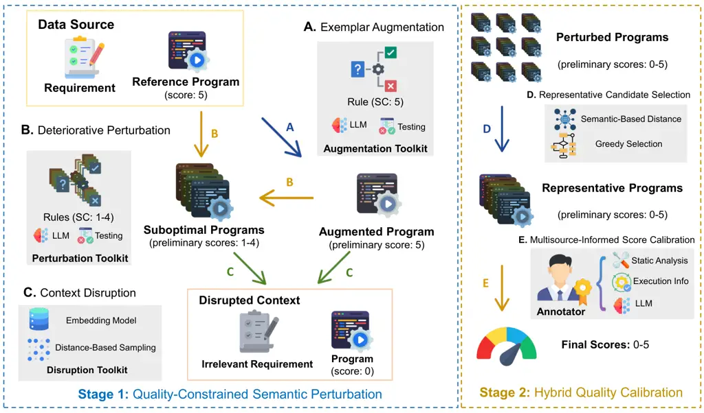
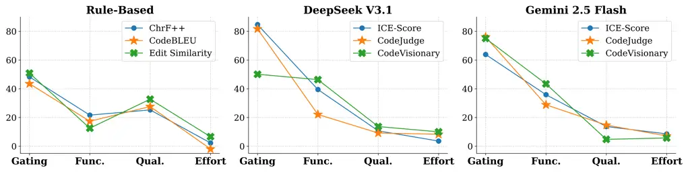
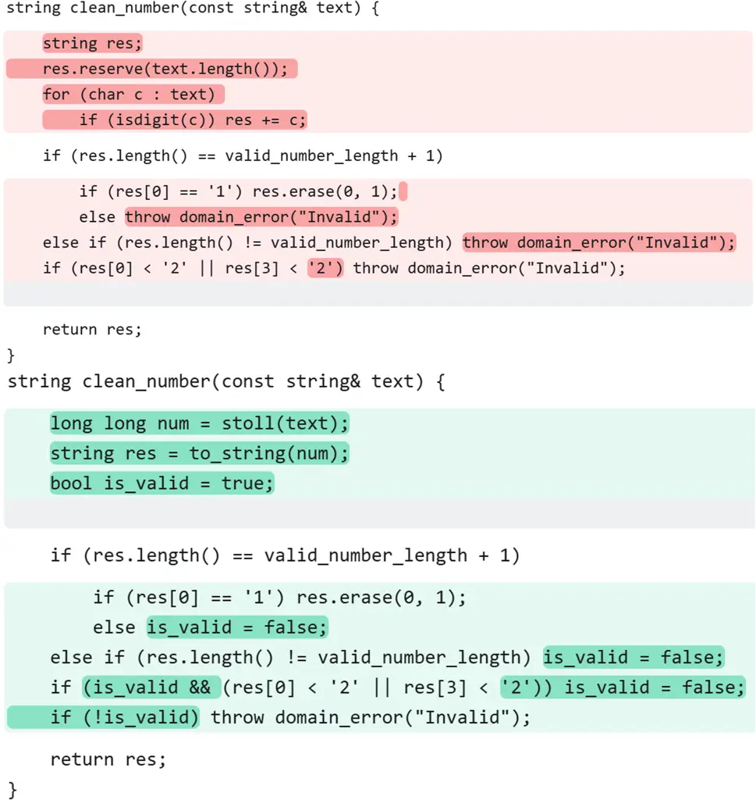

# Benchmarking Code LLM-as-a-Judge via Constrained Perturbation and Calibration

Ruiqi Wang    Xinchen Wang    Cuiyun Gao    Chun Yong Chong    Xin Xia
   Qing Liao ^(†)^(†)thanks: Ruiqi Wang, Xinchen Wang, Cuiyun Gao, and
Qing Liao are with Harbin Institute of Technology, Shenzhen, China
(e-mail: 24s151158@stu.hit.edu.cn; 200111115@stu.hit.edu.cn;
gaocuiyun@hit.edu.cn; liaoqing@hit.edu.cn). Cuiyun Gao is the
corresponding author.^(†)^(†)thanks: Chun Yong Chong is with Monash
University Malaysia, Bandar Sunway, Malaysia (e-mail:
chunyong@ieee.org).^(†)^(†)thanks: Xin Xia is with Zhejiang University,
Hangzhou, China (e-mail: xin.xia@acm.org).

###### Abstract

Code from LLM-assisted development may contain defects like API
hallucinations, motivating the development of code evaluation metrics to
assess such code before deployment. As conventional rule-based metrics
merely score code based on similarity to reference programs, and
execution-based metrics require expensive manual preparation for tests,
researchers have developed LLM-as-a-judge metrics for both behavioral
and non-behavioral code evaluation, and curated multiple benchmarks to
validate their effectiveness. However, such benchmarks suffer from
critical limitations: Some feature coarse-grained binary labels of
passing/failing unit tests, unable to distinguish between fundamental
and minor flaws; others utilize fine-grained criteria with manually
annotated scores as ground-truth, but such criteria are often vaguely
defined, introducing subjectivity and unreliability in human scores.
Furthermore, they often directly prompt LLMs to generate code for
evaluation, which may lead to unbalanced code quality distributions,
failing to test the metrics’ discriminative capability across varying
quality levels.

To curate a diverse benchmark with a balanced program quality
distribution and streamline manual annotation, we propose Axiom, a novel
perturbation-based framework. It reframes program scores as the
refinement effort needed for deployment, with two stages: (1)
Quality-constrained semantic perturbation, prompting LLMs to apply
sequences of predefined perturbation rules to existing programs,
precisely controlling each program’s target quality to achieve a
balanced distribution. (2) Hybrid quality calibration, selecting
semantically distinct programs for benchmark diversity, and performing
streamlined manual annotation with multisource context. With Axiom, we
curate AxiomBench, a large-scale multilingual benchmark with 1,962 code
evaluation problems in a more balanced score distribution and more
reliable annotated scores than previous benchmarks. We further conduct
an empirical study, revealing that while LLMs offer competitive
performance on ranking programs and verifiable evaluation subtasks, they
suffer from systematic pessimism bias and sample-level agentic
instability, and remain unreliable for subjective, non-behavioral code
evaluation.

## I Introduction

Recently, large language models (LLMs) have been widely deployed in
software engineering. With comprehensive pre- and post-training, these
colossal models possess strong reasoning \[1, 2\] and tool use \[3\]
capabilities, enabling them to assist in maintaining complex
repositories. Besides powerful LLMs like Google’s Gemini 2.5 \[4\] and
OpenAI’s GPT-4o \[5\], the industry has developed agentic applications
like Cursor and Claude Code. However, code from AI-assisted development
may be defective, with issues like API hallucinations \[6\] and social
bias \[7\], potentially leading to functional incorrectness or
suboptimal quality. Therefore, evaluating such code remains crucial
before deployment, and researchers have developed various metrics to
quantify the code’s overall quality.

While execution accuracy is the standard metric for validating program
behavior, it requires manually constructing environments and test cases,
which is labor-intensive. Rule-based metrics like CodeBLEU \[8\] and
RUBY \[9\] compare programs against reference programs. While efficient
to compute, they merely measure superficial lexical similarity. Manual
approaches require human experts to thoroughly review the code, which is
expensive and demands high levels of domain understanding. To reduce
human reliance, researchers propose LLM-as-a-judge metrics for code
evaluation, leveraging LLMs’ rich domain knowledge and
instruction-following ability, bypassing the need for reference programs
and test cases.

Naturally, researchers curate code evaluation benchmarks \[10, 11, 12\]
to verify whether LLM-as-a-judge metrics truly offer human-level code
evaluation. These benchmarks typically provide requirements and programs
for the metrics, and compare metric scores against human or test scores.
However, they suffer from major limitations, hindering comprehensive
assessments: (1) Unbalanced quality distribution. While open-source
programs are often used as ground-truths in code generation benchmarks
\[13\], they are unsuitable for code evaluation benchmarks, being highly
skewed towards higher quality. Therefore, existing benchmarks \[14, 15,
11\] use LLM-generated programs and label their scores with humans or
tests. However, the generation phase often prompts LLMs without
constraints \[10, 14\], suffering from the same higher-quality skew and
failing to adequately represent lower quality levels. (2) Coarse-grained
or subjective evaluation criteria. Some benchmarks use binary labels
(pass/fail) to indicate functional correctness \[16, 17\], disregarding
non-behavioral code quality and partial correctness; others apply
fine-grained criteria \[18, 14\] like a 5-point Likert scale, but with
vague descriptors like “slightly helpful”, instead of detailed and
objective definitions. This vagueness introduces high subjectivity and
inconsistency in human annotation, making the supposed “ground-truth”
unreliable. (3) Costly manual workload. Fine-grained evaluation requires
human-annotated scores, which is prohibitively expensive and prone to
quality control issues. This stems from its immense cognitive load on
annotators, requiring deep domain knowledge to meticulously reason about
logic and dependency at scale. Thus, existing benchmarks are often
small, unbalanced, and annotated with unreliable scores, highlighting
the need for a novel method to curate a large, balanced, and
reliably-grounded benchmark for meta-evaluating LLM-as-a-judge metrics.

Therefore, we propose Axiom, a novel framework to synthesize code
evaluation benchmarks. Axiom mitigates the shortcomings of existing
scoring systems by reframing code evaluation into measuring the
hypothetical effort needed to repair programs for deployment, resulting
in fine-grained, interpretable scores where higher values signify more
polished and deployable programs. By clearly defining each possible
score based on the scope of required fixes (e.g., a localized tweak or a
structural refactor), our evaluation criteria provide the necessary
foundation for a robust two-stage methodology: (1) Quality-constrained
semantic perturbation. Instead of prompting LLMs to generate code from
scratch without constraints, we utilize a perturbation-based pipeline.
This pipeline invokes LLMs to apply a sequence of predefined rules to
alter a program’s functionality or code quality, precisely generating
programs of predetermined quality. The involvement of LLMs allows
complex semantic changes to code, beyond simple, static tool-based
changes like operator swapping. Each program’s functionality is checked
via test cases. (2) Hybrid quality calibration. Due to the sheer number
of programs generated, we select a subset of representatives by greedily
choosing semantically distinct candidates to ensure diversity. We then
perform a streamlined annotation: instead of functionality evaluation
involving complex logic reasoning, the human annotator simply determines
the code quality and scope of changes to label the final score. This
greatly reduces manual workload, resulting in a large, balanced,
verified benchmark even with limited human resources.

We curate AxiomBench with Axiom, a code evaluation benchmark with 1,962
programs in a balanced quality distribution with reliable
human-calibrated scores, and study existing LLM-as-a-judge metrics,
making the following discoveries:

- •
  LLM-as-a-judge metrics are decent at relatively ranking programs based
  on quality, while agentic approaches further boost this capability for
  stronger LLMs. However, they suffer from systematic pessimism bias,
  rendering absolute scores unreliable without calibration.
- •
  LLM-as-a-judge shows competence in verifiable tasks like functionality
  evaluation. Surprisingly, conventional rule-based metrics outperform
  LLMs in non-functional assessment. Agentic approaches only boost
  performance on verifiable tasks of moderate difficulty.
- •
  Simpler metrics exhibit high sample-level consistency across repeated
  runs. In contrast, complex agentic workflows accumulate stochasticity
  across planning and tool-use steps, causing less stable scores for
  individual programs. However, their aggregate benchmark performance
  varies only marginally across full-dataset reruns.

Our contributions can be summarized as follows:

- •
  We present Axiom, a framework for generating code evaluation
  benchmarks at scale, to mitigate unreliability of previous data
  curation and annotation procedures.
- •
  We design the quality-constrained semantic perturbation stage,
  semantically perturbing code under strict score ceilings with LLMs to
  precisely control the expected quality. Predetermined quality scores
  are accurate, requiring substantially reduced manual workload for
  calibration.
- •
  We release AxiomBench and extensively study recent LLM-as-a-judge
  metrics, uncovering systematic biases and identifying key scenarios
  determining their reliability.

## II Related Work

### II-A Code Evaluation Metrics

Rule-based metrics measure lexical similarities between programs and
reference programs with predefined rules. CodeBLEU \[8\] combines BLEU
and code graph match. CrystalBLEU \[19\] excludes common n-grams in a
code corpus during BLEU computation to focus on crucial tokens.

LLM-as-a-judge metrics prompt LLMs to score programs. ICE-Score \[18\]
is an early attempt in LLM-based code evaluation with predefined
evaluation steps without tool use. CodeVisionary \[14\] evaluates code
with autonomous agents and negotiation. MCTS-Judge \[16\] applies
Monte-Carlo Tree Search to predict functional correctness.

Fig. 1: Overview of Axiom. Rule(s) refer to the perturbation rules
indicating how the perturbation should be performed, and SC refers to
the score ceiling of each rule, as described in Section III-B1.

### II-B Code Transformation

Code transformation generates new code based on existing code and
transformation rules, having been used to address multiple software
engineering tasks, such as code review \[20\] and program repair \[21\].
Recent studies use code transformation to synthesize clone detection
benchmarks. SeqCoBench \[22\] designs 20 types of single-step Python
transformations. EquiBench \[23\] deploys two-step domain-specific
transformations in four domains like CUDA. CETBench \[24\] performs up
to seven transformation steps with seven rule types.

While these transformation workflows can synthesize data for
reference-based code evaluation, they are inadequate for our
fine-grained evaluation criteria. We contend that modern LLMs are
capable enough to perform significantly more intricate and varied
transformations. This allows for the development of diverse,
general-purpose transformations applicable across various domains.

## III Methodology

We present an overview of Axiom in Figure 1.

### III-A Code Evaluation: Task Formulation

Given a program $`p`$, a metric $`f`$ scores the program as $`y=f(p)`$.
Previous work often used a binary scale $`y\in\{0,1\}`$ to indicate
$`p`$’s functional correctness, or a 5-point scale with vague
qualitative descriptors (e.g., “somewhat useful”) to assess aspects like
usefulness \[17\]. We argue that formulating scores as the effort needed
to refine a program until production-ready provides more concrete and
objective criteria. Thus, we measure the refinement effort as our
evaluation criteria:

- •
  5/5: Production-ready; no effort needed.
- •
  4/5: Perfect in functionality; requires minor tweaking to enhance code
  quality.
- •
  3/5: Perfect in functionality; requires major refactoring to enhance
  code quality.
- •
  2/5: Requires minor tweaking to repair functionality.
- •
  1/5: Requires major refactoring to repair functionality.
- •
  0/5: Fundamentally flawed; rewriting is more efficient.

Here, a “minor tweaking” refers to localized changes that preserve the
original control flow and algorithmic structure, like adding a boundary
check; a “major refactoring” involves altering the control flow or
logical structure, like reimplementing an essential data structure. This
distinction is inspired by studies on the scales of commits and
refactoring \[25, 26\].

This scale evaluates the program on two aspects:

- •
  Functionality measures whether the behavior aligns with the
  requirement, including input/output, efficiency, etc.
- •
  Code quality measures non-behavioral attributes like readability and
  maintainability.

This precisely defined scale improves upon previous criteria and enables
our framework to synthesize data at scale through specifically-designed
perturbation and calibration procedures.

[TABLE]

TABLE I: Summary of Perturbation Rules by score ceiling $`c(u)`$. The
rule set contains 45 rules total.

### III-B Quality-Constrained Semantic Perturbation

Given a code generation benchmark, where each sample is a triplet
$`(r,p_{\text{ref}},t)`$, where $`r`$ is the requirement,
$`p_{\text{ref}}`$ is the reference program, and $`t`$ is the set of
unit tests, this stage creates a code evaluation benchmark of
$`(r,p,s(p))`$ where $`p`$ is a program whose target score is $`s(p)`$
under our evaluation criteria. Previous work \[10, 14\] often directly
prompts LLMs to generate programs for requirement $`r`$, leading to
uncontrolled error types and unbalanced score distributions. To address
these issues, we propose a novel perturbation stage to synthesize
program $`p`$ and compute score $`s(p)`$.

In this section, we first introduce our perturbation design, and then
describe steps A, B, C in Figure 1:

- •
  Exemplar augmentation: generates more 5-point programs besides
  existing reference programs.
- •
  Deteriorative perturbation: synthesizes 1- to 4-point programs from
  5-point ones.
- •
  Context disruption: produces 0-point programs.

#### III-B1 Perturbation Rules

To comprehensively evaluate LLM-as-a-judge metrics, we utilize
perturbation, which transforms programs across the evaluation scale
defined in Section III-A, creating a diverse set of
requirement-program-quality triples. Formally, a perturbation
$`p^{\prime}=f_{u}(p)`$ transforms a program $`p`$ given a perturbation
rule $`u`$. Each rule $`u`$ is a tuple
$`\langle\mathcal{I}_{u},c(u)\rangle`$. $`\mathcal{I}_{u}`$ is a natural
language instruction describing the transformation, and
$`c(u)\in\{1,\dots,5\}`$ is the score ceiling, capping the maximum score
$`p^{\prime}`$ can achieve, i.e., acting as bottlenecks to the program
quality. The post-perturbation score is
$`s(p^{\prime})=\min(s(p),c(u))`$. For instance, applying a rule $`u`$
where $`c(u)=2`$ to a program of $`s(p)=5`$ degrades it to 2 points, now
requiring minor functionality repairs.

Rule Creation. We curate 45 rules with these steps:

1.  1.  Seed Selection: Manually drafts three rules reflecting common code
        defects and smells for each score ceiling.
2.  2.  LLM Expansion: Prompts the state-of-the-art Gemini 2.5 Pro to
        generate more rules given the seed rules, strictly adhering to the
        definitions of “minor tweaking” and “major refactoring” outlined
        previously.
3.  3.  Validation: Manually verifies that each instruction
        $`\mathcal{I}_{u}`$ matches its score ceiling $`c(u)`$.

Rule Taxonomy. Rules are categorized by their score ceiling, mapping
directly to the specific degradation required to reach that score level,
as summarized in Table I.

- •
  (Level 5) Semantic-Preserving Variations: generates alternative
  implementations that maintain functionality and high code quality,
  involving stylistic adaptations.
- •
  (Level 4) Minor Code Quality Degradation: introduces localized
  readability or style issues while preserving perfect functionality.
  Addressing these issues requires only “minor tweaking” as the control
  flow remains intact.
- •
  (Level 3) Major Code Quality Degradation: introduces design flaws that
  do not affect functionality, requiring “major refactoring” altering
  the program structure.
- •
  (Level 2) Minor Functional Defects: injects specific, localized bugs
  that break functionality, but can be repaired with “minor tweaking”
  without rewriting the core logic.
- •
  (Level 1) Major Functional Defects: renders the program functionally
  flawed, requiring “major refactoring” of structural overhauls, but not
  a complete rewrite.

Perturbation Algorithm. As shown in Algorithm 1, the process uses an LLM
for multi-step degradation. Given a target score $`s(p^{\prime})`$, we
sample a sequence of rules $`u_{1},\dots,u_{N}`$ such that
$`\min_{i}c(u_{i})=s(p^{\prime})`$. The LLM first validates if a rule is
applicable to the specific program $`p`$ (e.g., verifying recursions
exist before removing its base cases) and then generates the perturbed
program $`p^{\prime}`$. We check its functionality via unit tests.

0:  Program $`p`$, Perturbation rule set $`U_{*}`$, Target score
$`s(p^{\prime})`$

0:  Perturbed program $`p^{\prime}`$

 // 1. Generate score ceilings

 $`N\leftarrow\text{random}(1,N_{\max})\textit{ // Number of perturbations}`$

 for $`i=1`$ to $`N`$ do

  $`c_{i}=\text{random}(s(p^{\prime}),5)\textit{ // Score ceiling of step }i`$

 end for

 // Ensure $`\min_{i}c_{i}=s(p^{\prime})`$

 $`j\leftarrow\text{random}(1,N)`$

 $`c_{j}=s(p^{\prime})`$

 

 // 2. Follow randomly-selected rules

 $`p_{0}\leftarrow p`$

 for $`i=1`$ to $`N`$ do

  $`u\leftarrow\text{sample}(U_{c_{i}})\textit{ // }U_{c_{i}}\textit{: rules with score ceiling }c_{i}`$

  if not $`\textit{LLM\_feasible}(p_{i-1},u)`$ then

   return
$`\textsc{null}\textit{ // Fails if }u\textit{ is infeasible on }p_{i-1}`$

  end if

  $`p_{i}\leftarrow\textit{LLM\_perturb}(p_{i-1},u)\textit{ // Performs perturbation}`$

 end for

 $`p^{\prime}\leftarrow p_{N}`$

 return $`p^{\prime}`$

Algorithm 1 Multi-Step Perturbation

#### III-B2 Exemplar Augmentation

Code generation benchmarks typically provide a single reference program
per requirement. Relying on this solitary seed would constrain
perturbation diversity, limiting benchmark comprehensiveness. Thus, we
enrich the initial seed pool with additional 5-point programs to ensure
a diverse foundation for future perturbation.

For each requirement, we keep existing reference programs as the initial
seed pool of 5-point programs, and add new programs until the pool has
$`M`$ programs. To generate a new program $`p^{\prime}`$, we invoke
Algorithm 1 with target score $`s(p^{\prime})=5`$ and a random existing
program $`p`$. The algorithm utilizes perturbation rule set $`U_{5}`$
(rules with score ceiling 5), which rewrites $`p`$ while preserving its
functionality. The resulting program $`p^{\prime}`$ is verified via unit
testing.

#### III-B3 Deteriorative Perturbation

This step generates suboptimal programs of 1 to 4 points. Previous code
transformation work \[22\] often applied a single, minor change like
altering an operator, resulting in benchmarks with low diversity and
overly localized flaws. In contrast, our approach features richer defect
categories of both localized and structural changes to better reflect
complex real-world coding errors.

To generate a program $`p^{\prime}`$ with target score
$`s(p^{\prime})\in\{1,2,3,4\}`$, we apply Algorithm 1 to a random
5-point program $`p`$ with a sequence of perturbations to obtain
$`p^{\prime}`$. We run unit tests on $`p^{\prime}`$, and keep
$`p^{\prime}`$ only if it passes all tests ($`s(p^{\prime})\in\{3,4\}`$)
or fails at least one test ($`s(p^{\prime})\in\{1,2\}`$). This
generation–validation cycle is repeated until $`M`$ programs are
collected per target score per requirement.

This outcome-based design is efficient: Verifying each intermediate
perturbation is unnecessary; we only require the functional status of
the final $`p^{\prime}`$ matches $`s(p^{\prime})`$. We defer code
quality evaluation and score calibration to Section III-C.

#### III-B4 Context Disruption

This step creates 0-point programs. Instead of directly generating buggy
code, we pair programs with semantically unrelated requirements. This
approach creates reliable test cases that assess LLMs’ ability to detect
fundamental contextual irrelevance. Furthermore, since these pairings
are incorrect by definition, their scores of 0 are absolute, bypassing
manual calibration.

We use an embedding model $`E`$ to embed requirements
$`r_{1},...,r_{n}`$ into vectors $`E(r_{1}),...,E(r_{n})`$, and then
compute a distance matrix $`D`$ with cosine distance:
$`D_{ij}=1-\frac{E(r_{i})\cdot E(r_{j})}{\|E(r_{i})\|\|E(r_{j})\|}\in[0,2]`$,
where higher values indicate greater semantic dissimilarity.

For a given requirement $`r_{i}`$, we sample $`M`$ distinct requirements
by applying softmax over $`D`$ with temperature $`\tau=0.03`$.
Requirement $`r_{j}`$’s probability of being chosen is
$`P_{ij}=\frac{\exp(D_{ij}/\tau)}{\sum_{k=1}^{n}\exp(D_{ik}/\tau)}`$.
This encourages conceptually distant requirements, creating unambiguous
0-point pairings.

Finally, for each sampled requirement, we randomly select one of its
associated programs to serve as a 0-point program for requirement
$`r_{i}`$.

### III-C Hybrid Quality Calibration

The preceding stage yields a large corpus of programs, where each
program $`p`$ is associated with a requirement $`r`$ and a target score
$`s(p)`$. While its functional status is confirmed to align with
$`s(p)`$, its non-behavioral code quality and refinement effort remain
unexamined. To determine the final score $`s`$, the conventional
annotation procedure would require human experts to assess both the
functionality and code quality of each program, which is often slow and
unreliable due to the immense cognitive load and domain knowledge
required.

To address these challenges, we design the hybrid quality calibration
stage for both efficiency and reliability. Its core principle is to
decouple the assessment of functionality and non-behavioral code
quality. As the functionality has already been examined in the previous
stage, annotators no longer need to reason through complex program
logic. Instead, their task is narrowed to a much simpler and more
objective judgment: reviewing the diff between program $`p`$ and its
5-point pre-perturbation parent, determining its code quality and scope
of refinement changes with multisource information, and labeling the
final score $`s`$.

This decoupled approach dramatically reduces cognitive load on
annotators, accelerating annotation and increasing scoring reliability.
This efficiency allows us to curate a much larger verified benchmark
than a few hundred samples \[10\] while keeping our fine-grained
evaluation criteria.

This stage contains two steps (D and E in Figure 1). We select a
representative subset of programs, and then perform the final,
streamlined manual annotation to calibrate the scores.

#### III-C1 Representative Candidate Selection

The goal of this step is to select a balanced and diverse subset. For
each target score, the previous stage yields a large pool of $`N=nM`$
programs, where $`n`$ is the number of requirements, and $`M`$ is the
number of programs per target score. From this pool, we aim at curating
a representative subset of $`m`$ programs per target score before
calibration.

To ensure diversity and avoid redundancy, we quantify the dissimilarity
between programs with normalized token edit distance, which is more
semantically aware than character-wise metrics. We first tokenize each
program, discarding comments and whitespace, and then compute distance
matrix $`L`$. $`L_{ij}`$ is the minimum number of token edits
(insertions, deletions, and substitutions) to transform program
$`p_{i}`$ into $`p_{j}`$, normalized by the token count of the longer
program.

With the distance matrix $`L`$, we then select $`m`$ candidates from the
$`N`$ programs with the same target score with a greedy approach, which
employs a farthest-point heuristic. It begins with a random program, and
iteratively adds the remaining $`m-1`$ candidates. In each iteration, we
aim to select the most dissimilar program to the candidate set $`A`$. To
achieve this, we compute the minimum distance from each program to any
candidates, and then greedily choose an unselected program to maximize
this distance. We repeat this process until $`m`$ programs are selected.

#### III-C2 Hybrid Score Calibration

This final step calibrates the target score $`s(p)`$ of each candidate
program $`p`$ into the final, human-verified score $`s`$. To facilitate
an evidence-informed calibration, the annotator is provided with a
multisource report:

- •
  The diff comparison between $`p`$ and its 5-point parent.
- •
  The sequence of perturbation rules.
- •
  A static analysis report.
- •
  The full execution and test report.
- •
  An LLM-generated code quality report.

As the functional status of each program has already been confirmed via
automated testing, the annotator’s judgment is focused entirely on the
code quality and the scope of changes in the diff. Specifically, for
programs with functional flaws, the annotator verifies whether the
functional changes in the diff are structural refactors for $`s=1`$, or
a localized tweak for $`s=2`$; for functionally correct programs, the
annotator first assesses whether the code quality is perfect¹¹ 1 The
outputs from static analysis tools and the LLM are strictly advisory.
The final judgment on code quality depends solely on the human
annotator., and similarly judges the scope of changes to distinguish
programs with scores of 3–5.

After receiving the final score $`s`$, we obtain the final benchmark of
requirement $`r`$, program $`p`$, and ground-truth score $`s`$.

## IV Benchmark and Study Design

This section describes AxiomBench, a new code evaluation benchmark
created by Axiom. It then outlines the design of our empirical study,
which leverages AxiomBench to evaluate recent LLM-as-a-judge metrics for
code.

### IV-A AxiomBench: Curation

We use four recent, challenging benchmarks as data sources:

- •
  BigCodeBench \[27\] focuses on diverse Python libraries and complex
  instructions. We use the Hard subset.
- •
  LiveCodeBench \[28\] requires LLMs to reason on difficult algorithms.
  We use tasks from v3–v6 with Hard difficulty in C++, due to its
  dominance in competitive programming²² 2 Most submissions at
  https://codeforces.com/problemset/status are in C++..
- •
  APPS \[29\] contains 5,000 comprehensive Python tasks from various
  platforms. We use competition problems.
- •
  Aider-Polyglot³³ 3 https://aider.chat/2024/12/21/polyglot.html
  features difficult, multilingual tasks to test LLMs’ cross-file
  editing and algorithm design capability. We use problems in Java,
  Python, and C++.

We begin by randomly sampling up to 100 coding tasks from each selected
benchmark as requirements $`r`$. Their reference programs
$`p_{\text{ref}}`$ serve as the initial, 5-point programs for our
benchmark after being verified on test cases.

As the quality-constrained semantic perturbation stage requires numerous
LLM invocations, we sample one of these cost-efficient LLMs without
reasoning for each perturbation step: DeepSeek-V3.1, Qwen3-Coder-480B,
Kimi-K2, and Gemini-2.5-Flash. We generate $`M=2`$ programs per target
score per requirement with temperature $`T=0.3`$ and an output token
limit of 8192. For the embedding model, we use OpenAI’s
text-embedding-3-large. All LLM invocations are made online via API
providers. Unit tests are executed locally on an Ubuntu server with two
Intel Xeon Platinum 8276 CPUs and 256 GB RAM, in Bubblewrap’s sandbox
environment, with constraints of 5s CPU time and 12 GB RAM.

In the hybrid quality calibration stage, we tokenize programs with
Pygments lexers. We select up to $`m=90`$ programs per data source per
target score. We use DeepSeek-V3.1 for LLM-generated reports, and
cppcheck (C++), PMD (Java), and Pylint (Python) for static analysis. We
manually calibrate scores of all programs, including reference programs
$`p_{\text{ref}}`$.

### IV-B Annotation Details and Statistics

The manual calibration process is performed by a primary expert with 14
years of programming experience. After the 14-hour annotation procedure
(25 seconds/program), 1,431 programs (73% of 1,962) retain their target
scores without modification, indicating that target scores are already
highly accurate. To validate the objectivity and reproducibility of our
scoring criteria, we conduct an annotation study with 10% sampled data
(196 programs) from AxiomBench, and calibrate the scores with two
experts, each with more than five years of programming experience. The
inter-rater agreement results show high agreement with a Cohen’s
$`\kappa`$ of 96.7%, indicating that our criteria are highly objective
and reproducible. This justifies our choice of a primary annotator to
optimize annotation cost without sacrificing benchmark reliability.

The final AxiomBench-Full has an average of 58.4 lines of code, 8.5
cyclomatic complexity, and 477 tokens per program. We compare the
statistics of AxiomBench with other benchmarks in Table II.
Specifically, we report $`\kappa`$ for human annotation reliability,
compare different evaluation criteria, and report Normalized Shannon
Entropy $`S=-\sum_{k=1}^{N}p_{k}\log_{N}p_{k}\in[0,1]`$ to indicate
uniformity, where $`p_{i}`$ is the frequency of the $`i`$-th possible
score, and $`N`$ is the number of possible scores. $`S=1`$ indicates a
perfectly uniform quality distribution, whereas lower values indicate
class imbalance. As Table II demonstrates, AxiomBench achieves a very
high entropy of $`S=0.995`$, indicating a remarkably more balanced score
distribution than other benchmarks.

| Benchmark              | EX  | \#Prog. | \#Req. | $`\kappa`$ | $`S`$ |
| ---------------------- | --- | ------- | ------ | ---------- | ----- |
| AxiomBench-Full        | ✗   | 1,962   | 388    | 96.7       | 0.997 |
| AxiomBench-Rectifiable |     | 1,632   | 373    |            | 0.995 |
| Wang et al. \[10\]     | ✗   | 300     | 100    | 82.2       | 0.950 |
| CodeVisionary \[14\]   | ✗   | 363     | 121    | 80.0       | 0.675 |
| CodeJudge-Eval \[12\]  | ✓   | 1,860   | 457    | \-         | 0.785 |
| CodeJudgeBench \[11\]  | ✓   | 10,704  | 5,352  | \-         | 1.000 |

TABLE II: Benchmark statistics. Rectifiable refers to AxiomBench without
0-point programs, used in RQ1. Full refers to the complete AxiomBench,
used in other experiments. \#Prog./\#Req. means the number of
programs/requirements. $`\kappa`$ on our benchmark is computed on 10%
data (196 programs). Execution-based benchmarks (EX marked as ✓) only
evaluate code on functionality, and due to their absence of manual
annotation, $`\kappa`$ is inapplicable to them.

### IV-C Research Questions

We study these research questions with AxiomBench:

- •
  RQ1: How do existing code evaluation metrics perform on AxiomBench?

  This question assesses the performance of existing metrics by
  measuring the alignment between scores from each metric and
  ground-truth scores. To achieve this, we use two correlation
  coefficients, Spearman’s $`\rho`$ and Kendall’s $`\tau`$, which
  measure their ranked relationship, as well as Krippendorff’s
  $`\alpha`$ to measure their absolute agreement. We also measure the
  mean score of each metric to study systematic biases, and the Earth
  Mover’s Distance (EMD) \[30\] to study score distribution alignment.

- •
  RQ2: How does metric performance vary across subtasks of various
  complexity?

  This question provides a fine-grained diagnosis of metric performance
  by isolating evaluation subtasks: refinability gating, code quality
  assessment, functionality verification, and refinement effort
  estimation. Each can be formulated as a binary classification task. We
  use Matthews Correlation Coefficient (MCC) for its symmetric
  assessment of both positive and negative classes. Unlike
  $`F_{1}`$-score and accuracy, MCC effectively penalizes random
  guessing.

- •
  RQ3: Can these metrics evaluate code consistently?

  A reliable evaluation metric must assign consistent scores to the same
  program when invoked multiple times. We run each metric five times on
  the same program on the Aider-Polyglot subset, before quantifying
  consistency with two agreement coefficients, namely Krippendorff’s
  $`\alpha`$ and intra-class correlation (specifically, ICC(3, 1)).

### IV-D Experimental Setup

We study several code metrics with AxiomBench:

#### IV-D1 Rule-Based Metrics

These metrics compute rule-based similarity between program $`p`$ and
the reference program $`p_{\text{ref}}`$.

- •
  ChrF++ \[31\] computes $`F_{2}`$-scores based on character and token
  n-grams. While less commonly used than BLEU, it performs better on
  code evaluation \[10\].
- •
  CodeBLEU \[8\], tailored for code evaluation, combines BLEU, weighted
  n-gram match, syntactic AST match, and semantic data-flow match into
  the final score.
- •
  Edit Similarity \[32\] is derived from the edit distance. If the token
  edit distance between $`p`$ and $`p_{\text{ref}}`$ is
  $`d(p,p_{\text{ref}})`$, their edit similarity is
  $`1-\frac{d(p,p_{\text{ref}})}{\max(|p|,|p_{\text{ref}}|)}`$.

To standardize these metrics for a fair comparison, we first tokenize
each program $`p`$ with Pygments lexers instead of general-purpose LLM
tokenizers to better capture the syntactic code structure. After
discarding whitespace and comments, we compute raw score $`s_{p}`$ with
the metric. As these metrics produce continuous scores on varying
scales, we normalize them into our 0–5 integer scale by
$`round(5(s_{p}-s_{\text{min}})/(s_{\text{max}}-s_{\text{min}}))`$,
where $`s_{\min}`$ and $`s_{\max}`$ are the minimum and maximum raw
scores from that metric.

#### IV-D2 LLM-as-a-Judge Metrics

These metrics prompt the LLM to respond with a score, sometimes using a
predefined workflow to collect additional context before scoring.

- •
  ICE-Score \[18\] prompts the LLM to follow several predefined
  evaluation steps and assign the final score.
- •
  CodeJudge \[17\] first prompts an LLM to detect faults and computes a
  rule-based score with the JSON fault report. As the score computation
  misaligns with our evaluation criteria, we instead prompt the LLM to
  generate the final score based on our criteria with the report.
- •
  CodeVisionary \[14\] gathers context with an agentic tool-use
  workflow, and then lets several LLM judges discuss and score the code.
  Due to resource constraints, the maximum number of tool invocations is
  reduced to 20.

We use DeepSeek-V3.1 and Gemini-2.5-Flash for LLM-as-a-judge metrics. We
adhere to these metrics’ original prompt templates and hyper-parameter
configurations, but replace their evaluation criteria with ours. For the
ease of reading, we multiply the coefficients by 100.

## V Study Results

### V-A RQ1: Performance and Score Distribution

|                                  |          |          |            |       |       |
| -------------------------------- | -------- | -------- | ---------- | ----- | ----- |
| Metric                           | $`\rho`$ | $`\tau`$ | $`\alpha`$ | EMD   | Mean  |
| Part I: AxiomBench-Full          |          |          |            |       |       |
| Rule-Based Metrics               |          |          |            |       |       |
| ChrF++                           | 46.18    | 37.48    | 44.57      | 0.308 | 2.703 |
| CodeBLEU                         | 43.92    | 35.77    | 42.12      | 0.326 | 2.477 |
| Edit Similarity                  | 43.78    | 35.43    | 42.30      | 0.437 | 2.098 |
| LLM-as-a-Judge: DeepSeek-V3.1    |          |          |            |       |       |
| ICE-Score                        | 65.03    | 55.90    | 59.77      | 0.625 | 1.963 |
| CodeJudge                        | 61.81    | 53.26    | 44.47      | 1.025 | 1.423 |
| CodeVisionary                    | 61.45    | 51.65    | 41.89      | 1.121 | 1.327 |
| LLM-as-a-Judge: Gemini-2.5-Flash |          |          |            |       |       |
| ICE-Score                        | 59.59    | 49.71    | 46.53      | 0.922 | 1.527 |
| CodeJudge                        | 60.77    | 51.95    | 34.67      | 1.293 | 1.155 |
| CodeVisionary                    | 63.22    | 53.64    | 47.89      | 1.002 | 1.446 |
| Part II: AxiomBench-Rectifiable  |          |          |            |       |       |
| Rule-Based Metrics               |          |          |            |       |       |
| ChrF++                           | 13.25    | 10.74    | 12.54      | 0.232 | 3.099 |
| CodeBLEU                         | 11.45    | 9.26     | 10.27      | 0.238 | 2.813 |
| Edit Similarity                  | 15.13    | 12.36    | 11.09      | 0.522 | 2.422 |
| LLM-as-a-Judge: DeepSeek-V3.1    |          |          |            |       |       |
| ICE-Score                        | 40.06    | 33.93    | 31.68      | 0.752 | 2.358 |
| CodeJudge                        | 33.74    | 29.06    | 5.39       | 1.234 | 1.710 |
| CodeVisionary                    | 49.17    | 40.24    | 20.11      | 1.366 | 1.577 |
| LLM-as-a-Judge: Gemini-2.5-Flash |          |          |            |       |       |
| ICE-Score                        | 40.91    | 33.44    | 19.78      | 1.132 | 1.812 |
| CodeJudge                        | 33.19    | 28.08    | -8.94      | 1.555 | 1.388 |
| CodeVisionary                    | 40.05    | 33.17    | 15.51      | 1.205 | 1.738 |

TABLE III: Performance of each metric. The best result in each column is
underlined and marked bold. Results at most 3% worse than it are
underlined.

We measure the performance of each metric by computing the correlation
between ground-truth and metric scores. The results are available in
Table III. As we will discuss in RQ2, detecting fundamentally flawed
code (0-point) is simple for modern LLMs, which inflates performance
metrics. Consequently, while we report the performance on the Full set
to represent the complete quality spectrum (establishing 0-point as the
quality lower bound), we restrict our in-depth analysis to the
Rectifiable subset (ground-truth scores of 1–5).

The results highlight that current LLM-as-a-judge metrics are notably
more effective in relative ranking than assigning absolute scores.
ICE-Score, a simple metric with one inference pass, achieves moderate
rank correlations of $`\rho\approx 40\%`$ for both LLMs, but its
performance drops notably for absolute scoring at $`\alpha\approx 32\%`$
for DeepSeek and $`\alpha\approx 20\%`$ for Gemini. CodeJudge
demonstrates a similar trend of near-random absolute agreement with
$`|\alpha|<10\%`$, while offering moderate correlations of
$`\rho\approx 33\%`$ for both LLMs. Likewise, while CodeVisionary can
offer the highest ranking performance of $`\rho\approx 49\%`$ and
$`\tau\approx 40\%`$ for DeepSeek, this fails to translate to reliable
absolute scores with $`\alpha<21\%`$. This indicates that LLMs can
comprehend code semantics to distinguish relative quality, but lack the
internal scale calibration to match human-defined evaluation criteria,
necessitating calibration before scenario-specific code evaluation.

On the more complex Rectifiable subset, agentic metrics (CodeVisionary)
substantially boost the ranking performance of reasoning-capable LLMs
like DeepSeek-V3.1 by 22.7% to $`\rho\approx 49\%`$, as the multi-step
reasoning and tool-use procedure allows the LLM to examine the program
more thoroughly and generate more accurate relative ranks. Conversely,
LLMs weaker in reasoning, like Gemini-Flash, fail to benefit from the
agentic workflow, maintaining a performance of $`\rho\approx 40\%`$.
This is likely due to their weaker internal capability, which limits
their effectiveness with various tools. Nonetheless, agentic approaches
uniformly harm absolute scoring. CodeVisionary decreases $`\alpha`$ by
36.5% for DeepSeek-V3.1 and by 21.6% for Gemini-Flash, indicating that
simple prompting is preferable when absolute scoring is prioritized.

On the Full set, a converse trend emerges due to reasoning styles.
DeepSeek-V3.1, being prone to lengthy reasoning chains, is encouraged by
agentic approaches to deeply analyze fundamentally flawed code rather
than dismissing it, leading to a 5.5% performance degradation.
Conversely, for Gemini-Flash, which prefers shorter reasoning chains,
the agentic approach may act as a guardrail, forcing it to rapidly
identify useless programs, resulting in a 6.1% performance boost.

The analysis of Earth Mover’s Distance (EMD) and Mean Score exposes a
systematic pessimism in existing metrics for code evaluation. The
consistently lower mean scores suggest that LLM-as-a-judge metrics
exhibit profound negative biases. The highest mean score among these
metrics is observed in ICE-Score+DeepSeek-V3.1 at 2.358, which is still
19.9% lower than the ground-truth at 2.944. Other metrics demonstrate
even more severe biases at 38.5–52.9% lower than the ground-truth. We
attribute this to the objectives of RLHF training: LLMs are trained to
be helpful assistants, which encourages them to actively flag defects
rather than passively verify perfection. This reveals a trade-off
between helpfulness (which encourages false positives to demonstrate
utility) and precision (which punishes false positives).

EMDs further qualify the distribution mismatch. Surprisingly, rule-based
metrics exhibit much lower EMDs at 0.232–0.522, indicating that their
score distributions closely mimic the balanced distribution of
ground-truth scores. However, their near-zero correlation renders this
distributional fidelity useless. In contrast, LLM-as-a-judge metrics
yield high EMDs at 0.752–1.555. Combined with their negative bias, we
conclude that LLM-as-a-judge metrics tend to generate biased,
pessimistic scores with decent ranking correlation but poor
distributional fidelity.

### V-B RQ2: Diagnostic Capability Analysis

We further split code evaluation under our criteria into four binary
classification subtasks:

- •
  Refinability Gating (Gating): Detects fundamentally flawed code
  warranting discarding. Positive: score 0; negative: scores 1–5.
- •
  Functionality Verification (Func.): Detects programs that successfully
  implement the intended functionality. Positive: scores 3–5; negative:
  scores 0–2.
- •
  Code Quality Assessment (Qual.): Detects high-quality code from
  functionally correct programs. Positive: score 5; negative: scores
  3–4; excluded: scores 0–2.
- •
  Refinement Effort Estimation (Effort): Determines whether a defective
  program requires structural refactoring rather than localized
  tweaking. Positive: scores 1 and 3; negative: scores 2 and 4;
  excluded: scores 0 and 5.

Fig. 2: Plots of Matthews correlation coefficient (MCC) of each metric
on different subtasks.

In Figure 2, we observe that LLM performance degrades monotonically as
the task complexity increases, performing competitively on objective
verification subtasks while collapsing on subjective grading ones.
Specifically, Refinability Gating is the simplest subtask, where most
LLM-as-a-judge metrics achieve strong performance of MCC$`>`$75%, as
LLMs only need to recognize fundamentally flawed logic rather than
identifying subtle functional defects. An exception is observed with
DeepSeek-V3.1, where the inclusion of 0-point programs creates an
over-thinking trap; this LLM’s lengthy reasoning chains may lead to
hallucinated potential in useless code, resulting in an underwhelming
performance of 46% MCC. This exception aligns with our analysis in RQ1.

Functionality Verification appears more challenging but still tractable.
ICE-Score achieves a moderate 35–40% MCC, likely because modern LLM
training data includes abundant reasoning traces, enabling LLMs to
internally simulate program execution. The agentic approach,
CodeVisionary, provides a further 17.4% performance boost for DeepSeek
and a 21.0% boost for Gemini-Flash. Here, the tool use steps allow them
to actually execute the programs and generate reports based on concrete
runtime feedback rather than probabilistic simulation.

However, current metrics are incapable of handling subjective grading
subtasks, yielding disappointing performance of 5–15% MCC on Code
Quality Assessment. This requires them to examine non-functional aspects
by mimicking real-world code review. Without detailed instructions or
formal specifications for “quality”, they may be tempted to report
superficial characteristics like lack of comments, rather than
distinguishing nuanced structural flaws. On Refinement Effort
Estimation, no metrics exceed 10% MCC. This fundamentally different
subtask requires LLMs to not only detect defects but also simulate
repair trajectories to estimate the cost. Our results indicate that
while LLMs can detect code defects, they struggle to estimate the
magnitude of repair effort.

Among verifiable subtasks, LLM-as-a-judge ($`\text{MCC}>75`$% in most
cases) remarkably outperforms rule-based metrics (MCC$`<`$51%) on
Refinability Gating. While the agentic approach improves Gemini-Flash’s
performance, it paradoxically degrades DeepSeek-V3.1, reinforcing the
“over-thinking” hypothesis where unnecessarily lengthy reasoning
introduces noise into simple decisions. On the more challenging
Functionality Verification subtask, the performance gap persists, as
rule-based metrics struggle to capture runtime logic, and LLM-as-a-judge
metrics maintain moderate competence. Notably, the agentic CodeVisionary
consistently boosts performance by 17–21%, indicating that at this
moderate difficulty, the overhead of agentic usage pays off by runtime
context and deeper reasoning. Conversely, rule-based metrics achieve
superior performance on Code Quality Assessment at 25–33% MCC compared
to LLMs, which struggle to offer reliable non-functionality assessment.
This demonstrates that such conventional, rule-based metrics remain the
most robust method in code quality assessment. Finally, no metrics are
capable of correctly estimating refinement effort at near-zero MCC,
highlighting a critical gap in automated maintenance estimation.

### V-C RQ3: Scoring Consistency

| Metric                           | Consistency             |                        | Performance    (Mean ± Std.) |                        |
| -------------------------------- | ----------------------- | ---------------------- | ---------------------------- | ---------------------- |
|                                  | $`\alpha_{\text{Run}}`$ | ICC$`{}_{\text{Run}}`$ | $`\rho_{\text{GT}}`$         | $`\alpha_{\text{GT}}`$ |
| LLM-as-a-Judge: Gemini-2.5-Flash |                         |                        |                              |                        |
| ICE-Score                        | 86.61                   | 85.23                  | 39.92 ± 2.40                 | 16.84 ± 2.57           |
| CodeJudge                        | 73.89                   | 77.89                  | 29.82 ± 1.42                 | -17.71 ± 2.17          |
| CodeVisionary                    | 51.66                   | 52.09                  | 34.36 ± 1.66                 | 3.25 ± 3.66            |

TABLE IV: Metric consistency. Run metrics are computed across five runs
to measure sample-level consistency. GT metrics are computed for each
run against the ground-truth scores to measure variance in dataset-level
performance.

We study metric consistencies with Gemini-2.5-Flash in Table IV. Each
metric is executed five times on each program.

Both simpler metrics, ICE-Score and CodeJudge, show high consistency for
sample-level scores with $`\alpha>73\%`$ and $`\text{ICC}>77\%`$,
indicating that prompting the LLM once provides surprisingly consistent
results on a single sample. In contrast, the complex agentic metric,
CodeVisionary, behaves notably more inconsistently with 40.4% lower
$`\alpha`$ and 38.9% lower ICC. This can be attributed to accumulated
uncertainty: Each step during CodeVisionary’s pipeline of action
planning and tool calling introduces stochasticity, leading to higher
variance in the final scores. The other metrics only include 1–2 LLM
invocations, minimizing this uncertainty accumulation. For the
dataset-level performance, the standard deviations of $`\rho`$ and
$`\alpha`$ stay consistently below $`4\%`$, indicating that despite
stochasticity during LLM invocation, the aggregate dataset-level
performance impact is generally marginal.

## VI Discussion

### VI-A Illustrative Example

Fig. 3: Illustrative example in AxiomBench.

Figure 3 illustrates one AxiomBench example. The program above is
5-point and production-ready. Axiom first introduces a
semantics-preserving intermediate variable $`is\_valid`$, and then adds
a localized functional defect by converting $`text`$ to $`num`$ before
filtering non-digit characters. The perturbed program below preserves
the original structure but fails relevant tests. Since the functional
defect can be repaired by a localized edit, it is considered 2 points.

### VI-B Implications of Study

#### VI-B1 For Developers

1.  1.  Prefer ranking over absolute gating. Current LLM-as-a-judge metrics
        are competitive at ranking candidates but suffer from severe
        systematic bias in absolute scoring. Developers should avoid using
        raw LLM scores for quality gating, for instance, accepting the code
        if score$`>`$3, unless the metric has been strictly calibrated.
2.  2.  Delineate verifiable and subjective evaluation tasks. LLMs are more
        reliable in verifiable evaluation tasks like functionality
        assessment. However, they underperform in subjective grading tasks,
        like maintainability review, in which developers should treat LLM
        feedback as diagnostic rather than definitive.
3.  3.  Default to simple methods for stability. Contrary to the assumption
        that agents consistently improve performance, simple prompting often
        yields higher scoring stability and efficiency for standard
        evaluation. Agentic approaches should be reserved for complex
        evaluation tasks with proper variance reduction methods.

#### VI-B2 For Researchers

1.  1.  Adopt quality-constrained benchmark construction. Previous code
        evaluation benchmarks often rely on unconstrained LLM generation,
        inevitably skewing toward high-quality code, underrepresenting the
        lower-quality spectrum. To reliably test the metrics’ discriminative
        capability across the entire quality spectrum, future work should
        actively constrain the quality of generated code to guarantee a
        balanced distribution.
2.  2.  Address the subjectivity alignment gap. While LLMs are already
        competitive at detecting verifiable correctness, future work should
        pivot towards the harder evaluation task of subjective quality
        grading and target the challenging problem of non-behavioral code
        evaluation.
3.  3.  Prioritize absolute agreement and metric stability. Evaluating
        metrics solely via rank correlation obscures systematic biases.
        Researchers should also report absolute agreement meta-metrics like
        $`\alpha`$ to expose the biases. Furthermore, certain metrics like
        agentic methods amplify stochasticity and degrade scoring
        consistency. Therefore, future work should focus on variance
        reduction to stabilize agentic judges while preserving their
        reasoning depth.

### VI-C Threats to Validity

- •
  Domain Generalizability. AxiomBench mainly features algorithmic
  challenges and library usage tasks across three prevalent languages
  (C++, Java, Python). The findings may thus not fully generalize to
  languages with distinct paradigms like Rust or projects with
  repository-level dependencies. We mitigate this by including data
  sources with cross-file dependencies like Aider-Polyglot, and making
  perturbation rules inherently language- and dependency-agnostic. This
  allows Axiom to readily extend to more complex, domain-specific
  codebases.
- •
  Data Contamination. LLMs meta-evaluated as judges may have memorized
  parts of the reference programs during training, potentially inflating
  meta-evaluation results. We mitigate this by including data sources
  with continuous updates like LiveCodeBench. Furthermore, our reliance
  on perturbed programs naturally mitigates this risk, because they are
  uniquely generated with novel flaws absent from public sources like
  GitHub.
- •
  Subjectivity in Criteria Interpretation. Our evaluation criteria rely
  on human distinction between minor tweaks and major refactors,
  potentially introducing subjectivity in our ground-truth labels. We
  mitigate this with hybrid score calibration, providing the annotator
  with a wide range of objective evidence, like static analysis results
  and diff. This reframes the annotating task from open-ended scoring to
  a more objective verification. We also conduct a preliminary study as
  specified in Section IV-B, and the high inter-rater agreement
  indicates high objectivity during manual annotation.

## VII Conclusion

In this paper, we propose Axiom, a framework to synthesize code
evaluation data to meta-evaluate existing LLM-as-a-judge metrics for
code. Axiom involves a quality-constrained semantic perturbation stage
to synthesize programs and a hybrid quality calibration stage to
calibrate scores, addressing issues of previous benchmarks. We use this
framework to craft a balanced, verified benchmark, AxiomBench, conduct
experiments with multiple recent LLM-as-a-judge metrics, and release our
data⁴⁴ 4
[https://github.com/BackOnTruck/axiom-llm-judge](https://github.com/BackOnTruck/axiom-llm-judge).
and findings.

## References

- \[1\] OpenAI (2024) OpenAI o1 system card. CoRR abs/2412.16720. Cited
  by: §I.
- \[2\] DeepSeek-AI (2025) DeepSeek-r1: incentivizing reasoning
  capability in llms via reinforcement learning. CoRR abs/2501.12948.
  Cited by: §I.
- \[3\] Y. Qin, S. Hu, Y. Lin, W. Chen, N. Ding, G. Cui, Z. Zeng, X.
  Zhou, Y. Huang, C. Xiao, C. Han, Y. R. Fung, Y. Su, H. Wang, C.
  Qian, R. Tian, K. Zhu, S. Liang, X. Shen, B. Xu, Z. Zhang, Y. Ye, B.
  Li, Z. Tang, J. Yi, Y. Zhu, Z. Dai, L. Yan, X. Cong, Y. Lu, W.
  Zhao, Y. Huang, J. Yan, X. Han, X. Sun, D. Li, J. Phang, C. Yang, T.
  Wu, H. Ji, G. Li, Z. Liu, and M. Sun (2025) Tool learning with
  foundation models. ACM Comput. Surv. 57 (4), pp. 101:1–101:40. Cited
  by: §I.
- \[4\] G. Team (2025) Gemini 2.5: pushing the frontier with advanced
  reasoning, multimodality, long context, and next generation agentic
  capabilities. CoRR abs/2507.06261. Cited by: §I.
- \[5\] OpenAI (2024) GPT-4o system card. CoRR abs/2410.21276. External
  Links: [Link](https://doi.org/10.48550/arXiv.2410.21276),
  [Document](https://dx.doi.org/10.48550/ARXIV.2410.21276), 2410.21276
  Cited by: §I.
- \[6\] Y. Chen, M. Chen, C. Gao, Z. Jiang, Z. Li, and Y. Ma (2025)
  Towards mitigating API hallucination in code generated by llms with
  hierarchical dependency aware. In Proceedings of the 33rd ACM
  International Conference on the Foundations of Software Engineering,
  FSE Companion 2025, Clarion Hotel Trondheim, Trondheim, Norway, June
  23-28, 2025, pp. 468–479. Cited by: §I.
- \[7\] L. Ling, F. Rabbi, S. Wang, and J. Yang (2025) Bias unveiled:
  investigating social bias in llm-generated code. In AAAI-25, Sponsored
  by the Association for the Advancement of Artificial Intelligence,
  February 25 - March 4, 2025, Philadelphia, PA, USA, pp. 27491–27499.
  Cited by: §I.
- \[8\] S. Ren, D. Guo, S. Lu, L. Zhou, S. Liu, D. Tang, N.
  Sundaresan, M. Zhou, A. Blanco, and S. Ma (2020) CodeBLEU: a method
  for automatic evaluation of code synthesis. CoRR abs/2009.10297. Cited
  by: §I, §II-A, 2nd item.
- \[9\] N. M. Tran, H. Tran, S. Nguyen, H. Nguyen, and T. N.
  Nguyen (2019) Does BLEU score work for code migration?. In Proceedings
  of the 27th International Conference on Program Comprehension, ICPC
  2019, Montreal, QC, Canada, May 25-31, 2019, pp. 165–176. Cited by:
  §I.
- \[10\] R. Wang, J. Guo, C. Gao, G. Fan, C. Y. Chong, and X. Xia (2025)
  Can llms replace human evaluators? an empirical study of
  llm-as-a-judge in software engineering. Proc. ACM Softw. Eng. 2
  (ISSTA), pp. 1955–1977. Cited by: §I, §III-B, §III-C, 1st item, TABLE
  II.
- \[11\] H. Jiang, Y. Chen, Y. Cao, H. Lee, and R. T. Tan (2025)
  CodeJudgeBench: benchmarking llm-as-a-judge for coding tasks. CoRR
  abs/2507.10535. Cited by: §I, TABLE II.
- \[12\] Y. Zhao, Z. Luo, Y. Tian, H. Lin, W. Yan, A. Li, and J.
  Ma (2025) CodeJudge-eval: can large language models be good judges in
  code understanding?. In Proceedings of the 31st International
  Conference on Computational Linguistics, COLING 2025, Abu Dhabi, UAE,
  January 19-24, 2025, pp. 73–95. Cited by: §I, TABLE II.
- \[13\] J. Feng, J. Liu, C. Gao, C. Y. Chong, C. Wang, S. Gao, and X.
  Xia (2024) ComplexCodeEval: A benchmark for evaluating large code
  models on more complex code. In Proceedings of the 39th IEEE/ACM
  International Conference on Automated Software Engineering, ASE 2024,
  Sacramento, CA, USA, October 27 - November 1, 2024, pp. 1895–1906.
  Cited by: §I.
- \[14\] X. Wang, P. Gao, C. Peng, R. Hu, and C. Gao (2025)
  CodeVisionary: an agent-based framework for evaluating large language
  models in code generation. CoRR abs/2504.13472. Cited by: §I, §II-A,
  §III-B, 3rd item, TABLE II.
- \[15\] M. Evtikhiev, E. Bogomolov, Y. Sokolov, and T. Bryksin (2023)
  Out of the BLEU: how should we assess quality of the code generation
  models?. J. Syst. Softw. 203, pp. 111741. Cited by: §I.
- \[16\] Y. Wang, P. Ji, C. Yang, K. Li, M. Hu, J. Li, and G.
  Sartoretti (2025) MCTS-judge: test-time scaling in llm-as-a-judge for
  code correctness evaluation. CoRR abs/2502.12468. Cited by: §I, §II-A.
- \[17\] W. Tong and T. Zhang (2024) CodeJudge: evaluating code
  generation with large language models. In Proceedings of the 2024
  Conference on Empirical Methods in Natural Language Processing, EMNLP
  2024, Miami, FL, USA, November 12-16, 2024, pp. 20032–20051. Cited by:
  §I, §III-A, 2nd item.
- \[18\] T. Y. Zhuo (2024) ICE-score: instructing large language models
  to evaluate code. In Findings of the Association for Computational
  Linguistics: EACL 2024, St. Julian’s, Malta, March 17-22, 2024,
  pp. 2232–2242. Cited by: §I, §II-A, 1st item.
- \[19\] A. Eghbali and M. Pradel (2022) CrystalBLEU: precisely and
  efficiently measuring the similarity of code. In 44th IEEE/ACM
  International Conference on Software Engineering: Companion
  Proceedings, ICSE Companion 2022, Pittsburgh, PA, USA, May 22-24,
  2022, pp. 341–342. Cited by: §II-A.
- \[20\] P. Thongtanunam, C. Pornprasit, and C. Tantithamthavorn (2022)
  AutoTransform: automated code transformation to support modern code
  review process. In 44th IEEE/ACM 44th International Conference on
  Software Engineering, ICSE 2022, Pittsburgh, PA, USA, May 25-27, 2022,
  pp. 237–248. Cited by: §II-B.
- \[21\] Y. Li, S. Wang, and T. N. Nguyen (2020) DLFix: context-based
  code transformation learning for automated program repair. In ICSE
  ’20: 42nd International Conference on Software Engineering, Seoul,
  South Korea, 27 June - 19 July, 2020, pp. 602–614. Cited by: §II-B.
- \[22\] N. Maveli, A. Vergari, and S. B. Cohen (2025) What can large
  language models capture about code functional equivalence?. In
  Findings of the Association for Computational Linguistics: NAACL 2025,
  Albuquerque, New Mexico, USA, April 29 - May 4, 2025, pp. 6865–6903.
  Cited by: §II-B, §III-B3.
- \[23\] A. Wei, J. Cao, R. Li, H. Chen, Y. Zhang, Z. Wang, Y. Sun, Y.
  Liu, T. S. F. X. Teixeira, D. Yang, K. Wang, and A. Aiken (2025)
  EquiBench: benchmarking code reasoning capabilities of large language
  models via equivalence checking. CoRR abs/2502.12466. Cited by: §II-B.
- \[24\] N. Oza, I. Govil, P. Gupta, D. Khandelwal, D. Garg, and P.
  Singla (2025) CETBench: A novel dataset constructed via
  transformations over programs for benchmarking llms for
  code-equivalence checking. CoRR abs/2506.04019. Cited by: §II-B.
- \[25\] D. Dig, W. G. Griswold, E. R. Murphy-Hill, and M.
  Schäfer (2014) The future of refactoring (dagstuhl seminar 14211).
  Dagstuhl Reports 4 (5), pp. 40–67. Cited by: §III-A.
- \[26\] S. Hönel, M. Ericsson, W. Löwe, and A. Wingkvist (2019)
  Importance and aptitude of source code density for commit
  classification into maintenance activities. In 19th IEEE International
  Conference on Software Quality, Reliability and Security, QRS 2019,
  Sofia, Bulgaria, July 22-26, 2019, pp. 109–120. Cited by: §III-A.
- \[27\] T. Y. Zhuo, M. C. Vu, J. Chim, H. Hu, W. Yu, R.
  Widyasari, I. N. B. Yusuf, H. Zhan, J. He, I. Paul, S. Brunner, C.
  Gong, J. Hoang, A. R. Zebaze, X. Hong, W. Li, J. Kaddour, M. Xu, Z.
  Zhang, P. Yadav, and et al. (2025) BigCodeBench: benchmarking code
  generation with diverse function calls and complex instructions. In
  The Thirteenth International Conference on Learning Representations,
  ICLR 2025, Singapore, April 24-28, 2025, Cited by: 1st item.
- \[28\] N. Jain, K. Han, A. Gu, W. Li, F. Yan, T. Zhang, S. Wang, A.
  Solar-Lezama, K. Sen, and I. Stoica (2025) LiveCodeBench: holistic and
  contamination free evaluation of large language models for code. In
  The Thirteenth International Conference on Learning Representations,
  ICLR 2025, Singapore, April 24-28, 2025, Cited by: 2nd item.
- \[29\] D. Hendrycks, S. Basart, S. Kadavath, M. Mazeika, A. Arora, E.
  Guo, C. Burns, S. Puranik, H. He, D. Song, and J. Steinhardt (2021)
  Measuring coding challenge competence with APPS. In Proceedings of the
  Neural Information Processing Systems Track on Datasets and Benchmarks
  1, NeurIPS Datasets and Benchmarks 2021, December 2021, virtual, Cited
  by: 3rd item.
- \[30\] Y. Rubner, C. Tomasi, and L. J. Guibas (1998) A metric for
  distributions with applications to image databases. In Proceedings of
  the Sixth International Conference on Computer Vision (ICCV-98),
  Bombay, India, January 4-7, 1998, pp. 59–66. Cited by: 1st item.
- \[31\] M. Popovic (2017) ChrF++: words helping character n-grams. In
  Proceedings of the Second Conference on Machine Translation, WMT 2017,
  Copenhagen, Denmark, September 7-8, 2017, pp. 612–618. Cited by: 1st
  item.
- \[32\] V. Levenshtein (1965) Binary codes capable of correcting
  deletions, insertions, and reversals probl. Inf. Transm 1, pp. 8–17.
  Cited by: 3rd item.
