# Calibrating LLM Judges: Linear Probes for Fast and Reliable Uncertainty Estimation

Bhaktipriya Radharapu Affiliation: FAIR at Meta    Eshika Saxena
Affiliation: FAIR at Meta    Kenneth Li Affiliation: Meta
Superintelligence Labs
Correspondence:[bhakti@meta.com](mailto:email@domain)    Chenxi
Whitehouse Affiliation: FAIR at Meta    Adina Williams Affiliation: FAIR
at Meta    Nicola Cancedda Affiliation: FAIR at Meta

###### Abstract

As LLM-based judges become integral to industry applications, obtaining
well-calibrated uncertainty estimates efficiently has become critical
for production deployment. However, existing techniques, such as
verbalized confidence and multi-generation methods, are often either
poorly calibrated or computationally expensive. We introduce linear
probes trained with a Brier score-based loss to provide calibrated
uncertainty estimates from reasoning judges’ hidden states, requiring no
additional model training. We evaluate our approach on both objective
tasks (reasoning, mathematics, factuality, coding) and subjective human
preference judgments. Our results demonstrate that probes achieve
superior calibration compared to existing methods with $`\approx 10`$x
computational savings, generalize robustly to unseen evaluation domains,
and deliver higher accuracy on high-confidence predictions. However,
probes produce conservative estimates that underperform on easier
datasets but may benefit safety-critical deployments prioritizing low
false-positive rates. Overall, our work demonstrates that
interpretability-based uncertainty estimation provides a practical and
scalable plug-and-play solution for LLM judges in production.

## 1 Introduction

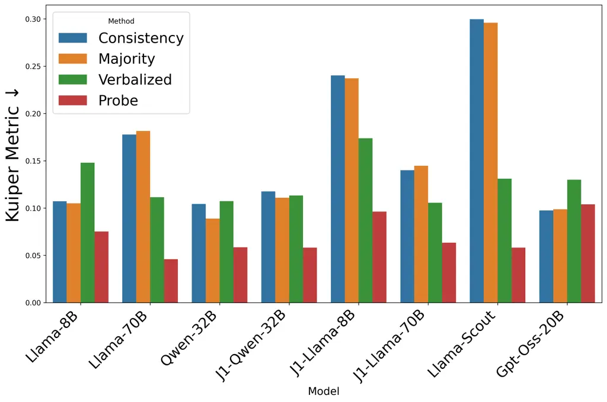

Figure 1: Calibration of models across model architectures, datasets,
and uncertainty estimation methods as measured by the Kuiper metric. We
compare four approaches across dense prompted judges (LLaMA 8B/70B, Qwen
32B), dense fine-tuned judges (J1 family), and MoE prompted judges
(GPT-OSS 20B, LLaMA Scout). Our probe-based method outperforms baseline
approaches across all architectures and training paradigms. Results
averaged across all evaluation datasets. Lower values indicate better
calibration.

LLM-as-judge paradigm (Zheng et al., 2023; Dubois et al., 2023; Touvron
et al., 2023) has become ubiquitous in modern AI development, providing
reward signals for alignment training (RLAIF) (Bai et al., 2022; Lee et
al., 2023; Kirk et al., 2024) and ranking models for deployment
decisions (Chiang et al., 2024). With the rapid advancement of
reasoning-capable models (OpenAI, 2024; DeepSeek-AI, 2025), LLM judges
that generate reasoning traces before rendering verdicts are becoming
increasingly prevalent due to their higher accuracy and transparency
(Whitehouse et al., 2025; Chen et al., 2025).

Yet, current practice treats all judgments as equally reliable. Without
calibrated confidence estimates, we cannot distinguish high-confidence
judgments from cases where the LLM is essentially guessing. Moreover,
LLM judges are known to be overconfident, systematically expressing
higher confidence than their empirical accuracy supports (Tian et al.,
2025; Jung et al., 2024). This leaves practitioners to either blindly
trust all judgments or manually review everything (defeating the purpose
of automation). This lack of uncertainty awareness is particularly
problematic across judgment types: for correctness evaluation, we cannot
identify objectively wrong judgments to exclude (Zhou et al., 2024b;
Ross et al., 2024; Wang et al., 2023); for preference evaluation, we
cannot detect genuinely ambiguous cases where humans may disagree or
multiple valid answers exist (Aroyo and Welty, 2015; Pavlick and
Kwiatkowski, 2019; Nie et al., 2020; Talat et al., 2022; Radharapu et
al., 2025).

Calibrated LLM judges, whose expressed confidence matches their
empirical accuracy, enable systems to route straightforward cases to
efficient models while reserving expensive judges or human reviewers for
uncertain decisions (Jung et al., 2024; Chen et al., 2023), dramatically
reducing computational and labor costs. Training processes become more
efficient by down-weighting uncertain judgments, preventing noisy labels
from causing reward hacking (Gao et al., 2022) and model collapse (Zhang
et al., 2024). Across these applications, calibration serves
complementary purposes: flagging likely errors in correctness tasks
while preserving valid diversity in preference tasks. Calibration is
thus essential for building reliable and trustworthy AI systems with LLM
judges.

In this work, our main contributions are: (1) A Brier-score–trained
linear probe that produces calibrated uncertainty estimates from
reasoning judges’ hidden states, requiring no additional model training
or multi-sample generation. (2) Our probe achieves substantially better
calibration than verbalized and multi-generation baselines across
multiple model families (dense and MoE) and judging styles (prompted and
fine-tuned), while requiring an order of magnitude less compute. (3)
Strong out-of-distribution generalization to unseen benchmarks, with
analysis of key trade-offs in probe’s performance.

## 2 Related Work

### 2.1 LLM Judges and Reasoning-Based Evaluation

Large language model judges have become ubiquitous for evaluating model
outputs across tasks ranging from pairwise preference ranking for
RLHF (Christiano et al., 2017; Ouyang et al., 2022) to judging for
correctness in verifiable tasks. These judges span a spectrum from
prompted general-purpose models like GPT-4 (Zheng et al., 2023; Dubois
et al., 2023) to specialized fine-tuned judges (Whitehouse et al., 2025;
Zhu et al., 2025; Kim et al., 2024a; Kim et al., 2024b; Li et al.,
2024a) that reason before giving their verdict. While these judges
achieve high accuracy, LLM judges are known to suffer from systematic
overconfidence (Jung et al., 2024; Tian et al., 2025; Xiong et al.,
2024).

### 2.2 Uncertainty Estimation in Large Language Models

Uncertainty estimation methods for LLMs fall into several categories,
each with distinct trade-offs:

##### Logit-Based Methods.

Token-level uncertainty estimation methods like Perplexity and
Temperature Scaling (Guo et al., 2017) assume uniform calibration across
tokens, ignoring the semantic and contextual nuances crucial for
reasoning tasks (Xie et al., 2024a). Maximum Softmax Probability
(MSP) (Plaut et al., 2024) has been shown to be consistently
miscalibrated in reasoning and multiple-choice QA tasks. Additionally,
approaches such as contextual calibration (Zhao et al., 2021) and batch
calibration (Zhou et al., 2024a) operate on single-token output logits,
making them inapplicable to reasoning judges that generate multi-token
responses.

##### Verbalized Confidence.

Asking models directly for confidence scores (Tian et al., 2023;
Kadavath et al., 2022; Lin et al., 2022) is straightforward, and has
been argued to be better than logit-based methods. However, verbalized
confidence produces overconfident estimates  (Tian et al., 2025; Xiong
et al., 2024; Tao et al., 2025; Lyu et al., 2025).

##### Consistency-Based Methods.

Self-consistency (Wang et al., 2022; Manakul et al., 2023), semantic
entropy (Kuhn et al., 2023), and related approaches (Chen and Mueller, 2024) achieve strong calibration by aggregating uncertainty across
multiple generations. Methods such as prompt ensembles or model
ensembles Huang et al. (2023); Jung et al. (2024); Tian et al. (2025)
involve perturbing prompts or aggregating uncertainty from different
models. However, they incur substantial computational costs (typically
10–20$`\times`$ inference overhead), limiting practical deployment.

##### Training-Based Approaches.

Methods like fine-tuning the model for improved verbalized confidence
 (Damani et al., 2025; Li et al., 2025a; Li et al., 2025b) or
specialized architectures  (Huang et al., 2023; Kapoor et al., 2024; Xie
et al., 2024a) require significant computational overhead through
additional training or architectural modifications.

##### Interpretability-Based Approaches.

Recent work has extracted uncertainty signals from internal
representations (Azaria and Mitchell, 2023; Zou et al., 2023; Li et al.,
2024b; Kossen et al., 2024; Burns et al., 2023; Sriramanan et al.,
2024), but focuses predominantly on hallucination detection in factual
question-answering where models recall memorized knowledge—a
fundamentally different setting from reasoning. Other methods Zhang et
al. (2025); Bi et al. (2025); Wang et al. (2024); Ji et al. (2025); Xie
et al. (2024b) targetted at reasoning, store hidden states per layer and
per intermediate reasoning step/token during inference, incurring
significant computational overhead with longer reasoning chains.
Moreover, these methods target _uncertainty-based selective
classification_ (distinguishing correct from incorrect predictions)
rather than _uncertainty calibration_ (aligning predicted uncertainty
with actual correctness). These tasks are complementary, and performance
on one does not imply the other (Tao et al., 2025).

Our work addresses these limitations with a plug-and-play approach:
linear probes that achieve strong calibration for reasoning judges
without requiring additional model training, multi-sample generation, or
per-token state storage during inference, offering a practical and
computationally efficient solution for deployment at scale.

## 3 Method

|                 |               |               |               |               |               |               |
| --------------- | ------------- | ------------- | ------------- | ------------- | ------------- | ------------- |
| Method          | LLAMA 8B      | LLAMA 70B     | QWEN 32B      | J1 QWEN 32B   | J1 LLAMA 8B   | J1 LLAMA 70B  |
| PPE Correctness |               |               |               |               |               |               |
| Verbalized      | 0.182 / 0.174 | 0.135 / 0.131 | 0.107 / 0.108 | 0.103 / 0.105 | 0.219 / 0.213 | 0.076 / 0.074 |
| Consistency     | 0.159 / 0.170 | 0.211 / 0.208 | 0.132 / 0.145 | 0.098 / 0.130 | 0.278 / 0.260 | 0.134 / 0.144 |
| Majority        | 0.159 / 0.154 | 0.215 / 0.202 | 0.125 / 0.137 | 0.085 / 0.109 | 0.279 / 0.261 | 0.138 / 0.128 |
| Probe           | 0.047 / 0.075 | 0.017 / 0.025 | 0.020 / 0.028 | 0.029 / 0.039 | 0.047 / 0.069 | 0.017 / 0.018 |
| PPE Preference  |               |               |               |               |               |               |
| Verbalized      | 0.173 / 0.166 | 0.123 / 0.121 | 0.196 / 0.194 | 0.195 / 0.195 | 0.192 / 0.188 | 0.122 / 0.120 |
| Consistency     | 0.153 / 0.155 | 0.231 / 0.226 | 0.048 / 0.083 | 0.051 / 0.071 | 0.324 / 0.311 | 0.207 / 0.200 |
| Majority        | 0.150 / 0.143 | 0.234 / 0.223 | 0.038 / 0.065 | 0.050 / 0.069 | 0.323 / 0.310 | 0.211 / 0.197 |
| Probe           | 0.062 / 0.093 | 0.040 / 0.047 | 0.066 / 0.077 | 0.056 / 0.072 | 0.051 / 0.066 | 0.034 / 0.039 |

Table 1: Calibration on Preference Policy Evaluation (PPE) datasets
measured by Kuiper/ECE (lower is better). We evaluate dense-architecture
models as prompted and fine-tuned judges across multiple sizes. On
objective PPE-Correctness tasks, probes outperform all baselines across
all models. On subjective PPE-Preference tasks, probes achieve best
performance on Llama variants and on Qwen closely match majority voting,
which requires 10× higher computational cost.

|              |               |               |               |               |               |               |
| ------------ | ------------- | ------------- | ------------- | ------------- | ------------- | ------------- |
| Method       | LLAMA 8B      | LLAMA 70B     | QWEN 32B      | J1 QWEN 32B   | J1 LLAMA 8B   | J1 LLAMA 70B  |
| JudgeBench   |               |               |               |               |               |               |
| Verbalized   | 0.205 / 0.188 | 0.152 / 0.145 | 0.103 / 0.107 | 0.114 / 0.113 | 0.274 / 0.263 | 0.156 / 0.155 |
| Consistency  | 0.077 / 0.193 | 0.231 / 0.243 | 0.205 / 0.276 | 0.087 / 0.124 | 0.282 / 0.259 | 0.188 / 0.204 |
| Majority     | 0.076 / 0.171 | 0.238 / 0.224 | 0.159 / 0.198 | 0.076 / 0.105 | 0.271 / 0.259 | 0.200 / 0.182 |
| Probe        | 0.072 / 0.119 | 0.062 / 0.077 | 0.055 / 0.059 | 0.037 / 0.048 | 0.122 / 0.135 | 0.075 / 0.074 |
| Reward Bench |               |               |               |               |               |               |
| Verbalized   | 0.032 / 0.038 | 0.035 / 0.045 | 0.023 / 0.027 | 0.041 / 0.043 | 0.009 / 0.007 | 0.067 / 0.078 |
| Consistency  | 0.039 / 0.071 | 0.039 / 0.052 | 0.033 / 0.035 | 0.234 / 0.251 | 0.078 / 0.078 | 0.031 / 0.033 |
| Majority     | 0.035 / 0.059 | 0.040 / 0.041 | 0.034 / 0.035 | 0.232 / 0.249 | 0.076 / 0.075 | 0.031 / 0.031 |
| Probe        | 0.120 / 0.145 | 0.065 / 0.067 | 0.092 / 0.106 | 0.111 / 0.128 | 0.166 / 0.190 | 0.128 / 0.140 |

Table 2: Out-of-distribution calibration (Kuiper/ECE, lower is better).
Probes outperform baselines on JudgeBench but lag on RewardBench, where
higher accuracy makes verbalized method’s overconfidence appear
well-calibrated.

Taking inspiration from other interpretability works on linear probes
that by and large perform _selective classification_ (distinguishing
correct from incorrect predictions) (Kossen et al., 2024; Azaria and
Mitchell, 2023; Zou et al., 2023; Burns et al., 2023; Li et al., 2024b),
we train probes to improve _calibration_ of models. We train a linear
regression model on the judge’s residual stream activations from the
last token, with verdict accuracy as the label. Layer selection is based
on validation performance, and we optimize the Brier score (Glenn, 1950)
loss:

```math
\mathcal{L}_{Brier}=\frac{1}{N}\sum_{i=1}^{N}(\hat{y}_{i}-y_{i})^{2}
```

where $`N`$ is the number of samples, $`\hat{y}_{i}`$ is the predicted
probability of verdict accuracy, and $`y_{i}\in\{0,1\}`$ is the ground
truth label. See A.5 for more details on the training of our probes.

In all our experiments, we prompt the judge to verbally express its
uncertainty before its verdict, allowing the probe to leverage both
internal representations and linguistic hedging signals, which correlate
with uncertainty (Lin et al., 2022; Lyu et al., 2025).

##### Datasets.

We train our probes using the Preference Proxy Evaluation (PPE) dataset
(Frick et al., 2024), which features real-world prompts sourced from LM
Arena and addresses two key LLM judge tasks: preference alignment and
correctness. The dataset includes PPE Preference (10.2K samples) with
human preference pairs from 20 LLMs across 121 languages, and PPE
Correctness (12.7K samples) with response pairs from four models on five
benchmarks (MMLU-Pro, MATH, GPQA, MBPP-Plus, IFEval) spanning knowledge,
mathematics, STEM, coding, and instruction following.

For out-of-distribution evaluation, we use JudgeBench (Tan et al., 2024)
(620 samples) and RewardBench (Lambert et al., 2024) (3K samples).
JudgeBench contains correct-incorrect response pairs across knowledge,
reasoning, math, and coding tasks, while RewardBench focuses heavily on
chat and human preference, and also includes safety, coding and
reasoning. These datasets test our probes’ ability to generalize to new
prompt types, languages, tasks, and model responses beyond the training
distribution.

##### Models.

We evaluate our probes on six dense models with varying architectures,
model families, and training strategies: fine-tuned judges from the
state-of-the-art J1 family Whitehouse et al. (2025), as well as their
prompted (non-finetuned) variants across 8B, 32B, and 70B
parameters—based on (Qwen Team, 2025) and Llama (AI@Meta, 2024). In
addition, we assess two Mixture-of-Experts (MoE) models: Llama-Scout
(109B) AI (2025) and GPT-OSS-20B (OpenAI, 2025). MoE models (Fedus et
al., 2021) utilize sparse activation patterns and routing mechanisms,
which may encode uncertainty differently than dense models, thereby
providing a rigorous test of the robustness of our probing approach.

##### Judge Formulations.

We consider three judge formulations: Pairwise Judge with Verdict (PaV):
Given a question $`x`$ and response pair $`(a,b)`$, the judge generates
reasoning trace followed by the preferred response $`y`$. Pairwise Judge
with Scores (PaS): The judge generates reasoning trace, followed by
real-valued scores $`s_{a},s_{b}`$ for each response, selecting the
higher-scoring response as the verdict. Pairwise Judge with Likert Scale
(PaL): After generating the reasoning trace, the judge selects from
{$`A\gg B`$, $`A>B`$, Tie, $`B>A`$, $`B\gg A`$}, where correctness is
verified by checking if the winning response is ranked higher. We use
PaV for Llama judges, PaS for Qwen judges (to maintain parity with the
fine-tuned variants in J1 family Whitehouse et al. (2025)), and PaL for
GPT judges, following LM Arena hard prompt protocol Tan et al. (2024);
Li et al. (2024c) (prompts in Appendix A.12).

##### Evaluation metrics.

We evaluate probe performance using the Kuiper statistic and Expected
Calibration Error (ECE). We use Kuiper statistic as the main indicator
of calibration as it is the most stable of the two metrics. We train and
evaluate probes on three different train-test splits of the PPE
datasets, reporting average metrics across splits. Standard deviations
were near zero for all results.

##### ECE (Expected Calibration Error).

ECE (Guo et al., 2017; Naeini et al., 2015) quantifies the difference
between predicted confidence and actual accuracy by partitioning
predictions into bins and measuring the gap within each bin. It is
computed as:

```math
\text{ECE}=\sum_{m=1}^{M}\frac{|B_{m}|}{n}|\text{acc}(B_{m})-\text{conf}(B_{m})|
```

where $`M`$ is the number of bins, $`B_{m}`$ is the set of samples in
bin $`m`$, $`n`$ is the total number of samples, $`\text{acc}(B_{m})`$
is the accuracy in bin $`m`$, and $`\text{conf}(B_{m})`$ is the average
confidence in bin $`m`$. In our evaluation, we use a bin size of 0.1, as
is common in the literature Guo et al. (2017); Tao et al. (2025), to
partition the 0–1 interval. However, it is a known weakness that ECE is
sensitive to bin size (Roelofs et al., 2020; Nixon et al., 2019).

##### Kuiper statistic.

The Kuiper metric Tygert (2025); Arrieta-Ibarra et al. (2022) measures
maximum cumulative miscalibration by computing the spread between over-
and under-confidence across all thresholds. Given sorted scores
$`S_{1}<S_{2}<\cdots<S_{n}`$ and binary labels
$`R_{1},R_{2},\ldots,R_{n}`$, we calculate weighted cumulative
differences $`C_{k}=\frac{1}{n}\sum_{j=1}^{k}(R_{j}-S_{j})W_{j}`$ for
$`k=1,2,\ldots,n`$:

```math
\text{Kuiper}=\max_{0\leq k\leq n}C_{k}-\min_{0\leq k\leq n}C_{k}
```

where $`C_{0}=0`$ and $`W_{j}`$ are weights. Lower values indicate
better calibration. We use $`W_{j}=S_{j}`$ to prioritize calibration in
high-confidence regions, reflecting production scenarios where
high-confidence judgments are retained while low-confidence cases are
delegated to more capable (and costlier) systems or human reviewers.

##### Baselines.

We compare to three baselines: verbalized confidence, self-consistency,
and majority. Verbalized confidence uses chain-of-thought explanations
followed by a verdict and confidence score (Xiong et al., 2024; Tian et
al., 2023). Self-consistency estimates confidence as the fraction of N
independent samples voting for a response (Wang et al., 2022). Majority
selects the most frequent verdict among N samples, with confidence as
the proportion of times the majority answer appears (Wang et al., 2022).
For verbalized confidence, we ablate prompts and score ranges (see
A.13). For consistency and majority, we vary $`N`$ (5–30) and
temperature (0–1.5), with optimal results at $`N=10`$, temperature
$`=0.7`$ (see ablations in A.9– A.10).

## 4 Results

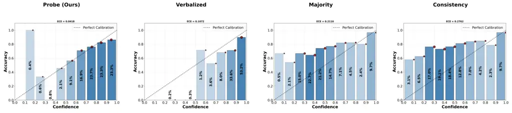

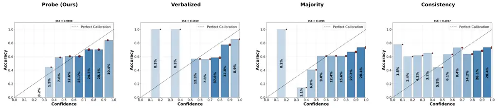

Figure 2: Reliability diagrams using 10 bins for Qwen 32B (Prompted
Judge) and J1 LLAMA 70B (Finetuned Judge) on JudgeBench. We notice
probes generally improve calibration. The color and percentage in each
bar present the proportion of data samples in each bin. The verbalized
method is generally overconfident, while multi-generation methods
(consistency, majority) may be underconfident (Qwen) or overconfident
(LLAMA) depending on model families. Similar trends are observed in
finetuned and prompted variants of the judges, as shown in Appendix A.8.

|                 |                 |                 |
| --------------- | --------------- | --------------- |
| Method          | LLAMA Scout     | GPT-OSS 20B     |
| PPE PREFERENCE  |                 |                 |
| Verbalized      | 0.1179 / 0.0892 | 0.2265 / 0.2233 |
| Consistency     | 0.3533 / 0.3287 | 0.2045 / 0.1922 |
| Majority        | 0.3506 / 0.3246 | 0.2056 / 0.1934 |
| Probe           | 0.0434 / 0.0582 | 0.1461 / 0.1713 |
| PPE CORRECTNESS |                 |                 |
| Verbalized      | 0.1931 / 0.1597 | 0.1462 / 0.1520 |
| Consistency     | 0.3212 / 0.2978 | 0.0932 / 0.0980 |
| Majority        | 0.3197 / 0.2940 | 0.0990 / 0.1034 |
| Probe           | 0.0643 / 0.0684 | 0.0689 / 0.1193 |
| JudgeBench      |                 |                 |
| Verbalized      | 0.1388 / 0.1312 | 0.1276 / 0.1267 |
| Consistency     | 0.3011 / 0.2918 | 0.0756 / 0.1097 |
| Majority        | 0.2955 / 0.2842 | 0.0738 / 0.0997 |
| Probe           | 0.0563 / 0.0766 | 0.0601 / 0.1263 |
| RewardBench     |                 |                 |
| Verbalized      | 0.0742 / 0.0671 | 0.0198 / 0.0191 |
| Consistency     | 0.2233 / 0.2037 | 0.0165 / 0.0248 |
| Majority        | 0.2178 / 0.1996 | 0.0166 / 0.0282 |
| Probe           | 0.0683 / 0.0879 | 0.1404 / 0.1917 |

Table 3: MoE model evaluation. Probes consistently outperform baselines
for Llama Scout (109B) both in- and out-of-distribution. For GPT-OSS
(20B), probes excel in-distribution and on JudgeBench but not on
RewardBench, exhibiting the same conservative behavior on RewardBench as
observed with dense models.

##### Performance on Dense Models In-Distribution.

Table 1 summarizes calibration results across dense model families and
datasets. Our probes consistently achieve the best calibration, with the
lowest Kuiper/ECE scores on both PPE Correctness and PPE Preference
tasks. Llama-family models show the largest gains, with 70–92%
improvements over multi-generation methods and 64–87% improvement over
verbalized methods, across both prompted and finetuned variants. For
Qwen models, probes deliver the best calibration on PPE Correctness and
competitive results on PPE Preference, while requiring 10x less compute
than multi-generation approaches. Calibration across task categories in
the PPE dataset (see A.3) demonstrates that probes consistently
outperform verbalized uncertainty and perform as well as or better than
multi-generation methods, even when model accuracy varies across these
subsets (i.e., between more difficult and easier tasks). We also see
that finetuned and non-finetuned variants achieve similar calibration
despite different accuracy levels (see A.4), demonstrating that high
accuracy does not guarantee good calibration.

##### Performance on Out of Distribution Datasets.

Probes generalize effectively to unseen benchmarks (Table 2),
consistently outperforming baselines on JudgeBench across all model
families, demonstrating strong robustness under domain shift. However,
on RewardBench, probe performance lags behind verbalized confidence for
several models. This suggests that while probes excel on challenging
tasks, their conservative calibration can underperform on easier
datasets where models already achieve high accuracy.

##### Relationship Between Accuracy and Calibration.

We attribute the relative underperformance of probes on RewardBench to
their conservative confidence estimation. RewardBench exhibits higher
overall accuracy across models, leading verbalized confidence (which
tends to overestimate certainty) to perform deceptively well. In
contrast, probes are designed to temper overconfidence, producing
smoother and more cautious probability distributions.

By analyzing model accuracy at different confidence thresholds in
Appendix A.2, we observe that probes yield higher accuracy among the
most confident predictions, but fewer samples are assigned high
confidence. Verbalized confidence, by contrast, spreads high confidence
too liberally, leading to apparent calibration gains on easy datasets
but poor reliability on harder ones.

In safety-critical applications such as medical advice, legal reasoning,
or financial decision-making, where false positives are costly, this
conservative behavior is highly desirable. Probes could present a
favorable trade-off between accuracy and risk, offering more trustworthy
confidence estimates even if slightly underconfident on easier datasets.

##### Verbalized confidence is often the second best option.

Verbalized Confidence is Often the Second Best Option. Among our three
baselines, verbalized confidence consistently performs second best after
probes. In contrast, multigeneration methods can skew model confidence
distributions—making models overconfident (LLaMA) or underconfident
(Qwen, GPT-OSS) depending on the model family. We also note that
prompting models to reason through uncertainty with hedging phrases
yields more calibrated confidence (Appendix A.13), supporting the
hypothesis that verbally expressing uncertainty improves
calibration (Lin et al., 2022; Lyu et al., 2025).

##### Performance on MOE models.

Table 3 extends our evaluation to Mixture-of-Experts (MoE)
architectures, LLAMA Scout and GPT-OSS 20B. Probes consistently
outperform all baselines across both in-distribution and
out-of-distribution datasets, except on RewardBench, where GPT-OSS
occasionally shows marginally better Kuiper values for the consistency
method. However, probes remain competitive while needing 10× fewer
inference calls than consistency, offering an efficiency gain.

##### Ablations with different losses and layers to train the probe.

We conduct ablation studies in Appendix A.7 comparing different loss
functions for probe training, evaluating binary cross-entropy, focal
loss Lin et al. (2017), and Brier score loss. We also experiment with
probes at various layers (see A.6). Our results demonstrate that Brier
score loss at the middle layer of models yields the most well-calibrated
uncertainty estimates.

##### Single-Pass Selective Classification Baselines.

In Appendix A.1 we compare against single-pass selective classification
baselines—including Perplexity, Maximum Softmax Probability, Energy Liu
et al. (2020), Chain of Embedding Wang et al. (2024), CoT-kinetics Bi et
al. (2025)—which use AUROC to measure how well uncertainty scores
distinguish correct from incorrect answers. As shown, our probes achieve
superior AUROC performance. Additionally, while some baselines require
storing hidden states for every token
($`\mathcal{O}(\text{tokens}\times\text{layers}\times\text{hidden\_dim})`$),
our probes only require
$`\mathcal{O}(\text{layers}\times\text{hidden\_dim})`$ memory.

## 5 Conclusion

We present a practical approach to calibrate LLM judges using linear
probes on model representations, achieving strong calibration without
additional training, multi-sample generation, or per-token storage,
enabling plug-and-play, cost-effective deployment. Probe-based
calibration significantly outperforms verbalized and multi-generation
methods across models, architectures, and tasks, delivering
order-of-magnitude computational savings and strong out-of-distribution
generalization for industry-scale deployment.

## Limitations

Future work could involve more investigation into interpreting which
features are learned by the probes and further experimentation to
optimize probe generalizability.

One limitation of this approach is that it requires access to the
judge’s hidden states in the middle layers and a labeled dataset with
ground truth verdicts. The method doesn’t work for domains where ground
truth verdicts aren’t available. Also, in this work, we train one probe
for each judge model, but if the judge is retrained or finetuned, the
probe may also need to be retrained as the information stored in the
hidden states could change.

## References

- AI (2025) M. AI Llama-4-scout-17b-16e-instruct. Meta Platforms, Inc..
  Note: Llama 4 Scout is a 17B parameter, 16 expert mixture-of-experts
  multimodal model. Licensed under the Llama 4 Community License
  Agreement.[https://huggingface.co/meta-llama/Llama-4-Scout-17B-16E-Instruct](https://huggingface.co/meta-llama/Llama-4-Scout-17B-16E-Instruct)
  Cited by: §3.
- AI@Meta (2024) AI@Meta Llama 3 model card. External Links:
  [Link](https://github.com/meta-llama/llama3/blob/main/MODEL_CARD.md)
  Cited by: §3.
- Aroyo and Welty (2015) L. Aroyo and C. Welty Truth is a lie: crowd
  truth and the seven myths of human annotation. AI Magazine 36 (1),
  pp. 15–24. External Links:
  [Document](https://dx.doi.org/10.1609/aimag.v36i1.2564),
  [Link](https://ojs.aaai.org/aimagazine/index.php/aimagazine/article/view/2564)
  Cited by: §1.
- Arrieta-Ibarra et al. (2022) I. Arrieta-Ibarra, P. Gujral, J.
  Tannen, M. Tygert, and C. Xu Metrics of calibration for probabilistic
  predictions. Journal of Machine Learning Research 23 (351), pp. 1–54.
  Cited by: §3.
- Azaria and Mitchell (2023) A. Azaria and T. M. Mitchell The internal
  state of an llm knows when it’s lying. Findings of the Association for
  Computational Linguistics. Cited by: §2.2, §3.
- Bai et al. (2022) Y. Bai, S. Kadavath, S. Kundu, A. Askell, J.
  Kernion, A. Jones, A. Chen, A. Goldie, A. Mirhoseini, C. McKinnon, et
  al. Constitutional ai: harmlessness from ai feedback. arXiv preprint
  arXiv:2212.08073. Cited by: §1.
- Bi et al. (2025) J. Bi, D. Yan, Y. Wang, W. Huang, H. Chen, G. Wan, M.
  Ye, X. Xiao, H. Schuetze, V. Tresp, and Y. Ma CoT-kinetics: a
  theoretical modeling assessing lrm reasoning process. arXiv preprint
  arXiv: 2505.13408. Cited by: §A.1, §2.2, §4.
- Burns et al. (2023) C. Burns, H. Ye, D. Klein, and J. Steinhardt
  Discovering latent knowledge in language models without supervision.
  International Conference on Learning Representations. Cited by: §2.2,
  §3.
- Chen and Mueller (2024) J. Chen and J. Mueller Quantifying uncertainty
  in answers from any language model and enhancing their
  trustworthiness. In Proceedings of the 62nd Annual Meeting of the
  Association for Computational Linguistics (Volume 1: Long Papers), L.
  Ku, A. Martins, and V. Srikumar (Eds.), Bangkok, Thailand,
  pp. 5186–5200. External Links:
  [Document](https://dx.doi.org/10.18653/v1/2024.acl-long.283),
  [Link](https://aclanthology.org/2024.acl-long.283/) Cited by: §2.2.
- Chen et al. (2023) L. Chen, M. Zaharia, and J. Zou FrugalGPT: how to
  use large language models while reducing cost and improving
  performance. arXiv preprint arXiv:2305.05176. Cited by: §1.
- Chen et al. (2025) N. Chen, Z. Hu, Q. Zou, J. Wu, Q. Wang, B. Hooi,
  and B. He JudgeLRM: large reasoning models as a judge. External Links:
  [Link](https://arxiv.org/abs/2504.00050), 2504.00050 Cited by: §1.
- Chiang et al. (2024) W. Chiang, L. Zheng, Y. Sheng, A. N.
  Angelopoulos, T. Li, D. Li, B. Zhu, H. Zhang, M. Jordan, J. E.
  Gonzalez, et al. Chatbot arena: an open platform for evaluating llms
  by human preference. In Forty-first International Conference on
  Machine Learning, Cited by: §1.
- Christiano et al. (2017) P. F. Christiano, J. Leike, T. Brown, M.
  Martic, S. Legg, and D. Amodei Deep reinforcement learning from human
  preferences. Advances in Neural Information Processing Systems 30.
  Cited by: §2.1.
- Damani et al. (2025) M. Damani, I. Puri, S. Slocum, I. Shenfeld, L.
  Choshen, Y. Kim, and J. Andreas Beyond binary rewards: training lms to
  reason about their uncertainty. arXiv preprint arXiv:2507.16806. Cited
  by: §2.2.
- DeepSeek-AI (2025) DeepSeek-AI Deepseek-r1: incentivizing reasoning
  capability in llms via reinforcement learning. arXiv preprint
  arXiv:2501.12948. Cited by: §1.
- Dubois et al. (2023) Y. Dubois, C. X. Li, R. Taori, T. Zhang, I.
  Gulrajani, J. Ba, C. Guestrin, P. S. Liang, and T. B. Hashimoto
  Alpacafarm: a simulation framework for methods that learn from human
  feedback. Advances in Neural Information Processing Systems 36,
  pp. 30039–30069. Cited by: §1, §2.1.
- Fedus et al. (2021) W. Fedus, B. Zoph, and N. Shazeer Switch
  transformers: scaling to trillion parameter models with simple and
  efficient sparsity. arXiv preprint arXiv: 2101.03961. Cited by: §3.
- Frick et al. (2024) E. Frick, T. Li, C. Chen, W. Chiang, A. N.
  Angelopoulos, J. Jiao, B. Zhu, J. Gonzalez, and I. Stoica How to
  evaluate reward models for rlhf. International Conference on Learning
  Representations. External Links:
  [Document](https://dx.doi.org/10.48550/arXiv.2410.14872) Cited by: §3.
- Gao et al. (2022) L. Gao, J. Schulman, and J. Hilton Scaling laws for
  reward model overoptimization. arXiv preprint arXiv: 2210.10760. Cited
  by: §1.
- Glenn (1950) W. B. Glenn Verification of forecasts expressed in terms
  of probability. Monthly weather review 78 (1), pp. 1–3. Cited by: §3.
- Guo et al. (2017) C. Guo, G. Pleiss, Y. Sun, and K. Q. Weinberger On
  calibration of modern neural networks. arXiv preprint arXiv:
  1706.04599. Cited by: §2.2, §3, §3.
- Huang et al. (2023) Y. Huang, J. Song, Z. Wang, H. Chen, L. Shen, X.
  Lei, and F. J. Wang Look before you leap: an exploratory study of
  uncertainty measurement for large language models. arXiv preprint
  arXiv:2307.10236. Cited by: §2.2, §2.2.
- Ji et al. (2025) Z. Ji, L. Yu, Y. Koishekenov, Y. Bang, A.
  Hartshorn, A. Schelten, C. Zhang, P. Fung, and N. Cancedda Calibrating
  verbal uncertainty as a linear feature to reduce hallucinations. arXiv
  preprint arXiv: 2503.14477. Cited by: §2.2.
- Jung et al. (2024) J. Jung, F. Brahman, and Y. Choi Trust or escalate:
  llm judges with provable guarantees for human agreement. arXiv
  preprint arXiv:2407.18370. Cited by: §1, §1, §2.1, §2.2.
- Kadavath et al. (2022) S. Kadavath, T. Conerly, A. Askell, T.
  Henighan, D. Drain, E. Perez, N. Schiefer, Z. Hatfield-Dodds, N.
  DasSarma, E. Tran-Johnson, S. Johnston, S. El-Showk, A. Jones, N.
  Elhage, T. Hume, A. Chen, Y. Bai, S. Bowman, S. Fort, D. Ganguli, D.
  Hernandez, J. Jacobson, J. Kernion, S. Kravec, L. Lovitt, K.
  Ndousse, C. Olsson, S. Ringer, D. Amodei, T. Brown, J. Clark, N.
  Joseph, B. Mann, S. McCandlish, C. Olah, and J. Kaplan Language models
  (mostly) know what they know. arXiv preprint arXiv: 2207.05221. Cited
  by: §2.2.
- Kapoor et al. (2024) S. Kapoor, N. Gruver, M. Roberts, A. Pal, S.
  Dooley, M. Goldblum, and A. Wilson Calibration-tuning: teaching large
  language models to know what they don’t know. In Proceedings of the
  1st Workshop on Uncertainty-Aware NLP (UncertaiNLP 2024), R.
  Vázquez, H. Celikkanat, D. Ulmer, J. Tiedemann, S. Swayamdipta, W.
  Aziz, B. Plank, J. Baan, and M. de Marneffe (Eds.), St Julians, Malta,
  pp. 1–14. External Links:
  [Link](https://aclanthology.org/2024.uncertainlp-1.1/) Cited by: §2.2.
- Kim et al. (2024a) S. Kim, J. Shin, Y. Cho, J. Jang, S. Longpre, H.
  Lee, S. Yun, S. Shin, S. Kim, J. Thorne, et al. Prometheus: inducing
  fine-grained evaluation capability in language models. arXiv preprint
  arXiv:2310.08491. Cited by: §2.1.
- Kim et al. (2024b) S. Kim, J. Shin, Y. Kwak, Y. Zhao, J. Jang, A.
  Hwang, G. Kim, H. Kim, J. Yoon, H. Park, et al. Prometheus 2: an open
  source language model specialized in evaluating other language models.
  arXiv preprint arXiv:2405.01535. Cited by: §2.1.
- Kirk et al. (2024) H. R. Kirk, A. Whitefield, P. Rottger, A. M.
  Bean, K. Margatina, R. Mosquera-Gomez, J. Ciro, M. Bartolo, A.
  Williams, H. He, et al. The prism alignment dataset: what
  participatory, representative and individualised human feedback
  reveals about the subjective and multicultural alignment of large
  language models. Advances in Neural Information Processing Systems 37,
  pp. 105236–105344. Cited by: §1.
- Kossen et al. (2024) J. Kossen, J. Han, M. Razzak, L. Schut, S. Malik,
  and Y. Gal Semantic entropy probes: robust and cheap hallucination
  detection in llms. arXiv preprint arXiv: 2406.15927. Cited by: §2.2,
  §3.
- Kuhn et al. (2023) L. Kuhn, Y. Gal, and S. Farquhar Semantic
  uncertainty: linguistic invariances for uncertainty estimation in
  natural language generation. International Conference on Learning
  Representations. Cited by: §2.2.
- Lambert et al. (2024) N. Lambert, V. Pyatkin, J. Morrison, L.
  Miranda, B. Y. Lin, K. Chandu, N. Dziri, S. Kumar, T. Zick, Y.
  Choi, N. A. Smith, and H. Hajishirzi RewardBench: evaluating reward
  models for language modeling. arXiv preprint arXiv: 2403.13787. Cited
  by: §3.
- Lee et al. (2023) H. Lee, S. Phatale, H. Mansoor, T. Mesnard, J.
  Ferret, K. Lu, C. Bishop, E. Hall, V. Carbune, A. Rastogi, and S.
  Prakash RLAIF vs. rlhf: scaling reinforcement learning from human
  feedback with ai feedback. arXiv preprint arXiv: 2309.00267. Cited by:
  §1.
- Li et al. (2024a) J. Li, S. Sun, W. Yuan, R. Fan, H. Zhao, and P. Liu
  Generative judge for evaluating alignment. arXiv preprint
  arXiv:2310.05470. Cited by: §2.1.
- Li et al. (2024b) K. Li, O. Patel, F. Viégas, H. Pfister, and M.
  Wattenberg Inference-time intervention: eliciting truthful answers
  from a language model. Advances in Neural Information Processing
  Systems 36. Cited by: §2.2, §3.
- Li et al. (2024c) T. Li, W. Chiang, E. Frick, L. Dunlap, T. Wu, B.
  Zhu, J. E. Gonzalez, and I. Stoica From crowdsourced data to
  high-quality benchmarks: arena-hard and benchbuilder pipeline. arXiv
  preprint arXiv: 2406.11939. Cited by: §3.
- Li et al. (2025a) Y. Li, M. Xiong, J. Wu, and B. Hooi ConfTuner:
  training large language models to express their confidence verbally.
  arXiv preprint arXiv: 2508.18847. Cited by: §2.2.
- Li et al. (2025b) Z. Li, X. Li, C. Huang, G. Li, K. Goshvadi, B.
  Dai, D. Schuurmans, P. Zhou, H. Palangi, Y. Song, P. Goyal, M.
  Kantarcioglu, B. A. Malin, and Y. Xue Judging with confidence:
  calibrating autoraters to preference distributions. arXiv preprint
  arXiv: 2510.00263. Cited by: §2.2.
- Lin et al. (2022) S. Lin, J. Hilton, and O. Evans Teaching models to
  express their uncertainty in words. arXiv preprint arXiv: 2205.14334.
  Cited by: §2.2, §3, §4.
- Lin et al. (2017) T. Lin, P. Goyal, R. Girshick, K. He, and P. Dollár
  Focal loss for dense object detection. In Proceedings of the IEEE
  international conference on computer vision, pp. 2980–2988. Cited by:
  §4.
- Liu et al. (2020) W. Liu, X. Wang, J. D. Owens, and Y. Li Energy-based
  out-of-distribution detection. arXiv preprint arXiv: 2010.03759. Cited
  by: §4.
- Lyu et al. (2025) Q. Lyu, K. Shridhar, C. Malaviya, L. Zhang, Y.
  Elazar, N. Tandon, M. Apidianaki, M. Sachan, and C. Callison-Burch
  Calibrating large language models with sample consistency. In
  Proceedings of the AAAI Conference on Artificial Intelligence, Vol.
  39, pp. 19260–19268. Cited by: §2.2, §3, §4.
- Manakul et al. (2023) P. Manakul, A. Liusie, and M. J. Gales
  Selfcheckgpt: zero-resource black-box hallucination detection for
  generative large language models. arXiv preprint arXiv:2303.08896.
  Cited by: §2.2.
- Naeini et al. (2015) M. P. Naeini, G. Cooper, and M. Hauskrecht
  Obtaining well calibrated probabilities using bayesian binning. In
  Proceedings of the AAAI conference on artificial intelligence (AAAI),
  Vol. 29, pp. 2901–2907. Cited by: §3.
- Nie et al. (2020) Y. Nie, X. Zhou, and M. Bansal What can we learn
  from collective human opinions on natural language inference data?. In
  Proceedings of the 2020 Conference on Empirical Methods in Natural
  Language Processing (EMNLP), B. Webber, T. Cohn, Y. He, and Y. Liu
  (Eds.), Online, pp. 9131–9143. External Links:
  [Document](https://dx.doi.org/10.18653/v1/2020.emnlp-main.734),
  [Link](https://aclanthology.org/2020.emnlp-main.734/) Cited by: §1.
- Nixon et al. (2019) J. Nixon, M. Dusenberry, G. Jerfel, T. Nguyen, J.
  Liu, L. Zhang, and D. Tran Measuring calibration in deep learning.
  arXiv preprint arXiv: 1904.01685. Cited by: §3.
- OpenAI (2024) OpenAI Learning to reason with llms. OpenAI Blog.
  External Links:
  [Link](https://openai.com/index/learning-to-reason-with-llms/) Cited
  by: §1.
- OpenAI (2025) OpenAI Gpt-oss-120b & gpt-oss-20b model card. External
  Links: [Link](https://arxiv.org/abs/2508.10925), 2508.10925 Cited by:
  §3.
- Ouyang et al. (2022) L. Ouyang, J. Wu, X. Jiang, D. Almeida, C.
  Wainwright, P. Mishkin, C. Zhang, S. Agarwal, K. Slama, A. Ray, et al.
  Training language models to follow instructions with human feedback.
  Advances in Neural Information Processing Systems 35, pp. 27730–27744.
  Cited by: §2.1.
- Pavlick and Kwiatkowski (2019) E. Pavlick and T. Kwiatkowski Inherent
  disagreements in human textual inferences. Transactions of the
  Association for Computational Linguistics 7, pp. 677–694. External
  Links: [Document](https://dx.doi.org/10.1162/tacl%5Fa%5F00293),
  [Link](https://aclanthology.org/Q19-1043/) Cited by: §1.
- Plaut et al. (2024) B. Plaut, N. X. Khanh, and T. Trinh Probabilities
  of chat llms are miscalibrated but still predict correctness on
  multiple-choice q&a. arXiv preprint arXiv: 2402.13213. Cited by: §2.2.
- Qwen Team (2025) Qwen Team Qwen3 technical report. External Links:
  [Link](https://arxiv.org/abs/2505.09388), 2505.09388 Cited by: §3.
- Radharapu et al. (2025) B. Radharapu, M. Revel, M. Ung, S. Ruder,
  and A. Williams Arbiters of ambivalence: challenges of using llms in
  no-consensus tasks. arXiv preprint arXiv: 2505.23820. Cited by: §1.
- Roelofs et al. (2020) R. Roelofs, N. Cain, J. Shlens, and M. C. Mozer
  Mitigating bias in calibration error estimation. arXiv preprint arXiv:
  2012.08668. Cited by: §3.
- Ross et al. (2024) C. Ross, M. Hall, A. Romero-Soriano, and A.
  Williams What makes a good metric? evaluating automatic metrics for
  text-to-image consistency. In First Conference on Language Modeling,
  External Links: [Link](https://openreview.net/forum?id=LFfktMPAci)
  Cited by: §1.
- Sriramanan et al. (2024) G. Sriramanan, S. Bharti, V. S. Sadasivan, S.
  Saha, P. Kattakinda, and S. Feizi LLM-check: investigating detection
  of hallucinations in large language models. In The Thirty-eighth
  Annual Conference on Neural Information Processing Systems, External
  Links: [Link](https://openreview.net/forum?id=LYx4w3CAgy) Cited by:
  §2.2.
- Talat et al. (2022) Z. Talat, H. Blix, J. Valvoda, M. I. Ganesh, R.
  Cotterell, and A. Williams On the machine learning of ethical
  judgments from natural language. In Proceedings of the 2022 Conference
  of the North American Chapter of the Association for Computational
  Linguistics: Human Language Technologies, M. Carpuat, M. de Marneffe,
  and I. V. Meza Ruiz (Eds.), Seattle, United States, pp. 769–779.
  External Links:
  [Document](https://dx.doi.org/10.18653/v1/2022.naacl-main.56),
  [Link](https://aclanthology.org/2022.naacl-main.56/) Cited by: §1.
- Tan et al. (2024) S. Tan, S. Zhuang, K. Montgomery, W. Y. Tang, A.
  Cuadron, C. Wang, R. Popa, and I. Stoica JudgeBench: a benchmark for
  evaluating llm-based judges. International Conference on Learning
  Representations. External Links:
  [Document](https://dx.doi.org/10.48550/arXiv.2410.12784) Cited by: §3,
  §3.
- Tao et al. (2025) L. Tao, Y. Yeh, M. Dong, T. Huang, P. Torr, and C.
  Xu Revisiting uncertainty estimation and calibration of large language
  models. arXiv preprint arXiv: 2505.23854. Cited by: §2.2, §2.2, §3.
- Tian et al. (2023) K. Tian, E. Mitchell, A. Zhou, A. Sharma, R.
  Rafailov, H. Yao, C. Finn, and C. Manning Just ask for calibration:
  strategies for eliciting calibrated confidence scores from language
  models fine-tuned with human feedback. In Proceedings of the 2023
  Conference on Empirical Methods in Natural Language Processing, H.
  Bouamor, J. Pino, and K. Bali (Eds.), Singapore, pp. 5433–5442.
  External Links:
  [Document](https://dx.doi.org/10.18653/v1/2023.emnlp-main.330),
  [Link](https://aclanthology.org/2023.emnlp-main.330/) Cited by: §2.2,
  §3.
- Tian et al. (2025) Z. Tian, Z. Han, Y. Chen, H. Xu, X. Yang, R.
  Xuan, H. Wang, and L. Liao Overconfidence in llm-as-a-judge: diagnosis
  and confidence-driven solution. arXiv preprint arXiv: 2508.06225.
  Cited by: §1, §2.1, §2.2, §2.2.
- Touvron et al. (2023) H. Touvron, L. Martin, K. Stone, P. Albert, A.
  Almahairi, Y. Babaei, N. Bashlykov, S. Batra, P. Bhargava, S.
  Bhosale, D. Bikel, L. Blecher, C. C. Ferrer, M. Chen, G. Cucurull, D.
  Esiobu, J. Fernandes, J. Fu, W. Fu, B. Fuller, C. Gao, V. Goswami, N.
  Goyal, A. Hartshorn, S. Hosseini, R. Hou, H. Inan, M. Kardas, V.
  Kerkez, M. Khabsa, I. Kloumann, A. Korenev, P. S. Koura, M.
  Lachaux, T. Lavril, J. Lee, D. Liskovich, Y. Lu, Y. Mao, X.
  Martinet, T. Mihaylov, P. Mishra, I. Molybog, Y. Nie, A. Poulton, J.
  Reizenstein, R. Rungta, K. Saladi, A. Schelten, R. Silva, E. M.
  Smith, R. Subramanian, X. E. Tan, B. Tang, R. Taylor, A.
  Williams, J. X. Kuan, P. Xu, Z. Yan, I. Zarov, Y. Zhang, A. Fan, M.
  Kambadur, S. Narang, A. Rodriguez, R. Stojnic, S. Edunov, and T.
  Scialom Llama 2: open foundation and fine-tuned chat models. External
  Links: [Link](https://arxiv.org/abs/2307.09288), 2307.09288 Cited by:
  §1.
- Tygert (2025) M. Tygert Calibration and bias in algorithms, data, and
  models: a tutorial on metrics and plots for measuring calibration,
  bias, fairness, reliability, and robustness. Zenodo. External Links:
  [Document](https://dx.doi.org/10.5281/zenodo.15253140),
  [Link](https://doi.org/10.5281/zenodo.15253140) Cited by: §3.
- Wang et al. (2023) P. Wang, L. Li, L. Chen, D. Zhu, B. Lin, Y. Cao, Q.
  Liu, T. Liu, and Z. Sui Large language models are not fair evaluators.
  arXiv preprint arXiv:2305.17926. Cited by: §1.
- Wang et al. (2022) X. Wang, J. Wei, D. Schuurmans, Q. Le, E. Chi, S.
  Narang, A. Chowdhery, and D. Zhou Self-consistency improves chain of
  thought reasoning in language models. arXiv preprint arXiv:
  2203.11171. Cited by: §2.2, §3.
- Wang et al. (2024) Y. Wang, P. Zhang, B. Yang, D. F. Wong, and R. Wang
  Latent space chain-of-embedding enables output-free llm
  self-evaluation. arXiv preprint arXiv:2410.13640. Cited by: §A.1,
  §2.2, §4.
- Whitehouse et al. (2025) C. Whitehouse, T. Wang, P. Yu, X. Li, J.
  Weston, I. Kulikov, and S. Saha J1: incentivizing thinking in
  llm-as-a-judge via reinforcement learning. arXiv preprint arXiv:
  2505.10320. Cited by: §1, §2.1, §3, §3.
- Xie et al. (2024a) J. Xie, A. S. Chen, Y. Lee, E. Mitchell, and C.
  Finn Calibrating language models with adaptive temperature scaling.
  arXiv preprint arXiv: 2409.19817. Cited by: §2.2, §2.2.
- Xie et al. (2024b) Z. Xie, J. Guo, T. Yu, and S. Li Calibrating
  reasoning in language models with internal consistency. In Advances in
  Neural Information Processing Systems, A. Globerson, L. Mackey, D.
  Belgrave, A. Fan, U. Paquet, J. Tomczak, and C. Zhang (Eds.), Vol. 37,
  pp. 114872–114901. External Links:
  [Link](https://proceedings.neurips.cc/paper_files/paper/2024/file/d037fd021c9aace128b8ce25001cdb6c-Paper-Conference.pdf)
  Cited by: §2.2.
- Xiong et al. (2024) M. Xiong, Z. Hu, X. Lu, Y. LI, J. Fu, J. He,
  and B. Hooi Can LLMs express their uncertainty? an empirical
  evaluation of confidence elicitation in LLMs. In The Twelfth
  International Conference on Learning Representations, External Links:
  [Link](https://openreview.net/forum?id=gjeQKFxFpZ) Cited by: §2.1,
  §2.2, §3.
- Zhang et al. (2025) A. Zhang, Y. Chen, J. Pan, C. Zhao, A. Panda, J.
  Li, and H. He Reasoning models know when they’re right: probing hidden
  states for self-verification. arXiv preprint arXiv: 2504.05419. Cited
  by: §2.2.
- Zhang et al. (2024) M. J. Zhang, Z. Wang, J. D. Hwang, Y. Dong, O.
  Delalleau, Y. Choi, E. Choi, X. Ren, and V. Pyatkin Diverging
  preferences: when do annotators disagree and do models know?. arXiv
  preprint arXiv: 2410.14632. Cited by: §1.
- Zhao et al. (2021) T. Z. Zhao, E. Wallace, S. Feng, D. Klein, and S.
  Singh Calibrate before use: improving few-shot performance of language
  models. International Conference on Machine Learning, pp. 12697–12706.
  Cited by: §2.2.
- Zheng et al. (2023) L. Zheng, W. Chiang, Y. Sheng, S. Zhuang, Z.
  Wu, Y. Zhuang, Z. Lin, Z. Li, D. Li, E. Xing, et al. Judging
  llm-as-a-judge with mt-bench and chatbot arena. Advances in neural
  information processing systems 36, pp. 46595–46623. Cited by: §1,
  §2.1.
- Zhou et al. (2024a) H. Zhou, X. Wan, L. Proleev, D. Mincu, J.
  Chen, K. A. Heller, and S. Roy Batch calibration: rethinking
  calibration for in-context learning and prompt engineering. In The
  Twelfth International Conference on Learning Representations, External
  Links: [Link](https://openreview.net/forum?id=L3FHMoKZcS) Cited by:
  §2.2.
- Zhou et al. (2024b) H. Zhou, H. Huang, Y. Long, B. Xu, C. Zhu, H.
  Cao, M. Yang, and T. Zhao Mitigating the bias of large language model
  evaluation. In Proceedings of the 23rd Chinese National Conference on
  Computational Linguistics (Volume 1: Main Conference), S. Maosong, L.
  Jiye, H. Xianpei, L. Zhiyuan, and H. Yulan (Eds.), Taiyuan, China,
  pp. 1310–1319. External Links:
  [Link](https://aclanthology.org/2024.ccl-1.101/) Cited by: §1.
- Zhu et al. (2025) L. Zhu, X. Wang, and X. Wang JudgeLM: fine-tuned
  large language models are scalable judges. External Links:
  [Link](https://arxiv.org/abs/2310.17631), 2310.17631 Cited by: §2.1.
- Zou et al. (2023) A. Zou, L. Phan, S. Chen, J. Campbell, P. Guo, R.
  Ren, A. Pan, X. Yin, M. Mazeika, A. Dombrowski, et al. Representation
  engineering: a top-down approach to ai transparency. arXiv preprint
  arXiv:2310.01405. Cited by: §2.2, §3.

## Appendix A Appendix

### A.1 Comparison with Other Single Pass Methods

Selective classification evaluates how effectively uncertainty scores
distinguish between correct and incorrect predictions. The most widely
used metric for this is AUROC, which quantifies the likelihood that a
correct prediction will have a lower uncertainty score than an incorrect
one. An AUROC of 0.5 indicates no discriminative ability (equivalent to
random guessing), whereas values approaching 1.0 reflect strong
discriminative performance.

Note that some of these methods like Bi et al. (2025); Wang et al.
(2024) outputs are not constrained to the \[0, 1\] range; instead, they
yield arbitrary scores that serve as relative signals—higher values may
indicate greater correctness, but these scores are not interpretable as
probabilities.

We evaluate various single-pass uncertainty estimation methods on the
JudgeBench dataset. These methods provide signals for detecting answer
correctness, which we measure using AUROC scores.

Table 4 shows the performance comparison across different model
architectures.

|              |       |       |          |          |         |         |       |
| ------------ | ----- | ----- | -------- | -------- | ------- | ------- | ----- |
| Method       | LLaMA | LLaMA | J1 LLaMA | J1 LLaMA | J1 QWEN | GPT-OSS | QWEN  |
|              | 8B    | 70B   | 8B       | 70B      | 32B     | OSS 20B | 32B   |
| MaxProb      | 46.77 | 51.48 | 50.67    | 59.61    | 64.27   | 43.54   | 51.47 |
| Perplexity   | 46.44 | 51.31 | 50.81    | 59.62    | 63.88   | 43.15   | 51.20 |
| Entropy      | 46.81 | 51.08 | 50.85    | 59.60    | 64.33   | 46.82   | 50.79 |
| TempScl      | 46.54 | 51.55 | 50.72    | 59.60    | 63.74   | 42.11   | 51.53 |
| Energy       | 47.99 | 50.07 | 53.34    | 50.00    | 49.34   | 71.53   | 67.79 |
| CoER         | 52.06 | 47.81 | 49.98    | 49.82    | 60.36   | 69.12   | 46.25 |
| CoEC         | 49.99 | 52.24 | 50.56    | 59.13    | 60.26   | 68.46   | 45.99 |
| CoTK         | 46.69 | 51.11 | 50.87    | 59.98    | 62.90   | 63.72   | 48.80 |
| Verbalised   | 46.83 | 57.95 | 53.50    | 62.04    | 68.86   | 64.47   | 69.20 |
| Sem. Entropy | 54.71 | 58.13 | 54.19    | 60.63    | 66.87   | 64.42   | 65.63 |
| Probe        | 52.38 | 58.14 | 55.36    | 63.17    | 69.05   | 62.03   | 71.17 |

Table 4: AUROC performance on JudgeBench, comparison of single-pass
uncertainty estimation methods across model architectures. Higher values
indicate better performance. Bold values indicate best performance per
model.

### A.2 Accuracy at Different Thresholds

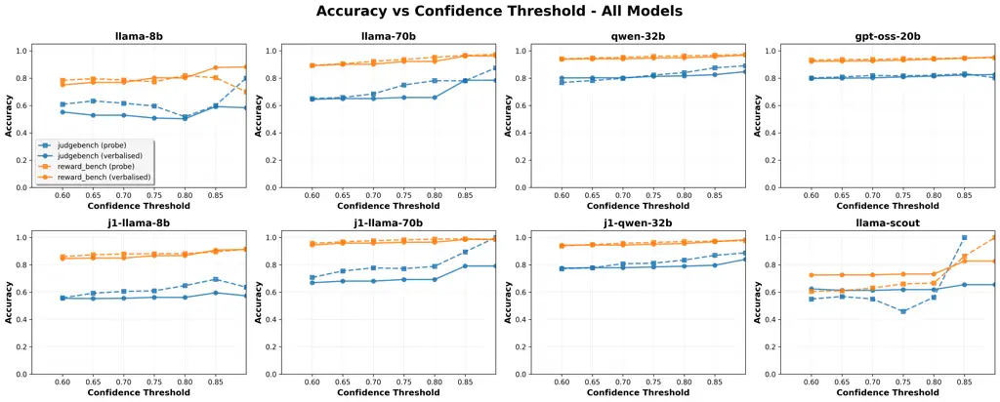

Figure 3: Accuracy of models at different confidence thresholds for
Probe and Verbalized uncertainity estimation methods.

### A.3 Additional Results –Performance on various PPE Correctness Benchmarks

In Table 5 and Table  6, we present the results on the different subsets
of PPE correctness dataset to see if the performance varies by domain.
We see that the probe performs well across the board.

|                        |                 |                 |                 |                 |                 |                 |
| ---------------------- | --------------- | --------------- | --------------- | --------------- | --------------- | --------------- |
| Method                 | LLAMA 8B        | LLAMA 70B       | QWEN 32B        | J1 QWEN 32B     | J1 LLAMA 8B     | J1 LLAMA 70B    |
| PPE Correctness Gpqa   |                 |                 |                 |                 |                 |                 |
| Verbalized             | 0.1846 / 0.1694 | 0.1431 / 0.1365 | 0.1411 / 0.1369 | 0.1444 / 0.1409 | 0.2604 / 0.2508 | 0.1109 / 0.1049 |
| Consistency            | 0.1824 / 0.1857 | 0.2774 / 0.2653 | 0.1136 / 0.1328 | 0.0635 / 0.1075 | 0.3078 / 0.2872 | 0.2270 / 0.2323 |
| Majority               | 0.1792 / 0.1734 | 0.2790 / 0.2623 | 0.1079 / 0.1245 | 0.0490 / 0.0809 | 0.3086 / 0.2851 | 0.2325 / 0.2175 |
| Probe                  | 0.0457 / 0.0469 | 0.0746 / 0.0717 | 0.0682 / 0.0673 | 0.0581 / 0.0599 | 0.0782 / 0.0767 | 0.0404 / 0.0444 |
| PPE Correctness Ifeval |                 |                 |                 |                 |                 |                 |
| Verbalized             | 0.1738 / 0.1690 | 0.1570 / 0.1440 | 0.1738 / 0.1729 | 0.1615 / 0.1603 | 0.2280 / 0.2191 | 0.0788 / 0.0732 |
| Consistency            | 0.1781 / 0.1865 | 0.2244 / 0.2235 | 0.0735 / 0.0985 | 0.0749 / 0.1201 | 0.3729 / 0.3603 | 0.1920 / 0.1836 |
| Majority               | 0.1810 / 0.1704 | 0.2301 / 0.2180 | 0.0708 / 0.0904 | 0.0626 / 0.0986 | 0.3771 / 0.3583 | 0.1946 / 0.1796 |
| Probe                  | 0.0368 / 0.0437 | 0.0161 / 0.0237 | 0.0596 / 0.0652 | 0.0541 / 0.0586 | 0.0239 / 0.0343 | 0.0393 / 0.0393 |
| PPE Correctness Math   |                 |                 |                 |                 |                 |                 |
| Verbalized             | 0.1456 / 0.1447 | 0.1349 / 0.1374 | 0.0336 / 0.0362 | 0.0355 / 0.0382 | 0.1259 / 0.1241 | 0.0345 / 0.0341 |
| Consistency            | 0.0501 / 0.0939 | 0.1025 / 0.1223 | 0.2789 / 0.2950 | 0.2195 / 0.2424 | 0.0843 / 0.0820 | 0.0523 / 0.0905 |
| Majority               | 0.0509 / 0.0725 | 0.1098 / 0.1041 | 0.2747 / 0.2903 | 0.2153 / 0.2365 | 0.0841 / 0.0796 | 0.0384 / 0.0662 |
| Probe                  | 0.0443 / 0.0459 | 0.0340 / 0.0383 | 0.0336 / 0.0316 | 0.0353 / 0.0349 | 0.0155 / 0.0165 | 0.0310 / 0.0342 |
| PPE Correctness Mbpp   |                 |                 |                 |                 |                 |                 |
| Verbalized             | 0.2506 / 0.2415 | 0.1905 / 0.1829 | 0.2280 / 0.2333 | 0.2196 / 0.2265 | 0.3073 / 0.2995 | 0.1331 / 0.1291 |
| Consistency            | 0.2573 / 0.2364 | 0.2995 / 0.2762 | 0.0255 / 0.0412 | 0.0690 / 0.0976 | 0.3943 / 0.3782 | 0.1538 / 0.1606 |
| Majority               | 0.2511 / 0.2276 | 0.2929 / 0.2743 | 0.0293 / 0.0365 | 0.0747 / 0.0751 | 0.3947 / 0.3829 | 0.1578 / 0.1452 |
| Probe                  | 0.0486 / 0.0471 | 0.0445 / 0.0644 | 0.0366 / 0.0379 | 0.0215 / 0.0401 | 0.0335 / 0.0406 | 0.0322 / 0.0551 |
| PPE Correctness Mmlu   |                 |                 |                 |                 |                 |                 |
| Verbalized             | 0.1546 / 0.1469 | 0.0607 / 0.0608 | 0.0470 / 0.0475 | 0.0357 / 0.0405 | 0.1779 / 0.1766 | 0.0430 / 0.0422 |
| Consistency            | 0.1209 / 0.1533 | 0.1586 / 0.1697 | 0.1869 / 0.2000 | 0.1439 / 0.1662 | 0.2157 / 0.2032 | 0.1046 / 0.1156 |
| Majority               | 0.1235 / 0.1315 | 0.1674 / 0.1603 | 0.1843 / 0.1994 | 0.1329 / 0.1506 | 0.2164 / 0.2063 | 0.1077 / 0.1015 |
| Probe                  | 0.0386 / 0.0406 | 0.0287 / 0.0304 | 0.0202 / 0.0277 | 0.0291 / 0.0387 | 0.0271 / 0.0312 | 0.0355 / 0.0413 |

Table 5: Performance on PPE Correctness subsets (dense models)

|                        |                 |                 |
| ---------------------- | --------------- | --------------- |
| Method                 | LLAMA Scout     | GPT OSS 20B     |
| PPE Correctness Gpqa   |                 |                 |
| Verbalized             | 0.2631 / 0.2452 | 0.1505 / 0.1534 |
| Consistency            | 0.2684 / 0.2448 | 0.1084 / 0.1241 |
| Majority               | 0.2714 / 0.2443 | 0.1110 / 0.1176 |
| Probe                  | 0.0652 / 0.0730 | 0.1301 / 0.1582 |
| PPE Correctness Ifeval |                 |                 |
| Verbalized             | 0.1168 / 0.0904 | 0.1584 / 0.1627 |
| Consistency            | 0.3413 / 0.3186 | 0.0514 / 0.0625 |
| Majority               | 0.3410 / 0.3112 | 0.0517 / 0.0558 |
| Probe                  | 0.0673 / 0.0803 | 0.0657 / 0.1049 |
| PPE Correctness Math   |                 |                 |
| Verbalized             | 0.2546 / 0.2505 | 0.0091 / 0.0122 |
| Consistency            | 0.2009 / 0.2066 | 0.0113 / 0.0205 |
| Majority               | 0.2061 / 0.2016 | 0.0115 / 0.0206 |
| Probe                  | 0.0587 / 0.0653 | 0.0648 / 0.0790 |
| PPE Correctness Mbpp   |                 |                 |
| Verbalized             | 0.0289 / 0.0161 | 0.3545 / 0.3645 |
| Consistency            | 0.4737 / 0.4660 | 0.2765 / 0.2759 |
| Majority               | 0.4748 / 0.4669 | 0.2908 / 0.3009 |
| Probe                  | 0.0453 / 0.0514 | 0.0472 / 0.0493 |
| PPE Correctness Mmlu   |                 |                 |
| Verbalized             | 0.2350 / 0.2186 | 0.0882 / 0.0894 |
| Consistency            | 0.2760 / 0.2559 | 0.0659 / 0.0754 |
| Majority               | 0.2750 / 0.2508 | 0.0691 / 0.0711 |
| Probe                  | 0.0643 / 0.0684 | 0.0689 / 0.1193 |

Table 6: Performance on PPE Correctness subsets (MOE models)

### A.4 Accuracy of Models on various Datasets

We study calibration on models with varying difficulty for the models.
RewardBench and PPE Math are the best performing across models.

PPE MBPP(Coding) and and PPE IfEval and PPE Preference are among the
harder datasets across models.

|              |            |            |        |        |        |        |        |        |
| ------------ | ---------- | ---------- | ------ | ------ | ------ | ------ | ------ | ------ |
| Model        | JudgeBench | PPE        | PPE    | PPE    | PPE    | PPE    | PPE    | Reward |
|              |            | Preference | GPQA   | IFEval | MBPP   | MMLU   | Math   | Bench  |
| Average      | 0.670      | 0.627      | 0.633  | 0.624  | 0.583  | 0.733  | 0.793  | 0.856  |
|              | ±0.108     | ±0.051     | ±0.078 | ±0.074 | ±0.073 | ±0.119 | ±0.157 | ±0.117 |
| LLAMA-8B     | 0.549      | 0.577      | 0.548  | 0.553  | 0.508  | 0.589  | 0.606  | 0.743  |
| J1-LLAMA-8B  | 0.549      | 0.605      | 0.560  | 0.545  | 0.537  | 0.654  | 0.716  | 0.844  |
| LLAMA-70B    | 0.644      | 0.660      | 0.624  | 0.605  | 0.599  | 0.750  | 0.694  | 0.890  |
| J1-LLAMA-70B | 0.669      | 0.665      | 0.656  | 0.675  | 0.651  | 0.794  | 0.869  | 0.944  |
| QWEN-32B     | 0.797      | 0.672      | 0.723  | 0.684  | 0.673  | 0.849  | 0.956  | 0.938  |
| J1-QWEN-32B  | 0.776      | 0.664      | 0.707  | 0.695  | 0.666  | 0.854  | 0.952  | 0.943  |
| GPT-OSS-20B  | 0.797      | 0.639      | 0.711  | 0.705  | 0.533  | 0.821  | 0.953  | 0.923  |
| LLAMA-SCOUT  | 0.578      | 0.531      | 0.532  | 0.530  | 0.501  | 0.555  | 0.598  | 0.621  |

Table 7: Verbalized method accuracy across different models and
datasets. Values show mean accuracy with standard deviation across
models. RewardBench is the easiest for the models overall followed by
PPE Math, PPE MBPP and PPE Preference are the hardest.

### A.5 Training the probe

We use the HuggingFace transformers library to train the probes. The
probe architecture has one linear layer with input dimension equal to
the judge’s hidden state dimension and output dimension of 1 (this is
essentially linear regression). We train on 4000 examples randomly
selected from the PPE datasets, with 2000 from all of the PPE
correctness datasets and 2000 from the PPE preference dataset. The rest
of the data ($`\approx`$10K examples) is used for in-distribution
evaluation. We use a learning rate of $`10^{-4}`$, weight decay of
$`0.01`$, batch size of 4, and train for 10 epochs. We experiment with
two loss functions, mean squared error (MSE) or Brier Score Loss and
Focal loss(FL), which is a reweighted binary cross entropy. The
formulations of the two loss functions where $`p`$ is the prediction and
$`y`$ is the label are as follows:

```math
\mathrm{MSE}(p,y)=(y-p)^{2}
```

```math
\mathrm{FL}(p,y)=-\alpha\,y\,(1-p)^{\gamma}\log(p)
```

```math
-(1-\alpha)(1-y)p^{\gamma}\log(1-p)
```

We take the probe’s logits as the confidence scores, after thresholding
them to be between 0 and 1.

### A.6 Layer Ablation Study

We experiment with training the probes on different hidden state layers
to determine the optimal layer for uncertainty estimation. We find that
middle layers tend to perform better, and use this to inform our
ultimate choice of which layers to report results on. Specifically, we
choose layer 8 for GPT OSS 20B, layer 16 for the 8B and 32B models and
LLaMA Scout, and layer 32 for the 70B models. Figure 4 shows the probe
performance across different layers.

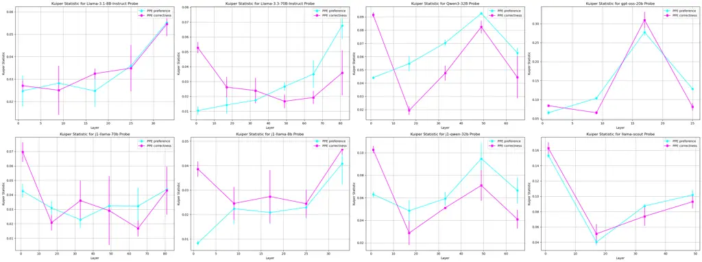

Figure 4: Probes trained on the middle layers perform best. Probe
performance by transformer layer. Probes perform better when trained on
middle layers, with performance typically peaking around layers 16-64
depending on model size.

### A.7 Loss Function Ablation

We compare different loss functions for probe training, including focal
loss with various hyperparameters $`\alpha`$ and $`\gamma`$, against MSE
loss. Table 8 presents the results across different datasets and models.

Note focal loss with $`\gamma=0`$ is the binary-cross entropy loss.

|                                       |                 |                 |                 |
| ------------------------------------- | --------------- | --------------- | --------------- |
| Loss Function                         | LLaMA 70B       | QWEN 32B        | GPT OSS 20B     |
| PPE PREFERENCE (Kuiper / ECE)         |                 |                 |                 |
| Focal: $`\alpha=0.25`$, $`\gamma=10`$ | 0.5528 / 0.0986 | 0.1875 / 0.1266 | 0.1441 / 0.1138 |
| Focal: $`\alpha=0.5`$, $`\gamma=0`$   | 0.1177 / 0.1644 | 0.1900 / 0.2111 | 0.2384 / 0.1869 |
| Focal: $`\alpha=0.75`$, $`\gamma=10`$ | 0.2600 / 0.2522 | 0.2431 / 0.2402 | 0.2669 / 0.2452 |
| Focal: $`\alpha=0.75`$, $`\gamma=20`$ | 0.0421 / 0.0629 | 0.1339 / 0.1629 | 0.2439 / 0.2326 |
| MSE                                   | 0.0303 / 0.0367 | 0.0765 / 0.1031 | 0.1676 / 0.1567 |
| PPE CORRECTNESS (Kuiper / ECE)        |                 |                 |                 |
| Focal: $`\alpha=0.25`$, $`\gamma=10`$ | 0.5865 / 0.2651 | 0.1433 / 0.1988 | 0.0738 / 0.1252 |
| Focal: $`\alpha=0.5`$, $`\gamma=0`$   | 0.1364 / 0.1504 | 0.1221 / 0.1275 | 0.1270 / 0.1291 |
| Focal: $`\alpha=0.75`$, $`\gamma=10`$ | 0.2234 / 0.2236 | 0.1380 / 0.1358 | 0.1440 / 0.1398 |
| Focal: $`\alpha=0.75`$, $`\gamma=20`$ | 0.0500 / 0.0513 | 0.0821 / 0.0940 | 0.1365 / 0.1378 |
| MSE                                   | 0.0323 / 0.0367 | 0.0559 / 0.0814 | 0.0999 / 0.1325 |
| JUDGEBENCH (Kuiper / ECE)             |                 |                 |                 |
| Focal: $`\alpha=0.25`$, $`\gamma=10`$ | 0.5991 / 0.1400 | 0.1649 / 0.2177 | 0.1154 / 0.1671 |
| Focal: $`\alpha=0.5`$, $`\gamma=0`$   | 0.1904 / 0.2176 | 0.1551 / 0.1526 | 0.1602 / 0.1619 |
| Focal: $`\alpha=0.75`$, $`\gamma=10`$ | 0.2907 / 0.2823 | 0.1891 / 0.1936 | 0.1677 / 0.1688 |
| Focal: $`\alpha=0.75`$, $`\gamma=20`$ | 0.0737 / 0.0967 | 0.1165 / 0.1220 | 0.1603 / 0.1639 |
| MSE                                   | 0.0546 / 0.0618 | 0.0682 / 0.0837 | 0.0986 / 0.1457 |
| REWARD BENCH (Kuiper / ECE)           |                 |                 |                 |
| Focal: $`\alpha=0.25`$, $`\gamma=10`$ | 0.6005 / 0.4541 | 0.1746 / 0.2379 | 0.1452 / 0.1992 |
| Focal: $`\alpha=0.5`$, $`\gamma=0`$   | 0.0365 / 0.0652 | 0.0316 / 0.0800 | 0.0361 / 0.0962 |
| Focal: $`\alpha=0.75`$, $`\gamma=10`$ | 0.0828 / 0.0852 | 0.0409 / 0.0468 | 0.0446 / 0.0742 |
| Focal: $`\alpha=0.75`$, $`\gamma=20`$ | 0.0348 / 0.0443 | 0.0367 / 0.0700 | 0.0456 / 0.0944 |
| MSE                                   | 0.1165 / 0.1198 | 0.1232 / 0.1475 | 0.1427 / 0.1914 |

Table 8: Ablations with different hyperparameters for focal loss. Note
focal loss is equal to binary cross entropy loss at $`\gamma=0`$

### A.8 Reliability Diagrams for all models on JudgeBench

We notice that verbalized confidence is generally overconfident across
models. Multi-generation methods like majority or consistency are
overconfident for the LLaMA family and the J1 LLaMa variants both across
dense and MoE models. Similarly, for GPT-OSS-20B, models tend to get
overconfident with multi-generation methods. However, for Qwen 32B and
J1-Qwen 32B, consistency and majority methods make the model
underconfident.

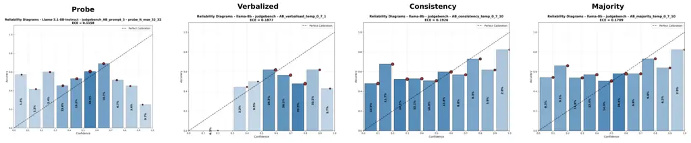

(a) LLAMA 8B

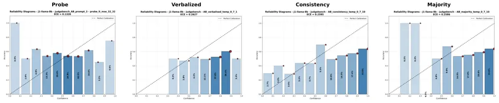

(b) J1 LLAMA 8B

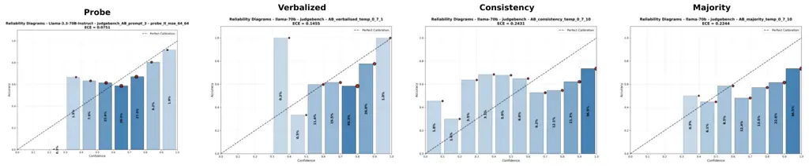

(c) LLAMA 70B

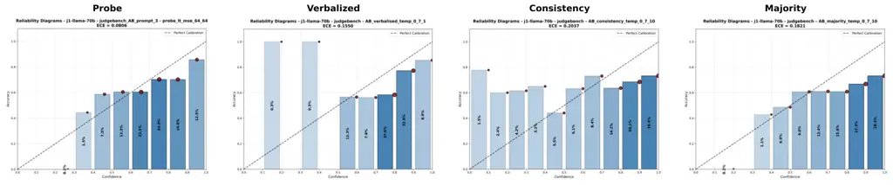

(d) J1 LLAMA 70B

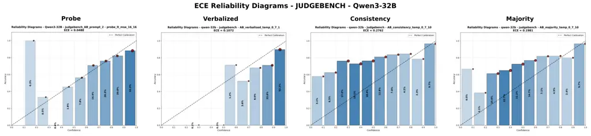

(e) QWEN 32B

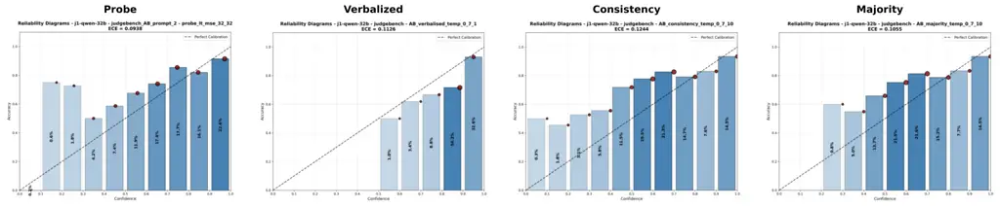

(f) J1 QWEN 32B

Figure 5: Reliability plots for Dense Models

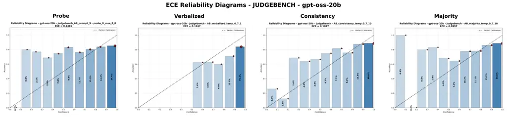

(a) GPT OSS 20B

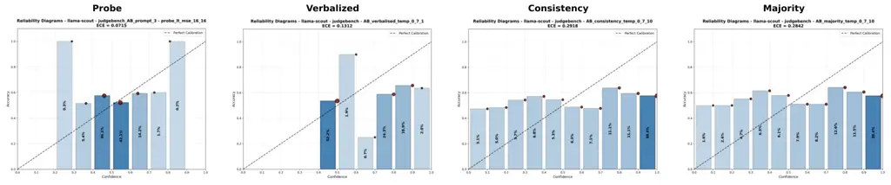

(b) LLAMA SCOUT

Figure 6: Reliability plots for MoE Models

### A.9 Temperature and Calibration Performance

We investigate the relationship between sampling temperature and
calibration performance. Figure 7 shows how ECE and Kuiper statistics
vary with temperature settings across different models.

Figure 7: ECE and Kuiper statistics as a function of temperature. We
observe the lowest ECE and Kuiper values for most models at temperature
0.7, with minimal gains beyond this point. Performance is worst at
temperature 0, improves at 0.7, and begins to decrease as temperature
increases further.

### A.10 Number of Runs and Consistency-Based Calibration

We examine how the number of consistency sampling runs affects
calibration performance. Figure 8 demonstrates the relationship between
the number of runs and calibration metrics.

Figure 8: ECE and Kuiper statistics as a function of the number of
consistency sampling runs. We observe the lowest ECE and Kuiper values
for most models at 10 runs, with minimal gains beyond this point. Models
tend to become overconfident as the number of runs increases.

### A.11 Prompts used for Multigeneration (Consistency, Majority) baselines


### A.12 Prompts for Verbalized confidence


### A.13 Prompt ablations for verbalized confidence

We also conduct ablation studies to determine which approach yields the
most effective verbalized confidence from the models. Specifically, we
experiment with permitting expressions of uncertainty within the
chain-of-thought reasoning, as opposed to the default chain-of-thought
approach. Additionally, we test different confidence scales, including
both the 0–1 and 0–100 ranges.

#### A.13.1 Varying confidence ranges


#### A.13.2 Varying elicitation mode


| Model        | With uncertainty in reasoning |         | Without uncertainty in reasoning |         |
| ------------ | ----------------------------- | ------- | -------------------------------- | ------- |
|              | 0-1                           | 0-100   | 0-1                              | 0-100   |
| LLAMA 70b    | 0.1483                        | 0.14496 | 0.19916                          | 0.17803 |
| J1 LLAMA 70b | 0.15651                       | 0.16230 | 0.18181                          | 0.19956 |
| LLAMA 8b     | 0.18799                       | 0.14251 | 0.26258                          | 0.20280 |
| J1 LLAMA 8b  | 0.26245                       | 0.18474 | 0.21141                          | 0.17139 |

Table 9: Calibration (Kuiper, lower is better) for various prompts
eliciting verbalized confidence

Figure 9: Best prompts for Verbalized confidence as measured by the
Kuiper metric. Lower is better. 0-100 ranges and allowing uncertainty in
reasoning work best.
