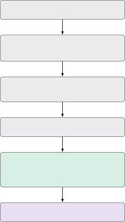
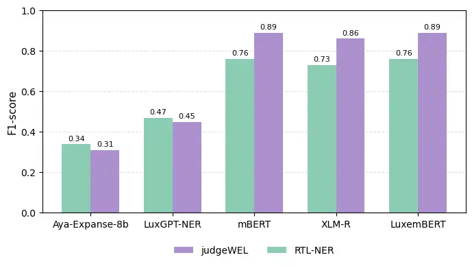

# Do LLMs Judge Distantly Supervised Named Entity Labels Well? Constructing the JudgeWEL Dataset

###### Abstract

We present judgeWEL, a dataset for named entity recognition (NER) in
Luxembourgish, automatically labelled and subsequently verified using
large language models (LLM) in a novel pipeline. Building datasets for
under-represented languages remains one of the major bottlenecks in
natural language processing, where the scarcity of resources and
linguistic particularities make large-scale annotation costly and
potentially inconsistent. To address these challenges, we propose and
evaluate a novel approach that leverages Wikipedia and Wikidata as
structured sources of weak supervision. By exploiting internal links
within Wikipedia articles, we infer entity types based on their
corresponding Wikidata entries, thereby generating initial annotations
with minimal human intervention. Because such links are not uniformly
reliable, we mitigate noise by employing and comparing several LLMs to
identify and retain only high-quality labelled sentences. The resulting
corpus is approximately five times larger than the currently available
Luxembourgish NER dataset and offers broader and more balanced coverage
across entity categories, providing a substantial new resource for
multilingual and low-resource NER research.

Keywords: Named Entity Recognition, Under-Represented Languages, Large
Language Model Evaluation

|                                                       |
| ----------------------------------------------------- |
| Alistair Plum¹, Laura Bernardy¹, Tharindu Ranasinghe² |
| ¹University of Luxembourg, Luxembourg                 |
| ²Lancaster University, UK                             |
| {alistair.plum, laura.bernardy}@uni.lu                |
| t.ranasinghe@lancaster.ac.uk                          |

Abstract content

## 1.  Introduction

Recent advances in large language models (LLMs) have redefined the scope
of natural language processing (NLP), shifting attention from
classification and sequence-labelling tasks to increasingly complex
generative applications. This transformation has enabled conversational
systems that integrate reasoning, translation, and summarisation within
a single multi-task architecture Brown et al. (2020); Touvron et al.
(2023); Jiang et al. (2023). Yet, the reach of these technologies
remains uneven. For many less-resourced and under-represented languages,
the benefits are limited: they continue to lack fundamental resources
such as labelled corpora that support even basic supervised learning
tasks, including sequence labelling and text classification Joshi et al.
(2020); Adelani et al. (2022).

Building datasets for such languages remains particularly challenging.
Obstacles typically include a scarcity of written material, limited
linguistic expertise, and the absence of sustained funding, all of which
reinforce a cycle of under-representation. When coupled with limited
prior research, these constraints make it difficult to bootstrap the
resources necessary for progress Hettiarachchi et al. (2025). In these
circumstances, creative and data-efficient strategies for dataset
construction are essential. This is the case for Luxembourgish, the
national language of Luxembourg and one of three official languages
alongside German and French. Despite its official status, Luxembourgish
is the only national language of an EU member state not represented at
the EU administrative level, thus remaining absent from standardised
resources such as Europarl Koehn (2005).

Luxembourgish is under-represented in NLP Joshi et al. (2020) compared
to its larger neighbours German and French, though it shares deep
historical and structural ties with both. It evolved from the Moselle
Franconian dialect Gilles (2019), displaying strong affinities with
German while integrating extensive French lexical and grammatical.
Code-switching and borrowing are common, particularly in informal
written communication, giving the language a dynamic character that
further complicates computational treatment. Despite these challenges,
the language’s roughly 400,000 speakers Gilles (2019), ongoing
standardisation efforts, and renewed digital interest make this an
opportune moment to improve NLP for Luxembourgish.

In this paper, we present a new methodology for the automatic creation
of a named entity recognition (NER) dataset. The methodology is designed
to achieve broad and reliable coverage with minimal human supervision.
To overcome the bottleneck of manual annotation, we combine distant
supervision from Wikipedia Wikipedia contributors (2001) and Wikidata
Cohere for AI (2025) with LLM-based quality control, leveraging the
ability of current large models to judge annotation consistency even in
languages not officially supported.

We hypothesise that certain LLMs can reliably distinguish high-quality
annotated sentences from those containing missing or incorrect tags,
thus enabling efficient filtering and scalable dataset construction. Our
main contributions are as follows:

1.  (1)
    An open pipeline for automatically constructing annotated NER
    datasets using Wikipedia, Wikidata, and LLM-based judgements.¹¹ 1
    [https://github.com/plumaj/judgeWEL](https://github.com/plumaj/judgeWEL)
2.  (2)
    The judgeWEL dataset for Luxembourgish NER, consisting of 28,866
    sentences featuring five entity types.¹

## 2.  Related Works

In this section, we summarise related works in the field of NER. Section
2.1 covers general work, Section 2.2 approaches in low-resource (LR)
settings, and Section 2.3 focuses on resources for Luxembourgish. This
includes existing language resources, both in terms of data and models.

### 2.1.  Named Entity Recognition

NER is a fundamental Information Extraction and NLP task that identifies
and classifies entities (e.g., people, locations, organizations, dates)
via sequence labelling schemes such as BIO Ramshaw and Marcus (1995a).
It builds the base for applications like question answering,
translation, summarization, and knowledge base construction.

Research on NER was started with MUC-6 Sundheim (1995). Early rule-based
systems used linguistic heuristics Mikheev et al. (1999); Weischedel et
al. (1996) and gazetteers Rau (1991); Farmakiotou et al. (2000); Nadeau
et al. (2006), the latter forming the basis for knowledge-based methods
exploiting ontologies Mendes et al. (2011); Rizzo and Troncy (2012).
These approaches required no labelled data and training but lacked
(cross-domain) scalability.

Recent work explores generative and LLM approaches. Zero-shot NER with
LLMs as standalone remains challenging Koehn and Schroeder (2005); Hu et
al. (2024); Premasiri et al. (2025), but improvements are achieved
through prompt engineering and few-shot learning with approaches like
PromptNER Ashok and Lipton (2023), GL-NER Zhu et al. (2024), and ProML
Chen et al. (2023). Hybrid frameworks like SuperICL Xu et al. (2024) and
LinkNER Lothritz et al. (2022) further integrate LLM reasoning with
fine-tuned NER models to enhance accuracy.

### 2.2.  Named Entity Recognition for Low-Resource languages

NER systems for high-resource (HR) languages such as English have
achieved state-of-the-art performance due to the availability of large
annotated datasets, including CoNLL’03 Tjong Kim Sang and De Meulder
(2003) and OntoNotes Weischedel et al. (2011). However, reaching this
performance is difficult in LR settings where labelled data is scarce
Ranasinghe et al. (2025). This lack of annotated data is often mitigated
through data augmentation and knowledge transfer between HR and LR
languages.

Cross-lingual knowledge transfer aims to transfer learned linguistic and
semantic representations from a source language to a target language
with limited labelled data. For example, Mayhew et al. (2017) used
translation techniques based on the lexica and Wikipedia to map the
knowledge from HR to LR languages. Similarly, Feng et al. (2018) used an
extended approach by enriching it with semantic mappings, enabling
coverage of named entities unseen in the LR datasets.

Tsai and Roth (2016) developed a technique for cross-lingual
Wikification, linking non-English Wikipedia entries to English
Wikipedia, training multilingual embeddings based on it to facilitate
cross-lingual transfer. The WikiAnn dataset Pan et al. (2017) is a large
multilingual benchmark covering 282 languages, also created via
cross-lingual Wikipedia links. Likewise, Polyglot-NER leveraged
distributed word representations encoding semantic and syntactic
properties of words across languages, by integrating Wikipedia links and
Freebase attributes to create a multilingual NER corpus in 40 languages
Al-Rfou et al. (2015).

An intermediate approach between cross-lingual transfer and augmentation
is MulDA Liu et al. (2021). It addresses the absence of labelled data in
a target language by translating limited NER data into multiple target
languages using entity placeholders, then generating synthetic
multilingual sequences through LMs.

For low-resource NER augmentation, PromptDA Liu et al. (2022) introduced
a label-conditioned word replacement and question-answering style
prompting method using BERT. Chen et al. (2021) enhanced LR NER by
fine-tuning XLM-RoBERTa using data from HR languages and an
attention-based strategy to capture the most relevant semantic and
syntactic information. More recent augmentation methods employ LLMs for
contextual and entity-level rewriting Ye et al. (2024), designed
specifically for few-shot and low-resource settings.

Synthetic data generation via prompting LLMs with a small number of gold
examples has also shown promising results Kamath and Vajjala (2025). The
application is further explored in studies examining the effectiveness
of LLM-generated synthetic data for NER augmentation.Kamath and Vajjala
(2025)

### 2.3.  Language Resources for Luxembourgish

Only recently has research on NLP for Luxembourgish gained momentum,
with a few early exceptions marking the first steps in resource creation
and linguistic analysis. Adda-Decker et al. (2008) presented initial
tools and corpora for computational processing; Snoeren et al. (2010)
investigated orthographic tendencies such as contextual n-deletion in
transcribed speech; and Lavergne et al. (2014) compiled a manually
annotated dataset of mixed-language sentences to test a language
identification system. More recently, progress has been made with
resources, tasks and models. Sirajzade et al. (2020) and Gierschek
(2022) developed modern sentiment analysis pipelines, Purschke (2020)
proposed an automatic approach for orthographic correction, and Plum et
al. (2024) started the first treebank for Luxembourgish. Philippy et al.
(2024) introduced a zero-shot classification method based on a curated
topic dictionary. Attardi (2015) demonstrated a comment moderation task,
Lutgen et al. (2025) worked on orthographic normalization, and Plum et
al. (2025) introduced the generative benchmark set LuxGen.

Lothritz et al. (2022) contributed a number of classification tasks,
including NER. The set was manually annotated for Person, Organisation,
Location, Geopolitical Entity, and Miscellaneous tags. The 5500
sentences were extracted from 450 RTL²² 2 The main news broadcaster of
Luxembourg. news articles. Person has the highest number of samples with
2272, Location has the least with 95 samples, and the mean number of
occurrences per label is reported at 1214. We refer to this set
throughout this paper as RTL-NER.

Various strategies have also been explored for Luxembourgish language
models. These include transfer learning from German with LuxGPT Bernardy
(2022), data augmentation via generated samples with LuxemBERT Lothritz
et al. (2022), and balanced training data extension via multilingual
data for LuxT5 Plum et al. (2025).

Despite these advances, Luxembourgish NLP still remains limited in scope
and scale. Resources are still being increased, research activity is
gaining momentum, and standard benchmarks remain minimal. Only a few
evaluation datasets exist for classification, and some smaller ones
cover generative tasks. Expanding these resources, both in terms of data
and modelling capacity, is therefore a key objective of the present
study.

## 3.  Dataset Construction

The construction of the judgeWEL (automatically judged Wikipedia
extracted Entities for Luxembourgish) dataset follows multiple steps. In
the following sections, we describe how we select the base data, how we
automatically check linked entity types, and how we use LLMs as judges
to compile the final dataset. Figure 1 shows an overview of the
pipeline.

Figure 1: Overview of the JudgeWEL dataset construction pipeline. Gray
stages denote automatic processing, green indicates the LLM-based
verification stage, and purple marks the final dataset.

### 3.1.  Base Data

The data basis is provided by Luxembourgish Wikipedia Wikipedia
contributors (2001) articles. We work with the 2024-03-29 dump, which
features around 77k articles across a variety of topics. While its size
is not comparable to the Wikipedias of its neighbouring countries,
Luxembourgish articles do follow the other commonalities in terms of how
the articles are structured. This structure is the reason why we choose
Wikipedia as a source; in particular, we rely on certain entities within
the text being hyperlinked to their (existing or non-existing)
respective Wikipedia article.

For extracting the articles from the XML dump, we utilise WikiExtractor
Attardi (2015). This tool allows us to extract the title and text of
each article, while removing any web formatting, such as the info box or
index, which are not needed. We extract title and text for each article
to json entities, while preserving hyperlink-tagged words in the text,
which is important for the next step in the pipeline.

### 3.2.  Entity Linking

Linking entities to their corresponding Wikidata Cohere for AI (2025)
page is the next step in the pipeline. Each article is split into
sentences using the sentence-splitter Koehn and Schroeder (2005) package
for Python. The splitter is not trained for Luxembourgish, but still
performs best when set to German, compared to other options.³³ 3 We
manually tested a small set of Luxembourgish examples with other options
for the language. For each hyperlinked entity in a sentence, we match
the article title via the Wikidata API to check its attributes. More
specifically, we check the following attributes for each type of entity
that we are targeting:

PER (Person)  
P31 = Q5 (human), or has attributes P569 (birthdate) or P570
(deathdate).

ORG (Organisation)  
P31 corresponds to QIDs that denote organisational entities (e.g., bank,
organization, business, hospital, etc.).

LOC (Location)  
P31 corresponds to location-type QIDs (e.g., town, municipality,
country, etc.).

DATE (Date)  
P31 equals Q14795564, Q3186692, or Q578 (i.e., types of date).

If a hyperlinked entity matches any of the attributes corresponding to a
targeted entity type, we annotate the entity tokens with that label. For
the labelling, we adopt the BIO (Begin-Inside-Outside) encoding for
entity boundary annotation, a format that has been widely used in NER
Ramshaw and Marcus (1995b); Tjong Kim Sang and De Meulder (2003). Any
hyperlinked entity that does not match the targeted entity types, or for
which we do not find a corresponding Wikidata entry, is discarded.

### 3.3.  First Selection Process

Focusing not only on high-quality but also varied annotated data, we
carry out a candidate sentence selection process after all entities have
been linked. In order to avoid extremely similar sentence structures, we
generally skip the first sentence of each article, as this tends to
follow a formulaic pattern introducing the main entity. We then extract
the following five sentences, which typically contain the highest
concentration of unique hyperlinks. Since Wikipedia conventionally links
entities only upon their first mention, these subsequent sentences are
more likely to introduce new entities and therefore yield more diverse
training examples.

Each sentence is then subjected to a series of quality checks designed
to ensure readability, non-overlap between entity spans, and adequate
contextual content. Sentences that are too short, entirely capitalised,
or composed solely of a single entity mention are excluded. We also
remove sentences where entities overlap or occupy nearly the entire span
of the sentence, as these tend to produce unreliable labels. To maintain
a balanced dataset, we include at most one negative example (a sentence
containing no entities) per article, provided that it meets minimal
length criteria. Duplicate sentences are also filtered out.

This selection procedure results in a pool of candidate sentences that
are both linguistically varied and structurally sound, providing a
robust basis for the subsequent LLM-based verification stage. In doing
so, we prioritise diversity and contextual completeness over maximal
volume, ensuring that later filtering and evaluation steps operate on
genuinely informative examples rather than redundant or low-quality
material.

"id":"1/100-1",  
"text":"De Jhempi Kniddel schafft beim Staat",  
"tokens":\["De", "Jhempi", "Kniddel", "schafft", "beim", "Staat",
"."\],  
"labels":\["O", "B-PER", "I-PER", "O", "O", "B-ORG", "O"\]

Figure 2: JSON representation of a labelled sentence used for the
dataset.

For the project at hand, the selection process results in 74,710
annotated sentences after the initial selection. Certain samples show
unlabelled, mislabelled, and incomplete entities, as well as sentences
that should not contain any entities (as negative examples) but do
contain entities. After this selection, all sentences are stored in JSON
format, as depicted by the example in Figure 2. Each sentence is given a
unique identifier, consisting of a running number, the Wikipedia article
ID that the sentence originates from, and the sentence number within
that article.

### 3.4.  Annotation Improvements

Since the Luxembourgish Wikipedia does not cover all entities present in
our dataset due to its size, we perform an additional automatic
annotation step. Using a LuxGPT model fine-tuned through prompt
engineering for NER with a modified version of RTL-NER dataset Bernardy
(2022), we re-evaluate all entities initially labelled with O-tags and,
where necessary, reassign them with one of the predefined entity tags.
Some manual post-processing is conducted to harmonize the tag set,
including the unification of the GPE tag under LOC. This is because the
RTL-NER distinguishes between these two tags (see Section 2.3), whereas
we do not. These adjustments are implemented using simple regular
expressions.

As both annotation procedures occasionally result in insufficient
tagging of date expressions, we subsequently apply a regular
expression–based script that searches for date patterns within token
sequences. These patterns include both numerical formats and
Luxembourgish expressions used to indicate temporal information.

### 3.5.  LLM-as-a-Judge

To minimise unlabelled, mislabelled, or incomplete entities in the
dataset, we test several LLMs to verify each candidate sentence. This
stage involves iterative prompt testing to identify those that best
retain correctly annotated examples while filtering out inconsistent
ones. Given the already substantial size of the automatically derived
corpus, our aim is not exhaustive coverage but reliability: we
deliberately accept the loss of some valid samples in favour of higher
overall consistency. The final prompt used for verification is shown in
Figure 3. The resulting instruction is concise but explicit, guiding the
model towards binary and decisive judgements.

Prompt: For each sentence below, please check whether the named entity
labels are appropriate. Each sentence will be presented as a list of
tokens, and you will be provided with a list of BIO tags that indicate
the entities. Some tokens may be labelled with just a tag and no BIO if
they are a singular item; that is acceptable. Some sentences will have
no labelled items at all and may be examples of no labels applying, a
negative example. The accepted labels are PER for a person, ORG for an
organisation, LOC for a location, DATE for a specific date or year, and
MISC for any other named entity that does not fit any of the other
types. Your task is to check each sentence: make sure the suggested
labels are correct, make sure that all potential labels have been
assigned, and that labels have been assigned the correct BIO range. For
unlabelled sentences, you need to make sure that these are valid
negative examples, so that really no labels apply. Since you will be
filtering the sentences, you will have to be decisive, offering a 1
(yes, keep sentence) or 0 (no, discard sentence) answer.

Figure 3: LLM-as-a-Judge prompt used.

We also include a system message for each prompt that takes care of
formatting, opting for a CSV output containing the sentence ID and the
verification label produced by the model. Sentences are passed in
batches of 20 in the previously described JSON format.

Once the prompt is refined to a satisfactory level, we evaluate a
diverse set of LLMs to identify the most reliable judge for
Luxembourgish data. The model selection balances open and closed
systems, scale regimes, and ecosystem diversity, thereby strengthening
empirical validity and reproducibility:

##### Proprietary Baselines.

GPT-5 represents the cutting edge of commercial models and serves as a
reference benchmark for high-end proprietary performance (OpenAI,
2025b). Its smaller counterpart, GPT-5-mini, provides a more lightweight
and cost-efficient variant for comparison, enabling us to assess
performance scalability within the same model family.

##### Open-Weight Systems.

Gemma-3-27B-IT is included because Google/DeepMind released it under a
permissive licence, allowing transparent evaluation and reproducibility.
Mistral-Medium-3.1 represents the new generation of mid-sized open
models optimised for efficiency and multilingual generalisation,
offering a valuable test case for open community-led development.
Finally, GPT-OSS-120B acts as a large open-weight counterpart to the
closed models, released by OpenAI under Apache 2.0 with near-parity on
reasoning benchmarks, providing a direct comparison point for open vs.
proprietary large-scale systems (OpenAI, 2025a; OpenAI, 2025c).

##### Instruction-Tuned Systems.

LLaMA-3.3-8B-Instruct offers a smaller, instruction-optimised model
within a widely adopted open-weight ecosystem (Touvron et al., 2024). In
addition, command-a-03-2025 represents a new generation of
instruction-tuned commercial models that occupy the middle ground
between fully open and closed systems, and is said to emphasise
controlled outputs and multilingual understanding (Cohere for AI, 2025).

Taken together, these models cover the current LLM landscape: closed vs.
open, large vs. compact, and general-purpose vs. instruction-tuned.
Covering these areas allows for a balanced and comprehensive evaluation
of model behaviour across technological and governance regimes.

| Split | Sents. | PER    | ORG   | LOC    | DATE   | MISC |
| ----- | ------ | ------ | ----- | ------ | ------ | ---- |
| Train | 22,947 | 11,013 | 2,620 | 10,341 | 11,355 | 243  |
| Dev   | 2,868  | 1,490  | 382   | 1,367  | 1,414  | 61   |
| Test  | 3,051  | 1,251  | 304   | 1,310  | 1,523  | 13   |

Table 1: Total sentences and entity type counts for the judgeWEL data
splits.

#### 3.5.1.  Human-as-a-Judge

To verify the LLM-judged sentences, and also keep human-oversight to a
minimum, two annotators (Luxembourgish native speakers, aged between
20-30) were tasked to verify 500 sentences of the dataset. The
annotators judged each sentence according to the prompt for the LLMs, so
that maximum comparability was retained. The annotators agreed 414 out
of 500 times, with Cohen’s $`\kappa`$ at 0.66. The annotation process
took 6 hours per annotator. For each disagreement, a consensus was
reached, which we consider the final human label. Of the 500 sentences,
182 were verified as high-quality examples, and added to the test set.

After human annotation, we evaluate the LLMs on the same set to select
the best. The evaluation of the LLMs as a judge is presented in Section
4.1.

### 3.6.  Final Dataset

We compile judgeWEL after obtaining the LLM judgements. In total, this
brings down the number of sentences to 28,866. For the training,
development, and testing splits we opted for roughly 80%, 10% and 10%.
We shuffle the data, and obtain the label balances as shown in Table 1.
Overall, PER is the most common tag, followed by DATE and LOC. For ORG,
we obtain far fewer samples, and very few for MISC.

## 4.  Evaluation

This section evaluates both the construction and use of the judgeWEL
dataset as described in the previous section. Specifically, we evaluate
the ability of LLMs to act as reliable judges of annotation quality
(Section 4.1), and the downstream performance of models supporting
Luxembourgish on the NER task (Section 4.2).

### 4.1.  LLM-as-a-Judge

Table 2 presents the agreement between each LLM and the human annotator
consensus. For each model, we report the absolute number of matching
labels and Cohen’s $`\kappa`$ as a measure of inter-rater reliability,
alongside the inter-annotator agreement between humans for reference.

| Model                 | Agreement | $`\kappa`$ |
| --------------------- | --------- | ---------- |
| Gemma-3-27B-IT        | 177       | -0.29      |
| LLaMA-3.3-8B-Instruct | 236       | -0.05      |
| command-a-03-2025     | 349       | 0.40       |
| Mistral-Medium-3.1    | 362       | 0.45       |
| GPT-OSS-120B          | 367       | 0.47       |
| GPT-5(-mini)          | 405       | 0.62       |
| Human Annotators      | 414       | 0.66       |

Table 2: Model agreement with annotator consensus labels on 500 test
samples.

Overall, GPT-5-mini and GPT-5 produce the exact same output, and clearly
outperform all other systems, reaching a $`\kappa`$ value of 0.62,
approaching the level of human inter-annotator agreement at 0.66. This
indicates that high-end proprietary models can understand Luxembourgish
text and capture the fine-grained cues that distinguish well-annotated
from inconsistent examples. The fact that the smaller model produces the
same output as the larger model also has significant cost implications,
as the former cost roughly \$25 to annotate the entire pre-filtered set
of 74k sentences, while the latter would have cost around \$180. Among
the open-weight systems, GPT-OSS-120B and Mistral-Medium-3.1 perform
comparatively well, showing moderate and stable alignment with human
judgements. The command-a-03-2025 model achieves slightly lower
agreement but remains consistent across samples, suggesting solid
comprehension but a less decisive evaluative behaviour. By contrast,
Gemma-3-27B-IT and LLaMA-3.3-8B-Instruct exhibit near-zero or negative
correlation with human ratings, confirming that instruction tuning alone
does not ensure evaluative reliability in smaller open-weight systems.

A finer-grained analysis of errors broken down by entity type reveals
that these aggregate differences mask systematic per-category biases,
evaluated on the 388 sentences for which both human annotators agreed.
DATE-containing sentences are the most consistently handled across all
models, with every system achieving its highest or near-highest F1 on
this category, likely because temporal expressions provide reliable
surface cues that LLM judges can exploit regardless of their general
evaluative quality. PER entities show a wider spread: Mistral-Medium-3.1
and command-a-03-2025 both exceed F1 72, while GPT-OSS-120B drops to
39.2, driven by a strong conservative bias that causes it to discard 52
of the 71 gold-keep PER sentences, a pattern consistent with its overall
tendency to over-reject. MISC entities prove the most problematic across
the board: GPT-5 and GPT-OSS-120B achieve an F1 of zero, never retaining
a MISC sentence that human annotators approved, while the remaining
models reach at best 17, largely driven by false positives. This likely
reflects the heterogeneous and language-specific nature of the MISC
class in Luxembourgish NER. Finally, sentences containing no named
entities expose the sharpest divide: GPT-5 and GPT-OSS-120B handle these
near-perfectly (F1 99.2 and 97.4), while Gemma-3-27B-IT discards all 60
such sentences, yielding an F1 of zero. This reinforces the
interpretation that its negative $`\kappa`$ reflects a systematic
tendency to equate the absence of named entities with annotation
failure, rather than random disagreement.

Taken together, these results show that while proprietary models
continue to lead in judgement accuracy, large open-weight and mid-size
commercial models are closing the gap, which indicates promising
potential for transparent, reproducible evaluation pipelines in the near
future.

### 4.2.  Named Entity Recognition Task

For the NER task, we benchmark a set of multilingual and
Luxembourgish-specific encoder models: mBERT Devlin et al. (2018),
LuxemBERT Lothritz et al. (2022), and XLM-RoBERTa Conneau et al. (2019).
Alongside this, we fine-tune and benchmark three generative LLMs:
LuxGPT-NER, aya-expanse-8b Üstün et al. (2024) and
Meta-Llama-3-8B-Instruct (Touvron et al., 2024). We also tested GPT-5 in
a zero- and few-shot setting, however, the model did not deliver
consistent results (producing just O tags) and we do not discuss any
further results, as finding the optimal model for this task was not our
objective.

The classification models are trained with the same settings in all
training/testing combinations, as the aim was to comparative
benchmarking above maximum performance. We used the following
hyperparameters: 3 epochs, input length of 128, and a learning rate of
$`5e-5`$. All classification models were trained on the same server. The
fine-tuned LLMs were trained for 5 epochs with Early Stopping, which
occured for LuxGPT-NER after the first, for Llama and Aya after the
third epoch. The other hyperparameters used were a learning rate of
$`2e-5`$ and an input length of maximum 512. Due to the LLM
architecture, the NER-tagging task was altered into a sequence modelling
task, with the token sequence to tag as prompt to complete with the
sequence of respective tags. Aya and Llama were also given an additional
system prompt defining the task. For the evaluation, the token sequences
were compared to the test sets.

Evaluation scores are obtained for all models using the seqeval Adelani
et al. (2022) package for Python, and we report the micro averaged
scores rounded to two decimals for each metric per model

To understand the potential performance increase achievable with
judgeWEL, we carry out the evaluation in two settings. First, we train,
validate and test on judgeWEL (Section 4.2.1), constructed with the
methodology laid out in this paper. Second, we train and validate on
judgeWEL, but test using the existing RTL-NER dataset for Luxembourgish
(Section 4.2.2), which we previously described in Section 2.3.

#### 4.2.1.  judgeWEL

As shown in Table 3, all transformer-based encoders perform well,
reaching F1-scores above 0.90. LuxemBERT slightly outperforms
multilingual baselines, confirming that language-specific pretraining
yields measurable gains even on relatively small corpora. XLM-RoBERTa
follows closely, demonstrating strong cross-lingual transfer from
related languages such as German. These results establish a reliable
baseline for Luxembourgish NER.

| Model      | Precision | Recall | F1-score |
| ---------- | --------- | ------ | -------- |
| LuxGPT-NER | 0.63      | 0.74   | 0.68     |
| Aya-exp-8b | 0.86      | 0.83   | 0.84     |
| LLaMA-3-8B | 0.93      | 0.91   | 0.92     |
| mBERT      | 0.92      | 0.90   | 0.91     |
| XLM-R      | 0.92      | 0.91   | 0.91     |
| LuxemBERT  | 0.92      | 0.92   | 0.92     |

Table 3: Evaluation results for each model trained and tested on the
judgeWEL dataset.

Among the generative LLMs, performance varies more widely.
Meta-Llama-3-8B-Instruct achieves the same performance level as
LuxemBert with a F1 score of 0.92. Aya-expanse-8b achieves an F1-score
of 0.84, which is slightly below the encoder-based baselines, but still
indicates strong generalisation and semantic awareness of entity
boundaries. In contrast, the fine-tuned LuxGPT-NER reaches 0.68,
suggesting that despite adaptation to Luxembourgish, it struggles to
maintain consistent token-level alignment during generation. Manual
inspection confirms that both models occasionally merge tokens, omit
boundaries, or produce malformed BIO sequences. This points to a broader
limitation of autoregressive architectures for sequence-labelling tasks,
where structured, token-aligned predictions are required. The same
tendency was observed in our zero-shot GPT-5 evaluation, where
high-level understanding did not translate into stable, fine-grained
labelling.

Figure 4: Model F1 scores trained on judgeWEL or RTL-NER, and evaluated
on RTL-NER.

#### 4.2.2.  Comparison with RTL-NER

To compare performance gains that our dataset brings to Luxembourgish
NER, we evaluate the same set of models in two further comparative
scenarios. First, we train on the judgeWEL dataset and evaluate on
RTL-NER. To ensure comparability, judgeWEL is downsampled to match the
size of the RTL-NER training split using stratified sampling. We then
train and evaluate on RTL-NER directly. Because the existing set
features different labels, and to ensure maximum comparability, we
combine the GPE and LOC entity types into one. The existing set does not
feature the DATE entity type, for which we make no changes. Second, we
retrain the models using the entire existing dataset, but again with GPE
and LOC entity types combined.

| Model      | Precision | Recall | F1-score |
| ---------- | --------- | ------ | -------- |
| LuxGPT-NER | 0.36      | 0.62   | 0.45     |
| Aya-exp-8b | 0.29      | 0.34   | 0.31     |
| LLaMA-3-8B | 0.02      | 0.01   | 0.02     |
| mBERT      | 0.93      | 0.91   | 0.92     |
| XLM-R      | 0.92      | 0.91   | 0.91     |
| LuxemBERT  | 0.92      | 0.92   | 0.92     |

Table 4: Evaluation results for each model trained on judgeWEL and
evaluated on RTL-NER.

When classification models are trained on the new dataset and evaluated
on the existing one, performance remains consistently high across
architectures, with mBERT and LuxemBERT achieving F1-scores of 0.89, and
with XLM-RoBERTa at 0.86 (see Table 4). This indicates that the
automatically constructed and judged dataset captures entity boundaries
accurately and generalises well to human-annotated data in a different
domain. The stability of cross-dataset performance suggests strong label
alignment and coverage across entity types, despite the partial mismatch
in label inventories. Model performance increases to around 0.91 in
terms of F1 score when trained on the full training set, which is
roughly 4 times larger.

By contrast, classification models trained solely on the original
RTL-NER dataset reach substantially lower F1-scores, confirming that the
new corpus provides broader contextual diversity and higher-quality
supervision. Figure 4 shows the differences in F1 score per model.

When comparing the results of the generative LLMs across setups, the
results change. We observe a small but consistent drop in performance
when moving from in-domain training on RTL-NER (0.34 for Aya-expanse-8b,
0.47 for LuxGPT-NER) to cross-domain evaluation using judgeWEL for
training (0.31 and 0.45, respectively). This decline suggests limited
transferability of token-level labelling behaviour across datasets, even
though entity semantics are largely preserved. Closer inspection reveals
that both models tend to generate incomplete or inconsistent BIO
sequences, frequently omitting boundaries or merging adjacent entities.
For Meta-Llama-3-8B-Instruct this effect shows especially strong in a
complete performance drop. The issue appears structural rather than
linguistic: autoregressive LLMs are not optimised for deterministic,
token-aligned output, and thus struggle to reproduce the rigid labelling
constraints that encoder-based architectures handle naturally. The same
pattern was already visible in the zero-shot GPT-5 evaluation, where the
model exhibited unstable tagging.

Overall, the results highlight the robustness of our approach: models
trained on automatically generated data can transfer effectively to
existing human-labelled benchmarks, thereby reducing the dependency on
costly manual annotation. This validates the use of LLM-assisted distant
supervision for future corpus creation in comparable low-resource
languages. The findings also underline that while instruction-tuned LLMs
capture entity meaning effectively, transformer encoders remain more
robust for precise sequence-labelling, particularly when generalising
beyond their training domain.

## 5.  Conclusion

This study set out to examine whether LLMs can reliably assist in the
construction and validation of an NER dataset for Luxembourgish, a
language with limited but growing annotated resources. The findings
confirm that current LLMs can serve as effective judges of annotation
quality, reaching levels of agreement close to human inter-annotator
consensus. This supports our hypothesis that LLMs are able to
distinguish between high and low-quality examples, even when the
language in question is not explicitly supported during pre-training.

At the same time, our results suggest that fully automating label
generation through LLMs remains premature. While models such as GPT-5
display strong discriminative capabilities, they still introduce
systematic inconsistencies when tasked with producing entity labels from
scratch. The hybrid approach proposed here, which combines structured
resources such as Wikipedia and Wikidata with selective LLM-based
filtering, thus represents a pragmatic middle ground between manual and
fully generative annotation.

Future work will focus on extending this methodology to other
under-represented languages with similar data profiles, as well as on
refining label granularity to capture additional entity subtypes and
relational information. Incorporating limited human-in-the-loop
validation and cross-lingual alignment could further enhance both
precision and transferability. Ultimately, this work demonstrates that
careful use of LLMs, rather than full automation, offers a sustainable
path towards equitable NLP. And for languages with little data, a
combination of structured knowledge and model verification may prove
more powerful than either alone.

## 6.  Acknowledgements

The data annotation for evaluation purposes was carried out by student
assistants, funded by the Horizon Europe project LLMs4EU. We thank the
annotators for their work.

The computational experiments reported in this paper were conducted on
the MeluXina high-performance computing infrastructure, an allocation
granted by the University of Luxembourg on the EuroHPC supercomputer
hosted by LuxProvide.

Tharindu Ranasinghe is partially funded from COST Action CA23147 GOBLIN
– Global Network on Large-Scale, Cross-domain and Multilingual Open
Knowledge Graphs, supported by COST (European Cooperation in Science and
Technology).

## 7.  Ethical Considerations

The dataset introduced in this paper is derived from publicly available
sources, primarily Wikipedia and Wikidata, which are both governed by
permissive licences (CC BY-SA 4.0 and CC0 respectively). No private or
sensitive user information was accessed or processed, and all data
handling complied with the applicable terms of use. The automatic
annotation process may nonetheless propagate biases present in the
original sources, such as uneven entity representation across gender,
geography, or topic. While these issues are partially mitigated by the
scale and diversity of Wikipedia, they warrant explicit acknowledgement
and monitoring in downstream applications.

The use of LLMs as annotation judges also introduces potential ethical
concerns. Proprietary models such as GPT-5 are not fully transparent in
their training data or alignment processes, limiting interpretability
and reproducibility. To balance this, we included a set of open-weight
models to ensure that the pipeline remains inspectable and reproducible.
The dataset and code will be released under open licences to support
transparency, reproducibility, and responsible research on low-resource
languages.

All human annotators involved in this study were compensated for their
work in accordance with national wage standards and institutional ethics
policy.

## 8.  Limitations

While the proposed approach substantially reduces the cost of data
creation for under-represented and under-resourced languages, several
limitations remain. First, the methodology depends on the existence of a
sufficiently populated Wikipedia edition and reliable entity linking to
Wikidata. For languages with extremely sparse or inconsistent Wikipedia
coverage, this strategy may yield limited or biased samples. Second,
although LLMs can approximate human judgement, their evaluations are
still probabilistic and subject to variation across prompts, temperature
settings, and API versions.

Furthermore, the dataset focuses on five coarse-grained entity
categories, which may not capture finer semantic distinctions (e.g.,
between organisations and institutions or between temporal and numerical
expressions). Finally, while the resulting dataset improves lexical and
topical coverage for Luxembourgish, its automatic origin may still
include residual annotation noise. Manual validation or iterative
human-in-the-loop refinement will be essential for tasks requiring high
precision, such as information extraction in sensitive or policy-related
domains.

## 9.  Bibliographical References

##

- Adda-Decker et al. (2008) M. Adda-Decker, T. Pellegrini, E. Bilinski,
  and G. Adda Developments of “Lëtzebuergesch” Resources for Automatic
  Speech Processing and Linguistic Studies. In Proceedings of LREC,
  External Links:
  [Link](http://www.lrec-conf.org/proceedings/lrec2008/pdf/855%5C%5Fpaper.pdf)
  Cited by: §2.3.
- Adelani et al. (2022) D. I. Adelani, D. Ruiter, M. Choudhury, et al.
  MasakhaNER 2.0: africa-centric transfer learning for named entity
  recognition. In Proceedings of ACL, Cited by: §1.
- Al-Rfou et al. (2015) R. Al-Rfou, V. Kulkarni, B. Perozzi, and S.
  Skiena Polyglot-ner: massive multilingual named entity recognition. In
  Proceedings of the SIAM International Conference on Data Mining, Cited
  by: §2.2.
- Ashok and Lipton (2023) D. Ashok and Z. C. Lipton Promptner: prompting
  for named entity recognition. arXiv preprint arXiv:2305.15444. Cited
  by: §2.1.
- Attardi (2015) Attardi Cited by: §3.1.
- Bernardy (2022) L. Bernardy A Luxembourgish GPT-2 Approach Based on
  Transfer Learning. Master’s Thesis, University of Trier. Cited by:
  §2.3, §3.4.
- Brown et al. (2020) T. B. Brown, B. Mann, N. Ryder, et al. Language
  models are few-shot learners. Advances in Neural Information
  Processing Systems 33. Cited by: §1.
- Chen et al. (2021) S. Chen, Y. Pei, Z. Ke, and W. Silamu Low-resource
  named entity recognition via the pre-training model. Symmetry 13 (5).
  External Links: [Link](https://www.mdpi.com/2073-8994/13/5/786), ISSN
  2073-8994, [Document](https://dx.doi.org/10.3390/sym13050786) Cited
  by: §2.2.
- Chen et al. (2023) Y. Chen, Y. Zheng, and Z. Yang Prompt-based metric
  learning for few-shot NER. In Findings of ACL, A. Rogers, J.
  Boyd-Graber, and N. Okazaki (Eds.), External Links:
  [Link](https://aclanthology.org/2023.findings-acl.451/),
  [Document](https://dx.doi.org/10.18653/v1/2023.findings-acl.451) Cited
  by: §2.1.
- Cohere for AI (2025) Cohere for AI Introducing command r+ and command
  a models. Note:
  [https://cohere.com/blog/command-a-command-r-plus](https://cohere.com/blog/command-a-command-r-plus)Accessed
  2025 Cited by: §3.5.
- Conneau et al. (2019) A. Conneau, K. Khandelwal, N. Goyal, V.
  Chaudhary, G. Wenzek, F. Guzmán, E. Grave, M. Ott, L. Zettlemoyer,
  and V. Stoyanov Unsupervised cross-lingual representation learning at
  scale. CoRR abs/1911.02116. External Links:
  [Link](http://arxiv.org/abs/1911.02116), 1911.02116 Cited by: §4.2.
- Devlin et al. (2018) J. Devlin, M. Chang, K. Lee, and K. Toutanova
  BERT: pre-training of deep bidirectional transformers for language
  understanding. CoRR abs/1810.04805. External Links:
  [Link](http://arxiv.org/abs/1810.04805), 1810.04805 Cited by: §4.2.
- Farmakiotou et al. (2000) D. Farmakiotou, V. Karkaletsis, J.
  Koutsias, G. Sigletos, C. D. Spyropoulos, and P. Stamatopoulos
  Rule-based named entity recognition for greek financial texts. In
  Proceedings of COMLEX 2000, Cited by: §2.1.
- Feng et al. (2018) X. Feng, X. Feng, B. Qin, Z. Feng, and T. Liu
  Improving low resource named entity recognition using cross-lingual
  knowledge transfer. In Proceedings of IJCAI, External Links:
  [Document](https://dx.doi.org/10.24963/ijcai.2018/566),
  [Link](https://doi.org/10.24963/ijcai.2018/566) Cited by: §2.2.
- Gierschek (2022) D. Gierschek Detection of Sentiment in Luxembourgish
  User Comments. Ph.D. Thesis, University of Luxembourg. External Links:
  [Link](http://hdl.handle.net/10993/50533) Cited by: §2.3.
- Gilles (2019) P. Gilles 39. Komplexe Überdachung II: Luxemburg. Die
  Genese Einer Neuen Nationalsprache. In Sprache und Raum - Ein
  internationales Handbuch der Sprachvariation. Volume 4 Deutsch, J.
  Herrgen and J. E. Schmidt (Eds.), External Links:
  [Document](https://dx.doi.org/doi%3A10.1515/9783110261295-039), ISBN
  9783110261295, [Link](https://doi.org/10.1515/9783110261295-039) Cited
  by: §1.
- Hettiarachchi et al. (2025) H. Hettiarachchi, T. Ranasinghe, P.
  Rayson, R. Mitkov, M. Gaber, D. Premasiri, F. A. Tan, and L. R. C.
  Uyangodage Overview of the first workshop on language models for
  low-resource languages (LoResLM 2025). In Proceedings of LoResLM
  (COLING), H. Hettiarachchi, T. Ranasinghe, P. Rayson, R. Mitkov, M.
  Gaber, D. Premasiri, F. A. Tan, and L. Uyangodage (Eds.), External
  Links: [Link](https://aclanthology.org/2025.loreslm-1.1/) Cited by:
  §1.
- Hu et al. (2024) Y. Hu, Q. Chen, J. Du, X. Peng, V. Keloth, X. Zuo, Y.
  Zhou, Z. Li, X. Jiang, Z. Lu, et al. Improving large language models
  for clinical named entity recognition via prompt engineering.. JAMIA.
  Cited by: §2.1.
- Jiang et al. (2023) A. Q. Jiang, A. Sablayrolles, A. Mensch, et al.
  Mistral 7b. arXiv preprint arXiv:2310.06825. Cited by: §1.
- Joshi et al. (2020) P. Joshi, S. Santy, A. Budhiraja, K. Bali, and M.
  Choudhury The state and fate of linguistic diversity and inclusion in
  the nlp world. In Proceedings of ACL, Cited by: §1, §1.
- Kamath and Vajjala (2025) G. Kamath and S. Vajjala Does synthetic data
  help named entity recognition for low-resource languages?. arXiv
  preprint arXiv:2505.16814. Cited by: §2.2.
- Koehn and Schroeder (2005) Koehn and Schroeder Cited by: §3.2.
- Koehn (2005) P. Koehn Europarl: a parallel corpus for statistical
  machine translation. In The Tenth Machine Translation Summit
  Proceedings of Conference, Cited by: §1.
- Lavergne et al. (2014) T. Lavergne, G. Adda, M. Adda-Decker, and L.
  Lamel Automatic language identity tagging on word and sentence-level
  in multilingual text sources: a case-study on Luxembourgish. In
  Proceedings of LREC, External Links:
  [Link](http://www.lrec-conf.org/proceedings/lrec2014/pdf/732%5C%5FPaper.pdf)
  Cited by: §2.3.
- Liu et al. (2022) J. Liu, Y. Chen, and J. Xu Low-Resource NER by Data
  Augmentation With Prompting. In Proceedings of IJCAI, External Links:
  [Document](https://dx.doi.org/10.24963/ijcai.2022/590),
  [Link](https://doi.org/10.24963/ijcai.2022/590) Cited by: §2.2.
- Liu et al. (2021) L. Liu, B. Ding, L. Bing, S. Joty, L. Si, and C.
  Miao MulDA: a multilingual data augmentation framework for
  low-resource cross-lingual NER. In Proceedings of ACL, C. Zong, F.
  Xia, W. Li, and R. Navigli (Eds.), External Links:
  [Link](https://aclanthology.org/2021.acl-long.453/),
  [Document](https://dx.doi.org/10.18653/v1/2021.acl-long.453) Cited by:
  §2.2.
- Lothritz et al. (2022) C. Lothritz, B. Lebichot, K. Allix, L.
  Veiber, T. Bissyande, J. Klein, A. Boytsov, C. Lefebvre, and A. Goujon
  LuxemBERT: Simple and Practical Data Augmentation in Language Model
  Pre-Training for Luxembourgish. In Proceedings of LREC, External
  Links: [Link](https://aclanthology.org/2022.lrec-1.543) Cited by:
  §2.3.
- Lothritz, Lebichot, Allix, Veiber, Bissyande, Klein, Boytsov,
  Lefebvre, and Goujon (2022) L. A. V. B. K. B. L. Lothritz and Goujon
  Cited by: §2.3, §4.2.
- Lutgen et al. (2025) A. Lutgen, A. Plum, C. Purschke, and B. Plank
  Neural text normalization for Luxembourgish using real-life variation
  data. In Proceedings of VarDial (COLING), Y. Scherrer, T.
  Jauhiainen, N. Ljubešić, P. Nakov, J. Tiedemann, and M. Zampieri
  (Eds.), External Links:
  [Link](https://aclanthology.org/2025.vardial-1.9/) Cited by: §2.3.
- Mayhew et al. (2017) S. Mayhew, C. Tsai, and D. Roth Cheap translation
  for cross-lingual named entity recognition. In Proceedings of
  EMNLP, M. Palmer, R. Hwa, and S. Riedel (Eds.), External Links:
  [Link](https://aclanthology.org/D17-1269/),
  [Document](https://dx.doi.org/10.18653/v1/D17-1269) Cited by: §2.2.
- Mendes et al. (2011) P. N. Mendes, M. Jakob, A. García-Silva, and C.
  Bizer DBpedia spotlight: shedding light on the web of documents. In
  Proceedings of Semantic Systems, Cited by: §2.1.
- Mikheev et al. (1999) A. Mikheev, M. Moens, and C. Grover Named entity
  recognition without gazetteers. In Proceedings of EACL, Cited by:
  §2.1.
- Nadeau et al. (2006) D. Nadeau, P. D. Turney, and S. Matwin
  Unsupervised named-entity recognition: generating gazetteers and
  resolving ambiguity. In Conference of the Canadian society for
  computational studies of intelligence, Cited by: §2.1.
- Nakayama (2018) Nakayama Cited by: §4.2.
- OpenAI (2025a) OpenAI Gpt-oss-120b & gpt-oss-20b model card. Note:
  [https://openai.com/index/gpt-oss-model-card/](https://openai.com/index/gpt-oss-model-card/)
  Cited by: §3.5.
- OpenAI (2025b) OpenAI Introducing gpt-5. Note:
  [https://openai.com/index/introducing-gpt-5/](https://openai.com/index/introducing-gpt-5/)
  Cited by: §3.5.
- OpenAI (2025c) OpenAI Introducing gpt-oss. Note:
  [https://openai.com/index/introducing-gpt-oss/](https://openai.com/index/introducing-gpt-oss/)
  Cited by: §3.5.
- Pan et al. (2017) X. Pan, B. Zhang, J. May, J. Nothman, K. Knight,
  and H. Ji Cross-lingual name tagging and linking for 282 languages. In
  Proceedings of ACL, R. Barzilay and M. Kan (Eds.), External Links:
  [Link](https://aclanthology.org/P17-1178/),
  [Document](https://dx.doi.org/10.18653/v1/P17-1178) Cited by: §2.2.
- Philippy et al. (2024) F. Philippy, S. Haddadan, and S. Guo Forget
  NLI, Use a Dictionary: Zero-Shot Topic Classification for Low-Resource
  Languages with Application to Luxembourgish. In Proceedings of SIGUL
  (LREC-COLING), External Links:
  [Link](https://aclanthology.org/2024.sigul-1.13) Cited by: §2.3.
- Plum et al. (2024) A. Plum, C. Döhmer, E. Milano, A. Lutgen, and C.
  Purschke LuxBank: the first Universal Dependency treebank for
  Luxembourgish. In Proceedings of TLT, D. Dakota, S. Jablotschkin, S.
  Kübler, and H. Zinsmeister (Eds.), External Links:
  [Link](https://aclanthology.org/2024.tlt-1.4/) Cited by: §2.3.
- Plum et al. (2025) A. Plum, T. Ranasinghe, and C. Purschke Text
  generation models for Luxembourgish with limited data: a balanced
  multilingual strategy. In Proceedings of VarDial (COLING), Y.
  Scherrer, T. Jauhiainen, N. Ljubešić, P. Nakov, J. Tiedemann, and M.
  Zampieri (Eds.), External Links:
  [Link](https://aclanthology.org/2025.vardial-1.7/) Cited by: §2.3,
  §2.3.
- Premasiri et al. (2025) D. Premasiri, T. Ranasinghe, R. Mitkov, M.
  El-Haj, and I. Frommholz Survey on legal information extraction:
  current status and open challenges. Knowledge and Information Systems
  67 (12), pp. 11287–11358. Cited by: §2.1.
- Purschke (2020) C. Purschke Attitudes Toward Multilingualism in
  Luxembourg. A Comparative Analysis of Online News Comments and
  Crowdsourced Questionnaire Data. Frontiers in AI 3. Cited by: §2.3.
- Ramshaw and Marcus (1995a) L. Ramshaw and M. Marcus Text chunking
  using transformation-based learning. In Third Workshop on Very Large
  Corpora, External Links: [Link](https://aclanthology.org/W95-0107/)
  Cited by: §2.1.
- Ramshaw and Marcus (1995b) L. Ramshaw and M. Marcus Text chunking
  using transformation-based learning. In Third Workshop on Very Large
  Corpora, External Links: [Link](https://aclanthology.org/W95-0107/)
  Cited by: §3.2.
- Ranasinghe et al. (2025) T. Ranasinghe, H. Hettiarachchi, N. C. N. V.
  Pathirana, D. Premasiri, L. Uyangodage, I. Nanomi Arachchige, A.
  Plum, P. Rayson, and R. Mitkov Sinhala encoder-only language models
  and evaluation. In Proceedings of the 63rd Annual Meeting of the
  Association for Computational Linguistics (Volume 1: Long Papers), W.
  Che, J. Nabende, E. Shutova, and M. T. Pilehvar (Eds.), Vienna,
  Austria, pp. 8623–8636. External Links:
  [Link](https://aclanthology.org/2025.acl-long.422/),
  [Document](https://dx.doi.org/10.18653/v1/2025.acl-long.422), ISBN
  979-8-89176-251-0 Cited by: §2.2.
- Ranasinghe et al. (2023) T. Ranasinghe, A. Plum, C. Purschke, and M.
  Zampieri Publish or Hold? Automatic Comment Moderation in
  Luxembourgish News Articles. In Proceedings of RANLP, Cited by: §2.3.
- Rau (1991) L. F. Rau Extracting company names from text. In
  Proceedings of IEEE AIA, Cited by: §2.1.
- Rizzo and Troncy (2012) G. Rizzo and R. Troncy NERD: a framework for
  unifying named entity recognition and disambiguation extraction tools.
  In Proceedings of EACL, Cited by: §2.1.
- Sirajzade et al. (2020) J. Sirajzade, D. Gierschek, and C. Schommer An
  Annotation Framework for Luxembourgish Sentiment Analysis. In
  Proceedings of SLTU-CCURL (LREC), Cited by: §2.3.
- Snoeren et al. (2010) N. D. Snoeren, M. Adda-Decker, and G. Adda The
  Study of Writing Variants in an Under-resourced Language: Some
  Evidence from Mobile N-Deletion in Luxembourgish. In Proceedings of
  LREC, External Links:
  [Link](http://www.lrec-conf.org/proceedings/lrec2010/pdf/258%5C%5FPaper.pdf)
  Cited by: §2.3.
- Sundheim (1995) B. M. Sundheim Overview of results of the muc-6
  evaluation. In Sixth Message Understanding Conference (MUC-6), Cited
  by: §2.1.
- Tjong Kim Sang and De Meulder (2003) E. F. Tjong Kim Sang and F. De
  Meulder Introduction to the conll-2003 shared task:
  language-independent named entity recognition. In Proceedings of the
  7th Conference on Natural Language Learning at HLT-NAACL 2003,
  External Links: [Link](https://aclanthology.org/W03-0419.pdf) Cited
  by: §2.2, §3.2.
- Touvron et al. (2023) H. Touvron, T. Lavril, G. Izacard, et al. LLaMA:
  open and efficient foundation language models. arXiv preprint
  arXiv:2302.13971. Cited by: §1.
- Touvron et al. (2024) H. Touvron, E. Voita, G. Izacard, et al. The
  llama 3 herd of models. arXiv preprint arXiv:2407.21783. Cited by:
  §3.5, §4.2.
- Tsai and Roth (2016) C. Tsai and D. Roth Cross-lingual wikification
  using multilingual embeddings. In Proceedings of NAACL-HLT, K.
  Knight, A. Nenkova, and O. Rambow (Eds.), External Links:
  [Link](https://aclanthology.org/N16-1072/),
  [Document](https://dx.doi.org/10.18653/v1/N16-1072) Cited by: §2.2.
- Üstün et al. (2024) A. Üstün, V. Aryabumi, Z. Yong, W. Ko, D.
  D’souza, G. Onilude, N. Bhandari, S. Singh, H. Ooi, A. Kayid, F.
  Vargus, P. Blunsom, S. Longpre, N. Muennighoff, M. Fadaee, J.
  Kreutzer, and S. Hooker Aya model: an instruction finetuned
  open-access multilingual language model. In Proceedings of ACL, Cited
  by: §4.2.
- Vrandečić and Krötzsch (2014) Vrandečić and Krötzsch Cited by: §1,
  §3.2.
- Weischedel et al. (1996) R. Weischedel, S. Boisen, D. M. Bikel, R.
  Bobrow, M. Crystal, W. Ferguson, A. Wechsler, P. R. Group, et al.
  Progress in information extraction. In TIPSTER TEXT PROGRAM PHASE II,
  Cited by: §2.1.
- Weischedel et al. (2011) R. Weischedel, E. Hovy, M. Marcus, M.
  Palmer, R. Belvin, S. Pradhan, L. Ramshaw, and N. Xue OntoNotes: a
  large training corpus for enhanced processing. Handbook of Natural
  Language Processing and Machine Translation. Springer 3 (3), pp. 3–4.
  Cited by: §2.2.
- Wikipedia contributors (2001) Wikipedia contributors Cited by: §1,
  §3.1.
- Xie et al. (2023) T. Xie, Q. Li, J. Zhang, Y. Zhang, Z. Liu, and H.
  Wang Empirical study of zero-shot NER with ChatGPT. In Proceedings of
  EMNLP, H. Bouamor, J. Pino, and K. Bali (Eds.), External Links:
  [Link](https://aclanthology.org/2023.emnlp-main.493/),
  [Document](https://dx.doi.org/10.18653/v1/2023.emnlp-main.493) Cited
  by: §2.1.
- Xu et al. (2024) C. Xu, Y. Xu, S. Wang, Y. Liu, C. Zhu, and J. McAuley
  Small models are valuable plug-ins for large language models. In
  Findings of ACL, L. Ku, A. Martins, and V. Srikumar (Eds.), External
  Links: [Link](https://aclanthology.org/2024.findings-acl.18/),
  [Document](https://dx.doi.org/10.18653/v1/2024.findings-acl.18) Cited
  by: §2.1.
- Ye et al. (2024) J. Ye, N. Xu, Y. Wang, J. Zhou, Q. Zhang, T. Gui,
  and X. Huang LLM-da: data augmentation via large language models for
  few-shot named entity recognition. arXiv preprint arXiv:2402.14568.
  Cited by: §2.2.
- Zhang et al. (2024) Z. Zhang, Y. Zhao, H. Gao, and M. Hu LinkNER:
  Linking Local Named Entity Recognition Models to Large Language Models
  using Uncertainty. In Proceedings of the ACM Web Conference, External
  Links: ISBN 9798400701719,
  [Link](https://doi.org/10.1145/3589334.3645414),
  [Document](https://dx.doi.org/10.1145/3589334.3645414) Cited by: §2.1.
- Zhu et al. (2024) X. Zhu, F. Dai, X. Gu, B. Li, M. Zhang, and W. Wang
  GL-NER: Generation-Aware Large Language Models for Few-Shot Named
  Entity Recognition. In Proceedings of ICANN, External Links: ISBN
  978-3-031-72349-0,
  [Link](https://doi.org/10.1007/978-3-031-72350-6_30),
  [Document](https://dx.doi.org/10.1007/978-3-031-72350-6%5F30) Cited
  by: §2.1.

## 10.  Language Resource References

##  

- Attardi (2015) Giusepppe Attardi. 2015. Wikiextractor.
  [https://github.com/attardi/wikiextractor](https://github.com/attardi/wikiextractor).
- Koehn and Schroeder (2005) Philipp Koehn and Josh Schroeder. 2005.
  sentence-splitter.
  [https://github.com/mediacloud/sentence-splitter](https://github.com/mediacloud/sentence-splitter).
- Lothritz et al. (2022) Cedric Lothritz, Bertrand Lebichot, Kevin
  Allix, Lisa Veiber, Tegawende Bissyande, Jacques Klein, Andrey
  Boytsov, Clément Lefebvre, and Anne Goujon. 2022. [LuxemBERT: Simple
  and Practical Data Augmentation in Language Model Pre-Training for
  Luxembourgish](https://aclanthology.org/2022.lrec-1.543). In
  _Proceedings of LREC_.
- Nakayama (2018) Hiroki Nakayama. 2018. seqeval: A Python framework for
  sequence labeling evaluation.
  [https://github.com/chakki-works/seqeval](https://github.com/chakki-works/seqeval).
- Vrandečić and Krötzsch (2014) Denny Vrandečić and Markus
  Krötzsch. 2014. [Wikidata: A free collaborative knowledge
  base](https://doi.org/10.1145/2629489). _Communications of the ACM_,
  57(10):78–85.
- Wikipedia contributors (2001) Wikipedia contributors. 2001. Wikipedia,
  the free encyclopedia.
  [https://www.wikipedia.org/](https://www.wikipedia.org/). Online
  resource, ongoing project. Wikimedia Foundation.
