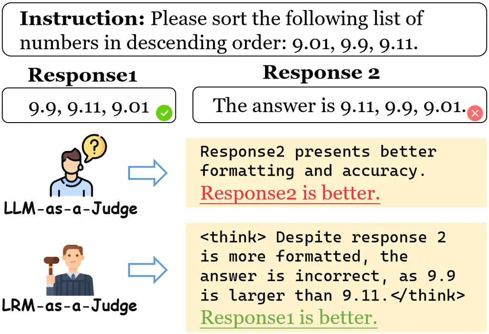
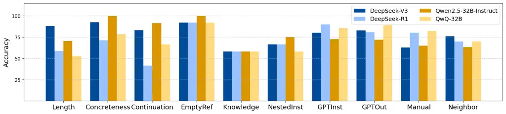
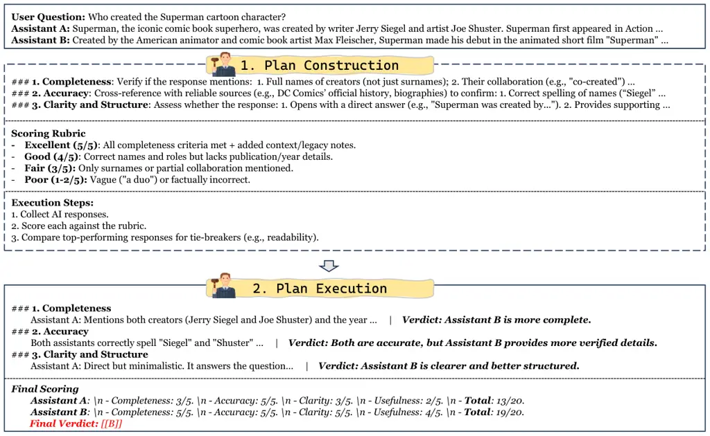
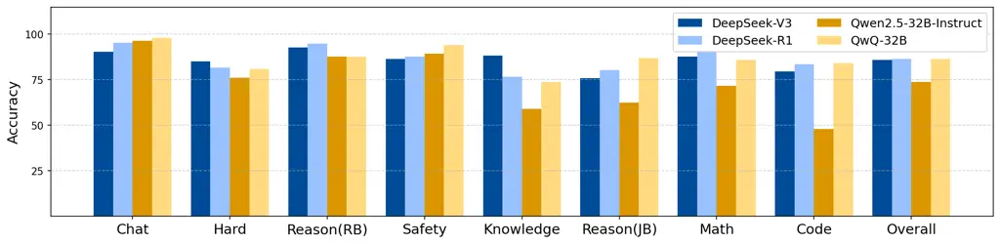

# Reasoning Model Is Superior LLM-Judge, Yet Suffers from Biases

Hui Huang Affiliation: Institute of Science Tokyo Affiliation: Harbin
Institute of Technology Email: [huanghui@stu.hit.edu.cn](mailto:)   
Xuanxin Wu Affiliation: The University of Osaka
Email: [arase@c.titech.ac.jp](mailto:)    Muyun Yang Affiliation: Harbin
Institute of Technology    Yuki Arase Affiliation: Institute of Science
Tokyo

###### Abstract

This paper presents the first systematic comparison investigating
whether Large Reasoning Models (LRMs) are superior judges to
non-reasoning LLMs. Our empirical analysis yields four key findings: 1)
LRMs outperform non-reasoning LLMs in terms of judgment accuracy,
particularly on reasoning-intensive tasks; 2) LRMs demonstrate superior
evaluation instruction-following capabilities; 3) LRMs exhibit enhanced
robustness against adversarial attacks targeting judgment tasks; 4)
However, LRMs still exhibit strong evaluation biases. To mitigate this
bias vulnerability, we propose PlanJudge, a lightweight evaluation
strategy that prompts the model to generate an explicit evaluation plan
before executing the judgment. Despite its simplicity, our experiments
demonstrate that PlanJudge significantly mitigates biases in
LLM-as-a-Judge while preserving overall judgment accuracy¹¹ 1 Code and
data are openly available at
[https://github.com/HuihuiChyan/LRM-Judge](https://github.com/HuihuiChyan/LRM-Judge)..

## 1 Introduction

The emergence of large language models (LLMs) has rendered existing
evaluation metrics insufficient, necessitating a new evaluation
paradigm. Conventional metrics, such as BLEU Papineni et al. (2002),
struggle to accommodate the open-ended nature of LLM-generated content.
Consequently, LLM-as-a-Judge has emerged as a robust alternative Zheng
et al. (2023). By leveraging advanced LLMs, this approach has achieved
superior evaluative precision and stronger alignment with human judgment
across a broad spectrum of tasks Huang et al. (2025); Wu et al. (2025).



Figure 1: Illustrative comparison of LLM-as-a-Judge and LRM-as-a-Judge.
LRMs can achieve better judgment performance by longer reasoning.

Recently, Large Reasoning Models (LRMs), exemplified by DeepSeek-R1 and
o1, represent a significant evolution Guo et al. (2025). As shown in
Figure 1, LRMs encourage the use of more tokens for reasoning,
incorporating mechanisms like chain-of-thought and self-reflection Chen
et al. (2025). This enables LRMs to simulate complex cognitive
processes, offering enhanced performance in demanding problem-solving
tasks.

However, recent literature has identified several limitations of LRMs
compared with non-reasoning LLMs. Some studies suggest that scaling
reasoning may compromise controllability, leading to inferior
instruction-following and rigidity Li et al. (2025b); Fu et al. (2025).
Others observe that extended reasoning can be detrimental on simpler
tasks, causing performance degradation due to overthinking Su et al.
(2025); Shojaee et al. (2025). The most closely related work was Wang et
al. (2025), which focuses primarily on assessing various judging biases
in LRMs. However, other important dimensions, such as adversarial
robustness, are ignored.

These observations raise a question: _Are LRMs superior LLM-Judges?_ To
answer this, we conducted the first comprehensive experiments comparing
reasoning models with their non-reasoning counterparts, which revealed:

|                                                                                                                                                                                                       |                |              |               |              |             |
| ----------------------------------------------------------------------------------------------------------------------------------------------------------------------------------------------------- | -------------- | ------------ | ------------- | ------------ | ----------- |
| Instruction: Write high converting facebook ad headline copy for a listing with the following properties: {“City”: Seattle, “Price”: 500000}.                                                         |                |              |               |              |             |
| ResponseA: Seattle Home for Sale: \$500,000. Act Fast!                                                                                                                                                |                |              |               |              |             |
| Helpfulness: 0                                                                                                                                                                                        | Correctness: 0 | Coherence: 4 | Complexity: 2 | Verbosity: 4 | Overall: 10 |
| ResponseB: Here’s a high-converting Facebook ad headline copy for a listing with the following properties: Seattle Home, \$500,000 - Modern Luxury in the Heart of the City. This headline contains … |                |              |               |              |             |
| Helpfulness: 2                                                                                                                                                                                        | Correctness: 1 | Coherence: 4 | Complexity: 1 | Verbosity: 0 | Overall: 8  |

Table 1: A data sample from Helpsteer2-trivial, where ResponseA has
better overall quality, but ResponseB has better quality under the
Helpfulness dimension.

1.  1.  LRMs significantly outperform non-reasoning models in general
        judgment accuracy.
2.  2.  LRMs present stronger evaluation instruction-following capabilities.
3.  3.  LRMs show enhanced robustness against adversarial attacks of
        instruction injection.
4.  4.  However, LRMs exhibit strong evaluation biases towards superficial
        qualities.

Overall, our findings suggest that LRMs are a superior choice for
LLM-as-a-Judge, while practitioners should remain vigilant regarding
persistent biases.

Building on these findings, we propose PlanJudge, a lightweight method
that leverages LRMs’ planning and instruction-following abilities to
improve robustness against biases. Specifically, the judge first
generates a comprehensive evaluation plan and then executes the
evaluation. Experimental results demonstrate that PlanJudge
significantly mitigates evaluation bias without requiring additional
training or resources.

## 2 Systematic Comparison of LRMs and LLMs for Judgment



Figure 2: Vulnerability to different bias types: LRMs are significantly
vulnerable to superficial quality biases.

### 2.1 Experiment Settings

Our primary objective is to address a practical question: when a
researcher needs to employ LLM-as-a-Judge for evaluation, should they
choose reasoning or non-reasoning models? Therefore, we systematically
evaluate the quality of LRMs as judges on the following fundamental
aspects²² 2 We mainly use the default prompts in each dataset..

#### General Evaluation Accuracy

How do LRMs perform in general evaluation across various domains? We
employed RewardBench Lambert et al. (2025) and JudgeBench Tan et al. ()
as two widely recognized benchmarks.

#### Evaluation Instruction Following

Can LRMs strictly follow instructions in evaluation tasks? In the
evaluation context, the most critical form of instruction-following is
the ability to prioritize a specific dimension (e.g., helpfulness,
verbosity) over overall quality when explicitly prompted to do so. To
assess this, we constructed a novel dataset, Helpsteer2-trivial, with
the following steps³³ 3 Further details and prompts are provided in
Appendix A.:

1.  1.  Filter samples with triplets of (Instruction, ResponseA, ResponseB)
        from Helpsteer2 Wang et al. (2024) where ResponseA is better
        overall, but ResponseB is better in one specific dimension, as shown
        in Table 1.
2.  2.  Define two prompts: The Overall prompt compares the two responses
        holistically, while the Specific prompt compares them strictly
        regarding that specific dimension.
3.  3.  If a judge selects ResponseA under the Overall prompt but switches
        to ResponseB under the Specific template, it indicates better
        evaluation instruction following capability. Consequently, we define
        our primary metric, the Reversal Rate (RR) as follows:

    ```math
    \displaystyle\text{RR}=\frac{\sum_{i}\mathbb{I}(y_{A}\succ y_{B}\mid P_{\text{overall}})\cdot\mathbb{I}(y_{B}\succ y_{A}\mid P_{\text{spec}})}{\sum_{i}\mathbb{I}(y_{A}\succ y_{B}\mid P_{\text{overall}})},
    ```

    where $`y_{A}`$ is the preferred response and $`y_{B}`$ is the
    dispreferred response, $`P_{\text{overall}}`$ and
    $`P_{\text{spec}}`$ are the two prompt templates⁴⁴ 4 A controlled
    analysis confirming the rationality of the RR metric is provided in
    Appendix E..

#### Vulnerability to Attacks

Are LRMs robust against adversarial attacks? We employed the RobustJudge
dataset Li et al. (2025a), which quantifies the defensive capabilities
of LRM-as-a-Judge against various types of prompt injection attacks.

#### Vulnerability to Bias

Are LRMs robust against bias as LLM-judges? We utilized BiasBench Park
et al. (2024) and LLMBar Zeng et al. (), which aim to quantify multiple
types of evaluation biases.

We select four pairs of reasoning versus non-reasoning models:
DeepSeek-V3 vs. DeepSeek-R1 Guo et al. (2025), Qwen2.5-32B-Instruct vs.
QwQ-32B Team (2025b), Qwen3-30B-A3B-Instruct vs. Thinking-2507, and
Qwen3-Next-80B-A3B-Instruct vs. Thinking Team (2025a). These models are
selected specifically as they provide ideal conditions for controlled
comparisons: QwQ-32B is explicitly derived from Qwen2.5-32B, and
DeepSeek-R1 from DeepSeek-V3, both with reasoning augmentation as the
main distinction. The Qwen3 series further enables hybrid reasoning mode
comparisons within the same architecture. This
reasoning-as-the-only-variant design allows us to rigorously isolate the
effect of reasoning on judging quality while holding other factors
constant.⁵⁵ 5 A controlled reasoning-budget experiment isolating the
attribute of reasoning length is provided in Appendix D.

|                             |             |            |
| --------------------------- | ----------- | ---------- |
| Models                      | RewardBench | JudgeBench |
| DeepSeek-V3                 | $`89.74`$   | 84.19      |
| DeepSeek-R1                 | 91.18       | $`80.48`$  |
| Qwen2.5-32B-Instruct        | $`89.31`$   | $`60.40`$  |
| QwQ-32B                     | 91.05       | 79.75      |
| Qwen3-30B-A3B-Instruct-2507 | $`89.88`$   | $`74.00`$  |
| Qwen3-30B-A3B-Thinking-2507 | 92.01       | 83.87      |
| Qwen3-Next-80B-A3B-Instruct | $`88.96`$   | $`79.45`$  |
| Qwen3-Next-80B-A3B-Thinking | 92.90       | 82.42      |

Table 2: Evaluation accuracy results

|                             |                    |           |
| --------------------------- | ------------------ | --------- |
| Models                      | Helpsteer2-Trivial |           |
|                             | OriACC             | RR        |
| DeepSeek-V3                 | $`78.22`$          | $`87.80`$ |
| DeepSeek-R1                 | $`73.61`$          | 95.24     |
| Qwen2.5-32B-Instruct        | $`71.13`$          | $`83.19`$ |
| QwQ-32B                     | $`76.49`$          | 91.11     |
| Qwen3-30B-A3B-Instruct-2507 | $`72.78`$          | $`95.67`$ |
| Qwen3-30B-A3B-Thinking-2507 | $`78.14`$          | 97.44     |
| Qwen3-Next-80B-A3B-Instruct | $`75.88`$          | $`82.50`$ |
| Qwen3-Next-80B-A3B-Thinking | $`77.94`$          | 91.18     |

Table 3: LLM-as-a-Judge results of evaluation instruction following
(“OriACC” indicates original evaluation accuracy under $`P_{overall}`$
template.).

[TABLE]

Table 4: Results on RobustJudge. We use iSDR in their paper as the
primary metric (lower is better).

|                             |           |           |
| --------------------------- | --------- | --------- |
| Models                      | BiasBench | LLMBar    |
| DeepSeek-V3                 | 81.25     | $`76.49`$ |
| DeepSeek-R1                 | $`65.00`$ | 79.00     |
| Qwen2.5-32B-Instruct        | 82.50     | $`67.71`$ |
| QwQ-32B                     | $`67.50`$ | 79.31     |
| Qwen3-30B-A3B-Instruct-2507 | 81.25     | $`59.25`$ |
| Qwen3-30B-A3B-Thinking-2507 | $`77.50`$ | 83.07     |
| Qwen3-Next-80B-A3B-Instruct | 80.00     | $`64.55`$ |
| Qwen3-Next-80B-A3B-Thinking | $`75.00`$ | 77.55     |

Table 5: Robustness to biases (higher is better).

### 2.2 Results

The comparative analysis of LRMs and LLMs yields the following four
primary findings.

#### Finding 1: LRM-as-a-Judge generally presents higher judgment accuracy.

As shown in Table 2 and Figure 4 in Appendix, LRMs are generally
stronger than non-reasoning models as judges, showing that reasoning
augmentation is highly effective for evaluation tasks. The improvement
is more significant in reasoning-intensive domains, such as code and
mathematics, demonstrating that an extended reasoning process benefits
both the generation and judgment of reasoning tasks⁶⁶ 6 The notable
exception is DeepSeek-R1, which underperforms on Knowledge judge tasks.
We attribute this to R1’s “zero” training approach, which leads to
higher hallucination rates on knowledge-centric tasks Yao et al.
(2025)..

#### Finding 2: LRMs present stronger evaluation instruction-following capabilities in evaluation.

As shown in Table 3, contrary to previous studies suggesting that
reasoning models perform worse in instruction following Jang et al.
(2025), our findings indicate the opposite trend. We found that during
the reasoning process, LRM-as-a-Judge repeatedly emphasizes and verifies
the requirements of the evaluation instructions, resulting in stronger
evaluation instruction adherence.

#### Finding 3: LRM-as-a-Judge is more robust against adversarial attacks.

As shown in Table 4, LRM-as-a-Judge is more robust against prompt
injection attacks. This is attributed to the reasoning process, which
carefully checks alignment and is less influenced by injected prompts.

#### Finding 4: LRM-as-a-Judge is significantly susceptible to superficial quality biases.

LRM-as-a-Judge often systematically evaluates responses against metrics.
Consequently, on BiasBench, responses designed to exploit these metrics,
such as length or concreteness, can yield excessively high scores, as
shown in Figure 2. In contrast, when responses exhibit clear instruction
misalignment as tested in LLMBar (Table 5), LRM-as-a-Judge is less
likely to be swayed by the bias.

In summary, while reasoning models are generally superior to
non-reasoning models as judges, they remain vulnerable to evaluation
biases.

## 3 PlanJudge

|              |                                                                     |                                                                     |                                                                     |
| ------------ | ------------------------------------------------------------------- | ------------------------------------------------------------------- | ------------------------------------------------------------------- |
| Models       | RewardBench                                                         | BiasBench                                                           | LLMBar                                                              |
| DeepSeek-V3  | $`89.70`$                                                           | $`81.25`$                                                           | $`76.49`$                                                           |
| w/ Heuristic | $`88.32`$ $`{}_{{{\color[rgb]{0.7148,0.125,0.0859}\text{-1.38}}}}`$ | $`92.11`$ $`{}_{{{\color[rgb]{0,0.2734,0}\text{+10.86}}}}`$         | $`78.99`$ $`{}_{{{\color[rgb]{0,0.2734,0}\text{+2.50}}}}`$          |
| w/ Self      | $`92.16`$ $`{}_{{{\color[rgb]{0,0.2734,0}\text{+2.46}}}}`$          | $`81.25`$                                                           | $`79.94`$ $`{}_{{{\color[rgb]{0,0.2734,0}\text{+3.45}}}}`$          |
| w/ Combined  | $`93.07`$ $`{}_{{{\color[rgb]{0,0.2734,0}\text{+3.37}}}}`$          | $`98.75`$ $`{}_{{{\color[rgb]{0,0.2734,0}\text{+17.50}}}}`$         | $`86.83`$ $`{}_{{{\color[rgb]{0,0.2734,0}\text{+10.34}}}}`$         |
| DeepSeek-R1  | $`91.10`$                                                           | $`65.00`$                                                           | $`79.00`$                                                           |
| w/ Heuristic | $`91.10`$                                                           | $`75.00`$ $`{}_{{{\color[rgb]{0,0.2734,0}\text{+10.00}}}}`$         | $`79.31`$ $`{}_{{{\color[rgb]{0,0.2734,0}\text{+0.31}}}}`$          |
| w/ Self      | $`91.19`$ $`{}_{{{\color[rgb]{0,0.2734,0}\text{+0.09}}}}`$          | $`81.25`$ $`{}_{{{\color[rgb]{0,0.2734,0}\text{+16.25}}}}`$         | $`80.56`$ $`{}_{{{\color[rgb]{0,0.2734,0}\text{+1.56}}}}`$          |
| w/ Combined  | $`92.47`$ $`{}_{{{\color[rgb]{0,0.2734,0}\text{+1.37}}}}`$          | $`97.50`$ $`{}_{{{\color[rgb]{0,0.2734,0}\text{+32.50}}}}`$         | $`86.21`$ $`{}_{{{\color[rgb]{0,0.2734,0}\text{+7.21}}}}`$          |
| Qwen2.5-32B  | $`89.30`$                                                           | $`82.50`$                                                           | $`67.71`$                                                           |
| w/ Heuristic | $`89.08`$ $`{}_{{{\color[rgb]{0.7148,0.125,0.0859}\text{-0.22}}}}`$ | $`87.50`$ $`{}_{{{\color[rgb]{0,0.2734,0}\text{+5.00}}}}`$          | $`66.77`$ $`{}_{{{\color[rgb]{0.7148,0.125,0.0859}\text{-0.94}}}}`$ |
| w/ Self      | $`89.15`$ $`{}_{{{\color[rgb]{0.7148,0.125,0.0859}\text{-0.15}}}}`$ | $`75.00`$ $`{}_{{{\color[rgb]{0.7148,0.125,0.0859}\text{-7.50}}}}`$ | $`71.16`$ $`{}_{{{\color[rgb]{0,0.2734,0}\text{+3.45}}}}`$          |
| w/ Combined  | $`89.68`$ $`{}_{{{\color[rgb]{0,0.2734,0}\text{+0.38}}}}`$          | $`93.59`$ $`{}_{{{\color[rgb]{0,0.2734,0}\text{+11.09}}}}`$         | $`75.55`$ $`{}_{{{\color[rgb]{0,0.2734,0}\text{+7.84}}}}`$          |
| QwQ-32B      | $`91.00`$                                                           | $`67.50`$                                                           | $`79.31`$                                                           |
| w/ Heuristic | $`90.29`$ $`{}_{{{\color[rgb]{0.7148,0.125,0.0859}\text{-0.71}}}}`$ | $`82.50`$ $`{}_{{{\color[rgb]{0,0.2734,0}\text{+15.00}}}}`$         | $`79.31`$                                                           |
| w/ Self      | $`93.03`$ $`{}_{{{\color[rgb]{0,0.2734,0}\text{+2.03}}}}`$          | $`83.75`$ $`{}_{{{\color[rgb]{0,0.2734,0}\text{+16.25}}}}`$         | $`82.76`$ $`{}_{{{\color[rgb]{0,0.2734,0}\text{+3.45}}}}`$          |
| w/ Combined  | $`93.13`$ $`{}_{{{\color[rgb]{0,0.2734,0}\text{+2.13}}}}`$          | $`95.00`$ $`{}_{{{\color[rgb]{0,0.2734,0}\text{+27.50}}}}`$         | $`83.07`$ $`{}_{{{\color[rgb]{0,0.2734,0}\text{+3.76}}}}`$          |

Table 6: PlanJudge makes LRMs robust against biases.

Building on the findings above, we introduce PlanJudge, a lightweight,
prompt-based mitigation strategy that leverages LRMs’ planning and
instruction-following abilities to reduce evaluation bias. As shown in
Figure 3 in Appendix B, the method operates through a two-step process:

1.  1.  Planning: First, based on the current evaluation task, a detailed
        evaluation plan is specified.
2.  2.  Execution: Then, the current judge executes the evaluation task
        according to the evaluation plan.

We explore three methods for plan generation⁷⁷ 7 Detailed prompts are
presented in Appendix B.:

1.  1.  Heuristic-based: We design specialized plans for different types of
        problems.
2.  2.  Self-synthesized: We let the model analyze the input and then design
        a plan itself.
3.  3.  Combined: We design a plan by combining Heuristic-based and
        Self-synthesized Planning.

Table 6 shows the results of both reasoning and non-reasoning models
with PlanJudge⁸⁸ 8 Detailed results are presented in Table 7, 8 and 9..
The results demonstrate that our method consistently yields a
substantial reduction in evaluation bias while preserving or even
improving the evaluation accuracy. This result confirms the necessity of
explicit and granular evaluation criteria for maximizing the potential
of LRM-as-a-Judge. It is notable that PlanJudge is also effective on
non-reasoning LLMs.

While Saha et al. (2025) also employed planning for improving
LLM-as-a-Judge, their method requires additional fine-tuning. In
contrast, PlanJudge is a lightweight, prompt-only strategy that achieves
significant improvement without any extra training or external
resources, making it readily adoptable in LLM-as-a-Judge pipelines.

## 4 Conclusion

In this study, we present the first systematic, multi-dimensional
comparison of reasoning vs. non-reasoning models for LLM-as-a-Judge. Our
results reveal that reasoning models consistently outperform
non-reasoning counterparts in accuracy, evaluation instruction
following, and attack robustness; however, they remain significantly
vulnerable to superficial-quality biases. We further propose PlanJudge,
a lightweight strategy that effectively addresses this limitation of
LRM-as-a-Judge without extra fine-tuning or external resources.

## Limitations

Our work has two main limitations that point toward future work.

#### 1) Model Coverage

We prioritize a reasoning-as-the-only-variant experimental design,
selecting model families where each reasoning model has a clear
non-reasoning counterpart from the same base architecture. This
controlled setup isolates reasoning as the primary variable but is
limited to specific open-source families. Future studies should expand
coverage to additional model families (e.g., LLaMA-based variants) and
incorporate proprietary models (e.g., o1) when their base-model
relationships are sufficiently documented.

#### 2) Evaluation Scope

While we cover four core judge desiderata: general accuracy, evaluation
instruction following, adversarial robustness, and bias robustness, our
evaluation relies on one to two benchmarks per dimension. Future work
should incorporate multiple independent harnesses per capability to
further strengthen conclusions. Additional dimensions such as judgment
consistency and interpretability also merit systematic investigation.

## Acknowledgments

This work was supported by JST K Program Grant Number
JPMJKP$`24`$C$`3`$, Japan and National Natural Science Foundation of
China (62276077).

## References

- Chen et al. (2025) Q. Chen, L. Qin, J. Liu, D. Peng, J. Guan, P.
  Wang, M. Hu, Y. Zhou, T. Gao, and W. Che Towards reasoning era: a
  survey of long chain-of-thought for reasoning large language models.
  arXiv preprint arXiv:2503.09567. Cited by: §1.
- Fu et al. (2025) T. Fu, J. Gu, Y. Li, X. Qu, and Y. Cheng Scaling
  reasoning, losing control: evaluating instruction following in large
  reasoning models. arXiv preprint arXiv:2505.14810. Cited by: §1.
- Guo et al. (2025) D. Guo, D. Yang, H. Zhang, J. Song, P. Wang, Q.
  Zhu, R. Xu, R. Zhang, S. Ma, X. Bi, et al. Deepseek-r1 incentivizes
  reasoning in llms through reinforcement learning. Nature 645 (8081),
  pp. 633–638. Cited by: §1, §2.1.
- Huang et al. (2025) H. Huang, X. Bu, H. Zhou, Y. Qu, J. Liu, M.
  Yang, B. Xu, and T. Zhao An empirical study of llm-as-a-judge for llm
  evaluation: fine-tuned judge model is not a general substitute for
  gpt-4. In Findings of the Association for Computational Linguistics:
  ACL 2025, pp. 5880–5895. Cited by: §1.
- Jang et al. (2025) D. Jang, Y. Kim, C. Park, H. Ryu, and E. Yang
  Reasoning model is stubborn: diagnosing instruction overriding in
  reasoning models. External Links: 2505.17225,
  [Link](https://arxiv.org/abs/2505.17225) Cited by: §2.2.
- Lambert et al. (2025) N. Lambert, V. Pyatkin, J. Morrison, L. J. V.
  Miranda, B. Y. Lin, K. Chandu, N. Dziri, S. Kumar, T. Zick, Y. Choi,
  et al. Rewardbench: evaluating reward models for language modeling. In
  Findings of the Association for Computational Linguistics: NAACL 2025,
  pp. 1755–1797. Cited by: §2.1.
- Li et al. (2025a) S. Li, C. Xu, J. Wang, X. Gong, C. Chen, J.
  Zhang, J. Wang, K. Lam, and S. Ji LLMs cannot reliably judge (yet?): a
  comprehensive assessment on the robustness of llm-as-a-judge. arXiv
  preprint arXiv:2506.09443. Cited by: §2.1.
- Li et al. (2025b) X. Li, Z. Yu, Z. Zhang, X. Chen, Z. Zhang, Y.
  Zhuang, N. Sadagopan, and A. Beniwal When thinking fails: the pitfalls
  of reasoning for instruction-following in llms. arXiv preprint
  arXiv:2505.11423. Cited by: §1.
- Papineni et al. (2002) K. Papineni, S. Roukos, T. Ward, and W. Zhu
  Bleu: a method for automatic evaluation of machine translation. In
  Proceedings of the 40th Annual Meeting of the Association for
  Computational Linguistics, P. Isabelle, E. Charniak, and D. Lin
  (Eds.), Philadelphia, Pennsylvania, USA, pp. 311–318. External Links:
  [Link](https://aclanthology.org/P02-1040/),
  [Document](https://dx.doi.org/10.3115/1073083.1073135) Cited by: §1.
- Park et al. (2024) J. Park, S. Jwa, R. Meiying, D. Kim, and S. Choi
  Offsetbias: leveraging debiased data for tuning evaluators. In
  Findings of the Association for Computational Linguistics: EMNLP 2024,
  pp. 1043–1067. Cited by: §2.1.
- Saha et al. (2025) S. Saha, X. Li, M. Ghazvininejad, J. Weston, and T.
  Wang Learning to plan & reason for evaluation with
  thinking-llm-as-a-judge. arXiv preprint arXiv:2501.18099. Cited by:
  §3.
- Shojaee et al. (2025) P. Shojaee, I. Mirzadeh, K. Alizadeh, M.
  Horton, S. Bengio, and M. Farajtabar The illusion of thinking:
  understanding the strengths and limitations of reasoning models via
  the lens of problem complexity. arXiv preprint arXiv:2506.06941. Cited
  by: §1.
- Su et al. (2025) J. Su, J. Healey, P. Nakov, and C. Cardie Between
  underthinking and overthinking: an empirical study of reasoning length
  and correctness in llms. arXiv preprint arXiv:2505.00127. Cited by:
  §1.
- \[14\] S. Tan, S. Zhuang, K. Montgomery, W. Y. Tang, A. Cuadron, C.
  Wang, R. Popa, and I. Stoica JudgeBench: a benchmark for evaluating
  llm-based judges. In The Thirteenth International Conference on
  Learning Representations, Cited by: §2.1.
- Team (2025a) Q. Team Qwen3 technical report. External Links:
  2505.09388, [Link](https://arxiv.org/abs/2505.09388) Cited by: §2.1.
- Team (2025b) Q. Team QwQ-32b: embracing the power of reinforcement
  learning. External Links:
  [Link](https://qwenlm.github.io/blog/qwq-32b/) Cited by: §2.1.
- Wang et al. (2025) Q. Wang, Z. Lou, Z. Tang, et al. Assessing judging
  bias in large reasoning models: an empirical study. arXiv preprint
  arXiv:2504.09946. Cited by: §1.
- Wang et al. (2024) Z. Wang, Y. Dong, O. Delalleau, J. Zeng, G.
  Shen, D. Egert, J. J. Zhang, M. N. Sreedhar, and O. Kuchaiev
  HelpSteer2: open-source dataset for training top-performing reward
  models. External Links: 2406.08673,
  [Link](https://arxiv.org/abs/2406.08673) Cited by: Appendix A, item 1.
- Wu et al. (2025) X. Wu, Y. Arase, and M. Nagata Policy-based sentence
  simplification: replacing parallel corpora with llm-as-a-judge.
  External Links: 2512.06228, [Link](https://arxiv.org/abs/2512.06228)
  Cited by: §1.
- Yao et al. (2025) Z. Yao, Y. Liu, Y. Chen, J. Chen, J. Fang, L.
  Hou, J. Li, and T. Chua Are reasoning models more prone to
  hallucination?. arXiv preprint arXiv:2505.23646. Cited by: footnote 6.
- \[21\] Z. Zeng, J. Yu, T. Gao, Y. Meng, T. Goyal, and D. Chen
  Evaluating large language models at evaluating instruction following.
  In NeurIPS 2023 Workshop on Instruction Tuning and Instruction
  Following, Cited by: §2.1.
- Zheng et al. (2023) L. Zheng, W. Chiang, Y. Sheng, S. Zhuang, Z.
  Wu, Y. Zhuang, Z. Lin, Z. Li, D. Li, E. Xing, et al. Judging
  llm-as-a-judge with mt-bench and chatbot arena. Advances in neural
  information processing systems 36, pp. 46595–46623. Cited by: §1.

## Appendix A Construction Details of Helpsteer2-trivial

This section describes how we construct Helpsteer2-trivial to evaluate
whether judge models can follow criterion-specific evaluation
instructions. The dataset is derived from Helpsteer2 Wang et al. (2024),
whose human annotations include both overall preference and aspect-level
scores. This structure allows us to identify cases where the overall
preferred response is not the best response under a particular
evaluation dimension.

Specifically, we filter samples into quadruplets of (question, preferred
response, dispreferred response, inverted aspect), where the preferred
response has the higher overall score but the dispreferred response has
a higher score on one specific aspect. We then evaluate each pair with
two prompts: an Overall prompt that asks for holistic preference
judgment and a Specific prompt that asks the judge to compare only the
inverted aspect. The prompts are shown in Prompts E and E.

A judge with both general judging ability and evaluation
instruction-following ability should first select the overall preferred
response under the Overall prompt and then switch to the
aspect-preferred response under the Specific prompt. We quantify this
behavior with Reversal Rate (RR):

```math
\text{RR}=\frac{\sum_{i}\mathbb{I}(y_{A}\succ y_{B}\mid P_{\text{overall}})\cdot\mathbb{I}(y_{B}\succ y_{A}\mid P_{\text{spec}})}{\sum_{i}\mathbb{I}(y_{A}\succ y_{B}\mid P_{\text{overall}})}
```

where $`y_{A}`$ is the overall preferred response, $`y_{B}`$ is the
overall dispreferred response, and $`P_{\text{overall}}`$ and
$`P_{\text{spec}}`$ are the two prompt templates. A higher RR indicates
that the judge can adapt its preference according to the requested
evaluation criterion instead of rigidly preserving the overall
preference.

## Appendix B Implementation Details of PlanJudge

This section provides the full implementation details of PlanJudge. As
shown in Figure 3, PlanJudge follows a two-stage framework. In the
planning stage, the judge receives the evaluation domain and user
question, then produces a detailed evaluation plan. In the execution
stage, the same judge compares the two candidate responses by following
the generated plan.

We investigate three plan-generation strategies. Heuristic-based
planning uses manually written domain plans for RewardBench categories.
Self-synthesized planning asks the model to create an evaluation plan
from the current input. Combined planning provides domain-level guidance
and asks the model to synthesize an input-specific plan. Prompt E is
used for all execution-stage judgments, while Prompts E, E, and E define
the three planning variants.



Figure 3: The PlanJudge pipeline begins with the pairwise responses to
be evaluated. The judge first constructs an evaluation plan and then
derives the final judgment by executing that plan.



Figure 4: Evaluation accuracy per domain: LRMs outperform LLMs on most
domains.

## Appendix C Detailed Results of PlanJudge

This section reports detailed PlanJudge results by benchmark subset, as
shown in Table 7, 8 and 9. These tables support the main result in
Table 6: PlanJudge substantially improves bias robustness on BiasBench
and LLMBar while largely preserving RewardBench accuracy.

|                      |             |           |           |           |           |
| -------------------- | ----------- | --------- | --------- | --------- | --------- |
| Model                | RewardBench |           |           |           |           |
|                      | Chat        | Chat Hard | Reasoning | Safety    | Overall   |
| DeepSeek-V3          | $`90.50`$   | 85.10     | 92.70     | $`86.40`$ | $`89.70`$ |
| w/ PlanJudge         | 94.13       | $`84.65`$ | $`90.54`$ | 96.79     | 93.07     |
| DeepSeek-R1          | 95.50       | 81.60     | 94.80     | $`87.70`$ | $`91.10`$ |
| w/ PlanJudge         | $`94.69`$   | $`81.32`$ | $`87.70`$ | 97.89     | 92.47     |
| Qwen2.5-32B-Instruct | 96.40       | $`76.10`$ | $`87.80`$ | $`89.30`$ | $`89.30`$ |
| w/ PlanJudge         | $`95.25`$   | 76.92     | 89.46     | 92.49     | 89.68     |
| QwQ-32B              | 98.00       | $`80.80`$ | $`87.70`$ | $`94.00`$ | $`91.00`$ |
| w/ PlanJudge         | $`93.85`$   | 82.68     | 89.32     | 98.25     | 93.13     |

Table 7: Detailed RewardBench results with PlanJudge.

|                      |           |              |              |           |           |            |           |
| -------------------- | --------- | ------------ | ------------ | --------- | --------- | ---------- | --------- |
| Model                | BiasBench |              |              |           |           |            |           |
|                      | Length    | Concreteness | Continuation | EmptyRef  | Knowledge | NestedInst | Overall   |
| DeepSeek-V3          | $`88.24`$ | $`92.86`$    | $`83.33`$    | $`92.31`$ | $`58.33`$ | $`66.67`$  | $`81.25`$ |
| w/ PlanJudge         | 100.00    | 100.00       | 100.00       | 100.00    | 91.67     | 100.00     | 98.75     |
| DeepSeek-R1          | $`58.82`$ | $`71.43`$    | $`41.67`$    | 92.31     | $`58.33`$ | $`66.67`$  | $`65.00`$ |
| w/ PlanJudge         | 100.00    | 100.00       | 100.00       | $`91.67`$ | 91.67     | 100.00     | 97.50     |
| Qwen2.5-32B-Instruct | $`70.59`$ | 100.00       | $`91.67`$    | 100.00    | $`58.33`$ | $`75.00`$  | $`82.50`$ |
| w/ PlanJudge         | 94.12     | $`92.86`$    | 100.00       | $`91.67`$ | 90.00     | 91.67      | 93.59     |
| QwQ-32B              | $`52.94`$ | $`78.57`$    | $`66.67`$    | $`92.31`$ | $`58.33`$ | $`58.33`$  | $`67.50`$ |
| w/ PlanJudge         | 94.12     | 92.86        | 100.00       | 100.00    | 83.33     | 100.00     | 95.00     |

Table 8: Detailed BiasBench results with PlanJudge.

|                      |           |           |           |           |           |
| -------------------- | --------- | --------- | --------- | --------- | --------- |
| Model                | LLMBar    |           |           |           |           |
|                      | Manual    | GPTInst   | GPTOut    | Neighbor  | Overall   |
| DeepSeek-V3          | $`63.04`$ | $`80.43`$ | 82.98     | $`76.12`$ | $`76.49`$ |
| w/ Combined          | 85.07     | 94.57     | $`74.47`$ | 89.13     | 86.83     |
| DeepSeek-R1          | $`80.43`$ | 90.22     | 80.85     | $`70.15`$ | $`79.00`$ |
| w/ Combined          | 88.81     | $`86.96`$ | $`78.72`$ | 84.78     | 86.21     |
| Qwen2.5-32B-Instruct | $`65.22`$ | $`72.83`$ | 72.34     | $`63.43`$ | $`67.71`$ |
| w/ Combined          | 72.39     | 80.43     | $`68.09`$ | 82.61     | 75.55     |
| QwQ-32B              | 82.61     | $`85.87`$ | 89.36     | $`70.15`$ | $`79.31`$ |
| w/ Combined          | $`80.60`$ | 90.22     | $`74.47`$ | 84.78     | 83.07     |

Table 9: Detailed LLMBar results with the combined PlanJudge strategy.

## Appendix D Reasoning Budget Control Experiment

A natural concern related to the superiority of LRM-as-a-Judge is that
the advantage of reasoning judges may come from producing longer
reasoning traces rather than from stronger judging ability. To examine
this concern, we conduct a diagnostic reasoning-budget control
experiment based on RewardBench. Specifically, for each example, we
first record the reasoning word count produced by the corresponding
reasoning model, and then instruct both the reasoning and non-reasoning
models to match that sample-specific word budget.

|                        |               |                |            |            |             |
| ---------------------- | ------------- | -------------- | ---------- | ---------- | ----------- |
| Model                  | Type          | Budget source  | Avg. words | Compliance | RewardBench |
| DeepSeek-R1 (baseline) | Reasoning     | Self-reference | 678.53     | 100.00%    | 92.17       |
| DeepSeek-V3            | Non-reasoning | DeepSeek-R1    | 327.51     | 58.02%     | 88.94       |
| DeepSeek-R1            | Reasoning     | DeepSeek-R1    | 715.91     | 120.25%    | 90.78       |
| QwQ-32B (baseline)     | Reasoning     | Self-reference | 681.13     | 100.00%    | 91.40       |
| Qwen2.5-32B-Instruct   | Non-reasoning | QwQ-32B        | 280.18     | 53.48%     | 89.40       |
| QwQ-32B                | Reasoning     | QwQ-32B        | 1082.94    | 170.75%    | 89.40       |

Table 10: Reasoning budget control experiment. Compliance denotes the
ratio between the generated reasoning length and the target reasoning
budget, where 100% indicates perfect compliance.

Table 10 shows that reasoning budgets are difficult to control through
simple prompting. Non-reasoning models substantially under-shoot the
requested budget, reaching only 58.02% and 53.48% compliance for the
DeepSeek and Qwen pairs, respectively, and still do not match the
original reasoning-model baselines. These results show that improving
the performance of LLM-as-a-Judge by merely extending the reasoning
budget is impractical, suggesting that the LRM advantage is not merely a
function of output length.

## Appendix E Common-Subset Reversal Rate Analysis

This section further validates Reversal Rate (RR) as a metric for
evaluation instruction following. RR measures whether a judge can switch
its preference in the correct direction when the prompt asks it to
prioritize a specific evaluation dimension, conditioned on first
identifying the overall better response. This conditioning helps
separate criterion following from general preference accuracy.

A potential concern is that RR uses a model-specific denominator: the
set of samples where each model is correct under the overall prompt. To
rule out denominator effects, we construct an aligned common subset on
Helpsteer2-trivial for each model pair, containing only samples where
both models are correct under the overall prompt. We then recompute RR
and Specific-Criterion Accuracy (whether the judge selects the response
that is better on the specific dimension under the criterion-specific
prompt) on this shared subset.

|                      |              |               |             |                  |                     |
| -------------------- | ------------ | ------------- | ----------- | ---------------- | ------------------- |
| Model                | Overall Acc. | Common subset | Original RR | Common-subset RR | Specific-Crit. Acc. |
| DeepSeek-V3          | 77.73%       | 332           | 87.80%      | 88.55%           | 88.45%              |
| DeepSeek-R1          | 73.61%       | 332           | 95.24%      | 95.48%           | 94.85%              |
| Qwen2.5-32B-Instruct | 71.13%       | 308           | 83.19%      | 83.44%           | 86.80%              |
| QwQ-32B              | 76.49%       | 308           | 91.11%      | 89.61%           | 92.78%              |

Table 11: Common-subset RR analysis on Helpsteer2-trivial. Common subset
denotes the aligned denominator shared by both models in each comparison
pair.

Table 11 shows that the RR trend is stable after denominator alignment.
DeepSeek-R1 remains higher than DeepSeek-V3 on common-subset RR (95.48%
vs. 88.55%), and QwQ-32B remains higher than Qwen2.5-32B-Instruct
(89.61% vs. 83.44%). The aligned Specific-Criterion Accuracy follows the
same pattern. These results indicate that the stronger evaluation
instruction following of reasoning judges is not an artifact of using
different effective denominators.


