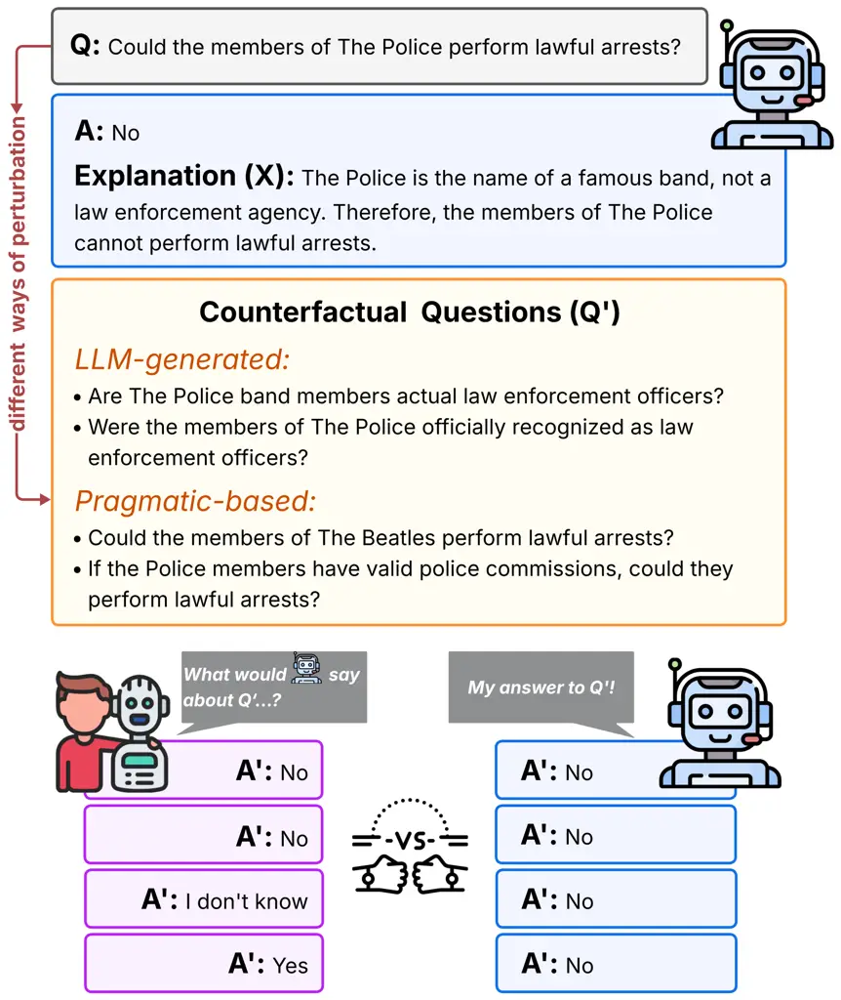
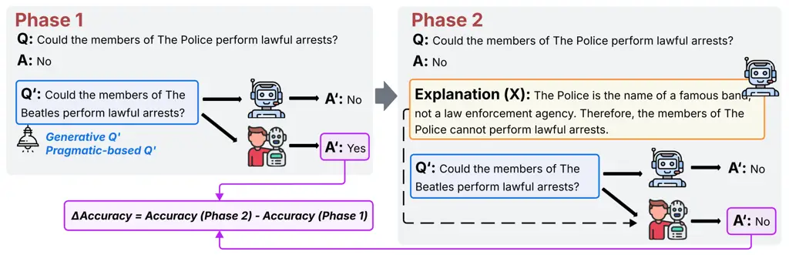
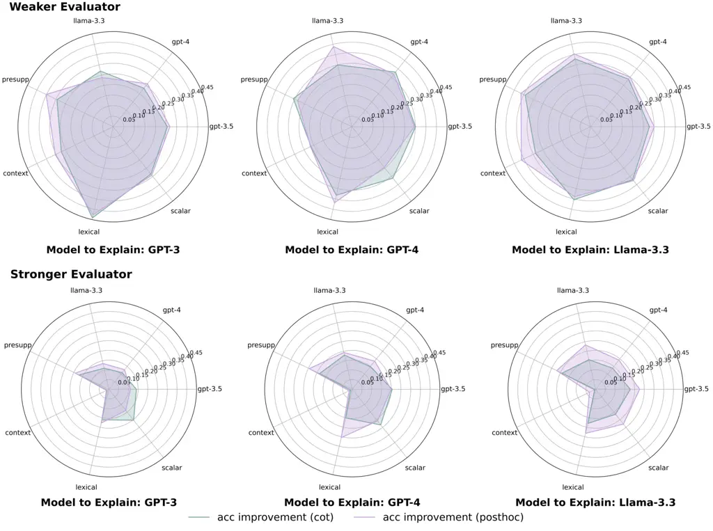
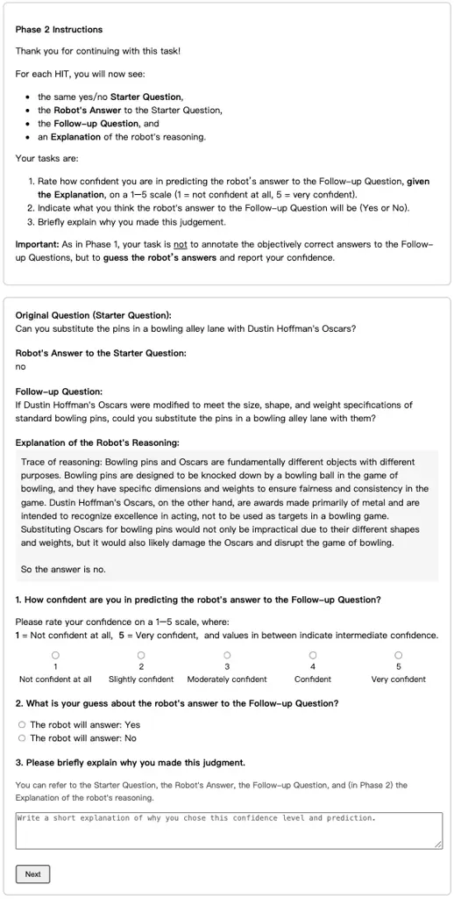

# Do LLM Self-Explanations Help Users Predict Model Behavior? Evaluating Counterfactual Simulatability with Pragmatic Perturbations

Pingjun Hong
Email: [mailto:pingjun.hong@univie.ac.atblackpingjun.hong](mailto:)   
Benjamin Roth
Email: [mailto:benjamin.roth@univie.ac.atblackbenjamin.roth@univie.ac.at](mailto:)
Affiliation:  Faculty of Computer Science, University of Vienna, Vienna,
Austria Affiliation:  UniVie Doctoral School Computer Science,
University of Vienna, Vienna, Austria Affiliation:  Faculty of
Philological and Cultural Studies, University of Vienna, Vienna, Austria

###### Abstract

Large Language Models (LLMs) can produce verbalized self-explanations,
yet prior studies suggest that such rationales may not reliably reflect
the model’s true decision process. We ask whether these explanations
nevertheless help users predict model behavior, operationalized as
counterfactual simulatability. Using StrategyQA, we evaluate how well
humans and LLM judges can predict a model’s answers to counterfactual
follow-up questions, with and without access to the model’s
chain-of-thought or post-hoc explanations. We compare LLM-generated
counterfactuals with pragmatics-based perturbations as alternative ways
to construct test cases for assessing the potential usefulness of
explanations. Our results show that self-explanations consistently
improve simulation accuracy for both LLM judges and humans, but the
degree and stability of gains depend strongly on the perturbation
strategy and judge strength. We also conduct a qualitative analysis of
free-text justifications written by human users when predicting the
model’s behavior, which provides evidence that access to explanations
helps humans form more accurate predictions on the perturbed questions.

## 1 Introduction



Figure 1: Pipeline for evaluating the usefulness of LLM
self-explanations based on different counterfactual question
perturbations. For each original $`Q`$ and model prediction, we measure
users’ ability to predict model behavior on different counterfactual
question sets $`Q^{\prime}`$, with and without access to the model’s
self-explanations.

Large language models (LLMs) can generate verbalized self-explanations
that accompany a model’s decision. These self-explanations are
increasingly used as a window into how the model “reasons”. Meanwhile, a
growing body of work has raised concerns about the faithfulness of such
explanations, showing that these rationales can be decoupled from the
underlying decision process, or manipulated without affecting the
model’s predictions, suggesting that self-explanations should not be
trusted as accounts of model behavior (Atanasova et al., 2023; Madsen et
al., 2024). This leaves open a question for explainable AI: even if LLM
verbalized self-explanations are not strictly faithful, can they
nonetheless _contribute to model understanding_ by helping users form
more accurate predictions about how the model will behave? Recent works
have proposed to assess explanation quality through counterfactual
simulatability: an explanation is considered useful if it helps people
anticipate how a model’s prediction would change on counterfactual
inputs (Doshi-Velez and Kim, 2017; Chen et al., 2024; Limpijankit et
al., 2025).

Natural language counterfactuals, defined as minimal what-if variations
of an input (Miller, 2019; Ross et al., 2021; Pearl, 2021), are widely
used in explainable AI to reveal how models behave under controlled
perturbations (Chen et al., 2024; Wang et al., 2024; Wang et al., 2025).
In a counterfactual simulatability protocol, users see an original
question $`Q`$ and the model’s prediction $`A`$, then predict the
model’s outputs on counterfactual variants $`Q^{\prime}`$. The
usefulness of an explanation is measured by how much it improves the
simulation accuracy.

While this line of work offers a promising operationalization of
explanation usefulness, much less attention has been paid to the
counterfactuals themselves. We still lack a systematic understanding of
how different ways of perturbing a question affect the conclusions about
the usefulness of explanations. In Chen et al. (2024)’s setup, for
example, the counterfactual questions are generated by LLMs using
prompt-based designs. If the evaluation protocol is sensitive to the
choice of perturbation, the measured usefulness of an explanation may
largely be an artifact of how those counterfactuals are constructed.

Figure 1 outlines our pipeline. We extend the counterfactual
simulatability framework to assess how LLM verbalized self-explanations
support model understanding. We study when and how explanations help
under different question perturbations. Specifically, we generate
counterfactual variants $`Q^{\prime}`$ of an original question $`Q`$ and
measure explanation usefulness by how much explanations help users
predict the model’s behavior on $`Q^{\prime}`$. Perturbations that yield
larger gains form a more informative testbed for evaluating
self-explanations.

To summarize, our paper addresses the following research questions: (i)
Do LLM verbalized self-explanations contribute to model understanding as
measured by counterfactual simulatability? (ii) How do different
counterfactual perturbation strategies assess the usefulness of LLM
self-explanations and the difference between conditions with and without
explanations? (iii) Are users biased toward the model’s original answer
when they reason about $`Q^{\prime}`$, and can self-explanations reduce
this bias? (iv) How do self-explanations affect human users’ confidence
and accuracy in predicting model behavior, and to what extent do
LLM-as-a-judge predictions align with human judgments?

## 2 Related Work

#### Evaluating Explanations Simulatability.

Simulatability measures how well humans can predict a model’s outputs
based on its explanations (Doshi-Velez and Kim, 2017; Ribeiro et al.,
2016; Chandrasekaran et al., 2018; Hase and Bansal, 2020; Chen et al.,
2024). Faithfulness, as a common metric for explanations, measures
whether an explanation is consistent with the model’s decision process
(Gilpin et al., 2018; Alvarez-Melis and Jaakkola, 2018; Jacovi and
Goldberg, 2020). Following Chen et al. (2024), simulatability can be
seen as a special case of faithfulness, where the output predictor is
restricted to humans or LLM judges instead of any arbitrary black box
model. In our work, we focus on simulatability as a way to capture the
usefulness of explanations (Doshi-Velez and Kim, 2017; Hoffman et al.,
2018).

Different from Chen et al. (2024), who run the simulatability setting
once with explanations, we conduct a forward simulation experiment with
two phases, following the experimental setup of the previous work, where
they test whether users can better predict a detector’s behavior after
seeing explanations (Hase and Bansal, 2020; Doshi-Velez and Kim, 2017;
Schoenegger et al., 2024). We run experiments with both human users and
LLM judges to evaluate how useful the model’s own verbal explanations
are for predicting its behavior.

#### Counterfactual Generation.

Counterfactual reasoning is the process of thinking about what would
have happened if conditions were different, and it is a common tool for
judging causality (Kahneman and Tversky, 1982). Such causal judgments
are important for model evaluation, error analysis, and explanation
(Miller, 2019). In NLP, most work defines a relationship between an
original input $`x`$ and a changed version $`\hat{x}`$, then constructs
$`\hat{x}`$ to follow this relationship (Wu et al., 2021). For example,
Gardner et al. (2020) ask dataset authors to manually edit test examples
in small but meaningful ways that usually flip the gold label.

However, manual counterfactuals are costly, so later work turns to
model-based generation. Wu et al. (2021) fine-tune GPT-2 (Radford et
al., 2019) to produce counterfactual examples given a desired edit type.
Wang et al. (2025) propose FITCF, a framework that filters
counterfactuals by checking whether the label flips, then uses them as
demonstrations for few-shot prompting, achieving better results than
three strong baselines. In Chen et al. (2024), which is closest to our
setup, LLMs are prompted to generate counterfactual questions for
StrategyQA. In contrast, we compare several counterfactual generation
methods and propose a more controlled, pragmatics-based editing
approach, and we compare it with counterfactual questions produced by
generative models.

## 3 Pragmatic Counterfactual Taxonomy

As in Table 1, Grice characterizes effective communication in terms of
four maxims—Quantity, Quality, Relation, and Manner—that regulate how
speakers cooperate in interaction (Grice, 1975).

| Maxim    | Description                                                                                                                     |
| -------- | ------------------------------------------------------------------------------------------------------------------------------- |
| Quantity | Make your contribution as informative as required for the current conversational goal, but not more informative than necessary. |
| Quality  | Ensure that your contribution is truthful: do not say what you believe to be false or lack adequate evidence for.               |
| Relation | Make your contribution relevant to the conversational context and the question under discussion.                                |
| Manner   | Be clear and orderly in how you express your contribution; avoid unnecessary ambiguity.                                         |

Table 1: The four Gricean maxims that underlie our pragmatic
counterfactual taxonomy.

[TABLE]

Table 2: Pragmatic counterfactual question types $`Q^{\prime}`$, their
associated Gricean maxims, linguistic motivations, and illustrative
examples.

These maxims capture implicit expectations about how much information to
provide, how truthful and well-founded it should be, how relevant it is
to the current goal, and how clearly it is expressed (Krause and Vossen,
2024; Ma et al., 2025). As NLP systems are increasingly used in
interactive and explanation-heavy settings, it is natural to ask whether
the explanations they provide remain robust when these pragmatic
dimensions are different (Jacquet et al., 2019; Kaczmarek-Majer et al.,
2022; Alexandris, 2024; Zuo et al., 2025)

We therefore take the Gricean maxims as a principled basis for designing
counterfactual question types. Each counterfactual corresponds to a
controlled manipulation of one or more maxims. Table 2 summarizes our
perturbation methods, together with linguistic motivations and examples.

## 4 Experimental Design

### 4.1 Task and Dataset

We use the StrategyQA (Geva et al., 2021) dataset as our primary QA
task. StrategyQA is an English question answering benchmark of 2,780
short, open-domain yes/no questions that require implicit factual
reasoning, often illustrated by examples like Did Aristotle use a
laptop?. Each example is annotated with a decomposition into reasoning
steps and a supporting Wikipedia paragraph.

### 4.2 Counterfactual Question Generation

#### LLM automatic counterfactual generation.

Following Chen et al. (2024), we prompt strong LLMs to generate
counterfactual variants of each StrategyQA question. These serve as a
non-pragmatic baseline. We adopt the same LLMs as Chen et al. (2024)
(GPT-3.5 (Brown et al., 2020; Ouyang et al., 2022) and GPT-4 (OpenAI et
al., 2023)) to ensure comparability of results, and additionally include
Llama-3.3-70B-Instruct ("Llama-3.3") (Grattafiori et al., 2024) as a
strong open-source model. The prompts used for automatic counterfactual
generation are listed in Appendix A.

#### Pragmatics-based counterfactual generation.

For generating pragmatics-based counterfactual questions in StrategyQA,
we follow the taxonomy in Table 2. In StrategyQA, each question is
paired with a term (from which the question is derived), a natural
language description of that term, and a set of implicit facts needed to
answer the question (Geva et al., 2021). We treat the term as a
pragmatic anchor—a lexical or conceptual element that carries implicit
assumptions, invites alternative interpretations, or structures the
reasoning process. We then construct five types of pragmatic
counterfactual transformations on top of these anchors:

- •
  Presupposition flip: we prompt GPT-4 to generate counterfactual
  variants of the form _“If A is not B but C, …”_, thereby flipping or
  challenging the presuppositions associated with the anchor term. The
  exact prompts are provided in Appendix B.
- •
  Lexical substitution: we replace the key term with a synonym or
  hypernym retrieved from WordNet (Miller, 1992), altering the lexical
  realization while preserving closely related meaning.
- •
  Scalar adjustment: we substitute quantifiers with stronger or weaker
  scalar alternatives, using manually specified scalar scales listed in
  Appendix C. The scales are defined on the basis of the scalar
  inventories discussed in previous works (Carston, 1998; Papafragou and
  Musolino, 2003; Sauerland, 2004).
- •
  Contextualization: we append one or two supporting facts from the
  dataset to enrich the question context and make part of the originally
  implicit pragmatic content explicit.

### 4.3 Self-explanations Collection

For each original question $`Q`$ and its model answer $`A`$, we collect
two types of explanations from the same set of models used for LLM
automatic counterfactual generation in §4.2. In our study, we consider
two types of verbalized self-explanations and generate one of each type
for every instance in the dataset (see Appendix D for prompt templates):

#### Chain-of-thought (CoT) explanations

, where the model reveals an explicit step-by-step reasoning process
(Nye et al., 2021). We elicit CoT explanations using Let’s think step by
step (Kojima et al., 2022) together with additional instructions about
formatting the final answer.

#### Post-hoc explanations

, where the model is asked to justify its produced answer without
modifying it (Camburu et al., 2018; Park et al., 2018).

### 4.4 Counterfactual Simulation



Figure 2: Counterfactual simulation pipeline for evaluating how human
and LLM judges predict model behavior from explanations and
counterfactual question sets.

We use a counterfactual simulation test to measure the ability of human
participants and LLM simulators to predict model behavior, following the
setup of Hase and Bansal (2020) and Chen et al. (2024). Our
counterfactual simulation design is illustrated in Figure 2. In previous
work, counterfactual simulation procedures have been used to assess
explanation usefulness by testing whether an explanation enables a judge
to infer a model’s outputs on counterfactual variants of the input.

Our primary summary statistic is acc_improvement, which we use to
compare conditions. Intuitively, OverallAcc measures how well an
evaluator can predict the model’s follow-up answer within a phase, while
acc_improvement captures the additional benefit of providing the model’s
self-explanation by comparing Phase 2 (with explanation) against Phase 1
(without explanation). We define:

```math
\Delta\mathrm{OverallAcc}=\mathrm{OverallAcc}^{\text{P2}}-\mathrm{OverallAcc}^{\text{P1}}.
```

A positive $`\Delta\mathrm{OverallAcc}`$ indicates that access to
explanations improves model-behavior prediction, whereas values near
zero suggest limited impact (e.g., when Phase 1 accuracy is already
high), and negative values indicate that explanations can occasionally
mislead the evaluator.

In our setup, we additionally use the simulation test to study the
effect of different counterfactual question sets. Holding the
explanation set fixed, we ask which counterfactual set yields the
largest acc_improvement.

#### LLM-as-a-judge simulation.

Building on prior work showing that LLMs approximate human judgments
with high agreement and nuance, we adopt an LLM-as-a-judge setup for our
counterfactual study (Zheng et al., 2023; Bai et al., 2023; Li et al.,
2025). For each item, we pair a starter question and the model’s answer
with a counterfactual follow-up. The judge then decides whether the
starter answer, optionally with its explanation, allows inferring the
model’s answer to the follow-up. To test robustness, we follow the
scalable-oversight setup of Kenton et al. (2024) and use two independent
judges with different capacities as Weaker Evaluator and Stronger
Evaluator.

#### Human simulation user study.

To assess how well our LLM-as-a-judge evaluations align with real human
behavior, we conduct a human-simulation user study on a subset of
GPT-4–generated explanations (both CoT and post-hoc), since it is the
most advanced explainer among the three models considered. We select 50
items, each paired with 7 counterfactual questions using 7 different
perturbation methods. In each trial, participants see a scenario
involving a “robot” (a LLM): a yes/no Starter Question, the Robot’s
Answer, and a yes/no Follow-up Question in Phase 1; in Phase 2, they
additionally see a textual Explanation of the robot’s reasoning.
Participants are explicitly instructed to predict the robot’s answer
rather than state their own belief about the correct answer. For every
trial, they (i) rate how confident they are about the robot’s follow-up
answer on a 1–5 scale, (ii) make a guess about the robot’s answer, and
(iii) provide a short free-text justification of how they arrived at
this guess. These annotations allow us to analyze both the accuracy and
perceived difficulty of simulating the model’s behavior, as well as the
role of explanations. Detailed annotation guidelines are provided in the
Appendix E.

## 5 LLM-as-a-Judge Results

### 5.1 LLM Judge Performance: Analysis of Accuracy Improvements



Figure 3: Radar charts summarizing LLM-as-a-judge acc_improvement on
different counterfactual question sets. The upper and lower panels show
results for a weaker and a stronger evaluator, respectively, each using
combinations of chain-of-thought (cot) and post-hoc explanations for
three underlying models to be explained.

LLM-as-judge acc_improvement across different counterfactual question
sets is visualized with radar charts in Figure 3. Overall, three trends
emerge:

(2) Comparison across counterfactual generation methods. For the weaker
judge, Lexical Substitution and Presupposition Flip yield the most
competitive results: Lexical Substitution achieves the largest
acc_improvement in four out of the six explanation settings, and
Presupposition Flip also consistently performs well. Some LLM-generated
counterfactual sets can be competitive in specific cases (e.g., for
post-hoc explanations of GPT-4), but their gains are not stable across
models and explanation types. For the stronger judge, the trends change.
Scalar Adjustment becomes one of the best-performing and most stable
question type, and Presupposition Flip remains strong except for the CoT
explanations by Llama-3.3. By contrast, the effectiveness of
Contextualization drops substantially compared to the weaker judge: for
the stronger judge, the Phase 1 accuracy on contextualized questions
already reaches 0.627 (the highest among all counterfactual sets and
much higher than the weaker judge’s 0.405), leaving very limited room
for further gains in Phase 2. Overall, while no single counterfactual
recipe dominates in all settings, pragmatics-based counterfactual
questions tend to be more stable than purely generative ones,
particularly Lexical Substitution, Presupposition Flip, and Scalar
Adjustment.

(3) CoT explanations vs. post-hoc explanations. We do not observe a
clear advantage of CoT explanations over post-hoc rationales. On
average, post-hoc explanations perform slightly better: for the weaker
judge, mean acc_improvement is 0.302 for CoT vs. 0.315 for post-hoc, and
for the stronger judge it is 0.149 vs. 0.156, respectively. This
suggests that, in our setup, targeted rationales are already sufficient
for enabling LLM judges to simulate the model’s behavior, and richer
step-by-step reasoning does not translate into larger gains.

(4) Effect of judge strength. Finally, comparing the two rows of radar
plots shows that overall acc_improvement is substantially larger for the
weaker evaluator than for the stronger one: the areas of the polygons
are visibly bigger in the weaker-judge row. This indicates that the same
combination of explanations and counterfactual questions yields much
larger gains when the judge is weaker, whereas a stronger judge already
predicts the base model reasonably well in Phase 1 and therefore has
limited headroom to benefit from additional information. In other words,
the marginal utility of explanations and counterfactuals decreases as
the judge becomes stronger.

Complete per-condition tables reporting guess rate, selective accuracy,
and overall accuracy by phase and condition are provided in Appendix F.

### 5.2 In-context Bias and Flip-back Behavior

A common failure mode of LLM-judges is _anchoring_: when asked to
predict the model’s answer to a follow-up question, the judge may simply
reuse the model’s original answer to the starter question, regardless of
whether that original answer is correct. Here we quantify this anchoring
effect and test whether providing self-explanations mitigates it,
especially in cases where the model’s original answer is wrong (where
_flip-back_ is desirable).

For each instance $`i`$, $`Q_{i}`$ and $`Q^{\prime}_{i}`$ denote the
starter and follow-up questions. The model’s answer to $`Q_{i}`$ is
$`a_{i}\in\{\text{yes},\text{no}\}`$. The judge predicts the model’s
answer to the follow-up question as
$`\hat{y}_{i}\in\{\text{yes},\text{no}\}`$, and we denote the phase by
$`p_{i}\in\{1,2\}`$.

#### Anchoring to the original answer (overall).

We first measure how often the judge repeats the model’s original answer
when predicting the answer to $`Q^{\prime}_{i}`$. We define an indicator
that the judge’s prediction matches the original answer:
$`B_{i}=\mathbb{I}[\hat{y}_{i}=a_{i}]`$. $`B_{i}=1`$ if the judge’s
prediction for $`Q^{\prime}_{i}`$ exactly equals the model’s answer to
$`Q_{i}`$.

For each phase $`p\in\{1,2\}`$, we define the in-context bias toward the
original answer as:

```math
\displaystyle\widehat{\operatorname{bias}}^{\text{orig}}(p) \displaystyle=\frac{1}{N_{p}}\sum_{i:\,p_{i}=p}B_{i}\,,
```

where $`N_{p}`$ is the number of instances in phase $`p`$.

#### Anchoring when the model is wrong (flip-back regime).

To isolate cases where anchoring is clearly undesirable, we focus on
instances where the model is _incorrect_ on the starter question. We
define an indicator of whether the model is correct on the starter
question: $`C_{i}=\mathbb{I}[a_{i}=g_{i}]`$, so that $`C_{i}=0`$ marks
instances where the model’s starter answer is incorrect. Within this
subset ($`C_{i}=0`$), we reuse the indicator $`B_{i}`$ and define:

```math
\displaystyle\widehat{\operatorname{bias}}^{\text{orig}}_{\text{wrong}}(p) \displaystyle=\frac{1}{N_{p}^{\text{wrong}}}\sum_{i:\,p_{i}=p,\;C_{i}=0}B_{i}\,,
```

where $`N_{p}^{\text{wrong}}`$ is the number of instances in phase $`p`$
for which the model’s answer to the starter question is incorrect
($`C_{i}=0`$).

We compare $`\widehat{\operatorname{bias}}^{\text{orig}}(p)`$ and
$`\widehat{\operatorname{bias}}^{\text{orig}}_{\text{wrong}}(p)`$ across
phases:
$`\Delta\text{bias\_orig}=\widehat{\operatorname{bias}}^{\text{orig}}(2)-\widehat{\operatorname{bias}}^{\text{orig}}(1)`$
and
$`\Delta\text{bias\_orig\_wrong}=\widehat{\operatorname{bias}}^{\text{orig}}_{\text{wrong}}(2)-\widehat{\operatorname{bias}}^{\text{orig}}_{\text{wrong}}(1)`$.
Negative values indicate reduced anchoring to the original answer in
Phase 2, while positive values indicate increased anchoring. Table 3
reports these changes for GPT-4 explanations across counterfactual
question sets, both overall and restricted to instances where the
model’s starter answer is incorrect. Full results are provided in
Appendix H.

|                    |              |                     |                           |
| ------------------ | ------------ | ------------------- | ------------------------- |
| expl_type          | cfq_type     | $`\Delta`$bias_orig | $`\Delta`$bias_orig_wrong |
| Weaker Evaluator   |              |                     |                           |
| cot                | gpt-3.5      | -0.013              | -0.209                    |
| cot                | gpt-4        | 0.009               | -0.224                    |
| cot                | Llama-3.3    | -0.043              | -0.229                    |
| cot                | presupp_flip | -0.195              | -0.017                    |
| cot                | contextual   | -0.003              | -0.047                    |
| cot                | lexical      | -0.057              | -0.073                    |
| cot                | scalar       | -0.074              | -0.076                    |
| posthoc            | gpt-3.5      | -0.029              | -0.241                    |
| posthoc            | gpt-4        | -0.033              | -0.304                    |
| posthoc            | Llama-3.3    | -0.081              | -0.284                    |
| posthoc            | presupp_flip | -0.237              | 0.013                     |
| posthoc            | contextual   | 0.008               | -0.026                    |
| posthoc            | lexical      | -0.054              | -0.095                    |
| posthoc            | scalar       | -0.027              | -0.042                    |
| Stronger Evaluator |              |                     |                           |
| cot                | gpt-3.5      | -0.090              | -0.241                    |
| cot                | gpt-4        | -0.057              | -0.201                    |
| cot                | Llama-3.3    | -0.074              | -0.225                    |
| cot                | presupp_flip | -0.073              | -0.014                    |
| cot                | contextual   | -0.017              | -0.084                    |
| cot                | lexical      | -0.061              | -0.073                    |
| cot                | scalar       | -0.049              | -0.010                    |
| posthoc            | gpt-3.5      | -0.091              | -0.254                    |
| posthoc            | gpt-4        | -0.081              | -0.295                    |
| posthoc            | Llama-3.3    | -0.096              | -0.290                    |
| posthoc            | presupp_flip | -0.081              | -0.022                    |
| posthoc            | contextual   | -0.028              | -0.104                    |
| posthoc            | lexical      | -0.095              | -0.149                    |
| posthoc            | scalar       | -0.052              | -0.079                    |

Table 3: Change in in-context bias from Phase 1 to Phase 2 for
explanations of GPT-4 across counterfactual question sets. Negative
values indicate reduced bias. Positive numbers are marked in blue.

Overall, in-context bias tends to decrease from Phase 1 to Phase 2. This
pattern suggests that LLM verbalized self-explanations generally reduce
judges’ tendency to stick with the original model prediction. Moreover,
the reductions are particularly pronounced when conditioning on
instances where the original answer is wrong, indicating that
explanations are especially helpful for correcting initially incorrect
model outputs.

## 6 Human User-study Results

### 6.1 Confidence and Accuracy Gains

Under the setup in §4.4, the mean confidence (1–5) from 28 participants
increases from 3.21 without explanations to 4.38 with explanations,
suggesting that explanations improve confidence in predicting the LLM’s
(GPT-4) behavior.

| cfq_type     | P1_acc | P2_acc | $`\Delta`$ acc |
| ------------ | ------ | ------ | -------------- |
| gpt-3.5      | 0.560  | 0.540  | -0.020         |
| gpt-4        | 0.460  | 0.470  | 0.010          |
| Llama-3.3    | 0.580  | 0.580  | 0.000          |
| presupp_flip | 0.360  | 0.400  | 0.040          |
| contextual   | 0.760  | 0.820  | 0.060          |
| lexical      | 0.760  | 0.800  | 0.040          |
| scalar       | 0.820  | 0.840  | 0.020          |
| Overall      | 0.614  | 0.634  | 0.020          |

Table 4: Human user study evaluation results. Accuracy by counterfactual
question type for Phase 1 and 2. For each counterfactual type, we
evaluate 100 questions.

In Table 4, we report human prediction accuracy against the model’s
actual follow-up answers in Phase 1 and Phase 2, along with the change
in accuracy ($`\Delta`$ acc). Overall accuracy increases slightly from
0.614 to 0.634. The gain is type-dependent: Contextualization shows the
largest improvement (+0.060), while Lexical Substitution and
Presupposition Flip improve by +0.040. In contrast, Scalar Adjustment
changes only marginally (+0.020), and model-generated types show little
or no benefit, with a small drop for GPT-3.5. Overall, explanations
provide modest and uneven improvements in human ability to anticipate
the model’s behavior.

By comparing human users to LLM-as-a-judge results, we estimate how well
LLMs approximate human judgments. On the subset that humans annotated,
the LLM judge matches human yes/no predictions at an overall rate of
0.601 in Phase 1 and 0.591 in Phase 2. We provide a more detailed
breakdown by counterfactual type in the Appendix I.

### 6.2 Case Study: Analysis of Human Rationales for Predicting Model Behavior

In addition to accuracy and agreement metrics, we collected
participants’ free-text rationales describing how they predicted the
model’s follow-up answer. We use these rationales to qualitatively
examine what cues humans attend to when simulating model behavior, and
how those cues shift from Phase 1 to Phase 2. In this section, we
present a small set of representative case studies selected to reflect
the main quantitative patterns.

#### Case 1: Explanations can help when they state a decision criterion that the model also applies.

When the follow-up question directly refers to a concept mentioned in
the model’s explanation, participants often move from simple Phase 1
heuristics (e.g., reusing the starter answer) to criterion matching in
Phase 2. In these cases, their rationales typically quote or paraphrase
a key phrase from the explanation and apply it to the follow-up
question.

Example: In the explanation, we know that there are programs like the
National School Lunch Program that provide free or reduced-price lunches
to eligible students. So few students are guaranteed lunch at school in
the US.

#### Case 2: Limited gains under ceiling effects.

When the follow-up question is a near-paraphrase of the starter question
or introduces only a minor adjustment, many participants already succeed
in Phase 1 by applying a simple consistency heuristic (predicting that
the model will answer the same way). In these cases, rationales often
acknowledge that the explanation is consistent with their initial guess
but does not add further information. Once Phase 1 performance is near
ceiling, explanations have little room to improve correctness.

Example: The explanation further support the answer with further
information like "The Smithsonian’s National Zoo in Washington DC is a
place where various animals are kept, but it does not currently house
harbor seals."

#### Case 3: Explanations may not resolve condition flips.

In these cases, participants’ rationales often express uncertainty about
how the model will respond after the follow-up introduces a critical
change in conditions. Even in Phase 2, the model’s explanation may not
directly address the specific condition that is altered in the
follow-up, leaving participants without a stable rule to extrapolate the
model’s behavior. As a result, these items can remain difficult across
phases. Qualitatively, the rationales suggest that participants focus on
the condition shift in the follow-up, while the explanation highlights
other aspects, which makes it less useful for predicting the model’s
answer.

Example: The explanation states that "if all conditions align", but in
the follow-up question, the condition changes. Not sure whether the
robot still thinks that a dealer could buy a Boeing 737-800.

#### Case 4: Explanations can distract when they are persuasive but not diagnostic.

We observe cases where a participant’s Phase 1 prediction is correct
under a simple heuristic, but Phase 2 introduces over-reliance on a
plausible-sounding detail in the explanation that does not actually
determine the model’s follow-up answer. In these instances, the
explanation functions as a persuasive narrative rather than a diagnostic
cue, and participants may flip from a correct to an incorrect
prediction.

Example: The explanation already compares mail carriers to more
dangerous jobs, so police officers will be judged dangerous.

#### Summary.

Across these case studies, human rationales suggest two recurring
themes. First, participants are successful when they can align the
follow-up question to an explicit criterion stated in the explanation;
this is precisely when Phase 2 yields the largest gains. Second, when
follow-up questions are either trivial (ceiling effects) or
underspecified (insufficient cues), explanations offer limited
additional benefit and may even distract.

## 7 Conclusion

In this work, we assess LLM self-explanations through counterfactual
simulatability. Explanations improve users’ ability to anticipate model
behavior for both human participants and LLM judges, but the measured
effect depends on the counterfactual construction and the evaluator. We
further observe that explanations mitigate a tendency to echo the
model’s original answer—most notably when the initial answer is
incorrect—suggesting a corrective “flip-back” mechanism. In the human
study, explanations also increase confidence and yield measurable
accuracy gains.

Overall, our findings show that, despite concerns about faithfulness of
verbalized self-explanations, they can help users better understand
model behavior in counterfactual settings. Our results highlight that
the counterfactual questions themselves are a key part of the
evaluation: different perturbation strategies can change both task
difficulty and the benefit of explanations, so counterfactual design
should be treated as a component rather than a neutral choice.
Annotations, explanations, and code will be released publicly upon
publication.

## Limitations

This study has potential limitations. Our study measures model
understanding using counterfactual simulatability on binary questions.
While this design offers a controlled way to measure whether
explanations help users predict model behavior, it may not fully reflect
real-world interactions where users ask open-ended questions and engage
in multi-turn dialogue. Second, although we introduce a
pragmatics-grounded taxonomy of counterfactual perturbations, the set of
transformations is incomplete and may not cover pragmatic phenomena that
arise in natural conversations (e.g., discourse context, speaker intent,
social norms).

Thirdly, parts of our pipeline rely on LLM-generated artifacts (e.g.,
LLM-generated counterfactuals and explanations, and GPT-4–based
presupposition flips), such as counterfactual questions or explanations.
Results may depend on the chosen prompts and models. We also test a
limited number of models and explanation formats, so generalization is
not guaranteed.

Finally, the human user study uses a relatively small sample
(participants and items) and focuses on a subset of conditions, which
limits statistical power for small effects and may not generalize across
user populations or expertise levels. Importantly, our work does not
claim that self-explanations are faithful accounts of the model’s
internal decision process: explanations can improve simulatability while
still being post-hoc or persuasive rather than diagnostic.

## Acknowledgments

We thank the members of the University of Vienna Natural Language
Processing (NLP) working group for their insightful feedback on earlier
drafts of this paper. We also express our sincere gratitude to the 28
volunteer annotators who participated in the user study.

This research has been funded by the Vienna Science and Technology Fund
(WWTF)\[10.47379/VRG19008\] “Knowledge-infused Deep Learning for Natural
Language Processing” and by the Vienna Science and Technology Fund
(WWTF)\[10.47379/VRG23007\] “Understanding Language in Context”.

#### Ethical considerations.

We do not foresee any ethical concerns associated with this work. All
analyses were conducted using publicly available datasets and models. No
private or sensitive information was used. Additionally, we release our
code, prompts, and documentation to support transparency and
reproducibility.

#### Use of AI Assistants.

The authors acknowledge the use of ChatGPT for correcting grammatical
errors, enhancing the coherence of the final manuscripts, and providing
coding assistance.

## References

- Alexandris (2024) C. Alexandris GenAI and socially responsible ai in
  natural language processing applications: a linguistic perspective. In
  AAAI Spring Symposia, External Links:
  [Link](https://api.semanticscholar.org/CorpusID:269971491) Cited by:
  §3.
- Alvarez-Melis and Jaakkola (2018) D. Alvarez-Melis and T. S. Jaakkola
  Towards robust interpretability with self-explaining neural networks.
  In Proceedings of the 32nd International Conference on Neural
  Information Processing Systems, NIPS’18, Red Hook, NY, USA,
  pp. 7786–7795. External Links:
  [Link](https://proceedings.neurips.cc/paper_files/paper/2018/file/3e9f0fc9b2f89e043bc6233994dfcf76-Paper.pdf)
  Cited by: §2.
- Atanasova et al. (2023) P. Atanasova, O. Camburu, C. Lioma, T.
  Lukasiewicz, J. G. Simonsen, and I. Augenstein Faithfulness tests for
  natural language explanations. In Proceedings of the 61st Annual
  Meeting of the Association for Computational Linguistics (Volume 2:
  Short Papers), A. Rogers, J. Boyd-Graber, and N. Okazaki (Eds.),
  Toronto, Canada, pp. 283–294. External Links:
  [Link](https://aclanthology.org/2023.acl-short.25/),
  [Document](https://dx.doi.org/10.18653/v1/2023.acl-short.25) Cited by:
  §1.
- Bai et al. (2023) Y. Bai, J. Ying, Y. Cao, X. Lv, Y. He, X. Wang, J.
  Yu, K. Zeng, Y. Xiao, H. Lyu, J. Zhang, J. Li, and L. Hou Benchmarking
  foundation models with language-model-as-an-examiner. In Proceedings
  of the 37th International Conference on Neural Information Processing
  Systems, NIPS ’23, Red Hook, NY, USA. External Links:
  [Link](https://proceedings.neurips.cc/paper_files/paper/2023/file/f64e55d03e2fe61aa4114e49cb654acb-Paper-Datasets_and_Benchmarks.pdf)
  Cited by: §4.4.
- Bhattacharjee et al. (2023) A. Bhattacharjee, R. Moraffah, J. Garland,
  and H. Liu Towards llm-guided causal explainability for black-box text
  classifiers. External Links:
  [Link](https://api.semanticscholar.org/CorpusID:262459118) Cited by:
  Appendix G.
- Brown et al. (2020) T. B. Brown, B. Mann, N. Ryder, M. Subbiah, J.
  Kaplan, P. Dhariwal, A. Neelakantan, P. Shyam, G. Sastry, A.
  Askell, S. Agarwal, A. Herbert-Voss, G. Krueger, T. Henighan, R.
  Child, A. Ramesh, D. M. Ziegler, J. Wu, C. Winter, C. Hesse, M.
  Chen, E. Sigler, M. Litwin, S. Gray, B. Chess, J. Clark, C. Berner, S.
  McCandlish, A. Radford, I. Sutskever, and D. Amodei Language models
  are few-shot learners. In Proceedings of the 34th International
  Conference on Neural Information Processing Systems, NIPS ’20, Red
  Hook, NY, USA. External Links: ISBN 9781713829546,
  [Link](https://papers.nips.cc/paper/2020/hash/1457c0d6bfcb4967418bfb8ac142f64a-Abstract.html)
  Cited by: §4.2.
- Camburu et al. (2018) O. Camburu, T. Rocktäschel, T. Lukasiewicz,
  and P. Blunsom E-snli: natural language inference with natural
  language explanations. In Advances in Neural Information Processing
  Systems, S. Bengio, H. Wallach, H. Larochelle, K. Grauman, N.
  Cesa-Bianchi, and R. Garnett (Eds.), Vol. 31, pp. . External Links:
  [Link](https://proceedings.neurips.cc/paper_files/paper/2018/file/4c7a167bb329bd92580a99ce422d6fa6-Paper.pdf)
  Cited by: §4.3.
- Carston (1998) R. Carston Informativeness, relevance and scalar
  implicature. Relevance Theory. Applications and Implications, pp. .
  External Links: [Document](https://dx.doi.org/10.1075/pbns.37.11car)
  Cited by: Appendix C, 3rd item.
- Chandrasekaran et al. (2018) A. Chandrasekaran, V. Prabhu, D.
  Yadav, P. Chattopadhyay, and D. Parikh Do explanations make VQA models
  more predictable to a human?. In Proceedings of the 2018 Conference on
  Empirical Methods in Natural Language Processing, E. Riloff, D.
  Chiang, J. Hockenmaier, and J. Tsujii (Eds.), Brussels, Belgium,
  pp. 1036–1042. External Links:
  [Link](https://aclanthology.org/D18-1128/),
  [Document](https://dx.doi.org/10.18653/v1/D18-1128) Cited by: §2.
- Chen et al. (2024) Y. Chen, R. Zhong, N. Ri, C. Zhao, H. He, J.
  Steinhardt, Z. Yu, and K. McKeown Do models explain themselves?
  counterfactual simulatability of natural language explanations. In
  Proceedings of the 41st International Conference on Machine Learning,
  ICML’24. External Links:
  [Link](https://dl.acm.org/doi/10.5555/3692070.3692380) Cited by: §1,
  §1, §1, §2, §2, §2, §4.2, §4.4.
- Doshi-Velez and Kim (2017) F. Doshi-Velez and B. Kim Towards a
  rigorous science of interpretable machine learning. arXiv: Machine
  Learning. External Links:
  [Link](https://api.semanticscholar.org/CorpusID:11319376) Cited by:
  §1, §2, §2.
- Gardner et al. (2020) M. Gardner, Y. Artzi, V. Basmov, J. Berant, B.
  Bogin, S. Chen, P. Dasigi, D. Dua, Y. Elazar, A. Gottumukkala, N.
  Gupta, H. Hajishirzi, G. Ilharco, D. Khashabi, K. Lin, J. Liu, N. F.
  Liu, P. Mulcaire, Q. Ning, S. Singh, N. A. Smith, S. Subramanian, R.
  Tsarfaty, E. Wallace, A. Zhang, and B. Zhou Evaluating models’ local
  decision boundaries via contrast sets. In Findings of the Association
  for Computational Linguistics: EMNLP 2020, T. Cohn, Y. He, and Y. Liu
  (Eds.), Online, pp. 1307–1323. External Links:
  [Link](https://aclanthology.org/2020.findings-emnlp.117/),
  [Document](https://dx.doi.org/10.18653/v1/2020.findings-emnlp.117)
  Cited by: §2.
- Ge et al. (2021) Y. Ge, S. Liu, Z. Li, S. Xu, S. Geng, Y. Li, J.
  Tan, F. Sun, and Y. Zhang Counterfactual evaluation for explainable
  AI. CoRR abs/2109.01962. External Links:
  [Link](https://arxiv.org/abs/2109.01962), 2109.01962 Cited by:
  Appendix G.
- Geva et al. (2021) M. Geva, D. Khashabi, E. Segal, T. Khot, D. Roth,
  and J. Berant Did aristotle use a laptop? a question answering
  benchmark with implicit reasoning strategies. Transactions of the
  Association for Computational Linguistics 9, pp. 346–361. External
  Links: [Link](https://aclanthology.org/2021.tacl-1.21/),
  [Document](https://dx.doi.org/10.1162/tacl%5Fa%5F00370) Cited by:
  §4.1, §4.2.
- Gilpin et al. (2018) L. H. Gilpin, D. Bau, B. Z. Yuan, A. Bajwa, M. A.
  Specter, and L. Kagal Explaining explanations: an overview of
  interpretability of machine learning. 2018 IEEE 5th International
  Conference on Data Science and Advanced Analytics (DSAA), pp. 80–89.
  External Links:
  [Link](https://api.semanticscholar.org/CorpusID:59600034) Cited by:
  §2.
- Grattafiori et al. (2024) A. Grattafiori, A. Dubey, A. Jauhri, A.
  Pandey, A. Kadian, A. Al-Dahle, A. Letman, A. Mathur, A. Schelten, A.
  Vaughan, A. Yang, A. Fan, A. Goyal, A. Hartshorn, A. Yang, A.
  Mitra, A. Sravankumar, A. Korenev, A. Hinsvark, A. Rao, A. Zhang, A.
  Rodriguez, A. Gregerson, A. Spataru, B. Roziere, B. Biron, B. Tang, B.
  Chern, C. Caucheteux, C. Nayak, C. Bi, C. Marra, C. McConnell, C.
  Keller, C. Touret, C. Wu, C. Wong, C. C. Ferrer, C. Nikolaidis, D.
  Allonsius, D. Song, D. Pintz, D. Livshits, D. Wyatt, D. Esiobu, D.
  Choudhary, D. Mahajan, D. Garcia-Olano, D. Perino, D. Hupkes, E.
  Lakomkin, E. AlBadawy, E. Lobanova, E. Dinan, E. M. Smith, F.
  Radenovic, F. Guzmán, F. Zhang, G. Synnaeve, G. Lee, G. L.
  Anderson, G. Thattai, G. Nail, G. Mialon, G. Pang, G. Cucurell, H.
  Nguyen, H. Korevaar, H. Xu, H. Touvron, I. Zarov, I. A. Ibarra, I.
  Kloumann, I. Misra, I. Evtimov, J. Zhang, J. Copet, J. Lee, J.
  Geffert, J. Vranes, J. Park, J. Mahadeokar, J. Shah, J. van der
  Linde, J. Billock, J. Hong, J. Lee, J. Fu, J. Chi, J. Huang, J.
  Liu, J. Wang, J. Yu, J. Bitton, J. Spisak, J. Park, J. Rocca, J.
  Johnstun, J. Saxe, J. Jia, K. V. Alwala, K. Prasad, K. Upasani, K.
  Plawiak, K. Li, K. Heafield, K. Stone, K. El-Arini, K. Iyer, K.
  Malik, K. Chiu, K. Bhalla, K. Lakhotia, L. Rantala-Yeary, L. van der
  Maaten, L. Chen, L. Tan, L. Jenkins, L. Martin, L. Madaan, L. Malo, L.
  Blecher, L. Landzaat, L. de Oliveira, M. Muzzi, M. Pasupuleti, M.
  Singh, M. Paluri, M. Kardas, M. Tsimpoukelli, M. Oldham, M. Rita, M.
  Pavlova, M. Kambadur, M. Lewis, M. Si, M. K. Singh, M. Hassan, N.
  Goyal, N. Torabi, N. Bashlykov, N. Bogoychev, N. Chatterji, N.
  Zhang, O. Duchenne, O. Çelebi, P. Alrassy, P. Zhang, P. Li, P.
  Vasic, P. Weng, P. Bhargava, P. Dubal, P. Krishnan, P. S. Koura, P.
  Xu, Q. He, Q. Dong, R. Srinivasan, R. Ganapathy, R. Calderer, R. S.
  Cabral, R. Stojnic, R. Raileanu, R. Maheswari, R. Girdhar, R.
  Patel, R. Sauvestre, R. Polidoro, R. Sumbaly, R. Taylor, R. Silva, R.
  Hou, R. Wang, S. Hosseini, S. Chennabasappa, S. Singh, S. Bell, S. S.
  Kim, S. Edunov, S. Nie, S. Narang, S. Raparthy, S. Shen, S. Wan, S.
  Bhosale, S. Zhang, S. Vandenhende, S. Batra, S. Whitman, S. Sootla, S.
  Collot, S. Gururangan, S. Borodinsky, T. Herman, T. Fowler, T.
  Sheasha, T. Georgiou, T. Scialom, T. Speckbacher, T. Mihaylov, T.
  Xiao, U. Karn, V. Goswami, V. Gupta, V. Ramanathan, V. Kerkez, V.
  Gonguet, V. Do, V. Vogeti, V. Albiero, V. Petrovic, W. Chu, W.
  Xiong, W. Fu, W. Meers, X. Martinet, X. Wang, X. Wang, X. E. Tan, X.
  Xia, X. Xie, X. Jia, X. Wang, Y. Goldschlag, Y. Gaur, Y. Babaei, Y.
  Wen, Y. Song, Y. Zhang, Y. Li, Y. Mao, Z. D. Coudert, Z. Yan, Z.
  Chen, Z. Papakipos, A. Singh, A. Srivastava, A. Jain, A. Kelsey, A.
  Shajnfeld, A. Gangidi, A. Victoria, A. Goldstand, A. Menon, A.
  Sharma, A. Boesenberg, A. Baevski, A. Feinstein, A. Kallet, A.
  Sangani, A. Teo, A. Yunus, A. Lupu, A. Alvarado, A. Caples, A. Gu, A.
  Ho, A. Poulton, A. Ryan, A. Ramchandani, A. Dong, A. Franco, A.
  Goyal, A. Saraf, A. Chowdhury, A. Gabriel, A. Bharambe, A.
  Eisenman, A. Yazdan, B. James, B. Maurer, B. Leonhardi, B. Huang, B.
  Loyd, B. D. Paola, B. Paranjape, B. Liu, B. Wu, B. Ni, B. Hancock, B.
  Wasti, B. Spence, B. Stojkovic, B. Gamido, B. Montalvo, C. Parker, C.
  Burton, C. Mejia, C. Liu, C. Wang, C. Kim, C. Zhou, C. Hu, C. Chu, C.
  Cai, C. Tindal, C. Feichtenhofer, C. Gao, D. Civin, D. Beaty, D.
  Kreymer, D. Li, D. Adkins, D. Xu, D. Testuggine, D. David, D.
  Parikh, D. Liskovich, D. Foss, D. Wang, D. Le, D. Holland, E.
  Dowling, E. Jamil, E. Montgomery, E. Presani, E. Hahn, E. Wood, E.
  Le, E. Brinkman, E. Arcaute, E. Dunbar, E. Smothers, F. Sun, F.
  Kreuk, F. Tian, F. Kokkinos, F. Ozgenel, F. Caggioni, F. Kanayet, F.
  Seide, G. M. Florez, G. Schwarz, G. Badeer, G. Swee, G. Halpern, G.
  Herman, G. Sizov, Guangyi, Zhang, G. Lakshminarayanan, H. Inan, H.
  Shojanazeri, H. Zou, H. Wang, H. Zha, H. Habeeb, H. Rudolph, H.
  Suk, H. Aspegren, H. Goldman, H. Zhan, I. Damlaj, I. Molybog, I.
  Tufanov, I. Leontiadis, I. Veliche, I. Gat, J. Weissman, J.
  Geboski, J. Kohli, J. Lam, J. Asher, J. Gaya, J. Marcus, J. Tang, J.
  Chan, J. Zhen, J. Reizenstein, J. Teboul, J. Zhong, J. Jin, J.
  Yang, J. Cummings, J. Carvill, J. Shepard, J. McPhie, J. Torres, J.
  Ginsburg, J. Wang, K. Wu, K. H. U, K. Saxena, K. Khandelwal, K.
  Zand, K. Matosich, K. Veeraraghavan, K. Michelena, K. Li, K.
  Jagadeesh, K. Huang, K. Chawla, K. Huang, L. Chen, L. Garg, L. A, L.
  Silva, L. Bell, L. Zhang, L. Guo, L. Yu, L. Moshkovich, L.
  Wehrstedt, M. Khabsa, M. Avalani, M. Bhatt, M. Mankus, M. Hasson, M.
  Lennie, M. Reso, M. Groshev, M. Naumov, M. Lathi, M. Keneally, M.
  Liu, M. L. Seltzer, M. Valko, M. Restrepo, M. Patel, M. Vyatskov, M.
  Samvelyan, M. Clark, M. Macey, M. Wang, M. J. Hermoso, M. Metanat, M.
  Rastegari, M. Bansal, N. Santhanam, N. Parks, N. White, N. Bawa, N.
  Singhal, N. Egebo, N. Usunier, N. Mehta, N. P. Laptev, N. Dong, N.
  Cheng, O. Chernoguz, O. Hart, O. Salpekar, O. Kalinli, P. Kent, P.
  Parekh, P. Saab, P. Balaji, P. Rittner, P. Bontrager, P. Roux, P.
  Dollar, P. Zvyagina, P. Ratanchandani, P. Yuvraj, Q. Liang, R.
  Alao, R. Rodriguez, R. Ayub, R. Murthy, R. Nayani, R. Mitra, R.
  Parthasarathy, R. Li, R. Hogan, R. Battey, R. Wang, R. Howes, R.
  Rinott, S. Mehta, S. Siby, S. J. Bondu, S. Datta, S. Chugh, S.
  Hunt, S. Dhillon, S. Sidorov, S. Pan, S. Mahajan, S. Verma, S.
  Yamamoto, S. Ramaswamy, S. Lindsay, S. Lindsay, S. Feng, S. Lin, S. C.
  Zha, S. Patil, S. Shankar, S. Zhang, S. Zhang, S. Wang, S. Agarwal, S.
  Sajuyigbe, S. Chintala, S. Max, S. Chen, S. Kehoe, S. Satterfield, S.
  Govindaprasad, S. Gupta, S. Deng, S. Cho, S. Virk, S. Subramanian, S.
  Choudhury, S. Goldman, T. Remez, T. Glaser, T. Best, T. Koehler, T.
  Robinson, T. Li, T. Zhang, T. Matthews, T. Chou, T. Shaked, V.
  Vontimitta, V. Ajayi, V. Montanez, V. Mohan, V. S. Kumar, V.
  Mangla, V. Ionescu, V. Poenaru, V. T. Mihailescu, V. Ivanov, W. Li, W.
  Wang, W. Jiang, W. Bouaziz, W. Constable, X. Tang, X. Wu, X. Wang, X.
  Wu, X. Gao, Y. Kleinman, Y. Chen, Y. Hu, Y. Jia, Y. Qi, Y. Li, Y.
  Zhang, Y. Zhang, Y. Adi, Y. Nam, Yu, Wang, Y. Zhao, Y. Hao, Y.
  Qian, Y. Li, Y. He, Z. Rait, Z. DeVito, Z. Rosnbrick, Z. Wen, Z.
  Yang, Z. Zhao, and Z. Ma The llama 3 herd of models. CoRR
  abs/2407.21783. External Links:
  [Link](https://doi.org/10.48550/arXiv.2407.21783),
  [Document](https://dx.doi.org/10.48550/ARXIV.2407.21783), 2407.21783
  Cited by: §4.2.
- Grice (1975) H. P. Grice Logic and conversation. In Syntax and
  Semantics: Vol. 3: Speech Acts, P. Cole and J. L. Morgan (Eds.),
  pp. 41–58. External Links:
  [Link](http://www.ucl.ac.uk/ls/studypacks/Grice-Logic.pdf) Cited by:
  §3.
- Hase and Bansal (2020) P. Hase and M. Bansal Evaluating explainable
  AI: which algorithmic explanations help users predict model behavior?.
  In Proceedings of the 58th Annual Meeting of the Association for
  Computational Linguistics, D. Jurafsky, J. Chai, N. Schluter, and J.
  Tetreault (Eds.), Online, pp. 5540–5552. External Links:
  [Link](https://aclanthology.org/2020.acl-main.491/),
  [Document](https://dx.doi.org/10.18653/v1/2020.acl-main.491) Cited by:
  §2, §2, §4.4.
- Hoffman et al. (2018) R. R. Hoffman, S. T. Mueller, G. Klein, and J.
  Litman Metrics for explainable AI: challenges and prospects. CoRR
  abs/1812.04608. External Links:
  [Link](http://arxiv.org/abs/1812.04608), 1812.04608 Cited by: §2.
- Jacovi and Goldberg (2020) A. Jacovi and Y. Goldberg Towards
  faithfully interpretable nlp systems: how should we define and
  evaluate faithfulness?. In Annual Meeting of the Association for
  Computational Linguistics, External Links:
  [Link](https://api.semanticscholar.org/CorpusID:215416110) Cited by:
  §2.
- Jacquet et al. (2019) B. Jacquet, O. Masson, F. Jamet, and J. Baratgin
  On the lack of pragmatic processing in artificial conversational
  agents. pp. 394–399. External Links: ISBN 978-3-030-02052-1,
  [Document](https://dx.doi.org/10.1007/978-3-030-02053-8%5F60) Cited
  by: §3.
- Kaczmarek-Majer et al. (2022) K. Kaczmarek-Majer, G. Casalino, G.
  Castellano, M. Dominiak, O. Hryniewicz, O. Kaminska, G. Vessio, and N.
  Díaz-Rodríguez PLENARY: explaining black-box models in natural
  language through fuzzy linguistic summaries. Information Sciences 614,
  pp. . External Links:
  [Document](https://dx.doi.org/10.1016/j.ins.2022.10.010) Cited by: §3.
- Kahneman and Tversky (1982) D. Kahneman and A. Tversky The simulation
  heuristic. External Links:
  [Link](https://api.semanticscholar.org/CorpusID:142448674) Cited by:
  §2.
- Kenton et al. (2024) Z. Kenton, N. Y. Siegel, J. Kramár, J.
  Brown-Cohen, S. Albanie, J. Bulian, R. Agarwal, D. Lindner, Y.
  Tang, N. D. Goodman, and R. Shah On scalable oversight with weak llms
  judging strong llms. In Proceedings of the 38th International
  Conference on Neural Information Processing Systems, NIPS ’24, Red
  Hook, NY, USA. External Links: ISBN 9798331314385,
  [Link](https://proceedings.neurips.cc/paper_files/paper/2024/file/899511e37a8e01e1bd6f6f1d377cc250-Paper-Conference.pdf)
  Cited by: §4.4.
- Kojima et al. (2022) T. Kojima, S. S. Gu, M. Reid, Y. Matsuo, and Y.
  Iwasawa Large language models are zero-shot reasoners. In Proceedings
  of the 36th International Conference on Neural Information Processing
  Systems, NIPS ’22, Red Hook, NY, USA. External Links: ISBN
  9781713871088, [Link](https://dl.acm.org/doi/10.5555/3600270.3601883)
  Cited by: §4.3.
- Krause and Vossen (2024) L. Krause and P. T.J.M. Vossen The Gricean
  maxims in NLP - a survey. In Proceedings of the 17th International
  Natural Language Generation Conference, S. Mahamood, N. L. Minh,
  and D. Ippolito (Eds.), Tokyo, Japan, pp. 470–485. External Links:
  [Link](https://aclanthology.org/2024.inlg-main.39/),
  [Document](https://dx.doi.org/10.18653/v1/2024.inlg-main.39) Cited by:
  §3.
- Li et al. (2025) D. Li, B. Jiang, L. Huang, A. Beigi, C. Zhao, Z.
  Tan, A. Bhattacharjee, Y. Jiang, C. Chen, T. Wu, K. Shu, L. Cheng,
  and H. Liu From generation to judgment: opportunities and challenges
  of LLM-as-a-judge. In Proceedings of the 2025 Conference on Empirical
  Methods in Natural Language Processing, C. Christodoulopoulos, T.
  Chakraborty, C. Rose, and V. Peng (Eds.), Suzhou, China,
  pp. 2757–2791. External Links:
  [Link](https://aclanthology.org/2025.emnlp-main.138/),
  [Document](https://dx.doi.org/10.18653/v1/2025.emnlp-main.138), ISBN
  979-8-89176-332-6 Cited by: §4.4.
- Limpijankit et al. (2025) M. Limpijankit, Y. Chen, M. Subbiah, N.
  Deas, and K. McKeown Counterfactual simulatability of LLM explanations
  for generation tasks. In Proceedings of the 18th International Natural
  Language Generation Conference, L. Flek, S. Narayan, L. H. Phương,
  and J. Pei (Eds.), Hanoi, Vietnam, pp. 659–683. External Links:
  [Link](https://aclanthology.org/2025.inlg-main.38/) Cited by: §1.
- Ma et al. (2025) B. Ma, Y. Li, W. Zhou, Z. Gong, Y. J. Liu, K.
  Jasinskaja, A. Friedrich, J. Hirschberg, F. Kreuter, and B. Plank
  Pragmatics in the era of large language models: a survey on datasets,
  evaluation, opportunities and challenges. In Proceedings of the 63rd
  Annual Meeting of the Association for Computational Linguistics
  (Volume 1: Long Papers), W. Che, J. Nabende, E. Shutova, and M. T.
  Pilehvar (Eds.), Vienna, Austria, pp. 8679–8696. External Links:
  [Link](https://aclanthology.org/2025.acl-long.425/),
  [Document](https://dx.doi.org/10.18653/v1/2025.acl-long.425), ISBN
  979-8-89176-251-0 Cited by: §3.
- Madaan et al. (2020) N. Madaan, I. Padhi, N. Panwar, and D. Saha
  Generate your counterfactuals: towards controlled counterfactual
  generation for text. In AAAI Conference on Artificial Intelligence,
  External Links:
  [Link](https://api.semanticscholar.org/CorpusID:228063841) Cited by:
  Appendix G.
- Madsen et al. (2024) A. Madsen, S. Chandar, and S. Reddy Are
  self-explanations from large language models faithful?. In Findings of
  the Association for Computational Linguistics: ACL 2024, L. Ku, A.
  Martins, and V. Srikumar (Eds.), Bangkok, Thailand, pp. 295–337.
  External Links:
  [Link](https://aclanthology.org/2024.findings-acl.19/),
  [Document](https://dx.doi.org/10.18653/v1/2024.findings-acl.19) Cited
  by: §1.
- Miller (1992) G. A. Miller WordNet: a lexical database for English. In
  Speech and Natural Language: Proceedings of a Workshop Held at
  Harriman, New York, February 23-26, 1992, External Links:
  [Link](https://aclanthology.org/H92-1116/) Cited by: 2nd item.
- Miller (2019) T. Miller Explanation in artificial intelligence:
  Insights from the social sciences. Artificial Intelligence 267,
  pp. 1–38. External Links: ISSN 0004-3702,
  [Link](https://www.sciencedirect.com/science/article/pii/S0004370218305988),
  [Document](https://dx.doi.org/https%3A//doi.org/10.1016/j.artint.2018.07.007)
  Cited by: §1, §2.
- Nguyen et al. (2024) V. B. Nguyen, P. Youssef, C. Seifert, and J.
  Schlötterer LLMs for generating and evaluating counterfactuals: a
  comprehensive study. In Findings of the Association for Computational
  Linguistics: EMNLP 2024, Y. Al-Onaizan, M. Bansal, and Y. Chen (Eds.),
  Miami, Florida, USA, pp. 14809–14824. External Links:
  [Link](https://aclanthology.org/2024.findings-emnlp.870/),
  [Document](https://dx.doi.org/10.18653/v1/2024.findings-emnlp.870)
  Cited by: Appendix G.
- Nye et al. (2021) M. I. Nye, A. J. Andreassen, G. Gur-Ari, H.
  Michalewski, J. Austin, D. Bieber, D. Dohan, A. Lewkowycz, M.
  Bosma, D. Luan, C. Sutton, and A. Odena Show your work: scratchpads
  for intermediate computation with language models. CoRR
  abs/2112.00114. External Links:
  [Link](https://arxiv.org/abs/2112.00114), 2112.00114 Cited by: §4.3.
- OpenAI et al. (2023) OpenAI, J. Achiam, S. Adler, S. Agarwal, L.
  Ahmad, I. Akkaya, F. L. Aleman, D. Almeida, J. Altenschmidt, S.
  Altman, S. Anadkat, R. Avila, I. Babuschkin, S. Balaji, V. Balcom, P.
  Baltescu, H. Bao, M. Bavarian, J. Belgum, I. Bello, J. Berdine, G.
  Bernadett-Shapiro, C. Berner, L. Bogdonoff, O. Boiko, M. Boyd, A.
  Brakman, G. Brockman, T. Brooks, M. Brundage, K. Button, T. Cai, R.
  Campbell, A. Cann, B. Carey, C. Carlson, R. Carmichael, B. Chan, C.
  Chang, F. Chantzis, D. Chen, S. Chen, R. Chen, J. Chen, M. Chen, B.
  Chess, C. Cho, C. Chu, H. W. Chung, D. Cummings, J. Currier, Y.
  Dai, C. Decareaux, T. Degry, N. Deutsch, D. Deville, A. Dhar, D.
  Dohan, S. Dowling, S. Dunning, A. Ecoffet, A. Eleti, T. Eloundou, D.
  Farhi, L. Fedus, N. Felix, S. P. Fishman, J. Forte, I. Fulford, L.
  Gao, E. Georges, C. Gibson, V. Goel, T. Gogineni, G. Goh, R.
  Gontijo-Lopes, J. Gordon, M. Grafstein, S. Gray, R. Greene, J.
  Gross, S. S. Gu, Y. Guo, C. Hallacy, J. Han, J. Harris, Y. He, M.
  Heaton, J. Heidecke, C. Hesse, A. Hickey, W. Hickey, P. Hoeschele, B.
  Houghton, K. Hsu, S. Hu, X. Hu, J. Huizinga, S. Jain, S. Jain, J.
  Jang, A. Jiang, R. Jiang, H. Jin, D. Jin, S. Jomoto, B. Jonn, H.
  Jun, T. Kaftan, L. Kaiser, A. Kamali, I. Kanitscheider, N. S.
  Keskar, T. Khan, L. Kilpatrick, J. W. Kim, C. Kim, Y. Kim, H.
  Kirchner, J. R. Kiros, M. Knight, D. Kokotajlo, L. Kondraciuk, A.
  Kondrich, A. Konstantinidis, K. Kosic, G. Krueger, V. Kuo, M.
  Lampe, I. Lan, T. Lee, J. Leike, J. Leung, D. Levy, C. Li, R. Lim, M.
  Lin, S. Lin, M. Litwin, T. Lopez, R. Lowe, P. Lue, A. Makanju, K.
  Malfacini, S. Manning, T. Markov, Y. Markovski, B. Martin, K.
  Mayer, A. Mayne, B. McGrew, S. M. McKinney, C. McLeavey, P.
  McMillan, J. McNeil, D. Medina, A. Mehta, J. Menick, L. Metz, A.
  Mishchenko, P. Mishkin, V. Monaco, E. Morikawa, D. P. Mossing, T.
  Mu, M. Murati, O. Murk, D. M’ely, A. Nair, R. Nakano, R. Nayak, A.
  Neelakantan, R. Ngo, H. Noh, O. Long, C. O’Keefe, J. W. Pachocki, A.
  Paino, J. Palermo, A. Pantuliano, G. Parascandolo, J. Parish, E.
  Parparita, A. Passos, M. Pavlov, A. Peng, A. Perelman, F. de Avila
  Belbute Peres, M. Petrov, H. P. de Oliveira Pinto, M. Pokorny, M.
  Pokrass, V. H. Pong, T. Powell, A. Power, B. Power, E. Proehl, R.
  Puri, A. Radford, J. W. Rae, A. Ramesh, C. Raymond, F. Real, K.
  Rimbach, C. Ross, B. Rotsted, H. Roussez, N. Ryder, M. D.
  Saltarelli, T. Sanders, S. Santurkar, G. Sastry, H. Schmidt, D.
  Schnurr, J. Schulman, D. Selsam, K. Sheppard, T. Sherbakov, J.
  Shieh, S. Shoker, P. Shyam, S. Sidor, E. Sigler, M. Simens, J.
  Sitkin, K. Slama, I. Sohl, B. Sokolowsky, Y. Song, N.
  Staudacher, F. P. Such, N. Summers, I. Sutskever, J. Tang, N. A.
  Tezak, M. Thompson, P. Tillet, A. Tootoonchian, E. Tseng, P.
  Tuggle, N. Turley, J. Tworek, J. F. C. Uribe, A. Vallone, A.
  Vijayvergiya, C. Voss, C. L. Wainwright, J. J. Wang, A. Wang, B.
  Wang, J. Ward, J. Wei, C. Weinmann, A. Welihinda, P. Welinder, J.
  Weng, L. Weng, M. Wiethoff, D. Willner, C. Winter, S. Wolrich, H.
  Wong, L. Workman, S. Wu, J. Wu, M. Wu, K. Xiao, T. Xu, S. Yoo, K.
  Yu, Q. Yuan, W. Zaremba, R. Zellers, C. Zhang, M. Zhang, S. Zhao, T.
  Zheng, J. Zhuang, W. Zhuk, and B. Zoph GPT-4 technical report.
  External Links:
  [Link](https://api.semanticscholar.org/CorpusID:257532815) Cited by:
  §4.2.
- Ouyang et al. (2022) L. Ouyang, J. Wu, X. Jiang, D. Almeida, C. L.
  Wainwright, P. Mishkin, C. Zhang, S. Agarwal, K. Slama, A. Ray, J.
  Schulman, J. Hilton, F. Kelton, L. Miller, M. Simens, A. Askell, P.
  Welinder, P. Christiano, J. Leike, and R. Lowe Training language
  models to follow instructions with human feedback. In Proceedings of
  the 36th International Conference on Neural Information Processing
  Systems, NIPS ’22, Red Hook, NY, USA. External Links: ISBN
  9781713871088,
  [Link](https://api.semanticscholar.org/CorpusID:246426909) Cited by:
  §4.2.
- Papafragou and Musolino (2003) A. Papafragou and J. Musolino Scalar
  implicatures: experiments at the semantics–pragmatics interface.
  Cognition 86 (3), pp. 253–282. External Links: ISSN 0010-0277,
  [Link](https://www.sciencedirect.com/science/article/pii/S0010027702001798),
  [Document](https://dx.doi.org/https%3A//doi.org/10.1016/S0010-0277%2802%2900179-8)
  Cited by: Appendix C, 3rd item.
- Park et al. (2018) D. H. Park, L. A. Hendricks, Z. Akata, A.
  Rohrbach, B. Schiele, T. Darrell, and M. Rohrbach Multimodal
  explanations: justifying decisions and pointing to the evidence. In
  2018 IEEE/CVF Conference on Computer Vision and Pattern Recognition,
  Vol. , pp. 8779–8788. External Links:
  [Document](https://dx.doi.org/10.1109/CVPR.2018.00915) Cited by: §4.3.
- Pearl (2021) J. Pearl Causal and counterfactual inference.
  pp. 427–438. External Links: ISBN 9780262366175,
  [Document](https://dx.doi.org/10.7551/mitpress/11252.003.0044) Cited
  by: §1.
- Radford et al. (2019) A. Radford, J. Wu, R. Child, D. Luan, D. Amodei,
  and I. Sutskever Language models are unsupervised multitask learners.
  External Links:
  [Link](https://api.semanticscholar.org/CorpusID:160025533) Cited by:
  §2.
- Ribeiro et al. (2016) M. Ribeiro, S. Singh, and C. Guestrin “Why
  should I trust you?”: explaining the predictions of any classifier. In
  Proceedings of the 2016 Conference of the North American Chapter of
  the Association for Computational Linguistics: Demonstrations, J.
  DeNero, M. Finlayson, and S. Reddy (Eds.), San Diego, California,
  pp. 97–101. External Links:
  [Link](https://aclanthology.org/N16-3020/),
  [Document](https://dx.doi.org/10.18653/v1/N16-3020) Cited by: §2.
- Ross et al. (2021) A. Ross, A. Marasović, and M. Peters Explaining NLP
  models via minimal contrastive editing (MiCE). In Findings of the
  Association for Computational Linguistics: ACL-IJCNLP 2021, C.
  Zong, F. Xia, W. Li, and R. Navigli (Eds.), Online, pp. 3840–3852.
  External Links:
  [Link](https://aclanthology.org/2021.findings-acl.336/),
  [Document](https://dx.doi.org/10.18653/v1/2021.findings-acl.336) Cited
  by: Appendix G, §1.
- Sauerland (2004) U. Sauerland Scalar Implicatures in Complex
  Sentences. Linguistics and Philosophy 27 (3), pp. 367–391. External
  Links: ISSN 1573-0549,
  [Link](https://doi.org/10.1023/B:LING.0000023378.71748.db),
  [Document](https://dx.doi.org/10.1023/B%3ALING.0000023378.71748.db)
  Cited by: Appendix C, 3rd item.
- Schoenegger et al. (2024) L. Schoenegger, Y. Xia, and B. Roth An
  evaluation of explanation methods for black-box detectors of
  machine-generated text. CoRR abs/2408.14252. External Links:
  [Link](https://doi.org/10.48550/arXiv.2408.14252),
  [Document](https://dx.doi.org/10.48550/ARXIV.2408.14252), 2408.14252
  Cited by: §2.
- Treviso et al. (2023) M. Treviso, A. Ross, N. M. Guerreiro, and A.
  Martins CREST: a joint framework for rationalization and
  counterfactual text generation. In Proceedings of the 61st Annual
  Meeting of the Association for Computational Linguistics (Volume 1:
  Long Papers), A. Rogers, J. Boyd-Graber, and N. Okazaki (Eds.),
  Toronto, Canada, pp. 15109–15126. External Links:
  [Link](https://aclanthology.org/2023.acl-long.842/),
  [Document](https://dx.doi.org/10.18653/v1/2023.acl-long.842) Cited by:
  Appendix G.
- Wang et al. (2024) Q. Wang, T. Anikina, N. Feldhus, S. Ostermann,
  and S. Möller CoXQL: a dataset for parsing explanation requests in
  conversational XAI systems. In Findings of the Association for
  Computational Linguistics: EMNLP 2024, Y. Al-Onaizan, M. Bansal,
  and Y. Chen (Eds.), Miami, Florida, USA, pp. 1410–1422. External
  Links: [Link](https://aclanthology.org/2024.findings-emnlp.76/),
  [Document](https://dx.doi.org/10.18653/v1/2024.findings-emnlp.76)
  Cited by: §1.
- Wang et al. (2025) Q. Wang, N. Feldhus, S. Ostermann, L. F.
  Villa-Arenas, S. Möller, and V. Schmitt FitCF: a framework for
  automatic feature importance-guided counterfactual example generation.
  In Findings of the Association for Computational Linguistics: ACL
  2025, W. Che, J. Nabende, E. Shutova, and M. T. Pilehvar (Eds.),
  Vienna, Austria, pp. 1176–1191. External Links:
  [Link](https://aclanthology.org/2025.findings-acl.64/),
  [Document](https://dx.doi.org/10.18653/v1/2025.findings-acl.64), ISBN
  979-8-89176-256-5 Cited by: Appendix G, Appendix G, §1, §2.
- Wu et al. (2021) T. Wu, M. T. Ribeiro, J. Heer, and D. Weld Polyjuice:
  generating counterfactuals for explaining, evaluating, and improving
  models. In Proceedings of the 59th Annual Meeting of the Association
  for Computational Linguistics and the 11th International Joint
  Conference on Natural Language Processing (Volume 1: Long Papers), C.
  Zong, F. Xia, W. Li, and R. Navigli (Eds.), Online, pp. 6707–6723.
  External Links: [Link](https://aclanthology.org/2021.acl-long.523/),
  [Document](https://dx.doi.org/10.18653/v1/2021.acl-long.523) Cited by:
  §2, §2.
- Zheng et al. (2023) L. Zheng, W. Chiang, Y. Sheng, S. Zhuang, Z.
  Wu, Y. Zhuang, Z. Lin, Z. Li, D. Li, E. P. Xing, H. Zhang, J. E.
  Gonzalez, and I. Stoica Judging llm-as-a-judge with mt-bench and
  chatbot arena. In Proceedings of the 37th International Conference on
  Neural Information Processing Systems, NIPS ’23, Red Hook, NY, USA.
  External Links: [Link](https://dl.acm.org/doi/10.5555/3666122.3668142)
  Cited by: §4.4.
- Zuo et al. (2025) L. Zuo, B. Plank, and S. Peng EVADE: llm-based
  explanation generation and validation for error detection in NLI. CoRR
  abs/2511.08949. External Links:
  [Link](https://doi.org/10.48550/arXiv.2511.08949),
  [Document](https://dx.doi.org/10.48550/ARXIV.2511.08949), 2511.08949
  Cited by: §3.

## Appendix A LLM-prompts for automatic counterfactual questions generation

This appendix shows the prompt used to generate follow-up counterfactual
yes/no questions on the StrategyQA dataset. We use exactly the same
natural-language prompt for all models and both backends (OpenAI Chat
Completions and local Hugging Face models). For OpenAI models, the
prompt is passed as system/user messages, and for Hugging Face models we
serialize the same messages via the tokenizer’s chat template using the
code in the main text.


## Appendix B LLM-prompts for presupposition flip counterfactual questions generation


## Appendix C Scalar scales

Table 5 lists the manually specified scalar scales used in our scalar
adjustment operations. The scales are defined on the basis of scalar
inventories discussed in previous work on scalar expressions and
implicatures (Carston, 1998; Papafragou and Musolino, 2003; Sauerland,
2004).

| Scale                    | Ordered items (stronger $`\rightarrow`$ weaker)                                                                                                |
| ------------------------ | ---------------------------------------------------------------------------------------------------------------------------------------------- |
| Quantifiers              | _all_, _almost all_, _most_, _a majority of_, _many_, _several_, _some_, _a few_, _few_, _hardly any_                                          |
| Universal quantifiers    | _every_, _each_                                                                                                                                |
| Existential quantifiers  | _any_, _at least one_, _at least some_                                                                                                         |
| Frequencies              | _always_, _almost always_, _usually_, _often_, _frequently_, _sometimes_, _occasionally_, _rarely_, _seldom_, _hardly ever_, _never_           |
| Epistemic modality       | _certainly_, _definitely_, _undoubtedly_, _almost certainly_, _very likely_, _likely_, _probably_, _plausibly_, _possibly_, _maybe_, _perhaps_ |
| Deontic modality         | _must_, _have to_, _be required to_, _should_, _ought to_, _be supposed to_, _be recommended to_, _may_, _can_                                 |
| Necessity / possibility  | _necessary_, _required_, _essential_, _recommended_, _advisable_, _optional_, _possible_                                                       |
| Attitude / success       | _succeed in_, _manage to_, _be able to_, _try to_, _attempt to_, _want to_                                                                     |
| Evidential / reporting   | _prove that_, _demonstrate that_, _show that_, _find that_, _report that_, _suggest that_, _speculate that_                                    |
| Claim strength / hedging | _it is certain that_, _it is clear that_, _it is likely that_, _it is probable that_, _it is plausible that_, _it is possible that_            |
| Degree adverbs           | _completely_, _totally_, _entirely_, _highly_, _very_, _quite_, _fairly_, _rather_, _somewhat_, _slightly_                                     |
| Evaluative adjectives    | _perfect_, _excellent_, _great_, _good_, _acceptable_, _adequate_, _poor_                                                                      |
| Temporal immediacy       | _immediately_, _right away_, _soon_, _eventually_, _someday_                                                                                   |
| Inclusion                | _including all_, _including most_, _including many_, _including some_                                                                          |

Table 5: Manually specified scalar scales used for scalar adjustment.
Within each row, items are ordered from stronger to weaker.

## Appendix D LLM-prompts for explanations generation

This appendix shows the prompt used for generating chain-of-thought and
post-hoc explanations on the StrategyQA dataset. We use exactly the same
natural-language prompt for all three models and both backends. For
OpenAI models, the prompt is passed as system/user chat messages, while
for Hugging Face models we serialize the same messages using the
tokenizer’s chat template.


## Appendix E User study guideline

We recruited 28 volunteer participants (B.Sc., M.Sc., and PhD students)
with English reading proficiency at CEFR level C1 or above. Before the
study, participants reported (i) their familiarity with LLMs on a
5-point Likert scale and (ii) whether they were familiar with
explainable AI (XAI). Most participants frequently used LLMs in their
work: 18/28 selected 5 (“very familiar / frequent use”), 4/28 selected 4
(“regular use in daily life”), and the remaining 6/28 selected 3
(“occasional use”). In contrast, only 2/28 reported in-depth knowledge
of XAI; the rest indicated limited familiarity or only a basic
awareness. Participation was fully voluntary, and participants were
generally interested in NLP and AI research. The experiment was
conducted online via a purpose-built web service.

In the following, we provide the full annotation guideline used in our
user study. Before starting the study, each participant is shown this
guideline, which includes a general introduction to the task, detailed
instructions, and illustrative examples. Participants are encouraged to
ask questions both before and during the study. Screenshots of the user
study interface are shown in Figures 4 and 5.

### E.1 Overview of the task

In this study, you will see short question–answer pairs involving a
“robot” (a large language model). Your job is to reason about what the
robot will answer to a follow-up yes/no question. There are two phases:

#### Phase 1

: You see a Starter Question, the Robot’s Answer, and a Follow-up
Question.

#### Phase 2

: You see the same elements plus an Explanation of the robot’s reasoning
for the follow-up question.

In every trial, you will:

- •
  rate how confident you are that you can reason about the robot’s
  answer to the follow-up question;
- •
  guess the robot’s answer to the follow-up question (Yes or No);
- •
  provide a short free-text explanation of how you made your guess.

### E.2 Very important: Guess the robot’s answer, not your own opinion

Your task is not to say what you think is objectively correct. Your task
is to guess what the robot will answer to the follow-up question. Even
if you believe the robot is wrong or unreasonable, you should still try
to infer its likely answer. Base your guess on: the Starter Question,
the Robot’s Answer, and (in Phase 2) the Explanation.

In your explanations, please focus on how you inferred the robot’s
behavior, not on what you personally think is true about the world.

### E.3 Confidence rating and forced guess

For each trial, you will first answer:

> “How confident are you that you can reason about what the robot will
> answer to the follow-up question?”

You will choose a number on a 1–5 scale (e.g., 1 = Not confident at all,
5 = Extremely confident).

After choosing a confidence level, you must still select one of:

- •
  The robot will answer: Yes
- •
  The robot will answer: No

There are no “I don’t know” or “cannot tell” options in the
multiple-choice part.

If you feel that you really cannot predict the robot’s answer at all:

- •
  choose the lowest confidence level;
- •
  still pick Yes or No as a forced guess;
- •
  in the free-text explanation, clearly say that you cannot guess, e.g.:
  “I can’t guess the robot’s answer; I chose ‘Yes’ randomly.”

This helps us distinguish between informed reasoning and random
guessing.

### E.4 What to write in your free-text explanation

After you have given your confidence rating and your Yes/No guess, you
will write a short explanation (typically 1–3 sentences). Here are some
general tips:

- •
  Keep it simple and concise, but concrete.
- •
  Explain why you think the robot will answer Yes or No.
- •
  Focus on how you used the robot’s previous answer and (in Phase 2) the
  explanation.
- •
  You do not need to write a long essay; 1–3 sentences are enough.

### E.5 Phase 1 guidelines (without explanation)

Typical patterns you may use (and can mention in your explanation):

#### Same conditions $`\rightarrow`$ same answer:

“The follow-up question is very similar to the starter question, so I
think the robot will give the same answer.”

#### Opposite conditions $`\rightarrow`$ opposite answer:

“The follow-up question reverses the condition in the starter question,
so I expect the robot to give the opposite answer.”

#### Inference from the Robot’s Answer:

“From the robot’s answer ‘no’ to the starter question, I infer that it
thinks X is unlikely, so I expect it will also answer ‘no’ to the
follow-up.”

#### Unclear / low confidence:

“I’m not confident. The robot’s answer to the starter question does not
clearly tell me how it will answer the follow-up, so this is mostly a
guess.”

### E.6 Phase 2 guidelines (with explanation)

For your free-text explanation in Phase 2 , you are encouraged to refer
directly to the explanation. You can quote short parts in quotation
marks, for example: “The explanation says ‘Rede Globo is a Brazilian
television network’, so I expect the robot to answer ‘Yes’ when asked if
the anchors speak Portuguese.”

You can combine the explanation with your own reasoning: “The
explanation says ‘X is the official language of Y’, which suggests the
robot believes people in Y usually speak X. Therefore, I think it will
answer ‘Yes’ to the follow-up question.”

### E.7 Examples of good and less useful explanations

Good explanations refer to the robot’s answer and/or the explanation and
make it clear how you predicted the robot’s behavior. Here are some
examples of good free-text explanations:

Example 1: “From the robot’s ‘no’ to the starter question and the
explanation that Chinese is not commonly spoken in Brazil, I think it
will answer ‘yes’ when asked about Portuguese.”

Example 2: “The explanation states ‘X is unlikely’, so I expect the
robot to keep the same negative answer for the follow-up.”

Try to avoid explanations that rely only on personal opinions without
referring to the robot, that simply repeat the question, or that say
nothing about your reasoning. If it really is just a guess, please still
explain why you cannot reason about the robot’s answer and mark low
confidence. Here are some examples of less informative explanations:

Example 1: “I think the correct answer is yes.”

Example 2: “Because of the question.”

Example 3: “Just a guess.”

### E.8 Summary

- •
  Always guess the robot’s answer, not your own belief about what is
  true.
- •
  Always provide a Yes/No guess, even if you are not confident.
- •
  If you really cannot predict the answer:
  - –
    choose “not confident”;
  - –
    still choose Yes or No; and
  - –
    write in your explanation that you cannot guess and why.

- •
  In Phase 1, base your reasoning mainly on the Starter Question and the
  Robot’s Answer.
- •
  In Phase 2, also use the Explanation, and feel free to quote it in
  quotation marks.
- •
  Keep explanations short but specific, focusing on how you infer the
  robot’s answer.


Figure 4: User study interface: instruction for phase 1.



Figure 5: User study interface: instruction for phase 2.

## Appendix F Full results for LLM-as-a-judge counterfactual simulation

This appendix reports the full per-condition results for our
LLM-as-a-judge counterfactual simulation.

We report three complementary accuracy-based metrics: (i) guess_rate,
the proportion of items judged as can_guess; (ii) selective_accuracy,
accuracy conditioned on guessing; and (iii) overall accuracy, accuracy
on all items, counting cannot_guess as incorrect. Results using two LLM
judges, gpt-3.5-turbo and gpt-4.1, are reported in Table 6 and Table 7.

| expl                | cfq_type     | P1_guess_rate | P1_acc | P1_sel_acc | P2_guess_rate | P2_acc | P2_sel_acc | $`\Delta`$ guess_rate | $`\Delta`$ acc | $`\Delta`$ sel_acc |
| ------------------- | ------------ | ------------- | ------ | ---------- | ------------- | ------ | ---------- | --------------------- | -------------- | ------------------ |
| cot (gpt-3.5)       | gpt-3.5      | 0.505         | 0.368  | 0.000      | 0.901         | 0.624  | 0.737      | 0.396                 | 0.256          | 0.008              |
| cot (gpt-3.5)       | gpt-4        | 0.623         | 0.479  | 0.769      | 0.940         | 0.712  | 0.757      | 0.317                 | 0.233          | -0.012             |
| cot (gpt-3.5)       | Llama-3.3    | 0.562         | 0.414  | 0.735      | 0.934         | 0.684  | 0.732      | 0.371                 | 0.270          | -0.003             |
| cot (gpt-3.5)       | presupp_flip | 0.434         | 0.267  | 0.614      | 0.894         | 0.562  | 0.628      | 0.460                 | 0.295          | 0.014              |
| cot (gpt-3.5)       | contextual   | 0.479         | 0.315  | 0.658      | 0.832         | 0.587  | 0.706      | 0.353                 | 0.272          | 0.048              |
| cot (gpt-3.5)       | lexical      | 0.244         | 0.134  | 0.550      | 0.820         | 0.507  | 0.617      | 0.576                 | 0.442          | 0.067              |
| cot (gpt-3.5)       | scalar       | 0.514         | 0.304  | 0.590      | 0.869         | 0.590  | 0.679      | 0.355                 | 0.286          | 0.089              |
| posthoc (gpt-3.5)   | gpt-3.5      | 0.485         | 0.358  | 0.738      | 0.842         | 0.626  | 0.743      | 0.357                 | 0.268          | 0.005              |
| posthoc (gpt-3.5)   | gpt-4        | 0.552         | 0.387  | 0.702      | 0.862         | 0.647  | 0.750      | 0.310                 | 0.260          | 0.048              |
| posthoc (gpt-3.5)   | Llama-3.3    | 0.517         | 0.374  | 0.723      | 0.797         | 0.613  | 0.768      | 0.280                 | 0.239          | 0.045              |
| posthoc (gpt-3.5)   | presupp_flip | 0.446         | 0.311  | 0.698      | 0.810         | 0.663  | 0.652      | 0.364                 | 0.352          | -0.046             |
| posthoc (gpt-3.5)   | contextual   | 0.526         | 0.339  | 0.643      | 0.901         | 0.643  | 0.714      | 0.375                 | 0.304          | 0.071              |
| posthoc (gpt-3.5)   | lexical      | 0.448         | 0.339  | 0.758      | 0.892         | 0.766  | 0.743      | 0.444                 | 0.427          | -0.015             |
| posthoc (gpt-3.5)   | scalar       | 0.628         | 0.508  | 0.809      | 0.861         | 0.801  | 0.790      | 0.233                 | 0.293          | -0.019             |
| cot (gpt-4)         | gpt-3.5      | 0.442         | 0.358  | 0.808      | 0.772         | 0.659  | 0.854      | 0.330                 | 0.301          | 0.046              |
| cot (gpt-4)         | gpt-4        | 0.566         | 0.476  | 0.843      | 0.914         | 0.807  | 0.882      | 0.348                 | 0.331          | 0.040              |
| cot (gpt-4)         | Llama-3.3    | 0.550         | 0.463  | 0.842      | 0.879         | 0.763  | 0.868      | 0.329                 | 0.300          | 0.026              |
| cot (gpt-4)         | presupp_flip | 0.406         | 0.338  | 0.833      | 0.764         | 0.645  | 0.844      | 0.358                 | 0.307          | 0.011              |
| cot (gpt-4)         | contextual   | 0.674         | 0.603  | 0.894      | 0.948         | 0.818  | 0.863      | 0.273                 | 0.215          | -0.031             |
| cot (gpt-4)         | lexical      | 0.466         | 0.380  | 0.815      | 0.804         | 0.712  | 0.818      | 0.338                 | 0.332          | 0.003              |
| cot (gpt-4)         | scalar       | 0.543         | 0.458  | 0.868      | 0.880         | 0.769  | 0.858      | 0.337                 | 0.311          | -0.010             |
| posthoc (gpt-4)     | gpt-3.5      | 0.456         | 0.364  | 0.799      | 0.768         | 0.660  | 0.860      | 0.312                 | 0.296          | 0.061              |
| posthoc (gpt-4)     | gpt-4        | 0.590         | 0.483  | 0.818      | 0.906         | 0.801  | 0.884      | 0.316                 | 0.318          | 0.066              |
| posthoc (gpt-4)     | Llama-3.3    | 0.543         | 0.343  | 0.873      | 0.838         | 0.732  | 0.882      | 0.295                 | 0.389          | 0.009              |
| posthoc (gpt-4)     | presupp_flip | 0.553         | 0.432  | 0.781      | 0.831         | 0.717  | 0.845      | 0.278                 | 0.285          | 0.064              |
| posthoc (gpt-4)     | contextual   | 0.671         | 0.588  | 0.877      | 0.948         | 0.805  | 0.849      | 0.277                 | 0.217          | -0.028             |
| posthoc (gpt-4)     | lexical      | 0.332         | 0.358  | 0.830      | 0.698         | 0.727  | 0.856      | 0.366                 | 0.369          | 0.026              |
| posthoc (gpt-4)     | scalar       | 0.658         | 0.546  | 0.830      | 0.820         | 0.792  | 0.846      | 0.162                 | 0.246          | 0.016              |
| cot (Llama-3.3)     | gpt-3.5      | 0.478         | 0.395  | 0.826      | 0.768         | 0.673  | 0.877      | 0.290                 | 0.278          | 0.051              |
| cot (Llama-3.3)     | gpt-4        | 0.607         | 0.511  | 0.842      | 0.908         | 0.799  | 0.880      | 0.301                 | 0.288          | 0.038              |
| cot (Llama-3.3)     | Llama-3.3    | 0.523         | 0.445  | 0.851      | 0.897         | 0.774  | 0.864      | 0.374                 | 0.329          | 0.013              |
| cot (Llama-3.3)     | presupp_flip | 0.365         | 0.312  | 0.854      | 0.762         | 0.655  | 0.860      | 0.397                 | 0.343          | 0.006              |
| cot (Llama-3.3)     | contextual   | 0.763         | 0.349  | 0.457      | 0.942         | 0.628  | 0.562      | 0.179                 | 0.289          | 0.105              |
| cot (Llama-3.3)     | lexical      | 0.434         | 0.334  | 0.770      | 0.793         | 0.688  | 0.889      | 0.359                 | 0.354          | 0.119              |
| cot (Llama-3.3)     | scalar       | 0.593         | 0.403  | 0.848      | 0.765         | 0.723  | 0.815      | 0.172                 | 0.320          | -0.033             |
| posthoc (Llama-3.3) | gpt-3.5      | 0.463         | 0.361  | 0.780      | 0.773         | 0.662  | 0.856      | 0.310                 | 0.301          | 0.076              |
| posthoc (Llama-3.3) | gpt-4        | 0.604         | 0.491  | 0.813      | 0.904         | 0.791  | 0.875      | 0.300                 | 0.300          | 0.062              |
| posthoc (Llama-3.3) | Llama-3.3    | 0.529         | 0.424  | 0.801      | 0.899         | 0.778  | 0.865      | 0.379                 | 0.354          | 0.064              |
| posthoc (Llama-3.3) | presupp_flip | 0.416         | 0.356  | 0.856      | 0.719         | 0.721  | 0.862      | 0.303                 | 0.365          | 0.006              |
| posthoc (Llama-3.3) | contextual   | 0.741         | 0.237  | 0.319      | 0.942         | 0.600  | 0.318      | 0.201                 | 0.363          | -0.001             |
| posthoc (Llama-3.3) | lexical      | 0.434         | 0.355  | 0.817      | 0.622         | 0.694  | 0.836      | 0.188                 | 0.339          | 0.019              |
| posthoc (Llama-3.3) | scalar       | 0.653         | 0.462  | 0.861      | 0.821         | 0.788  | 0.838      | 0.168                 | 0.326          | -0.023             |

Table 6: Per-condition results for counterfactual simulatability (judge:
gpt-3.5-turbo). Improvements are Phase 2 minus Phase 1.

| expl                | cfq_type   | P1_guess_rate | P1_acc | P1_sel_acc | P2_guess_rate | P2_acc | P2_sel_acc | $`\Delta`$ guess_rate | $`\Delta`$ acc | $`\Delta`$ sel_acc |
| ------------------- | ---------- | ------------- | ------ | ---------- | ------------- | ------ | ---------- | --------------------- | -------------- | ------------------ |
| cot (gpt-3.5)       | gpt-3.5    | 0.607         | 0.445  | 0.733      | 0.764         | 0.586  | 0.768      | 0.157                 | 0.141          | 0.035              |
| cot (gpt-3.5)       | gpt-4      | 0.740         | 0.541  | 0.731      | 0.859         | 0.650  | 0.757      | 0.119                 | 0.109          | 0.026              |
| cot (gpt-3.5)       | Llama-3.3  | 0.706         | 0.528  | 0.748      | 0.841         | 0.639  | 0.760      | 0.135                 | 0.111          | 0.012              |
| cot (gpt-3.5)       | PresupFlip | 0.664         | 0.401  | 0.604      | 0.854         | 0.571  | 0.587      | 0.190                 | 0.170          | -0.017             |
| cot (gpt-3.5)       | Contextual | 0.941         | 0.718  | 0.763      | 0.949         | 0.730  | 0.769      | 0.008                 | 0.012          | 0.006              |
| cot (gpt-3.5)       | Lexical    | 0.418         | 0.301  | 0.720      | 0.586         | 0.462  | 0.766      | 0.168                 | 0.161          | 0.046              |
| cot (gpt-3.5)       | Scalar     | 0.670         | 0.516  | 0.770      | 0.788         | 0.719  | 0.785      | 0.118                 | 0.203          | 0.015              |
| posthoc (gpt-3.5)   | gpt-3      | 0.689         | 0.479  | 0.752      | 0.774         | 0.589  | 0.761      | 0.085                 | 0.110          | 0.009              |
| posthoc (gpt-3.5)   | gpt-4      | 0.732         | 0.506  | 0.691      | 0.847         | 0.635  | 0.750      | 0.115                 | 0.129          | 0.059              |
| posthoc (gpt-3.5)   | Llama-3.3  | 0.695         | 0.499  | 0.718      | 0.838         | 0.635  | 0.758      | 0.143                 | 0.136          | 0.040              |
| posthoc (gpt-3.5)   | PresupFlip | 0.694         | 0.423  | 0.610      | 0.856         | 0.615  | 0.617      | 0.162                 | 0.192          | 0.007              |
| posthoc (gpt-3.5)   | Contextual | 0.947         | 0.676  | 0.714      | 0.949         | 0.690  | 0.708      | 0.002                 | 0.014          | -0.006             |
| posthoc (gpt-3.5)   | Lexical    | 0.425         | 0.300  | 0.705      | 0.595         | 0.478  | 0.743      | 0.179                 | 0.178          | 0.038              |
| posthoc (gpt-3.5)   | Scalar     | 0.652         | 0.484  | 0.743      | 0.795         | 0.623  | 0.771      | 0.143                 | 0.139          | 0.028              |
| cot (gpt-4)         | gpt-3.5    | 0.591         | 0.488  | 0.826      | 0.799         | 0.693  | 0.868      | 0.208                 | 0.205          | 0.042              |
| cot (gpt-4)         | gpt-4      | 0.768         | 0.660  | 0.860      | 0.919         | 0.809  | 0.881      | 0.151                 | 0.149          | 0.021              |
| cot (gpt-4)         | Llama-3.3  | 0.707         | 0.602  | 0.851      | 0.896         | 0.782  | 0.873      | 0.189                 | 0.180          | 0.022              |
| cot (gpt-4)         | PresupFlip | 0.638         | 0.530  | 0.831      | 0.880         | 0.716  | 0.814      | 0.242                 | 0.186          | -0.017             |
| cot (gpt-4)         | Contextual | 0.963         | 0.822  | 0.853      | 0.967         | 0.832  | 0.860      | 0.004                 | 0.010          | 0.007              |
| cot (gpt-4)         | Lexical    | 0.425         | 0.348  | 0.819      | 0.569         | 0.499  | 0.859      | 0.144                 | 0.151          | 0.040              |
| cot (gpt-4)         | Scalar     | 0.392         | 0.329  | 0.839      | 0.661         | 0.563  | 0.853      | 0.269                 | 0.234          | 0.014              |
| posthoc (gpt-4)     | gpt-3.5    | 0.592         | 0.490  | 0.828      | 0.796         | 0.689  | 0.865      | 0.204                 | 0.199          | 0.037              |
| posthoc (gpt-4)     | gpt-4      | 0.745         | 0.622  | 0.835      | 0.910         | 0.807  | 0.886      | 0.165                 | 0.185          | 0.051              |
| posthoc (gpt-4)     | Llama-3.3  | 0.697         | 0.588  | 0.843      | 0.888         | 0.782  | 0.880      | 0.191                 | 0.194          | 0.037              |
| posthoc (gpt-4)     | PresupFlip | 0.668         | 0.559  | 0.837      | 0.878         | 0.804  | 0.889      | 0.210                 | 0.245          | 0.052              |
| posthoc (gpt-4)     | Contextual | 0.955         | 0.801  | 0.839      | 0.970         | 0.819  | 0.844      | 0.015                 | 0.018          | 0.005              |
| posthoc (gpt-4)     | Lexical    | 0.344         | 0.306  | 0.860      | 0.528         | 0.561  | 0.886      | 0.184                 | 0.255          | 0.026              |
| posthoc (gpt-4)     | Scalar     | 0.650         | 0.553  | 0.850      | 0.832         | 0.761  | 0.878      | 0.182                 | 0.208          | 0.028              |
| cot (Llama-3.3)     | gpt-3.5    | 0.626         | 0.528  | 0.843      | 0.813         | 0.706  | 0.869      | 0.187                 | 0.178          | 0.026              |
| cot (Llama-3.3)     | gpt-4      | 0.796         | 0.682  | 0.857      | 0.935         | 0.821  | 0.878      | 0.139                 | 0.139          | 0.021              |
| cot (Llama-3.3)     | Llama-3.3  | 0.751         | 0.643  | 0.855      | 0.921         | 0.799  | 0.868      | 0.179                 | 0.156          | 0.013              |
| cot (Llama-3.3)     | PresupFlip | 0.652         | 0.564  | 0.865      | 0.896         | 0.755  | 0.843      | 0.244                 | 0.191          | -0.022             |
| cot (Llama-3.3)     | Contextual | 0.959         | 0.449  | 0.468      | 0.968         | 0.455  | 0.470      | 0.009                 | 0.006          | 0.002              |
| cot (Llama-3.3)     | Lexical    | 0.445         | 0.342  | 0.768      | 0.627         | 0.522  | 0.811      | 0.182                 | 0.180          | 0.043              |
| cot (Llama-3.3)     | Scalar     | 0.652         | 0.532  | 0.816      | 0.832         | 0.696  | 0.843      | 0.180                 | 0.164          | 0.027              |
| posthoc (Llama-3.3) | gpt-3.5    | 0.590         | 0.480  | 0.813      | 0.816         | 0.706  | 0.865      | 0.226                 | 0.226          | 0.052              |
| posthoc (Llama-3.3) | gpt-4      | 0.744         | 0.623  | 0.837      | 0.929         | 0.815  | 0.877      | 0.185                 | 0.192          | 0.040              |
| posthoc (Llama-3.3) | Llama-3.3  | 0.711         | 0.588  | 0.826      | 0.939         | 0.822  | 0.893      | 0.228                 | 0.234          | 0.067              |
| posthoc (Llama-3.3) | PresupFlip | 0.666         | 0.577  | 0.867      | 0.886         | 0.799  | 0.848      | 0.220                 | 0.222          | -0.019             |
| posthoc (Llama-3.3) | Contextual | 0.955         | 0.296  | 0.310      | 0.959         | 0.331  | 0.345      | 0.004                 | 0.035          | 0.035              |
| posthoc (Llama-3.3) | Lexical    | 0.436         | 0.316  | 0.829      | 0.631         | 0.548  | 0.844      | 0.195                 | 0.232          | 0.015              |
| posthoc (Llama-3.3) | Scalar     | 0.661         | 0.565  | 0.855      | 0.881         | 0.794  | 0.866      | 0.220                 | 0.229          | 0.011              |

Table 7: Per-condition results for counterfactual simulatability (judge:
gpt-4.1). Improvements are Phase 2 minus Phase 1.

## Appendix G Automatic Evaluation for Counterfactuals

| cfq_type        | cfq_type     | TS    | LFR_gold | LFR_orig |
| --------------- | ------------ | ----- | -------- | -------- |
| model_generated | gpt-3.5      | 0.777 | 0.487    | 0.497    |
| model_generated | gpt-4        | 0.713 | 0.535    | 0.525    |
| model_generated | Llama-3.3    | 0.634 | 0.503    | 0.517    |
| prag_cf         | presupp_flip | 1.480 | 0.629    | 0.534    |
| prag_cf         | contextual   | 1.255 | 0.350    | 0.349    |
| prag_cf         | lexical      | 0.203 | 0.450    | 0.401    |
| prag_cf         | scalar       | 0.184 | 0.437    | 0.397    |

Table 8: Label Flip Rate and Textual Similarity scores for
model-generated and pragmatics-based counterfactual questions.

In addition to simulation-based evaluation, we also consider automated
metrics that are commonly used to characterize counterfactual data.
These metrics quantify how a perturbation $`Q^{\prime}`$ related to its
original question $`Q`$, independently of any explanation.

#### Label Flip Rate

The label flip rate measures how often a perturbed example changes the
model’s predicted label relative to the original instance (Ge et al.,
2021; Nguyen et al., 2024; Bhattacharjee et al., 2023; Wang et al.,
2025). Intuitively, counterfactuals that preserve the surface form of
$`Q`$ but flip the label are considered more challenging and
informative, because they probe decision boundaries rather than trivial
paraphrases.

We compute the proportion of $`Q^{\prime}`$ for which the model’s answer
differs from its answer to $`Q`$, and later relate this flip rate to the
observed gains from showing explanations in our simulation test.

#### Textual Similarity

Textual similarity captures how close $`Q^{\prime}`$ remains to $`Q`$ in
form and content (Madaan et al., 2020). High similarity is often taken
to indicate a “minimal” counterfactual, where small edits lead to
different model behavior, whereas low similarity suggests that the
perturbation may be drifting too far from the original instance.

Following prior work on counterfactual evaluation, we quantify textual
similarity using a normalized word-level Levenshtein distance Ross et
al. (2021); Treviso et al. (2023); Wang et al. (2025).

Table 8 reports the Label Flip Rate and textual similarity results
across counterfactual question types. However, both metrics only
approximate counterfactual quality and ignore whether humans can
actually leverage explanations to anticipate model behavior, which is
what our simulation-based evaluation is designed to capture.

## Appendix H Full results for in-context bias and flip-back behavior

In this appendix, we report the full results on in-context bias and
flip-back behavior for explanations generated by GPT-3.5 and
Llama-3.3-70B in Table 9. The patterns mirror those observed for GPT-4:
in-context bias generally decreases from Phase 1 to Phase 2, with
especially pronounced reductions when conditioning on instances where
the original answer is incorrect.

|                    |              |                     |                           |                     |                           |
| ------------------ | ------------ | ------------------- | ------------------------- | ------------------- | ------------------------- |
| expl_type          | cfq_type     | gpt-3.5             |                           | Llama-3.3           |                           |
|                    |              | $`\Delta`$bias_orig | $`\Delta`$bias_orig_wrong | $`\Delta`$bias_orig | $`\Delta`$bias_orig_wrong |
| Weaker Evaluator   |              |                     |                           |                     |                           |
| cot                | gpt-3.5      | -0.072              | -0.093                    | -0.044              | -0.077                    |
| cot                | gpt-4        | -0.087              | -0.139                    | -0.025              | -0.013                    |
| cot                | Llama-3.3    | -0.087              | -0.078                    | 0.003               | -0.086                    |
| cot                | presupp_flip | -0.047              | -0.060                    | -0.162              | -0.015                    |
| cot                | contextual   | -0.023              | -0.045                    | -0.015              | -0.073                    |
| cot                | lexical      | -0.079              | -0.145                    | -0.055              | -0.063                    |
| cot                | scalar       | -0.029              | -0.054                    | -0.093              | -0.108                    |
| posthoc            | gpt-3.5      | -0.048              | -0.091                    | -0.110              | -0.292                    |
| posthoc            | gpt-4        | -0.015              | -0.106                    | -0.080              | -0.283                    |
| posthoc            | Llama-3.3    | -0.043              | -0.143                    | -0.063              | -0.321                    |
| posthoc            | presupp_flip | -0.164              | -0.013                    | -0.197              | -0.011                    |
| posthoc            | contextual   | -0.022              | -0.038                    | -0.018              | -0.062                    |
| posthoc            | lexical      | -0.065              | -0.119                    | -0.065              | -0.083                    |
| posthoc            | scalar       | -0.067              | -0.083                    | -0.055              | -0.069                    |
| Stronger Evaluator |              |                     |                           |                     |                           |
| cot                | gpt-3.5      | -0.090              | -0.241                    | -0.060              | -0.035                    |
| cot                | gpt-4        | -0.057              | -0.201                    | -0.037              | -0.041                    |
| cot                | Llama-3.3    | -0.087              | -0.078                    | -0.059              | -0.039                    |
| cot                | presupp_flip | -0.073              | -0.014                    | -0.052              | 0.011                     |
| cot                | contextual   | -0.017              | -0.084                    | -0.016              | 0.008                     |
| cot                | lexical      | -0.061              | -0.073                    | -0.061              | -0.033                    |
| cot                | scalar       | -0.049              | -0.010                    | -0.071              | -0.053                    |
| posthoc            | gpt-3.5      | -0.041              | -0.010                    | -0.092              | 0.028                     |
| posthoc            | gpt-4        | -0.035              | -0.002                    | -0.071              | 0.039                     |
| posthoc            | Llama-3.3    | -0.059              | -0.010                    | -0.095              | 0.040                     |
| posthoc            | presupp_flip | -0.085              | 0.008                     | -0.067              | 0.017                     |
| posthoc            | contextual   | -0.036              | 0.024                     | -0.045              | 0.033                     |
| posthoc            | lexical      | -0.065              | 0.008                     | -0.083              | -0.008                    |
| posthoc            | scalar       | -0.043              | -0.014                    | -0.060              | -0.034                    |

Table 9: Change in in-context bias from Phase 1 to Phase 2 across
counterfactual question sets, reported separately for gpt-3.5 and
Llama-3.3-70B. Negative values indicate reduced bias (more flip-back).
Positive numbers are marked in blue.

## Appendix I Human–LLM Judge Agreement on the Overlapping Subset

To assess how well LLM-as-a-judge approximates human judgments, we
compute raw yes/no agreement between human predictions and the LLM judge
on the overlapping subset of items. In Table 10 we report agreement
separately for Phase 1 (without explanations) and Phase 2 (with
explanations). In addition, we provide label distributions for both
raters and a breakdown by counterfactual type. These statistics
complement the main text by documenting where human and LLM judge
decisions align or diverge across transformation types. The full results
are shown in

| cfq_type             | Agreement (P1) | Agreement (P2) |
| -------------------- | -------------- | -------------- |
| Weaker Evaluator     |                |                |
| contextualization    | 0.776          | 0.820          |
| gpt_3.5              | 0.531          | 0.540          |
| gpt_4                | 0.469          | 0.440          |
| lexical_substitution | 0.735          | 0.740          |
| llama                | 0.612          | 0.560          |
| pre_flip             | 0.347          | 0.300          |
| scalar_adjustment    | 0.735          | 0.740          |
| Stronger Evaluator   |                |                |
| contextualization    | 0.660          | 0.480          |
| gpt_3.5              | 0.560          | 0.600          |
| gpt_4                | 0.440          | 0.540          |
| lexical_substitution | 0.600          | 0.480          |
| llama                | 0.640          | 0.740          |
| pre_flip             | 0.340          | 0.600          |
| scalar_adjustment    | 0.720          | 0.520          |

Table 10: Raw yes/no agreement between humans and the LLM-as-a-judge by
counterfactual question type on the overlapping subset.
