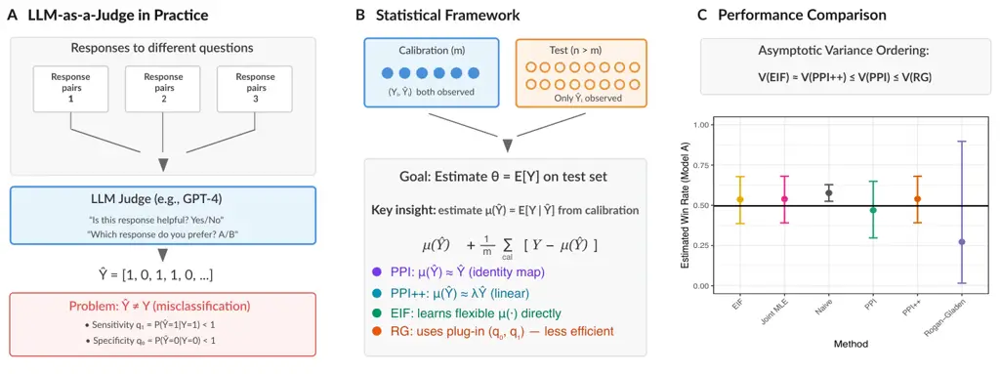

# Efficient Inference for Noisy LLM-as-a-Judge Evaluation

Yiqun T. Chen ^(†)^(†)thanks: Departments of Biostatistics and Computer
Science, Johns Hopkins University, Baltimore, MD 21205, USA;
correspondence email: yiqun.t.chen@gmail.com    Sizhu Lu ^(†)^(†)thanks:
Department of Statistics, University of California, Berkeley, CA 94720,
USA    Sijia Li ^(†)^(†)thanks: Department of Biostatistics, University
of California, Los Angeles, CA 90095, USA    Moran Guo ^(†)^(†)thanks:
Department of Biostatistics, Johns Hopkins University, Baltimore, MD
21205, USA    Shengyi Li ^(†)^(†)thanks: Department of Biostatistics,
Johns Hopkins University, Baltimore, MD 21205, USA

August 24, 2026

###### Abstract

Large language models (LLMs) are increasingly used as automatic
evaluators of generative AI outputs, a paradigm often referred to as
“LLM-as-a-judge.” In practice, LLM judges are imperfect predictions for
the underlying truth and can exhibit systematic, non-random errors. Two
main approaches have recently been proposed to address this issue: (i)
_direct measurement-error correction_ based on misclassification models
such as Rogan–Gladen-style estimators, and (ii) _surrogate-outcome
approaches_ such as prediction-powered inference (PPI), which correct
bias by calibrating prediction residuals on a small set of gold-standard
human labels. In this paper, we systematically study the performance of
these two approaches for estimating _mean parameters_ (e.g., average
benchmark scores or pairwise win rates). Leveraging tools from
semiparametric efficiency theory, we unify the two classes of estimators
by deriving explicit forms of _efficient influence function_ (EIF)-based
efficient estimators and characterize conditions under which PPI-style
estimators attain strictly smaller asymptotic variance than
measurement-error corrections. We verify our theoretical results in
simulations and demonstrate the methods on a real-data example. We
provide an implementation of the benchmarked methods and comparison
utilities at https://github.com/yiqunchen/debias-llm-as-a-judge.

## 1 Introduction

Automated model evaluation is an essential yet challenging task in
machine learning (ML), especially in the era of generative artificial
intelligence (AI), where scalability produces large volumes of outputs
to be labeled and introduces diverse output formats ranging from
numerical predictions and categorical labels to open-ended paragraphs
such as reasoning traces and mathematical proofs, all of which are not
adequately captured by traditional metrics such as mean squared error or
misclassification rates. Moreover, an increasing number of studies now
leverage large language models (LLMs) to generate both substantial
quantities of new questions and their corresponding answers, for which
running every question-answer pair through human verification is
infeasible.

Motivated by recent advances in LLMs, a growing body of work proposes
using LLMs as automatic “judges” to evaluate the outputs of other
models—for example, by determining whether a model’s answer is correct,
assigning a quality score, or selecting the preferred response between
two candidates, a practice known as “LLM-as-a-judge”. This approach
promises scalable and low-cost evaluation, but it also introduces a new
source of error: the LLM judge is an imperfect proxy for human judgment.
At a high level, LLM-as-a-judge workflows typically rely on:

- •
  a large _evaluation set_ on which _only_ LLM judgments are available,
  and
- •
  a smaller _calibration set_ on which both human labels and LLM
  judgments are observed.

This setup presents a challenge: relying solely on the calibration set
leads to high-variance evaluation, whereas relying on the evaluation set
labels leads to biased evaluation, as LLMs are known to produce
homogenized judgments and to avoid extreme categories. Recent work has
therefore asked the key question: _How can we optimally combine these
two datasets to construct valid, efficient estimates with calibrated
uncertainties (e.g., confidence intervals) for evaluation metrics?_

Statistically, LLM-as-a-judge evaluation can be framed as a classical
measurement-error problem. Consider the binary-outcome setting where the
human label $`Y`$ represents the latent truth and the LLM judgment
$`\hat{Y}`$ is a noisy surrogate. We observe paired data
$`(Y_{i},\hat{Y}_{i})`$ for a small calibration subset, while for most
of the evaluation set only $`\hat{Y}_{i}`$ is available. A long-standing
approach in this literature is to model the misclassification mechanism
$`\Pr(\hat{Y}\mid Y)`$ and estimate the true accuracy using _direct
measurement-error correction_, such as Rogan–Gladen estimators or
confusion-matrix inversion (Rogan and Gladen, 1978; Fuller, 2009).
Another school of thought, including _prediction-powered inference_
(PPI) (Angelopoulos et al., 2023a) and related work (Wang et al., 2020;
Miao et al., 2025; Salerno et al., 2025; Ji et al., 2025; Egami et al.,
2023; Rister Portinari Maranca et al., 2025), treats the LLM judgment as
a generic surrogate outcome for $`Y`$ and uses the calibration set to
correct the average bias of $`\hat{Y}`$. This approach yields valid
statistical inference without explicitly estimating the parameters of
the misclassification model.

Despite progress in both methodological traditions, there has been
little direct comparison of their statistical validity and efficiency.
This gap likely reflects the distinct cultures and communities in which
these approaches are typically applied: measurement-error models have
recently been used primarily in medical settings, such as estimating
COVID-19 and cause-of-death prevalence under imperfect
measurements (Rosin et al., 2023; González et al., 2017; Fiksel et al.,
2022), whereas PPI-style estimators are more commonly motivated by
modern ML/AI applications. A recent exception is Lee et al. (2025),
which provides a recipe for applying measurement-error corrections to
LLM-as-a-judge settings (see details in Section 2.2).

While we primarily focus on guarantees of inferential validity for mean
parameters in this work, there is a growing body of excellent
complementary research aimed at improving LLM-as-a-judge scores
($`\hat{Y}`$) so that $`\hat{Y}\approx Y`$ across a diverse set of tasks
and LLM models (Tian et al., 2025; Liu et al., 2024; Shi et al., 2024;
Sahoo et al., 2025; Schroeder and Wood-Doughty, 2024; Li et al., 2025).
We view this line of work as complementary to ours: our goal is to
provide guarantees regardless of the quality of $`\hat{Y}`$, while
improved calibration of $`\hat{Y}`$ can further reduce variance across
the estimators we consider (see Section 2 for details).

In this paper, we study the performance of these two approaches for
estimating _mean parameters_ and unify them through the lens of
semiparametric efficiency theory (see Figure 1 for an overview): From
elementary efficient influence function (EIF) theory for mean estimation
with a surrogate label $`\widehat{Y}`$, the optimal estimator depends on
the regression function $`\mathbb{E}[Y\mid\widehat{Y}]`$. This
perspective reveals that popular calibration-based estimators can be
understood as approximations to $`\mathbb{E}[Y\mid\widehat{Y}]`$ using
different functional forms: PPI implicitly uses the identity map
$`Y\approx\widehat{Y}`$; PPI++ uses a one-parameter linear map
$`Y\approx\lambda\widehat{Y}`$ with a tuning parameter $`\lambda`$; and
RePPI replaces these parametric forms with a flexible machine learning
model to estimate $`\mathbb{E}[Y\mid\widehat{Y}]`$ directly (Ji et al.,
2025). In particular, in the binary-outcome setting, PPI++ with the
optimal $`\lambda`$ coincides with the EIF-based estimator, whereas for
more general outcomes this coincidence need not hold. These sets of
insights we derived are closely related to the rich literature on
efficient inference for missing data, especially the missing completely
at random setup (Chen et al., 2008; Robins and Rotnitzky, 1995).
Recently, Xu et al. (2025) proposed a general “safe PPI” framework,
which improves upon PPI/PPI++ when the parameter of interest has
dimension $`p>1`$, and reached a similar conclusion that the asymptotic
variance of PPI++ can be strictly improved, unless
$`\mathbb{E}[Y\mid\widehat{Y}]`$ takes a restrictive linear form. Our
work can be seen as a parallel exploration and implementation for the
scalar outcome case, which covers the most common applications, such as
LLM-as-a-judge.

Empirically, we find that across a wide range of parameter settings, our
proposed EIF-based estimator outperforms vanilla PPI, and that both
methods outperform the Rogan–Gladen estimator in terms of finite-sample
bias and the efficiency of their confidence intervals. We further
explain these empirical findings _theoretically_ by proving that: (1)
the EIF estimator is asymptotically equivalent to PPI++ for binary
outcomes with the optimal tuning parameter; and (2) the asymptotic
variance of the PPI estimator is strictly smaller than that of the
Rogan–Gladen estimator.

Our work helps connect the growing literature on the estimation
efficiency theory in classic statistics with the rapidly expanding
practice of LLM-as-a-judge and calibration in applied AI work. As LLMs
increasingly become integral to data analysis workflows, our work offers
practical and much-needed guidance for the reliable uncertainty
quantification of LLM-as-a-judge systems.



Figure 1: Calibrating LLM-as-a-judge evaluations. (A) LLM-generated
labels $`\hat{Y}`$ are noisy, with sensitivity $`q_{1}<1`$ and
specificity $`q_{0}<1`$. (B) A human-labeled calibration set enables
bias correction using PPI, Rogan–Gladen (RG), or EIF-based estimators.
(C) Comparison of naive, RG, PPI, and EIF-based estimators for
evaluating LLM-as-a-judge performance.

## 2 Review of Calibration Methods in the Binary Setting

### 2.1 Problem setup

We stylize the LLM-as-a-judge evaluation as follows: for
$`i=1,\dots,N`$, we observe i.i.d. pairs

```math
Y_{i}\sim\mathrm{Bern}(\theta)\quad\text{denoting the human label,}\qquad\hat{Y}_{i}\in\{0,1\}\quad\text{denoting the LLM-as-a-judge label.} \tag{1}
```

The target parameter is the _mean human outcome_

```math
\theta=\mathbb{E}[Y]=\Pr(Y=1). \tag{2}
```

As a concrete example, if the goal is to compare two responses $`R_{1}`$
and $`R_{2}`$ produced by different LLMs, let $`Y_{i}=1`$ indicate that
a human annotator prefers $`R_{1}`$ over $`R_{2}`$ for prompt $`i`$ (0
otherwise). The estimand $`\theta`$ then represents the _human win rate_
of $`R_{1}`$ over $`R_{2}`$.

The full sample of size $`N`$ is partitioned into two _independent_,
disjoint subsets: a test set of size $`n`$, in which only the surrogate
outcome $`\hat{Y}_{i}`$ is observed, and a calibration set of size
$`m=N-n`$, in which both the true outcome $`Y_{j}`$ and the surrogate
$`\hat{Y}_{j}`$ are observed. This setup corresponds exactly to a
_missing completely at random_ (MCAR) mechanism, where the true outcome
$`Y_{i}`$ is missing for observations in the test set (Robins and
Rotnitzky, 1995; Little and Rubin, 2002), because the partition into
calibration versus test sets is generated by an independent Bernoulli
assignment that does not depend on either $`Y_{i}`$ or $`\hat{Y}_{i}`$.
For asymptotic analysis, we consider a regime in which both $`m`$ and
$`n`$ diverge with $`\frac{n}{m}\;\to\;\gamma_{1}\in(0,\infty).`$ That
is, the proportion of observations in the calibration set converges to a
fixed constant $`\frac{1}{1+\gamma_{1}}\in(0,1)`$.

Denote the empirical proportion of LLM-judged positives in the test set
by

```math
\hat{\theta}_{\mathrm{naive}}\;=\;\frac{1}{n}\sum_{i=1}^{n}\widehat{Y}_{i}. \tag{3}
```

When the judge is imperfect (i.e., $`q_{0}+q_{1}<2`$), we have that
$`\mathbb{E}[\hat{\theta}_{\mathrm{naive}}]=\theta+(q_{0}+q_{1}-2)\theta+(1-q_{0})`$,
which leads to biased point estimates, incorrect variance estimates, and
invalid inference. We therefore review several
calibration-based/debiasing estimators: the Rogan–Gladen (RG)
estimator (Rogan and Gladen, 1978; Lee et al., 2025), prediction-powered
inference (PPI) (Angelopoulos et al., 2023a), and its power-tuned
variant (PPI++) (Angelopoulos et al., 2023b).

### 2.2 Rogan–Gladen estimator

The Rogan–Gladen estimator accounts for the sensitivity and specificity
of the LLM judge,

```math
q_{1}=\Pr(\hat{Y}=1\mid Y=1),\qquad q_{0}=\Pr(\hat{Y}=0\mid Y=0). \tag{4}
```

Let $`p=\Pr(\hat{Y}=1)`$ denote the marginal probability that the LLM
calls an instance positive. The classical misclassification relationship
is

```math
p=q_{1}\theta+(1-q_{0})(1-\theta)=(q_{0}+q_{1}-1)\theta+(1-q_{0}). \tag{5}
```

Solving (5) for $`\theta`$ yields
$`\theta=\frac{p+q_{0}-1}{q_{0}+q_{1}-1}.`$ In practice, $`p`$,
$`q_{0}`$, and $`q_{1}`$ are unknown and estimated from the data:
$`\hat{p}=\frac{1}{n}\sum_{i=1}^{n}\hat{Y}_{i}`$. On the calibration
set, write $`m_{1}=\sum_{j=1}^{m}\mathbf{1}\{Y_{j}=1\}`$ and
$`m_{0}=m-m_{1}`$ and define

```math
\hat{q}_{1}=\frac{\sum_{j=1}^{m}\mathbf{1}\{\hat{Y}_{j}=1,Y_{j}=1\}}{m_{1}},\qquad\hat{q}_{0}=\frac{\sum_{j=1}^{m}\mathbf{1}\{\hat{Y}_{j}=0,Y_{j}=0\}}{m_{0}}.
```

The Rogan–Gladen estimator for $`\theta`$ is

```math
\hat{\theta}_{\mathrm{RG}}=\frac{\hat{p}+\hat{q}_{0}-1}{\hat{q}_{0}+\hat{q}_{1}-1}. \tag{6}
```

This is the classic prevalence estimator under measurement error (Rogan
and Gladen, 1978; Lang and Reiczigel, 2014) and the same estimator
proposed in Lee et al. (2025).

###### Proposition 1 (Asymptotic distribution of $`\hat{\theta}_{\mathrm{RG}}`$ in (6)).

Assume the test and calibration samples are independent and
$`q_{0}+q_{1}-1\neq 0`$ with $`q_{0}`$ and $`q_{1}`$ defined in (4).
With $`N=n+m\to\infty`$ and $`n/m\to\gamma_{1}`$, we have that

```math
\sqrt{N}\,\bigl(\hat{\theta}_{\mathrm{RG}}-\theta\bigr)\;\xrightarrow{d}\;\mathcal{N}\bigl(0,V_{\mathrm{RG}}\bigr),
```

where

```math
V_{\mathrm{RG}}=\frac{1+\gamma_{1}}{\gamma_{1}}\frac{1}{(q_{0}+q_{1}-1)^{2}}\left[p(1-p)\;+\;\gamma_{1}\left\{(1-\theta)\,q_{0}(1-q_{0})+\theta\,q_{1}(1-q_{1})\right\}\right]. \tag{7}
```

### 2.3 Prediction-powered inference (PPI)

Prediction-powered inference treats the LLM label as a surrogate for
$`Y`$ and corrects its bias using the calibration set without explicitly
modeling the sensitivity and specificity. Following the setup in
Section 2.2, we have that
$`\mathbb{E}[\hat{Y}]=p,\,\mathbb{E}[\hat{Y}-Y]=\Delta=p-\theta`$,
motivating the following estimator:

```math
\hat{\theta}_{\mathrm{PPI}}=\hat{p}-\frac{1}{m}\sum_{j=1}^{m}(\hat{Y}_{j}-Y_{j}). \tag{8}
```

###### Proposition 2.

Under the joint model (1) with independent test and calibration samples:

1.  (i)
    PPI is unbiased for all $`n,m`$:

    ```math
    \mathbb{E}[\hat{\theta}_{\mathrm{PPI}}]=\theta.
    ```

2.  (ii)
    The finite-sample variance is

    ```math
    \mathrm{Var}(\hat{\theta}_{\mathrm{PPI}})=\frac{p(1-p)}{n}+\frac{(1-\theta)(1-q_{0})+\theta(1-q_{1})-(\theta-p)^{2}}{m}, \tag{9}
    ```

    where $`p=\Pr(\hat{Y}=1)=(1-\theta)(1-q_{0})+\theta q_{1}`$. If
    $`N=n+m\to\infty`$ with $`n/m\to\gamma_{1}\in(0,\infty)`$,

    ```math
    \sqrt{N}\,(\hat{\theta}_{\mathrm{PPI}}-\theta)\xrightarrow{d}\mathcal{N}(0,V_{\mathrm{PPI}}),\;V_{\mathrm{PPI}}=\left(\frac{1+\gamma_{1}}{\gamma_{1}}\right)\left\{p(1-p)+\gamma_{1}\Bigl[(1-\theta)(1-q_{0})+\theta(1-q_{1})-(\theta-p)^{2}\Bigr]\right\}.
    ```

### 2.4 Power-tuned PPI (PPI++)

PPI++ generalizes (8) by introducing a tuning parameter
$`\lambda\in\mathbb{R}`$:

```math
\hat{\theta}_{\mathrm{\texttt{PPI++}}}(\lambda):=\frac{1}{m}\sum_{j=1}^{m}Y_{j}\;+\;\lambda\left(\frac{1}{n}\sum_{i=1}^{n}\hat{Y}_{i}\;-\;\frac{1}{m}\sum_{j=1}^{m}\hat{Y}_{j}\right). \tag{10}
```

It’s easy to see that (10) remains unbiased for any choice of
$`\lambda`$ that is independent of the $`Y_{i}`$’s, but different
choices lead to different asymptotic variances (and therefore different
power), as detailed in Proposition 3.

###### Proposition 3.

Assume $`\lambda`$ is fixed (non-data-dependent), under the joint model
(1) with independent test and calibration samples. Then:

1.  (i)
    _(Unbiasedness)_ For all $`n,m`$,

    ```math
    \mathbb{E}\!\left[\hat{\theta}_{\mathrm{\texttt{PPI++}}}(\lambda)\right]=\theta.
    ```

2.  (ii)
    _(Finite-sample variance)_

    ```math
    \mathrm{Var}\!\left(\hat{\theta}_{\mathrm{\texttt{PPI++}}}(\lambda)\right)=\frac{\theta(1-\theta)}{m}+\lambda^{2}\left(\frac{p(1-p)}{n}+\frac{p(1-p)}{m}\right)-\frac{2\lambda}{m}\,\theta\bigl(q_{1}-p\bigr). \tag{11}
    ```

3.  (iii)
    _(Asymptotic distribution)_ If $`N=n+m\to\infty`$ with
    $`n/m\to\gamma_{1}\in(0,\infty)`$, then

    ```math
    \sqrt{N}\left(\hat{\theta}_{\mathrm{\texttt{PPI++}}}(\lambda)-\theta\right)\xrightarrow{d}\mathcal{N}\!\left(0,\,V_{\mathrm{\texttt{PPI++}}}(\lambda)\right),
    ```

    where

    ```math
    V_{\mathrm{\texttt{PPI++}}}(\lambda)=\frac{1+\gamma_{1}}{\gamma_{1}}\left[\gamma_{1}\,\theta(1-\theta)+\lambda^{2}(1+\gamma_{1})\,p(1-p)-2\lambda\,\gamma_{1}\,\theta\bigl(q_{1}-p\bigr)\right]. \tag{12}
    ```

4.  (iv)
    _(Variance-minimizing tuning)_
    $`V_{\mathrm{\texttt{PPI++}}}(\lambda)`$ is minimized over
    $`\lambda\in\mathbb{R}`$ at

    ```math
    \lambda^{\star}=\frac{\gamma_{1}\,\theta\bigl(q_{1}-p\bigr)}{(1+\gamma_{1})\,p(1-p)}.
    ```

### 2.5 Maximum Likelihood Estimator

In addition to (moment-based) debiasing estimators such as PPI/PPI++,
another natural candidate is the _joint maximum likelihood estimator_
under the full three-parameter misclassification model for
$`(Y,\hat{Y})`$. In contrast to RG (which uses plug-in estimators for
sensitivity and specificity on the calibration sample), the MLE
explicitly fits $`(\theta,q_{0},q_{1})`$ by maximizing the joint
likelihood implied by the model across both the test and calibration
samples.

Under model (1), we have that the test observations satisfy
$`\hat{Y}_{i}\sim\mathrm{Bern}(p)`$, while the calibration observations
satisfy

```math
\Pr(Y=1,\hat{Y}=1)=\theta q_{1},\qquad\Pr(Y=1,\hat{Y}=0)=\theta(1-q_{1}),
```

```math
\Pr(Y=0,\hat{Y}=1)=(1-\theta)(1-q_{0}),\qquad\Pr(Y=0,\hat{Y}=0)=(1-\theta)q_{0}.
```

#### Likelihood and estimating equations.

Let $`O_{i}=(R_{i},Y_{i},\hat{Y}_{i})`$ for $`i=1,\dots,n+m`$, where
$`R_{i}\in\{0,1\}`$ indicates whether $`Y_{i}`$ is observed ($`R_{i}=1`$
for calibration and $`R_{i}=0`$ for test). In this setup we assume
$`R_{i}`$’s are simply i.i.d. draws with $`\Pr(R=1)=m/(n+m)`$, and the
observed-data likelihood factorizes into a calibration part (for
$`R=1`$) and a test-only part (for $`R=0`$). Writing
$`p=(1-\theta)(1-q_{0})+\theta q_{1}`$, the per-observation contribution
is

```math
f(O_{i};\theta,q_{0},q_{1})=\Bigl[\Pr(Y_{i},\hat{Y}_{i})\Bigr]^{R_{i}}\Bigl[\Pr(\hat{Y}_{i})\Bigr]^{1-R_{i}},
```

so the full log-likelihood (up to constants) is

```math
\displaystyle\ell(\theta,q_{0},q_{1}) \displaystyle=\sum_{i=1}^{n+m}(1-R_{i})\Bigl\{\hat{Y}_{i}\log p+(1-\hat{Y}_{i})\log(1-p)\Bigr\}
```

```math
\displaystyle\quad+\sum_{i=1}^{n+m}R_{i}\Bigl\{\mathbf{1}\{Y_{i}=1,\hat{Y}_{i}=1\}\log(\theta q_{1})+\mathbf{1}\{Y_{i}=1,\hat{Y}_{i}=0\}\log(\theta(1-q_{1}))
```

```math
\displaystyle\qquad+\mathbf{1}\{Y_{i}=0,\hat{Y}_{i}=1\}\log((1-\theta)(1-q_{0}))+\mathbf{1}\{Y_{i}=0,\hat{Y}_{i}=0\}\log((1-\theta)q_{0})\Bigr\}. \tag{13}
```

The MLE is defined as

```math
(\hat{\theta}_{\mathrm{MLE}},\hat{q}_{0,\mathrm{MLE}},\hat{q}_{1,\mathrm{MLE}})=\arg\max_{\theta,q_{0},q_{1}\in(0,1)}\ \ell(\theta,q_{0},q_{1}),
```

equivalently as a solution to the score equations

```math
\frac{\partial}{\partial\theta}\ell(\theta,q_{0},q_{1})=0,\qquad\frac{\partial}{\partial q_{0}}\ell(\theta,q_{0},q_{1})=0,\qquad\frac{\partial}{\partial q_{1}}\ell(\theta,q_{0},q_{1})=0.
```

In practice, these equations are solved numerically (e.g., by
Newton–Raphson), subject to the constraint $`q_{0}+q_{1}\neq 1`$
(identifiability).

###### Proposition 4 (Asymptotic normality and efficiency of the MLE).

Assume the three-parameter misclassification model for $`(Y,\hat{Y},R)`$
is correctly specified and standard regularity conditions hold. Suppose
$`N=n+m\to\infty`$ with $`n/m\to\gamma_{1}\in(0,\infty)`$, and define

```math
p=(1-\theta)(1-q_{0})+\theta q_{1},\qquad\eta=(\theta,q_{0},q_{1})^{\top}.
```

Denote the MLE based on the combined test ($`n`$) and calibration
($`m`$) samples as

```math
\hat{\eta}_{\mathrm{MLE}}:=(\hat{\theta}_{\mathrm{MLE}},\hat{q}_{0,\mathrm{MLE}},\hat{q}_{1,\mathrm{MLE}})^{\top}.
```

Then

```math
\sqrt{N}\,(\hat{\eta}_{\mathrm{MLE}}-\eta)\xrightarrow{d}\mathcal{N}\!\left(0,\ I_{\gamma_{1}}(\eta)^{-1}\right),
```

where the limiting Fisher information is

```math
I_{\gamma_{1}}(\theta,q_{0},q_{1})=\frac{\gamma_{1}}{1+\gamma_{1}}\,I_{\mathrm{test}}(\theta,q_{0},q_{1})+\frac{1}{1+\gamma_{1}}\,I_{\mathrm{cal}}(\theta,q_{0},q_{1}),
```

with

```math
I_{\mathrm{test}}(\theta,q_{0},q_{1})=\frac{1}{p(1-p)}\begin{pmatrix}(q_{0}+q_{1}-1)^{2}&-(q_{0}+q_{1}-1)(1-\theta)&\theta(q_{0}+q_{1}-1)\\
-(q_{0}+q_{1}-1)(1-\theta)&(1-\theta)^{2}&-\theta(1-\theta)\\
\theta(q_{0}+q_{1}-1)&-\theta(1-\theta)&\theta^{2}\end{pmatrix},
```

```math
I_{\mathrm{cal}}(\theta,q_{0},q_{1})=\mathrm{diag}\!\left(\frac{1}{\theta(1-\theta)},\ \frac{1-\theta}{q_{0}(1-q_{0})},\ \frac{\theta}{q_{1}(1-q_{1})}\right).
```

Consequently,

```math
\sqrt{N}\,(\hat{\theta}_{\mathrm{MLE}}-\theta)\xrightarrow{d}\mathcal{N}\!\left(0,\ \bigl[I_{\gamma_{1}}(\eta)^{-1}\bigr]_{11}\right),\;\text{where}
```

```math
\bigl[I_{\gamma_{1}}(\eta)^{-1}\bigr]_{11}=(1+\gamma_{1})\,\theta(1-\theta)\,\frac{\,p(1-p)+\gamma_{1}\Bigl[(1-\theta)q_{0}(1-q_{0})+\theta q_{1}(1-q_{1})\Bigr]\;}{\,p(1-p)+\gamma_{1}\Bigl[(q_{0}+q_{1}-1)^{2}\theta(1-\theta)+(1-\theta)q_{0}(1-q_{0})+\theta q_{1}(1-q_{1})\Bigr]\;}.
```

## 3 A principled efficiency lens via efficient influence functions

We now have multiple asymptotically unbiased estimators for
$`\theta=\mathbb{E}[Y]`$ (RG, PPI, PPI++, and the MLE). This motivates
the natural question:

> _What is the smallest achievable asymptotic variance under a given
> statistical model, and which estimators attain it?_

We answer this question using semiparametric efficiency theory in
statistics (see Bickel et al. (1993); Van der Vaart (2000) and
references therein for a detailed treatment). Let $`Z_{1},\dots,Z_{N}`$
denote i.i.d. observations from a distribution $`P`$ and let
$`\theta=\theta(P)`$ be the target parameter. An estimator
$`\hat{\theta}`$ is _regular and asymptotically linear_ if there exists
a mean-zero function $`\phi_{P}(Z)`$ such that
$`\hat{\theta}-\theta(P)=\frac{1}{N}\sum_{i=1}^{N}\phi_{P}(Z_{i})+o_{p}(N^{-1/2})`$.
Any such $`\phi_{P}`$ is called an _influence function_ (IF) for
$`\hat{\theta}`$, and a direct application of the central limit theorem
yields that

```math
\sqrt{N}\bigl(\hat{\theta}-\theta(P)\bigr)\ \xrightarrow{d}\ \mathcal{N}\!\left(0,\ \mathrm{Var}_{P}\!\bigl(\phi_{P}(Z)\bigr)\right).
```

Among all IFs, the _efficient influence function_ (EIF) for $`\theta`$
under $`P`$—when it exists—is the unique influence function with the
smallest asymptotic variance. This minimal variance is referred to as
the _semiparametric efficiency bound_. An estimator whose influence
function coincides with the EIF attains this bound and is therefore said
to be _semiparametrically efficient_.

Specifically, let’s consider the general model for the joint
distribution of $`(Y,\hat{Y},R)\sim P`$, where $`Y\in\{0,1\}`$ is the
human label; $`\hat{Y}\in\{0,1\}`$ is the LLM-judged label; and
$`R\in\{0,1\}`$ indicates whether an observation is in the calibration
(observed $`Y`$) or the test (missing $`Y`$) set, with no additional
constraints beyond the i.i.d. assumption across observations and $`R`$
is independent of $`Y`$ and $`\hat{Y}`$. Recall that we observe $`n`$
test points with $`\hat{Y}`$ only and $`m`$ calibration points with both
$`(Y,\hat{Y})`$. Let $`R\in\{0,1\}`$ indicate whether $`Y`$ is observed
($`R=1`$ for calibration and $`R=0`$ for test with
$`\Pr(R=1)=\frac{m}{m+n}`$), and define

```math
\mu(\hat{y}):=\mathbb{E}[Y\mid\hat{Y}=\hat{y}],\qquad\hat{y}\in\{0,1\}.
```

A useful way to motivate the EIF is to observe that there are two
natural sources of information about $`\theta=\mathbb{E}[Y]`$ in this
design: (i) the large test sample provides a precise estimate of the
distribution of $`\hat{Y}`$; and (ii) the calibration sample tells us
how $`Y`$ relates to $`\hat{Y}`$. The function $`\mu(\hat{Y})`$ is
exactly the _best_ way to “translate” $`\hat{Y}`$ into an estimate of
$`Y`$: by the law of iterated expectations,
$`\theta=\mathbb{E}[Y]=\mathbb{E}\{\mathbb{E}[Y\mid\hat{Y}]\}=\mathbb{E}[\mu(\hat{Y})]`$.
Thus a natural “impute-then-average” estimator is to average
$`\mu(\hat{Y})`$ over the (large) test set. However, since
$`\mu(\cdot)`$ is unknown, we need to learn it from the calibration
sample.

###### Proposition 5 (Efficient influence function).

Given $`(Y,\hat{Y},R)\sim P`$ with $`R`$ independent of $`Y`$ and
$`\hat{Y}`$, the efficient influence function for
$`\theta=\mathbb{E}[Y]`$ under $`P`$ is

```math
\phi^{\star}(R,Y,\hat{Y};P)=\mu(\hat{Y})-\theta+\,\frac{R}{\Pr(R=1)}\bigl\{Y-\mu(\hat{Y})\bigr\}. \tag{14}
```

###### Proposition 6.

Define

```math
\hat{\mu}(1):=\frac{\sum_{j=1}^{m}\mathbf{1}\{\hat{Y}_{j}=1\}\,Y_{j}}{\sum_{j=1}^{m}\mathbf{1}\{\hat{Y}_{j}=1\}},\;\hat{\mu}(0):=\frac{\sum_{j=1}^{m}\mathbf{1}\{\hat{Y}_{j}=0\}\,Y_{j}}{\sum_{j=1}^{m}\mathbf{1}\{\hat{Y}_{j}=0\}},\;\hat{\mu}(\hat{Y})=\hat{\mu}(0)\mathbf{1}\{\hat{Y}=0\}+\hat{\mu}(1)\mathbf{1}\{\hat{Y}=1\}.
```

Then an asymptotically efficient estimator for estimating $`\theta`$
under (1) can be written as

```math
\hat{\theta}_{\mathrm{EIF}}=\frac{1}{N}\sum_{i=1}^{N}\hat{\mu}(\hat{Y}_{i})\;+\;\frac{1}{m}\sum_{j=1}^{m}\Bigl(Y_{j}-\hat{\mu}(\hat{Y}_{j})\Bigr), \tag{15}
```

with the asymptotic distribution

```math
\sqrt{N}\bigl(\hat{\theta}_{\mathrm{EIF}}-\theta\bigr)\xrightarrow{d}\mathcal{N}\bigl(0,V_{\mathrm{EIF}}\bigr), \tag{16}
```

where the variance in the binary case simplifies to

```math
V_{\mathrm{EIF}}=\frac{\theta(1-\theta)}{p(1-p)}\left[\theta(1-\theta)(q_{0}+q_{1}-1)^{2}+{(\gamma_{1}+1)}\bigl(q_{1}(1-q_{1})\theta+q_{0}(1-q_{0})(1-\theta)\bigr)\right]. \tag{17}
```

#### PPI is not generally efficient.

General efficiency theory implies that the EIF estimator
$`\hat{\theta}_{\mathrm{EIF}}`$ in (15) is asymptotically efficient
under the general i.i.d. model for $`(Y,\widehat{Y},R)\sim P`$.
Consequently, its asymptotic variance in (17) is the smallest among all
regular, asymptotically linear estimators in this model. Moreover, with
some algebra, one can verify that all estimators introduced in Section 2
are regular and asymptotically linear. In particular, PPI corresponds to
the special choice $`\mu(\hat{Y})=\hat{Y}`$ in (14). This yields an
unbiased estimator, but it is not generally efficient unless
$`\mathbb{E}[Y\mid\hat{Y}]=\hat{Y}`$, in which case $`\hat{Y}`$ is a
perfect prediction for $`Y`$.

#### Optimally tuned PPI++ matches the EIF in the binary case.

Unlike PPI, PPI++ searches over a one-parameter family of unbiased
estimators and chooses $`\lambda`$ to minimize asymptotic variance. In
general, PPI++ does not coincide with the EIF estimator, because
$`\mathbb{E}[Y\mid\hat{Y}]`$ need not equal $`\lambda\hat{Y}`$ for a
single scalar $`\lambda`$. However, when $`Y,\hat{Y}\in\{0,1\}`$, the
regression function $`\mu(\hat{Y})=\mathbb{E}[Y\mid\hat{Y}]`$ is _always
affine_ in $`\hat{Y}`$, so the PPI++ family is rich enough to match the
EIF estimator. Indeed, letting $`\gamma_{1}=n/m`$, the
variance-minimizing choice from Proposition 3 can be written as

```math
\lambda^{\star}=\frac{\gamma_{1}\,\mathrm{Cov}(Y,\hat{Y})}{(1+\gamma_{1})\mathrm{Var}(\hat{Y})}=\frac{\gamma_{1}\,\theta(1-\theta)\,(q_{0}+q_{1}-1)}{(1+\gamma_{1})\,p(1-p)},\qquad p=(1-\theta)(1-q_{0})+\theta q_{1}.
```

On the other hand, by Bayes’ rule,

```math
\mu(1)=\Pr(Y=1\mid\hat{Y}=1)=\frac{\theta q_{1}}{p},\qquad\mu(0)=\Pr(Y=1\mid\hat{Y}=0)=\frac{\theta(1-q_{1})}{1-p}. \tag{18}
```

Therefore,

```math
\displaystyle\mu(1)-\mu(0) \displaystyle=\frac{\theta q_{1}}{p}-\frac{\theta(1-q_{1})}{1-p}=\theta\,\frac{q_{1}-p}{p(1-p)}
```

```math
\displaystyle=\theta\,\frac{q_{1}-\bigl[(1-\theta)(1-q_{0})+\theta q_{1}\bigr]}{p(1-p)}=\frac{\theta(1-\theta)(q_{0}+q_{1}-1)}{p(1-p)}.
```

Thus,
$`\lambda^{\star}=\frac{\gamma_{1}}{1+\gamma_{1}}\bigl\{\mu(1)-\mu(0)\bigr\}`$,
which is exactly the slope for the affine form of $`\mu(\hat{Y})`$,
showing that optimally tuned PPI++ is asymptotically equivalent to the
EIF estimator in the binary setting.

#### MLE is equivalent to EIF

Under the correctly specified model $`(Y,\widehat{Y},R)\sim P`$,
classical likelihood theory implies that the MLE is asymptotically
efficient for $`\theta`$ (Proposition 4) and therefore attains the
smallest possible asymptotic variance (Bickel et al., 1993). In the
binary-outcome case, the model is saturated by the three parameters
$`(\theta,q_{0},q_{1})`$, and thus we expect the asymptotic variance of
the EIF estimator to coincide with that of the MLE. The detailed algebra
establishing the equivalence of the variance expressions is deferred to
the appendix.

#### RG is less efficient than PPI.

Finally, it is instructive to compare (6) and (8), which yields the
following result in Proposition 7.

###### Proposition 7.

Fix $`\theta\in(0,1)`$ and $`q_{0},q_{1}\in(0,1)`$ with
$`q_{0}+q_{1}-1>0`$, and assume $`n,m\to\infty`$ with
$`n/m\to\gamma_{1}\in(0,\infty)`$. Then

```math
V_{\mathrm{PPI}}\;\leq\;V_{\mathrm{RG}},
```

where

```math
\frac{\gamma_{1}}{1+\gamma_{1}}V_{\mathrm{PPI}}=p(1-p)+\gamma_{1}\Bigl[(1-\theta)(1-q_{0})+\theta(1-q_{1})-(\theta-p)^{2}\Bigr]
```

and

```math
\frac{\gamma_{1}}{1+\gamma_{1}}V_{\mathrm{RG}}=\frac{1}{(q_{0}+q_{1}-1)^{2}}\left[p(1-p)\;+\;\gamma_{1}\left\{(1-\theta)\,q_{0}(1-q_{0})+\theta\,q_{1}(1-q_{1})\right\}\right]
```

for all such parameters, with equality if and only if $`q_{0}=q_{1}=1`$
(i.e. $`\Pr(\hat{Y}=Y)=1`$).

#### Asymptotic Efficiency Summary.

The relationships derived above imply a clear ordering of performance.
Under the general i.i.d. model for $`(Y,\hat{Y})`$, the EIF estimator
$`\hat{\theta}_{\mathrm{EIF}}`$ attains the semiparametric efficiency
bound. In the binary case, optimally tuned PPI++ is asymptotically
equivalent to $`\hat{\theta}_{\mathrm{EIF}}`$, and consequently to the
MLE. Formally, for $`N=n+m\to\infty`$ and $`\frac{n}{m}\to\gamma_{1}`$:

```math
\hat{\theta}_{\mathrm{EIF}}\;=_{\mathrm{asymp}}\;\hat{\theta}_{\mathrm{MLE}}\;=_{\mathrm{asymp}}\;\hat{\theta}_{\mathrm{\texttt{PPI++}}}(\lambda^{\star})\;\prec_{\mathrm{asymp}}\;\hat{\theta}_{\mathrm{PPI}}\;\prec_{\mathrm{asymp}}\;\hat{\theta}_{\mathrm{RG}},
```

where $`=_{\mathrm{asymp}}`$ denotes equivalence up to
$`o_{p}(n^{-1/2})`$ and $`\prec_{\mathrm{asymp}}`$ denotes smaller
asymptotic variance.

## 4 Beyond binary: Nonparametric Estimation of $`\mathbb{E}[Y\mid\hat{Y}]`$

In the binary case, $`\mu(\hat{Y})=\mathbb{E}[Y\mid\hat{Y}]`$ is
necessarily affine, allowing optimally tuned PPI++ to achieve the
efficiency bound. Moreover, the nonparametric distribution on
$`(Y,\hat{Y})`$ is equivalent to the three-parameter distribution used
for the MLE in the binary case; this “saturated” property allows the MLE
to attain the efficiency bound _without_ making any restrictive
parametric assumptions.

For richer surrogate outputs $`\widehat{Y}`$ (e.g., continuous scores
and ordinal ratings), the functional form of the EIF, and therefore of
$`\hat{\theta}_{\mathrm{EIF}}`$ in (15), remains unchanged. However, the
regression function $`\mu(\cdot)`$ may be nonlinear, and efficiency
depends on how close the estimator $`\widehat{\mu}(\cdot)`$ is to the
true conditional mean function.

When both $`Y`$ and $`\hat{Y}`$ are one-dimensional, estimating
$`\mu(\hat{Y})`$ reduces to a univariate regression problem, which can
be addressed using models ranging from simple linear regression to
flexible nonparametric smoothers. Given a consistent estimator
$`\hat{\mu}(\cdot)`$ and i.i.d. model $`(Y,\hat{Y},R)`$, we can then
construct the plug-in EIF estimator:

```math
\hat{\theta}_{\mathrm{EIF}}=\frac{1}{N}\sum_{i=1}^{N}\left(\hat{\mu}(\hat{Y}_{i})+\frac{1}{\hat{P}(R=1)}R_{i}\{Y_{i}-\hat{\mu}(\hat{Y}_{i})\}\right). \tag{19}
```

If we _design_ the labeling process $`R`$, e.g., we label a data point
with probability $`P(R=1)=\frac{\gamma_{1}}{1+\gamma_{1}}`$, then as
long as $`\hat{\mu}(\cdot)`$ is a consistent estimator of
$`\mu(\cdot)`$, (19) will be asymptotically efficient.

We finally note that, unlike the binary (or the categorical with finite
categories) case, we do not have a direct analogy with the MLE or RG
estimator in the continuous case without assuming additional parametric
relationship of $`Y`$ and $`\hat{Y}`$.

## 5 Simulation Study

### 5.1 Binary $`Y`$

We compare the performance of following estimators in simulation: the
naive estimator in (3), the Rogan–Gladen estimator in (6), the PPI
estimator in (8), the PPI++ estimator in (10), the MLE in (13), and the
EIF estimator in (15).

### 5.2 Simulation Setup

#### Data-generating process.

Each replicate consists of $`N=2{,}000`$ i.i.d. samples. The true binary
label is generated as
$`Y_{i}\stackrel{{\scriptstyle\text{i.i.d.}}}{{\sim}}\mathrm{Bern}(\theta)`$,
where $`\theta\in\{0.1,0.2,\ldots,0.9\}`$ is the target prevalence.

The LLM-as-a-judge surrogate $`\widehat{Y}_{i}`$ is generated from a
misclassification model with constant sensitivity and specificity,
$`\Pr(\widehat{Y}_{i}=1\mid Y_{i}=1)=q_{1}`$ and
$`\Pr(\widehat{Y}_{i}=0\mid Y_{i}=0)=q_{0}`$, respectively.

#### Parameter grid.

We vary the following parameters across a full factorial design:

- •
  True prevalence: $`\theta\in\{0.1,0.2,\ldots,0.9\}`$.
- •
  Judge accuracy: $`q_{0},q_{1}\in\{0.6,0.7,0.8\}`$.
- •
  Labeling budget (calibration size): $`\{1\%,5\%,10\%\}`$ of $`N`$
  (i.e., $`m\in\{20,100,200\}`$ human labels in expectation).

The calibration set is obtained by _random sampling_ from the full
dataset; thus the class counts $`m_{0}`$ and $`m_{1}`$ in the
calibration set are random and depend on the underlying prevalence
$`\theta`$. For each configuration, we perform $`B=1{,}000`$ Monte Carlo
replicates to compute bias as well as coverage and average width of 90%
confidence intervals.

#### Confidence interval construction.

We apply a logit transformation to all confidence intervals to improve
finite-sample coverage when $`\theta`$ is near the boundary (Brown et
al., 2001; Stone, 1996). Given point estimate $`\hat{\theta}`$ and
variance estimate $`\widehat{V}`$, we form

```math
\mathrm{CI}_{1-\alpha}=\mathrm{expit}\!\left(\mathrm{logit}(\hat{\theta})\pm z_{\alpha/2}\cdot\frac{\sqrt{\widehat{V}}}{\hat{\theta}(1-\hat{\theta})}\right),
```

where the standard error on the logit scale is obtained via the delta
method.

#### Evaluation metrics.

For each estimator $`\hat{\theta}`$, let $`\hat{\theta}^{(b)}`$ denote
its value in replicate $`b=1,\dots,B`$, and let
$`\mathrm{CI}^{(b)}=[L^{(b)},U^{(b)}]`$ denote its corresponding 90%
confidence interval. We compute:

- •
  Bias:
  $`\mathrm{Bias}(\hat{\theta})=\frac{1}{B}\sum_{b=1}^{B}\bigl(\hat{\theta}^{(b)}-\theta\bigr);`$
- •
  Coverage probability:
  $`\mathrm{Cov}(\hat{\theta})=\frac{1}{B}\sum_{b=1}^{B}\mathbf{1}\!\left\{\,L^{(b)}\leq\theta\leq U^{(b)}\,\right\};`$
- •
  Mean confidence interval width:
  $`\mathrm{Width}(\hat{\theta})=\frac{1}{B}\sum_{b=1}^{B}\bigl(U^{(b)}-L^{(b)}\bigr).`$

### 5.3 Results under symmetric judge accuracy ($`q_{0}=q_{1}`$)

Figures 2–4 are organized with rows corresponding to accuracy levels
$`q_{0}=q_{1}\in\{0.6,0.7,0.8\}`$ and columns corresponding to labeling
budgets.

#### Bias.

Figure 2 shows that all estimators except the naive one exhibit smaller
average bias than the naive sample-mean estimator. Recall that the bias
of the naive estimator is $`(1-q_{0})+\theta(q_{0}+q_{1}-2)`$, which is
negative for large $`\theta>0.5`$ and positive for small $`\theta<0.5`$,
consistent with our simulation results. Among the remaining estimators,
$`\hat{\theta}_{\mathrm{RG}}`$ exhibits comparatively larger
finite-sample bias.

Figure 2: Estimator bias of $`\hat{\theta}`$. All debiased estimators
achieve near-zero bias; the naive estimator (red) exhibits large bias in
many settings. When only 1% of the data is labeled,
$`\hat{\theta}_{\mathrm{RG}}`$ also exhibits considerable bias.

#### Coverage.

Figure 3 reports empirical coverage rates. The naive estimator exhibits
severe undercoverage, consistent with its asymptotic invalidity (at
$`\theta=0.5`$ the naive estimator is unbiased so the coverage is closer
to nominal level). All other estimators maintain near-nominal coverage
across settings. The RG estimator and its associated confidence
intervals tend to overcover, particularly when the number of labeled
observations is small (i.e., when the calibration set is limited).

Figure 3: Empirical coverage rates under the symmetric case
$`q_{0}=q_{1}`$. The naive estimator exhibits severe undercoverage. RG,
PPI, and PPI++ generally achieve nominal coverage; however, RG tends to
overcover when the labeled fraction $`m/n`$ is small and judge quality
is low (i.e., smaller $`q_{0}+q_{1}`$).

#### Confidence interval width.

Figure 4 compares interval widths among valid estimators (i.e.,
$`\hat{\theta}_{\mathrm{naive}}`$ excluded). As our theory predicted in
Section 3, EIF and PPI++ produce nearly identical and consistently
shortest intervals, typically 35–55% narrower than standard PPI. MLE
intervals are slightly wider but overall comparable to EIF and PPI++.
Rogan–Gladen intervals widen dramatically under low-accuracy judges due
to the $`1/(q_{0}+q_{1}-1)^{2}`$ amplification factor in its asymptotic
variance—at $`q_{0}=q_{1}=0.6`$, RG intervals are roughly 10$`\times`$
wider than those of EIF/PPI++.

Figure 4: Mean confidence interval width for the symmetric case
$`q_{0}=q_{1}`$. EIF and PPI++ produce nearly identical and shortest
intervals, outperforming Rogan–Gladen by a factor of 3–15$`\times`$
depending on the labeling ratio. The advantage is most pronounced when
$`q_{0}+q_{1}-1`$ is small (i.e., when the LLM-judge is closer to random
guessing). MLE produces slightly wider intervals but achieves coverage
closer to nominal. Naive confidence intervals are excluded since they
are too narrow and do not achieve the desired coverage.

### 5.4 Continuous $`Y`$

Here, we consider the simulation setup in Ji et al. (2025) where
$`\hat{Y}`$ takes discrete values (e.g., LLM ratings on a 1–5 scale)
while the true outcome $`Y`$ is continuous. This scenario is common when
LLMs are used as judges, providing ordinal ratings, but the ultimate
goal is to infer the continuous quality scale for the models $`Y`$.

#### Data Generating Process.

Let $`Z\sim\text{Unif}(\{1,2,3\})`$ denote a latent mixture component,
with conditional distribution
$`Y\mid Z\sim\mathcal{N}(\mu_{Z},\sigma^{2})`$ where
$`\bm{\mu}=(\mu_{1},\mu_{2},\mu_{3})^{\top}`$. The surrogate prediction
is on the component $`Z`$, and it’s easy to see that we need to
carefully model $`\mathbb{E}[Y|\widehat{Y}]`$. Even when the prediction
$`\widehat{Y}`$ perfectly identifies the latent class, the naive
estimator in (3) is biased for $`\mathbb{E}[Y]`$ because $`\widehat{Y}`$
and $`Y`$ are on different scales. Specifically, the bias would be
$`2-(\mu_{1}+\mu_{2}+\mu_{3})/3`$, which grows as the $`\mu_{k}`$ values
diverge from their category indices.

#### Simulation Design.

We fix $`N=2000`$, $`\mu_{1}=1`$, $`\mu_{2}=2`$, $`\sigma=1`$, and vary
$`\mu_{3}\in\{3,4,\ldots,9\}`$ to control bias magnitude. The labeled
fraction varies over $`\{5\%,10\%,20\%\}`$. We report coverage of 90%
confidence intervals and RMSE across $`B=500`$ replications.

Here, we compare the performance of the naive estimator in (3), the
prediction-powered estimator in (8), the power-tuned PPI++ estimator
in (10), EIF estimator in (19). For the EIF estimator, we use the
following three variants to approximate $`\mathbb{E}[Y|\widehat{Y}]`$:
(1) EIF: Learns $`g(z)=\mathbb{E}[Y\mid\widehat{Y}=z]`$ separately for
each $`z\in\{1,2,3\}`$; (2) EIF-linear: Fits
$`g(\widehat{Y})=a+b\cdot\widehat{Y}`$ via a linear regression (note
this is asymptotically equivalent to PPI++); and (3) EIF-GAM/spline:
Nonparametric calibration treating $`\widehat{Y}`$ as smooth function.
Since we are _not_ imposing additional distributional assumptions on
$`Y`$, we cannot write down a parametric likelihood function in the
continuous case, and therefore cannot easily extend the Rogan–Gladen and
the MLE estimators to this setting.

#### Results.

Figure 5 shows how inferential performance depends on how
$`\mathbb{E}[Y\mid\widehat{Y}]`$ is estimated. When
$`\bm{\mu}=(1,2,3)`$, the conditional mean is linear in $`\widehat{Y}`$,
so using $`\mathbb{E}[Y\mid\widehat{Y}]=\widehat{Y}`$ is correctly
specified and all methods except the naive estimator achieve nominal
coverage. Moreover, the confidence-interval width is indistinguishable
across methods, as EIF, PPI, and PPI++ are asymptotically equivalent.
However, as $`\mu_{3}`$ increases, the conditional mean is no longer
linear. While all debiased estimators retain correct coverage, there is
a clear efficiency gradient: PPI is the least efficient, followed
closely by PPI++ and EIF with a linear model for
$`\mathbb{E}[Y\mid\widehat{Y}]`$ (these two are asymptotically
equivalent under optimal tuning of PPI++). Finally, using a flexible
model to estimate $`\mathbb{E}[Y\mid\widehat{Y}]`$, such as a GAM (Wood, 2012) or spline, or fitting a three-category model that learns
$`g(z)=\mathbb{E}[Y\mid\widehat{Y}=z]`$ separately for each
$`z\in\{1,2,3\}`$, achieves the most efficient tier.

Figure 5: Coverage (left) and CI width (right) for discrete prediction
simulations. The dashed line indicates nominal 90% coverage. Most
methods achieve approximately valid coverage across varying bias
magnitudes ($`\mu_{3}`$), with naive intervals severely undercovering as
bias increases. EIF with spline and GAM calibration achieves the
narrowest intervals, reflecting its ability to correct discrete
predictions. As predicted, linear correction and PPI++ tread closely.

## 6 Real Data Application

### 6.1 Data and Experimental Setup

We evaluate the estimators on real human preference data from the
arena-human-preference-140k dataset, which is collected on Chatbot
Arena (Chiang et al., 2024), an online platform where users compare
responses from two AI models and select a winner. We focus on three
high-frequency model pairs, all with Claude Opus 4 as model A: (1)
Claude Opus 4 vs. Gemini 2.5 Flash ($`n=493`$); (2) Claude Opus 4 vs.
Gemini 2.5 Pro ($`n=414`$); (3) Claude Opus 4 vs. Qwen3-235B
($`n=494`$).

For each battle, the ground truth $`Y_{i}=1`$ if the human selected
model A (Claude), and $`Y_{i}=0`$ otherwise. We deploy two LLM judges,
GPT-4o-mini and GPT-5.2, to produce surrogate labels
$`\widehat{Y}_{i}\in\{0,1\}`$ based on the same prompt-response pairs
shown to human raters.

To mimic a real-world setting where we have only access to part of the
preference data, we use a 10% random sample of the data as a labeled
calibration set to estimate either $`\mathbb{E}[Y\mid\hat{Y}]`$ or the
misclassification probabilities $`(q_{0},q_{1})`$, and the remaining 90%
as an unlabeled test set. All confidence intervals are constructed at
the 90% nominal level.

### 6.2 Results

#### Judge quality.

Table 1 reports the estimated specificity ($`\hat{q}_{0}`$) and
sensitivity ($`\hat{q}_{1}`$) for each judge–dataset combination,
computed from a randomly sampled $`10\%`$ calibration set. The condition
$`q_{0}+q_{1}>1`$ indicates discriminative power beyond random guessing.

Judge quality varies substantially across settings. GPT-4o-mini performs
best when evaluating Claude 4 vs. Gemini 2.5 Flash, but worse on
Claude 4 vs. Gemini 2.5 Pro. GPT-5.2 achieves the highest overall
discrimination on Claude 4 vs. Gemini 2.5 Pro. Both judges perform
poorly on Claude 4 vs. Qwen3-235B, exhibiting low specificity despite
moderate sensitivity. These heterogeneous error rates further underscore
the need for bias correction: naive estimation inherits the systematic
errors of the judge.

| Model Pair                    | Judge       | $`\hat{q}_{0}`$ | $`\hat{q}_{1}`$ | $`\hat{q}_{0}+\hat{q}_{1}`$ |
| ----------------------------- | ----------- | --------------- | --------------- | --------------------------- |
| Claude 4 vs. Gemini 2.5 Flash | GPT-4o-mini | 0.74            | 0.69            | 1.43                        |
| Claude 4 vs. Gemini 2.5 Flash | GPT-5.2     | 0.47            | 0.67            | 1.14                        |
| Claude 4 vs. Gemini 2.5 Pro   | GPT-4o-mini | 0.50            | 0.81            | 1.31                        |
| Claude 4 vs. Gemini 2.5 Pro   | GPT-5.2     | 0.64            | 0.82            | 1.46                        |
| Claude 4 vs. Qwen3-235B       | GPT-4o-mini | 0.44            | 0.70            | 1.14                        |
| Claude 4 vs. Qwen3-235B       | GPT-5.2     | 0.50            | 0.64            | 1.14                        |

Table 1: Estimated judge quality metrics from calibration data
($`\hat{q}_{0}`$: specificity; $`\hat{q}_{1}`$: sensitivity). Values of
$`q_{0}+q_{1}`$ near 1 and 2 indicate near-random and near-perfect
performance, respectively.

#### Illustrative examples on one split.

Figure 6 shows point estimates and $`90\%`$ confidence intervals for a
single random calibration/test split across all three model pairs. The
horizontal black line indicates the true win rate, computed from all
human labels. We observe that: (i) the naive estimator is consistently
biased, overestimating the true win rate when using GPT-4o-mini as a
judge for Claude 4 Opus; (ii) the Rogan–Gladen estimator produces
extremely wide intervals that are largely uninformative in practice; and
(iii) PPI++, EIF, and the MLE yield similar point estimates with
moderate interval widths that cover the true value.

(a) Claude Opus 4 vs. Gemini 2.5 Flash (true win rate: 0.523)

(b) Claude Opus 4 vs. Gemini 2.5 Pro (true win rate: 0.496)

(c) Claude Opus 4 vs. Qwen3-235B (true win rate: 0.451)

Figure 6: Point estimates and 90% confidence intervals for win rate
estimation across three model pairs, using two LLM judges (GPT-4o-mini
and GPT-5.2). Horizontal black line shows the true win rate. Different
estimators and CIs are displayed in different colors.

#### Coverage and efficiency.

To assess coverage properties, Figure 7 plots empirical coverage against
mean confidence interval width for each estimator across 1,000 random
calibration/test splits. The naive estimator is unreliable, exhibiting
coverage that varies dramatically with the magnitude and direction of
judge bias: it attains near-perfect coverage when systematic errors
happen to align with the true prevalence (e.g., GPT-5.2 on Gemini 2.5
Pro), but collapses to $`0\%`$ coverage when bias is substantial, as
observed for GPT-4o-mini on Gemini 2.5 Pro and for both judges on
Qwen3-235B.

In contrast, PPI++, EIF, and MLE achieve near-nominal coverage across
all judge–dataset combinations, with mean interval widths of
$`0.27`$–$`0.30`$. PPI slightly overcovers with wider intervals
($`0.35`$–$`0.44`$), while Rogan–Gladen is highly conservative,
attaining $`100\%`$ coverage at the cost of very wide intervals
($`0.76`$–$`0.96`$). Among methods with valid coverage, PPI++, EIF, and
the MLE offer the best coverage–width tradeoff, as predicted by our
theory, achieving nominal coverage with intervals roughly three times
narrower than Rogan–Gladen.

Figure 7: Empirical coverage versus mean CI width across 1,000 random
90/10 test/calibration splits. Dashed line indicates 90% nominal
coverage. Error bars show 90% confidence intervals. Naive estimation
(gray) achieves 0% coverage when judge bias is substantial, while PPI++,
EIF, and MLE maintain nominal coverage with narrow intervals.

## 7 Discussion

We presented a unified lens for understanding calibration in
LLM-as-a-judge evaluations via efficient influence functions. We
compared, theoretically and through simulations, two complementary
strategies: direct measurement-error correction via misclassification
models and surrogate-based methods such as PPI, which treat LLM
judgments as surrogate outcomes. When the target is a mean outcome—as is
common in LLM-as-a-judge settings—both RG and PPI variants provide
simple, reliable solutions, with PPI++/EIF-based approaches preferred
for their variance advantages. In particular, for binary outcomes,
optimally tuned PPI++ is equivalent to the EIF-based strategy.

Several extensions follow naturally. A key direction is
instance-dependent misclassification, where LLM error rates vary with
input features or example difficulty. Extending our framework to this
setting parallels the semiparametric efficient inference literature:
with $`m(X,\hat{Y})=\mathbb{E}[Y\mid X,\hat{Y}]`$, our final estimator
involves an influence function of the form

```math
\phi^{\star}(O)=m(X,\hat{Y})-\theta+\frac{R}{\Pr(R=1\mid X,\hat{Y})}\{Y-m(X,\hat{Y})\}, \tag{20}
```

Another direction is developing multi-judge ensemble methods that
combine heterogeneous LLM evaluators to improve robustness. This would
require a careful treatment of multiple judges with distinct error rates
$`(q_{0},q_{1})`$ in (4), as well as principled ways to aggregate their
surrogate labels $`\hat{Y}`$ (e.g., via optimal weighting or learned
combination rules).

Finally, robustness to distribution shift, including covariate shift
(e.g., systematic differences in response styles between the calibration
and test sets) and label shift (e.g., changes in the prevalence of
ground-truth labels $`Y`$ between calibration and deployment, such as
when rolling out models to new cultural or geographic contexts),
warrants deeper methodological and empirical study, and we leave these
theoretical and computational developments to future work.

As LLM-as-a-judge evaluations become increasingly central to model
development and scientific assessment, we hope our results provide a
practical foundation for principled calibration, valid uncertainty
quantification, and efficient use of limited human labels.

## References

- Angelopoulos et al. (2023a) A. N. Angelopoulos, S. Bates, C.
  Fannjiang, M. I. Jordan, and T. Zrnic Prediction-powered inference.
  Science 382 (6671), pp. 669–674. Cited by: §1, §2.1.
- Angelopoulos et al. (2023b) A. N. Angelopoulos, J. C. Duchi, and T.
  Zrnic PPI++: Efficient Prediction-Powered Inference. arXiv preprint
  arXiv:2311.01453. Cited by: §2.1.
- Bickel et al. (1993) P. J. Bickel, C. A. Klaassen, P. J. Bickel, Y.
  Ritov, J. Klaassen, J. A. Wellner, and Y. Ritov Efficient and adaptive
  estimation for semiparametric models. Vol. 4, Springer. Cited by:
  §B.6, §3, §3.
- Brown et al. (2001) L. D. Brown, T. T. Cai, and A. DasGupta Interval
  Estimation for a Binomial Proportion. Statistical Science 16 (2),
  pp. 101–133. Cited by: §5.2.
- Chen et al. (2008) X. Chen, H. Hong, and A. Tarozzi Semiparametric
  Efficiency in GMM Models With Auxiliary Data. The Annals of Statistics
  36 (2). External Links: ISSN 0090-5364,
  [Link](http://dx.doi.org/10.1214/009053607000000947),
  [Document](https://dx.doi.org/10.1214/009053607000000947) Cited by:
  §1.
- Chiang et al. (2024) W. Chiang, L. Zheng, Y. Sheng, A. N.
  Angelopoulos, T. Li, D. Li, H. Zhang, B. Zhu, M. Jordan, J. E.
  Gonzalez, and I. Stoica Chatbot Arena: An Open Platform for Evaluating
  LLMs by Human Preference. arXiv preprint arXiv:2403.04132. Cited by:
  §6.1.
- Egami et al. (2023) N. Egami, M. Hinck, B. Stewart, and H. Wei Using
  imperfect surrogates for downstream inference: design-based supervised
  learning for social science applications of large language models.
  Advances in Neural Information Processing Systems 36, pp. 68589–68601.
  Cited by: §1.
- Fiksel et al. (2022) J. Fiksel, A. Datta, A. Amouzou, and S. Zeger
  Generalized Bayes Quantification Learning under Dataset Shift. Journal
  of the American Statistical Association 117 (540), pp. 2163–2181.
  Cited by: §1.
- Fuller (2009) W. A. Fuller Measurement error models. John Wiley &
  Sons. Cited by: §1.
- González et al. (2017) P. González, A. Castaño, N. V. Chawla,
  and J. J. D. Coz A Review on Quantification Learning. ACM Computing
  Surveys (CSUR) 50 (5), pp. 1–40. Cited by: §1.
- Ji et al. (2025) W. Ji, L. Lei, and T. Zrnic Predictions as
  Surrogates: Revisiting Surrogate Outcomes in the Age of AI. arXiv
  preprint arXiv:2501.09731. Cited by: §1, §1, §5.4.
- Lang and Reiczigel (2014) Z. Lang and J. Reiczigel Confidence limits
  for prevalence of disease adjusted for estimated sensitivity and
  specificity. Preventive Veterinary Medicine 113 (1), pp. 13–22. Cited
  by: §2.2.
- Lee et al. (2025) C. Lee, T. Zeng, J. Jeong, J. Sohn, and K. Lee How
  to Correctly Report LLM-as-a-Judge Evaluations. arXiv preprint
  arXiv:2511.21140. Cited by: §1, §2.1, §2.2.
- Li et al. (2025) H. Li, J. Chen, Q. Ai, Z. Chu, Y. Zhou, Q. Dong,
  and Y. Liu Calibraeval: calibrating prediction distribution to
  mitigate selection bias in llms-as-judges. In Proceedings of the 63rd
  Annual Meeting of the Association for Computational Linguistics
  (Volume 1: Long Papers), pp. 16537–16552. Cited by: §1.
- Little and Rubin (2002) R.J.A. Little and D.B. Rubin Statistical
  analysis with missing data. Wiley series in probability and
  mathematical statistics. Probability and mathematical statistics,
  Wiley. External Links: ISBN 9780471183860, LCCN 2002027006,
  [Link](http://books.google.com/books?id=aYPwAAAAMAAJ) Cited by: §2.1.
- Liu et al. (2024) Y. Liu, T. Yang, S. Huang, Z. Zhang, H. Huang, F.
  Wei, W. Deng, F. Sun, and Q. Zhang Calibrating llm-based evaluator. In
  Proceedings of the 2024 joint international conference on
  computational linguistics, language resources and evaluation
  (lrec-coling 2024), pp. 2638–2656. Cited by: §1.
- Miao et al. (2025) J. Miao, X. Miao, Y. Wu, J. Zhao, and Q. Lu
  Assumption-lean and data-adaptive post-prediction inference. Journal
  of Machine Learning Research 26 (179), pp. 1–31. Cited by: §1.
- Rister Portinari Maranca et al. (2025) A. Rister Portinari Maranca, J.
  Chung, M. Hinck, A. D. Wolsky, N. Egami, and B. M. Stewart Correcting
  the Measurement Errors of AI-Assisted Labeling in Image Analysis Using
  Design-Based Supervised Learning. Sociological Methods & Research,
  pp. 00491241251333372. Cited by: §1.
- Robins and Rotnitzky (1995) J. M. Robins and A. Rotnitzky
  Semiparametric efficiency in multivariate regression models with
  missing data. Journal of the American Statistical Association 90
  (429), pp. 122–129. Cited by: §1, §2.1.
- Rogan and Gladen (1978) W. J. Rogan and B. Gladen Estimating
  prevalence from the results of a screening test. American Journal of
  Epidemiology 107 (1), pp. 71–76. Cited by: §1, §2.1, §2.2.
- Rosin et al. (2023) S. P. Rosin, B. E. Shook-Sa, S. R. Cole, and M. G.
  Hudgens Estimating SARS-CoV-2 seroprevalence. Journal of the Royal
  Statistical Society Series A: Statistics in Society 186 (4),
  pp. 834–851. Cited by: §1.
- Sahoo et al. (2025) A. Sahoo, J. K. Karnuthala, T. P. Budhwani, P.
  Agarwal, S. Vaidyanathan, A. Siu, F. Dernoncourt, J. Healey, N.
  Lipka, R. Rossi, et al. Quantitative llm judges. arXiv preprint
  arXiv:2506.02945. Cited by: §1.
- Salerno et al. (2025) S. Salerno, J. Miao, A. Afiaz, K. Hoffman, A.
  Neufeld, Q. Lu, T. H. McCormick, and J. T. Leek ipd: an R package for
  conducting inference on predicted data. Bioinformatics 41 (2),
  pp. btaf055. Cited by: §1.
- Schroeder and Wood-Doughty (2024) K. Schroeder and Z. Wood-Doughty Can
  you trust LLM judgments? reliability of llm-as-a-judge. arXiv preprint
  arXiv:2412.12509. Cited by: §1.
- Shi et al. (2024) L. Shi, C. Ma, W. Liang, X. Diao, W. Ma, and S.
  Vosoughi Judging the judges: a systematic study of position bias in
  llm-as-a-judge. arXiv preprint arXiv:2406.07791. Cited by: §1.
- Stone (1996) C. J. Stone A course in probability and statistics. Vol.
  19, Duxbury Press Belmont. Cited by: §5.2.
- Tian et al. (2025) Z. Tian, Z. Han, Y. Chen, H. Xu, X. Yang, R.
  Xuan, H. Wang, and L. Liao Overconfidence in llm-as-a-judge: diagnosis
  and confidence-driven solution. arXiv preprint arXiv:2508.06225. Cited
  by: §1.
- Van der Vaart (2000) A. W. Van der Vaart Asymptotic statistics. Vol.
  3, Cambridge University Press. Cited by: §3.
- Wang et al. (2020) S. Wang, T. H. McCormick, and J. T. Leek Methods
  for correcting inference based on outcomes predicted by machine
  learning. Proceedings of the National Academy of Sciences 117 (48),
  pp. 30266–30275. Cited by: §1.
- Wood (2012) S. Wood Mgcv: mixed gam computation vehicle with
  gcv/aic/reml smoothness estimation. Cited by: §5.4.
- Xu et al. (2025) Z. Xu, D. Witten, and A. Shojaie A Unified Framework
  for Semiparametrically Efficient Semi-Supervised Learning. arXiv
  preprint arXiv:2502.17741. Cited by: §1.

Supplementary Materials for Unifying Debiasing Methods for
LLM-as-a-Judge Evaluations

## Appendix A Additional Results

### A.1 Finite-sample variability in calibration estimates

The Rogan–Gladen estimator relies on plug-in estimates $`\hat{q}_{0}`$
and $`\hat{q}_{1}`$. Figure 8 illustrates their finite-sample
variability across simulation settings. While these estimates are
approximately unbiased, their variance can be substantial when the
labeling budget is small. At $`1\%`$ labeling ($`m=20`$), the positive
class may contain only $`m_{1}\approx 3`$ observations, yielding an RMSE
of $`0.3`$ for $`\hat{q}_{1}`$, compared to $`0.1`$ for $`\hat{q}_{0}`$.

Because the RG estimator divides by $`\hat{q}_{0}+\hat{q}_{1}-1`$, the
resulting confidence intervals can be wide when $`m`$ is small or when
class imbalance leaves $`m_{1}`$ (or $`m_{0}`$) with few observations.

In contrast, PPI-type estimators and EIF-based approaches do not require
explicit estimation of $`(q_{0},q_{1})`$. Instead, they exploit unbiased
correction to learn $`\mathbb{E}[Y\mid\hat{Y}]`$, making them more
stable in small-calibration regimes.

Figure 8: Finite-sample RMSE of calibration estimates $`\hat{q}_{0}`$
and $`\hat{q}_{1}`$.

## Appendix B Proofs of Propositions

### B.1 Proof of Proposition 1

###### Proof.

Since the test sample consists of i.i.d. draws of $`\hat{Y}\in\{0,1\}`$
with $`p=\Pr(\hat{Y}=1)`$, it follows that
$`\hat{Y}_{i}\sim\mathrm{Bern}(p)`$ for $`i=1,\dots,n`$. For the sample
mean $`\hat{p}=\frac{1}{n}\sum_{i=1}^{n}\hat{Y}_{i}`$, as
$`n\to\infty`$, by the central limit theorem, we have that

```math
\sqrt{n}\,(\hat{p}-p)\;\xrightarrow{d}\;\mathcal{N}\!\bigl(0,p(1-p)\bigr).
```

On the calibration sample, define

```math
X_{ab}=\sum_{j=1}^{m}\mathbf{1}\{Y_{j}=a,\ \hat{Y}_{j}=b\},\qquad\pi_{ab}=\Pr(Y=a,\hat{Y}=b),\qquad a,b\in\{0,1\}.
```

Then $`X=(X_{00},X_{01},X_{10},X_{11})^{\top}`$ satisfies

```math
X\sim\mathrm{Multinomial}\bigl(m;\,\pi_{00},\pi_{01},\pi_{10},\pi_{11}\bigr),
```

where

```math
\displaystyle\pi_{00} \displaystyle=\Pr(Y=0,\hat{Y}=0)=q_{0}(1-\theta),
```

```math
\displaystyle\pi_{01} \displaystyle=\Pr(Y=0,\hat{Y}=1)=(1-q_{0})(1-\theta),
```

```math
\displaystyle\pi_{10} \displaystyle=\Pr(Y=1,\hat{Y}=0)=(1-q_{1})\theta,
```

```math
\displaystyle\pi_{11} \displaystyle=\Pr(Y=1,\hat{Y}=1)=q_{1}\theta.
```

Let $`\pi=(\pi_{00},\pi_{01},\pi_{10},\pi_{11})^{\top}`$ and
$`\hat{P}(R=1)^{\mathrm{cal}}=X/m`$. As $`m\to\infty`$, by the
multivariate central limit theorem,

```math
\sqrt{m}\,(\hat{P}(R=1)^{\mathrm{cal}}-\pi)\;\xrightarrow{d}\;\mathcal{N}\!\left(0,\,\mathrm{diag}(\pi)-\pi\pi^{\top}\right).
```

Since

```math
\hat{q}_{1}=\frac{\sum_{j=1}^{m}\mathbf{1}\{\hat{Y}_{j}=1,\ Y_{j}=1\}}{m_{1}},\qquad\hat{q}_{0}=\frac{\sum_{j=1}^{m}\mathbf{1}\{\hat{Y}_{j}=0,\ Y_{j}=0\}}{m_{0}},
```

it follows that

```math
\hat{q}_{1}=\frac{X_{11}}{X_{11}+X_{10}}=\frac{\hat{\pi}^{\mathrm{cal}}_{11}}{\hat{P}(R=1)^{\mathrm{cal}}_{11}+\hat{P}(R=1)^{\mathrm{cal}}_{10}},\qquad\hat{q}_{0}=\frac{X_{00}}{X_{00}+X_{01}}=\frac{\hat{P}(R=1)^{\mathrm{cal}}_{00}}{\hat{P}(R=1)^{\mathrm{cal}}_{00}+\hat{P}(R=1)^{\mathrm{cal}}_{01}}.
```

Define $`h:(0,1)^{4}\to(0,1)^{2}`$ by

```math
h(x_{00},x_{01},x_{10},x_{11})=\left(\frac{x_{00}}{x_{00}+x_{01}},\ \frac{x_{11}}{x_{10}+x_{11}}\right)^{\!\top},
```

so that $`h(\pi)=(q_{0},q_{1})^{\top}`$ and
$`h(\hat{P}(R=1)^{\mathrm{cal}})=(\hat{q}_{0},\hat{q}_{1})^{\top}`$.
Since $`\pi_{00}+\pi_{01}=1-\theta>0`$ and
$`\pi_{11}+\pi_{10}=\theta>0`$, the mapping $`h`$ is continuously
differentiable at $`\pi`$. Its Jacobian at $`\pi`$ is

```math
\nabla h(\pi)=\begin{pmatrix}\dfrac{\pi_{01}}{(\pi_{00}+\pi_{01})^{2}}&-\dfrac{\pi_{00}}{(\pi_{00}+\pi_{01})^{2}}&0&0\\[10.0pt]
0&0&-\dfrac{\pi_{11}}{(\pi_{10}+\pi_{11})^{2}}&\dfrac{\pi_{10}}{(\pi_{10}+\pi_{11})^{2}}\end{pmatrix}.
```

As $`m\to\infty`$, by the multivariate delta method,

```math
\sqrt{m}\begin{pmatrix}\hat{q}_{0}-q_{0}\\
\hat{q}_{1}-q_{1}\end{pmatrix}\xrightarrow{d}\mathcal{N}\!\left(0,\,\nabla h(\pi)\bigl(\mathrm{diag}(\pi)-\pi\pi^{\top}\bigr)\nabla h(\pi)^{\top}\right).
```

We note that $`\theta=\pi_{11}+\pi_{10}`$; therefore a direct
calculation yields

```math
\nabla h(\pi)\bigl(\mathrm{diag}(\pi)-\pi\pi^{\top}\bigr)\nabla h(\pi)^{\top}=\begin{pmatrix}\dfrac{q_{0}(1-q_{0})}{1-\theta}&0\\
0&\dfrac{q_{1}(1-q_{1})}{\theta}\end{pmatrix},
```

and

```math
\sqrt{m}\begin{pmatrix}\hat{q}_{0}-q_{0}\\
\hat{q}_{1}-q_{1}\end{pmatrix}\xrightarrow{d}\mathcal{N}\!\left(0,\,\begin{pmatrix}\dfrac{q_{0}(1-q_{0})}{1-\theta}&0\\
0&\dfrac{q_{1}(1-q_{1})}{\theta}\end{pmatrix}\right).
```

Since $`n/m\to\gamma_{1}\in(0,\infty)`$, we have
$`\sqrt{n}=\sqrt{n/m}\,\sqrt{m}`$ and
$`\sqrt{n/m}\to\sqrt{\gamma_{1}}`$. By Slutsky’s theorem,

```math
\sqrt{n}\begin{pmatrix}\hat{q}_{0}-q_{0}\\
\hat{q}_{1}-q_{1}\end{pmatrix}\xrightarrow{d}\mathcal{N}\!\left(0,\,\gamma_{1}\begin{pmatrix}\dfrac{q_{0}(1-q_{0})}{1-\theta}&0\\
0&\dfrac{q_{1}(1-q_{1})}{\theta}\end{pmatrix}\right).
```

Moreover, since the test sample is independent of the calibration
sample, $`\hat{p}`$ is independent of $`(\hat{q}_{0},\hat{q}_{1})`$.
Therefore, as $`n\to\infty`$,

```math
\sqrt{n}\begin{pmatrix}\hat{p}-p\\
\hat{q}_{0}-q_{0}\\
\hat{q}_{1}-q_{1}\end{pmatrix}\xrightarrow{d}\mathcal{N}\!\left(0,\,\mathrm{diag}\!\left(p(1-p),\ \gamma_{1}\frac{q_{0}(1-q_{0})}{1-\theta},\ \gamma_{1}\frac{q_{1}(1-q_{1})}{\theta}\right)\right).
```

Define $`g(p,q_{0},q_{1})=\frac{p+q_{0}-1}{q_{0}+q_{1}-1},`$ so that
$`\theta=g(p,q_{0},q_{1})`$. Algebra yields that

```math
\frac{\partial g}{\partial p}=\frac{1}{q_{0}+q_{1}-1},\qquad\frac{\partial g}{\partial q_{0}}=\frac{1-\theta}{q_{0}+q_{1}-1},\qquad\frac{\partial g}{\partial q_{1}}=-\frac{\theta}{q_{0}+q_{1}-1},
```

and hence

```math
\nabla g(p,q_{0},q_{1})=\frac{1}{q_{0}+q_{1}-1}\bigl(1,\ 1-\theta,\ -\theta\bigr).
```

By the multivariate delta method,

```math
\sqrt{n}\,(\hat{\theta}_{\mathrm{RG}}-\theta)\xrightarrow{d}\mathcal{N}\!\left(0,\,\nabla g(p,q_{0},q_{1})\ \mathrm{diag}\!\left(\pi(1-\pi),\ \gamma_{1}\frac{q_{0}(1-q_{0})}{1-\theta},\ \gamma_{1}\frac{q_{1}(1-q_{1})}{\theta}\right)\ \nabla g(p,q_{0},q_{1})^{\top}\right).
```

With algebra and the assumption that
$`\frac{N}{n}=\frac{m+n}{n}\to\frac{1+\gamma_{1}}{\gamma_{1}}`$, we have
that

```math
V_{\mathrm{RG}}=\left(\frac{1+\gamma_{1}}{\gamma_{1}}\right)\frac{1}{(q_{0}+q_{1}-1)^{2}}\left\{p(1-p)+\gamma_{1}\bigl[(1-\theta)q_{0}(1-q_{0})+\theta q_{1}(1-q_{1})\bigr]\right\}.
```

∎

### B.2 Proof of Proposition 2

###### Proof.

We first use the following decomposition

```math
\hat{\mu}=\hat{p}=\frac{1}{n}\sum_{i=1}^{n}\hat{Y}_{i},\qquad\hat{\Delta}=\frac{1}{m}\sum_{j=1}^{m}(\hat{Y}_{j}-Y_{j}),\qquad\hat{\theta}_{\mathrm{PPI}}=\hat{\mu}-\hat{\Delta}.
```

#### Step 1: Moments of $`\hat{\mu}`$.

Since
$`\hat{Y}_{i}\stackrel{{\scriptstyle\mathrm{iid}}}{{\sim}}\mathrm{Bern}(p)`$
in the test sample,

```math
\mathbb{E}[\hat{\mu}]=\mathbb{E}[\hat{Y}]=p,\qquad\mathrm{Var}(\hat{\mu})=\frac{1}{n}\mathrm{Var}(\hat{Y})=\frac{p(1-p)}{n}.
```

#### Step 2: Moments of $`\hat{\Delta}`$.

In the calibration sample, the summands $`\hat{Y}_{j}-Y_{j}`$ are
i.i.d., hence

```math
\mathbb{E}[\hat{\Delta}]=\mathbb{E}[\hat{Y}-Y],\qquad\mathrm{Var}(\hat{\Delta})=\frac{1}{m}\mathrm{Var}(\hat{Y}-Y).
```

Because $`\hat{Y},Y\in\{0,1\}`$, we have $`\hat{Y}-Y\in\{-1,0,1\}`$ and

```math
(\hat{Y}-Y)^{2}=\mathbf{1}\{\hat{Y}\neq Y\}.
```

Therefore,

```math
\mathbb{E}[(\hat{Y}-Y)^{2}]=\Pr(\hat{Y}\neq Y)=\Pr(\hat{Y}=1,Y=0)+\Pr(\hat{Y}=0,Y=1). \tag{21}
```

Using the definitions of $`q_{0},q_{1}`$,

```math
\Pr(\hat{Y}=1,Y=0)=(1-q_{0})(1-\theta),\qquad\Pr(\hat{Y}=0,Y=1)=(1-q_{1})\theta,
```

so (21) becomes

```math
\mathbb{E}[(\hat{Y}-Y)^{2}]=(1-\theta)(1-q_{0})+\theta(1-q_{1}). \tag{22}
```

Next, since $`\mathbb{E}[\hat{Y}]=p`$ and $`\mathbb{E}[Y]=\theta`$,

```math
\mathbb{E}[\hat{Y}-Y]=\mathbb{E}[\hat{Y}]-\mathbb{E}[Y]=p-\theta,
```

and hence

```math
\mathrm{Var}(\hat{Y}-Y)=\mathbb{E}[(\hat{Y}-Y)^{2}]-\{\mathbb{E}[\hat{Y}-Y]\}^{2}=(1-\theta)(1-q_{0})+\theta(1-q_{1})-(p-\theta)^{2}. \tag{23}
```

Combining with
$`\mathrm{Var}(\hat{\Delta})=m^{-1}\mathrm{Var}(\hat{Y}-Y)`$ yields

```math
\mathrm{Var}(\hat{\Delta})=\frac{(1-\theta)(1-q_{0})+\theta(1-q_{1})-(\theta-p)^{2}}{m}.
```

#### Step 3: Unbiasedness of $`\hat{\theta}_{\mathrm{PPI}}`$.

By linearity of expectation,

```math
\mathbb{E}[\hat{\theta}_{\mathrm{PPI}}]=\mathbb{E}[\hat{\mu}]-\mathbb{E}[\hat{\Delta}]=p-(p-\theta)=\theta.
```

#### Step 4: Finite-sample variance of $`\hat{\theta}_{\mathrm{PPI}}`$.

Because the test and calibration samples are independent, $`\hat{\mu}`$
and $`\hat{\Delta}`$ are independent. Thus,

```math
\mathrm{Var}(\hat{\theta}_{\mathrm{PPI}})=\mathrm{Var}(\hat{\mu}-\hat{\Delta})=\mathrm{Var}(\hat{\mu})+\mathrm{Var}(\hat{\Delta})=\frac{p(1-p)}{n}+\frac{(1-\theta)(1-q_{0})+\theta(1-q_{1})-(\theta-p)^{2}}{m}.
```

#### Step 5: Asymptotic normality.

By the CLT,

```math
\sqrt{n}\,(\hat{\mu}-p)\xrightarrow{d}\mathcal{N}\bigl(0,p(1-p)\bigr),\qquad\sqrt{m}\,(\hat{\Delta}-(p-\theta))\xrightarrow{d}\mathcal{N}\bigl(0,\mathrm{Var}(\hat{Y}-Y)\bigr).
```

If $`n,m\to\infty`$ with $`n/m\to\gamma_{1}\in(0,\infty)`$, then

```math
\sqrt{n}\,(\hat{\Delta}-(p-\theta))=\sqrt{\frac{n}{m}}\ \sqrt{m}\,(\hat{\Delta}-(p-\theta))\xrightarrow{d}\mathcal{N}\bigl(0,\gamma_{1}\,\mathrm{Var}(\hat{Y}-Y)\bigr),
```

by Slutsky’s theorem. Independence of the two samples implies the joint
convergence with independent limits, and therefore

```math
\sqrt{n}\,(\hat{\theta}_{\mathrm{PPI}}-\theta)=\sqrt{n}\,(\hat{\mu}-p)\;-\;\sqrt{n}\,(\hat{\Delta}-(p-\theta))\xrightarrow{d}\mathcal{N}\!\left(0,\,p(1-p)+\gamma_{1}\,\mathrm{Var}(\hat{Y}-Y)\right).
```

With algebra and the assumption that
$`\frac{N}{n}=\frac{m+n}{n}\to\frac{1+\gamma_{1}}{\gamma_{1}}`$, we have
that

```math
V_{\mathrm{PPI}}=\frac{1+\gamma_{1}}{\gamma_{1}}\left\{p(1-p)+\gamma_{1}\Bigl[(1-\theta)(1-q_{0})+\theta(1-q_{1})-(\theta-p)^{2}\Bigr]\right\}.
```

∎

### B.3 Proof of Proposition 3

###### Proof.

We can rewrite the PPI++ estimator with a fixed tuning parameter
$`\lambda\in\mathbb{R}`$ as:

```math
\hat{\theta}_{\mathrm{\texttt{PPI++}}}(\lambda)=\frac{1}{m}\sum_{j=1}^{m}Y_{j}\;+\;\lambda\left(\frac{1}{n}\sum_{i=1}^{n}\hat{Y}_{i}-\frac{1}{m}\sum_{j=1}^{m}\hat{Y}_{j}\right)=\lambda\,\hat{p}+\Bigl(\hat{\theta}_{\mathrm{class}}-\lambda\,\bar{\hat{Y}}_{\mathrm{cal}}\Bigr),
```

where

```math
\hat{\theta}_{\mathrm{class}}=\frac{1}{m}\sum_{j=1}^{m}Y_{j},\qquad\bar{\hat{Y}}_{\mathrm{cal}}=\frac{1}{m}\sum_{j=1}^{m}\hat{Y}_{j},\qquad\hat{p}=\frac{1}{n}\sum_{i=1}^{n}\hat{Y}_{i}.
```

#### Unbiasedness.

Under the joint model (1),
$`\mathbb{E}[\hat{\theta}_{\mathrm{class}}]=\mathbb{E}[Y]=\theta`$ and
$`\mathbb{E}[\hat{p}]=\mathbb{E}[\bar{\hat{Y}}_{\mathrm{cal}}]=\mathbb{E}[\hat{Y}]=p`$.
Hence,

```math
\mathbb{E}\!\left[\hat{\theta}_{\mathrm{\texttt{PPI++}}}(\lambda)\right]=\mathbb{E}[\hat{\theta}_{\mathrm{class}}]+\lambda\Bigl(\mathbb{E}[\hat{p}]-\mathbb{E}[\bar{\hat{Y}}_{\mathrm{cal}}]\Bigr)=\theta+\lambda(p-p)=\theta.
```

#### Finite-sample variance.

By independence of the test and calibration samples, $`\hat{p}`$ is
independent of
$`(\hat{\theta}_{\mathrm{class}},\bar{\hat{Y}}_{\mathrm{cal}})`$.
Therefore, we have that

```math
\mathrm{Var}\!\left(\hat{\theta}_{\mathrm{\texttt{PPI++}}}(\lambda)\right)=\mathrm{Var}(\lambda\hat{p})+\mathrm{Var}\!\left(\hat{\theta}_{\mathrm{class}}-\lambda\bar{\hat{Y}}_{\mathrm{cal}}\right).
```

Moreover,

```math
\mathrm{Var}(\hat{p})=\frac{1}{n}\mathrm{Var}(\hat{Y})=\frac{p(1-p)}{n},\;\mathrm{Var}(\hat{\theta}_{\mathrm{class}})=\frac{1}{m}\mathrm{Var}(Y)=\frac{\theta(1-\theta)}{m},\;\mathrm{Var}(\bar{\hat{Y}}_{\mathrm{cal}})=\frac{1}{m}\mathrm{Var}(\hat{Y})=\frac{p(1-p)}{m}.
```

For the covariance term, we simplify it as

```math
\mathrm{Cov}(\hat{\theta}_{\mathrm{class}},\bar{\hat{Y}}_{\mathrm{cal}})=\mathrm{Cov}\!\left(\frac{1}{m}\sum_{j=1}^{m}Y_{j},\ \frac{1}{m}\sum_{j=1}^{m}\hat{Y}_{j}\right)=\frac{1}{m}\mathrm{Cov}(Y,\hat{Y}),
```

since cross-sample terms vanish by independence across $`j`$. Also,

```math
\mathrm{Cov}(Y,\hat{Y})=\mathbb{E}[Y\hat{Y}]-\mathbb{E}[Y]\mathbb{E}[\hat{Y}]=\Pr(Y=1,\hat{Y}=1)-\theta p=\theta q_{1}-\theta p=\theta(q_{1}-p).
```

Putting these together gives

```math
\mathrm{Var}\!\left(\hat{\theta}_{\mathrm{\texttt{PPI++}}}(\lambda)\right)=\frac{\theta(1-\theta)}{m}+\lambda^{2}\left(\frac{p(1-p)}{n}+\frac{p(1-p)}{m}\right)-\frac{2\lambda}{m}\,\theta(q_{1}-p).
```

#### Asymptotic normality.

By the CLT,

```math
\sqrt{n}\,(\hat{p}-p)\xrightarrow{d}\mathcal{N}\bigl(0,p(1-p)\bigr).
```

For the calibration component, define i.i.d. variables

```math
W_{j}=Y_{j}-\lambda\hat{Y}_{j},\qquad\mathbb{E}[W_{j}]=\theta-\lambda p,\qquad\mathrm{Var}(W_{j})=\mathrm{Var}(Y-\lambda\hat{Y})=\theta(1-\theta)+\lambda^{2}p(1-p)-2\lambda\,\theta(q_{1}-p).
```

Then

```math
\hat{\theta}_{\mathrm{class}}-\lambda\bar{\hat{Y}}_{\mathrm{cal}}=\frac{1}{m}\sum_{j=1}^{m}W_{j},
```

and hence, again by the CLT,

```math
\sqrt{m}\left\{\bigl(\hat{\theta}_{\mathrm{class}}-\lambda\bar{\hat{Y}}_{\mathrm{cal}}\bigr)-(\theta-\lambda p)\right\}\xrightarrow{d}\mathcal{N}\!\left(0,\ \mathrm{Var}(Y-\lambda\hat{Y})\right).
```

If $`n,m\to\infty`$ with $`n/m\to\gamma_{1}\in(0,\infty)`$, then
$`\sqrt{n}=\sqrt{n/m}\,\sqrt{m}`$ and
$`\sqrt{n/m}\to\sqrt{\gamma_{1}}`$, so by Slutsky’s theorem,

```math
\sqrt{n}\left\{\bigl(\hat{\theta}_{\mathrm{class}}-\lambda\bar{\hat{Y}}_{\mathrm{cal}}\bigr)-(\theta-\lambda p)\right\}\xrightarrow{d}\mathcal{N}\!\left(0,\ \gamma_{1}\,\mathrm{Var}(Y-\lambda\hat{Y})\right).
```

Finally, using independence between the test and calibration samples,

```math
\displaystyle\sqrt{n}\bigl(\hat{\theta}_{\mathrm{\texttt{PPI++}}}(\lambda)-\theta\bigr) \displaystyle=\lambda\,\sqrt{n}(\hat{p}-p)+\sqrt{n}\left\{\bigl(\hat{\theta}_{\mathrm{class}}-\lambda\bar{\hat{Y}}_{\mathrm{cal}}\bigr)-(\theta-\lambda p)\right\}
```

```math
\displaystyle\xrightarrow{d}\mathcal{N}\!\left(0,\ \lambda^{2}p(1-p)+\gamma_{1}\,\mathrm{Var}(Y-\lambda\hat{Y})\right),
```

where

```math
\displaystyle\mathrm{Var}(Y-\lambda\hat{Y}) \displaystyle=\mathrm{Var}(Y)+\lambda^{2}\mathrm{Var}(\hat{Y})-2\lambda\,\mathrm{Cov}(Y,\hat{Y})
```

```math
\displaystyle=\theta(1-\theta)+\lambda^{2}p(1-p)-2\lambda\,\theta(q_{1}-p).
```

Plugging this into the asymptotic variance and the $`\frac{N}{n}`$
scaling gives us

```math
\displaystyle V_{\mathrm{\texttt{PPI++}}}(\lambda) \displaystyle=\frac{1+\gamma_{1}}{\gamma_{1}}\left\{\lambda^{2}p(1-p)+\gamma_{1}\Bigl[\theta(1-\theta)+\lambda^{2}p(1-p)-2\lambda\,\theta(q_{1}-p)\Bigr]\right\}
```

```math
\displaystyle=\frac{1+\gamma_{1}}{\gamma_{1}}\left\{\gamma_{1}\,\theta(1-\theta)+\lambda^{2}(1+\gamma_{1})\,p(1-p)-2\lambda\,\gamma_{1}\,\theta(q_{1}-p)\right\}.
```

∎

### B.4 Proof of Proposition 4

###### Proof.

Write the combined log-likelihood as

```math
\ell_{n,m}(\eta)=\sum_{i=1}^{n}\ell_{\mathrm{test}}(\hat{Y}_{i};\eta)+\sum_{j=1}^{m}\ell_{\mathrm{cal}}(Y_{j},\hat{Y}_{j};\eta),\qquad\eta=(\theta,q_{0},q_{1})^{\top},
```

where the test sample contributes only $`\hat{Y}`$ and the calibration
sample contributes $`(Y,\hat{Y})`$.

#### Step 1: Scores and Fisher information.

For a test-sample observation $`\hat{Y}\in\{0,1\}`$, the model implies

```math
P(\hat{Y}=1)=p(\eta)=(1-\theta)(1-q_{0})+\theta q_{1},
```

hence

```math
\ell_{\mathrm{test}}(\hat{Y};\eta)=\hat{Y}\log p+(1-\hat{Y})\log(1-p).
```

Let

```math
g(\eta)=\nabla_{\eta}p(\eta)=\bigl(q_{0}+q_{1}-1,\;-(1-\theta),\;\theta\bigr)^{\top}.
```

Taking derivative with respect to $`\eta`$ yields the score

```math
\dot{\ell}_{\mathrm{test}}(\hat{Y};\eta)=\frac{\hat{Y}-p}{p(1-p)}\,g(\eta).
```

Since $`\mathrm{Var}(\hat{Y})=p(1-p)`$, the (per-observation) Fisher
information from the test sample is

```math
I_{\mathrm{test}}(\eta)=\mathbb{E}\!\left[\dot{\ell}_{\mathrm{test}}(\hat{Y};\eta)\dot{\ell}_{\mathrm{test}}(\hat{Y};\eta)^{\top}\right]=\frac{1}{p(1-p)}\,g(\eta)g(\eta)^{\top},
```

which matches the stated matrix.

For a calibration-sample observation $`(Y,\hat{Y})`$, the complete-data
likelihood factorizes as

```math
P(Y=y,\hat{Y}=\hat{y})=P(Y=y)\,P(\hat{Y}=\hat{y}\mid Y=y),
```

where $`P(Y=1)=\theta`$, $`P(\hat{Y}=1\mid Y=0)=1-q_{0}`$, and
$`P(\hat{Y}=1\mid Y=1)=q_{1}`$. Thus

```math
\displaystyle\ell_{\mathrm{cal}}(Y,\hat{Y};\eta) \displaystyle=Y\log\theta+(1-Y)\log(1-\theta)
```

```math
\displaystyle\quad+(1-Y)\Bigl[\hat{Y}\log(1-q_{0})+(1-\hat{Y})\log q_{0}\Bigr]+Y\Bigl[\hat{Y}\log q_{1}+(1-\hat{Y})\log(1-q_{1})\Bigr].
```

The score components are

```math
\dot{\ell}_{\theta}=\frac{Y-\theta}{\theta(1-\theta)},\qquad\dot{\ell}_{q_{0}}=(1-Y)\Bigl(\frac{1-\hat{Y}}{q_{0}}-\frac{\hat{Y}}{1-q_{0}}\Bigr),\qquad\dot{\ell}_{q_{1}}=Y\Bigl(\frac{\hat{Y}}{q_{1}}-\frac{1-\hat{Y}}{1-q_{1}}\Bigr).
```

We first compute the off-diagnol entries in the information matrix.

#### Cross-moment $`\mathbb{E}[\dot{\ell}_{\theta}\dot{\ell}_{q_{0}}]`$:

$`\dot{\ell}_{q_{0}}`$ equals 0 when $`Y=1`$. Using iterated
expectations, we have that

```math
\mathbb{E}[\dot{\ell}_{\theta}\dot{\ell}_{q_{0}}]=\mathbb{E}[\mathbb{E}[\dot{\ell}_{\theta}\dot{\ell}_{q_{0}}\mid Y]]=(1-\theta)\mathbb{E}[\dot{\ell}_{\theta}\dot{\ell}_{q_{0}}\mid Y=0].
```

Given $`Y=0`$,
$`\dot{\ell}_{\theta}=\frac{-\theta}{\theta(1-\theta)}=\frac{-1}{1-\theta}`$,
so:

```math
\mathbb{E}[\dot{\ell}_{\theta}\dot{\ell}_{q_{0}}\mid Y=0]=\frac{-1}{1-\theta}\mathbb{E}[\dot{\ell}_{q_{0}}\mid Y=0]=\frac{-1}{1-\theta}\times 0=0.
```

#### Cross-moment $`\mathbb{E}[\dot{\ell}_{\theta}\dot{\ell}_{q_{1}}]`$:

First note that $`\dot{\ell}_{q_{1}}=0`$ when $`Y=0`$, therefore we have
that

```math
\mathbb{E}[\dot{\ell}_{\theta}\dot{\ell}_{q_{1}}]=\theta\mathbb{E}[\dot{\ell}_{\theta}\dot{\ell}_{q_{1}}\mid Y=1].
```

Given $`Y=1`$: $`\dot{\ell}_{\theta}=\frac{1}{\theta}`$, we conclude
that

```math
\mathbb{E}[\dot{\ell}_{\theta}\dot{\ell}_{q_{1}}\mid Y=1]=\frac{1}{\theta}\mathbb{E}[\dot{\ell}_{q_{1}}\mid Y=1]=\frac{1}{\theta}\times 0=0.
```

#### Cross-moment $`\mathbb{E}[\dot{\ell}_{q_{0}}\dot{\ell}_{q_{1}}]`$:

$`\dot{\ell}_{q_{0}}\dot{\ell}_{q_{1}}=(1-Y)\cdot Y\cdot(\cdots)`$;
since $`Y\in 0,1`$ implies $`(1-Y)\cdot Y=0`$ always.

Therefore, the calibration Fisher information is diagonal with entries

```math
I_{\mathrm{cal}}(\eta)=\mathrm{diag}\!\left(\mathbb{E}[\dot{\ell}_{\theta}^{2}],\ \mathbb{E}[\dot{\ell}_{q_{0}}^{2}],\ \mathbb{E}[\dot{\ell}_{q_{1}}^{2}]\right)=\mathrm{diag}\!\left(\frac{1}{\theta(1-\theta)},\ \frac{1-\theta}{q_{0}(1-q_{0})},\ \frac{\theta}{q_{1}(1-q_{1})}\right).
```

#### Step 2: Asymptotic normality of the joint MLE.

Let $`N=n+m`$ and write the full score as

```math
\dot{\ell}_{n,m}(\eta)=\sum_{i=1}^{n}\dot{\ell}_{\mathrm{test}}(\hat{Y}_{i};\eta)+\sum_{j=1}^{m}\dot{\ell}_{\mathrm{cal}}(Y_{j},\hat{Y}_{j};\eta).
```

By construction, $`\mathbb{E}[\dot{\ell}_{n,m}(\eta)]=0`$, and by
independence,

```math
\mathrm{Var}\!\Bigl(\frac{1}{\sqrt{N}}\dot{\ell}_{n,m}(\eta)\Bigr)=\frac{n}{N}\,I_{\mathrm{test}}(\eta)+\frac{m}{N}\,I_{\mathrm{cal}}(\eta)\ \to\ \frac{\gamma_{1}}{1+\gamma_{1}}I_{\mathrm{test}}(\eta)+\frac{1}{1+\gamma_{1}}I_{\mathrm{cal}}(\eta)=:I_{\gamma_{1}}(\eta),
```

since $`n/m\to\gamma_{1}\in(0,\infty)`$ implies
$`n/N\to\gamma_{1}/(1+\gamma_{1})`$ and $`m/N\to 1/(1+\gamma_{1})`$. A
multivariate CLT therefore gives

```math
\frac{1}{\sqrt{N}}\dot{\ell}_{n,m}(\eta)\ \xrightarrow{d}\ \mathcal{N}\!\bigl(0,\ I_{\gamma_{1}}(\eta)\bigr).
```

Under standard regularity conditions, we have that

```math
\sqrt{N}\,(\hat{\eta}_{\mathrm{MLE}}-\eta)=\Bigl(-\frac{1}{N}\ddot{\ell}_{n,m}(\tilde{\eta})\Bigr)^{-1}\Bigl(\frac{1}{\sqrt{N}}\dot{\ell}_{n,m}(\eta)\Bigr)\ \xrightarrow{d}\ \mathcal{N}\!\left(0,\ I_{\gamma_{1}}(\eta)^{-1}\right).
```

#### Step 3: Closed form for the $`(1,1)`$ entry.

Write $`w=\gamma_{1}/(1+\gamma_{1})`$ and note that

```math
I_{\gamma_{1}}(\eta)=w\,I_{\mathrm{test}}(\eta)+\frac{1}{1+\gamma_{1}}\,I_{\mathrm{cal}}(\eta)=D+uu^{\top},
```

where

```math
D=\frac{1}{1+\gamma_{1}}I_{\mathrm{cal}}(\eta)\quad\text{(diagonal)},\qquad u=\sqrt{\frac{w}{p(1-p)}}\,g(\eta).
```

Since $`D`$ is invertible (parameters in the interior), the
Sherman–Morrison formula gives

```math
(D+uu^{\top})^{-1}=D^{-1}-\frac{D^{-1}uu^{\top}D^{-1}}{1+u^{\top}D^{-1}u}.
```

Here,

```math
D^{-1}=(1+\gamma_{1})\,\mathrm{diag}\!\left(\theta(1-\theta),\ \frac{q_{0}(1-q_{0})}{1-\theta},\ \frac{q_{1}(1-q_{1})}{\theta}\right),
```

and a direct computation shows

```math
u^{\top}D^{-1}u=\frac{\gamma_{1}}{p(1-p)}\Bigl[(q_{0}+q_{1}-1)^{2}\theta(1-\theta)+(1-\theta)q_{0}(1-q_{0})+\theta q_{1}(1-q_{1})\Bigr].
```

Moreover, the first component satisfies

```math
\bigl(D^{-1}u\bigr)_{1}^{2}=\frac{\gamma_{1}(1+\gamma_{1})\,\theta^{2}(1-\theta)^{2}\,(q_{0}+q_{1}-1)^{2}}{p(1-p)}.
```

Substituting into the Sherman–Morrison expression and simplifying yields

```math
\bigl[I_{\gamma_{1}}(\eta)^{-1}\bigr]_{11}=(1+\gamma_{1})\,\theta(1-\theta)\,\frac{\,p(1-p)+\gamma_{1}\Bigl[(1-\theta)q_{0}(1-q_{0})+\theta q_{1}(1-q_{1})\Bigr]\;}{\,p(1-p)+\gamma_{1}\Bigl[(q_{0}+q_{1}-1)^{2}\theta(1-\theta)+(1-\theta)q_{0}(1-q_{0})+\theta q_{1}(1-q_{1})\Bigr]\;},
```

which is the stated closed form. The marginal asymptotic normality of
$`\hat{\theta}_{\mathrm{MLE}}`$ follows by taking the first coordinate
of the multivariate limit. ∎

### B.5 Proof of Proposition 5

###### Proof.

Recall the observed data are $`O=(R,RY,\hat{Y})`$, where $`R\in\{0,1\}`$
indicates whether $`Y`$ is observed and the labeling mechanism satisfies
$`P(R=1\mid Y,\hat{Y})=P(R=1)\in(0,1)`$.

Define

```math
\mu(\hat{Y})=\mathbb{E}[Y\mid\hat{Y}],\qquad\theta=\mathbb{E}[Y]=\mathbb{E}\bigl[\mu(\hat{Y})\bigr].
```

We derive the efficient influence function by identifying the _canonical
gradient_ of $`\theta`$ in the observed-data model.

#### Step 1: Tangent space representation.

Let $`\{P_{\varepsilon}:\varepsilon\in(-\delta,\delta)\}`$ be any
regular parametric submodel through the true distribution $`P_{0}`$
(with $`P_{\varepsilon=0}=P_{0}`$). Under $`P(R=1\mid Y,\hat{Y})=\pi`$,
the observed-data density factorizes as

```math
p_{\varepsilon}(o)=p_{\varepsilon,R}(r)\,p_{\varepsilon,\hat{Y}}(\hat{y})\,\bigl\{p_{\varepsilon,Y\mid\hat{Y}}(y\mid\hat{y})\bigr\}^{r},
```

so the observed-data score admits the decomposition

```math
s_{\varepsilon}(O)=s_{R}(R)+s_{\hat{Y}}(\hat{Y})+R\,s_{Y\mid\hat{Y}}(Y,\hat{Y}), \tag{24}
```

where the components satisfy the usual mean-zero constraints

```math
\mathbb{E}\!\left[s_{R}(R)\right]=0,\qquad\mathbb{E}\!\left[s_{\hat{Y}}(\hat{Y})\right]=0,\qquad\mathbb{E}\!\left[s_{Y\mid\hat{Y}}(Y,\hat{Y})\mid\hat{Y}\right]=0.
```

Thus the (closure of the) observed-data tangent space consists of all
functions of the form (24).

#### Step 2: Pathwise derivative of $`\theta`$.

Along the submodel,
$`\theta(\varepsilon)=\mathbb{E}_{\varepsilon}[Y]=\mathbb{E}_{\varepsilon}[\mu_{\varepsilon}(\hat{Y})]`$,
where
$`\mu_{\varepsilon}(\hat{y})=\mathbb{E}_{\varepsilon}[Y\mid\hat{Y}=\hat{y}]`$.
Differentiating at $`\varepsilon=0`$ and using standard score calculus
gives

```math
\displaystyle\left.\frac{d}{d\varepsilon}\theta(\varepsilon)\right|_{\varepsilon=0} \displaystyle=\mathbb{E}\!\left[\{\mu(\hat{Y})-\theta\}\,s_{\hat{Y}}(\hat{Y})\right]+\mathbb{E}\!\left[(Y-\mu(\hat{Y}))\,s_{Y\mid\hat{Y}}(Y,\hat{Y})\right]. \tag{25}
```

There is no contribution from $`s_{R}(R)`$ because $`\theta`$ depends
only on the marginal law of $`(Y,\hat{Y})`$.

#### Step 3: Candidate influence function and verification.

Consider

```math
\phi^{\star}(O)=\mu(\hat{Y})-\theta+\frac{R}{\pi}\{Y-\mu(\hat{Y})\}. \tag{26}
```

First, $`\mathbb{E}[\phi^{\star}(O)]=0`$ since
$`\mathbb{E}[\mu(\hat{Y})]=\theta`$ and

```math
\mathbb{E}\!\left[\frac{R}{\pi}\{Y-\mu(\hat{Y})\}\,\middle|\,\hat{Y}\right]=\frac{\mathbb{E}[R\mid\hat{Y}]}{\pi}\,\mathbb{E}[Y-\mu(\hat{Y})\mid\hat{Y}]=0.
```

Next, we show that $`\phi^{\star}`$ represents the pathwise derivative:
for any score $`s(O)`$ of the form (24),

```math
\displaystyle\mathbb{E}\!\left[\phi^{\star}(O)\,s(O)\right] \displaystyle=\mathbb{E}\!\left[\phi^{\star}(O)\,s_{R}(R)\right]+\mathbb{E}\!\left[\phi^{\star}(O)\,s_{\hat{Y}}(\hat{Y})\right]+\mathbb{E}\!\left[\phi^{\star}(O)\,Rs_{Y\mid\hat{Y}}(Y,\hat{Y})\right].
```

The first term is zero because $`\mathbb{E}[\phi^{\star}(O)\mid R]=0`$
(by the same calculation as above) and $`\mathbb{E}[s_{R}(R)]=0`$. For
the second term, the residual part drops out:

```math
\mathbb{E}\!\left[\frac{R}{\pi}\{Y-\mu(\hat{Y})\}\,s_{\hat{Y}}(\hat{Y})\right]=\mathbb{E}\!\left[s_{\hat{Y}}(\hat{Y})\,\mathbb{E}\!\left[\frac{R}{\pi}\{Y-\mu(\hat{Y})\}\,\middle|\,\hat{Y}\right]\right]=0,
```

so

```math
\mathbb{E}\!\left[\phi^{\star}(O)\,s_{\hat{Y}}(\hat{Y})\right]=\mathbb{E}\!\left[\{\mu(\hat{Y})-\theta\}\,s_{\hat{Y}}(\hat{Y})\right].
```

For the third term, note that
$`\mathbb{E}[s_{Y\mid\hat{Y}}(Y,\hat{Y})\mid\hat{Y}]=0`$ implies
$`\mathbb{E}[R\,s_{Y\mid\hat{Y}}(Y,\hat{Y})\mid\hat{Y}]=\pi\cdot 0=0`$,
hence

```math
\mathbb{E}\!\left[\{\mu(\hat{Y})-\theta\}\,Rs_{Y\mid\hat{Y}}(Y,\hat{Y})\right]=0,
```

and therefore

```math
\mathbb{E}\!\left[\phi^{\star}(O)\,Rs_{Y\mid\hat{Y}}(Y,\hat{Y})\right]=\mathbb{E}\!\left[\frac{R}{\pi}\{Y-\mu(\hat{Y})\}\,Rs_{Y\mid\hat{Y}}(Y,\hat{Y})\right]=\mathbb{E}\!\left[(Y-\mu(\hat{Y}))\,s_{Y\mid\hat{Y}}(Y,\hat{Y})\right],
```

using $`R^{2}=R`$ and
$`\mathbb{E}[Rf(Y,\hat{Y})]=\pi\mathbb{E}[f(Y,\hat{Y})]`$ under
$`P(R=1\mid Y,\hat{Y})=\pi`$.

Combining the pieces yields

```math
\mathbb{E}\!\left[\phi^{\star}(O)\,s(O)\right]=\mathbb{E}\!\left[\{\mu(\hat{Y})-\theta\}\,s_{\hat{Y}}(\hat{Y})\right]+\mathbb{E}\!\left[(Y-\mu(\hat{Y}))\,s_{Y\mid\hat{Y}}(Y,\hat{Y})\right],
```

which matches the pathwise derivative in (25). Hence $`\phi^{\star}`$ is
the canonical gradient of $`\theta`$ in the observed-data model, and
therefore the efficient influence function. This is exactly (14). ∎

### B.6 Proof of Proposition 6

###### Proof.

Step 1: Derivation of the estimator. By Proposition 5, an efficient
influence function for $`\theta`$ is

```math
\phi^{\star}(R,Y,\hat{Y})=\mu(\hat{Y})-\theta+\,\frac{R}{P(R=1)}\bigl\{Y-\mu(\hat{Y})\bigr\}.
```

The standard EIF (one-step) estimator is obtained by solving the
empirical estimating equation with $`\mu`$ replaced by $`\hat{\mu}`$ and
$`{P}(R=1)`$ replaced by $`\hat{P}(R=1)`$:

```math
0=\frac{1}{N}\sum_{i=1}^{N}\phi^{\star}\bigl(R_{i},Y_{i},\hat{Y}_{i};\theta,\hat{\mu},\hat{P}(R=1)\bigr).
```

Plugging in $`\phi^{\star}`$ and expanding gives

```math
0=\frac{1}{n+m}\sum_{i=1}^{n+m}\left[\hat{\mu}(\hat{Y}_{i})-\theta+\frac{R_{i}}{\hat{P}(R=1)}\{Y_{i}-\hat{\mu}(\hat{Y}_{i})\}\right].
```

Rearranging for $`\theta`$ yields:

```math
\theta=\frac{1}{N}\sum_{i=1}^{N}\hat{\mu}(\hat{Y}_{i})+\frac{1}{N}\sum_{i=1}^{N}\frac{R_{i}}{\hat{P}(R=1)}\{Y_{i}-\hat{\mu}(\hat{Y}_{i})\}.
```

Finally, under our setup $`{P}(R=1)=m/(n+m)`$, so plugging that as our
estimate gives us (15).

Step 2: Asymptotic normality. By standard M-estimation theory for
one-step estimators \[Bickel et al., 1993\],

```math
\sqrt{N}(\hat{\theta}_{\mathrm{EIF}}-\theta)=\frac{1}{\sqrt{N}}\sum_{i=1}^{N}\phi^{\star}(R_{i},Y_{i},\hat{Y}_{i})+o_{p}(1).
```

The central limit theorem then gives
$`\sqrt{N}(\hat{\theta}_{\mathrm{EIF}}-\theta)\xrightarrow{d}\mathcal{N}(0,V_{\mathrm{EIF}})`$
where $`V_{\mathrm{EIF}}=\mathrm{Var}(\phi^{\star})`$.

Step 3: Variance calculation. Write $`\phi^{\star}=A+B`$ where
$`A=\mu(\hat{Y})-\theta`$ and $`B=(R/P(R=1))(Y-\mu(\hat{Y}))`$. Since
$`\mathbb{E}[Y-\mu(\hat{Y})\mid\hat{Y}]=0`$, we have
$`\mathrm{Cov}(A,B)=0`$, so

```math
V_{\mathrm{EIF}}=\mathrm{Var}(A)+\mathrm{Var}(B).
```

For the first term:

```math
\mathrm{Var}(A)=\mathrm{Var}(\mu(\hat{Y}))=p(1-p)(\mu_{1}-\mu_{0})^{2}.
```

For the second term, using $`R^{2}=R`$ and independence of $`R`$ from
$`(Y,\hat{Y})`$:

```math
\mathrm{Var}(B)=\frac{1}{P(R=1)^{2}}\mathbb{E}[R(Y-\mu(\hat{Y}))^{2}]=\frac{1}{P(R=1)}\mathbb{E}[\mathrm{Var}(Y\mid\hat{Y})].
```

Since $`P(R=1)=m/N=1/(1+\gamma_{1})`$ where $`\gamma_{1}=n/m`$, we have

```math
\mathrm{Var}(B)=(1+\gamma_{1})\bigl[(1-p)\mu_{0}(1-\mu_{0})+p\,\mu_{1}(1-\mu_{1})\bigr].
```

Step 4: Simplification for binary case. Substituting
$`\mu_{1}=q_{1}\theta/p`$, $`\mu_{0}=(1-q_{1})\theta/(1-p)`$, and
$`p=q_{1}\theta+(1-q_{0})(1-\theta)`$, we obtain after algebra:

```math
\displaystyle\mu_{1}-\mu_{0} \displaystyle=\frac{\theta(1-\theta)(q_{0}+q_{1}-1)}{p(1-p)},
```

```math
\displaystyle(1-p)\mu_{0}(1-\mu_{0})+p\,\mu_{1}(1-\mu_{1}) \displaystyle=\frac{\theta(1-\theta)[q_{0}(1-q_{0})(1-\theta)+q_{1}(1-q_{1})\theta]}{p(1-p)}.
```

Combining yields (17). ∎

### B.7 Asymptotic equivalence of $`V_{\text{MLE}}`$ and $`V_{\text{EIF}}`$

###### Proposition 8.

Under the model (1) with $`\gamma_{1}=n/m`$, the asymptotic variance of
the MLE equals the asymptotic variance of the EIF estimator:

```math
V_{\mathrm{MLE}}:=\bigl[I_{\gamma_{1}}(\eta)^{-1}\bigr]_{11}=V_{\mathrm{EIF}}.
```

###### Proof.

Define

```math
\displaystyle C \displaystyle:=(q_{0}+q_{1}-1)^{2}\theta(1-\theta),
```

```math
\displaystyle B \displaystyle:=(1-\theta)q_{0}(1-q_{0})+\theta q_{1}(1-q_{1}).
```

Key identity. By the law of total variance applied to $`\hat{Y}`$:

```math
p(1-p)=\mathrm{Var}(\hat{Y})=\underbrace{\mathrm{Var}(\mathbb{E}[\hat{Y}\mid Y])}_{=C}+\underbrace{\mathbb{E}[\mathrm{Var}(\hat{Y}\mid Y)]}_{=B}=C+B.
```

Simplifying $`V_{\mathrm{MLE}}`$. From Proposition 4, the $`(1,1)`$
entry of the inverse Fisher information is

```math
V_{\mathrm{MLE}}=(1+\gamma_{1})\theta(1-\theta)\,\frac{p(1-p)+\gamma_{1}B}{p(1-p)+\gamma_{1}(C+B)}.
```

Substituting $`p(1-p)=C+B`$ in the denominator:

```math
\displaystyle V_{\mathrm{MLE}} \displaystyle=(1+\gamma_{1})\theta(1-\theta)\,\frac{(C+B)+\gamma_{1}B}{(C+B)+\gamma_{1}(C+B)}
```

```math
\displaystyle=(1+\gamma_{1})\theta(1-\theta)\,\frac{C+(1+\gamma_{1})B}{(1+\gamma_{1})(C+B)}
```

```math
\displaystyle=\frac{\theta(1-\theta)}{p(1-p)}\bigl[C+(1+\gamma_{1})B\bigr].
```

Comparing with $`V_{\mathrm{EIF}}`$. From Proposition 6:

```math
V_{\mathrm{EIF}}=\frac{\theta(1-\theta)}{p(1-p)}\bigl[\theta(1-\theta)(q_{0}+q_{1}-1)^{2}+(1+\gamma_{1})\bigl(q_{0}(1-q_{0})(1-\theta)+q_{1}(1-q_{1})\theta\bigr)\bigr].
```

This is precisely
$`\frac{\theta(1-\theta)}{p(1-p)}[C+(1+\gamma_{1})B]`$, which concludes
the proof ∎

### B.8 Proof of Proposition 7

###### Proof.

Let $`\kappa=q_{0}+q_{1}-1\in(0,1]`$, with $`\kappa=1`$ if and only if
$`q_{0}=q_{1}=1`$ (perfect classification).

We introduce the following notation for key quantities:

```math
\displaystyle V_{1} \displaystyle=p(1-p)=\mathrm{Var}(\hat{Y}),
```

```math
\displaystyle V_{2} \displaystyle=(1-\theta)(1-q_{0})+\theta(1-q_{1})-(\theta-p)^{2}=\mathrm{Var}(Y-\hat{Y}),
```

```math
\displaystyle V_{3} \displaystyle=(1-\theta)q_{0}(1-q_{0})+\theta q_{1}(1-q_{1})=\mathbb{E}[\mathrm{Var}(\hat{Y}|Y)].
```

Here $`V_{2}`$ is the variance of $`\delta=Y-\hat{Y}`$, noting that
$`\mathbb{E}[\delta]=\theta-p`$ and
$`\mathbb{E}[\delta^{2}]=\mathbb{P}(Y\neq\hat{Y})=(1-\theta)(1-q_{0})+\theta(1-q_{1})`$.

We further divide both by a factor of $`\frac{1+\gamma}{\gamma}`$, which
gives us

```math
V_{\mathrm{PPI}}=V_{1}+\gamma_{1}V_{2},\qquad V_{\mathrm{RG}}=\frac{1}{\kappa^{2}}(V_{1}+\gamma_{1}V_{3}).
```

Step 1: Decompose the difference. We have that

```math
\displaystyle V_{\mathrm{RG}}-V_{\mathrm{PPI}} \displaystyle=\frac{V_{1}+\gamma_{1}V_{3}}{\kappa^{2}}-V_{1}-\gamma_{1}V_{2}
```

```math
\displaystyle=V_{1}\left(\frac{1}{\kappa^{2}}-1\right)+\gamma_{1}\left(\frac{V_{3}}{\kappa^{2}}-V_{2}\right)
```

```math
\displaystyle=\frac{(1-\kappa^{2})V_{1}}{\kappa^{2}}+\frac{\gamma_{1}(V_{3}-\kappa^{2}V_{2})}{\kappa^{2}}
```

```math
\displaystyle=\frac{(1-\kappa)(1+\kappa)V_{1}}{\kappa^{2}}+\frac{\gamma_{1}(V_{3}-\kappa^{2}V_{2})}{\kappa^{2}}.
```

Step 2: First term is non-negative. Since $`0<\kappa\leq 1`$, we have
$`(1-\kappa)\geq 0`$, $`(1+\kappa)>0`$, and $`V_{1}=p(1-p)\geq 0`$. Thus

```math
\frac{(1-\kappa)(1+\kappa)V_{1}}{\kappa^{2}}\geq 0,
```

with equality if and only if $`\kappa=1`$ or $`p\in\{0,1\}`$.

Step 3: Second term is non-negative. It remains to show that
$`V_{3}-\kappa^{2}V_{2}\geq 0`$. We prove this via the law of total
variance.

###### Lemma 1.

$`V_{3}=V_{1}-\theta(1-\theta)\kappa^{2}`$.

###### Proof.

By the law of total variance applied to $`\hat{Y}`$:

```math
\mathrm{Var}(\hat{Y})=\mathbb{E}[\mathrm{Var}(\hat{Y}|Y)]+\mathrm{Var}(\mathbb{E}[\hat{Y}|Y]).
```

We have $`\mathbb{E}[\hat{Y}|Y=0]=\mathbb{P}(\hat{Y}=1|Y=0)=1-q_{0}`$
and $`\mathbb{E}[\hat{Y}|Y=1]=q_{1}`$. Therefore:

```math
\displaystyle\mathrm{Var}(\mathbb{E}[\hat{Y}|Y]) \displaystyle=(1-\theta)(1-q_{0}-p)^{2}+\theta(q_{1}-p)^{2}.
```

Using $`p=(1-\theta)(1-q_{0})+\theta q_{1}`$, we compute:

```math
\displaystyle 1-q_{0}-p \displaystyle=(1-q_{0})-(1-\theta)(1-q_{0})-\theta q_{1}
```

```math
\displaystyle=\theta(1-q_{0})-\theta q_{1}=-\theta(q_{0}+q_{1}-1)=-\theta\kappa,
```

```math
\displaystyle q_{1}-p \displaystyle=q_{1}-(1-\theta)(1-q_{0})-\theta q_{1}
```

```math
\displaystyle=(1-\theta)q_{1}-(1-\theta)(1-q_{0})=(1-\theta)(q_{0}+q_{1}-1)=(1-\theta)\kappa.
```

Thus:

```math
\mathrm{Var}(\mathbb{E}[\hat{Y}|Y])=(1-\theta)\theta^{2}\kappa^{2}+\theta(1-\theta)^{2}\kappa^{2}=\theta(1-\theta)\kappa^{2}.
```

Hence $`V_{3}=V_{1}-\theta(1-\theta)\kappa^{2}`$. ∎

Using Lemma 1:

```math
V_{3}-\kappa^{2}V_{2}=V_{1}-\theta(1-\theta)\kappa^{2}-\kappa^{2}V_{2}=V_{1}-\kappa^{2}\bigl(V_{2}+\theta(1-\theta)\bigr).
```

We claim this expression equals $`(1-\kappa)Q`$ for some $`Q\geq 0`$.
Algebraic manipulation (verified symbolically) shows:

```math
V_{3}-\kappa^{2}V_{2}=(1-\kappa)\cdot Q(\theta,q_{0},q_{1}),
```

where $`Q(\theta,q_{0},q_{1})\geq 0`$ for all $`\theta\in(0,1)`$ and
$`q_{0},q_{1}\in(0,1)`$ with $`q_{0}+q_{1}>1`$.

Since $`(1-\kappa)=2-q_{0}-q_{1}\geq 0`$ (as $`q_{0},q_{1}<1`$) and
$`Q\geq 0`$, we have:

```math
V_{3}-\kappa^{2}V_{2}\geq 0,
```

with equality if and only if $`\kappa=1`$ (i.e., $`q_{0}=q_{1}=1`$).

Step 4: Conclusion. Combining Steps 2 and 3:

```math
V_{\mathrm{RG}}-V_{\mathrm{PPI}}=\frac{(1-\kappa)(1+\kappa)V_{1}}{\kappa^{2}}+\frac{\gamma_{1}(V_{3}-\kappa^{2}V_{2})}{\kappa^{2}}\geq 0.
```

Therefore $`V_{\mathrm{PPI}}\leq V_{\mathrm{RG}}`$.

Equality condition. Equality holds if and only if both terms vanish. The
first term vanishes when $`\kappa=1`$ or $`p\in\{0,1\}`$. The second
term vanishes when $`\kappa=1`$. Since
$`p=(1-\theta)(1-q_{0})+\theta q_{1}`$ and
$`\theta,q_{0},q_{1}\in(0,1)`$, we have $`p\in(0,1)`$. Thus equality
requires $`\kappa=1`$, which means $`q_{0}+q_{1}=2`$, i.e.,
$`q_{0}=q_{1}=1`$ (the classifier is perfect). ∎

### B.9 Calibration fits for results in Section 5.4

We visualize the calibration functions
$`\mu(\hat{y})=\mathbb{E}[Y\mid\hat{Y}=\hat{y}]`$ estimated by each
method in Figure 9. The true conditional expectation (dashed black line)
is determined by the simulation DGP: since
$`Y\mid Z\sim\mathcal{N}(\mu_{Z},\sigma^{2})`$ and $`\hat{Y}=Z`$, the
calibration function is piecewise constant with jumps at
$`\hat{Y}\in\{1,2,3\}`$. Spline/GAM methods closely approximate this
step function, while linear calibration imposes a restrictive functional
form that introduces bias when the true relationship is non-linear. This
explains the wider confidence intervals observed for the linear EIF
estimator.

Figure 9: Calibration fits for the continuous $`Y`$ simulation.
