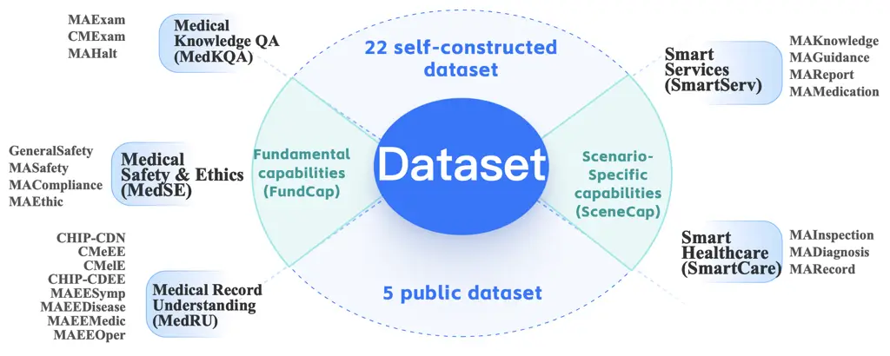
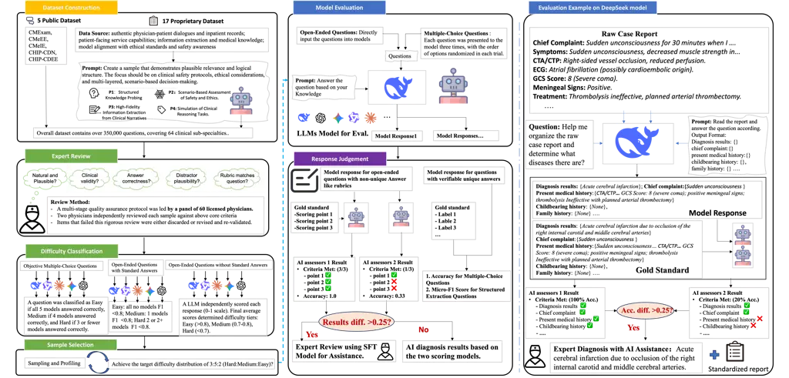
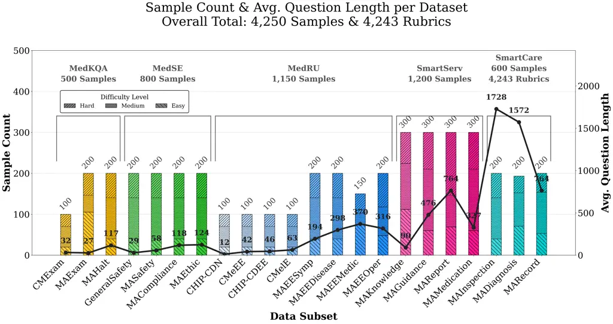
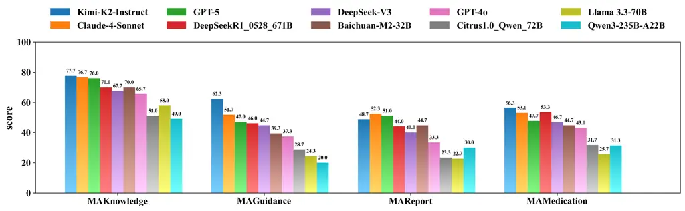

# MLB: A Scenario-Driven Benchmark for Evaluating Large Language Models in Clinical Applications

DOI: [XXXXXXX.XXXXXXX](https://doi.org/XXXXXXX.XXXXXXX)Conference: Make
sure to enter the correct conference title from your rights confirmation
email; June 03–05, 2018; Woodstock,
NYISBN: 978-1-4503-XXXX-X/2018/06CCS: Computing methodologies Natural
language generationCCS: Applied computing Health care information
systems

Qing He^(1,\*) Dongsheng Bi^(1,\*), Jianrong Lu^(2,1,\*), Minghui Yang¹,
Zixiao Chen¹, Jiacheng Lu¹, Jing Chen¹, Nannan Du¹, Xiao Cu¹, Sijing
Wu³, Peng Xiang⁴, Yinyin Hu³, Yi Guo³, Chunpu Li³, Shaoyang Li¹, Zhuo
Dong¹, Ming Jiang¹, Shuai Guo¹, Liyun Feng¹, Jin Peng¹, Jian Wang¹,
Jinjie Gu¹, Junwei Liu^(1,5, †) Affiliation: ¹ Ant Group, Hangzhou,
China  
² Zhejiang University, Hangzhou, China  
³ Health Information Center of Zhejiang Province, Hangzhou, China  
⁴ Department of AI and IT, The Second Affiliated Hospital, School of
Medicine, Zhejiang University, Hangzhou, China  
⁵ School of Software and Microelectronics, Peking University, Beijing,
China  
\* The first three authors contributed equally to this work;
†Corresponding Author. email: [bidongsheng.bds, minghui.ymh,
bobblair.wj@antgroup.com, jrong.alvin@gmail.com,
liujunwei@stu.pku.edu.cn](mailto:bidongsheng.bds,%20minghui.ymh,%20bobblair.wj@antgroup.com,%20jrong.alvin@gmail.com,%20liujunwei@stu.pku.edu.cn)

Received  23 November 2025

###### Abstract.

The proliferation of Large Language Models (LLMs) presents
transformative potential for healthcare, yet practical deployment is
hindered by the absence of frameworks that assess real-world clinical
utility. Existing benchmarks test static knowledge, failing to capture
the dynamic, application-oriented capabilities required in clinical
practice. To bridge this gap, we introduce a Medical LLM Benchmark MLB,
a comprehensive benchmark evaluating LLMs on both foundational knowledge
and scenario-based reasoning. MLB is structured around five core
dimensions: Medical Knowledge (MedKQA), Safety and Ethics (MedSE),
Medical Record Understanding (MedRU), Smart Services (SmartServ), and
Smart Healthcare (SmartCare). The benchmark integrates 22 datasets (17
newly curated) from diverse Chinese clinical sources, covering 64
clinical specialties. Its design features a rigorous curation pipeline
involving 300 licensed physicians. Besides, we provide a scalable
evaluation methodology, centered on a specialized judge model trained
via Supervised Fine-Tuning (SFT) on expert annotations. Our
comprehensive evaluation of 10 leading models reveals a critical
translational gap: while the top-ranked model, Kimi-K2-Instruct (77.3%
accuracy overall), excels in structured tasks like information
extraction (87.8% accuracy in MedRU), performance plummets in
patient-facing scenarios (61.3% in SmartServ). Moreover, the exceptional
safety score (90.6% in MedSE) of the much smaller Baichuan-M2-32B
highlights that targeted training is equally critical. Our specialized
judge model, trained via SFT on a 19k expert-annotated medical dataset,
achieves 92.1% accuracy, an F1-score of 94.37%, and a Cohen’s Kappa of
81.3% for human–AI consistency, validating a reproducible and
expert-aligned evaluation protocol. MLB thus provides a rigorous
framework to guide the development of clinically viable LLMs.

###### Keywords: 

Large Language Models, Benchmark, Medical AI, Healthcare, Evaluation,
Supervised Fine-Tuning

## 1. Introduction

The rapid advancement of LLMs holds immense promise for revolutionizing
healthcare, with potential applications ranging from clinical decision
support (Singhal et al., 2023; Thirunavukarasu et al., 2023) to
specialized tasks like mental health analysis (Yang et al., 2024; Lu et
al., 2024; Lu et al., 2025) and patient message triage (Subramanyam et
al., 2024). However, translating this potential into safe and effective
clinical practice requires overcoming significant challenges related to
professional accuracy, adaptability to complex scenarios, and adherence
to stringent safety and ethical standards (Lee et al., 2023; Shang et
al., 2024; Cima et al., 2025). For example, current benchmarks for
medical LLMs, such as those based on standardized licensing exams (Jin
et al., 2019; Pal et al., 2022), primarily assess foundational medical
knowledge through multiple-choice questions. While valuable, these
evaluations fail to measure the models’ practical utility in authentic
clinical contexts (Zhang et al., 2025) and, critically, lack a scalable
and reliable method for assessing the open-ended, nuanced reasoning
required in clinical interactions. This highlights an urgent need for a
comprehensive, application-oriented benchmark to guide the development
and deployment of LLMs in healthcare.

To address this critical gap, we developed the MLB, a benchmark designed
to systematically evaluate the end-to-end capabilities of LLMs in
healthcare within the Chinese clinical healthcare context. The MLB moves
beyond static knowledge assessment to prioritize performance in diverse,
realistic clinical scenarios, thereby assessing the breadth, depth, and
practical relevance of current models. Our objective is to provide a
scientific and objective framework for quantifying the reliability,
applicability, and safety of LLMs, fostering the development of
high-quality, trustworthy medical AI, aligning with the broader goal of
leveraging web and AI technologies for social good.

The main contributions of this work are as follows:

1.  (1)
    We introduce MLB a novel, scenario-driven benchmark constructed from
    challenging, real-world data sources, including multi-turn
    physician-patient dialogues from web-based telehealth platforms and
    authentic clinical records. Its expert-driven (300 physicians)
    curation and difficulty grading provide a robust assessment of
    practical clinical utility.
2.  (2)
    We propose and validate a scalable evaluation methodology for
    complex, open-ended clinical tasks. By applying SFT to a large
    corpus of expert-annotated judgments, we developed a specialized
    “judge" model that achieves high-fidelity, reproducible, and
    cost-effective evaluation at scale.
3.  (3)
    We conducted a comprehensive evaluation of 10 leading LLMs. This
    analysis reveals a critical translational gap: top models like
    Claude-4-Sonnet achieve high proficiency in structured tasks (88.8%
    in MedRU), yet the best-performing model, Kimi-K2-Instruct, only
    scores 61.3% in patient-facing scenarios (SmartServ). Our SFT-judge
    model proves essential for this analysis, achieving 92.1% accuracy
    and 81.3% Cohen’s Kappa, demonstrating near-human agreement.

## 2. Related Work

The evaluation of LLMs (Zhou et al., 2024; Lu et al., 2024) in the
medical domain has evolved from foundational knowledge tests to more
comprehensive assessments. Early and prominent benchmarks were largely
adapted from existing medical examinations. For instance, MedExQA (Kim
et al., 2024) utilized questions from the United States Medical
Licensing Examination (USMLE), establishing a standard for assessing
clinical knowledge. Similarly, PubMedQA (Jin et al., 2019) focused on
biomedical research questions requiring yes/no/maybe answers, while
MedMCQA (Pal et al., 2022) used multiple-choice questions from Indian
medical entrance exams. While these benchmarks are crucial for gauging a
model’s knowledge base, their format does not capture the complexities
of clinical interaction and reasoning.

Recognizing these limitations, subsequent efforts aimed for broader
evaluations. The MultiMedQA benchmark (Singhal et al., 2023) integrated
several existing datasets and introduced HealthSearchQA, a dataset of
commonly searched consumer health questions, to assess the model’s
ability to provide layperson-friendly information. Another notable
effort, MedBench (Liu et al., 2024), expanded the scope by including
tasks related to clinical notes, diagnostics, and patient conversations.
These benchmarks represent a significant step towards more holistic
evaluation.

A recent, concurrent effort is OpenAI’s HealthBench (Arora et al.,
2025), which also emphasizes real-world scenarios through 5,000
simulated dialogues. HealthBench employs a distinct methodology,
utilizing a generalist model (GPT-4.1) to score responses against
unique, physician-authored rubrics for each dialogue. While MLB shares
the goal of scenario-based evaluation, it provides a more diversified
assessment framework, integrating 22 datasets across five distinct
dimensions (MedKQA, MedSE, MedRU, SmartServ, SmartCare), rather than
focusing solely on dialogue quality. Methodologically, our SFT-trained
judge model is developed as a scalable proxy for human adjudication on
disputed, open-ended tasks, a different approach from HealthBench’s
rubric-based model evaluation. Furthermore, MLB’s scenarios are derived
from authentic clinical records and web-based telehealth data,
complementing HealthBench’s synthetically generated interactions.

However, a critical gap remains in the systematic evaluation of LLMs in
applied, scenario-based contexts that simulate real-world clinical
workflows. While MedBench (Liu et al., 2024) incorporates clinical
dialogue tasks, its scenarios often lack the complexity of real-world
data streams. MLB’s SceneCap dimension provides a more substantial
differentiation by simulating the entire clinical workflow. Our tasks
are not isolated conversations but are constructed from authentic,
multi-turn patient-provider interactions sourced from web-based
telehealth platforms and anonymized electronic health records (EHRs).

This contrasts with benchmarks like MultiMedQA (Singhal et al., 2023),
which merely aggregated existing datasets, or earlier web-tools focused
on information retrieval over clinical reasoning (Simmons, 2010). MLB’s
innovation lies in its expert-driven, synthesis-oriented data curation.
Our clinical experts (including web-health practitioners) fused
disparate, cross-source medical records (e.g., lab reports, notes) to
create novel, complex test cases. This methodology explicitly assesses
an LLM’s ability to handle the fragmented, conflicting data endemic to
clinical practice—a dimension previous benchmarks failed to measure. Our
use of web-telehealth data aligns with recent work scaling medical AI
via web technologies (Guo et al., 2022; Hsu et al., 2009; Giannakos,
2010). While parallel efforts address other modalities (Fan et al.,
2025), robust conversational AI evaluation remains a key challenge.

Critically, while these benchmarks introduce more complex tasks, they
often rely on simplified metrics (e.g., string matching) or costly,
non-scalable human evaluation for open-ended questions. A significant
methodological gap remains in the scalable and reproducible scoring of
nuanced clinical reasoning, a gap we address with our SFT-based
evaluation protocol.

## 3. The MLB Benchmark

The MLB is designed as a multi-layered evaluation system that assesses
LLMs from foundational knowledge to practical application. A key
challenge in this design is the reliable assessment of the “SceneCap"
domain, which relies on open-ended clinical scenarios. We address this
through a novel evaluation methodology (detailed in Section 3.6)
centered on a specialized SFT-trained judge model. The benchmark’s
hierarchical structure, detailed dataset composition, rigorous curation
process, and sophisticated evaluation methodology collectively ensure a
comprehensive and reliable assessment. Figure 2 shows the curation and
evaluation pipeline.

Figure 1. Overview of the MLB Benchmark. This figure illustrates the
benchmark’s hierarchical structure, divided into Fundamental
Capabilities (FundCap) and Scenario-based Capabilities (SceneCap), which
are further broken down into five core dimensions (MedKQA, MedSE, MedRU,
SmartServ, SmartCare).

Figure 2. Pipeline of Dataset Curation and Evaluation. The diagram
outlines the end-to-end process for creating and evaluating the MLB. It
begins with data acquisition from diverse sources (e.g., EHRs, web-based
dialogues), proceeds through a multi-paradigm generation pipeline
(P1-P4), and undergoes rigorous expert review by 300 licensed
physicians. The evaluation phase uses a hybrid scoring protocol in
response judgement, culminating in our SFT-based judge model for
resolving ambiguities.

### 3.1. Evaluation Dimensions

The benchmark framework is organized into a two-level hierarchy. At the
highest level, we distinguish between Fundamental Capabilities (FundCap)
and Scenario-based Capabilities (SceneCap). These are further broken
down into five core dimensions, as illustrated in Figure 1.

- •
  Fundamental Capabilities (FundCap): This domain assesses the core
  knowledge and processing abilities of an LLM in the medical field. It
  is divided into three dimensions:
  1.  (1)
      Medical Knowledge Question Answering (MedKQA): Evaluates the
      accuracy and breadth of an LLM’s medical knowledge and its ability
      to mitigate hallucinations.
  2.  (2)
      Medical Safety & Ethics (MedSE): Measures the model’s adherence to
      safety protocols, regulatory compliance, and ethical principles in
      a medical context.
  3.  (3)
      Medical Record Understanding (MedRU): Assesses the model’s
      capacity to process and extract structured information from
      unstructured clinical text, such as electronic health records
      (EHRs).

- •
  Scenario-based Capabilities (SceneCap): This domain evaluates the
  model’s performance in simulated real-world clinical applications. It
  is divided into two dimensions:
  1.  (1)
      Smart Services (SmartServ): Focuses on patient-facing tasks, such
      as providing Health Education, Department Guidance, report
      interpretation, and medication instructions.
  2.  (2)
      Smart Healthcare (SmartCare): Focuses on physician-support tasks,
      such as Medical Inspection Recommendation, assisting with
      Diagnostic Assistance, and Medical Record Writing Assistance.

### 3.2. Dataset Composition

To operationalize this framework, the MLB comprises 22 distinct
datasets, including 17 newly constructed (proprietary) datasets and 5
established public datasets. These datasets are derived from a diverse
range of sources, including clinical guidelines, medical textbooks,
authentic EHRs, and physician-patient dialogues, ensuring robust and
realistic evaluation scenarios. Figure 3 shows that the overall dataset
contains over 350,000 questions, covering 64 clinical sub-specialties.
Table 1 details the construction of the dataset The specific specialty
distribution is shown in Table 2.

Figure 3. Overview of the dataset composition, including total sample
size, distribution across dimensions, average question length, and
difficulty level. The chart displays the distribution of MLB’s 22
datasets across the five core dimensions. It highlights the total sample
size (4250 samples), the source of data (17 proprietary, 5 public), and
the average token length of questions, indicating the complexity of the
tasks.

|                   |                     |                                   |               |             |                 |                            |            |           |                              |
| ----------------- | ------------------- | --------------------------------- | ------------- | ----------- | --------------- | -------------------------- | ---------- | --------- | ---------------------------- |
| Primary Dimension | Secondary Dimension | Tertiary Dimension Intro.         | Dataset       | Source      | Type            | Scoring Method             | Original N | Sampled N | Sampling Key(s)              |
| FundCap           | MedKQA              | Med. Knowledge                    | CMExam        | Public      | Multiple-Choice | Accuracy                   | 6811       | 100       | difficulty level             |
|                   | MedKQA              | Med. Knowledge                    | MAExam        | Proprietary | Multiple-Choice | Accuracy                   | 1000       | 200       | difficulty level             |
|                   | MedKQA              | Med. Hallucination                | MAHalt        | Proprietary | Multiple-Choice | Accuracy                   | 5000       | 200       | type, difficulty level       |
|                   | MedSE               | General Safety                    | GeneralSafety | Proprietary | Open-Ended      | AI-Assisted w/ Expert Adj. | 3600       | 200       | difficulty level             |
|                   | MedSE               | Medical Safety                    | MASafety      | Proprietary | Multiple-Choice | Accuracy                   | 5000       | 200       | source, difficulty level     |
|                   | MedSE               | Med. Compliance                   | MACompliance  | Proprietary | Open-Ended      | AI-Assisted w/ Expert Adj. | 3000       | 200       | risk type, difficulty level  |
|                   | MedSE               | Medical Ethics                    | MAEthic       | Proprietary | Open-Ended      | AI-Assisted w/ Expert Adj. | 500        | 200       | risk type, difficulty level  |
|                   | MedRU               | Term Normalization                | CHIP-CDN      | Public      | Open-Ended      | Micro-F1                   | 2000       | 100       | department, difficulty level |
|                   | MedRU               | Info. Extraction                  | CMeEE         | Public      | Open-Ended      | Micro-F1                   | 5000       | 100       | department, difficulty level |
|                   | MedRU               | Info. Extraction                  | CHIP-CDEE     | Public      | Open-Ended      | Micro-F1                   | 384        | 100       | department, difficulty level |
|                   | MedRU               | Info. Extraction                  | CMeIE         | Public      | Open-Ended      | Micro-F1                   | 3585       | 100       | department, difficulty level |
|                   | MedRU               | Info. Extraction                  | MAEESymp      | Proprietary | Open-Ended      | Micro-F1                   | 1040       | 200       | department, difficulty level |
|                   | MedRU               | Info. Extraction                  | MAEEDisease   | Proprietary | Open-Ended      | Micro-F1                   | 716        | 200       | department, difficulty level |
|                   | MedRU               | Info. Extraction                  | MAEEMedic     | Proprietary | Open-Ended      | Micro-F1                   | 393        | 150       | department, difficulty level |
|                   | MedRU               | Info. Extraction                  | MAEEOper      | Proprietary | Open-Ended      | Micro-F1                   | 580        | 200       | department, difficulty level |
| SceneCap          | SmartServ           | Health Education                  | MAKnowledge   | Proprietary | Multiple-Choice | Accuracy                   | 6983       | 300       | department, difficulty level |
|                   | SmartServ           | Department Guidance               | MAGuidance    | Proprietary | Multiple-Choice | Accuracy                   | 4837       | 300       | department, difficulty level |
|                   | SmartServ           | Report Interp.                    | MAReport      | Proprietary | Multiple-Choice | Accuracy                   | 3000       | 300       | department, difficulty level |
|                   | SmartServ           | Medication Instruct.              | MAMedication  | Proprietary | Multiple-Choice | Accuracy                   | 5932       | 300       | department, difficulty level |
|                   | SmartCare           | Medical Inspection Recommendation | MAInspection  | Proprietary | Open-Ended      | AI-Assisted w/ Expert Adj. | 3000       | 200       | department, difficulty level |
|                   | SmartCare           | Diagnostic Assistance             | MADiagnosis   | Proprietary | Open-Ended      | AI-Assisted w/ Expert Adj. | 3000       | 200       | department, difficulty level |
|                   | SmartCare           | Med. Record Writing Assistance    | MARecord      | Proprietary | Open-Ended      | AI-Assisted w/ Expert Adj. | 3000       | 200       | department, difficulty level |

Table 1. Overview of Datasets, Evaluation Methods and Sampling Strategy
in the MLB. This comprehensive table details all 22 datasets within MLB,
organized by their primary, secondary, and tertiary dimensions. It
specifies the data source (Public/Proprietary), question type, scoring
metric, original and final sampled item counts (N), and the key
attributes (e.g., difficulty level, department) used for our stratified
and proportional sampling strategy.

[TABLE]

Table 2. Distribution of data samples across 9 major clinical
departments and 64 sub-specialties. This table provides a detailed
breakdown of the samples annotated by clinical specialty. Internal
Medicine (722 samples) is the most highly represented category.

### 3.3. Dataset Curation Process

The integrity and quality of the benchmark are underpinned by a
rigorous, human-in-the-loop curation process. This process combines the
scalability of automated generation with the precision of expert
verification.

#### 3.3.1. Dataset Preparation

Our data curation strategy combined the use of established public
benchmarks with the development of novel, purpose-built datasets to
ensure both broad coverage and targeted assessment of advanced
capabilities. This dual approach yielded a comprehensive collection of
22 datasets, comprising 5 public and 17 proprietary datasets.

##### Public Datasets

To ground our benchmark in established tasks, we incorporated five
widely recognized Chinese medical language processing datasets. These
included: CMExam (Liu et al., 2023), a dataset derived from the Chinese
National Medical Licensing Examination; CHIP-CDN (Cui et al., 2023), a
clinical diagnosis normalization task; and a suite of information
extraction datasets including CMeEE (Du et al., 2024) for named entity
recognition, CHIP-CDEE (Zhang et al., 2021) for structured clinical
event extraction, and CMeIE (Guan et al., 2020) for identifying semantic
relationships. These datasets provide a robust baseline for assessing
foundational natural language understanding capabilities in the medical
domain.

##### Proprietary Dataset Construction

The 17 proprietary datasets were meticulously constructed to address
gaps in existing benchmarks, particularly concerning clinical safety,
ethics, and complex, scenario-based reasoning. Our construction
methodology was centered on a sophisticated, prompt-based data
generation and annotation pipeline, leveraging advanced LLMs as scalable
generators, followed by rigorous verification by clinical experts. This
process can be categorized into four primary paradigms.

Paradigm 1: Structured Knowledge Probing. This paradigm was employed to
create datasets for assessing core medical knowledge (MAExam, MAHalt),
safety awareness (MASafety), and patient-facing service capabilities
(MAKnowledge, MAGuidance, MAReport, MAMedication). The core methodology
employed a suite of LLMs—namely Gemini-2.5-pro, Qwen3-235B-A22B, and
DeepSeekR1-0528-671B—for the automated generation of medical examination
items. For instance, to generate items for MAReport, the LLM was
provided with an authentic, anonymized clinical report and a structured
prompt instructing it to formulate a clinically relevant multiple-choice
question, generate one unambiguously correct answer, and create four
plausible yet incorrect distractors that target common misconceptions.

Paradigm 2: Scenario-Based Assessment of Safety and Ethics. To evaluate
model alignment with legal and ethical standards, we developed datasets
comprising complex, open-ended scenarios (GeneralSafety, MACompliance,
MAEthic). The process began with the curation of challenging scenarios
by medical and legal experts. These scenarios were framed as prompts to
which a model generated a response. Subsequently, a separate set of
structured, multi-dimensional evaluation prompts was used to score the
generated response, assessing criteria such as compliance and risk
awareness.

Paradigm 3: High-Fidelity Information Extraction from Clinical
Narratives. To assess nuanced information extraction, we constructed
four specialized datasets: MAEESymp (symptoms), MAEEDisease (diseases),
MAEEMedic (medications), and MAEEOper (operations). The process started
with a large corpus of anonymized Chinese electronic health records. We
employed a semi-automated annotation pipeline where an LLM performed an
initial pass of entity labeling, followed by a two-stage manual review
and correction process by our physician team to ensure gold-standard
accuracy.

Paradigm 4: Simulation of Clinical Reasoning Tasks. This category of
datasets (MAInspection, MADiagnosis, MARecord) was designed to simulate
complex clinical reasoning, derived from authentic physician-patient
dialogues and inpatient records sourced from web-based healthcare
interactions. For instance, the construction of the MADiagnosis dataset
required clinical experts to sift through multiple, often conflicting,
patient records to identify the most salient information for formulating
a diagnosis, thereby simulating the critical real-world skill of
evidence synthesis from complex and noisy data sources. This methodology
ensures that the tasks and their corresponding ground truths are firmly
rooted in actual clinical practice.

#### 3.3.2. Clinical Department Annotation

To enable specialty-specific analysis, we implemented a systematic
department annotation protocol for seven datasets within the SmartServ
and SmartCare domains. We utilized a large language model to map each
data instance to a standardized, two-tiered system of 9 primary and 64
secondary clinical departments. The annotation process adhered to strict
rules: a maximum of three departments per instance, restriction to the
predefined department list, and a “No Department" label for non-clinical
queries. This standardized annotation enhances the benchmark’s utility
for evaluating applications like automated patient department guidance.

#### 3.3.3. Expert Review and Refinement

To ensure clinical fidelity, we instituted a multi-stage quality
assurance protocol led by a panel of 300 licensed physicians from
Grade-A tertiary hospitals in China, including experts with experience
in web-based medical services. Our quality assurance involved a
dual-annotator and cross-verification workflow. Two physicians
independently reviewed each sample against five core criteria: natural
and plausible, clinical validity, answer correctness, distractor
plausibility (for multiple-choice questions), and rubric matches
question. Items that failed this rigorous review were either discarded
or revised and re-validated, ensuring every item in the MLB is accurate,
relevant, and of high quality.

### 3.4. Difficulty Classification

To enable a fine-grained analysis of model capabilities, each question
in the benchmark was assigned a difficulty level (Easy, Medium, Hard).
This classification was determined empirically based on the performance
of a panel of five diverse calibration LLMs (Mistral Large 2 (Jiang et
al., 2023), Qwen2.5-72B (Qwen et al., 2025), MedGemma-27B (Sellergren et
al., 2025), Baichuan-M1-14B (Wang et al., 2025a),
Citrus1.0-Qwen-72B (Wang et al., 2025b)). We employed three distinct
methodologies tailored to different question types.

1.  (1)
    Objective Multiple-Choice Questions: Difficulty was based on model
    consensus. A question was classified as Easy if all 5 models
    answered correctly, Medium if 4 models answered correctly, and Hard
    if 3 or fewer models answered correctly.
2.  (2)
    Open-Ended Questions with Standard Answers: For tasks like Named
    Entity Recognition (NER), we used the micro-F1 score. A response was
    considered correct if its micro-F1 score exceeded a threshold of
    0.8. Difficulty was then assigned using the same consensus logic as
    for multiple-choice questions.
3.  (3)
    Open-Ended Questions without Standard Answers: For tasks in MedSE
    and SmartCare, we used a dual-model scoring system where two
    instances of our scoring model (GPT-4o-1120) independently scored
    each response on a scale of 0 to 1. If the scores diverged
    significantly (by more than 0.25), the response was flagged for
    final judgement by a human medical expert. The final average score
    across the five calibration models determined the difficulty: Easy
    ($`>`$0.7), Medium (0.6-0.7), and Hard ($`<`$0.6).

This data-driven approach to difficulty scoring allows for a nuanced
diagnosis of model weaknesses.

### 3.5. Sample Selection

To ensure MLB is comprehensive and robust, we designed a systematic
sampling strategy guided by two principles: comprehensive coverage of
clinical specialties/attributes and a controlled difficulty
distribution. Table 1 details the sampling attributes and data counts.

For datasets with explicit specialty labels (e.g., MADiagnosis,  
MARecord), we used stratified sampling. We partitioned data into 64
clinical specialties and sampled proportionally from each stratum,
ensuring broad coverage. For datasets lacking specialty labels but
having other key attributes (e.g., MASafety by risk type, MAHalt by
hallucination type), we applied proportional sampling based on the
original distribution of attributes to ensure diverse assessment
dimensions.

To ensure discriminatory power, we implemented a multi-step iterative
process to achieve a target difficulty distribution of 3:5:2
(Hard:Medium:Easy), chosen to effectively differentiate model
capabilities. The process was as follows:

1.  (1)
    Initial Sampling and Profiling: We sampled a preliminary set based
    on coverage principles and analyzed its difficulty profile.
2.  (2)
    Gap Analysis and Supplementation: We calculated the shortfall
    against our 3:5:2 target and performed targeted sampling from the
    remaining data pool to fill these gaps, prioritizing
    under-represented categories.
3.  (3)
    Balancing and Verification: We made fine-tuning adjustments (e.g.,
    swapping items of the same specialty and difficulty) to precisely
    match the target ratio. The final set was verified to adhere to both
    coverage and difficulty principles.

### 3.6. Evaluation Methodology

Our evaluation protocol was designed to be rigorous, fair, and
efficient, incorporating a systematic sampling strategy, a mechanism to
mitigate bias, and a hybrid scoring framework centered on our novel
SFT-based judge model.

#### 3.6.1. Dynamic Evaluation for Bias Mitigation

To mitigate positional bias in multiple-choice questions, we implemented
a dynamic shuffling strategy. Each question was presented to the model
three times, with the order of options randomized in each trial. A
question was marked as correct only if the model provided the
semantically correct answer across all three permutations. This method
ensures that models reason about the content of the options rather than
relying on positional heuristics.

#### 3.6.2. Hybrid Scoring Protocol

We developed a hybrid scoring protocol that combines automated metrics
for structured tasks with an AI-assisted, expert-adjudicated framework
for complex, open-ended questions.

| Model                                       | Organization  | Type   | Parameters    |
| ------------------------------------------- | ------------- | ------ | ------------- |
| Kimi-K2-Instruct (Team et al., 2025a)       | Moonshot AI   | Closed | $`\sim`$1000B |
| DeepSeekR1_0528 (DeepSeek-AI et al., 2025a) | DeepSeek      | Open   | 671B          |
| Claude-4-Sonnet (Anthropic, 2025)           | Anthropic     | Closed | N/A           |
| GPT-5 (OpenAI, )                            | OpenAI        | Closed | N/A           |
| Baichuan-M2 (Team et al., 2025b)            | Baichuan      | Open   | 32B           |
| DeepSeek-V3 (DeepSeek-AI et al., 2025b)     | DeepSeek      | Open   | 671B          |
| Qwen3-235B (Yang et al., 2025)              | Alibaba Cloud | Open   | 235B          |
| GPT-4o (OpenAI et al., 2024)                | OpenAI        | Closed | N/A           |
| Citrus1.0 (Wang et al., 2025b)              | JD.com        | Open   | 72B           |
| Llama 3.3 (Grattafiori et al., 2024)        | Meta AI       | Open   | 70B           |

Table 3. List of LLMs Evaluated in This Study. The table lists the 10
diverse Large Language Models evaluated, including their originating
organization, access type (Open-source/Closed-source), and reported
parameter size (where available).

##### Fully Automated Evaluation

For tasks with objective, verifiable answers, scoring was fully
automated.

- •
  Accuracy for Multiple-Choice Questions: This metric was used for all
  multiple-choice datasets. A response was scored as correct only if it
  matched the ground truth across all three shuffled trials.
- •
  Micro-F1 Score for Structured Extraction: This metric was applied to
  tasks like Named Entity Recognition. The Micro-F1 score was calculated
  by aggregating true positives, false negatives, and false positives
  across all entity classes.

##### AI-Assisted Evaluation with Expert judgement

For open-ended questions lacking a single ground truth, we employed a
dual-assessor AI system with a human-in-the-loop workflow.

- •
  Initial AI Assessment: Each response was independently evaluated by
  two separate instances of our scoring model (GPT-4o-1120) against a
  predefined, multi-dimensional scoring rubric.
- •
  Human Judgement Trigger: A manual review by a human medical expert was
  automatically triggered if the scores from the two AI assessors
  exhibited a discrepancy greater than 0.25 on a normalized 0-1 scale.
- •
  Expert Review Workflow: When triggered, such cases were initially
  escalated to a physician from our expert panel for definitive
  assessment.

While this human-in-the-loop framework ensures gold-standard accuracy,
it introduces a significant evaluation bottleneck. To address this
challenge of scalability and cost, we developed our automated judge
model as a third-stage assessor.

##### Automated Judge Model

A fundamental barrier to evaluating complex, open-ended scenarios at
scale is the reliance on costly and subjective human expert scoring. To
overcome this, we introduce a specialized “judge" model as a core
component of our evaluation methodology. This model is engineered to
serve as a consistent, scalable, and expert-aligned adjudicator for
disputed or ambiguous responses. We trained this model using Supervised
Fine-Tuning (SFT) on a substantial corpus of 19,000 expert-annotated
scoring points, derived from complex cases where high-capability
generalist models disagreed. This SFT process imparts the model with the
nuanced decision-making capability of clinical experts, enabling a
reproducible and cost-effective evaluation pipeline. The training corpus
was constructed by aggregating the expert-annotated scoring points from
the disputed questions generated during the evaluation of nine distinct
LLMs. This dataset captures a wide array of complex and ambiguous cases.
The evaluation set was derived from the complete set of 596 disputed
questions generated by multiple models that was held out from the
training data, ensuring a rigorous test of generalization. This
specialized SFT model is already in preliminary online deployment,
providing decision-support assistance to clinicians and validating its
real-world utility.

## 4. Experimental Results

### 4.1. Evaluated Models

We evaluated a diverse set of prominent LLMs on the MLB to assess the
current state-of-the-art. The selection included both open-source and
closed-source models of varying sizes, representing a cross-section of
the field’s leading contenders. The models evaluated are listed in
Table 3. All models were evaluated using their official API endpoints.
To ensure the integrity of the evaluation and prevent any potential data
contamination, the models were not provided with any information about
the questions, tasks, or answer formats beforehand, and all interactions
were conducted via their respective APIs.

| Model                                    | Average | MedKQA | MedSE | MedRU | SmartServ | SmartCare |
| ---------------------------------------- | ------- | ------ | ----- | ----- | --------- | --------- |
| Kimi-K2-Instruct (Team et al., 2025a)    | 77.288  | 73.17  | 85.50 | 87.75 | 61.25     | 78.77     |
| DeepSeekR1-0528-671B (Guo et al., 2025)  | 75.434  | 78.58  | 85.09 | 88.27 | 53.33     | 71.90     |
| Claude-4-Sonnet (Anthropic, 2025)        | 74.534  | 76.42  | 73.67 | 88.78 | 58.42     | 75.38     |
| GPT-5 (OpenAI, )                         | 73.87   | 76.00  | 77.80 | 88.02 | 55.42     | 72.11     |
| Baichuan-M2-32B (Team et al., 2025b)     | 72.012  | 65.25  | 90.64 | 83.60 | 49.67     | 70.90     |
| DeepSeek-V3 (DeepSeek-AI et al., 2025b)  | 70.498  | 62.08  | 83.92 | 87.04 | 49.75     | 69.70     |
| Qwen3-235B-A22B (Yang et al., 2025)      | 65.886  | 52.00  | 80.61 | 85.25 | 32.58     | 78.99     |
| GPT-4o (OpenAI et al., 2024)             | 65.45   | 49.25  | 73.57 | 85.86 | 44.83     | 73.74     |
| Citrus1.0-Qwen-72B (Wang et al., 2025b)  | 63.946  | 67.50  | 70.95 | 78.14 | 33.67     | 69.47     |
| Llama 3.3-70B (Grattafiori et al., 2024) | 54.022  | 42.75  | 58.70 | 79.74 | 32.67     | 56.25     |

Table 4. Overall Performance of Evaluated LLMs Across the Five Core
Dimensions of the MLB. Scores represent the mean performance. The
best-performing model in each column is in bold, and the second-best is
underlined.

### 4.2. Overall Performance Analysis

As shown in Table 4, a clear performance hierarchy emerged.
Kimi-K2-Instruct achieved the highest overall score of 77.29,
demonstrating robust and well-rounded capabilities. It was closely
followed by DeepSeekR1-0528-671B (75.43) and Claude-4-Sonnet (74.53). A
critical observation is the universal performance drop in the SmartServ
(Smart Services) dimension. Although Kimi-K2-Instruct leads this
category, its score of 61.25 is significantly lower than scores in other
dimensions, and most models score below 55. This indicates a substantial
gap between foundational knowledge and the ability to apply it in
interactive, patient-facing scenarios. In contrast, performance on MedRU
(Medical Record Understanding) was consistently high across top models,
suggesting that fundamental NLP tasks like information extraction are
relatively mature. Performance on MedSE (Medical Safety & Ethics) was
also strong, with Baichuan-M2-32B achieving an exceptional 90.64,
indicating highly effective alignment training.

### 4.3. Performance on Sub-dimension SmartServ

To provide a more granular view, Figure 4 visualizes the performance of
top models on SmartServ. This reveals specific strengths and weaknesses
masked by aggregated scores. The results highlight that even
top-performing models have uneven capability profiles. For example,
Kimi-K2-Instruct showed superior performance, ranking first in the
MAKnowledge dimension. Notably, Baichuan-M2, despite its smaller size,
ranked fourth in the MAKnowledge.

Figure 4. Bar chart comparing the performance of selected models on the
SmartServ sub-dimension of the MLB.

### 4.4. Judge Model Performance

Validating our SFT-based judge model is a prerequisite for our main
findings (Section 5.1). We confirmed it can reliably resolve scoring
discrepancies, surpassing general-purpose LLMs. The results (Table 5)
demonstrate three key findings.

|                                |          |           |        |          |               |
| ------------------------------ | -------- | --------- | ------ | -------- | ------------- |
| Model                          | Accuracy | Precision | Recall | F1-Score | Cohen’s Kappa |
| Qwen3-235B-A22B, w/o SFT       | 0.7772   | 0.9416    | 0.7160 | 0.8135   | 0.5493        |
| DeepSeek-V3, w/o SFT           | 0.8677   | 0.8559    | 0.9679 | 0.9085   | 0.6730        |
| Kimi-K2-Instruct-0905, w/o SFT | 0.8007   | 0.8095    | 0.9235 | 0.8627   | 0.5045        |
| Gemini-2.5-pro, w/o SFT        | 0.7588   | 0.8872    | 0.7383 | 0.8059   | 0.4943        |
| GLM-4.6, w/o SFT               | 0.7513   | 0.9103    | 0.7030 | 0.7933   | 0.4937        |
| GPT-5-2025-08-07, w/o SFT      | 0.6633   | 0.9435    | 0.5358 | 0.6835   | 0.3776        |
| Qwen3-14B, w/o SFT             | 0.7102   | 0.8946    | 0.6494 | 0.7525   | 0.4235        |
| Qwen3-14B, with SFT on 2k data | 0.8325   | 0.8458    | 0.9210 | 0.8818   | 0.5962        |
| Qwen3-14B, with SFT 19k data   | 0.9213   | 0.9163    | 0.9728 | 0.9437   | 0.8132        |

Table 5. Performance of the Automated Judge Model on Disputed Cases,
validating the SFT approach.

First, our SFT-trained Qwen3-14B (trained on 19k data) achieves
state-of-the-art 92.13% accuracy and 94.37% F1-Score, significantly
outperforming all general-purpose baselines, including much larger
models like DeepSeek-V3 and GPT-5. Notably, the model maintains
consistent performance despite uneven input lengths (ranging from 764 to
1728 tokens). We utilized Qwen3-14B as the backbone because its compact
parameter size, combined with robust performance, makes it a highly
viable solution for practical clinical deployment.

Second, this performance is a direct result of specialized SFT. An
ablation study confirms this: the base Qwen3-14B accuracy (71.02%)
improved to 83.25% (with 2k SFT samples) and finally to 92.13% (with 19k
samples), validating that the model learns specialized capabilities from
the expert-annotated data.

Third, the model achieved a Cohen’s Kappa of 81.32%, signifying high
agreement with human experts. This confirms the model’s judgments are
trustworthy and aligned with human reasoning, unlike the general-purpose
models. Our SFT-based methodology thus provides a robust and trustworthy
proxy for human-level evaluation, enabling the scalable analysis in this
paper.

## 5. Discussion

The results from our evaluation on the MLB provide several critical
insights into the landscape of medical LLMs.

Model Scale and Specialization Drive Performance: The top-ranking
performance of Kimi-K2-Instruct, a model with a very large parameter
count, suggests scale remains a significant factor in achieving high
overall competence. Concurrently, the exceptional safety score of the
much smaller Baichuan-M2-32B highlights that targeted training and
fine-tuning are equally critical. The relatively modest scores of
powerful generalist models like GPT-4o and Llama 3.3 further underscore
that general-purpose excellence does not guarantee proficiency in the
high-stakes medical domain.

Clear Evidence of Progress Within Model Families: Our results
demonstrate significant iterative improvement within model series. For
example, GPT-5 (73.87) substantially outperforms GPT-4o (65.45) across
nearly all dimensions, indicating effective advancements in architecture
and training. A similar leap is observed from DeepSeek-V3 (70.50) to
DeepSeekR1-0528-671B (75.43), showcasing the rapid pace of progress in
the field.

Scenario Application Bottleneck: The most striking finding is the
universal difficulty models face in the SmartServ dimension. This
category requires more than simple knowledge retrieval; it demands
contextual understanding and the ability to interpret user intent from
non-technical language. Tasks like report interpretation and Department
Guidance are complex reasoning processes that current LLMs struggle to
execute reliably. This translational gap is the most significant
challenge for the practical deployment of medical LLMs in patient-facing
roles.

Unpacking Diverse Architectural Strengths: The MLB allows for a nuanced
analysis of each model’s unique profile.

- •
  Kimi-K2-Instruct is the best all-rounder, with a leading overall score
  for the challenging patient-facing (SmartServ) tasks.
- •
  DeepSeekR1-0528-671B excels in foundational knowledge, achieving the
  top score in MedKQA, making it a strong candidate for
  knowledge-intensive applications.
- •
  Claude-4-Sonnet shows exceptional strength in structured data
  processing, leading the MedRU dimension, which is critical for tasks
  involving electronic health records.
- •
  Baichuan-M2-32B, despite its smaller size, presents a superior
  performance in safety alignment with its category-defining score of
  90.64 in MedSE.
- •
  Qwen3-235B-A22B demonstrates a surprising specialization, securing the
  top position in SmartCare, suggesting it is highly optimized for
  physician-support tasks.

A Methodological Contribution via SFT: Beyond the model performance
insights, our work presents a significant methodological contribution:
the validation of an SFT-trained judge model for scalable, high-fidelity
benchmark evaluation. The failure of even powerful generalist models
(like DeepSeek-V3 and GPT-5) to match our specialized judge’s accuracy
(92.13%) on disputed cases (Table 5) proves that “judging" nuanced
medical responses is a distinct, complex skill. Our SFT approach
provides a blueprint for future benchmarks to move beyond costly
human-in-the-loop evaluation, enabling the field to reliably assess the
scenario-based capabilities.

Implications and Future Directions: Our findings suggest that the future
of medical LLM development must prioritize scenario-based training. This
involves moving beyond static Q&A datasets to incorporate more
interactive, dialogue-based tasks that mimic real clinical workflows.
Furthermore, the development of specialized evaluation metrics for
patient-facing communication is crucial. The MLB will continue to
evolve, incorporating more complex clinical scenarios to push the
frontier of medical AI evaluation.

## 6. Conclusion

In this work, we introduced MLB, a comprehensive benchmark designed to
rigorously evaluate LLMs in clinical contexts. Through our
multi-dimensional assessment of leading models, we revealed critical
gaps in safety and reliability that traditional metrics overlook. By
leveraging our granular, scenario-driven evaluation benchmark to expose
LLMs’ issues in the perspective of safety, ethics, and compliance, this
work bridges the trust gap between technical capability and clinical
reality, ensuring that future AI agents evolve from experimental tools
into trustworthy partners that safely empower physicians and democratize
high-quality patient care, adhering to the vision of AI for social good.

## 7. Ethical Considerations

The research protocol was approved by the Institutional Review Board
(IRB) under the protocol number 2025-074. This study was conducted in
strict adherence to the ACM Publications Policy on Research Involving
Human Participants and Subjects. To ensure privacy and confidentiality,
all data were fully de-identified prior to their use in this research.

## References

- Anthropic (2025) Anthropic System Card: Claude Opus 4 and Claude
  Sonnet 4. Technical report Anthropic. External Links: Cited by: Table
  3, Table 4.
- Arora et al. (2025) R. K. Arora, J. Wei, R. S. Hicks, P. Bowman, J.
  Quiñonero-Candela, F. Tsimpourlas, M. Sharman, M. Shah, A. Vallone, A.
  Beutel, J. Heidecke, and K. Singhal HealthBench: evaluating large
  language models towards improved human health. External Links:
  2505.08775, [Link](https://arxiv.org/abs/2505.08775) Cited by: §2.
- Cima et al. (2025) L. Cima, A. Miaschi, A. Trujillo, M. Avvenuti, F.
  Dell’Orletta, and S. Cresci Contextualized counterspeech: strategies
  for adaptation, personalization, and evaluation. In Proceedings of the
  ACM on Web Conference 2025, pp. 5022–5033. Cited by: §1.
- Cui et al. (2023) W. Cui, X. Fu, S. Liu, X. Liu, and J. Wu Exploring
  semantic information in disease: simple data augmentation techniques
  for chinese disease normalization. Cited by: §3.3.1.
- DeepSeek-AI et al. (2025a) DeepSeek-AI, D. Guo, D. Yang, H. Zhang, J.
  Song, R. Zhang, R. Xu, Q. Zhu, S. Ma, P. Wang, X. Bi, X. Zhang, X.
  Yu, Y. Wu, Z. F. Wu, Z. Gou, Z. Shao, Z. Li, Z. Gao, A. Liu, B.
  Xue, B. Wang, B. Wu, B. Feng, C. Lu, C. Zhao, C. Deng, C. Zhang, C.
  Ruan, D. Dai, D. Chen, D. Ji, E. Li, F. Lin, F. Dai, F. Luo, G.
  Hao, G. Chen, G. Li, H. Zhang, H. Bao, H. Xu, H. Wang, H. Ding, H.
  Xin, H. Gao, H. Qu, H. Li, J. Guo, J. Li, J. Wang, J. Chen, J.
  Yuan, J. Qiu, J. Li, J. L. Cai, J. Ni, J. Liang, J. Chen, K. Dong, K.
  Hu, K. Gao, K. Guan, K. Huang, K. Yu, L. Wang, L. Zhang, L. Zhao, L.
  Wang, L. Zhang, L. Xu, L. Xia, M. Zhang, M. Zhang, M. Tang, M. Li, M.
  Wang, M. Li, N. Tian, P. Huang, P. Zhang, Q. Wang, Q. Chen, Q. Du, R.
  Ge, R. Zhang, R. Pan, R. Wang, R. J. Chen, R. L. Jin, R. Chen, S.
  Lu, S. Zhou, S. Chen, S. Ye, S. Wang, S. Yu, S. Zhou, S. Pan, S. S.
  Li, S. Zhou, S. Wu, S. Ye, T. Yun, T. Pei, T. Sun, T. Wang, W.
  Zeng, W. Zhao, W. Liu, W. Liang, W. Gao, W. Yu, W. Zhang, W. L.
  Xiao, W. An, X. Liu, X. Wang, X. Chen, X. Nie, X. Cheng, X. Liu, X.
  Xie, X. Liu, X. Yang, X. Li, X. Su, X. Lin, X. Q. Li, X. Jin, X.
  Shen, X. Chen, X. Sun, X. Wang, X. Song, X. Zhou, X. Wang, X.
  Shan, Y. K. Li, Y. Q. Wang, Y. X. Wei, Y. Zhang, Y. Xu, Y. Li, Y.
  Zhao, Y. Sun, Y. Wang, Y. Yu, Y. Zhang, Y. Shi, Y. Xiong, Y. He, Y.
  Piao, Y. Wang, Y. Tan, Y. Ma, Y. Liu, Y. Guo, Y. Ou, Y. Wang, Y.
  Gong, Y. Zou, Y. He, Y. Xiong, Y. Luo, Y. You, Y. Liu, Y. Zhou, Y. X.
  Zhu, Y. Xu, Y. Huang, Y. Li, Y. Zheng, Y. Zhu, Y. Ma, Y. Tang, Y.
  Zha, Y. Yan, Z. Z. Ren, Z. Ren, Z. Sha, Z. Fu, Z. Xu, Z. Xie, Z.
  Zhang, Z. Hao, Z. Ma, Z. Yan, Z. Wu, Z. Gu, Z. Zhu, Z. Liu, Z. Li, Z.
  Xie, Z. Song, Z. Pan, Z. Huang, Z. Xu, Z. Zhang, and Z. Zhang
  DeepSeek-r1: incentivizing reasoning capability in llms via
  reinforcement learning. External Links: 2501.12948,
  [Link](https://arxiv.org/abs/2501.12948) Cited by: Table 3.
- DeepSeek-AI et al. (2025b) DeepSeek-AI, A. Liu, B. Feng, B. Xue, B.
  Wang, B. Wu, C. Lu, C. Zhao, C. Deng, C. Zhang, C. Ruan, D. Dai, D.
  Guo, D. Yang, D. Chen, D. Ji, E. Li, F. Lin, F. Dai, F. Luo, G.
  Hao, G. Chen, G. Li, H. Zhang, H. Bao, H. Xu, H. Wang, H. Zhang, H.
  Ding, H. Xin, H. Gao, H. Li, H. Qu, J. L. Cai, J. Liang, J. Guo, J.
  Ni, J. Li, J. Wang, J. Chen, J. Chen, J. Yuan, J. Qiu, J. Li, J.
  Song, K. Dong, K. Hu, K. Gao, K. Guan, K. Huang, K. Yu, L. Wang, L.
  Zhang, L. Xu, L. Xia, L. Zhao, L. Wang, L. Zhang, M. Li, M. Wang, M.
  Zhang, M. Zhang, M. Tang, M. Li, N. Tian, P. Huang, P. Wang, P.
  Zhang, Q. Wang, Q. Zhu, Q. Chen, Q. Du, R. J. Chen, R. L. Jin, R.
  Ge, R. Zhang, R. Pan, R. Wang, R. Xu, R. Zhang, R. Chen, S. S. Li, S.
  Lu, S. Zhou, S. Chen, S. Wu, S. Ye, S. Ye, S. Ma, S. Wang, S. Zhou, S.
  Yu, S. Zhou, S. Pan, T. Wang, T. Yun, T. Pei, T. Sun, W. L. Xiao, W.
  Zeng, W. Zhao, W. An, W. Liu, W. Liang, W. Gao, W. Yu, W. Zhang, X. Q.
  Li, X. Jin, X. Wang, X. Bi, X. Liu, X. Wang, X. Shen, X. Chen, X.
  Zhang, X. Chen, X. Nie, X. Sun, X. Wang, X. Cheng, X. Liu, X. Xie, X.
  Liu, X. Yu, X. Song, X. Shan, X. Zhou, X. Yang, X. Li, X. Su, X.
  Lin, Y. K. Li, Y. Q. Wang, Y. X. Wei, Y. X. Zhu, Y. Zhang, Y. Xu, Y.
  Xu, Y. Huang, Y. Li, Y. Zhao, Y. Sun, Y. Li, Y. Wang, Y. Yu, Y.
  Zheng, Y. Zhang, Y. Shi, Y. Xiong, Y. He, Y. Tang, Y. Piao, Y.
  Wang, Y. Tan, Y. Ma, Y. Liu, Y. Guo, Y. Wu, Y. Ou, Y. Zhu, Y. Wang, Y.
  Gong, Y. Zou, Y. He, Y. Zha, Y. Xiong, Y. Ma, Y. Yan, Y. Luo, Y.
  You, Y. Liu, Y. Zhou, Z. F. Wu, Z. Z. Ren, Z. Ren, Z. Sha, Z. Fu, Z.
  Xu, Z. Huang, Z. Zhang, Z. Xie, Z. Zhang, Z. Hao, Z. Gou, Z. Ma, Z.
  Yan, Z. Shao, Z. Xu, Z. Wu, Z. Zhang, Z. Li, Z. Gu, Z. Zhu, Z. Liu, Z.
  Li, Z. Xie, Z. Song, Z. Gao, and Z. Pan DeepSeek-v3 technical report.
  External Links: 2412.19437, [Link](https://arxiv.org/abs/2412.19437)
  Cited by: Table 3, Table 4.
- Du et al. (2024) X. Du, H. Zhao, D. Xing, Y. Jia, and H. Zan MRC-based
  nested medical ner with co-prediction and adaptive pre-training. arXiv
  preprint arXiv:2403.15800. Cited by: §3.3.1.
- Fan et al. (2025) W. Fan, J. Fei, D. Guo, K. Yi, X. Song, H. Xiang, H.
  Ye, and M. Li Towards multi-resolution spatiotemporal graph learning
  for medical time series classification. In Proceedings of the ACM on
  Web Conference 2025, pp. 5054–5064. Cited by: §2.
- Giannakos (2010) M. N. Giannakos The evaluation of an e-learning
  web-based platform. In International Conference on Computer Supported
  Education, Vol. 2, pp. 433–438. Cited by: §2.
- Grattafiori et al. (2024) A. Grattafiori, A. Dubey, A. Jauhri, A.
  Pandey, A. Kadian, A. Al-Dahle, A. Letman, A. Mathur, A. Schelten, A.
  Vaughan, A. Yang, A. Fan, A. Goyal, A. Hartshorn, A. Yang, A.
  Mitra, A. Sravankumar, A. Korenev, A. Hinsvark, A. Rao, A. Zhang, A.
  Rodriguez, A. Gregerson, A. Spataru, B. Roziere, B. Biron, B. Tang, B.
  Chern, C. Caucheteux, C. Nayak, C. Bi, C. Marra, C. McConnell, C.
  Keller, C. Touret, C. Wu, C. Wong, C. C. Ferrer, C. Nikolaidis, D.
  Allonsius, D. Song, D. Pintz, D. Livshits, D. Wyatt, D. Esiobu, D.
  Choudhary, D. Mahajan, D. Garcia-Olano, D. Perino, D. Hupkes, E.
  Lakomkin, E. AlBadawy, E. Lobanova, E. Dinan, E. M. Smith, F.
  Radenovic, F. Guzmán, F. Zhang, G. Synnaeve, G. Lee, G. L.
  Anderson, G. Thattai, G. Nail, G. Mialon, G. Pang, G. Cucurell, H.
  Nguyen, H. Korevaar, H. Xu, H. Touvron, I. Zarov, I. A. Ibarra, I.
  Kloumann, I. Misra, I. Evtimov, J. Zhang, J. Copet, J. Lee, J.
  Geffert, J. Vranes, J. Park, J. Mahadeokar, J. Shah, J. van der
  Linde, J. Billock, J. Hong, J. Lee, J. Fu, J. Chi, J. Huang, J.
  Liu, J. Wang, J. Yu, J. Bitton, J. Spisak, J. Park, J. Rocca, J.
  Johnstun, J. Saxe, J. Jia, K. V. Alwala, K. Prasad, K. Upasani, K.
  Plawiak, K. Li, K. Heafield, K. Stone, K. El-Arini, K. Iyer, K.
  Malik, K. Chiu, K. Bhalla, K. Lakhotia, L. Rantala-Yeary, L. van der
  Maaten, L. Chen, L. Tan, L. Jenkins, L. Martin, L. Madaan, L. Malo, L.
  Blecher, L. Landzaat, L. de Oliveira, M. Muzzi, M. Pasupuleti, M.
  Singh, M. Paluri, M. Kardas, M. Tsimpoukelli, M. Oldham, M. Rita, M.
  Pavlova, M. Kambadur, M. Lewis, M. Si, M. K. Singh, M. Hassan, N.
  Goyal, N. Torabi, N. Bashlykov, N. Bogoychev, N. Chatterji, N.
  Zhang, O. Duchenne, O. Çelebi, P. Alrassy, P. Zhang, P. Li, P.
  Vasic, P. Weng, P. Bhargava, P. Dubal, P. Krishnan, P. S. Koura, P.
  Xu, Q. He, Q. Dong, R. Srinivasan, R. Ganapathy, R. Calderer, R. S.
  Cabral, R. Stojnic, R. Raileanu, R. Maheswari, R. Girdhar, R.
  Patel, R. Sauvestre, R. Polidoro, R. Sumbaly, R. Taylor, R. Silva, R.
  Hou, R. Wang, S. Hosseini, S. Chennabasappa, S. Singh, S. Bell, S. S.
  Kim, S. Edunov, S. Nie, S. Narang, S. Raparthy, S. Shen, S. Wan, S.
  Bhosale, S. Zhang, S. Vandenhende, S. Batra, S. Whitman, S. Sootla, S.
  Collot, S. Gururangan, S. Borodinsky, T. Herman, T. Fowler, T.
  Sheasha, T. Georgiou, T. Scialom, T. Speckbacher, T. Mihaylov, T.
  Xiao, U. Karn, V. Goswami, V. Gupta, V. Ramanathan, V. Kerkez, V.
  Gonguet, V. Do, V. Vogeti, V. Albiero, V. Petrovic, W. Chu, W.
  Xiong, W. Fu, W. Meers, X. Martinet, X. Wang, X. Wang, X. E. Tan, X.
  Xia, X. Xie, X. Jia, X. Wang, Y. Goldschlag, Y. Gaur, Y. Babaei, Y.
  Wen, Y. Song, Y. Zhang, Y. Li, Y. Mao, Z. D. Coudert, Z. Yan, Z.
  Chen, Z. Papakipos, A. Singh, A. Srivastava, A. Jain, A. Kelsey, A.
  Shajnfeld, A. Gangidi, A. Victoria, A. Goldstand, A. Menon, A.
  Sharma, A. Boesenberg, A. Baevski, A. Feinstein, A. Kallet, A.
  Sangani, A. Teo, A. Yunus, A. Lupu, A. Alvarado, A. Caples, A. Gu, A.
  Ho, A. Poulton, A. Ryan, A. Ramchandani, A. Dong, A. Franco, A.
  Goyal, A. Saraf, A. Chowdhury, A. Gabriel, A. Bharambe, A.
  Eisenman, A. Yazdan, B. James, B. Maurer, B. Leonhardi, B. Huang, B.
  Loyd, B. D. Paola, B. Paranjape, B. Liu, B. Wu, B. Ni, B. Hancock, B.
  Wasti, B. Spence, B. Stojkovic, B. Gamido, B. Montalvo, C. Parker, C.
  Burton, C. Mejia, C. Liu, C. Wang, C. Kim, C. Zhou, C. Hu, C. Chu, C.
  Cai, C. Tindal, C. Feichtenhofer, C. Gao, D. Civin, D. Beaty, D.
  Kreymer, D. Li, D. Adkins, D. Xu, D. Testuggine, D. David, D.
  Parikh, D. Liskovich, D. Foss, D. Wang, D. Le, D. Holland, E.
  Dowling, E. Jamil, E. Montgomery, E. Presani, E. Hahn, E. Wood, E.
  Le, E. Brinkman, E. Arcaute, E. Dunbar, E. Smothers, F. Sun, F.
  Kreuk, F. Tian, F. Kokkinos, F. Ozgenel, F. Caggioni, F. Kanayet, F.
  Seide, G. M. Florez, G. Schwarz, G. Badeer, G. Swee, G. Halpern, G.
  Herman, G. Sizov, Guangyi, Zhang, G. Lakshminarayanan, H. Inan, H.
  Shojanazeri, H. Zou, H. Wang, H. Zha, H. Habeeb, H. Rudolph, H.
  Suk, H. Aspegren, H. Goldman, H. Zhan, I. Damlaj, I. Molybog, I.
  Tufanov, I. Leontiadis, I. Veliche, I. Gat, J. Weissman, J.
  Geboski, J. Kohli, J. Lam, J. Asher, J. Gaya, J. Marcus, J. Tang, J.
  Chan, J. Zhen, J. Reizenstein, J. Teboul, J. Zhong, J. Jin, J.
  Yang, J. Cummings, J. Carvill, J. Shepard, J. McPhie, J. Torres, J.
  Ginsburg, J. Wang, K. Wu, K. H. U, K. Saxena, K. Khandelwal, K.
  Zand, K. Matosich, K. Veeraraghavan, K. Michelena, K. Li, K.
  Jagadeesh, K. Huang, K. Chawla, K. Huang, L. Chen, L. Garg, L. A, L.
  Silva, L. Bell, L. Zhang, L. Guo, L. Yu, L. Moshkovich, L.
  Wehrstedt, M. Khabsa, M. Avalani, M. Bhatt, M. Mankus, M. Hasson, M.
  Lennie, M. Reso, M. Groshev, M. Naumov, M. Lathi, M. Keneally, M.
  Liu, M. L. Seltzer, M. Valko, M. Restrepo, M. Patel, M. Vyatskov, M.
  Samvelyan, M. Clark, M. Macey, M. Wang, M. J. Hermoso, M. Metanat, M.
  Rastegari, M. Bansal, N. Santhanam, N. Parks, N. White, N. Bawa, N.
  Singhal, N. Egebo, N. Usunier, N. Mehta, N. P. Laptev, N. Dong, N.
  Cheng, O. Chernoguz, O. Hart, O. Salpekar, O. Kalinli, P. Kent, P.
  Parekh, P. Saab, P. Balaji, P. Rittner, P. Bontrager, P. Roux, P.
  Dollar, P. Zvyagina, P. Ratanchandani, P. Yuvraj, Q. Liang, R.
  Alao, R. Rodriguez, R. Ayub, R. Murthy, R. Nayani, R. Mitra, R.
  Parthasarathy, R. Li, R. Hogan, R. Battey, R. Wang, R. Howes, R.
  Rinott, S. Mehta, S. Siby, S. J. Bondu, S. Datta, S. Chugh, S.
  Hunt, S. Dhillon, S. Sidorov, S. Pan, S. Mahajan, S. Verma, S.
  Yamamoto, S. Ramaswamy, S. Lindsay, S. Lindsay, S. Feng, S. Lin, S. C.
  Zha, S. Patil, S. Shankar, S. Zhang, S. Zhang, S. Wang, S. Agarwal, S.
  Sajuyigbe, S. Chintala, S. Max, S. Chen, S. Kehoe, S. Satterfield, S.
  Govindaprasad, S. Gupta, S. Deng, S. Cho, S. Virk, S. Subramanian, S.
  Choudhury, S. Goldman, T. Remez, T. Glaser, T. Best, T. Koehler, T.
  Robinson, T. Li, T. Zhang, T. Matthews, T. Chou, T. Shaked, V.
  Vontimitta, V. Ajayi, V. Montanez, V. Mohan, V. S. Kumar, V.
  Mangla, V. Ionescu, V. Poenaru, V. T. Mihailescu, V. Ivanov, W. Li, W.
  Wang, W. Jiang, W. Bouaziz, W. Constable, X. Tang, X. Wu, X. Wang, X.
  Wu, X. Gao, Y. Kleinman, Y. Chen, Y. Hu, Y. Jia, Y. Qi, Y. Li, Y.
  Zhang, Y. Zhang, Y. Adi, Y. Nam, Yu, Wang, Y. Zhao, Y. Hao, Y.
  Qian, Y. Li, Y. He, Z. Rait, Z. DeVito, Z. Rosnbrick, Z. Wen, Z.
  Yang, Z. Zhao, and Z. Ma The llama 3 herd of models. External Links:
  2407.21783, [Link](https://arxiv.org/abs/2407.21783) Cited by: Table
  3, Table 4.
- Guan et al. (2020) T. Guan, H. Zan, X. Zhou, H. Xu, and K. Zhang
  CMeIE: construction and evaluation of chinese medical information
  extraction dataset. In Natural Language Processing and Chinese
  Computing, X. Zhu, M. Zhang, Y. Hong, and R. He (Eds.), Cham,
  pp. 270–282. External Links: ISBN 978-3-030-60450-9 Cited by: §3.3.1.
- Guo et al. (2025) D. Guo, D. Yang, H. Zhang, J. Song, R. Zhang, R.
  Xu, Q. Zhu, S. Ma, P. Wang, X. Bi, et al. Deepseek-r1: incentivizing
  reasoning capability in llms via reinforcement learning. arXiv
  preprint arXiv:2501.12948. Cited by: Table 4.
- Guo et al. (2022) Y. Guo, Z. Ma, J. Mao, H. Qian, X. Zhang, H.
  Jiang, Z. Cao, and Z. Dou Webformer: pre-training with web pages for
  information retrieval. In Proceedings of the 45th International ACM
  SIGIR Conference on Research and Development in Information Retrieval,
  pp. 1502–1512. Cited by: §2.
- Hsu et al. (2009) C. Hsu, Y. Yeh, and J. Yen Development of design
  criteria and evaluation scale for web-based learning platforms.
  International Journal of Industrial Ergonomics 39 (1), pp. 90–95.
  Cited by: §2.
- Jiang et al. (2023) A. Q. Jiang, A. Sablayrolles, A. Mensch, C.
  Bamford, D. S. Chaplot, D. de las Casas, F. Bressand, G. Lengyel, G.
  Lample, L. Saulnier, L. R. Lavaud, M. Lachaux, P. Stock, T. L.
  Scao, T. Lavril, T. Wang, T. Lacroix, and W. E. Sayed Mistral 7b.
  External Links: 2310.06825, [Link](https://arxiv.org/abs/2310.06825)
  Cited by: §3.4.
- Jin et al. (2019) Q. Jin, B. Dhingra, Z. Liu, W. W. Cohen, and X. Lu
  Pubmedqa: a dataset for biomedical research question answering. arXiv
  preprint arXiv:1909.06146. Cited by: §1, §2.
- Kim et al. (2024) Y. Kim, J. Wu, Y. Abdulle, and H. Wu MedExQA:
  medical question answering benchmark with multiple explanations. arXiv
  preprint arXiv:2406.06331. Cited by: §2.
- Lee et al. (2023) P. Lee, S. Bubeck, and J. Petro Benefits, limits,
  and risks of gpt-4 as an ai chatbot for medicine. New England Journal
  of Medicine 388 (13), pp. 1233–1239. Cited by: §1.
- Liu et al. (2023) J. Liu, P. Zhou, Y. Hua, D. Chong, Z. Tian, A.
  Liu, H. Wang, C. You, Z. Guo, L. Zhu, and M. L. Li Benchmarking large
  language models on cmexam – a comprehensive chinese medical exam
  dataset. External Links: 2306.03030,
  [Link](https://arxiv.org/abs/2306.03030) Cited by: §3.3.1.
- Liu et al. (2024) M. Liu, J. Ding, J. Xu, W. Hu, X. Li, L. Zhu, Z.
  Bai, X. Shi, B. Wang, H. Song, P. Liu, X. Zhang, S. Wang, K. Li, H.
  Wang, T. Ruan, X. Huang, X. Sun, and S. Zhang MedBench: a
  comprehensive, standardized, and reliable benchmarking system for
  evaluating chinese medical large language models. External Links:
  2407.10990, [Link](https://arxiv.org/abs/2407.10990) Cited by: §2, §2.
- Lu et al. (2024) J. Lu, S. Hu, W. Wan, M. Li, L. Y. Zhang, L. Xue,
  and H. Jin Depriving the survival space of adversaries against
  poisoned gradients in federated learning. IEEE Transactions on
  Information Forensics and Security 19, pp. 5405–5418. Cited by: §1,
  §2.
- Lu et al. (2025) J. Lu, Z. Zhu, and J. Hou ParaSolver: a hierarchical
  parallel integral solver for diffusion models. In The Thirteenth
  International Conference on Learning Representations, External Links:
  [Link](https://openreview.net/forum?id=2JihLwirxO) Cited by: §1.
- OpenAI et al. (2024) OpenAI, J. Achiam, S. Adler, S. Agarwal, L.
  Ahmad, I. Akkaya, F. L. Aleman, D. Almeida, J. Altenschmidt, S.
  Altman, S. Anadkat, R. Avila, I. Babuschkin, S. Balaji, V. Balcom, P.
  Baltescu, H. Bao, M. Bavarian, J. Belgum, I. Bello, J. Berdine, G.
  Bernadett-Shapiro, C. Berner, L. Bogdonoff, O. Boiko, M. Boyd, A.
  Brakman, G. Brockman, T. Brooks, M. Brundage, K. Button, T. Cai, R.
  Campbell, A. Cann, B. Carey, C. Carlson, R. Carmichael, B. Chan, C.
  Chang, F. Chantzis, D. Chen, S. Chen, R. Chen, J. Chen, M. Chen, B.
  Chess, C. Cho, C. Chu, H. W. Chung, D. Cummings, J. Currier, Y.
  Dai, C. Decareaux, T. Degry, N. Deutsch, D. Deville, A. Dhar, D.
  Dohan, S. Dowling, S. Dunning, A. Ecoffet, A. Eleti, T. Eloundou, D.
  Farhi, L. Fedus, N. Felix, S. P. Fishman, J. Forte, I. Fulford, L.
  Gao, E. Georges, C. Gibson, V. Goel, T. Gogineni, G. Goh, R.
  Gontijo-Lopes, J. Gordon, M. Grafstein, S. Gray, R. Greene, J.
  Gross, S. S. Gu, Y. Guo, C. Hallacy, J. Han, J. Harris, Y. He, M.
  Heaton, J. Heidecke, C. Hesse, A. Hickey, W. Hickey, P. Hoeschele, B.
  Houghton, K. Hsu, S. Hu, X. Hu, J. Huizinga, S. Jain, S. Jain, J.
  Jang, A. Jiang, R. Jiang, H. Jin, D. Jin, S. Jomoto, B. Jonn, H.
  Jun, T. Kaftan, Ł. Kaiser, A. Kamali, I. Kanitscheider, N. S.
  Keskar, T. Khan, L. Kilpatrick, J. W. Kim, C. Kim, Y. Kim, J. H.
  Kirchner, J. Kiros, M. Knight, D. Kokotajlo, Ł. Kondraciuk, A.
  Kondrich, A. Konstantinidis, K. Kosic, G. Krueger, V. Kuo, M.
  Lampe, I. Lan, T. Lee, J. Leike, J. Leung, D. Levy, C. M. Li, R.
  Lim, M. Lin, S. Lin, M. Litwin, T. Lopez, R. Lowe, P. Lue, A.
  Makanju, K. Malfacini, S. Manning, T. Markov, Y. Markovski, B.
  Martin, K. Mayer, A. Mayne, B. McGrew, S. M. McKinney, C. McLeavey, P.
  McMillan, J. McNeil, D. Medina, A. Mehta, J. Menick, L. Metz, A.
  Mishchenko, P. Mishkin, V. Monaco, E. Morikawa, D. Mossing, T. Mu, M.
  Murati, O. Murk, D. Mély, A. Nair, R. Nakano, R. Nayak, A.
  Neelakantan, R. Ngo, H. Noh, L. Ouyang, C. O’Keefe, J. Pachocki, A.
  Paino, J. Palermo, A. Pantuliano, G. Parascandolo, J. Parish, E.
  Parparita, A. Passos, M. Pavlov, A. Peng, A. Perelman, F. de Avila
  Belbute Peres, M. Petrov, H. P. de Oliveira Pinto, Michael,
  Pokorny, M. Pokrass, V. H. Pong, T. Powell, A. Power, B. Power, E.
  Proehl, R. Puri, A. Radford, J. Rae, A. Ramesh, C. Raymond, F.
  Real, K. Rimbach, C. Ross, B. Rotsted, H. Roussez, N. Ryder, M.
  Saltarelli, T. Sanders, S. Santurkar, G. Sastry, H. Schmidt, D.
  Schnurr, J. Schulman, D. Selsam, K. Sheppard, T. Sherbakov, J.
  Shieh, S. Shoker, P. Shyam, S. Sidor, E. Sigler, M. Simens, J.
  Sitkin, K. Slama, I. Sohl, B. Sokolowsky, Y. Song, N.
  Staudacher, F. P. Such, N. Summers, I. Sutskever, J. Tang, N.
  Tezak, M. B. Thompson, P. Tillet, A. Tootoonchian, E. Tseng, P.
  Tuggle, N. Turley, J. Tworek, J. F. C. Uribe, A. Vallone, A.
  Vijayvergiya, C. Voss, C. Wainwright, J. J. Wang, A. Wang, B. Wang, J.
  Ward, J. Wei, C. Weinmann, A. Welihinda, P. Welinder, J. Weng, L.
  Weng, M. Wiethoff, D. Willner, C. Winter, S. Wolrich, H. Wong, L.
  Workman, S. Wu, J. Wu, M. Wu, K. Xiao, T. Xu, S. Yoo, K. Yu, Q.
  Yuan, W. Zaremba, R. Zellers, C. Zhang, M. Zhang, S. Zhao, T.
  Zheng, J. Zhuang, W. Zhuk, and B. Zoph GPT-4 technical report.
  External Links: 2303.08774, [Link](https://arxiv.org/abs/2303.08774)
  Cited by: Table 3, Table 4.
- \[24\] OpenAI GPT-5 System Card. Note: Cited by: Table 3, Table 4.
- Pal et al. (2022) A. Pal, L. K. Umapathi, and M. Sankarasubbu Medmcqa:
  a large-scale multi-subject multi-choice dataset for medical domain
  question answering. In Conference on health, inference, and learning,
  pp. 248–260. Cited by: §1, §2.
- Qwen et al. (2025) Qwen, :, A. Yang, B. Yang, B. Zhang, B. Hui, B.
  Zheng, B. Yu, C. Li, D. Liu, F. Huang, H. Wei, H. Lin, J. Yang, J.
  Tu, J. Zhang, J. Yang, J. Yang, J. Zhou, J. Lin, K. Dang, K. Lu, K.
  Bao, K. Yang, L. Yu, M. Li, M. Xue, P. Zhang, Q. Zhu, R. Men, R.
  Lin, T. Li, T. Tang, T. Xia, X. Ren, X. Ren, Y. Fan, Y. Su, Y.
  Zhang, Y. Wan, Y. Liu, Z. Cui, Z. Zhang, and Z. Qiu Qwen2.5 technical
  report. External Links: 2412.15115,
  [Link](https://arxiv.org/abs/2412.15115) Cited by: §3.4.
- Sellergren et al. (2025) A. Sellergren, S. Kazemzadeh, T.
  Jaroensri, A. Kiraly, M. Traverse, T. Kohlberger, S. Xu, F. Jamil, C.
  Hughes, C. Lau, J. Chen, F. Mahvar, L. Yatziv, T. Chen, B.
  Sterling, S. A. Baby, S. M. Baby, J. Lai, S. Schmidgall, L. Yang, K.
  Chen, P. Bjornsson, S. Reddy, R. Brush, K. Philbrick, M. Asiedu, I.
  Mezerreg, H. Hu, H. Yang, R. Tiwari, S. Jansen, P. Singh, Y. Liu, S.
  Azizi, A. Kamath, J. Ferret, S. Pathak, N. Vieillard, R. Merhej, S.
  Perrin, T. Matejovicova, A. Ramé, M. Riviere, L. Rouillard, T.
  Mesnard, G. Cideron, J. Grill, S. Ramos, E. Yvinec, M. Casbon, E.
  Buchatskaya, J. Alayrac, D. Lepikhin, V. Feinberg, S. Borgeaud, A.
  Andreev, C. Hardin, R. Dadashi, L. Hussenot, A. Joulin, O. Bachem, Y.
  Matias, K. Chou, A. Hassidim, K. Goel, C. Farabet, J. Barral, T.
  Warkentin, J. Shlens, D. Fleet, V. Cotruta, O. Sanseviero, G.
  Martins, P. Kirk, A. Rao, S. Shetty, D. F. Steiner, C.
  Kirmizibayrak, R. Pilgrim, D. Golden, and L. Yang MedGemma technical
  report. External Links: 2507.05201,
  [Link](https://arxiv.org/abs/2507.05201) Cited by: §3.4.
- Shang et al. (2024) L. Shang, Y. Zhang, B. Chen, R. Zong, Z. Yue, H.
  Zeng, N. Wei, and D. Wang MMAdapt: a knowledge-guided multi-source
  multi-class domain adaptive framework for early health misinformation
  detection. In Proceedings of the ACM Web Conference 2024,
  pp. 4653–4663. Cited by: §1.
- Simmons (2010) B. Simmons Clinical reasoning: concept analysis.
  Journal of advanced nursing 66 (5), pp. 1151–1158. Cited by: §2.
- Singhal et al. (2023) K. Singhal, S. Azizi, T. Tu, S. S. Mahdavi, J.
  Wei, H. W. Chung, N. Scales, A. Tanwani, H. Cole-Lewis, S. Pfohl, et
  al. Large language models encode clinical knowledge. Nature 620
  (7972), pp. 172–180. Cited by: §1, §2, §2.
- Subramanyam et al. (2024) P. L. Subramanyam, M. Iyyer, and B. N.
  Levine Triage of messages and conversations in a large-scale child
  victimization corpus. In Proceedings of the ACM Web Conference 2024,
  pp. 4544–4554. Cited by: §1.
- Team et al. (2025a) K. Team, Y. Bai, Y. Bao, G. Chen, J. Chen, N.
  Chen, R. Chen, Y. Chen, Y. Chen, Y. Chen, Z. Chen, J. Cui, H. Ding, M.
  Dong, A. Du, C. Du, D. Du, Y. Du, Y. Fan, Y. Feng, K. Fu, B. Gao, H.
  Gao, P. Gao, T. Gao, X. Gu, L. Guan, H. Guo, J. Guo, H. Hu, X. Hao, T.
  He, W. He, W. He, C. Hong, Y. Hu, Z. Hu, W. Huang, Z. Huang, Z.
  Huang, T. Jiang, Z. Jiang, X. Jin, Y. Kang, G. Lai, C. Li, F. Li, H.
  Li, M. Li, W. Li, Y. Li, Y. Li, Z. Li, Z. Li, H. Lin, X. Lin, Z.
  Lin, C. Liu, C. Liu, H. Liu, J. Liu, J. Liu, L. Liu, S. Liu, T. Y.
  Liu, T. Liu, W. Liu, Y. Liu, Y. Liu, Y. Liu, Y. Liu, Z. Liu, E. Lu, L.
  Lu, S. Ma, X. Ma, Y. Ma, S. Mao, J. Mei, X. Men, Y. Miao, S. Pan, Y.
  Peng, R. Qin, B. Qu, Z. Shang, L. Shi, S. Shi, F. Song, J. Su, Z.
  Su, X. Sun, F. Sung, H. Tang, J. Tao, Q. Teng, C. Wang, D. Wang, F.
  Wang, H. Wang, J. Wang, J. Wang, J. Wang, S. Wang, S. Wang, Y.
  Wang, Y. Wang, Y. Wang, Y. Wang, Y. Wang, Z. Wang, Z. Wang, Z.
  Wang, C. Wei, Q. Wei, W. Wu, X. Wu, Y. Wu, C. Xiao, X. Xie, W.
  Xiong, B. Xu, J. Xu, J. Xu, L. H. Xu, L. Xu, S. Xu, W. Xu, X. Xu, Y.
  Xu, Z. Xu, J. Yan, Y. Yan, X. Yang, Y. Yang, Z. Yang, Z. Yang, Z.
  Yang, H. Yao, X. Yao, W. Ye, Z. Ye, B. Yin, L. Yu, E. Yuan, H.
  Yuan, M. Yuan, H. Zhan, D. Zhang, H. Zhang, W. Zhang, X. Zhang, Y.
  Zhang, Y. Zhang, Y. Zhang, Y. Zhang, Y. Zhang, Y. Zhang, Z. Zhang, H.
  Zhao, Y. Zhao, H. Zheng, S. Zheng, J. Zhou, X. Zhou, Z. Zhou, Z.
  Zhu, W. Zhuang, and X. Zu Kimi k2: open agentic intelligence. External
  Links: 2507.20534, [Link](https://arxiv.org/abs/2507.20534) Cited by:
  Table 3, Table 4.
- Team et al. (2025b) M. Team, C. Dou, C. Liu, F. Yang, F. Li, J.
  Jia, M. Chen, Q. Ju, S. Wang, S. Dang, T. Li, X. Zeng, Y. Zhou, C.
  Zhu, D. Pan, F. Deng, G. Ai, G. Dong, H. Zhang, J. Tai, J. Hong, K.
  Lu, L. Sun, P. Guo, Q. Ma, R. Xin, S. Yang, S. Zhang, Y. Mo, Z.
  Liang, Z. Zhang, H. Cui, Z. Zhu, and X. Wang Baichuan-m2: scaling
  medical capability with large verifier system. External Links:
  2509.02208, [Link](https://arxiv.org/abs/2509.02208) Cited by: Table
  3, Table 4.
- Thirunavukarasu et al. (2023) A. J. Thirunavukarasu, D. S. J. Ting, K.
  Elangovan, L. Gutierrez, T. F. Tan, and D. S. W. Ting Large language
  models in medicine. Nature medicine 29 (8), pp. 1930–1940. Cited by:
  §1.
- Wang et al. (2025a) B. Wang, H. Zhao, H. Zhou, L. Song, M. Xu, W.
  Cheng, X. Zeng, Y. Zhang, Y. Huo, Z. Wang, Z. Zhao, D. Pan, F. Kou, F.
  Li, F. Chen, G. Dong, H. Liu, H. Zhang, J. He, J. Yang, K. Wu, K.
  Wu, L. Su, L. Niu, L. Sun, M. Wang, P. Fan, Q. Shen, R. Xin, S.
  Dang, S. Zhou, W. Chen, W. Luo, X. Chen, X. Men, X. Lin, X. Dong, Y.
  Zhang, Y. Duan, Y. Zhou, Z. Ma, and Z. Wu Baichuan-m1: pushing the
  medical capability of large language models. External Links:
  2502.12671, [Link](https://arxiv.org/abs/2502.12671) Cited by: §3.4.
- Wang et al. (2025b) G. Wang, M. Gao, S. Yang, Y. Zhang, L. He, L.
  Huang, H. Xiao, Y. Zhang, W. Li, L. Chen, J. Fei, and X. Li Citrus:
  leveraging expert cognitive pathways in a medical language model for
  advanced medical decision support. External Links: 2502.18274,
  [Link](https://arxiv.org/abs/2502.18274) Cited by: §3.4, Table 3,
  Table 4.
- Yang et al. (2025) A. Yang, A. Li, B. Yang, B. Zhang, B. Hui, B.
  Zheng, B. Yu, C. Gao, C. Huang, C. Lv, C. Zheng, D. Liu, F. Zhou, F.
  Huang, F. Hu, H. Ge, H. Wei, H. Lin, J. Tang, J. Yang, J. Tu, J.
  Zhang, J. Yang, J. Yang, J. Zhou, J. Zhou, J. Lin, K. Dang, K. Bao, K.
  Yang, L. Yu, L. Deng, M. Li, M. Xue, M. Li, P. Zhang, P. Wang, Q.
  Zhu, R. Men, R. Gao, S. Liu, S. Luo, T. Li, T. Tang, W. Yin, X.
  Ren, X. Wang, X. Zhang, X. Ren, Y. Fan, Y. Su, Y. Zhang, Y. Zhang, Y.
  Wan, Y. Liu, Z. Wang, Z. Cui, Z. Zhang, Z. Zhou, and Z. Qiu Qwen3
  technical report. External Links: 2505.09388,
  [Link](https://arxiv.org/abs/2505.09388) Cited by: Table 3, Table 4.
- Yang et al. (2024) K. Yang, T. Zhang, Z. Kuang, Q. Xie, J. Huang,
  and S. Ananiadou MentaLLaMA: interpretable mental health analysis on
  social media with large language models. In Proceedings of the ACM Web
  Conference 2024, pp. 4489–4500. Cited by: §1.
- Zhang et al. (2021) N. Zhang, M. Chen, Z. Bi, X. Liang, L. Li, X.
  Shang, K. Yin, C. Tan, J. Xu, F. Huang, et al. Cblue: a chinese
  biomedical language understanding evaluation benchmark. arXiv preprint
  arXiv:2106.08087. Cited by: §3.3.1.
- Zhang et al. (2025) Z. Zhang, Z. Lin, Y. Zheng, and X. Wu How much
  medical knowledge do llms have? an evaluation of medical knowledge
  coverage for llms. In Proceedings of the ACM on Web Conference 2025,
  pp. 5330–5341. Cited by: §1.
- Zhou et al. (2024) R. Zhou, L. Chen, and K. Yu Is llm a reliable
  reviewer? a comprehensive evaluation of llm on automatic paper
  reviewing tasks. In Proceedings of the 2024 joint international
  conference on computational linguistics, language resources and
  evaluation (LREC-COLING 2024), pp. 9340–9351. Cited by: §2.
