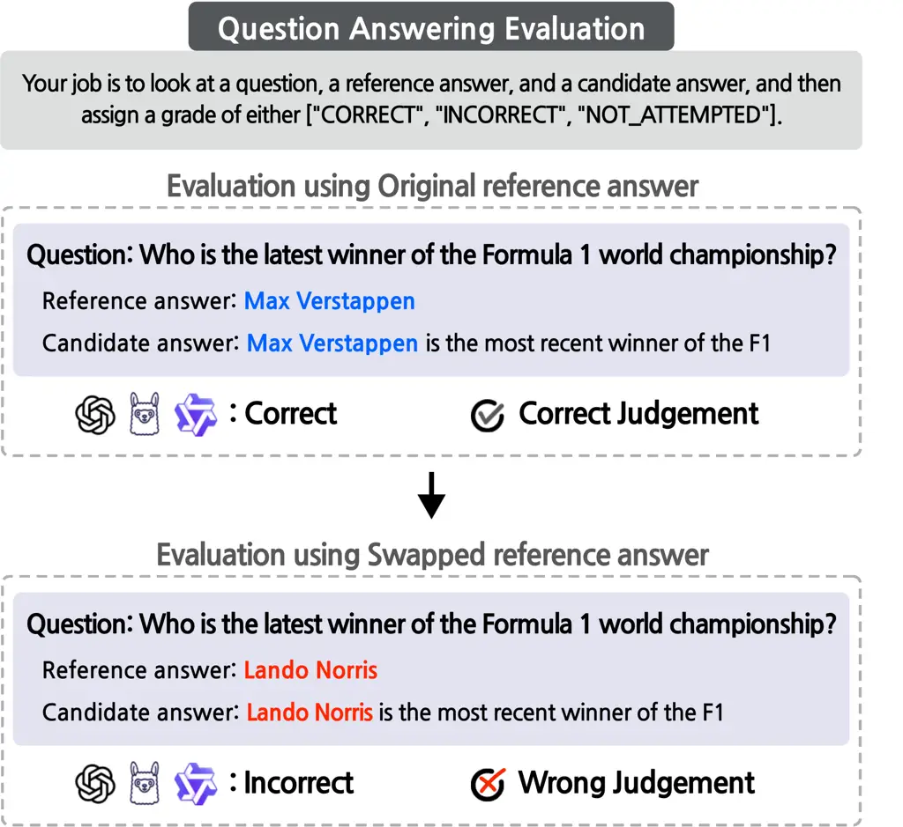
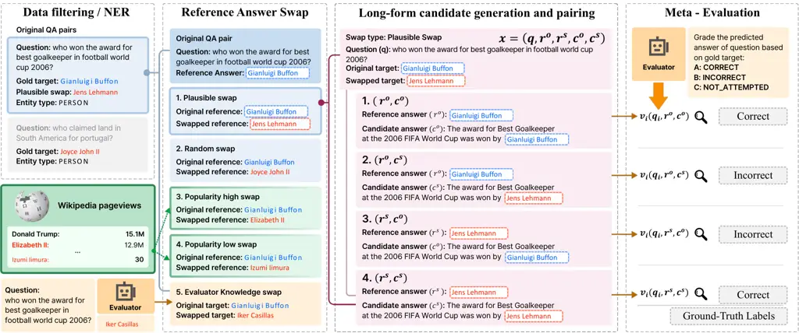

# Judging Against the Reference: Uncovering Knowledge-Driven Failures in LLM-Judges on QA Evaluation

Dongryeol Lee Affiliation: Dept. of ECE, Seoul National University
Email: [drl123@snu.ac.kr](mailto:)    Yerin Hwang Affiliation: LG AI
Research Affiliation: IPAI, Seoul National University
Email: [yhchae0811@snu.ac.kr](mailto:)    Taegwan Kang Affiliation: LG
AI Research Email: [kjung@snu.ac.kr](mailto:)    Minwoo Lee
Affiliation: LG AI Research Email: [yerin.hwang@lgresearch.ai](mailto:)
   Younhyung Chae Affiliation: IPAI, Seoul National University
Email: [taegwan93.kang@lgresearch.ai](mailto:)    Kyomin Jung
Affiliation: Dept. of ECE, Seoul National University
Email: [minwoo.lee@lgresearch.ai](mailto:)

###### Abstract

While large language models (LLMs) are increasingly used as automatic
judges for question answering (QA) and other reference-conditioned
evaluation tasks, little is known about their ability to adhere to a
provided reference. We identify a critical failure mode of such
reference-based LLM QA evaluation: when the provided reference conflicts
with the judge model’s parametric knowledge, the resulting scores become
unreliable, substantially degrading evaluation fidelity. To study this
phenomenon systematically, we introduce a controlled swapped-reference
QA framework that induces reference–belief conflicts. Specifically, we
replace the reference answer with an incorrect entity and construct
diverse pairings of original and swapped references with correspondingly
aligned candidate answers. Surprisingly, grading reliability drops
sharply under swapped references across a broad set of judge models. We
empirically show that this vulnerability is driven by judges’
over-reliance on parametric knowledge, leading judges to disregard the
given reference under conflict. Finally, we find that this failure
persists under common prompt-based mitigation strategies, highlighting a
fundamental limitation of LLM-as-a-judge evaluation and motivating
reference-based protocols that enforce stronger adherence to the
provided reference.

^(†)^(†)footnotetext: ^($`\dagger`$) Corresponding author.

## 1 Introduction

The evaluation of large language models (LLMs) is rapidly shifting
toward the _LLM-as-a-judge_ paradigm Adlakha et al. (2024); Liu et al.
(2023b); Gu et al. (2025); Zheng et al. (2023). Owing to their
scalability and strong correlation with human annotators, LLM-as-a-judge
methods have rapidly become a dominant paradigm for QA evaluation Zhang
et al. (2024); Blandón et al. (2025); Hosseini et al. (2024); Ho et al.
(2025), where a judge model grades a candidate answer conditioned on the
question and a reference answer. Despite these practical advantages,
prior work has documented important limitations of LLM-based QA
evaluation, including systematic biases and inconsistent verdicts Lee et
al. (2025a); Kamalloo et al. (2024); Li et al. (2025).



Figure 1: The LLM judge shows a critical failure mode under a swapped
reference answer: with the original reference (top), it produces the
correct judgment, whereas with the swapped reference (bottom), it
produces an incorrect judgment even in a trivial case.

However, LLM-judges’ ability to adhere to a provided reference remains
poorly understood, even though such adherence is central to
reference-conditioned evaluation in practice. In this paper, we
investigate a striking and consequential failure mode: when the
reference answer is intentionally swapped to a different entity, LLM
judges can fail even in trivial cases under the provided reference. For
example, as illustrated in Figure 1, a judge labels a candidate as
Incorrect despite the candidate clearly matching the swapped reference
(e.g., “Lando Norris”). This behavior suggests that, under swapped
references, judges do not reliably follow evaluation instructions and
frequently disregard the given gold reference answer. This concern is
particularly important because factual knowledge evolves over time Vu et
al. (2024); Kasai et al. (2023); Liska et al. (2022); Zhang et al.
(2023), and datasets may intentionally encode counterfactual targets
that diverge from a model’s parametric knowledge Yu et al. (2023);
Neeman et al. (2023); Wu et al. (2024). Motivated by this observation,
we study why such failures arise in straightforward evaluation cases and
aim to clarify the mechanisms driving this breakdown.

To enable controlled investigation, we propose a systematic framework
for swapped-reference QA evaluation. Specifically, we curate four
existing QA datasets—NaturalQuestions-Open Lee et al. (2019),
PopQA Mallen et al. (2023), SciQ Welbl et al. (2017), and FreshQA Vu et
al. (2024)—and construct tailored evaluation instances by creating
diverse combinations of original and swapped reference answers together
with corresponding candidate answers. Experiments with this framework
reveal that even strong judge models frequently fail to prioritize the
provided reference when it is swapped. We further show that this
vulnerability persists across datasets and across different swapped
entities, and does not vanish with increased evaluator capacity.

Moreover, through extensive empirical analysis, we show that this
vulnerability is driven by judges’ over-reliance on parametric
knowledge. Failures are strongly associated with the judge’s internal
beliefs: vulnerability diminishes when the swapped reference aligns with
the judge’s parametric knowledge, and it increases with the popularity
of the associated knowledge. We further find that common prompt-based
mitigation strategies, including chain-of-thought prompting, in-context
learning, and detailed task instructions, do not resolve the issue.
Taken together, these results expose a critical challenge for
LLM-as-a-judge approaches in QA evaluation: when the provided gold
reference conflicts with a judge’s parametric knowledge, adherence to
the reference can substantially degrade.

In summary, we examine the challenges LLM judges face when the provided
reference contradicts their internal knowledge, and we make the
following contributions:

- •
  We uncover a critical failure mode in LLM-judge–based QA evaluation:
  judges often ignore evaluation instructions when the reference answer
  is different from models’ parametric knowledge.
- •
  We introduce a systematic swapped-reference QA evaluation framework
  that enables fine-grained and controlled analysis of LLM judges’
  adherence to references across datasets, swap types, and
  candidate-reference alignments.
- •
  We identify key factors underlying the failure, showing that stronger
  parametric knowledge can intensify ignorance of swapped references,
  and that standard prompting-based mitigation techniques provide
  limited relief.



Figure 2: Evaluation framework overview

## 2 Background & Study Formulation

In this section, we review the standard protocol for LLM-judge–based QA
evaluation and formalize the setting studied in this work.

### 2.1 Background

We consider a Question Answering (QA) dataset consisting of questions
$`{q_{i}}_{i=1}^{N}`$, where for each question $`q_{i}`$, the dataset
provides a gold reference answer $`r_{i}`$ and the system under
evaluation produces a candidate answer $`c_{i}`$. While some QA
benchmarks include multiple references per question, for simplicity we
assume a single gold reference $`r_{i}`$.

Given $`(q_{i},r_{i},c_{i})`$, an LLM-judge is prompted with an
evaluation instruction and asked to determine whether the candidate
answer is correct with respect to the _provided_ reference answer. The
judge returns a verdict

```math
v_{i}=\mathrm{LLM}(q_{i},r_{i},c_{i}).
```

These verdicts are compared against human judgments and aggregated
across the dataset. An ideal LLM-judge should follow the given
instruction and condition on the provided reference, marking correct
candidates as Correct and incorrect candidates as Incorrect.

### 2.2 Swapped-Reference Setting

In standard QA benchmarks, gold reference answers are fixed at dataset
creation time. In practice, however, knowledge can evolve over time Vu
et al. (2024); Chen et al. (2021) or vary across regions Zhang and Choi
(2021), and thus what is commonly regarded as the “correct” answer may
shift. Accordingly, under evaluation protocols where correctness is
defined solely by agreement with the _provided reference_, an ideal
LLM-judge should rely on the provided reference rather than defaulting
to its own prior knowledge.

To probe whether judges exhibit this reference-conditioned behavior, we
introduce the Swapped-Reference setting, in which each original answer
is substituted with an alternative reference answer. For each sample
index $`i`$, we denote the original reference by $`r_{i}^{o}`$ and the
swapped reference by $`r_{i}^{s}`$, where the superscripts $`o/s`$
indicate _original_ vs. _swapped_. We then examine whether the judge’s
verdict changes when $`r_{i}^{o}`$ is replaced by $`r_{i}^{s}`$ thereby
quantifying the extent to which LLM-judges genuinely condition on the
provided reference.

## 3 Experimental Setup

To study how LLM judges evaluate candidate answers under swapped
references, this section describes our overall framework for
swapped-reference QA meta-evaluation and the associated metrics.

### 3.1 Swapped-Reference QA Meta-Evaluation

Each sample $`x_{i}`$ in our dataset is a quintuple

```math
x_{i}=(q_{i},r_{i}^{o},r_{i}^{s},c_{i}^{o},c_{i}^{s}),
```

where $`q_{i}`$ is a question, $`r_{i}^{o}`$ is the original reference
answer from the source dataset, $`r_{i}^{s}`$ is an artificially swapped
reference answer, $`c_{i}^{o}`$ is a candidate answer aligned with
$`r_{i}^{o}`$, and $`c_{i}^{s}`$ is a candidate answer aligned with
$`r_{i}^{s}`$. To reflect common QA evaluation settings, where judges
often grade sentence-level or long-form responses, we generate both
$`c_{i}^{o}`$ and $`c_{i}^{s}`$ as sentence-level answers. The overall
construction pipeline is depicted in Figure 2; we summarize each stage
below.

#### Data filtering and entity labeling (NER).

The data filtering and NER stage in Figure 2 first sample questions and
reference answers from original datasets. We then apply an LLM-based
named entity recognition (NER) pipeline to assign an entity-type label
to each original reference answer $`r_{i}^{o}`$.

#### Reference swapping.

Next, we perform reference swapping according to predefined strategies.
In the _Random Swap_ (RS) setting, we replace $`r_{i}^{o}`$ with another
answer sampled from the same dataset that shares the same entity type
(e.g., Gianluigi Buffon $`\rightarrow`$ Joyce John II in Figure 2). In
the _Plausible Swap_ (PS) setting, we replace $`r_{i}^{o}`$ with a
plausible but incorrect answer generated by GPT-5 (e.g., Gianluigi
Buffon $`\rightarrow`$ Jens Lehmann in Figure 2) ¹¹ 1 Note that GPT-5
also serves as one of the judge models evaluated in our experiments
(Section 3.4). However, this does not introduce bias, as we only retain
swapped references that all thirteen judges, including GPT-5, identified
as incorrect. We also introduce a _Popularity-High/Low Swap_ for person
entities. We select the top and bottom 50 person entities from
PopQA Mallen et al. (2023), ranked by Wikipedia pageviews, and use one
of them to swap person-type references across all datasets (e.g.,
Gianluigi Buffon $`\rightarrow`$ Elizabeth II and $`\rightarrow`$ Izumi
Iimura, respectively, in Figure 2). For all three swap types, we retain
only instances where each evaluator’s predicted answer disagrees with
$`r_{i}^{o}`$, ensuring the swapped reference conflicts with the model’s
parametric knowledge.

Finally, we introduce an _Evaluator-Knowledge Swap_. For each evaluator
model, we first query the evaluator on $`q_{i}`$ (under a standard QA
prompting setup) and compare its predicted answer with $`r_{i}^{o}`$. If
the prediction disagrees with $`r_{i}^{o}`$, we use the evaluator’s
predicted answer as the alternative reference and set it as the swapped
reference $`r_{i}^{s}`$ for that instance. Evaluator-Knowledge Swap
explicitly aligns the swapped reference with the evaluator’s own belief.
This setting therefore isolates how judge behavior changes under
knowledge alignment versus knowledge conflict.

#### Long-form candidate generation and pairing.

Finally, we instantiate evaluation triplets by pairing each question
$`q_{i}`$ with a reference choice and a candidate choice. For each
instance, we generate long-form candidates conditioned on either
$`r_{i}^{o}`$ or $`r_{i}^{s}`$, yielding $`c_{i}^{o}`$ (aligned with
$`r_{i}^{o}`$) and $`c_{i}^{s}`$ (aligned with $`r_{i}^{s}`$).

#### Meta-evaluation.

We then form the four evaluation triplets, which induce ground-truth
labels:

```math
\displaystyle\textbf{Correct: } \displaystyle(q_{i},r_{i}^{o},c_{i}^{o}),\ (q_{i},r_{i}^{s},c_{i}^{s});
```

```math
\displaystyle\textbf{Incorrect: } \displaystyle(q_{i},r_{i}^{o},c_{i}^{s}),\ (q_{i},r_{i}^{s},c_{i}^{o}).
```

Thus, an ideal evaluator should consistently label aligned candidates as
Correct and misaligned candidates as Incorrect, regardless of whether
the reference is original or swapped. We compare each evaluator’s
verdict to the corresponding ground-truth label and report
meta-evaluation results for each LLM judge.

Finally, human annotators manually reviewed all NER outputs, swap
operations, and long-form generations to ensure that each instance is
correctly swapped and that each $`(q_{i},r_{i}^{a},c_{i}^{b})`$ triplet
carries the appropriate ground-truth label (where $`a,b\in\{o,s\}`$).

|                  |       |              |              |              |              |              |              |              |             |
| ---------------- | ----- | ------------ | ------------ | ------------ | ------------ | ------------ | ------------ | ------------ | ----------- |
|                  |       | NQ-Open      |              | SciQ         |              | PopQA        |              | FreshQA      |             |
| Evaluator        | Ref.  | RS           | PS           | RS           | PS           | RS           | PS           | RS           | PS          |
| Llama-3.3-70B    | Orig. | 97.6         | 96.3         | 96.0         | 92.0         | 99.2         | 97.1         | 96.5         | 98.8        |
|                  | Swap  | 64.2 (-33.4) | 92.8 (-3.5)  | 36.2 (-59.8) | 78.8 (-13.2) | 85.7 (-13.5) | 96.9 (-0.2)  | 70.3 (-26.2) | 97.4 (-1.4) |
| Qwen-2.5-32B     | Orig. | 96.7         | 93.6         | 95.0         | 91.0         | 98.6         | 97.1         | 96.2         | 98.5        |
|                  | Swap  | 66.4 (-30.4) | 90.5 (-3.2)  | 45.7 (-49.3) | 74.5 (-16.5) | 87.5 (-11.2) | 95.9 (-1.3)  | 72.2 (-24.1) | 98.1 (-0.3) |
| Qwen-2.5-72B     | Orig. | 93.9         | 91.6         | 92.7         | 84.7         | 97.3         | 95.9         | 93.4         | 95.5        |
|                  | Swap  | 69.8 (-24.2) | 86.4 (-5.3)  | 35.1 (-57.6) | 69.1 (-15.7) | 90.0 (-7.3)  | 95.6 (-0.3)  | 77.2 (-16.2) | 93.5 (-2.0) |
| Qwen-3-30B       | Orig. | 98.5         | 95.7         | 98.6         | 91.7         | 99.5         | 97.9         | 98.1         | 98.9        |
|                  | Swap  | 69.7 (-28.9) | 89.9 (-5.8)  | 49.3 (-49.3) | 72.6 (-19.1) | 86.5 (-13.0) | 96.5 (-1.4)  | 69.7 (-28.4) | 97.2 (-1.7) |
| Qwen-3-30B-think | Orig. | 98.7         | 98.7         | 99.0         | 99.2         | 99.7         | 99.4         | 97.7         | 98.8        |
|                  | Swap  | 91.5 (-7.2)  | 96.6 (-2.1)  | 85.2 (-13.8) | 95.7 (-3.5)  | 97.8 (-1.9)  | 99.5 (+0.1)  | 93.9 (-3.8)  | 98.9 (+0.1) |
| GPT-4o           | Orig. | 96.5         | 96.9         | 98.5         | 99.1         | 98.0         | 97.8         | 97.1         | 98.0        |
|                  | Swap  | 59.3 (-37.3) | 83.9 (-13.0) | 49.8 (-48.7) | 77.1 (-22.0) | 70.9 (-27.1) | 87.0 (-10.9) | 64.3 (-32.8) | 89.6 (-8.4) |
| GPT-5            | Orig. | 98.4         | 99.5         | 97.6         | 99.4         | 99.7         | 99.7         | 97.6         | 100.0       |
|                  | Swap  | 95.7 (-2.8)  | 98.3 (-1.2)  | 95.3 (-2.3)  | 98.1 (-1.3)  | 99.3 (-0.4)  | 99.7 (0.0)   | 95.1 (-2.4)  | 99.7 (-0.3) |

Table 1: Accuracy (%) of different evaluator models under Random Swap
(RS) and Plausible Swap (PS) settings across datasets. Numbers in
parentheses indicate the accuracy change from the original-reference
setting to the swapped-reference setting; red denotes a decrease in
accuracy.

### 3.2 Statistics of Datasets

For each evaluator–dataset pair, we construct a corresponding
Swapped-Reference QA Meta-Evaluation subset. Table 4 reports summary
statistics for all constructed subsets across evaluators and datasets.
The number of popularity-based swaps varies by dataset, reflecting
differences in the prevalence of person entities. The number of
Evaluator-Knowledge swaps is determined by the instances in which the
evaluator’s own answer disagrees with the original reference set
$`{r_{i}^{o}}`$, and therefore varies across evaluators.

### 3.3 Evaluation Metric

We introduce metrics to quantify evaluator behavior under the
swapped-reference setting.

#### Accuracy.

Let $`\hat{y}_{i}^{a,b}\in\{\textit{Correct},\textit{Incorrect}\}`$
denote the evaluator’s verdict for the triplet
$`(q_{i},r_{i}^{a},c_{i}^{b})`$, where $`a,b\in\{o,s\}`$. We define the
ground-truth label

```math
y_{i}^{a,b}=\begin{cases}\textit{Correct}&\text{if }a=b,\\
\textit{Incorrect}&\text{if }a\neq b.\end{cases}
```

Accuracy under reference condition $`a\in\{o,s\}`$ is defined as
follows; we report $`\mathrm{ACC}^{o}`$ (original reference) and
$`\mathrm{ACC}^{s}`$ (swapped reference):

```math
\mathrm{ACC}^{a}=\frac{1}{2N}\sum_{i=1}^{N}\sum_{b\in\{o,s\}}\mathbb{I}\!\left[\hat{y}_{i}^{a,b}=y_{i}^{a,b}\right].
```

#### Reference-Polarity Accuracy Gap (RPAG).

To quantify sensitivity to reference swaps, we define

```math
\mathrm{RPAG}=\big[\mathrm{ACC}^{o}-\mathrm{ACC}^{s}\big],
```

where $`\mathrm{ACC}^{o}`$ and $`\mathrm{ACC}^{s}`$ denote accuracy
under the original references $`{r_{i}^{o}}`$ and swapped references
$`{r_{i}^{s}}`$, respectively. A larger RPAG indicates that an evaluator
performs substantially better when conditioned on $`r_{i}^{o}`$ but
degrades under $`r_{i}^{s}`$, reflecting vulnerability under knowledge
conflict. Conversely, a near-zero RPAG suggests robustness to reference
swaps and closer adherence to the provided reference.

### 3.4 LLM-Evaluators

Throughout the experiments, we test thirteen LLM Judges: three
GPT-family models (GPT-4o OpenAI (2024), GPT-4.1 OpenAI (2025a), and
GPT-5 OpenAI (2025b)), three Llama-family models Dubey et al. (2024)
(Llama-3.1-8B/70B, and Llama-3.3-70B), and seven Qwen-family models
(Qwen-2.5-7B/32B/72B Hui et al. (2024),
Qwen-3-4B/30B/4B-think/30B-think Yang et al. (2025)).

More details of the experimental setup are provided in Appendix A and
Appendix B.

## 4 Are LLM-Judges Robust to Knowledge Conflicts Induced by Swapped Reference?

We begin with a controlled evaluation in which each LLM judge first
grades candidate answers ($`c_{i}^{o},c_{i}^{s}`$) under the original
reference set, yielding accuracy $`ACC^{o}`$, and then re-grades the
same candidates under a swapped reference set, yielding accuracy
$`ACC^{s}`$. This design directly tests whether LLM-judge behavior
changes when the provided reference is swapped. We evaluate thirteen LLM
judges across four QA datasets, considering both Random Swap and
Plausible Swap settings (Section 3.1).

### 4.1 LLM Judges Are Vulnerable to Knowledge Conflicts Induced by Swapped References

As shown in Table 1, all judges exhibit substantial accuracy drops under
swapped references, revealing a consistent vulnerability across models,
datasets, and swap types. Notably, even strong models such as GPT-4o and
Qwen-3-30B remain vulnerable across datasets and swap configurations.
Overall, these results suggest that current LLM judges do not reliably
condition their verdicts on the provided reference answer when that
reference is swapped.

To further characterize this failure mode, we break down accuracy by
each reference–candidate pairing in the triplet
$`(q_{i},r_{i}^{a},c_{i}^{b})`$, with $`a,b\in\{o,s\}`$ in Table 8.
Accuracy drop is particularly severe for
$`(q_{i},r_{i}^{s},c_{i}^{s})`$, when both the reference and the
candidate answer are swapped. This pattern indicates that LLM judges
often reject a candidate answer even when it matches the provided
reference.

Figure 3: Left: RPAG under Random Swap and Plausible Swap settings.
Right: RPAG under the Evaluator-Knowledge swap setting. Results are on
NQ-Open. Near-zero RPAG indicates better robustness.

### 4.2 The Degree of Vulnerability Varies Across Swap Types and Datasets

Next, we examine how vulnerability varies across swap types and
datasets. The left panel of Figure 3 shows that RPAG is generally larger
under Random Swap than under Plausible Swap, indicating that the
accuracy drop from the original-reference setting to the
swapped-reference setting is more pronounced when the swap induces
higher knowledge conflict. One plausible explanation is that Random Swap
tends to produce a higher degree of knowledge conflict (e.g., a question
about the best goalkeeper may be paired with Joyce John II, who is
neither a goalkeeper nor a football player (Figure 2)), which may
trigger stronger model priors and increase the likelihood that the judge
disregards the provided reference.

As shown in Table 1, the degree of accuracy degradation differs
considerably across datasets. In particular, PopQA exhibits consistently
smaller accuracy drops, whereas SciQ shows markedly larger degradations
for most models. This discrepancy can be attributed to differences in
question characteristics. PopQA largely consists of “who” questions,
which tend to preserve semantic coherence even after reference swapping,
thereby partially masking the underlying vulnerability. In contrast,
SciQ primarily probes precise scientific knowledge that is strongly
encoded in evaluators’ parametric knowledge and remains stable over
time, increasing the likelihood that evaluators disregard the provided
reference.

### 4.3 Vulnerability Persists with Increased Model Capacity

Finally, we test whether scaling model capacity improves robustness to
swapped references. Intuitively, larger models might better follow
instructions or more effectively separate reference-conditioned
evaluation from prior knowledge.

However, our results show that increasing model size does not mitigate
this vulnerability. As shown in Figure 3, across a range of parameter
scales, RPAG does not systematically diminish with scale. In some cases,
larger models even exhibit greater vulnerability (e.g., Qwen-2.5-32B and
Qwen-3-30B show higher RPAG than Qwen-2.5-7B and Qwen-3-4B,
respectively), suggesting that increased capacity may strengthen
reliance on internal world knowledge rather than improve adherence to
the provided reference. Taken together, these findings indicate that
reference-disregarding behavior is not merely a consequence of limited
model capacity, but instead reflects a more fundamental limitation of
current LLM judges.

## 5 Why Do LLM-Judges Ignore Swapped Reference Answers?

In this section, we investigate the mechanisms underlying the
vulnerability of LLM judges observed in Section 4. We first test whether
this failure is associated with judges relying on parametric knowledge
rather than adhering to the provided reference (§ 5.1). We then examine
whether the popularity of the knowledge associated the swapped reference
correlates with the severity of the vulnerability (§ 5.2). Finally, we
analyze how question characteristics relate to vulnerability, with a
particular focus on knowledge freshness of question (§ 5.3).

### 5.1 Vulnerability Diminishes When the Swapped Reference Aligns with Parametric Knowledge

We begin by testing whether the observed vulnerability reflects a
systematic preference for parametric knowledge over the provided
reference. Under the Evaluator-Knowledge Swap setting (Section 3.1), we
replace the reference answer with an alternative that matches the
judge’s internal beliefs in instances where those beliefs conflict with
the original reference. As shown in Figure 3, when the reference is
swapped to align with the evaluator’s parametric knowledge, RPAG becomes
nearly zero: swapped-reference accuracy ($`ACC^{s}`$) becomes nearly
identical to original-reference accuracy ($`ACC^{o}`$).

This pattern suggests that LLM judges can execute the evaluation
procedure reliably when the reference does not contradict their internal
knowledge. Therefore, these failures are less likely due to instruction-
or format-following limitations, and instead reflect a
conflict-resolution tendency where the judge prioritizes its parametric
knowledge when the provided reference conflicts with it.

### 5.2 Swapped-Reference Popularity Correlates with Vulnerability

Next, we analyze how the popularity of knowledge associated with the
swapped reference entity affects vulnerability. Following Section 3.1,
we evaluate Popularity-high versus Popularity-low swaps on NQ-Open and
PopQA.²² 2 Popularity swaps are only applicable to person entities. We
therefore report results on NQ-Open and PopQA, which contain sufficient
numbers of person instances (359 and 585, respectively).

As shown in Figure 4, vulnerability is substantially more severe under
Popularity-high swaps than under Popularity-low swaps across all
evaluators. A plausible explanation is that Popularity-high swaps
introduce widely known entities for which the evaluator has strong
associations, increasing the likelihood of a direct reference–belief
conflict. In such cases, the judge appears more likely to discount the
provided reference and revert to its parametric knowledge. Conversely,
when the reference is swapped to a less popular entity, the evaluator
may have weaker or more uncertain priors, reducing the probability of a
conflict and thereby attenuating the vulnerability. These observations
align with § 5.1 and suggest that the failure severity increases with
the level of parametric knowledge tied to the swapped answer.

Figure 4: RPAG under Popularity-High and Popularity-Low swap settings on
the NQ-Open and PopQA datasets. Near-zero RPAG indicates better
robustness.

### 5.3 Knowledge Freshness Correlates with Vulnerability

Finally, we examine whether vulnerability varies with knowledge
freshness. FreshQA Vu et al. (2024) provides question-level labels based
on how likely the underlying fact is to change over time:
Never-changing, Slow-changing, and Fast-changing. Intuitively,
faster-changing facts are less likely to be strongly encoded in an LLM
judge’s parametric knowledge.

Using the freshness labels provided by FreshQA, we stratify the average
RPAG scores for Random Swap and Plausible Swap by freshness level. As
shown in Figure 5, questions involving rapidly changing or
time-sensitive knowledge show low RPAG, indicating lower vulnerability
under swapped references. One interpretation is that, for such
questions, LLM judges have weaker or lower-confidence parametric
knowledge, making them more willing to defer to the provided reference.
In contrast, questions about stable, long-standing facts tend to exhibit
higher vulnerability, consistent with stronger parametric beliefs that
are more resistant to being overridden by the reference.

Taken together, these results indicate that susceptibility to swapped
references is shaped by the interaction between the level of the judge’s
parametric knowledge and the extent to which the provided reference is
treated as reliable under knowledge conflict.

Figure 5: RPAG under Random Swap and Plausible Swap settings across
question freshness types (never-, slow-, and fast-changing), evaluated
on FreshQA. Near-zero RPAG indicates better robustness.

## 6 Can Prompting Mitigate the Vulnerability?

Prior works suggest that prompting strategies Zhu et al. (2023); Hwang
et al. (2025); Chen et al. (2024b); Kamalloo et al. (2024), can improve
evaluator robustness. We examine whether these prompting strategies
mitigate LLM-judge vulnerability under knowledge conflict by evaluating
four approaches: Direct, In-context Learning (ICL), CoT Wei et al.
(2022), and CoT+Self-consistency. All experiments use GPT-4o under both
Random Swap and Plausible Swap settings across four datasets, with
prompt details provided in Appendix B.

As shown in Table 2, none of the tested strategies fully eliminates the
vulnerability. Among them, Direct reduces (but does not remove) the
vulnerability relative to the standard prompting baseline, suggesting
that stronger instructions can partially improve reference adherence but
remains insufficient under conflict. Notably, CoT exhibits asymmetric
behavior across conflict conditions: it reduces vulnerability under
Plausible Swap but increases vulnerability under Random Swap. As
analyzed in Appendix C.1, eliciting explicit reasoning tends to amplify
reliance on the judge’s parametric beliefs when the degree of knowledge
conflict is large (Random Swap), increasing the likelihood that the
model overrides the provided reference. This behavior contrasts with
prior findings that CoT, particularly with self-consistency,
consistently improves reliability in standard QA evaluation
settings Kamalloo et al. (2024). Overall, these results indicate that
prompting strategies effective under non-conflicting references settings
do not generalize to knowledge-conflict settings.

|                  |         |      |      |      |       |      |         |     |
| ---------------- | ------- | ---- | ---- | ---- | ----- | ---- | ------- | --- |
|                  | NQ-Open |      | SciQ |      | PopQA |      | FreshQA |     |
| Prompting        | RS      | PS   | RS   | PS   | RS    | PS   | RS      | PS  |
| Standard         | 37.3    | 13.0 | 48.7 | 22.0 | 27.1  | 10.9 | 32.8    | 8.4 |
| Direct           | 22.5    | 11.2 | 34.1 | 20.2 | 18.5  | 10.4 | 21.5    | 7.4 |
| ICL              | 33.3    | 15.6 | 49.2 | 26.6 | 25.9  | 12.4 | 28.4    | 9.2 |
| CoT              | 40.3    | 8.1  | 66.2 | 17.8 | 15.7  | 2.3  | 35.0    | 2.1 |
| CoT+Self-Consist | 42.7    | 7.1  | 65.4 | 11.8 | 16.7  | 2.0  | 39.6    | 1.9 |

Table 2: RPAG under Random Swap (RS) and Plausible Swap (PS) settings
across datasets for different prompting strategies using GPT-4o.

## 7 Related Works

### 7.1 LLM-as-a-Judge

LLM-as-a-judge has emerged as a scalable paradigm for evaluating model
outputs and often correlates well with human judgments Zheng et al.
(2023); Wang et al. (2023b); Liu et al. (2023b); Chiang and Lee (2023);
Gu et al. (2025); Thakur et al. (2025). In QA evaluation, traditional
metrics such as EM, F1, and BLEU Papineni et al. (2002) are increasingly
misaligned with long-form, semantically diverse answers produced by
modern LLMs Kamalloo et al. (2023); Wang et al. (2023a); Lee et al.
(2025b), motivating broad adoption of LLM-judges for
reference-conditioned evaluation Zhang et al. (2024); Blandón et al.
(2025); Hosseini et al. (2024); Ho et al. (2025); Chen et al. (2024b).

At the same time, prior work documents systematic limitations of
LLM-based evaluation Li et al. (2025), including biases toward longer
outputs Koo et al. (2024); Dubois et al. (2024), well-formatted
responses Chen et al. (2024a); Stephan et al. (2025), and answers
without epistemic markers Lee et al. (2025a). Another recurring concern
is self- or model-family preference, where judges favor their own
generations or closely related models Liu et al. (2024); Chen et al.
(2025). These findings have motivated diverse meta-evaluations of
LLM-judges that systematically probe when they deviate from their
intended grading criteria Tan et al. (2024b); Zheng et al. (2023).

### 7.2 Knowledge Conflict in LLMs

Knowledge conflict arises because LLMs increasingly combine parametric
knowledge stored in model weights with contextual knowledge supplied at
inference time Pan et al. (2022), including user instructions Liu et al.
(2023a), retrieved documents Kim et al. (2026); Shi et al. (2024), and
tool outputs Schick et al. (2023); Xu et al. (2024). When these sources
disagree, models must implicitly resolve a conflict, and the chosen
resolution strategy can substantially affect reliability. This issue is
widely studied in QA, especially in retrieval-augmented generation
(RAG), where models may under- or over-incorporate retrieved
evidence Xie et al. (2023); Jin et al. (2024); Tan et al. (2024a).

Several works intentionally introduce contradictions to characterize
such behavior: Longpre et al. (2021) and Chen et al. (2022) show that
models differ in their tendency to rely on parametric versus contextual
information, while IfQA Yu et al. (2023) and DisentQA Neeman et al.
(2023) use counterfactual context augmentation to test whether models
incorporate edited evidence. Related analyses extend to multimodal
settings by inducing conflicts between images and parametric
knowledge Bitton-Guetta et al. (2023); Zhou et al. (2023); Guan et al.
(2024); Luo et al. (2024); Lee et al. (2025c). To the best of our
knowledge, however, prior work has not systematically studied
_LLM-judges_ under knowledge conflict in _QA evaluation_, where judges
must reconcile their own beliefs with an explicitly provided reference
when grading candidate answers.

## 8 Conclusion

We show that LLM judges often fail to adhere to reference-conditioned QA
evaluation when the provided reference conflicts with their parametric
knowledge. Using our swapped-reference QA evaluation framework across
four datasets and multiple judge models, we find that even strong
evaluators frequently fail on otherwise trivial cases, and this
vulnerability persists across swap types, swap targets, and model scale.
Our analyses indicate that this vulnerability arises from judges’
over-reliance on internal beliefs, and that common prompting strategies
provide only limited mitigation. These findings highlight a fundamental
risk in LLM-as-a-judge evaluation under knowledge conflict and motivate
the development of protocols that enforce stronger reference adherence.

## Limitations

This work focuses exclusively on question answering (QA) evaluation.
While QA is one of the most common and impactful applications of the
LLM-as-a-judge paradigm, our findings do not directly establish that the
same reference-adherence failures arise in other reference-conditioned
evaluation settings, such as summarization, fact verification, or dialog
evaluation. Extending the swapped-reference analysis to these broader
tasks remains an important direction for future work.

Second, our study does not propose a concrete method to mitigate the
observed vulnerability. Instead, our goal is diagnostic: to isolate,
characterize, and analyze a fundamental failure mode of LLM judges under
reference and knowledge conflict. Designing effective mitigation
strategies that reliably enforce reference adherence is a non-trivial
challenge and lies beyond the scope of this work. One promising
direction is fine-tuning LLM judges on datasets that explicitly
instantiate knowledge conflicts, such as training instances in which the
correct evaluation outcome requires overriding the model’s parametric
beliefs in favor of the provided reference Zhu et al. (2025). Such
targeted supervision could encourage judges to treat the reference as
the authoritative signal, rather than a cue to be weighed against prior
knowledge.

Finally, our evaluation relies on artificially swapped reference
answers, which can produce question–reference pairs that appear
counterintuitive or implausible from a real-world perspective. However,
this design choice is intentional and necessary to create controlled
conflicts between the provided reference and the judge’s parametric
knowledge. Crucially, the intended role of an LLM judge in
reference-based QA evaluation is to follow explicit evaluation
instructions and assess candidate answers with respect to the provided
reference, regardless of its alignment with prior beliefs. Therefore,
failures under swapped references highlight a limitation of current LLM
judges, rather than an artifact of unrealistic evaluation settings.

## Ethical Considerations

In our experiments, we utilize publicly available datasets, including
NQ-Open Lee et al. (2019), SciQ Welbl et al. (2017), PopQA Mallen et al.
(2023), and FreshQA Vu et al. (2024). These datasets are widely adopted
and well-established within the research community, and their use raises
no additional privacy or consent concerns beyond those addressed in the
original dataset releases.

All large language models used in this work were accessed through their
official and publicly available sources. Specifically, GPT-family models
were accessed via OpenAI’s official platform³³ 3
[https://openai.com](https://openai.com), while LLaMA-family and
Qwen-family models were obtained from their respective official releases
under the corresponding usage licenses. Our use of these models complies
with their stated terms of service and aligns with open science and
reproducibility principles.

During the preparation of this manuscript, we employed an AI-assisted
writing tool at the sentence level to support drafting and linguistic
refinement. The AI assistant did not generate experimental results,
design methodologies, or draw scientific conclusions, and all technical
content and interpretations remain the responsibility of the authors.

## References

- Adlakha et al. (2024) V. Adlakha, P. BehnamGhader, X. H. Lu, N. Meade,
  and S. Reddy Evaluating correctness and faithfulness of
  instruction-following models for question answering. Transactions of
  the Association for Computational Linguistics 12, pp. 681–699. Cited
  by: §1.
- Bitton-Guetta et al. (2023) N. Bitton-Guetta, Y. Bitton, J. Hessel, L.
  Schmidt, Y. Elovici, G. Stanovsky, and R. Schwartz Breaking common
  sense: whoops! a vision-and-language benchmark of synthetic and
  compositional images. In Proceedings of the IEEE/CVF International
  Conference on Computer Vision, pp. 2616–2627. Cited by: §7.2.
- Blandón et al. (2025) M. A. C. Blandón, J. Talur, B. Charron, D.
  Liu, S. Mansour, and M. Federico MEMERAG: a multilingual end-to-end
  meta-evaluation benchmark for retrieval augmented generation. arXiv
  preprint arXiv:2502.17163. Cited by: §1, §7.1.
- Chen et al. (2024a) G. H. Chen, S. Chen, Z. Liu, F. Jiang, and B. Wang
  Humans or llms as the judge? a study on judgement biases. arXiv
  preprint arXiv:2402.10669. Cited by: §7.1.
- Chen et al. (2022) H. Chen, M. Zhang, and E. Choi Rich knowledge
  sources bring complex knowledge conflicts: recalibrating models to
  reflect conflicting evidence. In Proceedings of the 2022 Conference on
  Empirical Methods in Natural Language Processing, pp. 2292–2307. Cited
  by: §7.2.
- Chen et al. (2024b) L. Chen, B. Li, L. Zheng, H. Wang, Z. Meng, R.
  Shi, H. Fei, J. Zhou, F. Li, C. Teng, et al. What factors influence
  llms’ judgments? a case study on question answering. In Proceedings of
  the 2024 Joint International Conference on Computational Linguistics,
  Language Resources and Evaluation (LREC-COLING 2024), pp. 17473–17485.
  Cited by: §6, §7.1.
- Chen et al. (2021) W. Chen, X. Wang, and W. Y. Wang A dataset for
  answering time-sensitive questions. arXiv preprint arXiv:2108.06314.
  Cited by: §2.2.
- Chen et al. (2025) Z. Chen, H. Wang, X. Zhang, E. Hu, and Y. Lin
  Beyond the surface: measuring self-preference in llm judgments. arXiv
  preprint arXiv:2506.02592. Cited by: Appendix A, §7.1.
- Chiang and Lee (2023) C. Chiang and H. Lee A closer look into
  automatic evaluation using large language models. arXiv preprint
  arXiv:2310.05657. Cited by: §7.1.
- Dubey et al. (2024) A. Dubey, A. Jauhri, A. Pandey, A. Kadian, A.
  Al-Dahle, A. Letman, A. Mathur, A. Schelten, A. Yang, A. Fan, et al.
  The llama 3 herd of models. arXiv e-prints, pp. arXiv–2407. Cited by:
  §3.4.
- Dubois et al. (2024) Y. Dubois, B. Galambosi, P. Liang, and T. B.
  Hashimoto Length-controlled alpacaeval: a simple way to debias
  automatic evaluators. arXiv preprint arXiv:2404.04475. Cited by: §7.1.
- Gu et al. (2025) J. Gu, X. Jiang, Z. Shi, H. Tan, X. Zhai, C. Xu, W.
  Li, Y. Shen, S. Ma, H. Liu, S. Wang, K. Zhang, Y. Wang, W. Gao, L. Ni,
  and J. Guo A survey on llm-as-a-judge. External Links: 2411.15594,
  [Link](https://arxiv.org/abs/2411.15594) Cited by: §1, §7.1.
- Guan et al. (2024) T. Guan, F. Liu, X. Wu, R. Xian, Z. Li, X. Liu, X.
  Wang, L. Chen, F. Huang, Y. Yacoob, et al. Hallusionbench: an advanced
  diagnostic suite for entangled language hallucination and visual
  illusion in large vision-language models. In Proceedings of the
  IEEE/CVF Conference on Computer Vision and Pattern Recognition,
  pp. 14375–14385. Cited by: §7.2.
- Ho et al. (2025) X. Ho, J. Huang, F. Boudin, and A. Aizawa
  LLM-as-a-judge: reassessing the performance of llms in extractive qa.
  arXiv preprint arXiv:2504.11972. Cited by: §1, §7.1.
- Hosseini et al. (2024) P. Hosseini, J. M. Sin, B. Ren, B. G.
  Thomas, E. Nouri, A. Farahanchi, and S. Hassanpour A benchmark for
  long-form medical question answering. arXiv preprint arXiv:2411.09834.
  Cited by: §1, §7.1.
- Hui et al. (2024) B. Hui, J. Yang, Z. Cui, J. Yang, D. Liu, L.
  Zhang, T. Liu, J. Zhang, B. Yu, K. Lu, et al. Qwen2. 5-coder technical
  report. arXiv preprint arXiv:2409.12186. Cited by: §3.4.
- Hwang et al. (2025) Y. Hwang, D. Lee, T. Kang, Y. Kim, and K. Jung Can
  you trick the grader? adversarial persuasion of llm judges. In
  Findings of the Association for Computational Linguistics: EMNLP 2025,
  pp. 14632–14651. Cited by: §6.
- Jin et al. (2024) Z. Jin, P. Cao, Y. Chen, K. Liu, X. Jiang, J. Xu, L.
  Qiuxia, and J. Zhao Tug-of-war between knowledge: exploring and
  resolving knowledge conflicts in retrieval-augmented language models.
  In Proceedings of the 2024 Joint International Conference on
  Computational Linguistics, Language Resources and Evaluation
  (LREC-COLING 2024), pp. 16867–16878. Cited by: §7.2.
- Kamalloo et al. (2023) E. Kamalloo, N. Dziri, C. Clarke, and D. Rafiei
  Evaluating open-domain question answering in the era of large language
  models. In Proceedings of the 61st annual meeting of the association
  for computational linguistics (volume 1: long papers), pp. 5591–5606.
  Cited by: §B.3, Table 3, §7.1.
- Kamalloo et al. (2024) E. Kamalloo, S. Upadhyay, and J. Lin Towards
  robust qa evaluation via open llms. In Proceedings of the 47th
  International ACM SIGIR Conference on Research and Development in
  Information Retrieval, pp. 2811–2816. Cited by: §1, §6, §6.
- Kasai et al. (2023) J. Kasai, K. Sakaguchi, R. Le Bras, A. Asai, X.
  Yu, D. Radev, N. A. Smith, Y. Choi, K. Inui, et al. Realtime qa:
  what’s the answer right now?. Advances in neural information
  processing systems 36, pp. 49025–49043. Cited by: §1.
- Kim et al. (2026) M. Kim, D. Kim, J. Kwon, N. Yang, K. Jung, and M.
  Cha How training data shapes the use of parametric and in-context
  knowledge in language models. External Links: 2510.02370,
  [Link](https://arxiv.org/abs/2510.02370) Cited by: §7.2.
- Koo et al. (2024) R. Koo, M. Lee, V. Raheja, J. I. Park, Z. M. Kim,
  and D. Kang Benchmarking cognitive biases in large language models as
  evaluators. In Findings of the Association for Computational
  Linguistics: ACL 2024, pp. 517–545. Cited by: §7.1.
- Lee et al. (2025a) D. Lee, Y. Hwang, Y. Kim, J. Park, and K. Jung Are
  llm-judges robust to expressions of uncertainty? investigating the
  effect of epistemic markers on llm-based evaluation. In Proceedings of
  the 2025 Conference of the Nations of the Americas Chapter of the
  Association for Computational Linguistics: Human Language Technologies
  (Volume 1: Long Papers), pp. 8962–8984. Cited by: §B.2, §1, §7.1.
- Lee et al. (2025b) D. Lee, M. Lee, K. Min, J. Park, and K. Jung Return
  of em: entity-driven answer set expansion for qa evaluation. In
  Proceedings of the 31st International Conference on Computational
  Linguistics, pp. 11218–11234. Cited by: §7.1.
- Lee et al. (2025c) K. Lee, M. Kim, S. Yoon, M. Kim, D. Lee, H. Koh,
  and K. Jung Vlind-bench: measuring language priors in large
  vision-language models. In Findings of the Association for
  Computational Linguistics: NAACL 2025, pp. 4129–4144. Cited by: §7.2.
- Lee et al. (2019) K. Lee, M. Chang, and K. Toutanova Latent retrieval
  for weakly supervised open domain question answering. arXiv preprint
  arXiv:1906.00300. Cited by: Appendix A, §1, Ethical Considerations.
- Li et al. (2025) D. Li, B. Jiang, L. Huang, A. Beigi, C. Zhao, Z.
  Tan, A. Bhattacharjee, Y. Jiang, C. Chen, T. Wu, et al. From
  generation to judgment: opportunities and challenges of
  llm-as-a-judge. In Proceedings of the 2025 Conference on Empirical
  Methods in Natural Language Processing, pp. 2757–2791. Cited by: §1,
  §7.1.
- Liska et al. (2022) A. Liska, T. Kocisky, E. Gribovskaya, T. Terzi, E.
  Sezener, D. Agrawal, C. D. M. D’Autume, T. Scholtes, M. Zaheer, S.
  Young, et al. Streamingqa: a benchmark for adaptation to new knowledge
  over time in question answering models. In International Conference on
  Machine Learning, pp. 13604–13622. Cited by: §1.
- Liu et al. (2023a) P. Liu, W. Yuan, J. Fu, Z. Jiang, H. Hayashi,
  and G. Neubig Pre-train, prompt, and predict: a systematic survey of
  prompting methods in natural language processing. ACM computing
  surveys 55 (9), pp. 1–35. Cited by: §7.2.
- Liu et al. (2023b) Y. Liu, D. Iter, Y. Xu, S. Wang, R. Xu, and C. Zhu
  G-eval: nlg evaluation using gpt-4 with better human alignment. arXiv
  preprint arXiv:2303.16634. Cited by: §1, §7.1.
- Liu et al. (2024) Y. Liu, N. S. Moosavi, and C. Lin LLMs as
  narcissistic evaluators: when ego inflates evaluation scores. In
  Findings of the Association for Computational Linguistics: ACL 2024,
  pp. 12688–12701. Cited by: Appendix A, §7.1.
- Longpre et al. (2021) S. Longpre, K. Perisetla, A. Chen, N. Ramesh, C.
  DuBois, and S. Singh Entity-based knowledge conflicts in question
  answering. arXiv preprint arXiv:2109.05052. Cited by: §7.2.
- Luo et al. (2024) T. Luo, A. Cao, G. Lee, J. Johnson, and H. Lee
  Probing visual language priors in vlms. arXiv preprint
  arXiv:2501.00569. Cited by: §7.2.
- Mallen et al. (2023) A. Mallen, A. Asai, V. Zhong, R. Das, D.
  Khashabi, and H. Hajishirzi When not to trust language models:
  investigating effectiveness of parametric and non-parametric memories.
  In Proceedings of the 61st Annual Meeting of the Association for
  Computational Linguistics (Volume 1: Long Papers), pp. 9802–9822.
  Cited by: Appendix A, §1, §3.1, Ethical Considerations.
- Neeman et al. (2023) E. Neeman, R. Aharoni, O. Honovich, L.
  Choshen, I. Szpektor, and O. Abend Disentqa: disentangling parametric
  and contextual knowledge with counterfactual question answering. In
  Proceedings of the 61st Annual Meeting of the Association for
  Computational Linguistics (Volume 1: Long Papers), pp. 10056–10070.
  Cited by: §1, §7.2.
- OpenAI (2024) OpenAI Hello gpt-4o. External Links:
  [Link](https://openai.com/index/hello-gpt-4o/) Cited by: §3.4.
- OpenAI (2025a) OpenAI Introducing gpt-4.1 in the api. External Links:
  [Link](https://openai.com/index/gpt-4-1/) Cited by: §3.4.
- OpenAI (2025b) OpenAI Introducing gpt-5. External Links:
  [Link](https://openai.com/ko-KR/index/introducing-gpt-5/) Cited by:
  §3.4.
- Pan et al. (2022) X. Pan, W. Yao, H. Zhang, D. Yu, D. Yu, and J. Chen
  Knowledge-in-context: towards knowledgeable semi-parametric language
  models. arXiv preprint arXiv:2210.16433. Cited by: §7.2.
- Papineni et al. (2002) K. Papineni, S. Roukos, T. Ward, and W. Zhu
  Bleu: a method for automatic evaluation of machine translation. In
  Proceedings of the 40th annual meeting of the Association for
  Computational Linguistics, pp. 311–318. Cited by: §7.1.
- Schick et al. (2023) T. Schick, J. Dwivedi-Yu, R. Dessì, R.
  Raileanu, M. Lomeli, E. Hambro, L. Zettlemoyer, N. Cancedda, and T.
  Scialom Toolformer: language models can teach themselves to use tools.
  Advances in Neural Information Processing Systems 36, pp. 68539–68551.
  Cited by: §7.2.
- Shi et al. (2024) W. Shi, S. Min, M. Yasunaga, M. Seo, R. James, M.
  Lewis, L. Zettlemoyer, and W. Yih Replug: retrieval-augmented
  black-box language models. In Proceedings of the 2024 Conference of
  the North American Chapter of the Association for Computational
  Linguistics: Human Language Technologies (Volume 1: Long Papers),
  pp. 8371–8384. Cited by: §7.2.
- Stephan et al. (2025) A. Stephan, D. Zhu, M. Aßenmacher, X. Shen,
  and B. Roth From calculation to adjudication: examining llm judges on
  mathematical reasoning tasks. In Proceedings of the Fourth Workshop on
  Generation, Evaluation and Metrics (GEM$`{}^{2}`$), pp. 759–773. Cited
  by: §7.1.
- Tan et al. (2024a) H. Tan, F. Sun, W. Yang, Y. Wang, Q. Cao, and X.
  Cheng Blinded by generated contexts: how language models merge
  generated and retrieved contexts when knowledge conflicts?. arXiv
  preprint arXiv:2401.11911. Cited by: §7.2.
- Tan et al. (2024b) S. Tan, S. Zhuang, K. Montgomery, W. Y. Tang, A.
  Cuadron, C. Wang, R. A. Popa, and I. Stoica Judgebench: a benchmark
  for evaluating llm-based judges. arXiv preprint arXiv:2410.12784.
  Cited by: §7.1.
- Thakur et al. (2025) A. S. Thakur, K. Choudhary, V. S. Ramayapally, S.
  Vaidyanathan, and D. Hupkes Judging the judges: evaluating alignment
  and vulnerabilities in llms-as-judges. In Proceedings of the Fourth
  Workshop on Generation, Evaluation and Metrics (GEM$`{}^{2}`$),
  pp. 404–430. Cited by: §7.1.
- Vu et al. (2024) T. Vu, M. Iyyer, X. Wang, N. Constant, J. Wei, J.
  Wei, C. Tar, Y. Sung, D. Zhou, Q. Le, et al. Freshllms: refreshing
  large language models with search engine augmentation. In Findings of
  the Association for Computational Linguistics: ACL 2024,
  pp. 13697–13720. Cited by: Appendix A, §1, §1, §2.2, §5.3, Ethical
  Considerations.
- Wang et al. (2023a) C. Wang, S. Cheng, Q. Guo, Y. Yue, B. Ding, Z.
  Xu, Y. Wang, X. Hu, Z. Zhang, and Y. Zhang Evaluating open-qa
  evaluation. Advances in Neural Information Processing Systems 36,
  pp. 77013–77042. Cited by: §B.2, §B.3, Table 3, §7.1.
- Wang et al. (2023b) J. Wang, Y. Liang, F. Meng, Z. Sun, H. Shi, Z.
  Li, J. Xu, J. Qu, and J. Zhou Is chatgpt a good nlg evaluator? a
  preliminary study. arXiv preprint arXiv:2303.04048. Cited by: §7.1.
- Wang et al. (2024) P. Wang, L. Li, L. Chen, Z. Cai, D. Zhu, B. Lin, Y.
  Cao, L. Kong, Q. Liu, T. Liu, et al. Large language models are not
  fair evaluators. In Proceedings of the 62nd Annual Meeting of the
  Association for Computational Linguistics (Volume 1: Long Papers),
  pp. 9440–9450. Cited by: §B.2.
- Wei et al. (2022) J. Wei, X. Wang, D. Schuurmans, M. Bosma, F. Xia, E.
  Chi, Q. V. Le, D. Zhou, et al. Chain-of-thought prompting elicits
  reasoning in large language models. Advances in neural information
  processing systems 35, pp. 24824–24837. Cited by: §B.3, §6.
- Welbl et al. (2017) J. Welbl, N. F. Liu, and M. Gardner Crowdsourcing
  multiple choice science questions. arXiv preprint arXiv:1707.06209.
  Cited by: Appendix A, §1, Ethical Considerations.
- Wu et al. (2024) Z. Wu, L. Qiu, A. Ross, E. Akyürek, B. Chen, B.
  Wang, N. Kim, J. Andreas, and Y. Kim Reasoning or reciting? exploring
  the capabilities and limitations of language models through
  counterfactual tasks. In Proceedings of the 2024 Conference of the
  North American Chapter of the Association for Computational
  Linguistics: Human Language Technologies (Volume 1: Long Papers),
  pp. 1819–1862. Cited by: §1.
- Xie et al. (2023) J. Xie, K. Zhang, J. Chen, R. Lou, and Y. Su
  Adaptive chameleon or stubborn sloth: revealing the behavior of large
  language models in knowledge conflicts. In The Twelfth International
  Conference on Learning Representations, Cited by: §7.2.
- Xu et al. (2024) R. Xu, Z. Qi, Z. Guo, C. Wang, H. Wang, Y. Zhang,
  and W. Xu Knowledge conflicts for llms: a survey. arXiv preprint
  arXiv:2403.08319. Cited by: §7.2.
- Yang et al. (2025) A. Yang, A. Li, B. Yang, B. Zhang, B. Hui, B.
  Zheng, B. Yu, C. Gao, C. Huang, C. Lv, et al. Qwen3 technical report.
  arXiv preprint arXiv:2505.09388. Cited by: §3.4.
- Yu et al. (2023) W. Yu, M. Jiang, P. Clark, and A. Sabharwal IfQA: a
  dataset for open-domain question answering under counterfactual
  presuppositions. In Proceedings of the 2023 Conference on Empirical
  Methods in Natural Language Processing, pp. 8276–8288. Cited by: §1,
  §7.2.
- Zhang et al. (2024) H. Zhang, R. Zhang, J. Guo, M. de Rijke, Y. Fan,
  and X. Cheng Are large language models good at utility judgments?. In
  Proceedings of the 47th International ACM SIGIR Conference on Research
  and Development in Information Retrieval, pp. 1941–1951. Cited by: §1,
  §7.1.
- Zhang and Choi (2021) M. Zhang and E. Choi SituatedQA: incorporating
  extra-linguistic contexts into qa. In Proceedings of the 2021
  conference on empirical methods in natural language processing,
  pp. 7371–7387. Cited by: §2.2.
- Zhang et al. (2023) Z. Zhang, M. Fang, L. Chen, M. Namazi-Rad, and J.
  Wang How do large language models capture the ever-changing world
  knowledge? a review of recent advances. arXiv preprint
  arXiv:2310.07343. Cited by: §1.
- Zheng et al. (2023) L. Zheng, W. Chiang, Y. Sheng, S. Zhuang, Z.
  Wu, Y. Zhuang, Z. Lin, Z. Li, D. Li, E. Xing, et al. Judging
  llm-as-a-judge with mt-bench and chatbot arena. Advances in neural
  information processing systems 36, pp. 46595–46623. Cited by: §1,
  §7.1, §7.1.
- Zhou et al. (2023) K. Zhou, E. Lai, W. B. A. Yeong, K. Mouratidis,
  and J. Jiang Rome: evaluating pre-trained vision-language models on
  reasoning beyond visual common sense. arXiv preprint arXiv:2310.19301.
  Cited by: §7.2.
- Zhu et al. (2023) L. Zhu, X. Wang, and X. Wang Judgelm: fine-tuned
  large language models are scalable judges. arXiv preprint
  arXiv:2310.17631. Cited by: §6.
- Zhu et al. (2025) L. Zhu, X. Wang, and X. Wang Judgelm: fine-tuned
  large language models are scalable judges. In International Conference
  on Learning Representations, Vol. 2025, pp. 51257–51296. Cited by:
  Limitations.

## Appendix A Details of Dataset

We sampled datasets from NQ-Open Lee et al. (2019), PopQA Mallen et al.
(2023), Sciq Welbl et al. (2017), and FreshQA Vu et al. (2024). For
NQ-Open, PopQA, and SciQ, we randomly sample 1,000 instances from the
original dataset.⁴⁴ 4 For NQ-Open, we randomly sample 1,000 instances
from the validation set; for PopQA, we randomly sample 1,000 instances
from the test set; for SciQ, we use the 1,000-question validation set.
For FreshQA, we use the dev and test splits of the August 18, 2025
version and exclude questions with false premises, yielding 452
instances.

Throughout dataset construction (e.g., NER, swapping, and candidate
generation), we used GPT-4o (gpt-4o-2024-08-06)⁵⁵ 5
[https://platform.openai.com/docs/models/gpt-4o](https://platform.openai.com/docs/models/gpt-4o)
with temperature 0 to perform NER and to generate long-form candidates,
as described in Section 3.1. This design helps mitigate _egocentric
bias_, where LLM judges tend to prefer their own generations Liu et al.
(2024); Chen et al. (2025). The prompts used for NER and for generating
the original and swapped long-form candidates are shown in Figures 6, 7,
and 8, respectively.

For Plausible Swap (PS), we used GPT-5 (gpt-5-2025-08-07)⁶⁶ 6
[https://platform.openai.com/docs/models/gpt-5](https://platform.openai.com/docs/models/gpt-5)
with the prompts shown in Figure 9. To ensure that the swapped reference
conflicts with evaluators’ internal knowledge, we queried each evaluator
on whether the swapped reference is the correct answer for the
corresponding question, and retained only swapped references that no
judge among all thirteen evaluators used in our experiments agreed with.

Table 4 reports dataset statistics. Throughout dataset construction, the
authors manually inspected entity extraction, swap operations, and
generated candidates to ensure data quality and reliability.

## Appendix B Experimental Details

### B.1 Judge Models

As described in Section 3.4, we evaluated thirteen LLM judges. For
GPT-family models, we used the official OpenAI API with the following
versions: GPT-4o (gpt-4o-2024-08-06)⁷⁷ 7
[https://platform.openai.com/docs/models/gpt-4o](https://platform.openai.com/docs/models/gpt-4o),
GPT-4.1 (gpt-4.1-2025-04-14)⁸⁸ 8
[https://platform.openai.com/docs/models/gpt-4.1](https://platform.openai.com/docs/models/gpt-4.1),
and GPT-5 (gpt-5-2025-08-07)⁹⁹ 9
[https://platform.openai.com/docs/models/gpt-5](https://platform.openai.com/docs/models/gpt-5).
For Llama-family and Qwen-family models, we used the official Hugging
Face repositories: Llama-3.1-8B¹⁰¹⁰ 10
[https://huggingface.co/meta-llama/Llama-3.1-8B-Instruct](https://huggingface.co/meta-llama/Llama-3.1-8B-Instruct),
Llama-3.1-70B¹¹¹¹ 11
[https://huggingface.co/meta-llama/Llama-3.1-70B-Instruct](https://huggingface.co/meta-llama/Llama-3.1-70B-Instruct),
and Llama-3.3-70B¹²¹² 12
[https://huggingface.co/meta-llama/Llama-3.3-70B-Instruct](https://huggingface.co/meta-llama/Llama-3.3-70B-Instruct);
Qwen-2.5-7B¹³¹³ 13
[https://huggingface.co/Qwen/Qwen2.5-7B-Instruct](https://huggingface.co/Qwen/Qwen2.5-7B-Instruct),
Qwen-2.5-32B¹⁴¹⁴ 14
[https://huggingface.co/Qwen/Qwen2.5-32B-Instruct](https://huggingface.co/Qwen/Qwen2.5-32B-Instruct),
and Qwen-2.5-72B¹⁵¹⁵ 15
[https://huggingface.co/Qwen/Qwen2.5-72B-Instruct](https://huggingface.co/Qwen/Qwen2.5-72B-Instruct);
and Qwen-3-4B¹⁶¹⁶ 16
[https://huggingface.co/Qwen/Qwen3-4B-Instruct-2507](https://huggingface.co/Qwen/Qwen3-4B-Instruct-2507),
Qwen-3-30B¹⁷¹⁷ 17
[https://huggingface.co/Qwen/Qwen3-30B-A3B-Instruct-2507](https://huggingface.co/Qwen/Qwen3-30B-A3B-Instruct-2507),
Qwen-3-4B-Think¹⁸¹⁸ 18
[https://huggingface.co/Qwen/Qwen3-4B-Thinking-2507](https://huggingface.co/Qwen/Qwen3-4B-Thinking-2507),
and Qwen-3-30B-Think¹⁹¹⁹ 19
[https://huggingface.co/Qwen/Qwen3-30B-A3B-Thinking-2507](https://huggingface.co/Qwen/Qwen3-30B-A3B-Thinking-2507).

### B.2 Hyperparameters

Across all experiments, we set the decoding temperature to $`0`$,
following common practice in LLM-as-a-judge evaluation settings Wang et
al. (2024); Wang et al. (2023a); Lee et al. (2025a). Unless otherwise
specified, we used greedy decoding with fixed max generation length and
the same prompt template across judges.

### B.3 Prompts

For QA evaluation, we adopt the SimpleQA evaluation template introduced
by OpenAI,²⁰²⁰ 20
[https://openai.com/index/introducing-simpleqa/](https://openai.com/index/introducing-simpleqa/)
as shown in Table 10. The SimpleQA evaluation template has become the de
facto standard evaluation prompt for QA in recent years. To test whether
our findings generalize across different evaluation prompts, we conduct
additional experiments using two widely adopted QA evaluation prompts
from prior work Kamalloo et al. (2023); Wang et al. (2023a), with GPT-4o
as the judge. As shown in Table 3, the vulnerability persists across
different prompt templates, indicating that LLM-judge susceptibility to
swapped references is not an artifact of the evaluation prompt but
rather a more fundamental limitation.

|                        |         |      |      |      |       |      |         |      |
| ---------------------- | ------- | ---- | ---- | ---- | ----- | ---- | ------- | ---- |
|                        | NQ-Open |      | SciQ |      | PopQA |      | FreshQA |      |
| Prompting              | RS      | PS   | RS   | PS   | RS    | PS   | RS      | PS   |
| Standard               | 37.3    | 13.0 | 48.7 | 22.0 | 27.1  | 10.9 | 32.8    | 8.4  |
| Direct                 | 22.5    | 11.2 | 34.1 | 20.2 | 18.5  | 10.4 | 21.5    | 7.4  |
| ICL                    | 33.3    | 15.6 | 49.2 | 26.6 | 25.9  | 12.4 | 28.4    | 9.2  |
| CoT                    | 40.3    | 8.1  | 66.2 | 17.8 | 15.7  | 2.3  | 35.0    | 2.1  |
| CoT+Self-Consist       | 42.7    | 7.1  | 65.4 | 11.8 | 16.7  | 2.0  | 39.6    | 1.9  |
| Wang et al. (2023a)    | 36.2    | 16.0 | 54.9 | 26.5 | 25.6  | 13.7 | 32.2    | 12.2 |
| Kamalloo et al. (2023) | 54.6    | 22.9 | 74.5 | 44.6 | 42.9  | 21.1 | 45.0    | 17.9 |

Table 3: RPAG under Random Swap (RS) and Plausible Swap (PS) settings
across datasets for different prompting strategies using GPT-4o.

For the experiments in Section 6, we evaluate the following four
prompting strategies: (1) Direct, which explicitly instructs the judge
to base its verdict solely on the provided reference; (2) CoT, which
requires the judge to produce a reasoning trace before outputting a
final verdict Wei et al. (2022); (3) CoT+Self-consistency, which applies
majority voting over CoT-based samples; and (4) In-Context Learning,
which applies few-shot examples that reflects reference swap settings.

The prompts for Direct, CoT, and In-Context Learning are shown in
Tables 11,  12, and  13, respectively.

### B.4 Computing Resources

For the experiments, we utilize two 8 NVIDIA A100 Tensor Core GPUs (each
with 80GB of memory).

## Appendix C Additional Analysis

### C.1 Manual Inspection of Reasoning Paths

Table 2 shows that Chain-of-Thought (CoT) prompting exhibits asymmetric
behavior across conflict conditions: it reduces vulnerability under
Plausible Swap but increases vulnerability under Random Swap. To better
understand this behavior, we manually inspected the reasoning paths of
50 examples for the Random Swap settings. We focus on instances where
the judge produced a correct verdict under standard prompting but
switched to an incorrect verdict when CoT prompting was applied.

As shown in Table 6, all inspected reasoning paths exhibit explicit
evidence of reference override driven by the model’s parametric
knowledge. Despite being provided with the reference answer, the judges
frequently justify their decisions by appealing to world knowledge that
contradicts the reference, ultimately producing incorrect verdicts.
These observations provide qualitative evidence supporting our
quantitative findings, demonstrating that under knowledge conflict, LLM
judges systematically prioritize parametric knowledge over the provided
reference, even when encouraged to reason explicitly.

### C.2 Full Results Table

We report the detailed accuracy across different reference–candidate
pairing: $`(r^{o},r^{o})`$, $`(r^{o},r^{s})`$, $`(r^{s},r^{o})`$, and
$`(r^{s},r^{s})`$ in Table 8.

|                     |     |         |      |       |         |
| ------------------- | --- | ------- | ---- | ----- | ------- |
| Swap Type           |     | NQ-Open | SciQ | PopQA | FreshQA |
| Random Swap         |     | 1000    | 996  | 1000  | 451     |
| Plausible Swap      |     | 1000    | 1000 | 1000  | 452     |
| Popularity          |     | 359     | 4    | 585   | 103     |
| Evaluator Knowledge |     |         |      |       |         |
| Llama-3.1-8B        |     | 453     | 95   | 390   | 241     |
| Llama-3.1-70B       |     | 118     | 20   | 161   | 82      |
| Llama-3.3-70B       |     | 207     | 38   | 291   | 151     |
| Qwen-2.5-7B         |     | 169     | 62   | 149   | 108     |
| Qwen-2.5-32B        |     | 296     | 69   | 315   | 140     |
| Qwen-2.5-72B        |     | 310     | 59   | 314   | 114     |
| Qwen-3-4B           |     | 412     | 75   | 438   | 134     |
| Qwen-3-30B          |     | 336     | 52   | 373   | 134     |
| Qwen3-4B-think      |     | 411     | 97   | 346   | 211     |
| Qwen3-30B-think     |     | 443     | 110  | 409   | 185     |
| GPT-4o              |     | 327     | 96   | 355   | 200     |
| GPT-4.1             |     | 296     | 86   | 227   | 157     |
| GPT-5               |     | 351     | 100  | 204   | 115     |

Table 4: Dataset statistics used throughout the experiments. The number
under Evaluator Knowledge indicates the number of instances in which the
evaluator’s own answer disagrees with the original reference answer.

|                              |                                                     |                           |                                                                                              |
| ---------------------------- | --------------------------------------------------- | ------------------------- | -------------------------------------------------------------------------------------------- |
| Swap Type                    | Question                                            | Reference                 | Candidate Answer                                                                             |
| Random Swap                  | How many UC schools are there in the United States? | $`r^{o}`$: 10             | $`c^{o}`$: There are 10 University of California (UC) campuses throughout the United States. |
|                              |                                                     | $`r^{s}`$: 126            | $`c^{s}`$: There are 126 UC schools located throughout the United States.                    |
| Plausible Swap               | Iceland is made up of a series of                   | $`r^{o}`$: volcanoes      | $`c^{o}`$: Iceland is composed of a series of volcanoes.                                     |
|                              |                                                     | $`r^{s}`$: glaciers       | $`c^{s}`$: Iceland is made up of a series of glaciers.                                       |
| Popularity-High              | Who played the Elephant Man in the film?            | $`r^{o}`$: John Hurt      | $`c^{o}`$: The Elephant Man was portrayed by John Hurt.                                      |
|                              |                                                     | $`r^{s}`$: Dwayne Johnson | $`c^{s}`$: Dwayne Johnson played the Elephant Man in the film.                               |
| Popularity-Low               | Who is the father of Ramkarpal Singh?               | $`r^{o}`$: Karpal Singh   | $`c^{o}`$: Ramkarpal Singh’s father is Karpal Singh.                                         |
|                              |                                                     | $`r^{s}`$: Jeong Ji-u     | $`c^{s}`$: The father of Ramkarpal Singh is Jeong Ji-u.                                      |
| Evaluator (GPT-4o) Knowledge | Word that means separation of church and state      | $`r^{o}`$: separationism  | $`c^{o}`$: The term refers to separation of church and state.                                |
|                              |                                                     | $`r^{s}`$: secularism     | $`c^{s}`$: The word is secularism.                                                           |

Table 5: Examples of swapped-reference QA instances across different
swap types.


Figure 6: Prompt template used for Named Entity Recognition (NER) in
Section 3.1.


Figure 7: Prompt template used for Original long-form candidate
generation reported in Section 3.1


Figure 8: Prompt template used for Swapped long-form candidate
generation reported in Section 3.1


Figure 9: Prompt template used for Plausible Swap reported in
Section 3.1


Figure 10: Prompt template used for Main Experiments.


Figure 11: Prompt template used for Direct prompting in Section 6


Figure 12: Prompt template used for CoT prompting in Section 6


Figure 13: Prompt template used for In-Context Learning prompting in
Section 6

|                                                                                                                                                                                                                                                                                                                                                                                                                                    |
| ---------------------------------------------------------------------------------------------------------------------------------------------------------------------------------------------------------------------------------------------------------------------------------------------------------------------------------------------------------------------------------------------------------------------------------- |
| Random Swap Error Example                                                                                                                                                                                                                                                                                                                                                                                                          |
| Question: who is mowgli’s main enemy in the jungle book Original Reference: \[Shere Khan\] Swapped Reference: \[Bing Russell\] Candidate: Mowgli’s main enemy in The Jungle Book is Bing Russell. Reasoning: • The question asks for Mowgli’s main enemy in The Jungle Book. • The reference entity is incorrect. • The candidate answer repeats the incorrect entity. • The correct answer should be Shere Khan. Final: Incorrect |

Table 6: An example of a Chain-of-Thought (CoT) reasoning path that
leads to an incorrect evaluation under the $`(r^{s},c^{s})`$ setting.

|                 |       |              |              |              |              |              |             |              |             |
| --------------- | ----- | ------------ | ------------ | ------------ | ------------ | ------------ | ----------- | ------------ | ----------- |
|                 |       | NQ-Open      |              | SciQ         |              | PopQA        |             | FreshQA      |             |
| Evaluator       | Ref.  | RS           | PS           | RS           | PS           | RS           | PS          | RS           | PS          |
| GPT-4.1         | Orig. | 98.3         | 98.3         | 97.8         | 98.7         | 99.2         | 99.3        | 98.2         | 97.0        |
|                 | Swap  | 71.1 (-27.2) | 87.3 (-11.0) | 56.7 (-41.1) | 82.3 (-16.4) | 86.2 (-13.0) | 93.4 (-5.9) | 73.4 (-24.8) | 92.6 (-4.4) |
| Llama-3.1-8B    | Orig. | 95.6         | 81.6         | 92.2         | 73.2         | 97.5         | 86.6        | 94.8         | 83.9        |
|                 | Swap  | 64.8 (-30.8) | 77.6 (-4.1)  | 44.2 (-48.0) | 64.0 (-9.2)  | 78.0 (-19.5) | 84.1 (-2.5) | 67.4 (-27.4) | 82.5 (-1.3) |
| Llama-3.1-70B   | Orig. | 97.5         | 97.9         | 97.6         | 96.7         | 99.0         | 98.6        | 97.3         | 99.6        |
|                 | Swap  | 69.9 (-27.6) | 94.5 (-3.5)  | 56.5 (-41.1) | 85.4 (-11.3) | 85.4 (-13.6) | 97.0 (-1.6) | 73.4 (-23.9) | 98.0 (-1.5) |
| Qwen-2.5-7B     | Orig. | 98.0         | 96.2         | 99.5         | 93.7         | 98.6         | 98.2        | 97.8         | 96.1        |
|                 | Swap  | 74.3 (-23.7) | 95.1 (-1.2)  | 57.2 (-42.3) | 78.6 (-15.1) | 83.7 (-15.0) | 96.6 (-1.6) | 74.5 (-23.3) | 95.6 (-0.6) |
| Qwen-3-4B       | Orig. | 98.2         | 95.2         | 99.1         | 93.6         | 98.5         | 97.1        | 98.9         | 99.1        |
|                 | Swap  | 74.5 (-23.7) | 91.8 (-3.4)  | 54.7 (-44.3) | 77.2 (-16.5) | 86.7 (-11.9) | 96.8 (-0.3) | 75.7 (-23.2) | 97.8 (-1.3) |
| Qwen-3-4B-think | Orig. | 98.1         | 96.9         | 98.3         | 97.3         | 99.3         | 98.7        | 97.3         | 99.6        |
|                 | Swap  | 83.5 (-14.6) | 95.0 (-1.9)  | 58.3 (-40.0) | 86.9 (-10.4) | 95.9 (-3.4)  | 99.0 (+0.4) | 86.8 (-10.5) | 99.1 (-0.4) |

Table 7: Accuracy (%) of different evaluator models under Random Swap
(RS) and Plausible Swap (PS) settings across datasets. Numbers in
parentheses indicate the accuracy change from the original-reference
setting to the swapped-reference setting; red denotes a decrease in
accuracy.

|                  |                   |         |      |       |       |       |       |         |       |
| ---------------- | ----------------- | ------- | ---- | ----- | ----- | ----- | ----- | ------- | ----- |
|                  |                   | NQ-Open |      | SciQ  |       | PopQA |       | FreshQA |       |
| Evaluator        | (ref., cand.)     | RS      | PS   | RS    | PS    | RS    | PS    | RS      | PS    |
| Llama-3.1-8B     | $`(r^{o},r^{o})`$ | 99.3    | 99.3 | 99.9  | 99.9  | 99.3  | 99.3  | 98.7    | 98.7  |
|                  | $`(r^{o},r^{s})`$ | 91.9    | 63.9 | 84.5  | 46.5  | 95.7  | 73.9  | 90.9    | 69.0  |
|                  | $`(r^{s},r^{o})`$ | 72.2    | 55.6 | 48.0  | 29.1  | 81.2  | 69.4  | 76.1    | 66.2  |
|                  | $`(r^{s},r^{s})`$ | 57.4    | 99.5 | 40.4  | 98.9  | 74.8  | 98.8  | 58.8    | 98.9  |
| Llama-3.1-70B    | $`(r^{o},r^{o})`$ | 97.9    | 98.0 | 100.0 | 100.0 | 99.0  | 99.0  | 99.8    | 99.8  |
|                  | $`(r^{o},r^{s})`$ | 97.0    | 97.8 | 95.2  | 93.3  | 98.9  | 98.1  | 94.9    | 99.3  |
|                  | $`(r^{s},r^{o})`$ | 94.5    | 94.8 | 87.5  | 81.8  | 99.1  | 98.2  | 95.8    | 98.9  |
|                  | $`(r^{s},r^{s})`$ | 45.3    | 94.1 | 25.6  | 88.9  | 71.6  | 95.8  | 51.0    | 97.1  |
| Llama-3.3-70B    | $`(r^{o},r^{o})`$ | 99.4    | 99.4 | 99.5  | 100.0 | 98.8  | 99.5  | 92.9    | 100.0 |
|                  | $`(r^{o},r^{s})`$ | 95.7    | 93.1 | 92.0  | 84.0  | 98.8  | 94.7  | 92.9    | 97.6  |
|                  | $`(r^{s},r^{o})`$ | 74.1    | 87.2 | 42.1  | 63.5  | 92.0  | 95.2  | 83.4    | 96.5  |
|                  | $`(r^{s},r^{s})`$ | 54.3    | 98.4 | 30.3  | 94.1  | 79.4  | 98.6  | 57.2    | 98.2  |
| Qwen-2.5-7B      | $`(r^{o},r^{o})`$ | 96.5    | 96.5 | 97.3  | 99.7  | 99.9  | 97.3  | 98.7    | 97.1  |
|                  | $`(r^{o},r^{s})`$ | 99.4    | 95.9 | 99.2  | 87.7  | 99.9  | 99.0  | 98.7    | 95.1  |
|                  | $`(r^{s},r^{o})`$ | 98.6    | 93.9 | 96.2  | 66.4  | 99.8  | 98.3  | 98.5    | 94.0  |
|                  | $`(r^{s},r^{s})`$ | 50.0    | 96.2 | 18.2  | 90.8  | 67.5  | 94.9  | 50.6    | 97.1  |
| Qwen-2.5-32B     | $`(r^{o},r^{o})`$ | 98.9    | 98.9 | 98.9  | 99.9  | 98.3  | 98.9  | 92.7    | 99.8  |
|                  | $`(r^{o},r^{s})`$ | 94.5    | 88.3 | 90.1  | 82.1  | 98.3  | 95.3  | 92.7    | 97.1  |
|                  | $`(r^{s},r^{o})`$ | 74.6    | 84.2 | 68.1  | 66.4  | 95.1  | 95.3  | 85.6    | 98.5  |
|                  | $`(r^{s},r^{s})`$ | 58.1    | 96.7 | 23.3  | 82.6  | 79.8  | 96.4  | 58.8    | 97.8  |
| Qwen-2.5-72B     | $`(r^{o},r^{o})`$ | 99.7    | 99.7 | 99.4  | 100.0 | 95.1  | 99.4  | 86.7    | 100.0 |
|                  | $`(r^{o},r^{s})`$ | 88.1    | 83.5 | 85.5  | 69.4  | 95.1  | 92.3  | 86.7    | 90.9  |
|                  | $`(r^{s},r^{o})`$ | 64.6    | 73.4 | 23.1  | 40.8  | 91.8  | 92.3  | 75.6    | 87.2  |
|                  | $`(r^{s},r^{s})`$ | 74.9    | 99.3 | 47.1  | 97.3  | 88.2  | 98.9  | 78.7    | 99.8  |
| Qwen-3-4B        | $`(r^{o},r^{o})`$ | 97.5    | 97.5 | 99.5  | 99.5  | 97.4  | 97.4  | 99.8    | 99.8  |
|                  | $`(r^{o},r^{s})`$ | 98.8    | 92.8 | 98.6  | 87.7  | 99.6  | 96.8  | 98.0    | 98.5  |
|                  | $`(r^{s},r^{o})`$ | 94.9    | 89.0 | 91.2  | 70.5  | 99.4  | 97.8  | 97.6    | 97.6  |
|                  | $`(r^{s},r^{s})`$ | 54.1    | 94.5 | 18.3  | 83.8  | 73.9  | 95.8  | 53.9    | 98.0  |
| Qwen-3-30B       | $`(r^{o},r^{o})`$ | 98.9    | 98.8 | 99.9  | 99.9  | 99.4  | 99.4  | 99.8    | 99.8  |
|                  | $`(r^{o},r^{s})`$ | 98.1    | 92.5 | 97.4  | 83.5  | 99.5  | 96.3  | 96.5    | 98.0  |
|                  | $`(r^{s},r^{o})`$ | 88.7    | 83.7 | 83.9  | 63.4  | 97.5  | 95.8  | 88.7    | 96.0  |
|                  | $`(r^{s},r^{s})`$ | 50.6    | 96.0 | 14.7  | 81.8  | 75.4  | 97.1  | 50.8    | 98.5  |
| Qwen-3-4B-think  | $`(r^{o},r^{o})`$ | 99.7    | 99.7 | 99.9  | 99.9  | 99.7  | 99.7  | 100.0   | 100.0 |
|                  | $`(r^{o},r^{s})`$ | 96.4    | 94.0 | 96.7  | 94.6  | 98.9  | 97.6  | 94.7    | 99.1  |
|                  | $`(r^{s},r^{o})`$ | 70.7    | 91.0 | 24.0  | 77.7  | 93.0  | 98.1  | 77.2    | 98.5  |
|                  | $`(r^{s},r^{s})`$ | 96.2    | 99.0 | 92.7  | 96.0  | 98.8  | 99.9  | 96.5    | 99.8  |
| Qwen-3-30B-think | $`(r^{o},r^{o})`$ | 99.4    | 99.3 | 100.0 | 100.0 | 99.8  | 99.8  | 100.0   | 100.0 |
|                  | $`(r^{o},r^{s})`$ | 98.1    | 98.0 | 98.6  | 98.3  | 99.4  | 98.9  | 95.6    | 97.6  |
|                  | $`(r^{s},r^{o})`$ | 83.6    | 93.8 | 74.6  | 94.2  | 98.1  | 99.1  | 88.9    | 98.0  |
|                  | $`(r^{s},r^{s})`$ | 98.2    | 99.3 | 94.4  | 97.2  | 98.0  | 99.8  | 97.8    | 99.8  |
| GPT-4o           | $`(r^{o},r^{o})`$ | 94.5    | 94.7 | 96.3  | 99.1  | 99.7  | 96.0  | 96.7    | 96.9  |
|                  | $`(r^{o},r^{s})`$ | 98.5    | 99.0 | 97.6  | 99.0  | 99.7  | 99.6  | 96.7    | 99.1  |
|                  | $`(r^{s},r^{o})`$ | 91.7    | 96.6 | 85.5  | 93.7  | 98.5  | 99.5  | 94.0    | 99.3  |
|                  | $`(r^{s},r^{s})`$ | 26.8    | 71.2 | 14.0  | 60.5  | 43.3  | 74.4  | 34.6    | 79.9  |
| GPT-4.1          | $`(r^{o},r^{o})`$ | 98.7    | 98.7 | 99.2  | 99.9  | 99.2  | 99.1  | 96.5    | 99.8  |
|                  | $`(r^{o},r^{s})`$ | 97.8    | 97.8 | 95.7  | 97.4  | 99.2  | 99.4  | 96.5    | 94.3  |
|                  | $`(r^{s},r^{o})`$ | 91.8    | 93.9 | 81.2  | 88.3  | 98.2  | 98.8  | 93.6    | 94.9  |
|                  | $`(r^{s},r^{s})`$ | 50.3    | 80.7 | 32.1  | 76.2  | 74.2  | 87.9  | 53.2    | 90.3  |
| GPT-5            | $`(r^{o},r^{o})`$ | 99.7    | 99.5 | 99.8  | 99.9  | 99.5  | 99.7  | 95.1    | 100.0 |
|                  | $`(r^{o},r^{s})`$ | 97.1    | 99.4 | 95.2  | 98.9  | 99.5  | 99.6  | 95.1    | 100.0 |
|                  | $`(r^{s},r^{o})`$ | 92.6    | 97.0 | 91.8  | 96.4  | 99.3  | 99.3  | 91.8    | 99.3  |
|                  | $`(r^{s},r^{s})`$ | 98.7    | 99.6 | 98.8  | 99.8  | 99.2  | 100.0 | 98.5    | 100.0 |

Table 8: Accuracy (%) of 13 evaluator models under Random Swap (RS) and
Plausible Swap (PS) settings. Each row corresponds to a
reference–candidate pairing: $`(r^{o},r^{o})`$, $`(r^{o},r^{s})`$,
$`(r^{s},r^{o})`$, and $`(r^{s},r^{s})`$.
