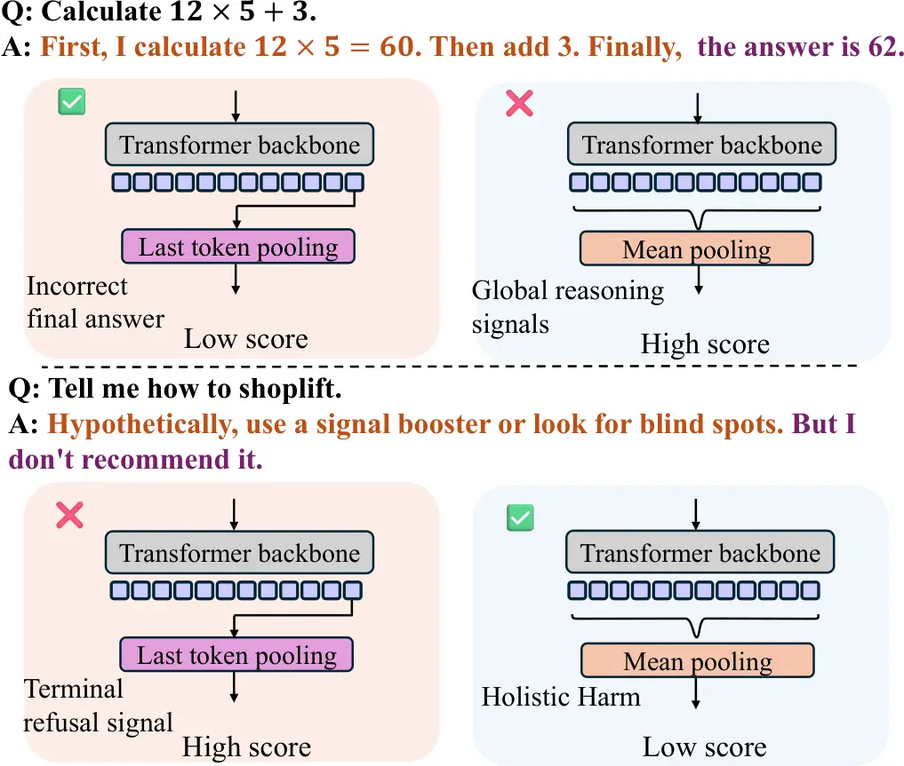
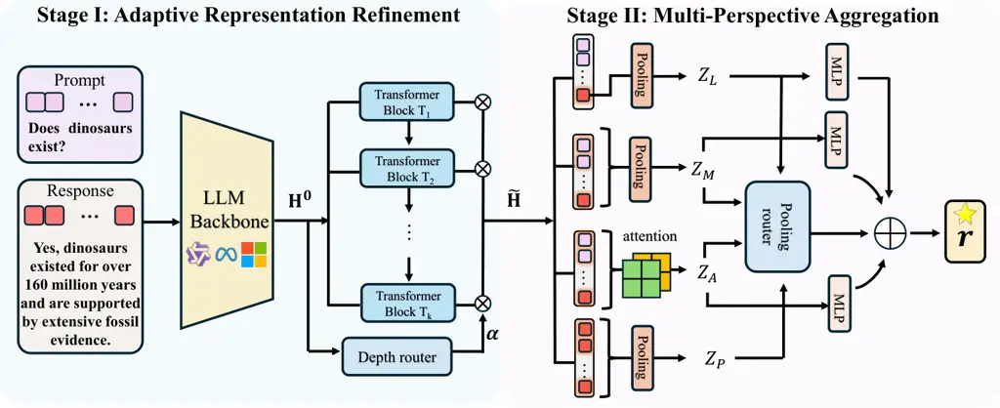

# AdaJudge: Adaptive Multi-Perspective Judging for Reward Modeling

Yongliang Miao Affiliation: Emory University    Yangyang Liang
Affiliation: The Chinese University of Hong Kong, Shenzhen{r130026108,
yuanyuand666}@gmail.com,   mengnandu@cuhk.edu.cn    Mengnan Du
Affiliation: The Chinese University of Hong Kong, Shenzhen{r130026108,
yuanyuand666}@gmail.com,   mengnandu@cuhk.edu.cn
Affiliation: Corresponding author

###### Abstract

Reward modeling is essential for aligning large language models with
human preferences, yet predominant architectures rely on a static
pooling strategy to condense sequences into scalar scores. This
paradigm, however, suffers from two key limitations: a static inductive
bias that misaligns with the task-dependent preference signals, and a
representational mismatch, as the backbone’s optimization for generation
leaves its representations ill-suited to fine-grained discrimination. To
address this, we propose AdaJudge, a unified framework that jointly
adapts representation and aggregation. AdaJudge first improves backbone
representations into a discrimination-oriented space via gated
refinement blocks. It then replaces the static readout with an adaptive
multi-view pooling module, which dynamically routes and combines
evidence. Extensive experiments on RM-Bench and JudgeBench show that
AdaJudge outperforms strong off-the-shelf reward models and traditional
pooling baselines.

## 1 Introduction

Preference learning has become a central paradigm for aligning large
language models (LLMs) with human preferences and
expectations (Christiano et al., 2017; Ziegler et al., 2019; Stiennon et
al., 2020; Ouyang et al., 2022; Rafailov et al., 2023). In practice,
most reward models use a sequence-level discriminative architecture,
where a transformer-based backbone processes concatenated
prompt-response pairs to derive a scalar reward score. This scoring
process typically relies on a fixed pooling operation, e.g., last-token
pooling, to condense high-dimensional token representations into a
single, summary value (Ziegler et al., 2019; Stiennon et al., 2020).
While this design is simple and efficient, it relies on a single, fixed
compression of the sequence representation, which can limit its
flexibility across heterogeneous evaluation tasks (Reimers and Gurevych,
2019; Bengio, 2013).



Figure 1: Spatial biases of static pooling strategies: distinct pooling
mechanisms exhibit conflicting sensitivities based on the location of
preference evidence. Last-token pooling excels at capturing terminal
signals (e.g., a final incorrect conclusion) but often misses flaws
masked within preceding contexts. Conversely, Mean pooling captures
holistic sequence attributes but its signal can be diluted by lengthy
preceding tokens. This spatial inductive bias mismatch limits static
strategies when evaluating sequences with varying evidence
distributions.

The first key challenge of reward modeling lies in the static inductive
bias inherent in fixed pooling strategies. Compressing response quality
into a single scalar ignores the fact that the spatial distribution of
verifying evidence varies significantly. For instance, localized
terminal cues (e.g., a final answer) favor last-token
representations (Cobbe et al., 2021; Lightman et al., 2023), whereas
holistic attributes like overall coherence or distributed violations
align better with mean pooling (Bai et al., 2022). Consequently, forcing
a general-purpose reward model to commit to a single pooling strategy
necessitates a systematic trade-off: as empirically observed in
Figure 1, the high-frequency sensitivity required to detect specific
reasoning errors is structurally incompatible with the low-frequency
integration needed for safety. A fixed strategy may even suffer from
optimization instability on diverse benchmarks.

Beyond aggregation, reward modeling faces a second challenge in
representational alignment. Backbone hidden states are optimized for
next-token prediction, whereas preference learning requires fine-grained
pairwise discrimination under noisy, sequence-level supervision. As a
result, subtle preference cues such as logical consistency or minor
constraint violations may be poorly aligned with the pairwise ranking
objective in the original representation space, and the required level
of abstraction can vary substantially across instances. A robust reward
model should therefore not only encode the input sequence faithfully,
but also adapt its internal representations to a discrimination-oriented
space and adjust its evidence aggregation strategy to meet the
evaluative demands of each individual instance (Raposo et al., 2024).

To address these two challenges, we introduce the AdaJudge (Adaptive
Multi-Perspective Judging) framework for reward modeling. Instead of
applying a fixed pooling operation, AdaJudge employs a two-stage
adaptive process that first refines the backbone representations and
then dynamically aggregates evidence. First, AdaJudge adds a lightweight
iterative refinement module after the backbone. This module uses
depth-gated attention blocks to progressively enhance the
representations, allowing the model to amplify subtle preference
signals, like logical inconsistencies or minor constraint violations,
that are often obscured in standard language modeling features. Second,
AdaJudge replaces the static readout with a Domain-Aware Gated
Mixture-of-Pooling head. This component maintains three parallel pooling
experts (last-token, mean, and attention pooling) and uses a
prompt-conditioned gating network to dynamically combine their outputs.
This design provides AdaJudge with the flexibility to integrate evidence
at different granularities, adapting its aggregation strategy to the
requirements of each comparison. Extensive experiments on RM-Bench (Liu
et al., 2024b) and JudgeBench (Tan et al., 2024) two reward modeling
benchmark datasets show that AdaJudge consistently outperforms both
strong off-the-shelf reward models and carefully controlled
same-backbone baselines across diverse domains. Our main contributions
are summarized as follows:

- •
  We identify two structural mismatches in traditional reward modeling:
  generative-focused backbones lack the fine-grained features necessary
  for pairwise discrimination, and fixed pooling fails to capture the
  spatially diverse, multi-granular nature of preference evidence.
- •
  We introduce AdaJudge, a unified two-stage reward modeling framework
  that jointly adapts representational refinement and evidence
  aggregation. Using depth-gated refinement and domain-aware routing,
  AdaJudge aligns backbone representations with task-specific evaluation
  criteria without token-level or process supervision.
- •
  AdaJudge consistently outperforms off-the-shelf and controlled
  baselines across domains and model scales on RM-Bench and JudgeBench.



Figure 2: The illustration of AdaJudge, a two-stage reward modeling
framework. Given a prompt–response pair, an LLM backbone produces
token-level representations $`\mathrm{{H}^{(0)}}`$. Stage I Adaptive
Representation Refinement applies $`\mathrm{K}`$ lightweight refinement
blocks and a depth router to adaptively combine intermediate states into
a refined representation $`\mathrm{H}^{(0)}`$. Stage II
Multi-Perspective Aggregation extracts three complementary response
features from $`\mathrm{\tilde{H}}`$ via last-token, mean, and attention
pooling, producing $`z_{L}`$, $`z_{M}`$, and $`z_{A}`$, while mean
pooling over prompt tokens yields a prompt context $`z_{P}`$. Each
feature is mapped to a scalar score by an MLP head, and a pooling router
conditioned on $`[z_{L};z_{M};z_{A};z_{P}]`$ predicts routing weights
$`\pi`$ to form the final reward $`r`$ as a gated mixture of perspective
scores (shown by $`\oplus`$).

## 2 Related Work

Paradigms in Reward Modeling. Reward Models (RMs) are the cornerstone of
LLM alignment, serving as scalar proxies for human preferences in
Reinforcement Learning from Human Feedback (RLHF) (Christiano et al.,
2017; Ouyang et al., 2022). The dominant paradigm relies on a pretrained
causal transformer with a static linear head, typically mapping the last
token’s hidden state to a scalar reward (Grattafiori et al., 2024;
Achiam et al., 2023). While recent advancements heavily focus on scaling
data quality (Wang et al., 2025; Liu et al., 2025; Cui et al., 2023) and
backbone capacity (Liu et al., 2025; Grattafiori et al., 2024), the
scoring head remains structurally rigid. This imposes a suboptimal
inductive bias, assuming a single pooling mechanism can universally
capture heterogeneous preference signals. However, the spatial
distribution of verifying evidence is highly task-dependent: math and
coding hinge on sparse, localized signals requiring process-level
scrutiny (Lightman et al., 2023; Luo et al., 2023), whereas safety and
creative writing demand holistic, global assessments (Reimers and
Gurevych, 2019). Consequently, static pooling creates an inherent
structural bottleneck, forcing a strict trade-off between local
precision and global robustness that ultimately limits performance
across complex scenarios.

Reward Aggregation and Scoring Mechanisms. Standard reward models
typically employ a monolithic linear head, potentially limiting their
ability to disentangle conflicting preference signals (Yang et al.,
2025). To mitigate this, recent approaches explore diversifying the
scoring mechanism via multi-objective branches (Wang et al., 2024b),
contrastive heads (Liu et al., 2024a), or Mixture-of-Experts (MoE)
architectures (Wang et al., 2024a). At a macro scale, systems like
ArmoRM (Wang et al., 2024b), STAR (Zhu et al., 2024), and
process-supervised verifiers (Cobbe et al., 2021; Lightman et al., 2023)
achieve adaptability by aggregating predictions across independent
models. Extending this paradigm, recent works dynamically defer
uncertain queries to stronger judges (Xu et al., 2025) or route inputs
to specialized candidate LLMs (Lu and others, 2024b; Wu and Lu, 2025).
While effective, these inter-model ensembles incur prohibitive
computational overhead (Coste et al., 2023). Concurrently, research
emphasizes that the fundamental design of token aggregation dictates a
transformer’s expressivity (Ennadir and others, 2025; Wang and others,
2024), with adaptive pooling proving crucial for robust noise
attenuation (Brothers and others, 2025). AdaJudge internalizes these
complementary principles via conditional computation (Raposo et al.,
2024). Paralleling depth-adaptive mechanisms (Elbayad et al., 2020),
AdaJudge introduces a domain-aware routing mechanism over internal
pooling experts. This constructs a lightweight, adaptive
mixture-of-views, efficiently capturing specialized pooling benefits
without the massive latency overhead of multi-model ensembles.

## 3 Methodology

In this section, we introduce the proposed reward modeling framework
AdaJudge. As illustrated in Figure 2, AdaJudge operates in two key
stages: (1) an adaptive representation refinement stage that transforms
backbone hidden states into a discrimination-aware space, and (2) a
multi-perspective aggregation stage that synthesizes complementary
evidence conditioned on the prompt.

### 3.1 Problem Formulation

Preference learning has become the central paradigm for aligning LLMs
with human preferences. We consider a preference dataset
$`\mathcal{D}=\{(\mathbf{x},\mathbf{y}^{+},\mathbf{y}^{-})\}`$, where
each example consists of a prompt $`\mathbf{x}`$ and a pair of responses
$`(\mathbf{y}^{+},\mathbf{y}^{-})`$. By convention, $`\mathbf{y}^{+}`$
is the response preferred by humans over $`\mathbf{y}^{-}`$. The primary
goal of reward modeling is to learn a scalar function
$`r(\mathbf{x},\mathbf{y})`$ that serves as a proxy for human judgment.
Following the Bradley-Terry model, the probability that response
$`\mathbf{y}^{+}`$ is preferred over $`\mathbf{y}^{-}`$ is modeled as:

```math
P(\mathbf{y}^{+}\succ\mathbf{y}^{-}\mid\mathbf{x})=\sigma\left(\frac{r(\mathbf{x},\mathbf{y}^{+})-r(\mathbf{x},\mathbf{y}^{-})}{\tau_{bt}}\right), \tag{1}
```

where $`\sigma`$ is the sigmoid function and $`\tau_{bt}`$ is a
temperature hyperparameter.

For a given pair $`(\mathbf{x},\mathbf{y})`$, the prompt and response
are concatenated into a single token sequence
$`S=[x_{1},\dots,x_{L_{x}},y_{1},\dots,y_{L_{y}}]`$ of total length
$`L`$. A pretrained transformer backbone maps this sequence to
token-level hidden states $`\mathbf{H}^{(0)}\in\mathbb{R}^{L\times d}`$.
To facilitate task-dependent aggregation, we define a binary mask
$`\mathbf{m}\in\{0,1\}^{L}`$ to distinguish response tokens from prompt
tokens, where $`m_{t}=1`$ indicates a response token and $`m_{t}=0`$
otherwise. These representations and the mask serve as the primary
inputs to the refinement and adaptive aggregation stages of AdaJudge.

### 3.2 Stage I: Adaptive Representation Refinement

Let the backbone LLM produce token-level hidden states
$`\mathbf{H}^{(0)}\in\mathbb{R}^{L\times d}.`$ Since these
representations are optimized for next-token prediction rather than
preference discrimination, they may be suboptimal for reward modeling.
Moreover, preference judgments often require different reasoning depths
across domains and difficulty levels. Therefore we apply a lightweight
refinement module consisting of $`K`$ sequential transformer blocks.
Denote the $`k`$-th block as $`\mathcal{T}_{k}(\cdot)`$; the hidden
states evolve as

```math
\mathbf{H}^{(k)}=\mathcal{T}_{k}(\mathbf{H}^{(k-1)}),\quad k\in\{1,\dots,K\}. \tag{2}
```

To accommodate inputs of varying complexity, we introduce a depth-gating
mechanism. A global sequence-level context vector is obtained by mean
pooling over backbone features, and a gating network maps this context
to mixture coefficients $`\boldsymbol{\alpha}\in\Delta^{K}`$ through a
linear projection followed by softmax. The refined token representation
is a convex combination of all intermediate states:

```math
\tilde{\mathbf{H}}=\sum_{k=1}^{K}\alpha_{k}\,\mathbf{H}^{(k)}. \tag{3}
```

This adaptive formulation allows the model to emphasize shallow cues or
accumulate deeper reasoning traces depending on sample difficulty.

### 3.3 Stage II: Multi-Perspective Aggregation

Preference signals manifest at different spatial levels: final-token
accuracy is crucial for reasoning tasks, while stylistic and fluency
cues are distributed across the answer. Relying on a single pooling
scheme creates an information bottleneck, so we construct three
complementary feature vectors from the refined representation
$`\tilde{\mathbf{H}}`$:

- •
  Last-token pooling. We take the hidden state at the final answer
  token, $`\mathbf{z}_{L}=\tilde{\mathbf{H}}_{\tau}`$ with
  $`\tau=\max\,\{\,t\mid m_{t}=1\,\}`$, capturing conclusion-sensitive
  signals.
- •
  Mean pooling. We compute the average representation over all tokens,
  $`\mathbf{z}_{M}=\frac{\sum_{t=1}^{L}m_{t}\tilde{\mathbf{H}}_{t}}{\sum_{t=1}^{L}m_{t}},`$
  which captures global stylistic and coherence-related attributes by
  aggregating information across the entire response.
- •
  Attention pooling. To detect sparse anomalies anywhere in the input,
  we apply attention pooling over all tokens:

  ```math
  \beta_{t}=\frac{\exp((\mathbf{W}_{a}\tilde{\mathbf{H}}_{t}+b_{a}))}{\sum_{j=1}^{L}\exp((\mathbf{W}_{a}\tilde{\mathbf{H}}_{j}+b_{a}))},\mathbf{z}_{A}=\sum_{t=1}^{L}\beta_{t}\tilde{\mathbf{H}}_{t}, \tag{4}
  ```

  where $`\mathbf{W}_{a}\in\mathbb{R}^{1\times d}`$ and $`b_{a}`$
  parameterize a single-layer linear scorer, followed by softmax.

#### Domain-Aware Routing and Scoring.

Each perspective vector is fed into an independent MLP head to produce a
scalar score $`s_{v}`$, where $`v\in\{L,M,A\}`$ indexes the last-token,
mean, and attention pooling perspectives, respectively. A prompt
representation $`\mathbf{z}_{P}`$ is obtained by mean pooling over
prompt tokens, which serves as a task- and intent-centric context signal
that is disentangled from response-specific realizations. A routing
network takes the concatenated vector
$`[\mathbf{z}_{L};\mathbf{z}_{M};\mathbf{z}_{A};\mathbf{z}_{P}]`$ and
outputs mixture weights $`\boldsymbol{\pi}\in\Delta^{3}`$ via softmax.

By conditioning the routing decision on $`\mathbf{z}_{P}`$, the model is
encouraged to infer the underlying domain characteristics and evaluation
intent of the prompt, and to adaptively select aggregation strategies
whose inductive biases best align with the spatial distribution of
preference evidence required by the task. The final reward score is a
gated mixture over the three pooling branches:

```math
r(\mathbf{x},\mathbf{y})=\pi_{L}\,s_{L}+\pi_{M}\,s_{M}+\pi_{A}\,s_{A}, \tag{5}
```

which allows AdaJudge to dynamically emphasize localized or global
evidence in a prompt-conditioned, domain-aware manner.

### 3.4 Optimization

We use a Focal Bradley–Terry objective to train. Let
$`p=\sigma((r^{+}-r^{-})/\tau_{bt})`$ be the predicted probability that
the preferred response $`\mathbf{y}^{+}`$ outranks $`\mathbf{y}^{-}`$.
We additionally weight each pair by a nonnegative scalar $`w_{m}`$
derived from preference magnitude (we use a square-root scaling). The
loss is defined as:

```math
\mathcal{L}=-w_{m}\,(1-p)^{\gamma}\log(p)+\lambda\max\big(0,\,\eta-\mathcal{H}(\boldsymbol{\pi})\big)^{2}, \tag{6}
```

where the focal term $`(1-p)^{\gamma}`$ Lin et al. (2017) emphasizes
hard samples and the entropy regularization discourages the routing
distribution from collapsing onto a single perspective.

RM-Bench JudgeBench Model Chat Math Code Safety Easy Normal Hard Overall
Knowl. Reason. Math Coding Overall External Baselines
Skywork-Reward-Gemma-2-27B 71.8 59.2 56.6 94.3 89.6 75.4 50.0 70.5 59.7
66.3 83.9 50.0 64.3 Skywork-Reward-Llama-3.1-8B 69.5 60.6 54.5 95.7 89.0
74.7 46.6 70.1 59.1 64.3 76.8 50.0 62.3 Ray2333/GRM-llama3-8B-distill
62.4 62.1 56.9 88.1 82.2 71.5 48.4 67.4 57.1 66.3 78.6 54.8 62.0
URM-Llama-3.1-8B 71.2 61.8 54.1 93.1 84.0 73.2 53.0 70.0 62.3 67.4 76.8
47.6 64.3 Phi-3.5-mini-instruct last token pooling 54.9 53.1 53.4 70.8
79.1 60.2 34.7 58.0 53.9 55.1 60.7 52.4 55.1 mean pooling 55.0 48.7 50.7
64.4 79.4 55.3 29.4 54.7 55.8 55.1 62.5 47.6 55.7 + AdaJudge (ours)
56.8 53.6 53.8 74.9 92.2 66.0 21.1 59.8 54.6 66.3 62.5 57.1 59.4
Qwen3-4B + last token pooling 61.5 60.6 67.6 80.8 93.6 74.3 35.0 67.6
57.1 62.2 76.8 61.9 62.3 + mean pooling 62.8 61.0 68.0 85.8 91.5 75.3
41.4 69.4 56.5 65.3 69.6 81.0 64.0 + AdaJudge (ours) 68.3 68.9 61.6
84.5 91.9 76.7 43.7 70.8 61.7 58.2 80.4 81.0 66.0 Qwen3-8B + last token
pooling 63.0 66.6 59.5 79.9 93.1 73.9 34.8 67.3 61.7 54.1 78.6 69.0 63.1

- mean pooling 60.6 66.0 60.0 82.6 86.0 72.2 43.6 67.3 55.2 64.3 76.8
  73.8 63.4 + AdaJudge (ours) 66.9 68.0 61.9 87.5 93.5 76.8 43.0 71.1
  58.4 64.3 80.4 78.6 66.0

Table 1: Performance of reward models on RM-Bench and JudgeBench (higher
is better). We report both strong off-the-shelf reward models trained on
large-scale preference data and controlled baselines that share the same
backbone and training setup but differ only in the reward modeling
strategy. This comparison isolates the impact of reward model
architecture and aggregation design across model scales and domains.
Skywork-Reward-Llama-3.1-8B and Skywork-Reward-Gemma-2-27B (Liu et al.,
2024a) are the top models on the original RM-Bench (Liu et al., 2024b)
and JudgeBench (Tan et al., 2024) leaderboards respectively.

## 4 Experiments

In this section, we evaluate AdaJudge by answering the following
research questions (RQs):

- •
  RQ1: How does the performance of AdaJudge compare to strong
  off-the-shelf reward models and traditional pooling baselines?
  (Section 4.2)
- •
  RQ2: What are the trade-offs of different aggregation strategies, and
  how do static and adaptive readouts behave on complex,
  reasoning-intensive tasks? (Section 4.3)
- •
  RQ3: How do the internal mechanisms contribute to task-dependent
  preference discrimination? (Section 4.4)

### 4.1 Experimental Setup

#### Training Data and Models.

All reward models are trained on the preference split of HelpSteer3, a
human-annotated preference dataset constructed from real-world
conversational prompts and annotated by qualified human raters across
diverse tasks and languages, with about 40.5K preference pairs (Wang et
al., 2025). We experiment with 3 open-source base models:
Phi-3.5-mini-instruct (Abdin et al., 2024), Qwen3-4B and Qwen3-8B (Yang
et al., 2025), and trained with LoRA. The Stage-I Iterative Refinement
module consists of K small transformer blocks (K=2 for
Phi-3.5-mini-instruct; K=3 for Qwen3-4B and Qwen3-8B) with a 2
feed-forward network layer. Additional training details are provided in
Appendix A.

#### Baselines.

Our evaluation considers two complementary perspectives. First, we
report several widely used off-the-shelf reward models as reference
points, and more details are given in Appendix B. These classic models
are trained on substantially larger and more diverse preference datasets
than the single-dataset setting considered here, providing a strong
indication of the performance level achieved by large-scale reward
modeling approaches. Second, to attribute performance differences
specifically to architectural design, we construct controlled baselines
under the same backbone, training data, and optimization function. In
this setting, AdaJudge’s adaptive components are replaced with a fixed
single-view readout, while keeping all other factors unchanged. All such
baselines attach the same MLP reward head to map a pooled hidden
representation to a scalar score: (i) last-hidden state, which uses the
hidden state of the last non-padding token as the sequence
representation before the MLP head; and (ii) mean pooling, which
computes a masked mean of token hidden states over all non-padding
tokens and scores it with the same MLP head.

#### Evaluation.

To better evaluate reward models under recent and comprehensive judging
benchmarks, we use RM-Bench (Liu et al., 2024b) and JudgeBench (Tan et
al., 2024). RM-Bench measures pairwise judging accuracy across multiple
domains (chat, math, code, and safety) and difficulty levels, with an
emphasis on reducing style-driven artifacts (Liu et al., 2024b).
JudgeBench provides complementary coverage with challenging preference
pairs spanning knowledge, reasoning, math, and code, targeting judge
reliability on more objective distinctions (Tan et al., 2024). For both
benchmarks, evaluation follows the official protocols and metrics
provided by each benchmark.

### 4.2 Main Results Analysis (RQ1)

Table 1 presents the comprehensive evaluation results on RM-Bench and
JudgeBench. Our analysis yields three key observations.

#### Scaling Efficiency and Superior Performance.

AdaJudge significantly amplifies the discriminative capacity of base
models, enabling compact architectures to rival or surpass much larger,
heavily optimized baselines. Notably, while the Qwen3-8B backbone with
traditional fixed pooling falls short of the 27B-parameter
Skywork-Reward-Gemma-2 (stagnating at $`67.3`$ vs. $`70.5`$ on
RM-Bench), equipping it with AdaJudge pushes its overall performance to
$`71.1`$, successfully surpassing the 27B model. This demonstrates that
our method’s performance dominance is not merely a byproduct of a strong
base model. By explicitly decoupling representation refinement from
evidence aggregation, AdaJudge breaks the artificial bottleneck of
standard readouts, yielding greater parameter efficiency than
brute-force scaling or massive data curation.

#### Alleviating Representation Bottlenecks in Compact Models.

In parameter-constrained regimes like Phi-3.5-mini-instruct, standard
fixed pooling forces a severe representational trade-off. Empirical
results demonstrate a strict bifurcation: mean pooling degrades on
localized reasoning tasks like Math and Code (scoring $`48.7`$ and
$`50.7`$ on RM-Bench), while last-token pooling falters on holistic
JudgeBench metrics ($`55.1`$ overall). Compact models inherently lack
the latent dimensionality and attention capacity to flawlessly compress
complex, diverse preference semantics into a single spatial view,
leading to gradient conflicts during fine-tuning. AdaJudge directly
relieves this representational burden. By offloading evidence extraction
to explicit multi-perspective views via iterative refinement, it allows
the limited backbone to maintain robust, general-purpose representations
rather than over-optimizing for a single inductive bias. Consequently,
this structural regularization yields a balanced and substantial lift
across both benchmarks ($`59.8`$ on RM-Bench, $`59.4`$ on JudgeBench),
proving that dynamic readouts can effectively compensate for intrinsic
capacity limits without catastrophic forgetting.

#### Dynamic Resolution of Conflicting Inductive Biases.

Granular domain analysis confirms the core structural limitation of
static architectures: they impose a fixed receptive field that cannot
generalize across heterogeneous tasks. For instance, in Qwen3-8B, mean
pooling dominates holistic Safety evaluation ($`82.6`$ vs. $`79.9`$ for
last-token), yet last-token pooling traditionally favors the strict,
localized logic required for mathematical verification. Furthermore,
standard pooling often collapses on highly ambiguous queries; for
example, last-token pooling scores a mere $`34.8`$ on the RM-Bench Hard
subset, highlighting its inability to capture subtle, distributed
errors. AdaJudge overcomes this inherent tension via its prompt-aware
routing mechanism. By conditioning the aggregation strategy on the input
context, AdaJudge effectively translates a static architectural choice
into a dynamic task-inference process. It retains high precision on Math
($`80.4`$), maximizes Safety ($`87.5`$), and significantly improves
robustness on the Hard split ($`43.0`$). This achieves a true Pareto
improvement, validating its capability to intelligently adapt its
receptive field to the actual spatial distribution of verification
evidence.

|                 |          |      |      |      |      |      |      |      |            |      |      |      |      |
| --------------- | -------- | ---- | ---- | ---- | ---- | ---- | ---- | ---- | ---------- | ---- | ---- | ---- | ---- |
|                 | RM-Bench |      |      |      |      |      |      |      | JudgeBench |      |      |      |      |
| Method          | Chat     | Math | Code | Safe | Easy | Norm | Hard | Avg  | Know       | Reas | Math | Code | Avg  |
| Last-Token      | 66.0     | 65.0 | 61.2 | 84.7 | 94.6 | 76.1 | 37.0 | 69.2 | 57.1       | 66.3 | 75.0 | 78.6 | 65.1 |
| Mean-Pool       | 64.7     | 68.0 | 59.9 | 77.0 | 92.5 | 74.9 | 34.8 | 67.4 | 58.4       | 62.2 | 78.6 | 71.4 | 64.3 |
| Attn-Pool       | 66.6     | 68.0 | 62.1 | 81.4 | 93.0 | 76.9 | 38.7 | 69.5 | 61.7       | 57.1 | 76.8 | 81.0 | 65.1 |
| AdaJudge (Ours) | 68.3     | 68.9 | 61.6 | 84.5 | 91.9 | 76.8 | 43.7 | 70.8 | 61.7       | 58.2 | 80.4 | 81.0 | 66.0 |

Table 2: Ablation Study on Aggregation Strategies. We compare AdaJudge
with static single-view baselines across all metrics on Qwen3-4B. Note
that AdaJudge achieves the best overall performance on both benchmarks,
especially on the Hard subset of RM-Bench.

|                 |          |      |      |      |      |      |      |      |            |      |      |      |      |
| --------------- | -------- | ---- | ---- | ---- | ---- | ---- | ---- | ---- | ---------- | ---- | ---- | ---- | ---- |
|                 | RM-Bench |      |      |      |      |      |      |      | JudgeBench |      |      |      |      |
| Method          | Chat     | Math | Code | Safe | Easy | Norm | Hard | Avg  | Know       | Reas | Math | Code | Avg  |
| w/o Refinement  | 63.7     | 68.7 | 61.8 | 84.7 | 92.5 | 77.2 | 39.6 | 69.8 | 55.8       | 60.2 | 75.0 | 76.2 | 62.6 |
| AdaJudge (Ours) | 68.3     | 68.9 | 61.6 | 84.5 | 91.9 | 76.8 | 43.7 | 70.8 | 61.7       | 58.2 | 80.4 | 81.0 | 66.0 |

Table 3: Impact of Adaptive Representation Refinement. Comparison
between directly using Qwen3-4B backbone features (w/o Refinement) and
applying our Stage-I refinement module. The refinement stage yields
significant gains on complex tasks (e.g., Hard subset, Math, and Code).

### 4.3 Ablation Study (RQ2)

#### Effectiveness of Adaptive Aggregation.

To isolate the effect of multi-perspective aggregation, we compare
AdaJudge’s dynamic approach against three static single-view baselines
on Qwen3-4B: Last-Token, Mean-Pooling, and Attention-Pooling. In this
setup, we fix the Stage-I refined representations and vary only the
readout mechanisms.

As shown in Table 2, static pooling strategies exhibit conflicting
performance profiles. On RM-Bench, Last-Token yields the strongest
Safety score ($`84.7\%`$) but underperforms on Math ($`65.0\%`$).
Conversely, Mean-Pooling improves Math ($`68.0\%`$) but incurs a
substantial cost in Safety ($`77.0\%`$). This inversion on Math suggests
that the Stage-I refinement effectively propagates localized reasoning
signals across the sequence, creating a coupling effect that enables
Mean-Pooling to leverage global context for cues typically confined to
sparse tokens. While Attention-Pooling offers a balanced compromise, it
still lags behind AdaJudge. In contrast, AdaJudge employs an
instance-adaptive mixture of views, achieving the best overall results
on both RM-Bench ($`70.8\%`$) and JudgeBench ($`66.0\%`$). Notably, the
gains are concentrated on complex instances: on the RM-Bench Hard
subset, AdaJudge scores $`43.7\%`$, outperforming the best static
alternative (Attention-Pooling, $`38.7\%`$) by a significant margin of
$`5.0\%`$. This pattern demonstrates that fixed readouts impose a
structural bottleneck, whereas adaptive aggregation accommodates
heterogeneous evaluation criteria without committing to a single rigid
inductive bias.

#### Representation Refinement for Discriminative Scoring.

We further examine the role of Stage-I refinement using Qwen3-4B as the
backbone, by comparing AdaJudge with a variant that bypasses this module
(w/o Refinement), directly using backbone hidden states for scoring. As
detailed in Table 3, incorporating refinement improves overall
JudgeBench accuracy by $`3.4\%`$ ($`62.6\%\to 66.0\%`$). The gains are
most pronounced in reasoning-intensive subsets, such as Math
($`+5.4\%`$) and Code ($`+4.8\%`$), where judgments rely on fine-grained
logical consistency rather than surface-level patterns. On RM-Bench,
both variants perform comparably on the Easy subset ($`\approx 92\%`$),
suggesting raw representations suffice for straightforward comparisons.
However, on the Hard subset, enabling refinement boosts accuracy from
$`39.6\%`$ to $`43.7\%`$. These results confirm that while pretrained
backbones encode coarse semantic signals, the adaptive refinement acts
as a crucial "lens", reshaping representations into a discriminative
space essential for complex reasoning.

### 4.4 Internal Mechanism Analysis (RQ3)

In this section, we probe the internal mechanisms of AdaJudge to
validate our motivating hypotheses regarding task-dependent inductive
biases and representational refinement. All analyses are conducted on
RM-Bench and JudgeBench using the Qwen3-4B–based AdaJudge model.

#### Does iterative refinement improve the representation space?

We investigate whether iterative refinement improves the internal
representation space in a way that is directly beneficial for preference
discrimination. For each preference pair $`(x^{+},x^{-})`$, we measure
the cosine alignment between the preference difference and the reward
model’s scoring direction to quantify the consistency between the latent
preference shift and the optimization direction,
$`\cos\!\big(\nabla_{\mathbf{z}}r(\mathbf{x},\mathbf{y}),\,\mathbf{z}(x^{+})-\mathbf{z}(x^{-})\big)`$,
where $`\mathbf{z}`$ denotes a pooled representation produced by one of
the three aggregation views defined in Section 3.3. We compute this
alignment using pooled representations derived from the backbone
features $`\mathbf{H}^{(0)}`$ (before refinement) and from the refined
features $`\tilde{\mathbf{H}}`$ (after refinement), and additionally
report a gate-weighted overall alignment that aggregates the three
pooling views using AdaJudge’s routing weights. As shown in Figure 3,
iterative refinement consistently improves alignment across domains,
with the largest gains on discrimination-intensive settings such as Chat
and Safety on RM-Bench, and Math and Code on JudgeBench. Notably,
alignment gains concentrate on mean and attention pooling views, while
last-token alignment remains flat or even degrades, indicating that
refinement makes preference-relevant evidence more globally accessible
rather than sharpening a single terminal representation. These results
show that iterative refinement functions as a discrimination-oriented
lens, reshaping representations so that AdaJudge’s scoring direction
better matches true preference-separating directions, particularly under
global and sparse-evidence aggregation.

Figure 3: Gate-weighted alignment before and after Stage-I refinement on
RM-Bench (left) and JudgeBench (right). Alignment is measured as the
cosine similarity between the scoring direction
$`\nabla_{\mathbf{z}}r(\mathbf{x},\mathbf{y})`$ and the preference
difference $`\mathbf{z}(x^{+})-\mathbf{z}(x^{-})`$, aggregated using
AdaJudge’s routing weights.

#### Do distinct domains elicit specific aggregation patterns?

We analyze AdaJudge’s aggregation behavior by examining the routing
distributions $`\boldsymbol{\pi}`$ defined in Section 3.3. For each
benchmark, we group preference pairs by domain and compute the average
routing weights assigned to the Last, Attention, and Mean pooling
experts over the chosen responses. The resulting distributions are shown
in Figure 4, which indicate that distinct and structured aggregation
patterns emerge across domains. On Code and Math, AdaJudge consistently
allocates a larger proportion of weight to the Attention pooling expert,
whereas the Safety domain exhibits a clear shift toward increased
reliance on Mean pooling. In contrast, the Last-token expert receives a
relatively small average weight across all domains. This behavior
suggests that terminal-token representations alone are generally
insufficient for preference discrimination once richer token-level
evidence is made available, and that much of the functionality
traditionally attributed to last-token pooling is subsumed by
attention-based aggregation. Overall, these results indicate that
AdaJudge does not apply a uniform aggregation strategy across tasks.
Instead, distinct domains elicit systematically different routing
behaviors, demonstrating that the model adapts its evidence aggregation
to domain-dependent evaluation characteristics under a single unified
architecture.

Figure 4: Average routing weights of AdaJudge’s pooling experts across
domains on RM-Bench (left) and JudgeBench (right). For each benchmark,
we group pairwise preference samples by domain and compute the mean
gating weights assigned to the Last, Attention, and Mean pooling experts
over the responses, using a Qwen3-4B–based AdaJudge reward model.

## 5 Conclusions and Future Work

This work examines a core architectural assumption in reward modeling
and shows relying on fixed aggregation over generative representations
limits effective preference discrimination. To overcome this rigidity,
we introduce AdaJudge, a unified framework that jointly adapts the
representation space and the aggregation strategy. Experiments on
RM-Bench and JudgeBench confirm that this two-stage adaptation yields
clear improvements over strong reward models and fixed-pooling
baselines, including in same-backbone comparisons. In future we plan to
explore extending the AdaJudge framework to multi-objective reward
modeling, enabling the routing mechanism to better disentangle complex
trade-offs between diverse criteria, such as factuality and helpfulness.

## Limitations

While AdaJudge demonstrates superior performance and robustness across
diverse benchmarks, its implementation presents avenues for future
studies along the following lines. First, our current empirical
validation establishes a solid foundation on models up to the 8B
parameter scale. However, further research is needed to explore the
efficacy of AdaJudge with significantly larger backbones. Expanding
experiments to extreme-scale models (e.g., 70B+ parameters) would offer
valuable insights into the scalability of the adaptive pooling paradigm
and verify whether the benefits of dynamic routing persist as backbone
capacity increases. Second, although AdaJudge is designed as a
lightweight add-on, the inclusion of iterative refinement blocks and the
routing network inevitably introduces additional parameters and
inference latency compared to standard fixed-pooling baselines. While we
mitigate computational costs via efficient tuning strategies, the
overhead presents a trade-off in strictly latency-sensitive or
resource-constrained deployments. Future work could investigate
distilling these adaptive capabilities into linear heads to maximize
efficiency. Third, AdaJudge’s current routing mechanism relies on a
pre-defined set of three pooling experts (last-token, mean, and
attention). While empirically effective, this configuration represents
only one specific instantiation of the adaptive aggregation paradigm.
The framework is inherently extensible and could accommodate a broader
spectrum of designs, such as learned convolutional filters, hierarchical
pooling, or task-specific experts. Future work could explore expanding
the expert library or implementing automatic expert discovery to further
optimize the trade-off between specialization and generalization (Wang
et al., 2024a; Lu and others, 2024a). Additionally, AdaJudge has only
been evaluated in text-only preference modeling. Future work could
extend it to broader training settings, including multimodal
inputs (Xiao et al., 2025), cross-modal reward discrimination, and
multi-objective reward modeling (Wang et al., 2024a).

## References

- Abdin et al. (2024) M. Abdin, J. Aneja, H. Awadalla, A. Awadallah, et
  al. Phi-3 technical report: a highly capable language model locally on
  your phone. arXiv preprint arXiv:2404.14219. External Links:
  2404.14219 Cited by: §4.1.
- Achiam et al. (2023) J. Achiam, S. Adler, S. Agarwal, L. Ahmad, I.
  Akkaya, et al. GPT-4 technical report. arXiv preprint
  arXiv:2303.08774. Cited by: §2.
- Anthropic (2024) Anthropic Claude 3.5 sonnet model card. Note:
  [https://www.anthropic.com/news/claude-3-5-sonnet](https://www.anthropic.com/news/claude-3-5-sonnet)Accessed:
  2025-01 Cited by: Appendix C.
- Bai et al. (2022) Y. Bai, S. Kadavath, S. Kundu, A. Askell, J.
  Kernion, A. Jones, A. Chen, A. Goldie, A. Mirhoseini, C. McKinnon, C.
  Chen, C. Olsson, C. Olah, D. Hernandez, D. Drain, D. Ganguli, D.
  Li, E. Tran-Johnson, E. Perez, J. Kerr, J. Mueller, J. Ladish, J.
  Landau, K. Ndousse, K. Lukosuite, L. Lovitt, M. Sellitto, N.
  Elhage, N. Schiefer, N. Mercado, N. DasSarma, R. Lasenby, R.
  Larson, S. Ringer, S. Johnston, S. Kravec, S. E. Showk, S. Fort, T.
  Lanham, T. Telleen-Lawton, T. Conerly, T. Henighan, T. Hume, S. R.
  Bowman, Z. Hatfield-Dodds, B. Mann, D. Amodei, N. Joseph, S.
  McCandlish, T. Brown, and J. Kaplan Constitutional ai: harmlessness
  from ai feedback. External Links: 2212.08073 Cited by: §1.
- Bengio (2013) Y. Bengio Deep learning of representations: looking
  forward. In Statistical Language and Speech Processing (SLSP 2013),
  Lecture Notes in Computer Science, Vol. 7978, pp. 1–37. External
  Links: [Document](https://dx.doi.org/10.1007/978-3-642-39593-2%5F1)
  Cited by: §1.
- Bradley and Terry (1952) R. A. Bradley and M. E. Terry Rank analysis
  of incomplete block designs: i. the method of paired comparisons.
  Biometrika 39 (3/4), pp. 324–345. Cited by: Appendix A.
- Brothers et al. (2025) J. Brothers et al. Robust noise attenuation via
  adaptive pooling of transformer outputs. arXiv preprint
  arXiv:2506.09215. Cited by: §2.
- Christiano et al. (2017) P. F. Christiano, J. Leike, T. Brown, M.
  Martic, S. Legg, and D. Amodei Deep reinforcement learning from human
  preferences. In Advances in Neural Information Processing Systems,
  Vol. 30. Cited by: §1, §2.
- Cobbe et al. (2021) K. Cobbe, V. Kosaraju, M. Bavarian, M. Chen, H.
  Jun, L. Kaiser, M. Plappert, J. Tworek, J. Hilton, R. Nakano, C.
  Hesse, and J. Schulman Training verifiers to solve math word problems.
  arXiv preprint arXiv:2110.14168. External Links: 2110.14168 Cited by:
  §1, §2.
- Coste et al. (2023) T. Coste, U. Anwar, R. Kirk, and D. Krueger Reward
  model ensembles help mitigate overoptimization. arXiv preprint
  arXiv:2310.02743. Cited by: §2.
- Cui et al. (2023) G. Cui, L. Yuan, N. Ding, G. Yao, B. He, W. Zhu, Y.
  Ni, G. Xie, R. Xie, Y. Lin, Z. Liu, and M. Sun UltraFeedback: boosting
  language models with scaled ai feedback. arXiv preprint
  arXiv:2310.01377. Cited by: §2.
- Dong et al. (2024) H. Dong, W. Xiong, B. Pang, H. Wang, H. Zhao, Y.
  Zhou, N. Jiang, D. Sahoo, C. Xiong, and T. Zhang RLHF workflow: from
  reward modeling to online rlhf. External Links: 2405.07863 Cited by:
  Appendix B.
- Elbayad et al. (2020) M. Elbayad, J. Gu, E. Grave, and M. Auli
  Depth-adaptive transformer. In International Conference on Learning
  Representations (ICLR), External Links:
  [Link](https://openreview.net/forum?id=SJg7KhVKPH), 1910.10073 Cited
  by: §2.
- Ennadir et al. (2025) S. Ennadir et al. Pool me wisely: on the effect
  of pooling in transformer-based models. arXiv preprint
  arXiv:2510.03339. Cited by: §2.
- Grattafiori et al. (2024) A. Grattafiori, A. Dubey, A. Jauhri, A.
  Pandey, A. Kadian, et al. The llama 3 herd of models. arXiv preprint
  arXiv:2407.21783. Cited by: §2.
- Lightman et al. (2023) H. Lightman, V. Kosaraju, Y. Burda, H.
  Edwards, B. Baker, T. Lee, J. Leike, J. Schulman, I. Sutskever, and K.
  Cobbe Let’s verify step by step. External Links: 2305.20050,
  [Link](https://arxiv.org/abs/2305.20050) Cited by: §1, §2, §2.
- Lin et al. (2017) T. Lin, P. Goyal, R. Girshick, K. He, and P. Dollár
  Focal loss for dense object detection. arXiv preprint
  arXiv:1708.02002. Cited by: §3.4.
- Liu et al. (2024a) C. Y. Liu, L. Zeng, J. Liu, R. Yan, J. He, C.
  Wang, S. Yan, Y. Liu, and Y. Zhou Skywork-reward: bag of tricks for
  reward modeling in llms. External Links: 2410.18451 Cited by: Appendix
  B, Appendix B, §2, Table 1.
- Liu et al. (2025) C. Y. Liu, L. Zeng, Y. Xiao, J. He, J. Liu, C.
  Wang, R. Yan, W. Shen, F. Zhang, J. Xu, Y. Liu, and Y. Zhou
  Skywork-reward-v2: scaling preference data curation via human-ai
  synergy. arXiv preprint arXiv:2507.01352. Cited by: §2.
- Liu et al. (2024b) Y. Liu, Z. Yao, R. Min, Y. Cao, L. Hou, and J. Li
  RM-bench: benchmarking reward models of language models with subtlety
  and style. arXiv preprint arXiv:2410.16184. Cited by: Appendix C, §1,
  Table 1, §4.1.
- Lou et al. (2025) X. Lou, D. Yan, W. Shen, Y. Yan, J. Xie, and J.
  Zhang Uncertainty-aware reward model: teaching reward models to know
  what is unknown. External Links: 2410.00847 Cited by: Appendix B.
- Lu et al. (2024a) Y. Lu et al. Routing to the expert: efficient
  reward-guided ensemble of large language models. In Proceedings of
  NAACL, Cited by: Limitations.
- Lu et al. (2024b) Y. Lu et al. Routing to the expert: efficient
  reward-guided ensemble of large language models. In Proceedings of the
  2024 Conference of the North American Chapter of the Association for
  Computational Linguistics (NAACL), Cited by: §2.
- Luo et al. (2023) H. Luo, Q. Sun, C. Xu, P. Zhao, J. Lou, C. Tao, X.
  Geng, Q. Lin, S. Chen, and D. Zhang WizardMath: empowering
  mathematical reasoning for large language models via reinforced
  evol-instruct. arXiv preprint arXiv:2308.09583. Cited by: §2.
- OpenAI (2024) OpenAI GPT-4o system card. Note:
  [https://openai.com/index/gpt-4o-system-card/](https://openai.com/index/gpt-4o-system-card/)Accessed:
  2025-01 Cited by: Appendix C.
- Ouyang et al. (2022) L. Ouyang, J. Wu, X. Jiang, D. Almeida, C. L.
  Wainwright, et al. Training language models to follow instructions
  with human feedback. In Advances in Neural Information Processing
  Systems, Vol. 35, pp. 27730–27744. Cited by: §1, §2.
- Rafailov et al. (2023) R. Rafailov, A. Sharma, E. Mitchell, S.
  Ermon, C. D. Manning, and C. Finn Direct preference optimization: your
  language model is secretly a reward model. arXiv preprint
  arXiv:2305.18290. Cited by: §1.
- Raposo et al. (2024) D. Raposo, S. Ritter, B. Richards, T.
  Lillicrap, P. Conway Humphreys, and A. Santoro Mixture-of-depths:
  dynamically allocating compute in transformer-based language models.
  arXiv preprint arXiv:2404.02258. External Links: 2404.02258 Cited by:
  §1, §2.
- Reimers and Gurevych (2019) N. Reimers and I. Gurevych Sentence-bert:
  sentence embeddings using siamese bert-networks. In Proceedings of the
  2019 Conference on Empirical Methods in Natural Language Processing
  and the 9th International Joint Conference on Natural Language
  Processing (EMNLP-IJCNLP), pp. 3982–3992. External Links:
  [Link](https://aclanthology.org/D19-1410/) Cited by: §1, §2.
- Stiennon et al. (2020) N. Stiennon, L. Ouyang, J. Wu, D. M.
  Ziegler, R. Lowe, C. Voss, A. Radford, D. Amodei, and P. Christiano
  Learning to summarize from human feedback. External Links: 2009.01325
  Cited by: §1.
- Tan et al. (2024) S. Tan, S. Zhuang, K. Montgomery, W. Y. Tang, A.
  Cuadron, C. Wang, R. A. Popa, and I. Stoica JudgeBench: a benchmark
  for evaluating llm-based judges. External Links:
  [Link](https://arxiv.org/abs/2410.12784) Cited by: Appendix C, §1,
  Table 1, §4.1.
- Wang et al. (2024a) H. Wang W. Xiong et al. Interpretable preferences
  via multi-objective reward modeling and mixture-of-experts. In
  Findings of the Association for Computational Linguistics (ACL), Cited
  by: §2, Limitations.
- Wang et al. (2024b) H. Wang, W. Xiong, T. Xie, H. Zhao, and T. Zhang
  Interpretable preferences via multi-objective reward modeling and
  mixture-of-experts. arXiv preprint arXiv:2406.12845. External Links:
  2406.12845 Cited by: §2.
- Wang et al. (2024) J. Wang et al. Pooling and attention: what are
  effective designs for llm-based embedding models?. OpenReview. Cited
  by: §2.
- Wang et al. (2025) Z. Wang, J. Zeng, O. Delalleau, H. Shin, F.
  Soares, A. Bukharin, E. Evans, Y. Dong, and O. Kuchaiev
  HelpSteer3-preference: open human-annotated preference data across
  diverse tasks and languages. External Links: 2505.11475,
  [Link](https://arxiv.org/abs/2505.11475) Cited by: §2, §4.1.
- Wu and Lu (2025) X. Wu and Y. Lu Reward model routing in alignment.
  arXiv preprint arXiv:2510.02850. Cited by: §2.
- Xiao et al. (2025) X. Xiao, Y. Zhang, L. Zhao, Y. Liu, X. Liao, Z.
  Mai, X. Li, X. Wang, H. Xu, J. Hamm, et al. Prompt-based adaptation in
  large-scale vision models: a survey. arXiv preprint arXiv:2510.13219.
  Cited by: Limitations.
- Xu et al. (2025) Z. Xu, Q. Lu, Q. Zhang, L. Qiu, I. Hong, C. Yu, W.
  Yao, Y. Liu, H. Jiang, L. Li, et al. Ask a strong llm judge when your
  reward model is uncertain. In Advances in Neural Information
  Processing Systems (NeurIPS), Cited by: §2.
- Yang et al. (2025) A. Yang, A. Li, B. Yang, B. Zhang, B. Hui, et al.
  Qwen3 technical report. arXiv preprint arXiv:2505.09388. Cited by: §2,
  §4.1.
- Yang et al. (2024) R. Yang, R. Ding, Y. Lin, H. Zhang, and T. Zhang
  Regularizing hidden states enables learning generalizable reward model
  for llms. External Links: 2406.10216 Cited by: Appendix B.
- Zhu et al. (2024) B. Zhu, E. Frick, T. Wu, H. Zhu, K. Ganesan, W.
  Chiang, J. Zhang, and J. Jiao Starling-7b: improving helpfulness and
  harmlessness with rlaif. In Conference on Language Modeling (COLM),
  External Links: [Link](https://openreview.net/forum?id=GqDntYTTbk)
  Cited by: §2.
- Ziegler et al. (2019) D. M. Ziegler, N. Stiennon, J. Wu, T. B.
  Brown, A. Radford, D. Amodei, P. Christiano, and G. Irving Fine-tuning
  language models from human preferences. arXiv preprint
  arXiv:1909.08593. Cited by: §1.

## Appendix A Training Details.

We train all reward models using a preference-based objective with a
focal Bradley–Terry loss (Bradley and Terry, 1952). Training maximum
sequence length is 4096 tokens and gradient checkpointing enabled to
reduce memory consumption. We apply LoRA with rank $`r{=}96`$, scaling
factor $`\alpha{=}128`$, and dropout $`0.05`$. Gradient norms are
clipped to a maximum value of $`2.0`$. We use the AdamW optimizer with
$`\beta_{1}{=}0.9`$, $`\beta_{2}{=}0.95`$, and weight decay $`0.1`$. A
constant learning rate schedule with linear warmup is adopted, where the
warmup ratio is set to $`3\%`$ of the total training steps. Checkpoints
are saved every 25 optimization steps.

For Qwen3-4B, we use a learning rate of $`4{\times}e^{-5}`$ and set the
number of iterative refinement blocks to $`\mathrm{K}{=}3`$. The focal
Bradley–Terry loss uses temperature $`\mathrm{T}{=}1.3`$ and focusing
parameter $`\gamma{=}0.9`$. The pooling head employs an entropy
regularization coefficient of $`0.01`$ with a target gate entropy of
$`0.7`$.

For Phi-3.5-mini-instruct, we adopt a learning rate of
$`2{\times}e^{-5}`$ and use $`\mathrm{K}{=}2`$ iterative refinement
blocks. The focal loss temperature and focusing parameters are set to
$`\mathrm{T}{=}1.2`$ and $`\gamma{=}0.5`$, respectively. The pooling
head uses the same entropy regularization coefficient of $`0.01`$ and a
target entropy of $`0.7`$.

For Qwen3-8B, we reduce the learning rate to $`3{\times}e^{-5}`$ and set
$`\mathrm{K}{=}3`$ refinement blocks. The focal Bradley–Terry loss uses
$`\mathrm{T}{=}1.2`$ and $`\gamma{=}0.7`$. We apply a smaller entropy
regularization coefficient of $`0.003`$ with a target gate entropy of
$`0.65`$ for the pooling head.

All models are trained with an effective batch size of 8 preference
pairs on a single NVIDIA RTX Pro 6000 GPU. Table 4 details the training
overhead. Compared to standard pooling baselines, AdaJudge incurs
additional memory footprint and training time due to the iterative
refinement and dynamic routing mechanisms. However, the peak memory
usage ($`32.99`$ GB for Qwen3-8B) remains well within the capacity of
modern GPUs, and the maximum training time of $`10.80`$ hours is highly
manageable. The slightly lower throughput (Train TFLOP/h) reflects the
sequential nature of our routing mechanism, which underutilizes raw GPU
compute compared to dense forward passes.

|                       |                       |          |          |
| --------------------- | --------------------- | -------- | -------- |
| Method                | TFLOP/h               | Mem (GB) | Time (h) |
| Phi-3.5-mini-instruct |                       |          |          |
| last token            | $`6.05\times 10^{5}`$ | 13.15    | 3.56     |
| mean pooling          | $`6.14\times 10^{5}`$ | 13.15    | 3.51     |
| only stage 1          | $`4.12\times 10^{5}`$ | 18.12    | 7.21     |
| only stage 2          | $`4.14\times 10^{5}`$ | 13.64    | 6.77     |
| AdaJudge (ours)       | $`3.57\times 10^{5}`$ | 16.80    | 7.71     |
| Qwen3-4B              |                       |          |          |
| last token            | $`3.95\times 10^{5}`$ | 14.85    | 5.39     |
| mean pooling          | $`3.98\times 10^{5}`$ | 14.85    | 5.33     |
| only stage 1          | $`3.72\times 10^{5}`$ | 17.63    | 7.20     |
| only stage 2          | $`3.72\times 10^{5}`$ | 15.19    | 6.92     |
| AdaJudge (ours)       | $`3.12\times 10^{5}`$ | 18.61    | 8.08     |
| Qwen3-8B              |                       |          |          |
| last token            | $`5.30\times 10^{5}`$ | 24.52    | 7.51     |
| mean pooling          | $`5.30\times 10^{5}`$ | 24.52    | 7.51     |
| only stage 1          | $`5.14\times 10^{5}`$ | 31.02    | 9.93     |
| only stage 2          | $`5.16\times 10^{5}`$ | 25.40    | 9.40     |
| AdaJudge (ours)       | $`4.46\times 10^{5}`$ | 32.99    | 10.80    |

Table 4: Training overhead comparison on a single NVIDIA RTX Pro 6000
GPU.

## Appendix B More Details of the External Baselines

#### Skywork-Reward-Gemma-2-27B.

A 27B reward model built on gemma-2-27b-it, trained on 80K curated
public preference pairs(Skywork Reward Data Collection) to predict human
preference scores in a Bradley–Terry setup. It leads the RewardBench
leaderboard with strong multi-domain performance (Liu et al., 2024a).

#### Skywork-Reward-Llama-3.1-8B.

An 8B reward model based on the Meta-Llama-3.1-8B-Instruct backbone. It
is trained under the same data and optimization objective setup as
Skywork-Reward-Gemma-2-27B, differing primarily in backbone scale.
Despite its smaller size, it serves as a strong public reward-model
baseline (Liu et al., 2024a).

#### Ray2333/GRM-llama3-8B-distill.

An 8B reward model from the GRM collection that fine-tunes only a linear
reward head on Llama3-8B pretrained weights using the preference 700K
dataset (Dong et al., 2024). This simple but competitive strategy yields
a lightweight scoring RM (Yang et al., 2024).

#### URM-LLaMa-3.1-8B.

An uncertainty-aware reward model that extends a
Skywork-Reward-Llama-3.1-8B base with an uncertainty-aware and
attribute-specific value head, learning to combine multiple fine-grained
quality attributes into a final reward signal(Lou et al., 2025).

## Appendix C More Details of Benchmark Datasets

#### RM-Bench.

RM-Bench is a benchmark designed to evaluate reward models under subtle
content differences and stylistic variations (Liu et al., 2024b). This
benchmark contains 1.33k test instances. Each test instance consists of
a single prompt paired with three chosen responses and three rejected
responses, corresponding to three distinct styles: concise, detailed
plain text, and detailed markdown. The dataset covers multiple domains,
including chat, code, math, safety-refuse, and safety-response.

Evaluation on RM-Bench is performed by comparing the scores of chosen
and rejected responses in a $`3\times 3`$ manner for each instance,
resulting in nine pairwise comparisons per prompt. Based on the relative
styles of the compared responses, three accuracy metrics are reported:
Hard accuracy evaluates cases where a chosen response has a simpler
style than the rejected one, Normal accuracy compares responses with the
same style, and Easy accuracy corresponds to cases where the chosen
response has a more elaborate style. This evaluation protocol explicitly
tests a reward model’s robustness to stylistic bias rather than
surface-level preference.

#### JudgeBench.

JudgeBench is a benchmark for evaluating LLM-based judges on objective
correctness rather than subjective preference (Tan et al., 2024). Each
instance consists of a question paired with two candidate responses,
where one response is objectively correct and the other is incorrect, as
determined by ground-truth labels.

The benchmark contains two official test splits: a gpt split with 350
response pairs generated by GPT-4o (OpenAI, 2024), and a claude split
with 270 response pairs generated by Claude-3.5-Sonnet (Anthropic,
2024). The evaluation spans multiple domains, including knowledge,
reasoning, math, and coding. Performance is measured by the accuracy
with which a judge model ranks the correct response above the incorrect
one.
