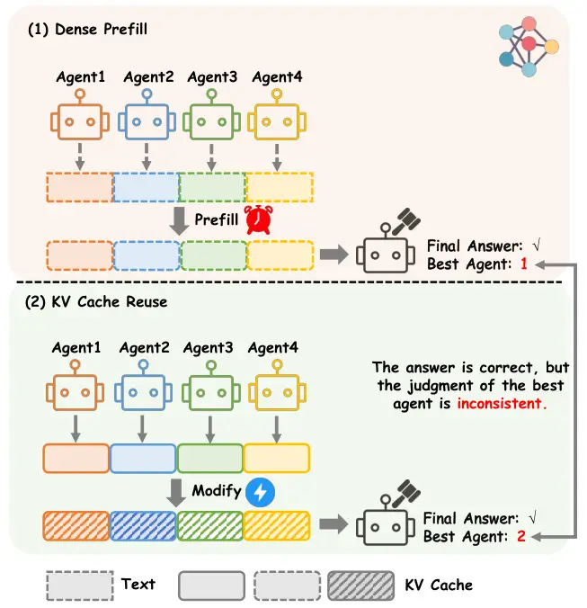
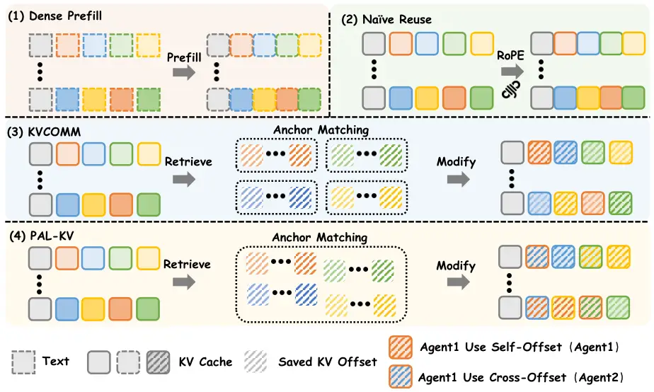
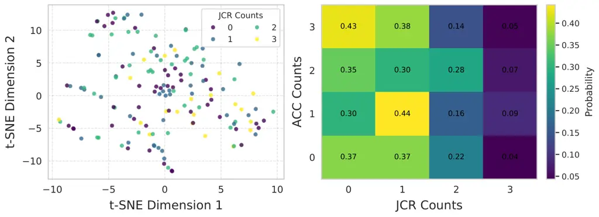
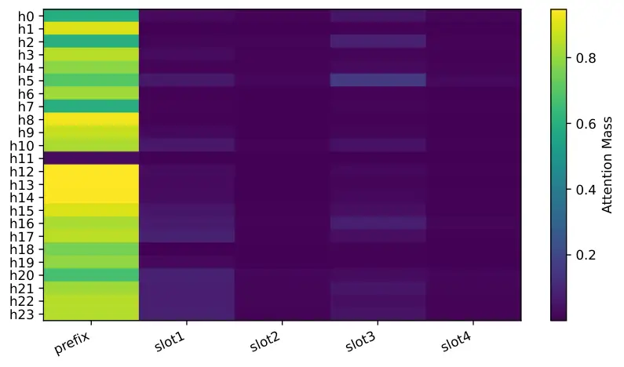
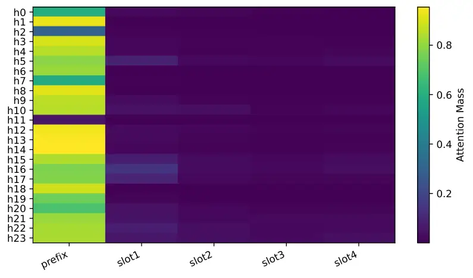
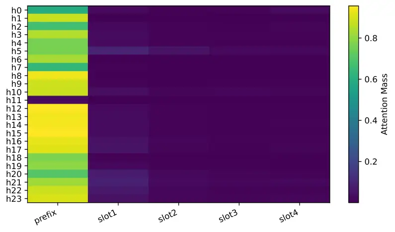

# When KV Cache Reuse Fails in Multi-Agent Systems: Cross-Candidate Interaction is Crucial for LLM Judges

Sichu Liang ^(†)^(†)thanks: Equal Contribution Affiliation: Southeast
University    Zhenglin Wang ¹¹footnotemark: 1 Affiliation: Southeast
University    Jiajia Chu Affiliation: Huawei Technologies Ltd    Pengfei
Xia Affiliation: Huawei Technologies Ltd    Hui Zang ^(†)^(†)thanks:
Corresponding author Affiliation: Huawei Technologies Ltd    Deyu Zhou
²²footnotemark: 2 Affiliation: Southeast University

###### Abstract

Multi-agent LLM systems routinely generate multiple candidate responses
that are aggregated by an LLM judge. To reduce the dominant prefill cost
in such pipelines, recent work advocates KV cache reuse across partially
shared contexts and reports substantial speedups for generation agents.
In this work, we show that these efficiency gains do not transfer
uniformly to _judge-centric_ inference. Across GSM8K, MMLU, and
HumanEval, we find that reuse strategies that are effective for
execution agents can severely perturb judge behavior: _end-task accuracy
may appear stable, yet the judge’s selection becomes highly inconsistent
with dense prefill._ We quantify this risk using Judge Consistency Rate
(JCR) and provide diagnostics showing that reuse systematically weakens
cross-candidate attention, especially for later candidate blocks. Our
ablation further demonstrates that explicit cross-candidate interaction
is crucial for preserving dense-prefill decisions. Overall, our results
identify a previously overlooked failure mode of KV cache reuse and
highlight judge-centric inference as a distinct regime that demands
dedicated, risk-aware system design. ¹¹ 1 The code is available in
[https://anonymous.4open.science/r/kv_reuse_fails-5B0C](https://anonymous.4open.science/r/kv_reuse_fails-5B0C)

## 1 Introduction



Figure 1: Illustration of decision non-invariance under judge-side KV
cache reuse. Top: dense prefill recomputes the judge KV cache and
selects Agent 1. Bottom: KV reuse stitches/modifies cached KV blocks,
keeping the final answer correct but changing the selected best agent,
despite identical candidate texts.

Modern intelligent systems often reason by considering multiple
alternatives rather than committing to a single trajectory—a pattern
observed in human decision-making and in AI systems that rely on search,
sampling, and planning Churchland et al. (2008); Browne et al. (2012);
Silver et al. (2016). Large language models (LLMs) have begun to exhibit
similar behavior through techniques such as multi-sample
decoding Leviathan et al. (2023); Gui et al. (2024); Sun et al. (2024),
self-consistency Wang et al. (2023); Li et al. (2025c), preference
modeling Rafailov et al. (2023); Ouyang et al. (2022); Sun et al.
(2025); Ye et al. (2025b), and search-based inference Yao et al. (2023);
Besta et al. (2024), where multiple candidate solutions are generated
and subsequently evaluated.

LLM-based multi-agent systems (MAS) Hong et al. (2024); Wu et al. (2024)
represent a concrete instantiation of this paradigm, where multiple
execution agents generate diverse candidate outputs that are aggregated
by a central meta-agent Zhang et al. (2025c) responsible for planning,
coordination or judging Chen et al. (2024); Fourney et al. (2024); Zhang
et al. (2025b). To enable such collaboration, execution agents and the
meta-agent must repeatedly exchange intermediate reasoning, candidate
outputs, and contextual information, leading to substantial overlap in
their effective input contextsWang et al. (2025); Zhang et al. (2025a).
While this interaction improves robustness and reasoning quality, it
also introduces severe computational redundancy: each agent repeatedly
performs a full prefill pass over largely overlapping context, causing
inference cost to scale rapidly with the number of agents Ye et al.
(2025a).

A natural solution is KV cache reuse Kwon et al. (2023); Zheng et al.
(2024b). During LLM inference, the prefill stage encodes the entire
input context and constructs key–value (KV) caches for attention, which
can be reused directly when multiple inputs share overlapping prefixes.
However, in multi-agent settings, simple prefix-based reuse is often
ineffective: although agents typically share substantial contextual
overlap (e.g., task instructions or exchanged messages), their prompts
frequently diverge due to role specifications, intermediate reasoning,
or agent-specific context. Consequently, KV caches across agents are
similar but not identical, preventing direct reuse Zhao et al. (2025);
Liu et al. (2025). This has motivated _cross-prefix_ (approximate) reuse
methods that enable reuse under partially shared prefixes and have
reported substantial speedups for generation agents in multi-agent
pipelines Yang et al. (2025); Yao et al. (2025); Ye et al. (2025a); Lu
et al. (2025).

Most existing studies evaluate KV reuse primarily from the perspective
of execution agents, implicitly assuming that efficiency gains transfer
uniformly across all components of a multi-agent pipeline. Yet the
impact of KV reuse on _judge_ agents—which must compare multiple
candidates jointly and produce a selection Li et al. (2024a)—remains
largely unexplored.

This gap is non-trivial, as judging constitutes a qualitatively
different inference regime from generation Li et al. (2025b). Prior work
has examined the reliability of LLM-based judges Zheng et al. (2024a),
documenting systematic biases such as position preference Li et al.
(2024b) and sensitivity to irrelevant contexts Shi et al. (2023).
However, these failures are typically attributed to model limitations or
task-level biases, rather than to _system-level efficiency
optimizations_ that modify the inference procedure. Consequently, how KV
cache reuse alters judge behavior in multi-candidate comparison settings
remains an open question. As shown in Figure 1, KV reuse may keep the
final answer unchanged while altering which candidate the judge selects,
motivating judge-centric diagnostics beyond accuracy.

In this paper, we revisit KV cache reuse from a _judge-centric_
perspective, where an LLM judge must _jointly_ compare multiple
candidates within a single context and output both a final answer and
the selected candidate. We show that judge-side reuse can be
_decision-non-invariant_: it may preserve end-task accuracy while
substantially changing which candidate the judge selects, especially
under order perturbations. These results highlight judge-centric
inference as a distinct regime in which preserving cross-candidate
interactions is critical.

Our key contributions are:

- •
  Judge-centric evaluation of KV reuse. We provide a systematic study of
  KV reuse in multi-candidate judging across tasks, candidate-generation
  regimes, and candidate orderings.
- •
  Decision instability beyond accuracy. We introduce Judge Consistency
  Rate (JCR) to quantify decision non-invariance relative to dense
  prefill, and show that Acc. and JCR can be decoupled—accuracy may
  appear stable while selection behavior becomes inconsistent under
  reuse.
- •
  Mechanistic diagnostics and implications. Through attention analyses
  and controlled ablations, we attribute the failure to disrupted
  cross-candidate interaction; we further develop PAL-KV as a probe to
  rule out agent identity as the dominant bottleneck and discuss
  practical directions such as interaction-aware reuse and risk-aware
  gating.

## 2 Related Work

#### KV Cache Reuse.

KV cache reuse is a widely studied approach for reducing the high
prefill cost of large language model (LLM) inference. Early systems Kwon
et al. (2023); Zheng et al. (2024b) focus on prefix caching, where KV
tensors are reused only when the input context remains identical. Recent
work extends KV reuse along two main directions. One line studies
_cross-model_ KV sharing, enabling cache reuse across model variants
derived from the same backbone Liu et al. (2026); Li et al. (2025a).
Most closely related to our study is the second line on _cross-prefix_
KV reuse, which enables approximate reuse when prompts share partial
prefixes but are not identical. Methods such as *TurboRAG* Lu et al.
(2025), *KVLink* Yang et al. (2025), and *CacheBlend* Yao et al. (2025)
achieve this via position adjustment, linking tokens, or selective
recomputation, and are typically evaluated in settings with limited
cross-segment interactions. *KVCOMM* Ye et al. (2025a) further brings
cross-prefix reuse to _multi-agent systems_ by using anchor examples to
correct cache deviations across agent-specific prompts.

We study KV reuse in _judge-centric_ multi-candidate inference and show
that reuse strategies effective for agent-side generation can be
decision-non-invariant for judges, revealing a failure mode overlooked
by prior work.

#### LLM-Based Multi-Agent Systems.

LLM-based multi-agent systems coordinate multiple specialized agents
through structured communication graphs Chen et al. (2024); Zhuge et al.
(2024), where _execution agents_ produce candidate outputs under
different roles or prompts Wang et al. (2025); Zhang et al. (2025a). A
common pattern is a central LLM _meta-agent_ that aggregates and
verifies multiple agent responses within a single context window to
produce the final decision Li et al. (2023); Hong et al. (2024); Zhang
et al. (2025c), making it a key component for both quality and
efficiency.

We show that KV reuse, while effective for execution agents, is not
always _behavior-preserving_ for judge agents, often changing which
candidate is selected relative to dense prefill.

#### LLM-as-a-Judge.

LLM-based judges are increasingly deployed as _decision modules_ in
high-stakes workflows including healthcare, finance, and legal
analysis Xie et al. (2024); Xie et al. (2023); Raju et al. (2024), where
selection robustness is critical. Most existing formulations treat
judging as either _pairwise comparison_ or _scalar scoring_, where
candidates are evaluated independently or in pairs Sun et al. (2024);
Sun et al. (2025). In contrast, many practical applications require a
judge to process _multiple candidates jointly_ within a single context
and directly select the best output Tran et al. (2025); Gera et al.
(2025). This setting is especially common in multi-agent systems, where
a judge must aggregate and attribute outputs from several execution
agents.

Such judges require cross-candidate comparison and relative reasoning,
unlike standard generation Li et al. (2025b). We study KV cache reuse
under this joint multi-candidate judging setting and show it can change
the judge’s selection relative to dense prefill.

## 3 Preliminaries



Figure 2: Judge-side KV cache construction for multi-candidate judging.
Dense prefill recomputes the full judge cache, while Naïve Reuse aligns
and stitches execution-side candidate KV chunks. KVCOMM retrieves
anchor-based cache offsets to correct reused chunks, and PAL-KV pools
anchors across agents for offset retrieval.

We study _judge-centric_ multi-candidate inference with $`N`$ execution
agents and a central judge agent. Given an input question $`x`$, each
execution agent $`A_{i}`$ is instantiated as a large language model with
an agent-specific prompt $`p_{i}`$ (e.g., role description or
instruction), and produces a candidate response $`y_{i}`$. A judge agent
$`J`$ with a judge-specific prompt $`p_{J}`$ then takes all candidate
responses as input and outputs (i) a final answer $`\hat{y}`$ and (ii)
the index of the selected candidate $`\hat{i}`$:

```math
(\hat{y},\hat{i})\;=\;J\!\left(p_{J},\;x,\;y_{1:N}\right),\qquad\hat{i}\in\{1,\dots,N\}. \tag{1}
```

Unlike pairwise comparison or scalar scoring, the judge must _jointly_
reason over multiple candidates within a single context, performing
explicit cross-candidate comparison and selection.

#### Candidate generation regimes.

We consider two common ways to construct multi-candidate inputs in
multi-agent pipelines.

(1) Progressive refinement. Candidates are generated sequentially, where
later agents may condition on earlier candidates:

```math
y_{i}=A_{i}\!\left(p_{i},\;x,\;y_{1:i-1}\right),\qquad i=1,\dots,N. \tag{2}
```

(2) Parallel exploration. Candidates are generated independently without
observing each other:

```math
y_{i}=A_{i}\!\left(p_{i},\;x\right),\qquad i=1,\dots,N. \tag{3}
```

#### Judge input ordering.

To disentangle content-based judging from potential ordering effects, we
optionally randomize the presentation order of candidates to the judge.
Let $`\pi`$ be a permutation over $`\{1,\dots,N\}`$. The judge observes
candidates in the permuted order $`y_{\pi(1:N)}`$:

```math
(\hat{y},\hat{i})=J\!\left(p_{J},\;x,\;y_{\pi(1:N)}\right), \tag{4}
```

where no-shuffle uses the identity permutation and shuffle samples
$`\pi`$ per example. Under shuffle, the predicted index $`\hat{i}`$ is
mapped back to the original candidate index via $`\pi`$.

## 4 KV Reuse for Multi-Candidate Judging

Figure 2 summarizes the judge-side cache construction strategies
compared in this work. We consider judge-centric inference where a judge
processes $`N`$ candidate responses within a single context. We use
$`\mathcal{K}(\cdot)`$ to denote the KV cache obtained by encoding a
token sequence, and $`\mathcal{K}(s)[u]`$ to denote the KV entries in
$`\mathcal{K}(s)`$ corresponding to a subsequence $`u\subseteq s`$. For
each candidate response $`y_{i}`$, the execution agent has already
computed and cached its KV entries under its execution-time context
$`S_{i}^{\text{exec}}`$:

```math
\mathcal{C}_{i}\;=\;\mathcal{K}\!\left(S_{i}^{\text{exec}}\right)[y_{i}]. \tag{5}
```

We use $`\oplus`$ to denote concatenation of KV-cache chunks in the
displayed candidate order (i.e., stitching cache segments into a single
judge cache). Let $`o_{i}`$ be the starting _token position_ (index) of
candidate $`y_{i}`$ in the judge input, and let
$`\mathcal{C}_{i}^{\rightarrow o_{i}}`$ denote the position-aligned
version of $`\mathcal{C}_{i}`$ (e.g., via RoPE Su et al. (2024)
re-indexing) so that it is valid starting at position $`o_{i}`$ in the
judge sequence. For a KV cache reuse method $`m`$, we denote by
$`\mathcal{C}^{J}_{m}`$ the assembled KV cache segment corresponding to
the concatenation of the $`N`$ candidate responses in the judge prompt .

#### Dense Prefill.

Let $`S^{J}=(p_{J},x,y_{1},\dots,y_{N})`$ denote the full judge input
sequence. Dense prefill recomputes the judge KV cache from scratch as
$`\mathcal{K}(S^{J})`$. In particular, the KV chunk for candidate
$`y_{i}`$ under dense judging is

```math
\mathcal{C}_{i}^{\text{dense}}\;=\;\mathcal{K}\!\left(S^{J}\right)[y_{i}], \tag{6}
```

which differs from the execution-time chunk $`\mathcal{C}_{i}`$ due to
the different conditioning context.

Then the full judge cache can be written as

```math
\mathcal{C}^{J}_{\text{dense}}=\mathcal{C}^{\text{dense}}_{1}\oplus\mathcal{C}^{\text{dense}}_{2}\oplus\cdots\oplus\mathcal{C}^{\text{dense}}_{N}. \tag{7}
```

#### Naïve Reuse (Position-Only Reuse).

Naïve reuse stitches cached response chunks into the judge context by
position alignment and concatenation:

```math
\mathcal{C}^{J}_{\text{naive}}\;=\;\mathcal{C}_{1}^{\rightarrow o_{1}}\oplus\mathcal{C}_{2}^{\rightarrow o_{2}}\oplus\cdots\oplus\mathcal{C}_{N}^{\rightarrow o_{N}}. \tag{8}
```

This approach reuses execution-side KV as-is and does not account for
prefix-dependent KV deviations induced by the judge-side context. This
position-only stitching strategy has been used in prior KV reuse
settings, e.g., in RAG-style cache reuse Lu et al. (2025) and in
multi-agent interaction setups that reuse cached internal states Zou et
al. (2025).

#### KVCOMM (Anchor-based Offset Correction).

KVCOMM improves reuse by adding an anchor-retrieved correction to each
reused chunk Ye et al. (2025a). For candidate $`i`$, KVCOMM constructs a
matching view $`v_{i}`$ under the current judge-side prefix and
retrieves a correction

```math
\widehat{\Delta}_{i}=\texttt{RetrieveOffset}(v_{i};\mathcal{A}^{(i)}), \tag{9}
```

where $`\mathcal{A}^{(i)}`$ is the agent-specific anchor pool used by
KVCOMM. It then corrects the aligned chunk as

```math
\widetilde{\mathcal{C}}_{i}^{J}\;=\;\mathcal{C}_{i}^{\rightarrow o_{i}}+\widehat{\Delta}_{i}, \tag{10}
```

and assembles the judge cache by concatenation:

```math
\mathcal{C}^{J}_{\text{kvcomm}}\;=\;\widetilde{\mathcal{C}}_{1}^{J}\oplus\widetilde{\mathcal{C}}_{2}^{J}\oplus\cdots\oplus\widetilde{\mathcal{C}}_{N}^{J}. \tag{11}
```

We follow KVCOMM for anchor construction, matching, and correction
estimation, and use its reliability criterion to fall back to dense
computation when reuse is deemed unreliable.

#### PAL-KV (Pooled-Anchor Lookup).

PAL-KV (Pooled-Anchor Lookup KV reuse) is a minimal modification of
KVCOMM that changes only the retrieval scope of anchors. While KVCOMM
retrieves $`\widehat{\Delta}_{i}`$ from an agent-specific pool
$`\mathcal{A}^{(i)}`$, PAL-KV retrieves from the union of all pools:

```math
\widehat{\Delta}_{i}^{\text{pal}}=\texttt{RetrieveOffset}\!\left(v_{i};\bigcup_{j=1}^{N}\mathcal{A}^{(j)}\right). \tag{12}
```

and applies

```math
\widetilde{\mathcal{C}}_{i,\text{pal}}^{J}=\mathcal{C}_{i}^{\rightarrow o_{i}}+\widehat{\Delta}_{i}^{\text{pal}}. \tag{13}
```

The assembled judge cache is

```math
\mathcal{C}^{J}_{\text{pal}}=\widetilde{\mathcal{C}}_{1,\text{pal}}^{J}\oplus\widetilde{\mathcal{C}}_{2,\text{pal}}^{J}\oplus\cdots\oplus\widetilde{\mathcal{C}}_{N,\text{pal}}^{J}. \tag{14}
```

Thus, PAL-KV modifies _which_ correction is selected, while keeping the
reuse and correction mechanism identical to KVCOMM.

## 5 Experiments

### 5.1 Experimental Setup

#### Multi-candidate generation.

We use the two candidate-generation regimes in Sec. 2, and generate
$`N{=}4`$ candidates per example. To isolate judge-side effects, we
disable execution-side reuse and _fix the candidate set_: for each
example we generate the candidates once with dense prefill and reuse the
identical candidate texts for all judge-side methods. We evaluate both
no-shuffle and shuffle candidate orders to quantify ordering effects on
judge-side reuse.

#### Models and implementation.

Our primary experiments use Llama-3.2-3B-Instruct Meta (2024) for both
execution agents and the judge, while ablations consider models from the
Llama-3.1/3.2 Grattafiori et al. (2024) and Qwen-2.5 Yang et al. (2024)
families across a range of sizes (3B–14B). To induce candidate diversity
while keeping the judge deterministic, execution agents use temperature
$`0.2`$ and the judge uses temperature $`0`$. For KVCOMM and PAL-KV, we
use an anchor pool of size $`|\mathcal{A}^{(i)}|=5`$ per agent.

### 5.2 Benchmarks

We evaluate judge-centric KV reuse on three representative benchmarks
spanning reasoning, programming, and knowledge-intensive domains: GSM8K.
A grade-school math reasoning benchmark Cobbe et al. (2021); HumanEval.
A code generation benchmark consisting of programming tasks with unit
tests Chen (2021). MMLU. A multi-domain knowledge benchmark covering
diverse subjects Hendrycks et al. (2021).

### 5.3 Evaluation Metrics

#### Task Acc.

The primary metric for the judge’s final answer: exact-match accuracy
for GSM8K and MMLU, and Pass@1 for HumanEval (also denoted as _Acc._ in
tables).

#### Judge Consistency Rate (JCR).

The percentage of examples where KV reuse and dense-prefill judging
select the same candidate _given the same candidate ordering_. JCR
measures the decision invariance under KV reuse. For shuffle, we use
identical permutations for both runs and map indices back to original
IDs.

#### Reuse Rate (Reuse).

The fraction of candidate blocks ($`y_{1:N}`$) assembled via reuse
versus dense recomputation. It excludes the shared judge prefix and
output tokens. We disable execution-side reuse to ensure an identical
candidate set across methods.

|                        |         |               |       |                |        |       |                |        |           |                |        |
| ---------------------- | ------- | ------------- | ----- | -------------- | ------ | ----- | -------------- | ------ | --------- | -------------- | ------ |
| Settings               | Shuffle | Method        | MMLU  |                |        | GSM8K |                |        | HumanEval |                |        |
|                        |         |               | Acc.  | JCR(-00.00)    | Reuse  | Acc.  | JCR(-00.00)    | Reuse  | Acc.      | JCR(-00.00)    | Reuse  |
| Progressive Refinement | No      | Dense Prefill | 45.09 | 100.00         | 00.00  | 71.34 | 100.00         | 00.00  | 33.54     | 100.00         | 00.00  |
|                        |         | Naïve Reuse   | 49.02 | 31.37          | 100.00 | 11.83 | 50.87          | 100.00 | 45.96     | 64.60          | 100.00 |
|                        |         | KVCOMM        | 39.22 | 66.67          | 32.55  | 64.14 | 87.91          | 29.93  | 51.55     | 57.14          | 48.32  |
|                        |         | PAL-KV        | 42.48 | 69.28          | 32.55  | 64.59 | 89.23          | 29.93  | 49.69     | 66.46          | 48.32  |
|                        | Yes     | Dense Prefill | 44.44 | 100.00(+00.00) | 00.00  | 70.51 | 100.00(+00.00) | 00.00  | 31.68     | 100.00(+00.00) | 00.00  |
|                        |         | Naïve Reuse   | 39.86 | 27.45(-03.92)  | 100.00 | 16.98 | 19.88(-30.99)  | 100.00 | 49.06     | 23.60(-41.00)  | 100.00 |
|                        |         | KVCOMM        | 39.87 | 39.87(-26.80)  | 32.29  | 63.84 | 51.75(-36.16)  | 31.86  | 49.69     | 21.74(-35.40)  | 44.84  |
|                        |         | PAL-KV        | 47.06 | 31.37(-37.91)  | 32.29  | 62.53 | 51.27(-37.96)  | 31.86  | 49.07     | 24.22(-42.24)  | 44.84  |
| Parallel Exploration   | No      | Dense Prefill | 49.02 | 100.00         | 00.00  | 67.32 | 100.00         | 00.00  | 28.57     | 100.00         | 00.00  |
|                        |         | Naïve Reuse   | 61.44 | 26.14          | 100.00 | 20.34 | 23.93          | 100.00 | 40.99     | 39.75          | 100.00 |
|                        |         | KVCOMM        | 47.06 | 58.16          | 44.84  | 39.63 | 59.19          | 63.12  | 31.68     | 61.49          | 66.96  |
|                        |         | PAL-KV        | 45.10 | 62.75          | 44.84  | 41.17 | 59.55          | 63.12  | 32.30     | 64.60          | 66.96  |
|                        | Yes     | Dense Prefill | 51.63 | 100.00(+00.00) | 00.00  | 70.28 | 100.00(+00.00) | 00.00  | 25.63     | 100.00(+00.00) | 00.00  |
|                        |         | Naïve Reuse   | 36.60 | 24.18(-1.96)   | 100.00 | 19.86 | 24.92(+0.99)   | 100.00 | 50.31     | 27.95(-11.80)  | 100.00 |
|                        |         | KVCOMM        | 43.14 | 46.41(-11.75)  | 44.84  | 38.89 | 34.43(-24.76)  | 63.21  | 37.27     | 32.92(-28.57)  | 66.96  |
|                        |         | PAL-KV        | 43.14 | 45.75(-17.00)  | 44.84  | 39.95 | 35.32(-24.23)  | 63.21  | 36.02     | 36.65(-27.95)  | 66.96  |

Table 1: Judge-side KV cache reuse results on three benchmarks under
different settings. Bold denotes the best Acc., and the JCR column
additionally reports the performance drop under shuffle relative to
no-shuffle.

## 6 Results and Analysis

### 6.1 Main Results

#### Overview: judge decisions are not invariant under KV reuse.

Table 1 reports task accuracy (Acc.), Judge Consistency Rate (JCR), and
the judge-side candidate Reuse Rate (Reuse) across all benchmarks. A
central observation is that KV reuse can substantially change which
candidate the judge selects, even when end-task accuracy remains
comparable. This decision non-invariance appears consistently under both
multi-agent candidate-generation regimes (Progressive Refinement and
Parallel Exploration), suggesting that the phenomenon is not tied to a
particular collaboration pattern. Overall, these results expose a
failure mode that would be missed if one monitors task metrics alone: KV
reuse may preserve outcomes while silently perturbing the judge’s
underlying selection behavior.

#### Accuracy can mask instability: reuse perturbs selection beyond what Acc reveals.

Under dense prefill, changing the candidate order (shuffle vs.
no-shuffle) often affects Acc. only moderately. In contrast, reuse-based
methods frequently exhibit low JCR even when Acc. remains close to the
dense-prefill baseline, indicating that the judge’s cross-candidate
comparison is highly sensitive to judge-side reuse. This decoupling is
critical for judge-centric pipelines where downstream properties—such as
attribution, explanation, and auditability—depend on _which_ candidate
is chosen, not only whether the final answer is correct. Appendix A.2
further analyzes this phenomenon and shows that Acc. and JCR are weakly
correlated.

#### Candidate-order perturbation (shuffle) amplifies inconsistency.

A striking pattern is that shuffle sharply reduces JCR for _all_
reuse-based methods. This indicates that judge-side reuse is strongly
_layout-dependent_: the effective prefix for each candidate block is
determined by the entire preceding candidate configuration in the judge
prompt. When the order changes, reuse approximations become much less
reliable, leading to large drops in JCR even when Acc. changes little.

#### PAL-KV as a probe: agent identity is not the dominant bottleneck.

We use PAL-KV as a controlled variant to test whether judge
inconsistency is mainly caused by _agent-specific_ offset distributions
assumed by KVCOMM. By pooling anchors across agents, PAL-KV relaxes the
agent-identity constraint in offset retrieval. Empirically, pooled
retrieval yields _small but consistent_ gains in the fixed-layout
setting (no-shuffle), suggesting that some offset patterns transfer
across agents when the presentation structure is stable. However, under
shuffle, PAL-KV does not mitigate the large JCR drop and behaves
similarly to KVCOMM; other probes show the same limitation
(Appendix A.4). Together, these results suggest that the dominant driver
of judge-centric failures is the changing cross-candidate
context/layout, rather than agent identity per se. In the next
subsection, we provide direct evidence that preserving _cross-candidate
interaction_ is crucial for maintaining dense-prefill judge decisions.

|                        |         |          |        |          |        |
| ---------------------- | ------- | -------- | ------ | -------- | ------ |
| Settings               | Shuffle | Acc. (%) |        | JCR (%)  |        |
|                        |         | Original | Masked | Original | Masked |
| Progressive Refinement | No      | 45.09    | 43.79  | 100.00   | 28.76  |
|                        | Yes     | 44.44    | 45.10  | 100.00   | 32.03  |
| Parallel Exploration   | No      | 49.02    | 48.37  | 100.00   | 22.22  |
|                        | Yes     | 54.25    | 47.71  | 100.00   | 31.37  |

Table 2: Effect of masking cross-candidate attention under dense
prefill.

Figure 3: Relative attention mass over regions (prefix and candidate
slots) under different KV reuse methods.

### 6.2 Why Does Judge-Centric Reuse Fail? Interaction Diagnostics

#### Attention diagnostics: reuse weakens cross-candidate attention, especially for later slots.

To understand why judge selections change under reuse, we analyze
attention patterns during the judge’s first-token generation. Figure 3
shows a consistent trend: attention over the shared prefix and the first
candidate block is relatively similar across methods, but attention to
later candidate blocks is substantially weaker and more erratic under
reuse-based methods than under dense prefill. Representative attention
maps for individual methods are provided in Appendix A.5. This is
consistent with the interpretation that reuse perturbs the fine-grained
cross-candidate interactions needed for joint comparison, causing the
judge to under-attend to late-arriving evidence.

#### Masking ablation: cross-candidate interaction is necessary beyond judge-style formatting.

A natural alternative explanation is that reuse fails simply because
execution-side KV caches are “incompatible” with the judge prompt. To
isolate the role of _interaction_ from _format_, we conduct a masking
ablation where candidates are placed in the judge prompt but
cross-candidate attention is explicitly blocked (candidate $`i`$ cannot
attend to candidates $`1{:}i{-}1`$). As shown in Table 2, masking has
only a limited effect on _Acc_ but causes a dramatic collapse in _JCR_,
approaching random-choice behavior for $`N{=}4`$. This provides direct
evidence that judge-centric inference critically relies on
cross-candidate interaction, and that removing such interaction—even
under the same judge-style prompt—destroys decision invariance relative
to dense prefill.

(a) Effect of anchor pool size.

(b) Effect of the number of candidates (agents).

(c) Effect of model family and size.

Figure 4: Ablations under shuffle: judge-side decision non-invariance
persists. Varying anchor pool size, candidate count, or model size does
not reliably restore JCR for KV reuse methods.

### 6.3 Ablation Studies

Unless otherwise specified, all ablations focus on the shuffle regime,
which is particularly challenging for judge-side reuse due to
order-induced layout changes; we use MMLU under Progressive Refinement
with shuffled candidate order as a representative testbed.

#### Anchor pool size is not the bottleneck under shuffle.

A plausible hypothesis is that poor anchor matches cause offset
correction to fail. We therefore increase the anchor pool size
(Figure 4(a)); as expected, a larger pool increases the Reuse Rate
(Appendix Table 3). Nevertheless, JCR under shuffle stays low and
changes little as the pool grows, suggesting that the failure is not
driven by insufficient anchor coverage. Instead, when the preceding
candidate configuration changes, anchor similarity becomes an unreliable
proxy for preserving the interaction effects needed for judging.

#### More candidates can improve Acc but make decision invariance harder.

We vary the number of candidates $`N`$ (Figure 4(b)). Increasing $`N`$
often improves _Acc_ by providing stronger candidates, but JCR decreases
monotonically across reuse-based methods. This highlights a key tension
in judge-centric systems: adding candidates improves solution quality
but expands the space of cross-candidate interactions that reuse must
preserve, making invariant selection increasingly fragile.

#### Scaling model size improves Acc but does not reliably restore JCR.

We evaluate different model families and sizes (Figure 4(c)). While
larger models tend to improve _Acc_, JCR does not show a corresponding
improvement and remains unstable under reuse. This indicates that judge
inconsistency is not merely a capacity issue; rather, it reflects
sensitivity to interaction patterns that current reuse schemes fail to
preserve.

Figure 5: Jaccard similarity of selected Top-$`k`$% tokens between the
small and large models.

Figure 6: Detecting universally safe vs. unsafe instances for judge-side
reuse (AUC $`\approx 0.82`$, AP $`\approx 0.77`$).

## 7 Discussion and Future Directions

Our study highlights a judge-centric failure mode of KV cache reuse:
when a judge must _jointly_ compare multiple candidate blocks, reuse can
substantially alter the selected candidate (low JCR), especially under
unstable layouts such as shuffle. Together with attention diagnostics
and the masking ablation, the evidence points to a central mechanism:
judge-centric inference relies on fine-grained cross-candidate
interactions that current reuse schemes do not reliably preserve. We
discuss two preliminary directions suggested by this mechanism.

#### From the perspective of interaction-preserving

A promising direction is to enhance judge-side reuse by selectively
retaining interaction-relevant context. Removing low-salience tokens
(e.g., redundant rationales) may mitigate attention dilution Shi et al.
(2023), helping the judge focus on informative evidence across
candidates. Crucially, this aims to concentrate rather than restrict
cross-candidate visibility. In a pilot analysis, we find substantial
overlap in token selections between Llama-3.2-1B and 3B models, with
Jaccard similarity increasing alongside the retention budget (Figure 5).
This suggests that small-to-large model cooperation Zhao et al. (2025);
Liu et al. (2025) could help identify judge-relevant tokens. However,
fully restoring judge invariance likely requires more sophisticated,
interaction-aware objectives beyond simple token-level overlap.


#### From the perspective of meta-reasoning for risk-aware gating.

Given the judge’s sensitivity to KV reuse, a promising direction is to
apply _meta-reasoning_—deciding which inference strategy to employ based
on the specific situation Yan et al. (2025). While proactive segment
prediction is effective in standard KV systems Pan et al. (2025),
judge-centric reuse requires conservative gating with reliable
fallbacks. Rather than predicting the success of a specific strategy
(AUC $`\approx 0.6`$), a more robust meta-goal is to identify instances
that are _universally safe_ for reuse (i.e., unlikely to alter the
judge’s selection in all three KV Reuse Methods). Using features derived
from the candidate set—such as correctness signals and pairwise
similarities—a simple classifier can distinguish “universally safe” vs.
“unsafe” instances with an AUC of 0.82 (Figure 6). This suggests that
future gating mechanisms should prioritize conservative safety detection
over fine-grained strategy selection to ensure decision invariance.


#### Outlook.

Overall, accelerating judge-centric inference likely requires methods
that explicitly preserve cross-candidate interactions under variable
layouts, potentially combining interaction-aware reuse, selective
retention/compression, and conservative gating with principled
fallbacks.

## 8 Conclusion

Our results reveal that KV reuse in judge-centric tasks is not
inherently behavior-preserving. While task accuracy remains stable, JCR
exposes a critical decoupling: judges frequently switch selections due
to disrupted cross-candidate interactions, especially under variable
layouts. These findings establish JCR as a vital diagnostic and motivate
future research into interaction-preserving and risk-aware KV
acceleration.

## Limitations

#### Judge biases and reliability are not the focus.

LLM-based judges are known to exhibit intrinsic biases and instability
(e.g., position preference and sensitivity to formatting). This work
does not aim to assess the judge’s _absolute_ fairness, calibration, or
stability, nor do we analyze whether KV reuse amplifies specific biases
of LLM judges. Instead, we focus on a narrower question: whether
judge-side KV reuse is _behavior-preserving_ relative to dense prefill
in multi-candidate _joint_ judging, i.e., whether reuse introduces
decision non-invariance even when task accuracy appears stable.

#### Scope of reuse and system coverage.

Our study focuses on _judge-centric_ KV reuse—reusing KV chunks of
candidate blocks when constructing the judge’s prefill cache—and uses
dense prefill as the reference behavior. We do not claim comprehensive
end-to-end optimization for all components of a full multi-agent stack,
nor do we report system-wide latency/throughput under different serving
configurations. Consequently, our reported Reuse Rate and analyses are
intentionally centered on the judge stage rather than end-to-end
efficiency.

#### Protocol and prompt dependence.

Our findings are obtained under a specific judging protocol (joint
multi-candidate selection with structured outputs) and
candidate-generation settings (few-shot prompting and chain-of-thought
style rationales). Different judge prompts (e.g., pairwise ranking vs.
joint selection), output constraints (selection-only vs. judge
rewriting), or candidate formatting may change the sensitivity profile.
While we expect the core phenomenon—that joint judging relies on
delicate cross-candidate interactions—to persist, quantitative results
may vary with protocol choices.

#### Limited cross-model and cross-architecture reuse.

We do not systematically evaluate KV reuse across _different model
families_, sizes, or architectures (e.g., heterogeneous agents and
judges). Such heterogeneous deployments are common in practice (e.g., a
stronger judge supervising weaker generators, or mixing different model
families), and the transferability of KV corrections in these settings
remains unclear. This limitation partly reflects the current research
landscape: formally published cross-model KV reuse/sharing approaches
appear relatively scarce, with representative examples targeting
specific adaptation or sharing settings (e.g., MobiLoRA Li et al.
(2025a) and DroidSpeak Liu et al. (2026)), rather than broad
cross-family, cross-size reuse. Extending judge-centric reuse to
heterogeneous model mixtures is an important direction for future work.

#### Model scale coverage.

Due to computational constraints, our experiments focus on small-to-mid
scale open-source LLMs (up to 14B parameters). While we include a
model-size ablation within this range, we do not claim that the
magnitude of decision non-invariance (e.g., JCR drops under reuse)
transfers unchanged to substantially larger models. Evaluating
judge-centric KV reuse on larger-scale LLMs (and potentially stronger
judges supervising weaker generators) remains an important direction. To
this end, we are actively expanding our evaluation to include models
with significantly larger parameter counts to further generalize the
findings of this study.

#### Implementation stack and deployment variability.

All experiments are conducted under an open-source inference stack
(HuggingFace Transformers²² 2
[https://huggingface.co/docs/transformers](https://huggingface.co/docs/transformers))
on a fixed GPU setup. Different kernels, serving systems, attention
implementations, or cache-management policies could affect absolute
accuracy and the magnitude of reuse-induced perturbations. We encourage
validation under diverse deployment stacks.

#### Downstream safety and compute considerations.

Our study highlights a failure mode where accuracy may mask decision
instability; in high-stakes downstream workflows, such non-invariance
can complicate accountability and auditing. We do not provide
application-specific deployment guidelines, and practitioners should
perform domain-specific evaluation and safeguards. Finally, while KV
reuse is motivated by reducing redundant computation, we do not quantify
end-to-end energy impacts; efficiency gains may be offset by increased
scale of deployment.

## References

- Besta et al. (2024) M. Besta, N. Blach, A. Kubicek, R.
  Gerstenberger, M. Podstawski, L. Gianinazzi, J. Gajda, T. Lehmann, H.
  Niewiadomski, P. Nyczyk, et al. Graph of thoughts: solving elaborate
  problems with large language models. In Proceedings of the AAAI
  conference on artificial intelligence, Vol. 38, pp. 17682–17690. Cited
  by: §1.
- Browne et al. (2012) C. B. Browne, E. Powley, D. Whitehouse, S. M.
  Lucas, P. I. Cowling, P. Rohlfshagen, S. Tavener, D. Perez, S.
  Samothrakis, and S. Colton A survey of monte carlo tree search
  methods. IEEE Transactions on Computational Intelligence and AI in
  games 4 (1), pp. 1–43. Cited by: §1.
- Chen (2021) M. Chen Evaluating large language models trained on code.
  arXiv preprint arXiv:2107.03374. Cited by: §5.2.
- Chen et al. (2024) W. Chen, Y. Su, J. Zuo, C. Yang, C. Yuan, C.
  Chan, H. Yu, Y. Lu, Y. Hung, C. Qian, Y. Qin, X. Cong, R. Xie, Z.
  Liu, M. Sun, and J. Zhou AgentVerse: facilitating multi-agent
  collaboration and exploring emergent behaviors. In The Twelfth
  International Conference on Learning Representations, External Links:
  [Link](https://openreview.net/forum?id=EHg5GDnyq1) Cited by: §1, §2.
- Churchland et al. (2008) A. K. Churchland, R. Kiani, and M. N. Shadlen
  Decision-making with multiple alternatives. Nature neuroscience 11
  (6), pp. 693–702. Cited by: §1.
- Cobbe et al. (2021) K. Cobbe, V. Kosaraju, M. Bavarian, M. Chen, H.
  Jun, L. Kaiser, M. Plappert, J. Tworek, J. Hilton, R. Nakano, et al.
  Training verifiers to solve math word problems. arXiv preprint
  arXiv:2110.14168. Cited by: §5.2.
- Fourney et al. (2024) A. Fourney, G. Bansal, H. Mozannar, C. Tan, E.
  Salinas, F. Niedtner, G. Proebsting, G. Bassman, J. Gerrits, J. Alber,
  et al. Magentic-one: a generalist multi-agent system for solving
  complex tasks. arXiv preprint arXiv:2411.04468. Cited by: §1.
- Gera et al. (2025) A. Gera, O. Boni, Y. Perlitz, R. Bar-Haim, L. Eden,
  and A. Yehudai JuStRank: benchmarking LLM judges for system ranking.
  In Proceedings of the 63rd Annual Meeting of the Association for
  Computational Linguistics (Volume 1: Long Papers), W. Che, J.
  Nabende, E. Shutova, and M. T. Pilehvar (Eds.), Vienna, Austria,
  pp. 682–712. External Links:
  [Link](https://aclanthology.org/2025.acl-long.34/),
  [Document](https://dx.doi.org/10.18653/v1/2025.acl-long.34), ISBN
  979-8-89176-251-0 Cited by: §2.
- Grattafiori et al. (2024) A. Grattafiori, A. Dubey, A. Jauhri, A.
  Pandey, A. Kadian, A. Al-Dahle, A. Letman, A. Mathur, A. Schelten, A.
  Vaughan, et al. The llama 3 herd of models. arXiv preprint
  arXiv:2407.21783. Cited by: §5.1.
- Gui et al. (2024) L. Gui, C. Gârbacea, and V. Veitch Bonbon alignment
  for large language models and the sweetness of best-of-n sampling.
  Advances in Neural Information Processing Systems 37, pp. 2851–2885.
  Cited by: §1.
- Hendrycks et al. (2021) D. Hendrycks, C. Burns, S. Basart, A. Zou, M.
  Mazeika, D. Song, and J. Steinhardt Measuring massive multitask
  language understanding. In International Conference on Learning
  Representations, External Links:
  [Link](https://openreview.net/forum?id=d7KBjmI3GmQ) Cited by: §5.2.
- Hong et al. (2024) S. Hong, M. Zhuge, J. Chen, X. Zheng, Y. Cheng, J.
  Wang, C. Zhang, Z. Wang, S. K. S. Yau, Z. Lin, L. Zhou, C. Ran, L.
  Xiao, C. Wu, and J. Schmidhuber MetaGPT: meta programming for a
  multi-agent collaborative framework. In The Twelfth International
  Conference on Learning Representations, External Links:
  [Link](https://openreview.net/forum?id=VtmBAGCN7o) Cited by: §1, §2.
- Kwon et al. (2023) W. Kwon, Z. Li, S. Zhuang, Y. Sheng, L.
  Zheng, C. H. Yu, J. Gonzalez, H. Zhang, and I. Stoica Efficient memory
  management for large language model serving with pagedattention. In
  Proceedings of the 29th symposium on operating systems principles,
  pp. 611–626. Cited by: §1, §2.
- Leviathan et al. (2023) Y. Leviathan, M. Kalman, and Y. Matias Fast
  inference from transformers via speculative decoding. In International
  Conference on Machine Learning, pp. 19274–19286. Cited by: §1.
- Li et al. (2025a) B. Li, Y. Wang, H. Ma, L. Chen, J. Xiao, and S. Wang
  MobiLoRA: accelerating LoRA-based LLM inference on mobile devices via
  context-aware KV cache optimization. In Proceedings of the 63rd Annual
  Meeting of the Association for Computational Linguistics (Volume 1:
  Long Papers), W. Che, J. Nabende, E. Shutova, and M. T. Pilehvar
  (Eds.), Vienna, Austria, pp. 23400–23410. External Links:
  [Link](https://aclanthology.org/2025.acl-long.1140/),
  [Document](https://dx.doi.org/10.18653/v1/2025.acl-long.1140), ISBN
  979-8-89176-251-0 Cited by: §2, Limited cross-model and
  cross-architecture reuse..
- Li et al. (2025b) D. Li, B. Jiang, L. Huang, A. Beigi, C. Zhao, Z.
  Tan, A. Bhattacharjee, Y. Jiang, C. Chen, T. Wu, K. Shu, L. Cheng,
  and H. Liu From generation to judgment: opportunities and challenges
  of LLM-as-a-judge. In Proceedings of the 2025 Conference on Empirical
  Methods in Natural Language Processing, C. Christodoulopoulos, T.
  Chakraborty, C. Rose, and V. Peng (Eds.), Suzhou, China,
  pp. 2757–2791. External Links:
  [Link](https://aclanthology.org/2025.emnlp-main.138/),
  [Document](https://dx.doi.org/10.18653/v1/2025.emnlp-main.138), ISBN
  979-8-89176-332-6 Cited by: §1, §2.
- Li et al. (2023) G. Li, H. Hammoud, H. Itani, D. Khizbullin, and B.
  Ghanem Camel: communicative agents for" mind" exploration of large
  language model society. Advances in Neural Information Processing
  Systems 36, pp. 51991–52008. Cited by: §2.
- Li et al. (2024a) H. Li, Q. Dong, J. Chen, H. Su, Y. Zhou, Q. Ai, Z.
  Ye, and Y. Liu Llms-as-judges: a comprehensive survey on llm-based
  evaluation methods. arXiv preprint arXiv:2412.05579. Cited by: §1.
- Li et al. (2025c) Y. Li, J. Zhang, S. Feng, P. Yuan, X. Wang, J.
  Shi, Y. Zhang, C. Tan, B. Pan, Y. Hu, and K. Li Revisiting
  self-consistency from dynamic distributional alignment perspective on
  answer aggregation. In Findings of the Association for Computational
  Linguistics: ACL 2025, W. Che, J. Nabende, E. Shutova, and M. T.
  Pilehvar (Eds.), Vienna, Austria, pp. 25208–25223. External Links:
  [Link](https://aclanthology.org/2025.findings-acl.1293/),
  [Document](https://dx.doi.org/10.18653/v1/2025.findings-acl.1293),
  ISBN 979-8-89176-256-5 Cited by: §1.
- Li et al. (2024b) Z. Li, C. Wang, P. Ma, D. Wu, S. Wang, C. Gao,
  and Y. Liu Split and merge: aligning position biases in LLM-based
  evaluators. In Proceedings of the 2024 Conference on Empirical Methods
  in Natural Language Processing, Y. Al-Onaizan, M. Bansal, and Y. Chen
  (Eds.), Miami, Florida, USA, pp. 11084–11108. External Links:
  [Link](https://aclanthology.org/2024.emnlp-main.621/),
  [Document](https://dx.doi.org/10.18653/v1/2024.emnlp-main.621) Cited
  by: §1.
- Liu et al. (2025) J. Liu, B. Chen, and C. Zhang Speculative prefill:
  turbocharging TTFT with lightweight and training-free token importance
  estimation. In Forty-second International Conference on Machine
  Learning, External Links:
  [Link](https://openreview.net/forum?id=bzbuZ0ItBq) Cited by: §1, §7.
- Liu et al. (2026) Y. Liu, Y. Huang, J. Yao, Z. Gu, K. Du, H. Li, Y.
  Cheng, J. Jiang, S. Lu, M. Musuvathi, and E. Choukse DroidSpeak:
  efficient context sharing for multiple-llm inference. In NSDI,
  External Links:
  [Link](https://www.microsoft.com/en-us/research/publication/droidspeak-kv-cache-sharing-for-efficient-multi-llm-serving/)
  Cited by: §2, Limited cross-model and cross-architecture reuse..
- Lu et al. (2025) S. Lu, H. Wang, Y. Rong, Z. Chen, and Y. Tang
  TurboRAG: accelerating retrieval-augmented generation with precomputed
  KV caches for chunked text. In Proceedings of the 2025 Conference on
  Empirical Methods in Natural Language Processing, C.
  Christodoulopoulos, T. Chakraborty, C. Rose, and V. Peng (Eds.),
  Suzhou, China, pp. 6599–6612. External Links:
  [Link](https://aclanthology.org/2025.emnlp-main.334/),
  [Document](https://dx.doi.org/10.18653/v1/2025.emnlp-main.334), ISBN
  979-8-89176-332-6 Cited by: §1, §2, §4.
- Meta (2024) A. Meta Llama 3.2: revolutionizing edge ai and vision with
  open, customizable models. Meta AI Blog. Retrieved December 20,
  pp. 2024. Cited by: §5.1.
- Ouyang et al. (2022) L. Ouyang, J. Wu, X. Jiang, D. Almeida, C.
  Wainwright, P. Mishkin, C. Zhang, S. Agarwal, K. Slama, A. Ray, et al.
  Training language models to follow instructions with human feedback.
  Advances in neural information processing systems 35, pp. 27730–27744.
  Cited by: §1.
- Pan et al. (2025) Z. Pan, A. PATEL, Y. Shen, Z. Hu, Y. Guan, W. Li, L.
  Qin, Y. Wang, and Y. Ding KVFlow: efficient prefix caching for
  accelerating LLM-based multi-agent workflows. In The Thirty-ninth
  Annual Conference on Neural Information Processing Systems, External
  Links: [Link](https://openreview.net/forum?id=5Iw1nDtYmT) Cited by:
  §7.
- Rafailov et al. (2023) R. Rafailov, A. Sharma, E. Mitchell, C. D.
  Manning, S. Ermon, and C. Finn Direct preference optimization: your
  language model is secretly a reward model. Advances in neural
  information processing systems 36, pp. 53728–53741. Cited by: §1.
- Raju et al. (2024) R. S. Raju, S. Jain, B. Li, J. L. Li, and U.
  Thakker Constructing domain-specific evaluation sets for
  LLM-as-a-judge. In Proceedings of the 1st Workshop on Customizable
  NLP: Progress and Challenges in Customizing NLP for a Domain,
  Application, Group, or Individual (CustomNLP4U), S. Kumar, V.
  Balachandran, C. Y. Park, W. Shi, S. A. Hayati, Y. Tsvetkov, N.
  Smith, H. Hajishirzi, D. Kang, and D. Jurgens (Eds.), Miami, Florida,
  USA, pp. 167–181. External Links:
  [Link](https://aclanthology.org/2024.customnlp4u-1.14/),
  [Document](https://dx.doi.org/10.18653/v1/2024.customnlp4u-1.14) Cited
  by: §2.
- Shi et al. (2023) F. Shi, X. Chen, K. Misra, N. Scales, D.
  Dohan, E. H. Chi, N. Schärli, and D. Zhou Large language models can be
  easily distracted by irrelevant context. In International Conference
  on Machine Learning, pp. 31210–31227. Cited by: §1, §7.
- Silver et al. (2016) D. Silver, A. Huang, C. J. Maddison, A. Guez, L.
  Sifre, G. Van Den Driessche, J. Schrittwieser, I. Antonoglou, V.
  Panneershelvam, M. Lanctot, et al. Mastering the game of go with deep
  neural networks and tree search. nature 529 (7587), pp. 484–489. Cited
  by: §1.
- Su et al. (2024) J. Su, M. Ahmed, Y. Lu, S. Pan, W. Bo, and Y. Liu
  Roformer: enhanced transformer with rotary position embedding.
  Neurocomputing 568, pp. 127063. Cited by: §4.
- Sun et al. (2024) H. Sun, M. Haider, R. Zhang, H. Yang, J. Qiu, M.
  Yin, M. Wang, P. Bartlett, and A. Zanette Fast best-of-n decoding via
  speculative rejection. Advances in Neural Information Processing
  Systems 37, pp. 32630–32652. Cited by: §1, §2.
- Sun et al. (2025) H. Sun, Y. Shen, and J. Ton Rethinking reward
  modeling in preference-based large language model alignment. In The
  Thirteenth International Conference on Learning Representations, Cited
  by: §1, §2.
- Tran et al. (2025) H. Tran, Z. Yao, Z. Yang, J. Wang, Y. Zhang, S.
  Han, F. Ouyang, and H. Yu RARE: retrieval-augmented reasoning
  enhancement for large language models. In Proceedings of the 63rd
  Annual Meeting of the Association for Computational Linguistics
  (Volume 1: Long Papers), W. Che, J. Nabende, E. Shutova, and M. T.
  Pilehvar (Eds.), Vienna, Austria, pp. 18305–18330. External Links:
  [Link](https://aclanthology.org/2025.acl-long.896/),
  [Document](https://dx.doi.org/10.18653/v1/2025.acl-long.896), ISBN
  979-8-89176-251-0 Cited by: §2.
- Wang et al. (2023) X. Wang, J. Wei, D. Schuurmans, Q. V. Le, E. H.
  Chi, S. Narang, A. Chowdhery, and D. Zhou Self-consistency improves
  chain of thought reasoning in language models. In The Eleventh
  International Conference on Learning Representations, External Links:
  [Link](https://openreview.net/forum?id=1PL1NIMMrw) Cited by: §1.
- Wang et al. (2025) Z. Wang, Y. Wang, X. Liu, L. Ding, M. Zhang, J.
  Liu, and M. Zhang AgentDropout: dynamic agent elimination for
  token-efficient and high-performance LLM-based multi-agent
  collaboration. In Proceedings of the 63rd Annual Meeting of the
  Association for Computational Linguistics (Volume 1: Long Papers), W.
  Che, J. Nabende, E. Shutova, and M. T. Pilehvar (Eds.), Vienna,
  Austria, pp. 24013–24035. External Links:
  [Link](https://aclanthology.org/2025.acl-long.1170/),
  [Document](https://dx.doi.org/10.18653/v1/2025.acl-long.1170), ISBN
  979-8-89176-251-0 Cited by: §1, §2.
- Wu et al. (2024) Q. Wu, G. Bansal, J. Zhang, Y. Wu, B. Li, E. Zhu, L.
  Jiang, X. Zhang, S. Zhang, J. Liu, et al. Autogen: enabling next-gen
  llm applications via multi-agent conversations. In First Conference on
  Language Modeling, Cited by: §1.
- Xie et al. (2023) Q. Xie, W. Han, X. Zhang, Y. Lai, M. Peng, A.
  Lopez-Lira, and J. Huang PIXIU: a large language model, instruction
  data and evaluation benchmark for finance. In Proceedings of the 37th
  International Conference on Neural Information Processing Systems,
  pp. 33469–33484. Cited by: §2.
- Xie et al. (2024) Y. Xie, S. Zhang, H. Cheng, P. Liu, Z. Gero, C.
  Wong, T. Naumann, H. Poon, and C. Rose DocLens: multi-aspect
  fine-grained evaluation for medical text generation. In Proceedings of
  the 62nd Annual Meeting of the Association for Computational
  Linguistics (Volume 1: Long Papers), L. Ku, A. Martins, and V.
  Srikumar (Eds.), Bangkok, Thailand, pp. 649–679. External Links:
  [Link](https://aclanthology.org/2024.acl-long.39/),
  [Document](https://dx.doi.org/10.18653/v1/2024.acl-long.39) Cited by:
  §2.
- Yan et al. (2025) H. Yan, L. Zhang, J. Li, Z. Shen, and Y. He
  Position: LLMs need a bayesian meta-reasoning framework for more
  robust and generalizable reasoning. In Forty-second International
  Conference on Machine Learning Position Paper Track, External Links:
  [Link](https://openreview.net/forum?id=RrvhbxO2hd) Cited by: §7.
- Yang et al. (2024) A. Yang, B. Yang, B. Zhang, B. Hui, B. Zheng, B.
  Yu, C. Li, D. Liu, F. Huang, H. Wei, et al. Qwen2. 5 technical report.
  arXiv preprint arXiv:2412.15115. Cited by: §5.1.
- Yang et al. (2025) J. Yang, B. Hou, W. Wei, Y. Bao, and S. Chang
  KVLink: accelerating large language models via efficient KV cache
  reuse. In The Thirty-ninth Annual Conference on Neural Information
  Processing Systems, External Links:
  [Link](https://openreview.net/forum?id=oDcAGSXZZP) Cited by: §1, §2.
- Yao et al. (2025) J. Yao, H. Li, Y. Liu, S. Ray, Y. Cheng, Q.
  Zhang, K. Du, S. Lu, and J. Jiang CacheBlend: fast large language
  model serving for rag with cached knowledge fusion. In Proceedings of
  the Twentieth European Conference on Computer Systems, EuroSys ’25,
  New York, NY, USA, pp. 94–109. External Links: ISBN 9798400711961,
  [Link](https://doi.org/10.1145/3689031.3696098),
  [Document](https://dx.doi.org/10.1145/3689031.3696098) Cited by: §1,
  §2.
- Yao et al. (2023) S. Yao, D. Yu, J. Zhao, I. Shafran, T. Griffiths, Y.
  Cao, and K. Narasimhan Tree of thoughts: deliberate problem solving
  with large language models. Advances in neural information processing
  systems 36, pp. 11809–11822. Cited by: §1.
- Ye et al. (2025a) H. Ye, Z. Gao, M. Ma, Q. Wang, Y. Fu, M. Chung, Y.
  Lin, Z. Liu, J. Zhang, D. Zhuo, and Y. Chen KVCOMM: online
  cross-context kv-cache communication for efficient llm-based
  multi-agent systems. Cited by: §1, §1, §2, §4.
- Ye et al. (2025b) Z. Ye, X. Li, Q. Li, Q. Ai, Y. Zhou, W. Shen, D.
  Yan, and Y. LIU Learning LLM-as-a-judge for preference alignment. In
  The Thirteenth International Conference on Learning Representations,
  External Links: [Link](https://openreview.net/forum?id=HZVIQE1MsJ)
  Cited by: §1.
- Zhang et al. (2025a) G. Zhang, Y. Yue, Z. Li, S. Yun, G. Wan, K.
  Wang, D. Cheng, J. X. Yu, and T. Chen Cut the crap: an economical
  communication pipeline for LLM-based multi-agent systems. In The
  Thirteenth International Conference on Learning Representations,
  External Links: [Link](https://openreview.net/forum?id=LkzuPorQ5L)
  Cited by: §1, §2.
- Zhang et al. (2025b) W. Zhang, C. Cui, Y. Zhao, Y. Liu, and B. An
  AgentOrchestra: a hierarchical multi-agent framework for
  general-purpose task solving. arXiv preprint arXiv:2506.12508. Cited
  by: §1.
- Zhang et al. (2025c) Y. Zhang, X. Liu, and C. Xiao MetaAgent:
  automatically constructing multi-agent systems based on finite state
  machines. In Proceedings of the 42nd International Conference on
  Machine Learning, A. Singh, M. Fazel, D. Hsu, S. Lacoste-Julien, F.
  Berkenkamp, T. Maharaj, K. Wagstaff, and J. Zhu (Eds.), Proceedings of
  Machine Learning Research, Vol. 267, pp. 75667–75694. External Links:
  [Link](https://proceedings.mlr.press/v267/zhang25bc.html) Cited by:
  §1, §2.
- Zhao et al. (2025) Y. Zhao, Y. Peng, N. Cam-Tu, Z. Li, W. Xiaoliang,
  hai zhao, and X. Fu SmallKV: small model assisted compensation of KV
  cache compression for efficient LLM inference. In The Thirty-ninth
  Annual Conference on Neural Information Processing Systems, External
  Links: [Link](https://openreview.net/forum?id=0BVrpXMr5Y) Cited by:
  §1, §7.
- Zheng et al. (2024a) C. Zheng, H. Zhou, F. Meng, J. Zhou, and M. Huang
  Large language models are not robust multiple choice selectors. In The
  Twelfth International Conference on Learning Representations, External
  Links: [Link](https://openreview.net/forum?id=shr9PXz7T0) Cited by:
  §1.
- Zheng et al. (2024b) L. Zheng, L. Yin, Z. Xie, C. L. Sun, J.
  Huang, C. H. Yu, S. Cao, C. Kozyrakis, I. Stoica, J. E. Gonzalez, et
  al. Sglang: efficient execution of structured language model programs.
  Advances in neural information processing systems 37, pp. 62557–62583.
  Cited by: §1, §2.
- Zhuge et al. (2024) M. Zhuge, W. Wang, L. Kirsch, F. Faccio, D.
  Khizbullin, and J. Schmidhuber GPTSwarm: language agents as
  optimizable graphs. In Proceedings of the 41st International
  Conference on Machine Learning, pp. 62743–62767. Cited by: §2.
- Zou et al. (2025) J. Zou, X. Yang, R. Qiu, G. Li, K. Tieu, P. Lu, K.
  Shen, H. Tong, Y. Choi, J. He, et al. Latent collaboration in
  multi-agent systems. arXiv preprint arXiv:2511.20639. Cited by: §4.

## Appendix A Additional Analyses and Extended Results

### A.1 Naïve position-only reuse is brittle for judge-centric comparison

Naïve Reuse reuses _all_ candidate blocks (Reuse%=100% by construction)
via position alignment and stitching, without accounting for
prefix-dependent deviations. While this can be effective for some
standard prefix-sharing workloads, it is highly unstable for
judge-centric inference: it often produces very low JCR and can even
catastrophically harm accuracy on reasoning benchmarks (e.g., severe
drops on GSM8K), indicating that position-only stitching fails to
preserve the cross-candidate interaction patterns required for reliable
joint comparison.

### A.2 Judge Instability vs. Task Difficulty

This section provides additional evidence that low judge consistency
(low JCR) is not merely a byproduct of task difficulty. Here we
operationalize _task difficulty_ by ACC Counts: for each example, we
count how many reuse-based methods (Naïve Reuse, KVCOMM, and PAL-KV)
produce a correct final answer. We measure decision non-invariance by
JCR Counts: the number of reuse-based methods whose _selected candidate_
matches dense prefill (i.e., the per-method JCR indicator aggregated
over the three reuse methods).

Embedding view. Figure 7 (left) visualizes question embeddings projected
to 2D with a supervised t-SNE, where points are colored by JCR Counts.
If judge non-invariance were primarily driven by question semantics (or
by a small subset of intrinsically “hard” questions), we would expect
instances with low JCR Counts to form separable regions. Instead,
instances with different JCR Counts are heavily intermixed, suggesting
that decision non-invariance is not well explained by the question
embedding geometry and is difficult to predict from semantics alone.

Difficulty–consistency relationship. Figure 7 (right) shows the
empirical distribution of ACC Counts vs. JCR Counts. While one might
expect “easy” instances (high ACC Counts) to also yield stable judge
selections (high JCR Counts), the heatmap shows only a weak association:
even when multiple reuse methods answer correctly, the judge’s selected
candidate can still differ from dense prefill (non-trivial mass at high
ACC Counts but low JCR Counts). Conversely, low ACC Counts do not
uniquely correspond to low JCR Counts either. Overall, these results
indicate that task correctness and decision invariance are partially
decoupled in judge-centric inference, reinforcing the need for JCR-style
diagnostics beyond end-task accuracy.



Figure 7: Task difficulty vs. judge decision non-invariance. Left: t-SNE
of question embeddings, colored by _JCR Counts_ (number of reuse methods
whose selection matches dense prefill). Right: joint distribution
between _ACC Counts_ (number of reuse methods that answer correctly) and
_JCR Counts_.

### A.3 Anchor Pool Size and Effective Reuse

As showed in Table 3, we vary the anchor pool size to test whether
insufficient anchor coverage explains low JCR under shuffle. As
expected, a larger pool increases the effective Reuse Rate, but it does
not reliably restore JCR.

|        |           |          |         |           |
| ------ | --------- | -------- | ------- | --------- |
| Method | AnchorNum | Acc. (%) | JCR (%) | Reuse (%) |
| KVCOMM | 5         | 39.87    | 39.87   | 32.29     |
|        | 10        | 37.25    | 38.56   | 47.58     |
|        | 15        | 37.91    | 38.56   | 52.55     |
|        | 20        | 34.64    | 34.64   | 57.25     |
| PAL-KV | 5         | 47.06    | 31.37   | 32.29     |
|        | 10        | 35.29    | 37.91   | 47.58     |
|        | 15        | 43.14    | 35.29   | 52.55     |
|        | 20        | 34.64    | 37.25   | 57.25     |

Table 3: Effect of anchor pool size on performance (additional results).

### A.4 Slot-Aligned Stabilization Baseline

We evaluate a slot-aligned variant that indexes reuse decisions by fixed
candidate slots to test whether slot identity alone can stabilize reuse
under shuffle.

One might hope that indexing offsets by fixed _slots_ in the judge
prompt would stabilize reuse under shuffling. However, Table 4 shows no
consistent gain from a slot-aligned variant. This suggests that true
stability requires more than slot identity: for a candidate block, the
_entire preceding candidate configuration_ (and thus the induced
interaction structure) matters. Under shuffle, this configuration space
scales combinatorially, making naive stabilization impractical.

|                        |            |          |         |           |
| ---------------------- | ---------- | -------- | ------- | --------- |
| Setting                | Method     | Acc. (%) | JCR (%) | Reuse (%) |
| Progressive Refinement | KVCOMM     | 39.87    | 39.87   | 32.29     |
|                        | Slot-Align | 43.79    | 36.84   | 26.14     |
| Parallel Exploration   | KVCOMM     | 43.14    | 46.41   | 44.84     |
|                        | Slot-Align | 43.14    | 45.10   | 44.44     |

Table 4: Slot-aligned stabilization does not reliably improve decision
invariance (additional results).



(a) Dense Prefill



(b) Naïve Reuse



(c) KVCOMM


(d) PAL-KV

Figure 8: Attention mass visualization under different KV reuse
strategies.

### A.5 Additional Attention Visualizations

This section provides additional attention visualizations for
representative examples under dense prefill and reuse-based methods,
complementing the aggregate statistics reported in the main text.
Figure 8 shows token-level attention mass over the shared prefix and
candidate slots during the judge’s first-token generation. While the
main text summarizes the _average_ attention allocated to each region,
here we present qualitative examples that illustrate how the attention
patterns differ across methods.

In dense prefill, the judge typically allocates non-trivial attention to
multiple candidate blocks (e.g., slot1 and slot3 in the shown example),
which is consistent with the intended behavior of joint multi-candidate
comparison. In contrast, Naïve Reuse often exhibits a highly
concentrated pattern where attention collapses onto a single early slot
(frequently slot1), suggesting that position-only stitching can distort
cross-candidate interactions and effectively reduce the judge’s ability
to incorporate later evidence. KVCOMM and PAL-KV partially mitigate this
collapse by restoring some attention to non-first slots; however, their
attention distributions remain noticeably more peaked than dense
prefill, indicating that the judge still under-attends to certain
candidate blocks relative to the dense reference. Overall, these
visualizations support the interpretation that KV reuse can bias the
judge toward a more _shortcut_ decision process—selecting a “best”
candidate with less thorough cross-candidate comparison—which helps
explain the observed drops in JCR.

## Appendix B Case Study

Figures 15 and 16 provide a GSM8K case study under Parallel Exploration
with shuffle ordering, illustrating how judge selections can change
relative to dense prefill.

This case study illustrates _decision non-invariance_ rather than answer
degradation. Among the four candidates, Agents 1 and 4 provide
essentially equivalent and correct solutions (both conclude \$12 with
near-identical reasoning steps), while Agents 2 and 3 make the same
arithmetic mistake (\$16). Under dense prefill, the judge selects
Agent 1, whereas under KVCOMM it selects Agent 4, despite producing the
same final answer.

Why this is still informative. Because multiple candidates are correct
and highly similar, the judge’s choice is driven by fine-grained
cross-candidate comparison and implicit tie-breaking (e.g., how evidence
from each block is integrated, which rationale is attended to, and how
the judge maps candidate identities under a shuffled layout), rather
than by correctness alone. This is precisely the regime where we observe
large drops in JCR: KV reuse can change _which_ candidate the judge
attributes as best even when task accuracy remains unchanged. In other
words, the failure mode here is not “worse answers,” but _unstable
attribution/selection_ relative to dense prefill, which undermines
auditability and accountability in judge-centric pipelines.

## Appendix C Reproducibility Details

### C.1 Prompting Templates and Output Formats

This appendix summarizes the prompting templates used for both execution
agents and the judge, as well as the structured output format required
for reliable parsing of the final answer and the selected candidate
index.

Execution-agent prompting. To ensure that candidate responses are
directly comparable (i.e., differences arise from stochasticity or
contextual variation rather than mismatched roles), we use _the same
role prompt and instruction template_ for all execution agents within
each benchmark. Specifically, for MMLU we design a dedicated role prompt
(MMLU Solver) tailored to multiple-choice reasoning in Figure 11; for
GSM8K we reuse KVCOMM’s Math Solver role prompt in Figure 9; and for
HumanEval we reuse the Programming Expert role prompt in Figure 10. All
execution agents follow the same output schema and produce (i) a final
answer and (ii) an explicit rationale, which helps the judge compare
candidates under a consistent format.

Judge prompting. For the judge agent, we adapt the base role prompt
FinalInfer to a selection-oriented variant FinalSelectBest in Figure 13,
 12 and  14. The judge is instructed to _jointly_ (a) select the best
candidate by outputting its index and (b) produce the final answer,
while keeping the selection decision, final answer, and justification in
_separate structured fields_. This design aligns with our JCR
evaluation, which focuses on whether KV reuse changes the judge’s
selected candidate relative to dense prefill.

### C.2 Inference Setup

All experiments are run on two NVIDIA RTX 4090 GPUs with 24GB memory
each. We set the maximum generation length to 512 tokens for both
execution agents and the judge. All models are executed in bfloat16;
empirically, float16 can lead to NaN failures on Qwen-2.5 models in our
setup.

### C.3 Implementation Details of KVCOMM and PAL-KV

We provide additional implementation details for KVCOMM and PAL-KV
beyond the main text, including anchor construction, matching views,
correction retrieval, and fallback criteria.

#### Our main-paper description is simplified.

In the main paper, we describe KVCOMM-style reuse as _retrieving the
nearest anchor and applying its cache offset_. This is a simplified view
used for exposition. In the original KVCOMM design, reuse is _gated_ by
a shareability criterion (a thresholded decision), and the offset is
typically predicted by _interpolating multiple anchors_ rather than
always using a single nearest one.

#### Reuse gating (thresholded decision).

KVCOMM maintains an anchor pool for each placeholder segment. For an
incoming placeholder $`\phi`$, KVCOMM first decides whether it is
_shareable_ by checking (i) length compatibility and (ii)
embedding-based proximity to existing anchors. Concretely, the anchor
prediction uses a threshold $`\gamma`$ to determine whether the matched
anchors are sufficiently concentrated in embedding space; if the
criterion is not satisfied, KVCOMM falls back to dense prefilling and
treats the new sample as a new anchor to expand future coverage. This
“reuse-or-fallback” logic is part of KVCOMM’s standard online procedure.

#### Offset approximation (weighted aggregation).

When $`\phi`$ is predicted shareable, KVCOMM retrieves a set of matched
anchors and estimates the KV offset by a _weighted sum_ of their stored
deviations. In particular, the weights are computed by a softmax over
negative embedding distances, so closer anchors contribute more. The
approximated placeholder cache is obtained by adding the weighted offset
to the base cache; neighboring prefix segments are updated analogously.

#### No matched anchors $`\Rightarrow`$ no reuse.

If no anchor satisfies the shareability criterion (e.g., no
length-compatible / sufficiently close anchors), KVCOMM does _not_ reuse
KV for that placeholder. Instead it performs dense prefilling, measures
the true deviation to the base cache, and stores it as a new anchor
entry for future requests.

#### PAL-KV: a probe that keeps KVCOMM’s reuse rate unchanged.

Our probe method PAL-KV is designed to analyze the effect of
_pooling/aggregation_ while keeping the _reuse rate_ identical to
KVCOMM. Therefore, PAL-KV _never changes_ KVCOMM’s reuse gating
decision: we only activate PAL-KV’s “anchor-pooling” behavior _when
KVCOMM already decides the placeholder is shareable (i.e., would
reuse)_. In those reuse cases, instead of applying only a single
nearest-anchor offset, PAL-KV explicitly pools a larger set of matched
anchors (the same matched set used by KVCOMM’s interpolation, or an
expanded top-$`K`$ subset) and aggregates their offsets via the same
distance-based weighting. In contrast, when KVCOMM falls back to dense
prefilling, PAL-KV also falls back, so the frequency of reuse events is
preserved by construction.

### C.4 Shuffle Setting and Motivation

A potential concern is that the shuffle setting may appear artificial.
In practice, however, non-fixed candidate ordering is common in
judge-centric multi-agent pipelines. First, many MAS deployments use
dynamic and non-canonical communication graphs (e.g., varying groupings,
asynchronous message passing, or early-stopping/anytime behaviors),
which induces variability in when each candidate becomes available. To
reduce end-to-end latency, systems often stream candidates to the judge
as soon as they are produced, rather than waiting to enforce a fixed
global order; consequently, the presentation order of candidate blocks
can vary across runs.

Second, the judge literature has repeatedly highlighted position-related
effects (e.g., position preference / order bias), and it is therefore
standard practice to evaluate robustness under alternative candidate
permutations. Our shuffle regime serves as a controlled and reproducible
proxy for these naturally occurring order variations and robustness
checks, enabling us to isolate how KV reuse behaves under layout
instability.

### C.5 Datasets Details

We follow KVCOMM’s dataset processing and evaluation protocol as closely
as possible; for full preprocessing and prompting details, please refer
to our released code. We evaluate on: (i) a fixed MMLU³³ 3
[https://huggingface.co/datasets/cais/mmlu](https://huggingface.co/datasets/cais/mmlu)
validation subset of 153 questions sampled with seed=888; (ii) the full
GSM8K⁴⁴ 4
[https://huggingface.co/datasets/openai/gsm8k](https://huggingface.co/datasets/openai/gsm8k)
test set (1,319 problems); and (iii) the full HumanEval⁵⁵ 5
[https://huggingface.co/datasets/openai/openai_humaneval](https://huggingface.co/datasets/openai/openai_humaneval)
Python set (161 tasks).


Figure 9: Math Solver Prompting Template.


Figure 10: Programming Expert Prompting Template.


Figure 11: MMLU Solver Prompting Template.


Figure 12: FinalSelectBest for Math Prompting Template.


Figure 13: FinalSelectBest for MMLU Prompting Template.


Figure 14: FinalSelectBest for Code Prompting Template.


Figure 15: Case Study: A GSM8K Example under Parallel Exploration,
Shuffle Settings, Part 1 Candidate outputs.


Figure 16: Case Study: A GSM8K Example under Parallel Exploration,
Shuffle Settings, Part2 Judge outputs.
