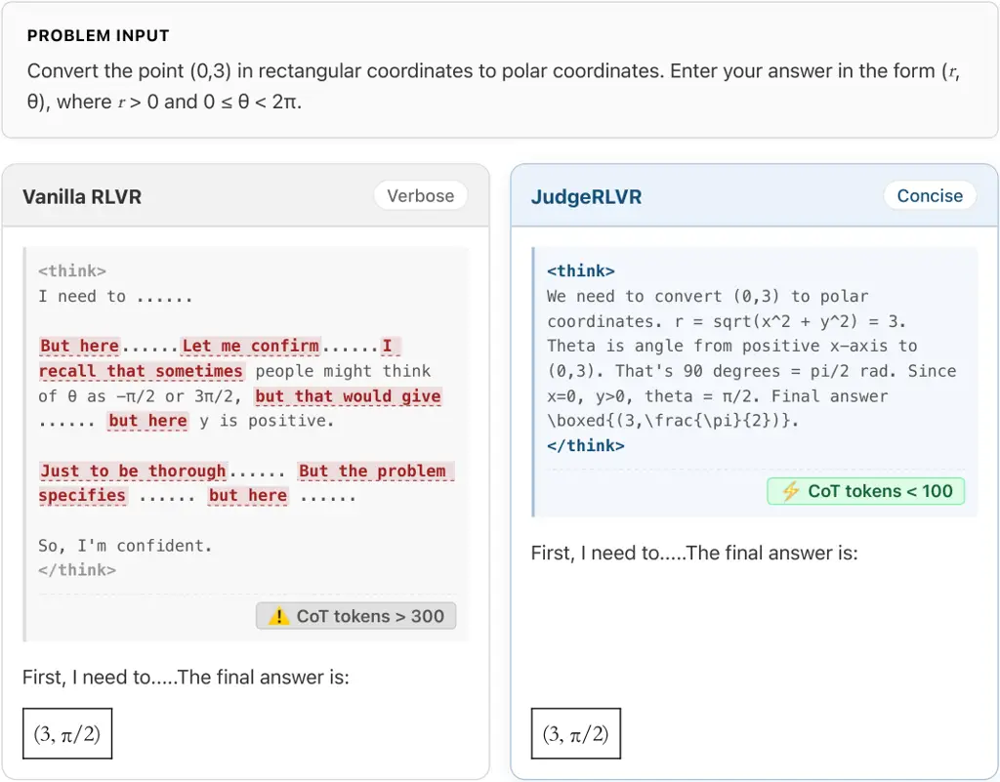

\titlefont

JudgeRLVR: Judge First, Generate Second for Efficient Reasoning

Jiangshan Duo^(†‡⋆) Hanyu Li^(‡§) Hailin Zhang ^(‡) Yudong Wang^(†‡)  
Sujian Li^(†⋄) Liang Zhao^(‡⋄)

^(†)State Key Laboratory of Multimedia Information Processing, School of

Computer Science, Peking University

^(§)CFCS, School of Computer Science, Peking University

^(‡)LLM-Core Xiaomi

\abscontent

⁰⁰footnotetext: ^(⋆)Contribution during internship at Xiaomi LLM-Core
Team.⁰⁰footnotetext: ^(⋄)Co-corresponding authors.

###### Abstract

Reinforcement Learning with Verifiable Rewards (RLVR) has become a
standard paradigm for reasoning in Large Language Models. However,
optimizing solely for final-answer correctness often drives models into
aimless, verbose exploration, where they rely on exhaustive
trial-and-error tactics rather than structured planning to reach
solutions. While heuristic constraints like length penalties can reduce
verbosity, they often truncate essential reasoning steps, creating a
difficult trade-off between efficiency and verification. In this paper,
we argue that discriminative capability is a prerequisite for efficient
generation: by learning to distinguish valid solutions, a model can
internalize a guidance signal that prunes the search space. We propose
JudgeRLVR, a two-stage _judge-then-generate_ paradigm. In the first
stage, we train the model to judge solution responses with verifiable
answers. In the second stage, we fine-tune the _same_ model with vanilla
generating RLVR initialized from the judge. Compared to Vanilla RLVR
using the same math-domain training data, JudgeRLVR achieves a better
quality–efficiency trade-off for Qwen3-30B-A3B: on in-domain math, it
delivers about +3.7 points average accuracy gain with -42% average
generation length; on out-of-domain benchmarks, it delivers about +4.5
points average accuracy improvement, demonstrating enhanced
generalization.

## 1 Introduction

Reinforcement Learning with Verifiable Rewards (RLVR) has become a
widely adopted method for improving large language models on complex
reasoning tasks (Zhu et al., 2025; Shao et al., 2025). By providing
sparse yet automatically checkable supervision signals (e.g., whether
the final answer is correct), RLVR enables models to explore strategies
beyond supervised demonstrations and has achieved strong results on
reasoning benchmarks like math and code.



Figure 1: Qualitative comparison of reasoning patterns between Vanilla
RLVR and JudgeRLVR. While outcome-based RL guarantees final answer
correctness, it often induces verbose and unstructured exploration
(left). JudgeRLVR implicitly regularizes the reasoning process, leading
to a direct and coherent solution path (right).

Figure 2: Pipeline for the two-stage training of JudgeRLVR

However, RLVR does not merely optimize correctness; it also implicitly
shapes a model’s _thinking pattern_. When trained primarily with a
final-answer reward, many LLMs drift toward a generative search style:
enumerating tentative branches, revising intermediate steps, and
performing explicit self-correction (Team et al., 2024). Figure 1 shows
that the reasoning model’s output can be divided into 2 parts:
chain-of-thought (CoT) trajectories and solution responses. CoT
trajectories usually include all the details of the model’s lengthy
thought process, whereas solution responses tend to present a clear
logical process along with the final answer. The resulting CoT
trajectories are often long and exhibit frequent backtracking (e.g.,
heavy use of “but”, “however”, “let’s try again”) (Cai and et al.,
2025). Long outputs are expensive, but a deeper issue is _quality_: such
trajectories are low in information density. Existing methods such as
Kimi K1.5 (Moonshot AI Team, 2025) and DAPO (Yu et al., 2025) introduce
length penalties to reduce tokens and stabilize training, but often come
with accuracy drops, making it difficult to achieve an ideal
quality–efficiency trade-off.

This raises a more general question: can we explore a training paradigm
that explicitly targets higher-quality thinking patterns, rather than
hoping the model eventually “stumbles upon” them through repeated
trial-and-error? Cognitive science suggests that expert reasoning is not
defined by externalizing exhaustive search, but by _early discrimination
and pruning_: unpromising paths are filtered before they are expanded
(Chi et al., 1981). This aligns with common intuition: experts quickly
spot low-value reasoning paths and focus on high-yield hypotheses, while
novices resort to trial-and-error and frequent backtracking. This
intuition motivates the idea that, to achieve efficient reasoning, one
should first develop the ability to judge what constitutes direct and
valid reasoning, and then learn how to reason for specific problems.

Based on the idea above, we propose JudgeRLVR, a two-stage
_judge-then-generate_ paradigm. As shown in Figure 2, in judging stage,
we train the model as a judge: given candidate solution responses
generated by diverse models, it learns to classify them as correct or
incorrect. In generating stage, we initialize the model from the judging
stage and apply _Vanilla RLVR_ fine-tuning on the same model. Under this
training paradigm, the model learns to implicitly prune low-quality
branches prior to generating extensive textual search, thereby fostering
more direct and reliable reasoning patterns.

It is worth noting that, we do not impose any explicit length or quality
penalties on the CoT trajectories; thus, any reduction in verbosity or
refinement in reasoning style can be attributed to the discriminative
priors transferred from the judging stage.

With our training paradigm, a model can achieve an optimal balance
between performance and efficiency. Compared to Vanilla RLVR using the
same training data, JudgeRLVR achieves a quality–efficiency trade-off on
Qwen3-30B-A3B (Team, 2025): on in-domain math, it achieves about +3.7
points average accuracy improvement while reducing average generation
length by about 42%; on out-of-domain benchmarks, it delivers about +4.5
points average accuracy improvement. From extensive experiments, we also
analyze the specific impact of this training paradigm on thinking
patterns. We observe a shift in the linguistic style of the generated
text, with notably fewer explicit backtracking cues such as “but” during
reasoning. This suggests that JudgeRLVR moves from an externalized
trial-and-error process to an internal decision-making process, thereby
producing higher-quality reasoning patterns.

In summary, our main contributions are: (i) we propose JudgeRLVR, a new
training paradigm for inducing higher-quality thinking patterns via
_judge-then-generate_; (ii) JudgeRLVR demonstrates a better
quality–efficiency trade-off than Vanilla RLVR on both in-domain and
out-of-domain tasks; (iii) we provide interpretable linguistic evidence
which is consistent with reduced explicit backtracking.

## 2 Related Work

### 2.1 RLVR and Verifiable-Reward Training for Reasoning

Reinforcement Learning with Verifiable Rewards (RLVR) is a leading
approach for improving LLM reasoning using automatic, task-specific
rewards, often outperforming supervised fine-tuning on math and logic
tasks (Lambert et al., 2024; Guo et al., 2025a; Xu et al., 2025).
However, RLVR has notable limitations: it can yield gains even under
spurious rewards (Shao et al., 2025), and it mainly reweights existing
high-reward reasoning paths rather than inducing new reasoning behaviors
(Yue et al., 2025). This is consistent with concerns that RLVR may
implicitly encourage suboptimal thinking by optimizing final correctness
instead of process quality (DataLearner, 2025). Most variants emphasize
reward design or optimization, leaving the quality–efficiency trade-off
underexplored.

### 2.2 Mathematical Reasoning in Large Language Models

Mathematical reasoning is a core benchmark for LLMs, where recent
progress relies heavily on RLVR and targeted training (Team et al.,
2024; Shen et al., 2025). Data diversification via paraphrasing can
improve generalization (Shen et al., 2025), while extended RLVR training
improves accuracy but tends to produce verbose reasoning traces (Team et
al., 2024). Synthetic data scaling further boosts capability yet does
not eliminate redundancy (Zhou et al., 2025), and scaling studies still
report low information density in reasoning outputs (Sun et al., 2024).
Overall, improving both correctness and efficiency remains challenging.

### 2.3 Learning to Judge: Evaluators, Verifiers, and Discriminative Supervision

Training evaluators and using discriminative supervision can steer LLM
outputs by separating good from bad generations (Guo et al., 2025b; Tang
et al., 2025). Discriminative fine-tuning can suppress negative outputs
without preference data (Guo et al., 2025b), and stronger evaluators
improve reasoning-quality assessment via coherence-focused criteria
(Tang et al., 2025). Verifiers can detect reasoning errors with
uncertainty signals (Han et al., 2024), and systematic studies highlight
the need for task-specific validation metrics (Shimabucoro et al.,
2024). Yet existing work rarely adopts a two-stage pipeline that first
trains judgment and then uses it to guide generation, which we address
in JudgeRLVR.

## 3 Method

JudgeRLVR divides the training of a single reasoning policy into two
sequential stages with different roles but intended capability transfer:
a _judge_ stage that trains discriminative error awareness, followed by
a _generating_ stage that optimizes solution generation. Our core
hypothesis is that discriminative competence is a prerequisite for
efficient generation. Once the model internalizes what constitutes a
valid CoT trajectory, it can down-weight erroneous branches early in
generation without any explicit length penalty.

Figure 2 illustrates the complete pipeline of our two-stage training.

### 3.1 Notation and Task Definition

The dataset consists of problems in a specific domain:
$`x\in\mathcal{X}`$ with gold final answers $`a^{\star}(x)`$.

The solution response is denoted $`z=(o_{1},\dots,o_{T})`$, a token
sequence containing a clear logical process and ending with a final
answer string. The final answer $`a(z)`$ is extracted from the solution
responses via a deterministic parser. We do not train the model to judge
directly on full outputs that include complete CoT trajectories because
such outputs are often extremely long and contain a large amount of
distracting information that can interfere with the judgment. Instead,
we expect the model to judge directly based on the clean solution
response, so that it can identify errors with greater precision.

We define a binary correctness label $`\ell\in\{0,1\}`$:

```math
\ell(x,z)=\mathbb{I}\big(a(z)=a^{\star}(x)\big). \tag{1}
```

The policy (language model) is denoted $`\pi_{\theta}`$.

### 3.2 Stage 1: Judging Stage

In judging stage, the model is trained as a judge. Given a problem $`x`$
and a candidate solution response $`z`$, the policy produces a
critique/commentary $`c`$ which contains the CoT trajectory, and outputs
a discrete verdict token $`v\in\{0,1\}`$ (0 for incorrect and 1 for
correct):

```math
(c,v)\sim\pi_{\theta}(\cdot\mid x,z). \tag{2}
```

#### Data construction.

We construct a discriminative dataset $`D_{\text{judge}}`$ consisting of
triplets $`(x,z,\ell)`$:

- •
  Response generation (rollout). For each problem $`x`$, we sample a set
  of candidate solution responses $`\{z_{1},\dots,z_{n}\}`$ from several
  models, and obtain $`\ell(x,z_{i})`$ by comparing $`a(z_{i})`$ with
  $`a^{\star}(x)`$.
- •
  Hard negative mining. We prioritize _moderate-difficulty_ problems
  whose empirical pass rates under rollouts is neither 0 nor 1, yielding
  more informative “nearly-correct” errors.
- •
  Class balancing. For each $`x`$, we subsample to balance positives
  ($`\ell=1`$) and negatives ($`\ell=0`$), avoiding majority-class bias.

#### Reward.

The reward is whether the final verdict $`v_{i}`$ matches the true label
$`\ell(x,z_{i})`$:

```math
r_{i}=\mathbb{I}(v_{i}=\ell(x,z_{i})) \tag{3}
```

The training objective encourages $`v_{i}`$ to match the true label
$`\ell(x,z_{i})`$. Meanwhile, the commentary $`c`$, as an explanatory
prefix, is optimized by the same policy-gradient signal.

### 3.3 Stage 2: Generating Stage

In generating stage, the model is trained under Vanilla RLVR setting and
outputs solutions of the problems. The policy is initialized from the
judging stage weights.

Given a problem $`x`$, the policy generates a CoT trajectory and the
solution response $`z`$ (including the final parsed answer $`a(z)`$):

```math
z\sim\pi_{\theta}(\cdot\mid x). \tag{4}
```

The reward remains the sparse binary correctness signal based only on
the final answer:

```math
r=\ell(x,z)=\mathbb{I}\big(a(z)=a^{\star}(x)\big). \tag{5}
```

### 3.4 Hypothesized Mechanism and Verification Overview

We hypothesize that JudgeRLVR improves reasoning-pattern quality through
the two stages in two corresponding ways: (i) style transfer: in judging
stage, learning to judge induces a global shift in the model’s reasoning
language style; (ii) reduced backtracking: in generating stage, training
activates the internalized efficient pattern, reducing explicit
self-correction and backtracking in text. We design targeted experiments
to test both points; definitions and results are provided in Section 4.

## 4 Experimental Setup

### 4.1 Model Configuration and Training Data

We use Qwen3-30B-A3B (Team, 2025), a mixture-of-experts (MoE)
architecture. To ensure a basic level of reasoning capability, we first
conduct supervised fine-tuning (SFT) on curated open-source CoT
datasets, obtaining Qwen3-30B-A3B-SFT with improved reasoning and
instruction-following abilities.

For RLVR, we collect and filter open-source resources to build a dataset
of 113k math problems with gold answers. To construct specialized
training data for the judging stage, we adopt a strict sampling
strategy:

- •
  Rollout generation. For each problem, we use MiMo-7B RL (Xiaomi, 2025)
  and the target model Qwen3-30B-A3B-SFT to each generate 8 reasoning
  traces and answers, yielding 16 distinct reasoning paths.
- •
  Balanced sampling. We filter outputs so that each problem retains an
  equal number of correct and incorrect solutions, avoiding bias from
  class imbalance.

Our training algorithm is DAPO (Yu et al., 2025), a GRPO-family policy
gradient method. We implement dynamic sampling to filter out samples
with pass rates $`0`$ or $`1`$ during rollout. The batch size is set to
256 and the rollout size is $`n=8`$. We use AdamW optimizer (Loshchilov
and Hutter, 2018) for training. The learning rate is set to
$`3\times 10^{-6}`$ with a $`10`$-step warmup. We use a training
temperature of $`1.0`$ and a testing temperature of $`0.6`$, with
top-$`p`$ set to $`1.0`$ and max tokens set to 65536 for both training
and testing.

### 4.2 Evaluation Benchmarks

We evaluate JudgeRLVR on in-domain math reasoning: AIME24 (Zhang and
Math-AI, 2024), AIME25 (Zhang and Math-AI, 2025), MATH500 (Hendrycks et
al., 2021), HMMT_feb_2025 (Balunović et al., 2025), BeyondAIME
(ByteDance-Seed, 2025) and on diverse out-of-domain benchmarks: GPQA
Diamond (Science Reasoning) (Rein et al., 2023), IFEval (Instruction
Following) (Zhou et al., 2023), LiveCodeBenchv6 (Coding) (Jain et al.,
2024), MMLU-Redux (General Knowledge) (Gema et al., 2025), ZebraLogic
(Logical Reasoning) (Lin et al., 2025), covering a wide range of general
capabilities. The detailed setups of these benchmarks are in appendix C.

### 4.3 Main Experiments

Our main experiments are designed to answer a single overarching
question: does the proposed judge-then-generate paradigm improve the
quality–efficiency trade-off of RLVR beyond Vanilla RLVR? To make this
comparison meaningful, we evaluate three training settings that isolate
the effect of the staged paradigm from other factors.

Base SFT: the static baseline model Qwen3-30B-A3B-SFT. Base SFT serves
as a reference point for the model’s reasoning ability before RL and its
default generation style, allowing us to measure how much of the
downstream gains come specifically from RLVR.

Vanilla RLVR: Vanilla generating RLVR optimizing only for final-answer
correctness. Vanilla RLVR serves as a strong baseline to demonstrate the
advantages of our method. The total training is 250 steps.

JudgeRLVR: our judge-then-generate method. The judging stage is 145
steps and the generating stage is 105 steps.

Vanilla RLVR and JudgeRLVR use the same training and evaluation
hyperparameters and the same total training steps. We report both
accuracy and generation length because our goal is not only to increase
correctness, but also to reduce unnecessary computation and improve
information density in the produced reasoning.

The generating and rollout prompt, and the judging prompt are in
appendix A.

### 4.4 Ablations

We conduct targeted ablations to validate that JudgeRLVR’s gains come
from the divided stages itself rather than from simply adding more
training signals.

Judge Only: only judging stage training. Judge Only setting evaluates
whether judge training alone can already improve generation quality, or
whether generating stage is necessary to translate judging competence
into improved generation performance. This ablation directly tests our
core assumption that judging is a prerequisite but not a substitute for
generating optimization.

Mixed Strategy: judging stage is replaced by parallel training on mixed
Judge/Generative data (ratio 1:1), with each data type using its
corresponding reward; generating stage is then run as usual. Mixed
Strategy setting probes whether the ordering and separation of roles
matters: by interleaving judge-style and generation-style updates, we
test whether simultaneously optimizing two behaviors interferes with
learning a clean internal decision policy. In other words, this ablation
examines whether the model benefits from first consolidating an
error-aware judge prior before being asked to explore and exploit it
during generation.

Together, these ablations aim to distinguish (i) “benefit from judging”
from (ii) “benefit from judging first, then generating, ” clarifying
which component is responsible for improved efficiency and
generalization.

### 4.5 Mechanism Verification

To test style transfer and reduced backtracking, we design:

Perplexity (PPL). PPL is the exponential of a language model’s average
negative log-likelihood over a sequence; it measures how “surprised” or
“confused” the model is, and lower values indicate the model is more
familiar with the sequence content. Changes in perplexity can reflect
the extent to which a model is familiar with a particular linguistic
style. Using the Base SFT model as a fixed evaluator, we compute changes
in the PPL of outputs produced under different training methods; these
changes then reflect stylistic shifts during training. During judging
stage training of JudgeRLVR, we sample model outputs at each step (10
samples per step) for Vanilla RLVR and JudgeRLVR, and compute the
average PPL of the Base SFT model on these outputs.

Transition-word statistics. Behaviors such as explicit backtracking and
reflection in model outputs are typically manifested through the use of
transition-words. Therefore, by counting the number and frequency of
such discourse markers in outputs over the course of training, these
statistics can indicate, to some extent, that backtracking is
decreasing. During generating stage training of JudgeRLVR, we sample
1000 outputs per step and count occurrences and frequencies of
contrast/backtracking markers:

> but, however, though, although, yet, still, nevertheless, nonetheless,
> instead, conversely, whereas, while, actually, wait.

The above experiments are used to demonstrate shifts in style and
backtracking. Combined with improvements in model performance, they can
provide a comprehensive indication that these shifts are moving in a
favorable direction.

|                  |                 |                   |                 |                   |                 |                 |                   |                |
| ---------------- | --------------- | ----------------- | --------------- | ----------------- | --------------- | --------------- | ----------------- | -------------- |
|                  | Base SFT        |                   | Vanilla RLVR    |                   | JudgeRLVR (Seq) |                 |                   |                |
| Benchmark        | Acc$`\uparrow`$ | Len$`\downarrow`$ | Acc$`\uparrow`$ | Len$`\downarrow`$ | Acc$`\uparrow`$ | $`\Delta`$ (pp) | Len$`\downarrow`$ | $`\Delta`$ (%) |
| In-Domain (Math) |                 |                   |                 |                   |                 |                 |                   |                |
| AIME24           | 85.7            | 20.8k             | 86.3            | 21.8k             | 89.0            | +2.7            | 12.9k             | -41            |
| AIME25           | 74.1            | 26.8k             | 77.0            | 27.2k             | 78.7            | +1.7            | 17.2k             | -37            |
| MATH500          | 97.4            | 6.7k              | 98.0            | 6.8k              | 97.2            | -0.8            | 2.0k              | -71            |
| HMMT_feb_2025    | 57.1            | 24.9k             | 60.8            | 26.9k             | 70.0            | +9.2            | 20.4k             | -24            |
| BeyondAIME       | 55.5            | 33.8k             | 58.3            | 34.3k             | 63.9            | +5.6            | 21.3k             | -38            |
| Overall Avg      | 74.0            | 22.6k             | 76.1            | 23.4k             | 79.8            | +3.7            | 14.8k             | -42            |
| Out-of-Domain    |                 |                   |                 |                   |                 |                 |                   |                |
| GPQA Diamond     | 63.0            | 12.0k             | 61.2            | 12.1k             | 66.4            | +5.2            | 11.2k             | -7.5           |
| IFEval           | 80.6            | 3.2k              | 79.9            | 4.1k              | 86.4            | +6.5            | 4.6k              | +12            |
| LiveCodeBenchv6  | 57.4            | 20.6k             | 58.2            | 22.8k             | 63.9            | +5.7            | 18.7k             | -18            |
| MMLU Redux       | 86.8            | 2.1k              | 85.4            | 2.1k              | 87.0            | +1.6            | 1.5k              | -28            |
| ZebraLogic       | 84.6            | 7.7k              | 83.6            | 7.9k              | 86.8            | +3.2            | 9.6k              | +22            |
| Overall Avg      | 74.5            | 9.1k              | 73.7            | 9.8k              | 78.1            | +4.5            | 9.1k              | -3.9           |

Table 1: Main results comparing Base SFT, Vanilla RLVR, and JudgeRLVR
(Sequential). We report accuracy (Acc) and average generation length in
tokens (Len). For JudgeRLVR, $`\Delta`$ is absolute change in accuracy
(pp:percentage point) vs Vanilla RLVR (higher is better); for Len,
$`\Delta`$ is relative change vs Vanilla RLVR (shorter is better).

|                  |                 |                   |                 |                 |                   |                |                 |                 |                   |                |
| ---------------- | --------------- | ----------------- | --------------- | --------------- | ----------------- | -------------- | --------------- | --------------- | ----------------- | -------------- |
|                  | JudgeRLVR (Seq) |                   | Judge Only      |                 |                   |                | Mixed Strategy  |                 |                   |                |
| Benchmark        | Acc$`\uparrow`$ | Len$`\downarrow`$ | Acc$`\uparrow`$ | $`\Delta`$ (pp) | Len$`\downarrow`$ | $`\Delta`$ (%) | Acc$`\uparrow`$ | $`\Delta`$ (pp) | Len$`\downarrow`$ | $`\Delta`$ (%) |
| In-Domain (Math) |                 |                   |                 |                 |                   |                |                 |                 |                   |                |
| AIME24           | 89.0            | 12.9k             | 87.0            | -2.0            | 22.4k             | +74            | 88.3            | -0.7            | 12.8k             | -0.8           |
| AIME25           | 78.7            | 17.2k             | 76.3            | -2.4            | 28.5k             | +66            | 79.7            | +1.0            | 18.2k             | +6.0           |
| MATH500          | 97.2            | 2.0k              | 97.2            | +0.0            | 7.4k              | +266           | 98.0            | +0.8            | 2.2k              | +7.9           |
| HMMT_feb_2025    | 70.0            | 20.4k             | 61.5            | -8.5            | 17.9k             | -12            | 69.0            | -1.0            | 25.9k             | +27            |
| BeyondAIME       | 63.9            | 21.3k             | 57.3            | -6.6            | 35.8k             | +68            | 63.4            | -0.5            | 22.9k             | +7.3           |
| Overall Avg      | 79.8            | 14.8k             | 75.9            | -3.9            | 22.4k             | +92            | 79.7            | -0.1            | 16.4k             | +9.5           |
| Out-of-Domain    |                 |                   |                 |                 |                   |                |                 |                 |                   |                |
| GPQA Diamond     | 66.4            | 11.2k             | 66.9            | +0.5            | 7.9k              | -30            | 63.7            | -2.7            | 16.1k             | +44            |
| IFEval           | 86.4            | 4.6k              | 85.9            | -0.5            | 4.2k              | -9.0           | 80.4            | -6.0            | 7.9k              | +72            |
| LiveCodeBenchv6  | 63.9            | 18.7k             | 61.4            | -2.5            | 21.3k             | +14            | 56.4            | -7.5            | 26.7k             | +43            |
| MMLU Redux       | 87.0            | 1.5k              | 87.4            | +0.4            | 1.0k              | -31            | 87.1            | +0.1            | 3.3k              | +119           |
| ZebraLogic       | 86.8            | 9.6k              | 87.3            | +0.5            | 8.0k              | -17            | 87.4            | +0.6            | 7.9k              | -19            |
| Overall Avg      | 78.1            | 9.1k              | 77.8            | -0.3            | 8.5k              | -15            | 75.0            | -3.1            | 12.4k             | +52            |

Table 2: Main results comparing JudgeRLVR (Sequential), Judge Only, and
Mixed Strategy. We report accuracy (Acc) and average generation length
in tokens (Len). For Judge Only and Mixed Strategy, $`\Delta`$ is
absolute change in accuracy (pp:percentage point) vs JudgeRLVR (higher
is better); for Len, $`\Delta`$ is relative change vs JudgeRLVR (shorter
is better).

Figure 3: Base SFT perplexity (PPL) evaluated on sampled outputs along
training steps. Vanilla RLVR stays stylistically close to Base SFT (flat
PPL), while JudgeRLVR (judging stage) exhibits increasing PPL,
indicating style transfer.

Figure 4: Counts(left) and Frequencies(right) of transition/backtracking
markers (e.g., but, however, wait) in sampled outputs across JudgeRLVR
generating stage training steps.

## 5 Results

### 5.1 Main Results

Table 1 compares Base SFT, Vanilla RLVR that optimizes only final-answer
correctness, and our proposed JudgeRLVR (sequential two-stage). The
overall conclusion is that, compared with Vanilla RLVR, JudgeRLVR
achieves higher or comparable accuracy while producing substantially
shorter generations on most benchmarks, demonstrating a better
quality–efficiency trade-off.

#### In-domain math: improving accuracy while markedly reducing redundant reasoning.

On AIME24/25, HMMT_feb_2025, and BeyondAIME, JudgeRLVR consistently
improves accuracy over Vanilla RLVR, while significantly reducing
generation length. This matches the motivation of our divided stages:
judging stage, via strict balanced sampling (equal numbers of correct
and incorrect traces per problem), strengthens the model’s ability to
recognize error patterns and unproductive reasoning; then in generating
stage, generating optimization can more reliably follow
higher-confidence, lower-branching solution paths, reducing
trial-and-error backtracking and verbose exploration. The larger gains
on HMMT and BeyondAIME further suggest that the advantage of “judge
first, then generate” is more pronounced when problems require longer
chains of reasoning and stronger strategy selection.

On MATH500, JudgeRLVR is slightly worse in accuracy than Vanilla RLVR,
but reduces generation length drastically. This indicates that for
relatively saturated datasets, there is limited headroom for further
accuracy gains, while JudgeRLVR can still substantially reduce reasoning
cost when accuracy is largely maintained.

#### Out-of-domain: both generalization and efficiency gains, with task-dependent trade-offs.

On GPQA Diamond, LiveCodeBenchv6, and MMLU-Redux, JudgeRLVR improves
accuracy while also reducing length. This suggests that the
“error-sensitive / avoid-detours” preference learned in judging stage is
not restricted to math, but can transfer to science reasoning, coding,
and broad knowledge tasks, reducing ineffective exploration and
improving overall decision quality.

In contrast, on IFEval and ZebraLogic we observe “higher accuracy but
longer outputs”. This suggests that for tasks emphasizing format
compliance, constraint satisfaction, or discrete rule verification, the
model may need to generate more explicit checks to ensure correctness,
trading off some length advantage for a higher pass rates. This does not
contradict our goal: JudgeRLVR is not designed to mechanically minimize
length, but to reduce _unproductive_ reasoning; when a task
intrinsically requires more explicit structure, a moderate increase in
length may be a necessary cost.

### 5.2 Ablation Results

Table 2 reports two ablations—Judge Only and Mixed Strategy—to test: (i)
whether judging stage alone is sufficient; and (ii) whether sequential
staging is essential.

#### Judge Only: better “judging” does not reliably translate into better generation.

Judge Only shows clear degradations on multiple benchmarks, especially
on in-domain math: compared with JudgeRLVR, accuracy drops on math
benchmarks. More importantly, generation length increases substantially.
This indicates that the discriminative capability learned in judging
stage does not automatically induce a more concise generation policy; it
can even make the model more prone to “writing out the checking process”
or reasoning more cautiously and verbosely, which lengthens outputs and
hurts final accuracy. In other words, error-aware discrimination is a
necessary prerequisite, but not a substitute for generating
optimization; generating stage is still required to convert error
sensitivity into better path selection and more information-dense
expression during generation.

We also observe that Judge Only can achieve comparable or slightly
better accuracy on some out-of-domain tasks while producing shorter
outputs. This suggests that some “judging” preferences learned in
judging stage may directly benefit certain tasks; however, this benefit
is unstable and cannot replace the full two-stage pipeline for our core
objective.

#### Mixed Strategy: interleaving judge and generate updates weakens the benefit of sequential stages.

Mixed Strategy can be close to JudgeRLVR on some tasks, but is overall
more unstable: it slightly exceeds JudgeRLVR on AIME25 and MATH500, yet
drops substantially on tasks such as IFEval and LiveCodeBenchv6, often
with significantly longer outputs. This aligns with our hypothesis: when
“judge-style” and “generation-style” behaviors are optimized in a 1:1
interleaved manner, the model must satisfy two different objectives and
reward structures in the same phase, which can lead to interference in
policy-gradient updates and prevent the emergence of a clean, stable
internal decision process of “judge first, then generate”. The result is
occasional local accuracy gains, but weaker overall efficiency and
generalization.

### 5.3 Mechanism Verification

#### Style transfer measured by PPL under Base SFT.

Figure 3 reports the Base SFT model’s average perplexity on sampled
outputs across training steps. For Vanilla RLVR, the average PPL remains
largely unchanged, suggesting the output distribution stays
stylistically close to Base SFT. In contrast, during JudgeRLVR judging
stage, Base SFT PPL increases noticeably, indicating a systematic style
shift induced by judge training.

#### Reduced explicit backtracking measured by transition words.

Figure 4 show that during JudgeRLVR generating stage, both the absolute
count and frequency of transition/backtracking words decrease
substantially over training, consistent with reduced explicit
backtracking and a shift of verification/correction into internal
decision-making.

## 6 Conclusion

In this paper, we proposed JudgeRLVR, a two-stage training paradigm that
acts as a precursor to efficient reasoning. By explicitly training the
model to discriminate solution validity before generating, we achieved a
superior quality–efficiency trade-off. Our experiments on Qwen3-30B-A3B
show that JudgeRLVR improves in-domain math accuracy while reducing
generation length by approximately 42%, with notable generalization to
out-of-domain tasks.

Many assume that judging an answer is the easy part, because
verification seems to come with a checklist that generation does not.
Our study points to a sharper truth: on identical math problems with the
same model, judging yields greater improvement than solving alone, so
“is this correct?” is a problem in its own right. Training the judge
makes the model internalize what a good line of thought looks like, and
later generation can cross its own limits with fewer false starts. In
this sense, to generate is simply to judge so well that the correct
answer is the only thing left to say.

## References

- Balunović et al. (2025) M. Balunović, J. Dekoninck, I. Petrov, N.
  Jovanović, and M. Vechev MathArena: evaluating llms on uncontaminated
  math competitions. SRI Lab, ETH Zurich. External Links:
  [Link](https://matharena.ai/) Cited by: §4.2.
- ByteDance-Seed (2025) ByteDance-Seed BeyondAIME: advancing math
  reasoning evaluation beyond high school olympiads. Hugging Face. Note:
  [\[https://huggingface.co/datasets/ByteDance-Seed/BeyondAIME\](https://huggingface.co/datasets/ByteDance-Seed/BeyondAIME)](<https://%5Bhttps://huggingface.co/datasets/ByteDance-Seed/BeyondAIME%5D(https://huggingface.co/datasets/ByteDance-Seed/BeyondAIME)>)
  Cited by: §4.2.
- Cai and et al. (2025) H. J. Cai and et al. How much backtracking is
  enough? exploring the interplay of sft and rl in enhancing llm
  reasoning. External Links: 2505.24273 Cited by: §1.
- Chi et al. (1981) M. T. H. Chi, P. J. Feltovich, and R. Glaser
  Categorization and representation of physics problems by experts and
  novices. Cognitive Science 5 (2), pp. 121–152. Cited by: §1.
- DataLearner (2025) A. DataLearner Reinforcement learning with
  verifiable rewards (rlvr): why the focus of llm training is shifting
  in 2025. DataLearner Official Blog. External Links:
  [Link](https://wap.datalearner.com/blog/1051766245990867) Cited by:
  §2.1.
- Gema et al. (2025) A. P. Gema, J. O. J. Leang, G. Hong, A.
  Devoto, A. C. M. Mancino, R. Saxena, X. He, Y. Zhao, X. Du, M. R. G.
  Madani, C. Barale, R. McHardy, J. Harris, J. Kaddour, E. Van Krieken,
  and P. Minervini Are we done with mmlu?. In Proceedings of NAACL 2025,
  Cited by: §4.2.
- Guo et al. (2025a) J. Guo, J. Tang, and X. Li DeepSeek-r1: scaling
  rlvr for mathematical reasoning. External Links: 2503.12745 Cited by:
  §2.1.
- Guo et al. (2025b) Y. Guo, X. Wang, Y. Zhang, and P. Liu
  Discriminative finetuning of generative large language models without
  reward models and preference data. External Links: 2502.18679 Cited
  by: §2.3.
- Han et al. (2024) X. Han, Y. Wang, Z. Li, and C. Zhang
  Uncertainty-based verifiers for llm reasoning outputs. External Links:
  2408.04567 Cited by: §2.3.
- Hendrycks et al. (2021) D. Hendrycks, C. Burns, S. Kadavath, A.
  Arora, S. Basart, E. Tang, D. Song, and J. Steinhardt Measuring
  mathematical problem solving with the MATH dataset. Advances in Neural
  Information Processing Systems (NeurIPS). External Links: 2103.03874
  Cited by: §4.2.
- Jain et al. (2024) N. Jain, K. Han, A. Gu, W. Li, F. Yan, T. Zhang, S.
  Wang, A. Solar-Lezama, K. Sen, and I. Stoica LiveCodeBench: holistic
  and contamination free evaluation of large language models for code.
  External Links: 2403.07974 Cited by: §4.2.
- Lambert et al. (2024) N. Lambert, N. A. Smith, and H. Hajishirzi
  Scalable verifiable reward learning for large language models.
  External Links: 2410.08316 Cited by: §2.1.
- Lin et al. (2025) B. Y. Lin, R. Le Bras, K. Richardson, A.
  Sabharwal, R. Poovendran, P. Clark, and Y. Choi ZebraLogic: on the
  scaling limits of llms for logical reasoning. External Links:
  2502.01100 Cited by: §4.2.
- Loshchilov and Hutter (2018) I. Loshchilov and F. Hutter Decoupled
  Weight Decay Regularization. In International Conference on Learning
  Representations, External Links:
  [Link](https://openreview.net/forum?id=Bkg6RiCqY7) Cited by: §4.1.
- Moonshot AI Team (2025) Moonshot AI Team Kimi k1.5: scaling
  reinforcement learning with llms. arXiv preprint arXiv:2501.12599.
  Cited by: §1.
- Rein et al. (2023) D. Rein, B. L. Hou, A. C. Stickland, J.
  Petty, R. Y. Pang, J. Dirani, J. Michael, and S. R. Bowman GPQA: a
  graduate-level google-proof q&a benchmark. External Links: 2311.12022
  Cited by: §4.2.
- Shao et al. (2025) Y. Shao, T. Liu, M. Chen, and S. Li Spurious
  rewards: rethinking training signals in rlvr. External Links:
  2506.10947 Cited by: §1, §2.1.
- Shen et al. (2025) W. Shen, J. Li, H. Zhang, and Z. Wang LLM reasoning
  engine: specialized training for enhanced mathematical reasoning. In
  Proceedings of the 4th International Workshop on Knowledge-Augmented
  Methods for Natural Language Processing (KnowledgeNLP’25),
  pp. 118–128. Cited by: §2.2.
- Shimabucoro et al. (2024) L. Shimabucoro, R. Chavhan, T. Hospedales,
  and H. Gouk Evaluating the evaluators: are validation methods for
  few-shot learning fit for purpose?. Transactions on Machine Learning
  Research, pp. 1–13. Cited by: §2.3.
- Sun et al. (2024) Z. Sun, Y. Liu, D. Chen, and W. Li Skywork-math:
  scaling mathematical reasoning with corpus fine-tuning. External
  Links: 2409.12345 Cited by: §2.2.
- Tang et al. (2025) X. Tang, J. Chen, B. Zhang, and Z. Liu
  UnifiedReward-think: a comprehensive evaluator for reasoning quality.
  External Links: 2507.05678 Cited by: §2.3.
- Team et al. (2024) D. Team, F. Liu, H. Wang, and B. Zhang
  DeepSeek-math: enhancing mathematical reasoning via rlvr. In
  Proceedings of the 38th International Conference on Machine Learning
  (ICML’24), pp. 2345–2356. Cited by: §1, §2.2.
- Team (2025) Q. Team Qwen3 technical report. External Links:
  2505.09388, [Link](https://arxiv.org/abs/2505.09388) Cited by: §1,
  §4.1.
- Xiaomi (2025) L. Xiaomi MiMo: unlocking the reasoning potential of
  language model – from pretraining to posttraining. External Links:
  2505.07608, [Link](https://arxiv.org/abs/2505.07608) Cited by: 1st
  item.
- Xu et al. (2025) Y. Xu, T. Chakraborty, S. Sharma, L. Nunes, E.
  Kıcıman, S. Lu, and R. Chandra Direct reasoning optimization: llms can
  reward and refine their own reasoning for open-ended tasks. External
  Links: 2506.13351 Cited by: §2.1.
- Yu et al. (2025) Q. Yu, Z. Zhang, R. Zhu, Y. Yuan, X. Zuo, Y. Yue, W.
  Dai, T. Fan, G. Liu, L. Liu, et al. Dapo: an open-source llm
  reinforcement learning system at scale. arXiv preprint
  arXiv:2503.14476. Cited by: §1, §4.1.
- Yue et al. (2025) X. Yue, Z. Chen, and G. Huang Does reinforcement
  learning with verifiable rewards elicit novel reasoning abilities?.
  External Links: 2504.13837 Cited by: §2.1.
- Zhang and Math-AI (2024) Y. Zhang and T. Math-AI American invitational
  mathematics examination (aime) 2024. Cited by: §4.2.
- Zhang and Math-AI (2025) Y. Zhang and T. Math-AI American invitational
  mathematics examination (aime) 2025. Cited by: §4.2.
- Zhou et al. (2023) J. Zhou, T. Lu, S. Mishra, S. Brahma, S. Basu, Y.
  Luan, D. Zhou, and L. Hou Instruction-following evaluation for large
  language models. External Links: 2311.07911 Cited by: §4.2.
- Zhou et al. (2025) M. Zhou, J. Li, X. Wang, and L. Zhang JiuZhang3.0:
  efficient mathematical reasoning via synthetic data pre-training.
  External Links: 2505.09876 Cited by: §2.2.
- Zhu et al. (2025) X. Zhu, M. Xia, Z. Wei, W. Chen, D. Chen, and Y.
  Meng The surprising effectiveness of negative reinforcement in llm
  reasoning. External Links: 2506.01347 Cited by: §1.

## Appendix A Prompt Templates of Judge and Generate

Judging Prompt


Generating and Rollout Prompt


## Appendix B Case Study

Full output of Figure 1

#### Problem Statement

> Convert the point $`(0,3)`$ in rectangular coordinates to polar
> coordinates. Enter your answer in the form $`(r,\theta),`$ where
> $`r>0`$ and $`0\leq\theta<2\pi.`$

#### Vanilla RLVR

> \<think\>
>
> I need to convert the point (0,3) from rectangular coordinates to
> polar coordinates. The rectangular coordinates are given as (x,y) =
> (0,3), and I need to find the polar coordinates (r, $`\theta`$), where
> r is the distance from the origin, and $`\theta`$ is the angle from
> the positive x-axis.
>
> First, recall the formulas for conversion. The radius r is given by r
> = $`\sqrt{(x^{2}+y^{2})}`$. Plugging in the values, x is 0 and y is 3,
> so r = $`\sqrt{(0^{2}+3^{2})}`$ = $`\sqrt{(0+9)}`$ = $`\sqrt{9}`$ = 3.
> So r is 3.
>
> Now, for the angle $`\theta`$, it’s given by
> $`\theta=\tan^{-1}(y/x)`$. But here, x is 0, and y is 3. So if I plug
> in, $`\tan^{-1}(3/0)`$, which is undefined because division by zero.
> That makes sense because when x is 0, the point is on the y-axis.
>
> I know that when a point is on the positive y-axis, the angle
> $`\theta`$ should be $`\pi/2`$ radians, or 90 degrees. Since the
> problem asks for $`\theta`$ in radians between 0 and $`2\pi`$, I
> should use radians.
>
> So, $`\theta=\pi/2`$.
>
> Let me confirm. If r is 3, and $`\theta`$ is $`\pi/2`$, then the
> rectangular coordinates should be
> $`x=r\cos\theta=3*\cos(\pi/2)=3*0=0`$, and
> $`y=r\sin\theta=3*\sin(\pi/2)=3*1=3`$. Perfect, that matches.
>
> The problem says r \> 0, which is satisfied since r=3\>0, and
> $`\theta`$ between 0 and $`2\pi`$, $`\pi/2`$ is within that range.
>
> I recall that sometimes people might think of $`\theta`$ as $`-\pi/2`$
> or $`3\pi/2`$, but that would give a negative y-value, which is not
> the case here. Since y is positive, it has to be in the first or
> second quadrant, but since x is 0, it’s specifically on the positive
> y-axis, so $`\theta=\pi/2`$.
>
> If $`\theta`$ were $`3\pi/2`$, that would be the negative y-axis,
> where y is negative, but here y is positive, so it’s not that.
>
> So, I think $`(3,\pi/2)`$ is the correct polar coordinate.
>
> The answer should be in the form (r, $`\theta`$), so (3, $`\pi/2`$).
>
> I should write it as a pair. And the problem says to box the final
> answer.
>
> So, I think that’s it.
>
> Just to be thorough, is there any other representation? For example,
> could r be negative? But the problem specifies r \> 0, so no. And
> $`\theta`$ is usually taken in $`[0,2\pi)`$, so $`\pi/2`$ is fine.
>
> Sometimes people use degrees, but here it’s specified to use radians,
> and the range is given, so radians are implied.
>
> The problem doesn’t specify units, but in mathematics, especially with
> $`\pi`$, it’s standard to use radians.
>
> So, I’m confident.
>
> \</think\>
>
> First, I need to convert the point $`(0,3)`$ from rectangular
> coordinates to polar coordinates $`(r,\theta)`$ with $`r>0`$ and
> $`0\leq\theta<2\pi`$, use the conversion formulas.
>
> The radius $`r`$ is given by:
>
> ```math
> r=\sqrt{x^{2}+y^{2}}=\sqrt{0^{2}+3^{2}}=\sqrt{9}=3.
> ```
>
> The angle $`\theta`$ is found using $`\theta=\tan^{-1}(y/x)`$.
> However, since $`x=0`$ and $`y=3>0`$, the point lies on the positive
> y-axis. Thus, $`\theta=\pi/2`$.
>
> Verify the solution:
>
> - •
>   $`x=r\cos\theta=3\cos(\pi/2)=3\cdot 0=0`$,
> - •
>   $`y=r\sin\theta=3\sin(\pi/2)=3\cdot 1=3`$,
>
> which matches the original point.
>
> The conditions are satisfied: $`r=3>0`$ and $`\theta=\pi/2`$ is in
> $`[0,2\pi)`$.
>
> Thus, the polar coordinates are $`(3,\pi/2)`$.\]
>
> The final answer is:
>
> ```math
> \boxed{\left(3,\ \dfrac{\pi}{2}\right)}
> ```

#### JudgeRLVR

> \<think\>
>
> We need to convert (0,3) to polar coordinates. r = sqrt(xˆ2 + yˆ2) =
> sqrt(0+9)=3. Theta is angle from positive x-axis to point (0,3).
> That’s 90 degrees = pi/2 rad. Since x=0, y\>0, theta = $`\pi/2`$. So
> answer (3, $`\pi/2`$). Ensure within 0 to $`2\pi`$. So final answer
>
> ```math
> (3,\frac{\pi}{2})
> ```
>
> .
>
> \</think\>

> First, I need to calculate r.
>
> The point $`(0,3)`$ has
>
> ```math
> r=\sqrt{0^{2}+3^{2}}=3
> ```
>
> and lies on the positive $`y`$-axis, so the angle from the positive
> $`x`$-axis is
>
> ```math
> \theta=\frac{\pi}{2}.
> ```
>
> Thus the polar coordinates are $`(3,\frac{\pi}{2})`$.
>
> The final answer is:
>
> ```math
> \boxed{(3,\frac{\pi}{2})}
> ```

## Appendix C Evaluate Details

Table 3 shows the metric setup of evaluation benchmarks.

|                 |                   |
| --------------- | ----------------- |
| Benchmark       | Metric            |
| AIME24          | Acc avg@10        |
| AIME25          | Acc avg@10        |
| MATH500         | Acc               |
| HMMT_feb_2025   | Acc avg@10        |
| BeyondAIME      | Acc avg@8         |
| GPQA Diamond    | Exact Match avg@5 |
| IFEval          | Prompt Strict     |
| LiveCodeBenchv6 | Pass@1            |
| MMLU-Redux      | Exact Match       |
| ZebraLogic      | Acc               |

Table 3: Evaluation Benchmarks
