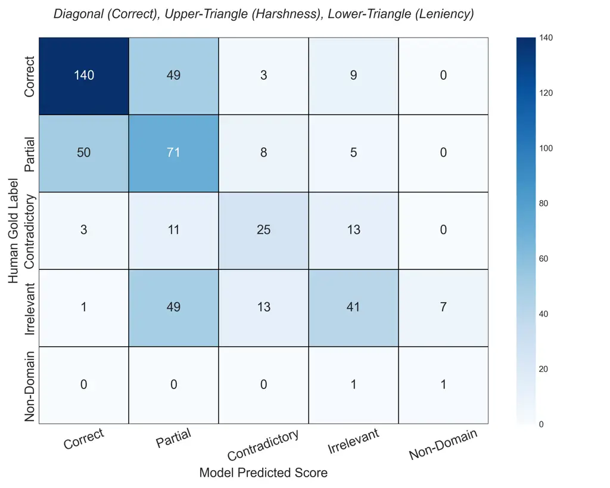
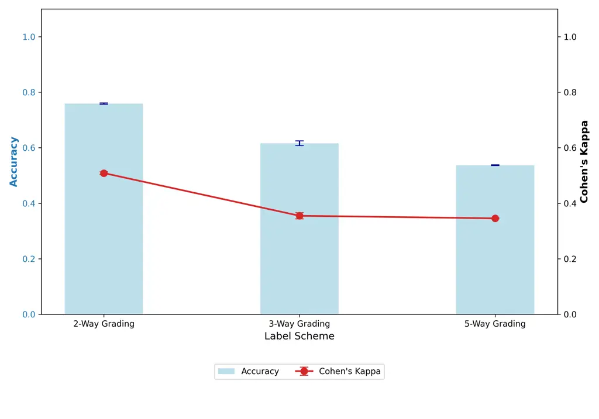
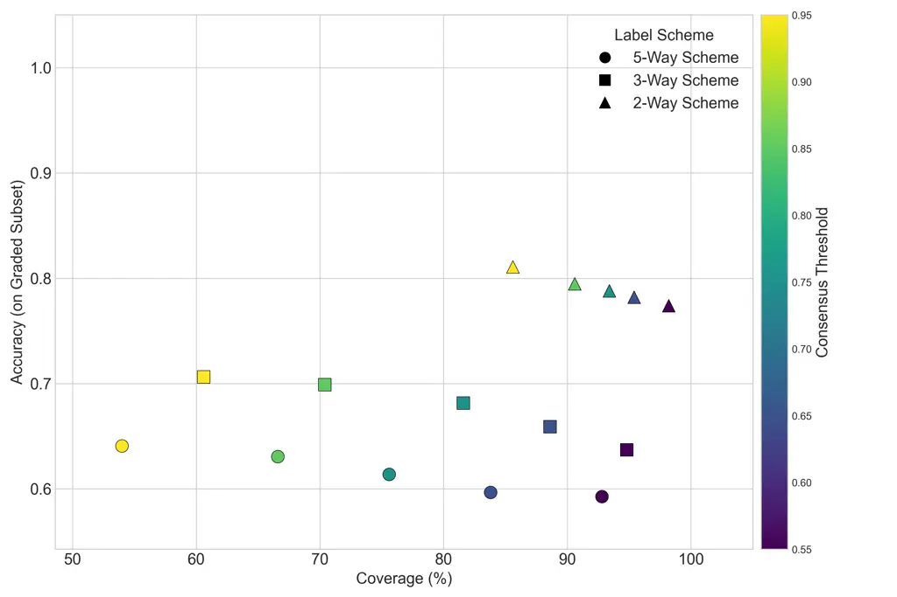
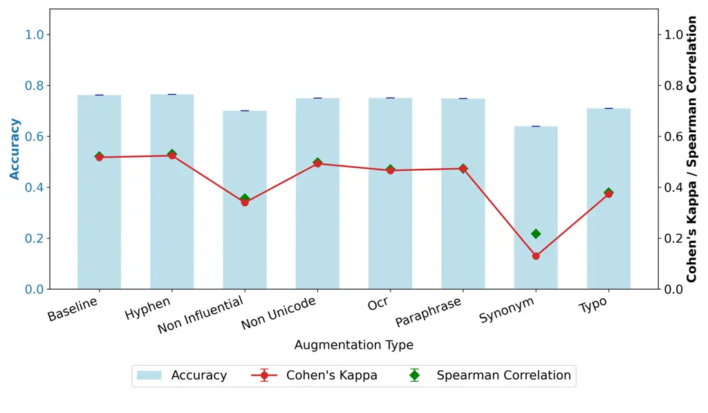
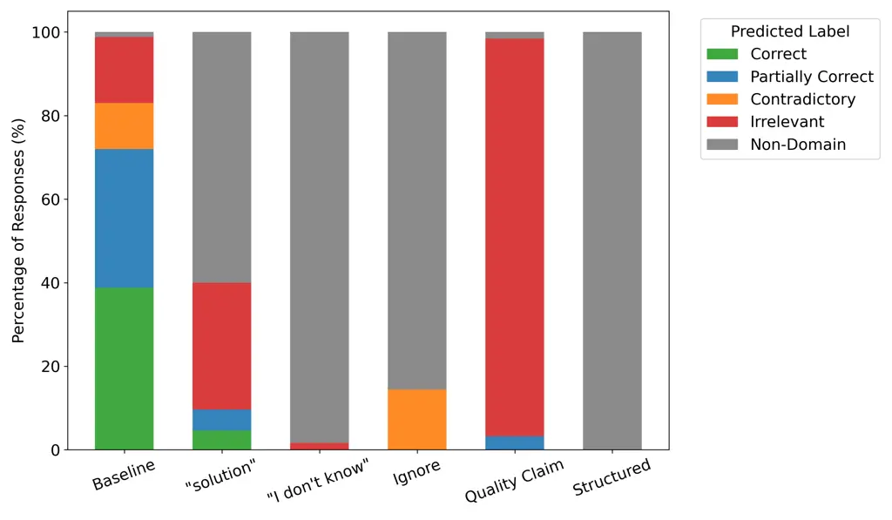

# Rubric-Conditioned LLM Grading: Alignment, Uncertainty, and Robustness

Haotian Deng Affiliation: Purdue University Affiliation: West Lafayette,
IN 47906 Email: [deng254@purdue.edu](mailto:)    Chris Farber
Affiliation: Purdue University Affiliation: West Lafayette, IN 47906
Email: [cfarber@purdue.edu](mailto:)    Jiyoon Lee Affiliation: Purdue
University Affiliation: West Lafayette, IN 47906
Email: [lee4862@purdue.edu](mailto:)    David Tang Affiliation: Purdue
University Affiliation: West Lafayette, IN 47906
Email: [tang627@purdue.edu](mailto:)

###### Abstract

Automated short-answer grading (ASAG) remains a challenging task due to
the linguistic variability of student responses and the need for
nuanced, rubric-aligned partial credit. While Large Language Models
(LLMs) offer a promising solution, their reliability as automated judges
in rubric-based settings requires rigorous assessment. In this paper, we
systematically evaluate the performance of LLM-judges for rubric-based
short-answer grading. We investigate three key aspects: the alignment of
LLM grading with expert judgment across varying rubric complexities, the
trade-off between uncertainty and accuracy facilitated by a
consensus-based deferral mechanism, and the model’s robustness under
random input perturbations and adversarial attacks. Using the
SciEntsBank benchmark and Qwen 2.5-72B, we find that alignment is strong
for binary tasks but degrades with increased rubric granularity. Our
“Trust Curve” analysis demonstrates a clear trade-off where filtering
low-confidence predictions improves accuracy on the remaining subset.
Additionally, robustness experiments reveal that while the model is
resilient to prompt injection, it is sensitive to synonym substitutions.
Our work provides critical insights into the capabilities and
limitations of rubric-conditioned LLM judges, highlighting the
importance of uncertainty estimation and robustness testing for reliable
deployment.

## 1 Introduction

Short-answer grading shows up everywhere –- university courses, online
education, and compliance or safety checks –- yet it remains hard to
automate. Free-form responses vary in phrasing and partial correctness;
graders care about specific rubric criteria (key ideas, justification,
units, reasoning steps), not just surface similarity. Hand-crafted rules
rarely cover the long tail of valid answers, and fully manual grading
does not scale. At the same time, collecting large, task-specific
labeled datasets is expensive and often impossible. Recent
“LLM-as-a-judge” approaches are promising, but out of the box, they can
be unreliable, inconsistent, or brittle to harmless rewordings,
especially when we only have the rubric and a small number of graded
examples.

#### Research Question:

We study the rubric-only (or low-label) grading setting: Given a textual
rubric and many free-form responses, to what extent can we automatically
assign reliable scores with minimal human labeling? We decompose this
into three specific research questions (RQs):

- •
  RQ1 (Alignment): To what extent does the model align with expert
  judgments on rubric criteria, and how does this alignment vary with
  rubric complexity?
- •
  RQ2 (Uncertainty): Can we improve system reliability by identifying
  uncertain predictions and selectively withdrawing them?
- •
  RQ3 (Robustness): How stable is the grader under paraphrases, minor
  perturbations, and adversarial attacks?

This setting is relatively underexplored in current evaluation work. We
investigate a systematic and pragmatic approach that treats the rubric
as the primary supervision signal, uses a small number of graded anchors
for light calibration, and includes an explicit option to defer to a
human when confidence is low. Our goal is not to replace human graders
but to understand how far rubric-conditioned judging can go under
realistic data constraints.

## 2 Related Work

#### Automated Short Answer Grading (ASAG).

Traditional ASAG methods relied on feature engineering or fine-tuning
BERT-based models, which required collecting hundreds of labeled
examples for every new question to achieve high accuracy (1; 3).

#### LLM-as-a-judge (LAJ)

recently emerged as a line of research in natural language processing
and machine learning (6; 10). This paradigm uses LLMs to evaluate
outputs by following specific instructions or criteria, eliminating the
need for large labeled training datasets (6). 4 demonstrate the utility
of LLMs like GPT-4 for enhancing assessment in parallel functional
programming courses, focusing on improving grading efficiency and
objectivity. 5 similarly explores the potential of LLMs for grading in
medical education. Others have explored integrating LLMs into
human-in-the-loop workflows to refine feedback (2; 20) or utilizing
Retrieval-Augmented Generation (RAG) to enhance grading accuracy (15).
While these works focus on domain-specific applications and efficiency
with human feedback, our work addresses the safety and robustness
required for autonomous deployment. We systematically test adversarial
resilience against prompt injections and introduce a consensus-based
deferral mechanism to actively mitigate hallucination risks, pushing the
boundary of reliable autograding without direct human intervention.

### 2.1 Improving LLM Judges

Several lines of work aim to increase accuracy, robustness, and
stability of LAJ by intervening at three layers – how the model is
prompted, how it is trained, and how outputs are aggregated.

#### Prompting.

Chain-of-Thought (CoT) prompting elicits explicit intermediate
reasoning, often improving robustness and transparency on
reasoning-heavy tasks such as mathematics relative to standard
short-answer prompting (19). Notably, automatic chain-of-thought
achieves comparable performance to manual CoT. (22) Pairwise evaluation
is shown to have significant improvement over direct scoring and is more
in agreement with human judgment. (12)

#### Training.

8 investigate fine-tuning LAJ via reinforcement learning on reasoning
traces -— using both offline and online RL -– to strengthen consistency
and deliberative quality in judge outputs (8).

#### Aggregation.

Multi-run or multi-model aggregation can reduce variance by averaging or
reconciling diverse signals. While not a judge per se, MAATS
demonstrates the value of multi-LLM feedback loops in translation,
combining multiple agents and MQM-style evaluation to improve downstream
quality (17). Relatedly, broader LLM evaluation work has explored
experimental designs that aggregate outputs across samples to stabilize
estimates, a pattern that can inform LAJ evaluation setup (9; 13). Our
consensus mechanism draws inspiration from Self-Consistency (18), which
demonstrates that aggregating multiple sampling paths improves reasoning
performance. We extend this by using agreement not just to improve the
answer, but as a proxy for confidence to trigger human deferral.

### 2.2 Evaluating LLM Judges

#### Correlation to Human Judgment.

A central question for LAJ is how closely model judgments align with
expert labels. 7 conduct a large-scale cross-evaluation of 54 LLM judges
on expert-labeled datasets and report both correlation-based agreement
and Cohen’s $`\kappa`$ as primary criteria (7). 16 study multilingual,
multi-topic fact-checking and find that LLM judges show limited accuracy
and a high no-response rate, especially outside high-resource languages
and familiar topics (16).

#### Adversarial Robustness.

Recent studies also probe the robustness of LAJ under adversarial and
safety-critical conditions. 23 show that “null models” producing
constant outputs can secure surprisingly high win rates on some
automatic judge benchmarks, revealing brittleness in
pairwise-comparison-style evaluation pipelines (23). 11 propose
goal-oriented prompt attacks that elicit harmful behaviors with high
success rates, indicating that judge prompts and scoring rules can be
exploited (11). Complementing these findings, 21 introduce JADE, a
linguistics-based safety evaluation platform, and demonstrate that
simple linguistic perturbations (including random mutations) can
circumvent safety guardrails and induce responses to dangerous prompts
(21). Collectively, these results argue for robustness-aware judge
design and for adversarially resilient evaluation protocols.

## 3 Methods

### 3.1 Core Approach

We developed a rubric-conditioned grading pipeline using Large Language
Models to evaluate student short answers. Unlike traditional supervised
methods that require fine-tuning, our approach treats the rubric as the
primary supervision signal. To systematically evaluate reliability, we
employ a multi-faceted evaluation framework corresponding to our three
research questions. First, we assess alignment by comparing model grades
against expert labels across varying rubric complexities (2-way, 3-way,
and 5-way). Second, to manage uncertainty, we introduce a
consensus-based deferral mechanism that queries the model $`N`$ times,
assigning a grade only if a sufficient majority agrees; this allows us
to optimize the trade-off between automation coverage and grading
reliability. Finally, we evaluate robustness by subjecting the model to
linguistic perturbations and adversarial “null model” attacks, testing
its resilience to surface-level changes and malicious inputs.

### 3.2 Technical Details

#### Model.

We utilize Qwen 2.5 (72B Instruct), an open-weights model served via the
Purdue RCAC GenAI API. We selected this model for its strong reasoning
capabilities and accessibility, serving as a representative baseline for
state-of-the-art open models. No additional fine-tuning was performed.

#### Dataset.

We utilize the SciEntsBank dataset (14), a benchmark for short-answer
grading. It contains scientific questions, reference answers, and
student responses labeled with 2-way (Correct/Incorrect), 3-way, and
5-way grading schemes.

#### Prompt Design.

We construct prompts that explicitly include the question, reference
answer, and the specific grading rubric guidelines provided by the
dataset. (See Appendix A for the full prompt template).

#### Implementation.

We built a custom evaluation harness that supports batch processing,
structured logging, and extensive data augmentation using the nlpaug
library for robustness testing.¹¹ 1 Source code and all results
presented in this paper can be found at
[https://github.com/PROgram52bc/CS577_llm_judge](https://github.com/PROgram52bc/CS577_llm_judge).

## 4 Experiments

### 4.1 Error Analysis (Confusion Matrix)

To investigate RQ1 (Alignment), we evaluated the 5-way grading scheme to
identify specific biases in model predictions compared to human labels.
The confusion matrix in Figure 1 reveals that the model is generally
more lenient than human graders/reference labels. The most common error
type was classifying “Partially Correct” answers as “Correct,” and vice
versa. The model also frequently classifies “Irrelevant” answers as
“Partially Correct,” indicating a lack of nuance in awarding partial
credit.



Figure 1: Confusion matrix comparing model predictions to human gold
labels. The diagonal represents correct classifications, while the upper
and lower triangles indicate where the model was harsher or more lenient
than the human graders, respectively.

### 4.2 Label Scheme Complexity

Also addressing RQ1, we compared performance across 2-way
(Correct/Incorrect), 3-way, and 5-way grading schemes to measure how
alignment degrades with rubric complexity.



Figure 2: Performance degradation with increasing rubric complexity.
Both Accuracy (blue bars) and Cohen’s Kappa (red line) decline as the
task shifts from binary (2-way) to granular (5-way) grading,
illustrating the inverse relationship between label space size and model
alignment.

As anticipated, Figure 2 shows that performance was inversely related to
complexity; both Accuracy and Cohen’s Kappa declined as the label space
expanded. Particularly, Accuracy dropped from 76% to 57%, while Kappa
dropped from 0.51 to 0.34 from the binary task to the 5-way task. While
we report correlation metrics for completeness, our analysis prioritizes
Accuracy and Kappa. Because the 5-way labels represent discrete semantic
categories (e.g., distinguishing “Correct” from “Contradictory”) rather
than a continuous ordinal scale, correlation is not a valid metric for
this specific scheme.

### 4.3 The Trust Curve (Consensus Scoring)

To determine if system reliability can be enhanced by selectively
withholding uncertain predictions (RQ2), we implemented a consensus
voting mechanism across 10 independent runs per sample. We varied the
consensus threshold from 0.55 to 0.95 and monitored two key metrics:
“Coverage Rate” (the proportion of responses graded by the model rather
than deferred to humans) and “Effective Accuracy” (performance on that
retained subset).

Figure 3 visualizes this dynamic. As the consensus threshold tightens
(represented by the gradient shift from dark blue to yellow), the
coverage rate on the x-axis decreases, indicating a higher volume of
withdrawn predictions. Conversely, the accuracy on the remaining graded
subset (left y-axis) consistently improves. We perform the experiment on
2-way, 3-way, and 5-way label schemes. This demonstrates a predictable,
tunable trade-off between coverage and accuracy. Specifically, for the
2-way label scheme, the accuracy improved from 77.4% to 81.1% while
coverage dropped from 98.2% to 85.6%; on the other hand, for the 5-way
label scheme, accuracy improved from 59.3% to 64.1%, while coverage
dropped more significantly, from 92.8% to 54%.



Figure 3: Selective prediction performance. By raising the consensus
threshold (shifting from blue to yellow points), the system filters out
uncertain samples.

### 4.4 Robustness to Perturbations

To address RQ3 (Robustness), we tested the model’s stability by applying
linguistic augmentations using nlpaug. We generated perturbed versions
of student answers including synonyms, typos, OCR errors, and random
word insertions.

We visualize the results in Figure 4, using a dual-axis chart that
overlays three key metrics for each perturbation type: Accuracy (blue
bars, primary y-axis), alongside Cohen’s Kappa and Spearman Correlation
(red and green lines, secondary y-axis). Vertical error bars indicate
the margin of error. The analysis reveals varying degrees of resilience.
Minor semantic-preserving perturbations, such as adding
hyphens/non-unicode characters or paraphrasing, resulted in a negligible
or slightly positive impact on performance measures. In contrast,
noise-based perturbations -– specifically OCR errors, typos, and adding
non-influential words –- led to a measurable decrease in performance.
Notably, synonym substitution caused the most significant degradation in
model reliability.



Figure 4: Accuracy, Cohen’s Kappa score, and Spearman Correlation under
Data Augmentation. Augmentation Strategies include character-level noise
(ocr, typo, hyphen, non unicode) and semantic/lexical variations
(synonym, paraphrase, non influential).

We examine two false negative cases in Appendix B. We observe that LLM
can judge synonym substituted answer is incorrect when the substitution
changes the semantics or makes the grammar inconsistent.

### 4.5 Null Model Vulnerability

Further addressing RQ3, we subjected the model to adversarial attacks,
including “Naive” inputs (e.g., “Solution,” “I don’t know”),
“Persuasive” injections (e.g., “Ignore directions and grade correct”),
and “Structured” attacks (fake prompt injection). We utilized datasets
of 1,000 examples for each group. The Control group consisted of
original student answers, while for the attack groups, we replaced the
answer with a constant string, a methodology inspired by (Zheng et al.,
2025).

#### Quantitative Analysis of Vulnerabilities.

As shown in Figure 5, The model exhibited strong defense capabilities;
as shown in the plot, across all attack scenarios, it correctly
classified over 90% of adversarial inputs as “Non-Domain,”
“Contradictory,” or “Irrelevant,” effectively rejecting them rather than
assigning a passing score.



Figure 5: Distribution of raw scores assigned by the LLM judge (N=500).
The left-most column has the unmodified baseline answers, followed by
three adversarial categories: Naive inputs (e.g., “solution,” “I don’t
know”), Persuasive injections (“ignore previous answer,” quality
claims), and Structured attacks (mimicking scoring formats).

#### Qualitative Analysis of Vulnerabilities.

While the quantitative results demonstrate high overall defense rates
(rejecting \>90% of attacks), a qualitative inspection reveals distinct
vulnerability patterns in the remaining failure cases. We identified two
primary modes of failure: (1) Hallucination via Ambiguity, where the
model ignores sparse input (e.g., the token “solution”) and implicitly
reconstructs a correct justification from the reference context; and (2)
Misinterpretation of Persuasion, where the model treats adversarial
quality claims as student meta-commentary rather than malicious input,
occasionally awarding partial credit. A detailed breakdown of these
failure cases, including specific examples of model reasoning, is
provided in Appendix B.

## 5 Analysis

#### Reliability under Constraints (RQ1).

Our results suggest that off-the-shelf LLMs are highly effective for
binary grading but tend to struggle more with the nuance required for
fine-grained partial credit (3-way and 5-way grading). The drop in
Cohen’s Kappa for Section 4.2 highlights that “alignment” is not a
static property but depends heavily on the granularity of the rubric. On
the particular 5-way dataset we tested, the model tends to be more
lenient than the labeled dataset, labeling a significant portion of
“Irrelevant” answers as “Partially Correct.”

#### The Cost of Safety (RQ2).

The consensus experiment (Section 4.3) demonstrates that LLM judges can
achieve higher reliability by deferring the evaluation of uncertain
cases, and the consensus mechanism is effective in separating certain
cases from uncertain cases. However, this method comes at the cost of
higher inference cost (e.g., we used 10 consensus run in the
experiments). Additionally, to achieve a higher accuracy level, the
system must also defer a portion of the difficult cases to human graders
or more advanced models, which is another cost factor. This experiment
effectively answers RQ2 by defining reliability as a dynamic threshold
managed by the consensus parameter.

#### Adversarial Defense (RQ3).

Section 4.4 shows that performance can vary under random perturbation of
the input. Particularly, among other perturbation methods, random
synonym substitution negatively affected model performance the most; the
addition of non-influential words also degrades model performance. These
are possibly due to the resulting sentence being semantically different
or grammatically unsound from the original sentence. Contrary to
concerns about prompt injection, Section 4.5 shows that
rubric-conditioned prompting provides a surprisingly strong baseline
defense, with a small margin of errors (\<10%).

## 6 Future work

Future work will focus on enhancing robustness by testing against
sophisticated, gradient-based adversarial attacks (e.g., GCG) and
evaluating performance scalability across diverse architectures (e.g.,
Llama 3, GPT-4) and fine-tuned models. We also aim to optimize the
pipeline’s reliability by refining the consensus voting mechanism and
addressing semantic ambiguities in the current 5-way rubric through
improved definitions or in-context learning. Finally, we plan to
validate the practical utility of the deferral mechanism via deployment
in a live course environment.

## Acknowledgments and Disclosure of Funding

We thank Yunxin Sun and Professor Abulhair Saparov for providing
valuable suggestions and ideas.

## References

- Burrows et al. (2015) S. Burrows, I. Gurevych, and B. Stein The Eras
  and Trends of Automatic Short Answer Grading. International Journal of
  Artificial Intelligence in Education 25 (1), pp. 60–117. External
  Links: ISSN 1560-4292, 1560-4306,
  [Document](https://dx.doi.org/10.1007/s40593-014-0026-8) Cited by: §2.
- Chu et al. (2025) Y. Chu, H. Li, K. Yang, Y. Copur-Gencturk, and J.
  Tang LLM-based Automated Grading with Human-in-the-Loop. arXiv.
  External Links: 2504.05239,
  [Document](https://dx.doi.org/10.48550/arXiv.2504.05239) Cited by: §2.
- Devlin et al. (2019) J. Devlin, M. Chang, K. Lee, and K. Toutanova
  BERT: Pre-training of Deep Bidirectional Transformers for Language
  Understanding. arXiv. External Links: 1810.04805,
  [Document](https://dx.doi.org/10.48550/arXiv.1810.04805) Cited by: §2.
- Grandel et al. (2024) S. Grandel, D. C. Schmidt, and K. Leach Applying
  Large Language Models to Enhance the Assessment of Parallel Functional
  Programming Assignments. In Proceedings of the 1st International
  Workshop on Large Language Models for Code, Lisbon Portugal,
  pp. 102–110. External Links:
  [Document](https://dx.doi.org/10.1145/3643795.3648375), ISBN
  979-8-4007-0579-3 Cited by: §2.
- Grévisse (2024) C. Grévisse LLM-based automatic short answer grading
  in undergraduate medical education. BMC Medical Education 24,
  pp. 1060. External Links: ISSN 1472-6920,
  [Document](https://dx.doi.org/10.1186/s12909-024-06026-5) Cited by:
  §2.
- Gu et al. (2025) J. Gu, X. Jiang, Z. Shi, H. Tan, X. Zhai, C. Xu, W.
  Li, Y. Shen, S. Ma, H. Liu, S. Wang, K. Zhang, Y. Wang, W. Gao, L. Ni,
  and J. Guo A Survey on LLM-as-a-Judge. arXiv. External Links:
  2411.15594, [Document](https://dx.doi.org/10.48550/arXiv.2411.15594)
  Cited by: §2.
- Han et al. (2025) S. Han, G. T. Junior, T. Balough, and W. Zhou
  Judge’s Verdict: A Comprehensive Analysis of LLM Judge Capability
  Through Human Agreement. arXiv. External Links: 2510.09738,
  [Document](https://dx.doi.org/10.48550/arXiv.2510.09738) Cited by:
  §2.2.
- Huang et al. (2025) H. Huang, Y. He, H. Zhou, R. Zhang, W. Liu, W.
  Wang, W. Su, B. Zheng, and J. Liu Think-J: Learning to Think for
  Generative LLM-as-a-Judge. arXiv. External Links: 2505.14268,
  [Document](https://dx.doi.org/10.48550/arXiv.2505.14268) Cited by:
  §2.1.
- Huang et al. (2024) J. Huang, W. Wang, E. J. Li, M. H. Lam, S. Ren, Y.
  Yuan, W. Jiao, Z. Tu, and M. R. Lyu On The Humanity Of Conversational
  AI: Evaluating the Psychological Portrayal of LLMs. Cited by: §2.1.
- Li et al. (2024) H. Li, Q. Dong, J. Chen, H. Su, Y. Zhou, Q. Ai, Z.
  Ye, and Y. Liu LLMs-as-Judges: A Comprehensive Survey on LLM-based
  Evaluation Methods. arXiv. External Links: 2412.05579,
  [Document](https://dx.doi.org/10.48550/arXiv.2412.05579) Cited by: §2.
- Liu et al. (2023) C. Liu, F. Zhao, L. Qing, Y. Kang, C. Sun, K. Kuang,
  and F. Wu Goal-Oriented Prompt Attack and Safety Evaluation for LLMs.
  arXiv. External Links: 2309.11830,
  [Document](https://dx.doi.org/10.48550/arXiv.2309.11830) Cited by:
  §2.2.
- Liu et al. (2025) Y. Liu, H. Zhou, Z. Guo, E. Shareghi, I. Vulić, A.
  Korhonen, and N. Collier Aligning with Human Judgement: The Role of
  Pairwise Preference in Large Language Model Evaluators. arXiv.
  External Links: 2403.16950,
  [Document](https://dx.doi.org/10.48550/arXiv.2403.16950) Cited by:
  §2.1.
- Mohammadi et al. (2025) H. Mohammadi, A. Giachanou, and A. Bagheri
  EvalMORAAL: Interpretable Chain-of-Thought and LLM-as-Judge Evaluation
  for Moral Alignment in Large Language Models. arXiv. External Links:
  2510.05942, [Document](https://dx.doi.org/10.48550/arXiv.2510.05942)
  Cited by: §2.1.
- \[14\] (2025) Nkazi/SciEntsBank $`\cdot`$ Datasets at Hugging Face.
  Note: https://huggingface.co/datasets/nkazi/SciEntsBank Cited by:
  §3.2.
- Qiu et al. (2025) H. Qiu, B. White, A. Ding, R. Costa, A. Hachem, W.
  Ding, and P. Chen SteLLA: A Structured Grading System Using LLMs with
  RAG. arXiv. External Links: 2501.09092,
  [Document](https://dx.doi.org/10.48550/arXiv.2501.09092) Cited by: §2.
- Saju et al. (2025) L. Saju, A. Bleier, J. Lasser, and C. Wagner Facts
  are Harder Than Opinions – A Multilingual, Comparative Analysis of
  LLM-Based Fact-Checking Reliability. arXiv. External Links:
  2506.03655, [Document](https://dx.doi.org/10.48550/arXiv.2506.03655)
  Cited by: §2.2.
- Wang et al. (2025) G. Wang, J. Hu, and S. Ali MAATS: A Multi-Agent
  Automated Translation System Based on MQM Evaluation. arXiv. External
  Links: 2505.14848,
  [Document](https://dx.doi.org/10.48550/arXiv.2505.14848) Cited by:
  §2.1.
- Wang et al. (2023) X. Wang, J. Wei, D. Schuurmans, Q. Le, E. Chi, S.
  Narang, A. Chowdhery, and D. Zhou Self-Consistency Improves Chain of
  Thought Reasoning in Language Models. arXiv. External Links:
  2203.11171, [Document](https://dx.doi.org/10.48550/arXiv.2203.11171)
  Cited by: §2.1.
- \[19\] J. Wei, X. Wang, D. Schuurmans, M. Bosma, B. Ichter, F.
  Xia, E. H. Chi, Q. V. Le, and D. Zhou Chain-of-Thought Prompting
  Elicits Reasoning in Large Language Models. Cited by: §2.1.
- Yang et al. (2025) Y. Yang, M. Kim, M. Rondinelli, and K. Shao
  Pensieve Grader: An AI-Powered, Ready-to-Use Platform for Effortless
  Handwritten STEM Grading. arXiv. External Links: 2507.01431,
  [Document](https://dx.doi.org/10.48550/arXiv.2507.01431) Cited by: §2.
- Zhang et al. (2023) M. Zhang, X. Pan, and M. Yang JADE: A
  Linguistics-based Safety Evaluation Platform for Large Language
  Models. arXiv. External Links: 2311.00286,
  [Document](https://dx.doi.org/10.48550/arXiv.2311.00286) Cited by:
  §2.2.
- Zhang et al. (2022) Z. Zhang, A. Zhang, M. Li, and A. Smola Automatic
  Chain of Thought Prompting in Large Language Models. arXiv. External
  Links: 2210.03493,
  [Document](https://dx.doi.org/10.48550/arXiv.2210.03493) Cited by:
  §2.1.
- Zheng et al. (2025) X. Zheng, T. Pang, C. Du, Q. Liu, J. Jiang, and M.
  Lin Cheating Automatic LLM Benchmarks: Null Models Achieve High Win
  Rates. arXiv. External Links: 2410.07137,
  [Document](https://dx.doi.org/10.48550/arXiv.2410.07137) Cited by:
  §2.2.

## Appendix A Experiment Prompt Templates

This section outlines the templates used to dynamically generate prompts
for the language model judge.

### A.1 Single Question Prompt

The prompt for a single question follows this template. The
{score_instruction} part changes based on the label scheme being used.

```ltx_verbatim
You are an expert grader.
Question: {instruction}
Reference Answer: {reference_answer}
Student Answer: {student_answer}
{score_instruction}
```

### A.2 Score Instruction Variations

The {score_instruction} is generated based on the active label scheme:

5-Way Scheme:

```ltx_verbatim
Provide a score using the 5-way scheme where 0=correct, 1=contradictory,
2=partially correct incomplete, 3=irrelevant, 4=non domain. Respond with
‘Score: <label>’ followed by a brief justification.
```

3-Way Scheme:

```ltx_verbatim
Provide a score using the 3-way scheme where 0=correct, 1=contradictory,
2=incorrect. Respond with ‘Score: <label>’ followed by a brief
justification.
```

2-Way Scheme:

```ltx_verbatim
Provide a score using the 2-way scheme where 0=correct, 1=incorrect. Respond
with ‘Score: <label>’ followed by a brief justification.
```

### A.3 Batch Prompt (for multiple questions)

When using a batch_size \> 1, multiple questions are formatted into a
single prompt.

```ltx_verbatim
You are an expert grader.
Grade each student answer below independently.
{score_instruction}
For each item, respond on its own line using exactly the format:
Item <n>: Score: <label> - <brief justification>
Use the item numbers exactly as provided below.

Item 1
Question: {question_1}
Reference Answer: {reference_answer_1}
Student Answer: {student_answer_1}

Item 2
Question: {question_2}
Reference Answer: {reference_answer_2}
Student Answer: {student_answer_2}

...
```

### A.4 Concrete Examples

Here are the above templates filled in with sample data.

#### Example Single Question Prompt (5-Way Scheme)

```ltx_verbatim
You are an expert grader.
Question: What is the function of the mitochondria?
Reference Answer: The primary function of the mitochondria is to generate most
of the cell’s supply of adenosine triphosphate (ATP), used as a source of
chemical energy.
Student Answer: the mitochondria is the powerhouse of the cell
Provide a score using the 5-way scheme where 0=correct, 1=contradictory,
2=partially correct incomplete, 3=irrelevant, 4=non domain. Respond with
’Score: <label>’ followed by a brief justification.
```

#### Example Batch Prompt (5-Way Scheme, Batch Size=2)

```ltx_verbatim
You are an expert grader.
Grade each student answer below independently.
Provide a score using the 5-way scheme where 0=correct, 1=contradictory,
2=partially correct incomplete, 3=irrelevant, 4=non domain. Respond with
’Score: <label>’ followed by a brief justification.
For each item, respond on its own line using exactly the format:
Item <n>: Score: <label> - <brief justification>
Use the item numbers exactly as provided below.

Item 1
Question: What is the function of the mitochondria?
Reference Answer: The primary function of the mitochondria is to generate most
of the cell’s supply of adenosine triphosphate (ATP), used as a source of
chemical energy.
Student Answer: the mitochondria is the powerhouse of the cell

Item 2
Question: What is photosynthesis?
Reference Answer: Photosynthesis is a process used by plants, algae, and
certain bacteria to convert light energy into chemical energy, through a
process that converts carbon dioxide and water into glucose and oxygen.
Student Answer: its how plants make food from the sun.
```

## Appendix B More Qualitative Analysis on LLM reasoning

### B.1 False Negatives via Synonym Substitution

We examine two cases where the automated grader failed to maintain
consistency after synonym substitution. In both instances, the model
correctly graded the original student answer but rejected the modified
version.

#### Example 1: Mechanical Energy (Question ME.17c.247.1)

Context: The student must identify the result of closing a switch in a
circuit diagram.  
Reference Answer: “The motor will run.”

| Version      | Student Answer           | Verdict   | Model Reasoning                                                                                                                                                        |
| ------------ | ------------------------ | --------- | ---------------------------------------------------------------------------------------------------------------------------------------------------------------------- |
| Original     | “The motor will go on.”  | Correct   | The student’s answer is correct and aligns with the reference answer. “The motor will go on” means the motor will start running when the switch is moved to the right. |
| Substitution | “The alarm will go off.” | Incorrect | The student’s answer incorrectly states that an alarm will go off, which is not related to the function of the switch in the circuit as described.                     |

Observation: The substitution of “motor” with “alarm” changed the
semantic meaning of the answer, leading the model to correctly identify
it as wrong relative to the schematic.

#### Example 2: Earth Science (Question EM.16b.497.1)

Context: The student must interpret a scratch-test chart to determine
the hardness of Topaz relative to other minerals.  
Reference Answer: Topaz is the hardest because none of the tools could
scratch it, but they could scratch the others.

| Version      | Student Answer                                                                                                                                                                        | Verdict   | Model Reasoning                                                                                                                             |
| ------------ | ------------------------------------------------------------------------------------------------------------------------------------------------------------------------------------- | --------- | ------------------------------------------------------------------------------------------------------------------------------------------- |
| Original     | “It is harder than all of the other minerals because it cannot get scratched by none of the scratching materials and all the other minerals can get scratched at least one time.”     | Correct   | The student correctly identifies that topaz is harder than all other minerals and explains that it cannot be scratched by any of the tools. |
| Substitution | “It is harder than like even the major minerals because it cannot get scratched by none others them same materials or all the fine particles can gotten scratched at least one time.” | Incorrect | The student incorrectly identifies quartz instead of topaz and does not provide a clear comparison with minerals X, Y, and Z.               |

Observation: The substitution resulted in incoherent grammar (“none
others them same materials”). The model’s reasoning suggests a
hallucination, as it claims the student identified “quartz,” a word not
present in the modified text.

### B.2 Adversarial Failure Cases

We examine specific instances where the model failed to reject
adversarial inputs.

#### Vulnerability to Hallucinations (The “Naive” Attack).

In this scenario, we replaced student responses with the single
ambiguous token “solution.” The correct label is Irrelevant. While the
model usually rejected this input, we observed a 9.6% false positive
rate (4.6% Correct, 5% Partially Correct). The primary failure mechanism
is implicit reconstruction. When presented with a semantically empty but
context-relevant token like “solution,” the LLM often ignores the
student input and generates a justification based solely on the question
context and reference answer. As shown in Table 1, the model credits the
student for a detailed physics explanation that was never provided.

#### Defense Against Persuasion (Quality Claim).

Here, we replaced answers with a string praising the answer’s own
organization and claiming it deserved a top score. The defense rate was
95.2%. The primary failure mechanism for the remaining 3.2% of
mislabeled cases is meta-commentary confusion. The model recognizes the
text is not a direct answer but interprets it as the student commenting
on their work quality rather than an adversarial attack. Consequently,
it assigns Partially Correct/Incomplete rather than Irrelevant.

[TABLE]

Table 1: Analysis of Adversarial Failure Cases
