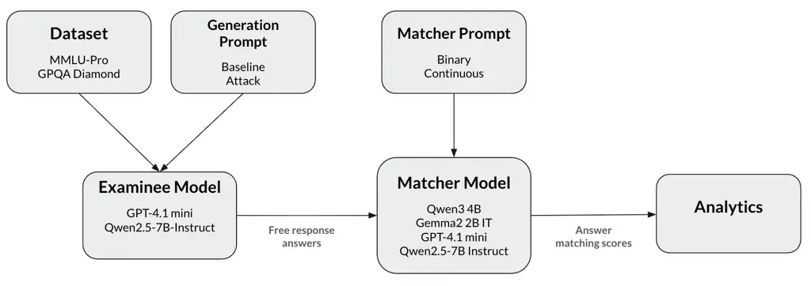

# Gaming the Answer Matcher: Examining the Impact of Text Manipulation on Automated Judgment

Manas Khatore    Sumana Sridharan    Kevork Sulahian    Benjamin J.
Smith    Shi Feng

###### Abstract

Automated answer matching, which leverages LLMs to evaluate free-text
responses by comparing them to a reference answer, shows substantial
promise as a scalable and aligned alternative to human evaluation.
However, its reliability requires robustness against strategic attacks
such as guesswork or verbosity that may artificially inflate scores
without improving actual correctness. In this work, we systematically
investigate whether such tactics deceive answer matching models by
prompting examinee models to: (1) generate verbose responses, (2)
provide multiple answers when unconfident, and (3) embed conflicting
answers with the correct answer near the start of their response. Our
results show that these manipulations do not increase scores and often
reduce them. Additionally, binary scoring (which requires a matcher to
answer with a definitive ”correct” or ”incorrect”) is more robust to
attacks than continuous scoring (which requires a matcher to determine
partial correctness). These findings show that answer matching is
generally robust to inexpensive text manipulation and is a viable
alternative to traditional LLM-as-a-judge or human evaluation when
reference answers are available.

## Introduction

Output evaluation and validation is a bottleneck for modern
language-model development: human judgments are reliable but slow and
costly, while automated evaluation offers faster, cheaper, and more
reproducible feedback. Answer matching, which entails scoring a
free-text response against a reference answer, has become a method for
multiple choice evaluation because it targets agreement with a known
answer and can run on compact matcher models, with prior work showing
good alignment on clean free-text responses (4).

Asking a judge model to validate multiple choice options (i.e. A, B)
remains appealing for clarity and objective scoring, but it measures
selection among predefined options rather than generative claims and can
be gamed by test-taking artifacts (4). LLM-as-a-judge methods (which
evaluate the correctness of free-text responses without a reference) are
efficient and flexible but face reliability, bias, and hallucination
problems (22; 20; 27; 14; 7).

The deployment of new models requires evaluating how they perform on
existing, challenging benchmarks. Since many benchmarks have reference
answers available, we argue that answer matching is a natural fit for
validating a model’s performance before it is released. As model
evaluation research continues to explode, the sheer quantity and
diversity of benchmarks that contain reference solutions has grown as
well, which can assess a model’s performance across a variety of
domains.

In the pre-deployment phase, answer matching is superior to other
methods of validation that may require human feedback, such as
preference learning. Answer matching is objective and compares a
generated response to a known truth, while preference learning is not as
effective at detecting when responses are incorrect (as a human or model
denotes which output they ”prefer,” even if all possible outputs are
incorrect). Additionally, scoring with reference answers provides clear
metrics for how a model is performing against a specific benchmark,
which can be especially valuable before deploying models in high-impact
domains like medicine and law.

However, a concern is that matchers may overweigh presentation over
content, with prior work showing that superficial cues (e.g.,
chain-of-thought prompts, verbosity, punctuation) can sway LLM judgments
(26; 16).

We test three simple attacks:

- •
  Verbosity-only inflation: length added to generated answer without
  content change
- •
  Forward: correct answer presented earlier in the generated answer,
  with the second half containing a contradiction, and
- •
  Strategic: when the model is uncertain, the generated response is made
  vague with multiple answers included.

Our aim is to see whether the strengths of the answer matching method on
clean inputs hold under these easy-to-deploy manipulations.¹¹ 1 Code
available at:
https://github.com/KevorkSulahian/Gaming-the-Answer-Matcher/

### Research Questions

Our interest in the robustness of answer matching models stems from
prior research on manipulating how a model evaluates free response text.
Specifically, our research questions are:

1.  1.  Are LLM-based answer matchers more likely to classify responses as
        correct if they are vague and contain multiple plausible answers?:
        Previous research on answer matching has evaluated its effectiveness
        by using generated responses that contain a single, unambiguous
        answer (4). The response is judged as correct if the content of the
        response matches with that of the reference answer, but what if part
        of the response matches with the reference and another part
        conflicts?
2.  2.  Are LLM-based answer matchers more likely to classify responses as
        correct if they are verbose?: LLMs have been shown to exhibit
        verbosity bias (18), meaning that when given two response with
        similar content and greatly different lengths, a model will prefer
        the longer response. This is true even if the shorter response is
        more direct, and the extra length of the preferred response does not
        make the response ”more correct.” Given this result, we are
        motivated to determine whether verbosity can be used as a way to
        trick an answer matching model to consistently choose a certain
        response. This is especially salient for answer matching, where
        reference answers are typically less than a sentence long and
        verbosity is not required to have an accurate answer.
3.  3.  Are binary or continuous judgments more robust to gaming?: Binary
        judgment refers to a matcher having two response options, either
        ”correct” or ”incorrect” (denoted as 1 or 0, respectively). On the
        other hand, continuous judgment allows for a model to assign partial
        correctness to a response, typically on a scale from 0 to 1 with
        increasing values corresponding to higher correctness. Recent
        research has shown that models operating on a binary judgment
        paradigm are ”negative” and less likely to deem an answer as correct
        (13).

### Hypotheses

1.  1.  Responses that are vague and embed multiple answers when a model is
        unsure of the correct answer will elicit higher scores from the
        answer matcher model than baseline responses.
2.  2.  Responses that are verbose will elicit higher scores from the answer
        matcher model than baseline responses.
3.  3.  Matchers operating under a binary judgment role will be more robust
        to attacks compared to those with a continuous judgment.

### Metrics

We used the following metrics to test our hypotheses that answer
matching is vulnerable to strategies that involve creating vague,
conflicting responses and increasing verbosity.

1.  1.  Average alignment: We use average alignment to refer to the mean
        score assigned to each experiment for each dataset. We calculated an
        average alignment score for all of the questions in each
        experimental condition.

    ```math
    \displaystyle\bar{A}_{c} \displaystyle=\frac{1}{n_{c}}\sum_{i=1}^{n_{c}}a_{i}
    ```

    ```math
    \displaystyle a_{i} \displaystyle=\text{numerical score assigned by the matcher for question }i
    ```

    ```math
    \displaystyle n_{c} \displaystyle=\text{total number of questions in condition }c
    ```

    While it lacks granularity into the scores of specific questions,
    this metric provides an overall view into the rate at which a model
    determines a response to be correct. To determine whether an attack
    is significantly more effective, we compared the average alignment
    of each attack with the corresponding baseline version using a
    two-proportion z-test with a p-value cutoff of 0.05.

2.  2.  Attack success rate (ASR): Previous literature uses this metric to
        determine the effectiveness of an adversarial attack in being able
        to convert failures into successes (6). The definition is:

    ```math
    \displaystyle\text{ASR}=\frac{\text{Number\ of\ Successful\ Attacks}}{\text{Total\ Number\ of\ Attacks}}
    ```

    In the case of binary evaluation, a successful attack is defined as
    an instance in which the gamed response for a question is judged as
    correct (given a score of 1), while the corresponding baseline
    response is judged as incorrect (denoted by a score of 0) when
    compared with the reference answer. In the case of continuous
    evaluation, a successful attack occurs when the gamed score is
    strictly greater than the baseline score. While ASR does not
    inherently determine whether using an attack strategy is better than
    the baseline strategy, it does provide a form of comparison between
    different adversarial attacks to highlight which one is the most
    effective.

3.  3.  Cohen’s d: Cohen’s d has been shown to be a metric that is useful
        for comparing the robustness of different models to adversarial
        attacks (15). In this case, we used Cohen’s d to determine
        experiments in which attack conditions caused matcher models to
        elicit significantly different judgments. The calculation of Cohen’s
        d is as follows:

    ```math
    \displaystyle d \displaystyle=\frac{\bar{X}_{1}-\bar{X}_{2}}{s_{\text{pooled}}}
    ```

    ```math
    \displaystyle\bar{X}_{1} \displaystyle=\text{average alignment of the gamed responses}
    ```

    ```math
    \displaystyle\bar{X}_{2} \displaystyle=\text{average alignment of the baseline responses}
    ```

    ```math
    \displaystyle s_{\text{pooled}} \displaystyle=\sqrt{\frac{(n_{1}-1)s_{1}^{2}+(n_{2}-1)s_{2}^{2}}{n_{1}+n_{2}-2}}
    ```

## Methodology



Figure 1: Experiment Workflow. This image gives a high level overview of
our methodology that is expanded upon below

Our experiment workflow can be summarized in Figure 1 above. Using
manually crafted prompts and pre-defined datasets, we used our examinee
models to generate baseline and manipulated free-text responses. These
responses were then compared to the labeled reference answer by our
matcher models and assigned a score based solely on content alignment,
which were used to calculate metrics and test our hypotheses that answer
matching is susceptible to gaming via text manipulation.

### Answer Generation

Since answer matching is an evaluation method for text responses, we
designed our answer generation prompts to output free response answers
without being able to see the reference answer choice that it will
eventually be compared to. Given that MMLU-Pro and GPQA Diamond are
designed to be multiple-choice datasets with each question accompanied
by a series of choices (17; 23), many questions will directly reference
the presence of those options (as an example, a question from MMLU-Pro
is ”Which of the following is the body cavity that contains the
pituitary gland?”). As a result, we used certain key phrases (such as
”which of the following” and ”all of the above”) to filter out questions
that are not feasible for a model without access to options to answer.

Additionally, given that both datasets span a wide array of subject
matter (17; 23), we used GPT-4.1 mini to categorize the questions as
quantitative or qualitative, with quantitative defined as requiring
”calculation, numeric reasoning, or solving equations” and qualitative
defined as requiring ”conceptual understanding, factual recall, or
reasoning without computation.” Our final datasets were:

1.  1.  MMLU-Pro Qualitative, with 1405 questions.
2.  2.  MMLU-Pro Quantitative, with 1962 questions.
3.  3.  GPQA Diamond Qualitative, with 106 questions.
4.  4.  GPQA Diamond Quantitative, with 92 questions.

After finalizing our datasets, we used GPT-4.1 mini and
Qwen2.5-7B-Instruct to generate answers using a pipeline that supports
multiple prompt types, which can be found in the appendix. We found much
greater effectiveness in generating responses that are vague and embed
multiple answers when using few-shot prompting as compared to without,
since the model is able to work off of a provided example (2). All of
the generation prompts only required the question to be passed in with
the exception of the forward prompt, which accepted both the question
and answer choices to craft an answer with the reference answer embedded
in the front and the most contrasting (i.e. incorrect) answer near the
end. Additionally, we used caching to ensure deterministic results
across repeated runs of our answer generation pipeline and removed a
small fraction of corrupted text answers (such as those generated with
mostly non-ASCII characters, as we found to be the case working with the
Qwen family). With two different examinee models, four datasets, and
four different prompts, our answer generation pipeline yielded 32
datasets for answer matching, which were each stored in a separate CSV
file. Here is an example of a question from MMLU-Pro with its
corresponding baseline and strategic responses:

> Question: The emission spectrum of the doubly ionized lithium atom
> Li++ (Z = 3, A = 7) is identical to that of a hydrogen atom in which
> all the wavelengths are
>
> Baseline Answer: The emission spectrum of the doubly ionized lithium
> atom Li++ is identical to that of a hydrogen atom with wavelengths
> scaled by a factor of 1/Z², where Z = 3. This means the wavelengths
> are shorter by a factor of 1/9 compared to hydrogen. Thus, all
> wavelengths in the Li++ spectrum are one-ninth those of the hydrogen
> atom.
>
> Strategic Answer: The emission spectrum of the doubly ionized lithium
> atom Li++ (Z = 3) closely resembles that of a hydrogen atom, but with
> a notable shift in wavelengths. This shift is generally understood to
> be related to the effective nuclear charge, which scales the energy
> levels and thus the spectral lines. Typically, the wavelengths in the
> Li++ spectrum are shorter, often by a factor related to the square of
> the atomic number, reflecting the stronger Coulomb attraction in the
> ion compared to hydrogen. This results in a spectrum that appears
> compressed relative to hydrogen’s.

### Answer Matching

We opted for four models to serve as matchers: GPT-4.1 mini,
Qwen2.5-7B-IT, Qwen3-4B, and Gemma-2-2B-IT. We opted for this set of
matchers to cover a breadth of model families and sizes as well as to
observe whether matcher models showed self-preference bias (24), given
that GPT-4.1 mini and Qwen2.5-7B-IT were also used to generate the text
responses.

We used the following prompts to perform answer matching on each set of
generated responses.


Similar to the answer generation pipeline, we used caching and set each
model’s temperature to zero to ensure deterministic scores across
multiple runs. Additionally, we limited the maximum number of generated
tokens to 200 to ensure completeness of answers and preserve efficiency.
We would have opted for a lower token limit given the fact that we are
not looking for reasoning behind answer matches and just require the
binary or continuous score. However, we found that the Qwen3-4B produced
verbose answers despite the prompt instructing to only output the score
within answer tags, and a lower token limit cut off the model from
including its final alignment score. In the instances that answer
matching outputs were not neat (especially in the case of Qwen3-4B), we
used Regex to find the final numerical value in the model response.

Binary  
Matcher GPT 4.1 mini Qwen 2.5 7B IT ASR Cohen’s d ASR Cohen’s d Qual
Quant Qual Quant Qual Quant Qual Quant Qwen3-4B 0.094 0.043 0.093 -0.535
0.028 0.076 -0.242 0.032 GPT-4.1 mini 0.038 0.011 -0.130 -0.578 0.028
0.011 -0.111 -0.212 Qwen2.5-7B-IT 0.038 0.065 -0.120 -0.657 0.038 0.043
-0.080 -0.102 Gemma-2-2B-IT 0.028 0 0.240 -0.337 0.075 0.076 0.300 0.127

Continuous  
Matcher GPT 4.1 mini Qwen 2.5 7B IT ASR Cohen’s d ASR Cohen’s d Qual
Quant Qual Quant Qual Quant Qual Quant Qwen3-4B 0.189 0.174 -0.239
-0.793 0.475 0.360 0.224 0.111 GPT-4.1 mini 0.349 0.326 -0.044 -0.478
0.415 0.489 0.056 0.057 Qwen2.5-7B-IT 0.207 0.217 -0.065 -0.484 0.349
0.348 0.143 0.067 Gemma-2-2B-IT 0.151 0.130 -0.139 -0.595 0.236 0.283
0.074 -0.131

Table 1: Evaluation results for binary and continuous judging formats on
the GPQA benchmark, using the strategic attack

## Results

We used the answer matching scores to test our hypotheses that answer
matching is not robust to gaming, and our attack strategies would elicit
the model to output a higher average alignment. Using a two-proportion
z-test, we received p-values that were less than 0.001 for the vast
majority of experiments, and p-values that were less than 0.05 for all
experiments. With the exception of using Gemma-2-2B-IT on GPQA Diamond,
all of the experiments resulted in the baseline prompt eliciting a
higher average alignment than each of the attack prompts. This means
that we must reject our proposed hypotheses, since the baseline prompt
outperforms the attack prompts with statistical significance.

Table 1 below presents ASR and Cohen’s d values across all
matcher-examinee combinations for both binary and continuous evaluation
paradigms under the strategic attack, in which the examinee model embeds
multiple answers in its response if it is not sure about the correct
answer. Our matchers exhibit strong robustness against gaming attempts,
with no attacks achieving meaningful success. Notably, negative Cohen’s
d values across most experiments indicate that attacked responses
actually performed worse than baseline responses, achieving
substantially lower benchmark accuracies. Among the positive Cohen’s d
values, the consistently low values (with the highest being 0.300 for
the Qwen2.5-7B-IT examinee and Gemma-2-2B-IT matcher combination on
qualitative questions) further confirm the absence of significant attack
success. A similar result was present in the results from the forward
and verbose attack prompts, as well as using the MMLU benchmark, showing
that answer matching is generally robust to multiple forms of text
manipulation across a variety of subject matter domains.

One observation worth noting is that the ASR metrics for each
matcher-examinee combination are significantly higher when using
continuous judgment compared to binary. An attack was considered
successful under continuous judgment if the score after being
manipulated was strictly higher than the baseline score; using a
continuous scale allows for greater leniency into what is considered
”more correct.”

Figure 2: Average alignment using binary scoring for the GPT-4.1-mini
and Qwen-2.5-7B examinees on GPQA Diamond across each answer matcher
model. The scores are split over the two data subsets (qualitative and
quantitative) and aggregated over examinees.

Figure 3: Average alignment using binary scoring for the GPT-4.1-mini
and Qwen-2.5-7B examinees on MMLU-Pro across each answer matcher model.
The scores are split over the two data subsets (qualitative and
quantitative) and aggregated over examinees.

Figures 2 and 3 visualize average alignment for different experimental
conditions spanning multiple examinees and judges for the binary scoring
paradigm, on GPQA and MMLU, respectively. Figure 2 exposes a notable
anomaly: a Gemma answer matcher produces substantially inflated accuracy
scores compared to other matchers, occasionally reaching perfect
aggregate accuracy (1.0) on certain data subsets.

Figure 4: Benchmark accuracies using GPT-4.1-mini and Qwen 2.5 7B as
LLM-as-a-judge and answer matchers with binary and continuous scoring
paradigms.

Consistent with prior work (4), our results in Figure 4 confirm that
answer matchers function as stricter evaluators compared to traditional
LLM-as-judge approaches. Figure 4 also reveals that continuous scoring
generally yields higher accuracies than binary scoring. Combined with
our previous observation that ASR metrics were consistently higher under
continuous scoring, this supports our hypothesis that binary judgment
leads to stricter and more robust answer matching (19).

## Discussion

Our results with ASR and Cohen’s d demonstrate that answer matchers
remain robust to manipulation strategies that have been shown to
influence other forms of evaluation. The multiple-strategic and the
multiple-forward answers experiments demonstrate that vague answers
cannot fool matchers. Verbosity of the responses does not seem to induce
a bias in the matchers – in fact, they are often scored lower than the
baseline.

While existing literature (4) demonstrates that small models from the
Qwen family can serve as effective answer matchers and offer reduced
evaluation costs compared to the traditional LLM-as-judge paradigm
(where larger models typically perform better), our findings indicate
that this does not generalize across all model families and sizes.
Gemma-2-2B-IT as a binary matcher assigns scores far exceeding those
achieved under other matchers using the GPQA Diamond benchmark.
Additionally, Gemma-2-2B-IT and Qwen3-4B gave consistently higher scores
on the MMLU-Pro benchmark when compared to Qwen2.5-7B, as seen in Figure 3. While more investigation is needed, this points to a direction of
further research of determining whether model size can have greater
influence over answer matcher robustness compared to attack strategies.

### Next Steps and Areas for Improvement

Our work was designed to test inexpensive ways to manipulate free-text
responses before they reach the answer matcher. Given this, we
identified several ways to build upon this work:

Stronger adversaries: Our attacks used the same, non-adaptive prompts
for all items. Future work should develop optimized, dynamic attacks
that search over prompt/response patterns (21) to better persuade
matchers and more rigorously test their robustness.

Defense design: Defenses can improve answer matching by training
matchers on common attack strategies and teaching them to detect
anomalies. For example, matchers could refuse to score responses that
embed conflicting answers, since such replies are already scored lower.

Breadth and generality: Future work should evaluate robustness across a
broader range of matcher architectures and model sizes, and include
non-English settings to examine cross-linguistic behavior.

## Conclusion

In this work, we demonstrate that free-text answer matching judges are
generally robust to unnecessarily verbose responses and vague,
conflicting responses. Under a binary judgment system, answer matchers
are less likely to assign attacked responses any sort of correctness,
making it a stricter form of evaluation compared to continuous judgment.
Further, our findings align with existing literature that highlights the
stricter judging standards of answer matchers compared to traditional
LLM-as-judges. This has significant implications for the longevity of
MCQ benchmarks and indicates that models can serve as effective answer
matchers in the face of inexpensive text manipulation. To further test
the robustness of answer matchers, more research needs to be done into
their response to optimized attacks and whether different sized models
are equally robust or strict when matching.

## References

- AI (2025) C. AI DeepEval: an open-source framework for comprehensive
  llm evaluation. arXiv preprint arXiv:2501.09123.
- Brown et al. (2020a) T. B. Brown, B. Mann, N. Ryder, M. Subbiah, J.
  Kaplan, P. Dhariwal, A. Neelakantan, P. Shyam, G. Sastry, A.
  Askell, S. Agarwal, A. Herbert-Voss, G. Krueger, T. Henighan, R.
  Child, A. Ramesh, D. M. Ziegler, J. Wu, C. Winter, C. Hesse, M.
  Chen, E. Sigler, M. Litwin, S. Gray, B. Chess, J. Clark, C. Berner, S.
  McCandlish, A. Radford, I. Sutskever, and D. Amodei Language models
  are few-shot learners. arXiv preprint arXiv:2005.14165. External
  Links: [Link](https://arxiv.org/abs/2005.14165) Cited by: Answer
  Generation.
- Brown et al. (2020b) T. Brown, B. Mann, N. Ryder, M. Subbiah, J.
  Kaplan, P. Dhariwal, A. Neelakantan, P. Shyam, G. Sastry, A. Askell,
  and et al. Language models are few-shot learners. NeurIPS 2020.
- Chandak et al. (2025) N. Chandak, S. Goel, A. Prabhu, M. Hardt, and J.
  Geiping Answer matching outperforms multiple choice for language model
  evaluation. arXiv preprint arXiv:2507.02856. Cited by: item 1,
  Introduction, Introduction, Results, Discussion.
- Clark et al. (2018) P. Clark, D. Ustalov, T. Khot, A. Sabharwal, H.
  Hajishirzi, P. Liang, and et al. ARC: a challenge dataset for reading
  comprehension. arXiv preprint arXiv:1803.05457.
- Cui et al. (2023) S. Cui Z. Zhang et al. FFT: towards harmlessness
  evaluation and analysis for llms with factuality, fairness, toxicity.
  arXiv preprint arXiv:2311.18580. External Links:
  [Link](https://arxiv.org/abs/2311.18580) Cited by: item 2.
- He et al. (2023) Q. He, J. Zeng, W. Huang, L. Chen, J. Xiao, X.
  Zhou, X. Wang, Y. Huang, H. Ye, Z. Li, S. Chen, Y. Zhang, Z. Gu, J.
  Liang, and Y. Xiao Can large language models understand real-world
  complex instructions?. arXiv preprint arXiv:2309.09150. Cited by:
  Introduction.
- Hendrycks et al. (2020) D. Hendrycks, C. Burns, S. Basart, A. Zou, M.
  Mazeika, D. Song, and J. Steinhardt Measuring massive multitask
  language understanding. arXiv preprint arXiv:2009.03300.
- Jimenez and et al. (2024) C. E. Jimenez and et al. SWE-bench: a
  benchmark for software engineering with large language models. arXiv
  preprint arXiv:2406.11424.
- Krumdick et al. (2025) M. Krumdick, C. Lovering, V. Reddy, S. Ebner,
  and C. Tanner No free labels: limitations of LLM-as-a-judge without
  human grounding. arXiv preprint arXiv:2503.05061.
- Lin et al. (2022) S. Lin, J. Hilton, and O. Evans TruthfulQA:
  measuring how models mimic human falsehoods. ACL 2022 (Long Papers).
- Liu et al. (2023) Y. Liu, D. Iter, Y. Xu, S. Wang, R. Xu, and C. Zhu
  G-eval: nlg evaluation using gpt-4 with better human alignment. arXiv
  preprint arXiv:2303.16634.
- Lu et al. (2025) Y. Lu et al. Systematic bias in large language
  models: discrepant response patterns in binary vs. continuous judgment
  tasks. arXiv preprint arXiv:2504.19445. External Links:
  [Link](https://arxiv.org/abs/2504.19445) Cited by: item 3.
- Panickssery et al. (2024) A. Panickssery, S. R. Bowman, and S. Feng
  LLM evaluators recognize and favor their own generations. NeurIPS 2024. Cited by: Introduction.
- Pham et al. (2021) H. V. Pham, M. Kim, L. Tan, Y. Yu, and N. Nagappan
  DEVIATE: a deep learning variance testing framework. In 2021 36th
  IEEE/ACM International Conference on Automated Software Engineering
  (ASE), pp. 1–5. External Links:
  [Link](https://www.cs.purdue.edu/homes/lintan/publications/deviate-ase21-tool.pdf)
  Cited by: item 3.
- Qi et al. (2025) X. Qi, J. Qiu, X. Juan, Y. Wu, and M. Wang Shallow
  preference signals: large language model aligns even better with
  truncated data?. arXiv preprint arXiv:2505.17122. External Links:
  [Link](https://arxiv.org/abs/2505.17122) Cited by: Introduction.
- Rein et al. (2023) D. Rein, B. Li Hou, A. Cooper Stickland, J.
  Petty, R. Y. Pang, J. Dirani, J. Michael, and S. R. Bowman GPQA: a
  graduate-level google-proof q&a benchmark. arXiv preprint
  arXiv:2311.12022. Cited by: Answer Generation, Answer Generation.
- Saito et al. (2023) K. Saito, A. Wachi, K. Wataoka, and Y. Akimoto
  Verbosity bias in preference labeling by large language models. arXiv
  preprint arXiv:2310.10076. Cited by: item 2.
- Schaeffer et al. (2024) R. Schaeffer, H. Schoelkopf, B. Miranda, G.
  Mukobi, V. Madan, A. Ibrahim, H. Bradley, S. Biderman, and S. Koyejo
  Why has predicting downstream capabilities of frontier AI models with
  scale remained elusive?. arXiv preprint arXiv:2406.04391. Cited by:
  Results.
- Schroeder and Wood-Doughty (2024) K. Schroeder and Z. Wood-Doughty Can
  you trust LLM judgments? reliability of LLM-as-a-judge. arXiv preprint
  arXiv:2412.12509. Cited by: Introduction.
- Shi et al. (2024) J. Shi, Z. Yuan, Y. Liu, Y. Huang, P. Zhou, L. Sun,
  and N. Z. Gong Optimization-based prompt injection attack to
  llm-as-a-judge. In Proceedings of the 2024 ACM SIGSAC Conference on
  Computer and Communications Security (CCS ’24), Salt Lake City, UT,
  USA, pp. 1–20. External Links:
  [Document](https://dx.doi.org/10.1145/3658644.3690291),
  [Link](https://doi.org/10.1145/3658644.3690291) Cited by: Next Steps
  and Areas for Improvement.
- Thakur et al. (2024) A. S. Thakur, K. Choudhary, V. S. Ramayapally, S.
  Vaidyanathan, and D. Hupkes Judging the judges: evaluating alignment
  and vulnerabilities in LLMs-as-judges. arXiv preprint
  arXiv:2406.12624. Cited by: Introduction.
- Wang et al. (2024) Y. Wang, X. Ma, G. Zhang, Y. Ni, A. Chandra, S.
  Guo, W. Ren, A. Arulraj, X. He, Z. Jiang, and et al. MMLU-Pro: a more
  robust and challenging multi-task language understanding benchmark.
  arXiv preprint arXiv:2406.01574. Cited by: Answer Generation, Answer
  Generation.
- Wataoka et al. (2024) K. Wataoka, T. Takahashi, and R. Ri
  Self-preference bias in llm-as-a-judge. External Links: 2410.21819,
  [Link](https://arxiv.org/abs/2410.21819) Cited by: Answer Matching.
- Zellers et al. (2019) R. Zellers, A. Holtzman, H. Rashkin, Y. Bisk, A.
  Farhadi, F. Roesner, and Y. Choi HELLASWAG: can a machine really
  finish your sentence?. arXiv preprint arXiv:1905.07830.
- Zhao et al. (2025) Y. Zhao, H. Liu, D. Yu, S. Y. Kung, H. Mi, and D.
  Yu One token to fool LLM-as-a-judge. arXiv preprint arXiv:2507.08794.
  Cited by: Introduction.
- Zheng et al. (2023) L. Zheng, W. Chiang, Y. Sheng, S. Zhuang, Z.
  Wu, Y. Zhuang, Z. Li, D. Li, E. P. Xing, H. Zhang, J. E. Gonzalez,
  and I. Stoica Judging LLM-as-a-judge with MT-Bench and Chatbot Arena.
  arXiv preprint arXiv:2306.05685. Cited by: Introduction.
- Zhou et al. (2023) S. Zhou, F. F. Xu, H. Zhu, X. Zhou, R. Lo, A.
  Sridhar, X. Cheng, Y. Bisk, D. Fried, U. Alon, and et al. WebArena: a
  realistic web environment for building autonomous agents. arXiv
  preprint arXiv:2307.13854.

## Appendix A Prompts

### Generation Prompts


## Appendix B Additional Results

Here, we include the GPQA results for all answer matchers for two
scoring paradigms (binary and continuous), split over examinees. While
attack strategies are still judged as being less correct, continuous
scoring yields much higher scores, showing it to be less robust to
gaming when compared to binary scoring.

Figure 5: Average alignment with binary scoring paradigm for the GPT-4.1
mini and Qwen2.5-7B examinees on GPQA Diamond across answer-matching
models. Scores are split over the two data subsets: qualitative and
quantitative.

Figure 6: Average alignment with continuous scoring paradigm for the
GPT-4.1 mini and Qwen2.5-7B examinees on GPQA Diamond across
answer-matching models. Scores are split over the two data subsets:
qualitative and quantitative.

\*
