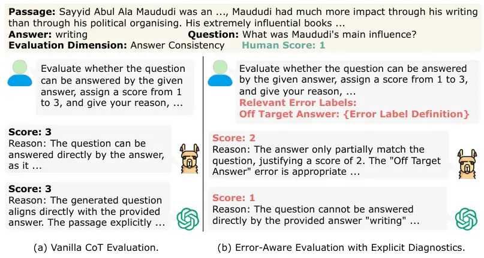
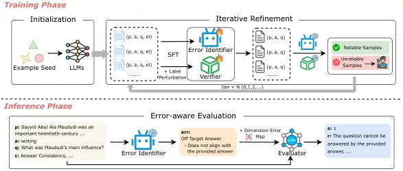

# ErrEval: Error-Aware Evaluation for Question Generation through Explicit Diagnostics

Weiping Fu Affiliation: School of Computer Science and Technology, Xi’an
Jiaotong University, Xi’an, China Affiliation: Shaanxi Province Key
Laboratory of Big Data Knowledge Engineering, Xi’an, China    Bifan Wei
Affiliation: School of Continuing Education, Xi’an Jiaotong University,
Xi’an, China Affiliation: Shaanxi Province Key Laboratory of Big Data
Knowledge Engineering, Xi’an, China    Jingyi Hao Affiliation: School of
Computer Science and Technology, Xi’an Jiaotong University, Xi’an, China
Affiliation: Shaanxi Province Key Laboratory of Big Data Knowledge
Engineering, Xi’an, China    Yushun Zhang Affiliation: School of
Computer Science and Technology, Xi’an Jiaotong University, Xi’an, China
Affiliation: Shaanxi Province Key Laboratory of Big Data Knowledge
Engineering, Xi’an, China    Jian Zhang Affiliation: School of Computer
Science and Technology, Xi’an Jiaotong University, Xi’an, China
Affiliation: Shaanxi Province Key Laboratory of Big Data Knowledge
Engineering, Xi’an, China    Jiaxin Wang Affiliation: Test center,
National University of Defense Technology, Xi’an, China    Bo Li
Affiliation: School of Computer Science and Technology, Xi’an Jiaotong
University, Xi’an, China Affiliation: Shaanxi Province Key Laboratory of
Big Data Knowledge Engineering, Xi’an, China    Yu He
Affiliation: School of Computer Science and Technology, Xi’an Jiaotong
University, Xi’an, China Affiliation: Shaanxi Province Key Laboratory of
Big Data Knowledge Engineering, Xi’an, China    Lingling Zhang
Affiliation: School of Computer Science and Technology, Xi’an Jiaotong
University, Xi’an, China Affiliation: Shaanxi Province Key Laboratory of
Big Data Knowledge Engineering, Xi’an, China    Jun Liu
Affiliation: School of Computer Science and Technology, Xi’an Jiaotong
University, Xi’an, China Affiliation: Shaanxi Province Key Laboratory of
Big Data Knowledge Engineering, Xi’an, China

###### Abstract

Automatic Question Generation (QG) often produces outputs with critical
defects, such as factual hallucinations and answer mismatches. However,
existing evaluation methods, including LLM-based evaluators, mainly
adopt a black-box and holistic paradigm without explicit error modeling,
leading to the neglect of such defects and overestimation of question
quality. To address this issue, we propose ErrEval, a flexible and
Error-aware Evaluation framework that enhances QG evaluation through
explicit error diagnostics. Specifically, ErrEval reformulates
evaluation as a two-stage process of error diagnosis followed by
informed scoring. At the first stage, a lightweight plug-and-play Error
Identifier detects and categorizes common errors across structural,
linguistic, and content-related aspects. These diagnostic signals are
then incorporated as explicit evidence to guide LLM evaluators toward
more fine-grained and grounded judgments. Extensive experiments on three
benchmarks demonstrate the effectiveness of ErrEval, showing that
incorporating explicit diagnostics improves alignment with human
judgments. Further analyses confirm that ErrEval effectively mitigates
the overestimation of low-quality questions ¹¹ 1 Codes and resources are
available at:
[https://github.com/WeipingFu/ErrEval](https://github.com/WeipingFu/ErrEval).

## 1 Introduction

Question Generation (QG) is a fundamental task in Natural Language
Generation (NLG) Guo et al. (2024), aiming to generate questions given a
context and often with a target answer. Reliable evaluation of generated
questions is essential for ensuring the quality of QG systems deployed
in downstream applications such as question answering Lyu et al. (2021),
dialogue systems Zeng et al. (2023), and educational assessments Ghanem
et al. (2022).

Traditional QG evaluation methods, including similarity-based metrics
(e.g., BLEU Papineni et al. (2002), BERTScore Zhang\* et al. (2020)) and
generation-based approaches (e.g., BARTScore Yuan et al. (2021),
GPTScore Fu et al. (2024a)), provide efficient but coarse assessments,
offering limited interpretability and weak support for fine-grained,
multi-dimensional evaluation. In response to these limitations, large
language models (LLMs), such as GPT-4 OpenAI (2023) and LLaMA Touvron et
al. (2023), have recently emerged as powerful evaluators that support
multi-dimensional evaluation, generate natural language explanations,
and exhibit improved alignment with human judgments Li et al. (2024);
Wang et al. (2024).



Figure 1: Comparison between vanilla CoT and error-aware evaluation
using LLMs, where the former overestimates a flawed question and the
latter aligns more closely with human judgment.

Despite these advancements, current LLM-based evaluators mainly follow a
black-box and holistic evaluation paradigm, which maps generated
questions directly to scalar ratings without modeling the underlying
errors that lead to low-quality outputs. As a result, questions with
critical defects are often overestimated. A natural way to address this
limitation is to introduce error modeling into the evaluation process,
which prior studies have shown to improve evaluation reliability Xu et
al. (2023). Following this insight, we explore augmenting LLM-based QG
evaluation with explicit error diagnostics. As illustrated in Figure 1,
LLM evaluators using a vanilla Chain-of-Thought (CoT) prompt Wei et al.
(2022) overrate a flawed question (a), but revise their scores toward
the human judgment when explicit error information is provided (b). To
substantiate this observation, we conduct a pilot study on 300 samples
from QGEval Fu et al. (2024b) and find that providing LLM evaluator with
human-labeled error information improves alignment with human judgments
by an average of 56.6% across evaluation dimensions (Figure 2). Taken
together, these findings indicate that explicit error modeling provides
a useful diagnostic perspective for QG evaluation, enabling more
fine-grained and calibrated judgments.

Figure 2: Pilot experiment - Pearson correlation coefficients (%)
between model scores and human scores. Flu.: Fluency; Clar.: Clarity;
Conc.: Conciseness; Rel.: Relevance; Cons.: Consistency; Ans.:
Answerability; AnsC.: Answer Consistency; Avg.: Average.

To this end, we propose an error-aware evaluation framework named
ErrEval that reformulates LLM-based QG evaluation by introducing
explicit error diagnostics as an intermediate step. Specifically, we
first design an error taxonomy which comprises 11 error types spanning
structural, linguistic, and content-related aspects (Table 1), inspired
by the Multidimensional Quality Metrics (MQM) framework in machine
translation Freitag et al. (2021). Each error type is aligned with the
evaluation dimensions it directly affects (Appendix A), enabling
principled use of error diagnostics during evaluation. Based on the
proposed error taxonomy, we develop a lightweight Error Identifier using
an iterative refinement strategy to support accurate error
identification. The predicted errors are finally converted into explicit
diagnostic signals and incorporated into the evaluation process, guiding
LLM evaluators to focus on dimension-relevant issues and produce more
accurate judgments.

We validate ErrEval through extensive experiments on three benchmarks
and four LLM evaluators, spanning different evaluation settings and
covering both open-source and closed-source models (Sec. 4.1). The
results show that ErrEval improves the alignment between model and human
judgments across various dimensions (Sec. 4.2). Further analyses
indicate that accurate error identification contributes to error-aware
evaluation and that incorporating explicit error diagnostics reduces the
tendency to overestimate low-quality questions (Sec. 4.3).

To summarize, our main contributions are threefold:

- •
  We propose ErrEval, an error-aware framework that enhances LLM-based
  evaluation through explicit error diagnosis. To the best of our
  knowledge, this is the first work to adopt such a diagnostic paradigm
  in the context of question generation.
- •
  To support error-aware evaluation in practice, we design an error
  taxonomy with 11 error types and develop a lightweight plug-and-play
  Error Identifier to provide diagnostic signals for LLM evaluators.
- •
  Extensive experiments on three benchmarks show that ErrEval
  consistently improves alignment with human judgments across different
  LLM evaluators and evaluation settings.



Figure 3: Framework of ErrEval. Given a passage ($`p`$), answer ($`a`$),
generated question ($`q`$), and evaluation criteria ($`c`$), ErrEval
performs evaluation with explicit error diagnostics. An iteratively
trained Error Identifier (EI) detects error types ($`el`$), which are
organized as diagnostic information ($`err`$) to guide
dimension-specific scoring by LLM evaluators. The EI functions as a
lightweight and plug-and-play module.

## 2 Problem Formulation

Our goal is to evaluate the quality of generated questions across
multiple dimensions (e.g., Answerability). We formalize the LLM-based
evaluation paradigm as a dimension-specific scoring function:

```math
(s,r)=F(p,a,q,c,err) \tag{1}
```

where $`F`$ is the evaluation function, $`p`$, $`a`$, and $`q`$
represent the source passage, the reference answer, and the generated
question, respectively. $`c`$ denotes the evaluation criteria (i.e., a
specific dimension with its scoring criteria). The optional input
$`err`$ provides error diagnosis information, which guides the evaluator
toward a more focused and interpretable assessment. The output includes
a score $`s`$ for the specific dimension and a reason $`r`$ that
explains why the scoring decision is made. The scoring scales vary
across evaluation settings (e.g., Likert-scale ratings, binary
classification).

In parallel, we formalize the error identification task as a multi-label
classification problem, as a single question may contain multiple types
of errors. Let $`\mathcal{L}=\{l_{1},l_{2},...,l_{K}\}`$ denote the
predefined set of $`K`$ error types, including a special label No Error.
Given a triplet $`(p,a,q)`$, the task is to predict which error types
apply to the generated question. The model learns a function:

```math
el=f(p,a,q) \tag{2}
```

where $`f`$ is a multi-label classifier parameterized by a neural
network, and $`el\in\{0,1\}^{K}`$ is a binary vector indicating the
presence (1) or absence (0) of each error type in $`\mathcal{L}`$.

These two components are tightly coupled in our proposed framework: the
predicted error types $`el`$ are used to form the diagnosis information
$`err`$ to guide evaluators for dimension-specific evaluation.

## 3 The ErrEval Framework

The overall framework of ErrEval is illustrated in Figure 3. It consists
of two main phases: a training phase for learning explicit error
diagnostics, and an inference phase for diagnosis-guided evaluation.
During the training phase, we iteratively train two components: an Error
Identifier (EI), which predicts error types in generated questions, and
a Verifier, which serves as a quality-control module to assess and
filter the EI’s predictions. A data filtering and refinement mechanism
is employed to progressively improve both the quality of the training
data and the performance of the two models. The training process
comprises two stages: initialization, where a small set of error-labeled
data is constructed using LLMs (Sec. 3.1), and iterative refinement,
where more diverse and realistic data are added through
model-in-the-loop expansion (Sec. 3.2).

In the inference phase, given a source passage, a target answer, a
generated question, and the evaluation criteria, the EI first identifies
potential error types in the question. The error types relevant to the
target evaluation dimension, together with their descriptions, are then
organized as diagnostic information and incorporated into the evaluation
process to condition an LLM-based evaluator for dimension-specific
scoring. Notably, the EI can be seamlessly paired with different LLM
evaluators, enabling ErrEval to function as a plug-and-play enhancement
rather than a model-specific solution.

Underlying this framework is a carefully designed error taxonomy that
defines 11 distinct error types across structural, linguistic, and
content-related aspects. This taxonomy serves as both the label space
for training the Error Identifier and the semantic bridge that links
error diagnostics to evaluation dimensions. We describe the taxonomy in
detail in Sec. 3.3.

|                 |                                      |                                                                                 |
| --------------- | ------------------------------------ | ------------------------------------------------------------------------------- |
| Category        | Error Type                           | Description                                                                     |
| Structural      | Incomplete (Inc)                     | Misses essential components, making the question unfinished.                    |
|                 | Not A Question (NAQ)                 | Lacks interrogative structure or is a statement rather than a question.         |
| Linguistic      | Spell Error (Spell)                  | Contains misspelled words affecting readability or clarity.                     |
|                 | Grammar Error (Gram)                 | Grammatical issues such as incorrect word order, tense, subject-verb agreement. |
|                 | Vague (Vag)                          | The question is unclear, overly broad, or ambiguous in meaning.                 |
|                 | Unnecessary Copy from Passage (Copy) | Overquotes or redundantly copies large portions of the passage.                 |
| Content-related | Off Topic (OTP)                      | The question is unrelated to the topic of the passage.                          |
|                 | Factual Error (Fact)                 | Includes incorrect facts that contradict the passage.                           |
|                 | Information Not Mentioned (INM)      | Asks for information not present in the passage.                                |
|                 | Off Target Answer (OTA)              | Does not align with the provided answer.                                        |
| –               | No Error (NoErr)                     | The question is clear, relevant, and answerable without any issues.             |

Table 1: Error types grouped by category, with their descriptions.

### 3.1 Initialization

We adopt an LLM-based error data synthesis process to construct an
initial labeled dataset for training the initial EI and Verifier.
Specifically, we leverage LLMs to generate questions exhibiting
predefined error types given a passage and a target answer. Few-shot
examples are used to encourage the generation of questions with the
desired error patterns. We apply a multi-model agreement filtering
strategy to ensure label reliability. Each generated question is
independently evaluated by three LLMs (GPT-4o, Claude-3.5, and
Gemini-2.0-pro), which assign confidence scores for the presence of the
target error types. A sample is retained only if at least two models
assign a confidence score of $`\geq 0.8`$. Through this process, we
obtain an initial dataset with error labels for each sample. For
training the Verifier, we construct negative examples via label
perturbation, by heuristically altering the original error labels to
simulate invalid annotations.

### 3.2 Iterative Refinement

To introduce more realistic and diverse error patterns, we construct an
unlabeled question pool by collecting outputs from multiple QG models,
including BART Lewis et al. (2020), T5 Raffel et al. (2020), and Flan-T5
Chung et al. (2024) of varying sizes. These models generate questions
from passages and answers sampled from SQuAD Rajpurkar et al. (2016) and
HotpotQA Yang et al. (2018). This unlabeled pool serves as the basis for
iterative refinement. In each iteration, the current EI and Verifier are
applied to the unlabeled question pool to predict and validate error
types. Their confidence scores are used to compute two selection
metrics, uncertainty and inconsistency:

```math
Uncertainty=1-|p_{e}-0.5| \tag{3}
```

```math
Inconsistency=|p_{e}-p_{v}| \tag{4}
```

where $`p_{e}`$ and $`p_{v}`$ denote the confidence scores from the EI
and Verifier, respectively. Based on these metrics, samples are
categorized into reliable and unreliable sets. Reliable samples
correspond to high confidence and verifier-consistent predictions, while
unreliable samples exhibit high uncertainty or high inconsistency. The
specific threshold values for uncertainty and inconsistency are
empirically chosen and reported in Appendix F.

At each iteration ($`iter\geq 1`$), a subset of reliable samples is
directly added to the training set, whereas a subset of unreliable
samples is manually verified before being used for further fine-tuning.
Typically, several hundred new examples are incorporated per iteration,
gradually expanding the training data with high-quality and diverse
samples.

|                          |                |               |               |               |               |                |                |               |
| ------------------------ | -------------- | ------------- | ------------- | ------------- | ------------- | -------------- | -------------- | ------------- |
| Method                   | Flu.           | Clar.         | Conc.         | Rel.          | Cons.         | Ans.           | AnsC.          | Avg.          |
| Similarity-based Methods |                |               |               |               |               |                |                |               |
| BLEU                     | 2.8            | 4.9           | 13.8          | 4.1           | 3.2           | 8.0            | 16.2           | 7.6           |
| Q-BLEU                   | 7.2            | 8.2           | 21.6          | 5.8           | 7.5           | 11.3           | 19.8           | 11.6          |
| BERTScore                | 14.0           | 12.3          | 31.3          | 11.3          | 9.1           | 13.1           | 23.1           | 16.3          |
| BLEURT                   | 7.8            | 10.5          | 17.9          | 10.4          | 9.8           | 14.4           | 27.1           | 14.0          |
| QSTS                     | 1.6            | 10.4          | 1.5           | 7.7           | 4.3           | 13.0           | 25.0           | 9.1           |
| Generation-based Methods |                |               |               |               |               |                |                |               |
| BARTScore                | 14.8           | 3.5           | 51.1          | 5.3           | 0.1           | 1.8            | 1.5            | 11.2          |
| GPTScore                 | 13.4           | 10.4          | 5.2           | 41.6          | 19.7          | 14.8           | 23.6           | 18.4          |
| UniEval                  | 37.0           | 21.9          | 25.9          | 15.3          | 15.6          | 20.7           | 35.6           | 24.6          |
| QRelScore                | 21.3           | 9.6           | 55.3          | 3.2           | 0.2           | 2.6            | 2.5            | 13.5          |
| RQUGE                    | 4.5            | 9.2           | 12.6          | 7.0           | 20.0          | 21.1           | 56.1           | 18.6          |
| LLM-based Methods        |                |               |               |               |               |                |                |               |
| JudgeLM                  | 29.9           | 29.7          | 49.8          | 16.5          | 14.3          | 21.8           | 16.6           | 25.5          |
| Prometheus 2             | 17.8           | 18.4          | 25.4          | 6.9           | 5.4           | 15.6           | 17.2           | 15.2          |
| INSTRUCTSCORE            | 20.0           | 16.2          | 41.4          | 5.0           | 11.0          | 16.6           | 13.5           | 17.7          |
| TIGERScore               | 19.9           | 18.3          | 18.4          | 4.1           | 9.7           | 18.0           | 13.1           | 14.5          |
| LLaMA-3 Vanilla CoT      | 27.1           | 24.6          | 51.1          | 15.3          | 16.0          | 20.8           | 11.9           | 23.8          |
| + ErrEval-base           | 38.5^((+11.4)) | 32.6^((+8.0)) | 57.6^((+6.5)) | 17.2^((+1.9)) | 18.3^((+2.3)) | 30.0^((+9.2))  | 26.4^((+14.5)) | 31.5^((+7.7)) |
| + ErrEval-large          | 36.7^((+9.6))  | 32.8^((+8.2)) | 56.4^((+5.3)) | 18.0^((+2.7)) | 18.8^((+2.8)) | 33.5^((+12.7)) | 27.6^((+15.7)) | 32.0^((+8.2)) |
| Qwen3 Vanilla CoT        | 33.4           | 30.2          | 46.2          | 24.3          | 29.7          | 37.2           | 37.5           | 34.1          |
| + ErrEval-base           | 35.0^((+1.6))  | 33.6^((+3.4)) | 54.3^((+8.1)) | 22.6^((-1.7)) | 30.1^((+0.4)) | 41.0^((+3.8))  | 39.9^((+2.4))  | 36.6^((+2.5)) |
| + ErrEval-large          | 37.6^((+4.2))  | 32.9^((+2.7)) | 54.3^((+8.1)) | 23.5^((-0.8)) | 31.0^((+1.3)) | 41.4^((+4.2))  | 41.3^((+3.8))  | 37.4^((+3.3)) |
| GPT-4o Vanilla CoT       | 34.2           | 26.8          | 48.6          | 14.2          | 23.9          | 32.5           | 51.2           | 33.1          |
| + ErrEval-base           | 34.7^((+0.5))  | 27.3^((+0.5)) | 51.8^((+3.2)) | 13.7^((-0.5)) | 27.0^((+3.1)) | 34.0^((+1.5))  | 52.1^((+0.9))  | 34.4^((+1.3)) |
| + ErrEval-large          | 35.5^((+1.3))  | 28.3^((+1.5)) | 52.5^((+3.9)) | 14.1^((-0.1)) | 25.5^((+1.6)) | 33.8^((+1.3))  | 52.8^((+1.6))  | 34.6^((+1.5)) |
| Claude-3.5 Vanilla CoT   | 42.2           | 29.5          | 52.3          | 22.2          | 29.9          | 39.8           | 43.2           | 37.0          |
| + ErrEval-base           | 42.2^((+0.0))  | 33.5^((+4.0)) | 57.4^((+5.1)) | 23.8^((+1.6)) | 30.7^((+0.8)) | 45.9^((+6.1))  | 52.6^((+9.4))  | 40.9^((+3.9)) |
| + ErrEval-large          | 42.8^((+0.6))  | 32.9^((+3.4)) | 56.8^((+4.5)) | 22.7^((+0.5)) | 31.8^((+1.9)) | 46.0^((+6.2))  | 53.3^((+10.1)) | 40.9^((+3.9)) |

Table 2: Pearson correlation coefficients (%) between automatic
evaluation methods and human scores on QGEval. For each evaluation
dimension, the best and second-best results are highlighted in bolded
and underlined, respectively. ErrEval-base/large: error-aware evaluation
using RoBERTa-base/RoBERTa-large Error Identifiers.

### 3.3 Error Taxonomy

To support error diagnosis of quality issues in generated questions, we
define a taxonomy consisting of eleven error types. Guided by prior
error analysis and commonly adopted evaluation dimensions which cover
both linguistic aspects (e.g., fluency, clarity) and task-oriented
aspects (e.g., consistency, answerability) Fu et al. (2024b), we
identify recurring error patterns and annotate questions with multiple
error types. We organize error types into a taxonomy with three
categories: (1) Structural errors, which concern the form, structure,
and completeness of a question. (2) Linguistic errors, related to
language use such as spelling, grammar, and expression. (3)
Content-related errors, which capture semantic misalignment among the
question, passage, and answer.

This taxonomy facilitates understanding of how different error types
correspond to specific evaluation dimensions. Structural and linguistic
errors primarily concern the form and expression of a question and may
affect both linguistic and task-oriented dimensions. For example,
incomplete questions impair both fluency and answerability. In contrast,
content-related errors reflect semantic misalignment between the
question, passage, and answer, and are associated with task-oriented
dimensions. For instance, factual errors can severely compromise both
consistency and answerability. Table 1 summarizes all error types and
their definitions, and Appendix A presents the full mapping between
error types and evaluation dimensions.

## 4 Experiment

### 4.1 Experimental Setup

#### Datasets and Metrics

We conduct experiments on three datasets: QGEval, SimQG Gollapalli and
Ng (2022), and SQuAD 2.0 Rajpurkar et al. (2018), all of which contain
human-annotated evaluation labels, providing a reliable reference for
assessing the quality and robustness of automatic evaluation methods.
Specifically, on QGEval and SimQG, we use the Pearson correlation
coefficient to measure the alignment between automatic evaluation scores
and human judgments. On SQuAD 2.0, we evaluate binary answerability
prediction on a subset of its original development set and report
classification metrics, including accuracy, macro precision, recall, and
F1 score.

#### Automatic Evaluation Methods

We compare our proposed method (error-aware evaluation) against multiple
automatic evaluation baselines, which are grouped into three main
categories: (1) Similarity-based methods, including BLEU, BERTScore,
BLEURT Sellam et al. (2020), Q-BLEU Nema and Khapra (2018), and QSTS
Gollapalli and Ng (2022). (2) Generation-based methods, such as
BARTScore, GPTScore, UniEval Zhong et al. (2022), QRelScore Wang et al.
(2022), and RQUGE Mohammadshahi et al. (2023). (3) LLM-based methods,
such as Vanilla CoT Prompt, JudgeLM Zhu et al. (2025), Prometheus 2 Kim
et al. (2024), INSTRUCTSCORE Xu et al. (2023), and TIGERScore Jiang et
al. (2023).

We evaluate both the vanilla CoT prompting approach and our error-aware
prompting variant using four LLMs as evaluators: LLaMA-3
(LLaMA-3-8B-Instruct), Qwen3 (Qwen3-8B), GPT-4o, and Claude-3.5
(Claude-3.5-haiku-20241022), covering both open-source and closed-source
models. For each model, the vanilla CoT prompt consists of a task
description, the target evaluation dimension, scoring criteria,
step-by-step evaluation guidance, and the input $`(p,a,q)`$ triple. Our
error-aware prompting variant extends the vanilla prompt by
incorporating explicit error information and making minor adjustments to
the evaluation steps, while keeping all other prompt components
unchanged. Prompt templates are provided in Appendix E.2.

#### Implementation Details

We train our models using RoBERTa Liu et al. (2019). The Error
Identifier uses both RoBERTa-base and RoBERTa-large to examine the
effect of model capacity, while the Verifier uses RoBERTa-base, which is
sufficient for validating EI predictions while maintaining training
efficiency. We conduct five training iterations (from Iteration 0 to
Iteration 4), as EI performance on the development set begins to degrade
at Iteration 4. We adopt the model checkpoint from Iteration 3 for all
downstream evaluations. All models are trained using standard
fine-tuning settings with early stopping based on development
performance. Detailed data splits and hyperparameters are provided in
Appendix F.

|                          |               |               |               |               |
| ------------------------ | ------------- | ------------- | ------------- | ------------- |
| Method                   | Flu.          | Rel.          | Ans.          | Avg.          |
| Similarity-based Methods |               |               |               |               |
| BLEU                     | 4.2           | 13.2          | 18.7          | 12.0          |
| Q-BLEU                   | 6.5           | 17.7          | 22.0          | 15.4          |
| BERTScore                | 19.1          | 17.8          | 27.0          | 21.3          |
| BLEURT                   | 22.8          | 20.1          | 32.0          | 25.0          |
| QSTS                     | 12.5          | 4.4           | 14.4          | 10.4          |
| Generation-based Methods |               |               |               |               |
| BARTScore                | 6.9           | 23.1          | 19.1          | 16.4          |
| GPTScore                 | 23.7          | 41.8          | 48.1          | 37.9          |
| UniEval                  | 50.3          | 32.2          | 44.6          | 42.4          |
| QRelScore                | 2.0           | 15.4          | 8.7           | 8.7           |
| RQUGE                    | 14.2          | 16.6          | 34.5          | 21.8          |
| LLM-based Methods        |               |               |               |               |
| JudgeLM                  | 43.7          | 35.0          | 42.5          | 40.4          |
| Prometheus 2             | 22.3          | 16.1          | 18.6          | 19.0          |
| INSTRUCTSCORE            | 35.6          | 14.5          | 34.1          | 28.1          |
| TIGERScore               | 21.9          | 19.2          | 27.9          | 23.0          |
| LLaMA-3 Vanilla CoT      | 37.8          | 36.8          | 53.7          | 42.8          |
| + ErrEval-base           | 38.3^((+0.5)) | 39.1^((+2.3)) | 55.2^((+1.5)) | 44.2^((+1.4)) |
| + ErrEval-large          | 38.9^((+1.1)) | 42.1^((+5.3)) | 57.4^((+3.7)) | 46.1^((+3.3)) |
| Qwen3 Vanilla CoT        | 45.8          | 53.8          | 67.7          | 55.8          |
| + ErrEval-base           | 45.6^((-0.2)) | 54.5^((+0.7)) | 67.8^((+0.1)) | 56.0^((+0.2)) |
| + ErrEval-large          | 49.1^((+3.3)) | 55.0^((+1.2)) | 68.2^((+0.5)) | 57.4^((+1.6)) |
| GPT-4o Vanilla CoT       | 39.0          | 46.7          | 60.3          | 48.7          |
| + ErrEval-base           | 39.4^((+0.4)) | 47.2^((+0.5)) | 62.8^((+2.5)) | 49.8^((+1.1)) |
| + ErrEval-large          | 41.3^((+2.3)) | 48.0^((+1.3)) | 63.0^((+2.7)) | 50.8^((+2.1)) |
| Claude-3.5 Vanilla CoT   | 41.6          | 54.2          | 66.6          | 54.1          |
| + ErrEval-base           | 46.2^((+4.6)) | 55.2^((+1.0)) | 69.9^((+3.3)) | 57.1^((+3.0)) |
| + ErrEval-large          | 44.5^((+2.9)) | 53.1^((-1.1)) | 70.7^((+4.1)) | 56.1^((+2.0)) |

Table 3: Pearson correlation coefficients (%) between automatic methods
and human scores on SimQG.

### 4.2 Main Results

We evaluate ErrEval on three benchmarks to examine its performance
across different evaluation settings and LLM evaluators.

#### ErrEval Improves Alignment with Human Judgments across LLM Evaluators

Table 2 and Table 3 report Pearson correlation coefficients between
automatic evaluation scores and human judgments. We find that ErrEval
achieves the best performance and improves correlation with human
judgments across all LLM evaluators on both benchmarks. On QGEval,
ErrEval-base improves the average Pearson correlation by 12.0% relative
to the vanilla CoT baseline across four LLM evaluators, while
ErrEval-large yields a larger average relative improvement of 13.2%. The
improvements are more pronounced on task-oriented dimensions such as
Answerability and Answer Consistency, with average relative gains of
17.3% and 20.3%, respectively. On SimQG, ErrEval-base and ErrEval-large
achieve average relative improvements of 2.8% and 4.5%, respectively,
over the vanilla CoT baseline across the four LLM evaluators, even when
baseline correlations are relatively high. Similar to the observations
on QGEval, larger gains are observed on task-oriented dimensions such as
Answerability.

#### Error Diagnostics Improve Answerability Classification

Table 4 reports binary answerability classification results on
SQuAD 2.0. Since most baselines are designed for score-based evaluation
and cannot be directly adapted to binary classification, we compare
ErrEval only with vanilla CoT prompting across four LLM evaluators. As
shown in the Table, ErrEval improves the evaluation performance relative
to the vanilla baseline across all evaluators. For example, with
LLaMA-3, ErrEval-large increases accuracy from 62.9% to 67.5%, while for
Qwen3, ErrEval-large achieves absolute gains of 6.4% in accuracy. These
results demonstrate that explicit error diagnostics help LLM evaluators
better distinguish answerable from unanswerable questions.

| Method                 | Acc           | $`\mathbf{P}_{\mathbf{M}}`$ | $`\mathbf{R}_{\mathbf{M}}`$ | $`\mathbf{F1}_{\mathbf{M}}`$ |
| ---------------------- | ------------- | --------------------------- | --------------------------- | ---------------------------- |
| LLaMA-3 Vanilla CoT    | 62.9          | 68.1                        | 66.4                        | 62.6                         |
| + ErrEval-base         | 65.7^((+2.8)) | 73.6^((+5.5))               | 70.0^((+3.6))               | 65.2^((+2.6))                |
| + ErrEval-large        | 67.5^((+4.6)) | 75.0^((+6.9))               | 71.6^((+5.2))               | 67.1^((+4.5))                |
| Qwen3 Vanilla CoT      | 74.4          | 74.9                        | 75.6                        | 74.3                         |
| + ErrEval-base         | 78.0^((+3.6)) | 78.1^((+3.2))               | 79.0^((+3.4))               | 77.9^((+3.6))                |
| + ErrEval-large        | 80.8^((+6.4)) | 80.4^((+5.5))               | 81.3^((+5.7))               | 80.6^((+6.3))                |
| GPT-4o Vanilla CoT     | 84.9          | 84.4                        | 84.7                        | 84.5                         |
| + ErrEval-base         | 85.8^((+0.9)) | 85.3^((+0.9))               | 85.4^((+0.7))               | 85.4^((+0.9))                |
| + ErrEval-large        | 86.3^((+1.4)) | 85.9^((+1.5))               | 85.8^((+1.1))               | 85.8^((+1.3))                |
| Claude-3.5 Vanilla CoT | 78.5          | 80.4                        | 80.7                        | 78.5                         |
| + ErrEval-base         | 80.0^((+1.5)) | 81.2^((+0.8))               | 81.9^((+1.2))               | 80.0^((+1.5))                |
| + ErrEval-large        | 80.4^((+1.9)) | 81.4^((+1.0))               | 82.2^((+1.5))               | 80.4^((+1.9))                |

Table 4: Results on SQuAD 2.0. Acc: Accuracy; $`P_{M}`$, $`R_{M}`$,
$`F1_{M}`$: Macro Precision, Recall, and F1.

### 4.3 Analysis

#### Iterative Refinement Enables More Accurate Error Identification

Table 5 reports the performance of different Error Identifiers on the
development set. We report multi-label classification metrics, including
Micro F1, Macro F1, and Weighted F1, together with Exact Match Rate
(EMR), which measures whether the predicted error set exactly matches
the gold annotations, and Over Prediction Rate (OPR), which quantifies
the proportion of predicted error labels not present in the ground
truth. A lower OPR indicates fewer fake error signals and a reduced risk
of interfering with downstream evaluation. The results compare Error
Identifiers with different backbone architectures and training
strategies. Supervised models yield higher performance than zero-shot
LLM prompting. Among fine-tuned models, RoBERTa and ModernBERT Warner et
al. (2024) achieve comparable performance and outperform LLaMA-3 with
LoRA adaptation. Building on this comparison, we further apply the
iterative refinement strategy to RoBERTa-based models. Compared to the
fine-tuned baseline, both RoBERTa-base and RoBERTa-large achieve further
improvements through iterative refinement, demonstrating the
effectiveness of the proposed training strategy (for a fair comparison,
both fine-tuned and iteratively refined models are trained using data up
to Iteration 3).

|                      |                              |                              |                              |      |                   |
| -------------------- | ---------------------------- | ---------------------------- | ---------------------------- | ---- | ----------------- |
| Error Identifier     | $`\mathbf{F1}_{\mathbf{m}}`$ | $`\mathbf{F1}_{\mathbf{M}}`$ | $`\mathbf{F1}_{\mathbf{w}}`$ | EMR  | OPR$`\downarrow`$ |
| Zero-shot Prompting  |                              |                              |                              |      |                   |
| LLaMA-3              | 26.1                         | 22.1                         | 33.4                         | 8.6  | 77.3              |
| GPT-4o               | 53.8                         | 48.7                         | 55.7                         | 38.6 | 47.6              |
| Fine-tuning          |                              |                              |                              |      |                   |
| LLaMA-3 (LoRA)       | 56.8                         | 45.3                         | 53.1                         | 53.6 | 40.7              |
| ModernBERT-base      | 61.9                         | 45.3                         | 53.0                         | 57.9 | 30.0              |
| ModernBERT-large     | 71.7                         | 54.5                         | 63.5                         | 64.3 | 21.1              |
| RoBERTa-base         | 62.7                         | 51.2                         | 56.9                         | 55.7 | 28.9              |
| RoBERTa-large        | 69.9                         | 63.2                         | 65.2                         | 66.4 | 25.7              |
| Iterative Refinement |                              |                              |                              |      |                   |
| RoBERTa-base         | 71.5                         | 63.5                         | 66.6                         | 67.9 | 25.0              |
| RoBERTa-large        | 81.2                         | 78.0                         | 77.9                         | 75.7 | 17.5              |

Table 5: The performance(%) of different EIs.
$`\mathbf{F1}_{\mathbf{m}}`$: Micro F1. $`\mathbf{F1}_{\mathbf{M}}`$:
Macro F1. $`\mathbf{F1}_{\mathbf{w}}`$: Weighted F1. EMR: Exact Match
Rate. OPR: Over Prediction Rate.

#### More Accurate Error Identification Leads to Better Evaluation Alignment

We analyze how evaluation performance varies across EI training
iterations to examine the relationship between error identification
accuracy and evaluation outcomes. Using LLaMA-3 as the evaluator, we
inject error information predicted by EI models (Roberta-large) from
different iterations and measure the average Pearson correlation between
evaluator scores and human judgments on the pilot set annotated from
QGEval (Figure 4). Without any error information, the vanilla method
achieves a baseline correlation of 29.3%. As EI training progresses from
Iteration 0 to Iteration 3, the evaluator–human correlation increases
steadily, reaching 46.2% at Iteration 3. For reference, providing
human-annotated error information yields a correlation of 50.4%, serving
as an upper bound in this analysis. At Iteration 4, both EI performance
and evaluation correlation exhibit a slight decrease. These observations
show that changes in EI accuracy are reflected in downstream evaluation
results, highlighting the role of error identification quality in
error-aware LLM-based evaluation.

#### Error-Aware Evaluation Reduces Overestimation of Low-Quality Questions

To investigate whether incorporating error information can mitigate the
overestimation of low-quality questions, we compare the vanilla CoT
method with our error-aware approach (ErrEval-large) using LLaMA-3 as
the evaluator on QGEval. Questions with a human score $`\leq 2`$ are
treated as low-quality, while those with a score of $`3`$ are considered
high-quality. We focus on the overestimation rate ($`OverR`$), defined
as the proportion of low-quality questions that are incorrectly assigned
a high score:

```math
OverR=\frac{Count((s_{h}\leq 2)\cap(s_{m}=3))}{Count(s_{h}\leq 2)} \tag{5}
```

Here, $`s_{h}`$ and $`s_{m}`$ denote the human score and model score,
respectively. As shown in Figure 5, the vanilla CoT method exhibits high
overestimation rates across evaluation dimensions, exceeding 80% on
several task-oriented dimensions, including consistency (83.1%),
answerability (83.7%), and answer consistency (93.5%). Incorporating
error diagnostics reduces overestimation, with ErrEval lowering these
rates to 75.4%, 71.7%, and 81.3%, respectively. These results indicate
that error-aware guidance helps evaluators better penalize quality
issues that are overlooked by vanilla prompting.

Figure 4: Effect of EI accuracy on evaluation result across training
iterations.

Figure 5: The overestimation rates of Vanilla Prompt method and
ErrEval-large.

## 5 Related Work

#### Automatic Evaluation Methods

Existing evaluation methods fall into three main types. Similarity-based
methods (e.g., Q-BLEU, QSTS) compare generated questions to references,
but fail to recognize valid yet dissimilar questions. Generation-based
methods (e.g., QRelScore) leverage pretrained language models to
evaluate question quality without relying on reference questions.
However, their output is typically a single aggregated score with
limited interpretability. Recent LLM-based methods (e.g., G-Eval Liu et
al. (2023), ChatEval Chan et al. (2023)) enhance evaluation by prompting
large language models to evaluate multiple quality dimensions and
provide explanations. However, most existing approaches rely on holistic
scoring and do not model the underlying error signals that lead to
low-quality questions, which can result in overestimation during
evaluation. Our work complements this line of research by introducing
explicit error diagnostics into the evaluation process, enabling more
grounded and interpretable LLM-based evaluation for QG.

#### Error Analysis and Diagnostics in NLG

Explicit error analysis has been explored in NLG evaluation as a means
to improve interpretability and reliability. The MQM framework
introduced a structured taxonomy of error types for machine translation,
providing a foundation for error-oriented evaluation. Recent work such
as InstructScore Xu et al. (2023) and TIGERScore Jiang et al. (2023)
further employs LLMs to identify specific error types across different
generation tasks. However, these approaches typically rely on large,
non-modular models and apply fixed scoring heuristics that limit
flexibility. In contrast, our method introduces a lightweight,
plug-and-play Error Identifier and leverages error diagnostics as
explicit evidence to guide downstream LLM evaluators, rather than
directly mapping errors to predefined score deductions. This design
enables flexible and error-aware evaluation while remaining compatible
with existing LLM-based evaluators.

## 6 Conclusion

In this work, we propose ErrEval, an error-aware evaluation framework
for question generation that augments LLM-based evaluation with explicit
error diagnostics to address the limitations of holistic and black-box
scoring. ErrEval introduces a diagnostic evaluation paradigm that
identifies error types in generated questions and relates them to
specific evaluation dimensions, enabling more interpretable and grounded
assessments. To support this framework, we define an error taxonomy with
11 error types covering structural, linguistic, and content-related
aspects. Based on this taxonomy, a lightweight Error Identifier is
developed via an iterative refinement strategy. The Error Identifier is
designed as a plug-and-play component that can be seamlessly integrated
into existing LLM-based evaluators, making the framework flexible and
easy to adopt. Extensive experiments on multiple benchmarks and LLM
evaluators demonstrate the effectiveness of ErrEval and show that it
reduces the tendency to overestimate low-quality questions.

## Limitations

ErrEval introduces an error-aware evaluation framework for question
generation by incorporating explicit error diagnostics into LLM-based
evaluation. Despite the advantages, it has several limitations: (1)
ErrEval is specifically designed for question generation, and extending
it to other generation tasks requires task-specific adaptation and
validation. Such extensions depend on the availability of appropriate
error taxonomy and task-relevant evaluation criteria, which limits the
direct applicability of ErrEval beyond QG evaluation. Future work may
leverage large language models to assist in the automatic construction
and validation of these components to reduce manual effort. (2) Error
diagnostic information is currently incorporated in a relatively simple
manner. Specifically, diagnostic signals are appended to the evaluation
prompt, without enforcing explicit constraints on how they should
influence the evaluator’s reasoning process. As a result, evaluators may
occasionally overlook these signals and retain their original judgments.
Future work could investigate mechanisms to more effectively leverage
error diagnostic information.

## References

- Chan et al. (2023) C. Chan, W. Chen, Y. Su, J. Yu, W. Xue, S.
  Zhang, J. Fu, and Z. Liu ChatEval: towards better llm-based evaluators
  through multi-agent debate. In International Conference on Learning
  Representations, External Links:
  [Link](https://openreview.net/forum?id=FQepisCUWu) Cited by: §5.
- Chung et al. (2024) H. W. Chung, L. Hou, S. Longpre, B. Zoph, Y.
  Tay, W. Fedus, Y. Li, X. Wang, M. Dehghani, S. Brahma, A.
  Webson, S. S. Gu, Z. Dai, M. Suzgun, X. Chen, A. Chowdhery, A.
  Castro-Ros, M. Pellat, K. Robinson, D. Valter, S. Narang, G.
  Mishra, A. Yu, V. Zhao, Y. Huang, A. Dai, H. Yu, S. Petrov, E. H.
  Chi, J. Dean, J. Devlin, A. Roberts, D. Zhou, Q. V. Le, and J. Wei
  Scaling instruction-finetuned language models. Journal of Machine
  Learning Research 25 (70), pp. 1–53. External Links:
  [Link](http://jmlr.org/papers/v25/23-0870.html) Cited by: §3.2.
- Freitag et al. (2021) M. Freitag, G. Foster, D. Grangier, V.
  Ratnakar, Q. Tan, and W. Macherey Experts, errors, and context: a
  large-scale study of human evaluation for machine translation.
  Transactions of the Association for Computational Linguistics 9,
  pp. 1460–1474. External Links:
  [Link](https://aclanthology.org/2021.tacl-1.87/),
  [Document](https://dx.doi.org/10.1162/tacl%5Fa%5F00437) Cited by: §1.
- Fu et al. (2024a) J. Fu, S. Ng, Z. Jiang, and P. Liu GPTScore:
  evaluate as you desire. In Proceedings of the 2024 Conference of the
  North American Chapter of the Association for Computational
  Linguistics: Human Language Technologies (Volume 1: Long Papers), K.
  Duh, H. Gomez, and S. Bethard (Eds.), pp. 6556–6576. External Links:
  [Link](https://aclanthology.org/2024.naacl-long.365/),
  [Document](https://dx.doi.org/10.18653/v1/2024.naacl-long.365) Cited
  by: 2nd item, §1.
- Fu et al. (2024b) W. Fu, B. Wei, J. Hu, Z. Cai, and J. Liu QGEval:
  benchmarking multi-dimensional evaluation for question generation. In
  Proceedings of the 2024 Conference on Empirical Methods in Natural
  Language Processing, Y. Al-Onaizan, M. Bansal, and Y. Chen (Eds.),
  pp. 11783–11803. External Links:
  [Link](https://aclanthology.org/2024.emnlp-main.658/),
  [Document](https://dx.doi.org/10.18653/v1/2024.emnlp-main.658) Cited
  by: 1st item, §1, §3.3.
- Ghanem et al. (2022) B. Ghanem, L. Lutz Coleman, J. Rivard Dexter, S.
  von der Ohe, and A. Fyshe Question generation for reading
  comprehension assessment by modeling how and what to ask. In Findings
  of the Association for Computational Linguistics: ACL 2022,
  pp. 2131–2146. Cited by: §1.
- Gollapalli and Ng (2022) S. D. Gollapalli and S. Ng QSTS: a
  question-sensitive text similarity measure for question generation. In
  Proceedings of the 29th International Conference on Computational
  Linguistics, Gyeongju, Republic of Korea, pp. 3835–3846. External
  Links: [Link](https://aclanthology.org/2022.coling-1.337) Cited by:
  2nd item, 5th item, §4.1, §4.1.
- Guo et al. (2024) S. Guo, L. Liao, C. Li, and T. Chua A survey on
  neural question generation: methods, applications, and prospects. In
  Proceedings of the Thirty-Third International Joint Conference on
  Artificial Intelligence, IJCAI-24, K. Larson (Ed.), pp. 8038–8047.
  Note: Survey Track External Links:
  [Document](https://dx.doi.org/10.24963/ijcai.2024/889),
  [Link](https://doi.org/10.24963/ijcai.2024/889) Cited by: §1.
- Jiang et al. (2023) D. Jiang, Y. Li, G. Zhang, W. Huang, B. Y. Lin,
  and W. Chen TIGERScore: towards building explainable metric for all
  text generation tasks. Transactions on Machine Learning Research.
  External Links:
  [Link](https://api.semanticscholar.org/CorpusID:263334281) Cited by:
  5th item, §4.1, §5.
- Kim et al. (2024) S. Kim, J. Suk, S. Longpre, B. Y. Lin, J. Shin, S.
  Welleck, G. Neubig, M. Lee, K. Lee, and M. Seo Prometheus 2: an open
  source language model specialized in evaluating other language models.
  In Proceedings of the 2024 Conference on Empirical Methods in Natural
  Language Processing, pp. 4334–4353. External Links:
  [Link](https://aclanthology.org/2024.emnlp-main.248/) Cited by: 3rd
  item, §4.1.
- Lewis et al. (2020) M. Lewis, Y. Liu, N. Goyal, M. Ghazvininejad, A.
  Mohamed, O. Levy, V. Stoyanov, and L. Zettlemoyer BART: denoising
  sequence-to-sequence pre-training for natural language generation,
  translation, and comprehension. In Proceedings of the 58th Annual
  Meeting of the Association for Computational Linguistics, Online,
  pp. 7871–7880. External Links:
  [Link](https://aclanthology.org/2020.acl-main.703),
  [Document](https://dx.doi.org/10.18653/v1/2020.acl-main.703) Cited by:
  §3.2.
- Li et al. (2024) Z. Li, X. Xu, T. Shen, C. Xu, J. Gu, Y. Lai, C. Tao,
  and S. Ma Leveraging large language models for NLG evaluation:
  advances and challenges. In Proceedings of the 2024 Conference on
  Empirical Methods in Natural Language Processing, Y. Al-Onaizan, M.
  Bansal, and Y. Chen (Eds.), Miami, Florida, USA, pp. 16028–16045.
  External Links: [Link](https://aclanthology.org/2024.emnlp-main.896/),
  [Document](https://dx.doi.org/10.18653/v1/2024.emnlp-main.896) Cited
  by: §1.
- Liu et al. (2023) Y. Liu, D. Iter, Y. Xu, S. Wang, R. Xu, and C. Zhu
  G-eval: NLG evaluation using gpt-4 with better human alignment. In
  Proceedings of the 2023 Conference on Empirical Methods in Natural
  Language Processing, H. Bouamor, J. Pino, and K. Bali (Eds.),
  Singapore, pp. 2511–2522. External Links:
  [Link](https://aclanthology.org/2023.emnlp-main.153/),
  [Document](https://dx.doi.org/10.18653/v1/2023.emnlp-main.153) Cited
  by: §5.
- Liu et al. (2019) Y. Liu, M. Ott, N. Goyal, J. Du, M. Joshi, D.
  Chen, O. Levy, M. Lewis, L. Zettlemoyer, and V. Stoyanov RoBERTa: a
  robustly optimized bert pretraining approach. External Links:
  1907.11692, [Link](https://arxiv.org/abs/1907.11692) Cited by: §4.1.
- Lyu et al. (2021) C. Lyu, L. Shang, Y. Graham, J. Foster, X. Jiang,
  and Q. Liu Improving unsupervised question answering via
  summarization-informed question generation. In Proceedings of the 2021
  Conference on Empirical Methods in Natural Language Processing, Online
  and Punta Cana, Dominican Republic, pp. 4134–4148. External Links:
  [Link](https://aclanthology.org/2021.emnlp-main.340),
  [Document](https://dx.doi.org/10.18653/v1/2021.emnlp-main.340) Cited
  by: §1.
- Mohammadshahi et al. (2023) A. Mohammadshahi, T. Scialom, M.
  Yazdani, P. Yanki, A. Fan, J. Henderson, and M. Saeidi RQUGE:
  reference-free metric for evaluating question generation by answering
  the question. In Findings of the Association for Computational
  Linguistics: ACL 2023, Toronto, Canada, pp. 6845–6867. External Links:
  [Link](https://aclanthology.org/2023.findings-acl.428),
  [Document](https://dx.doi.org/10.18653/v1/2023.findings-acl.428) Cited
  by: 5th item, §4.1.
- Nema and Khapra (2018) P. Nema and M. M. Khapra Towards a better
  metric for evaluating question generation systems. In Proceedings of
  the 2018 Conference on Empirical Methods in Natural Language
  Processing, Brussels, Belgium, pp. 3950–3959. External Links:
  [Link](https://aclanthology.org/D18-1429),
  [Document](https://dx.doi.org/10.18653/v1/D18-1429) Cited by: 4th
  item, §4.1.
- OpenAI (2023) OpenAI Gpt-4 technical report. arXiv preprint
  arXiv:2303.08774. Cited by: §1.
- Papineni et al. (2002) K. Papineni, S. Roukos, T. Ward, and W. Zhu
  BLEU: a method for automatic evaluation of machine translation. In
  Proceedings of the 40th Annual Meeting on Association for
  Computational Linguistics, ACL ’02, USA, pp. 311–318. External Links:
  [Link](https://doi.org/10.3115/1073083.1073135),
  [Document](https://dx.doi.org/10.3115/1073083.1073135) Cited by: 1st
  item, §1.
- Raffel et al. (2020) C. Raffel, N. Shazeer, A. Roberts, K. Lee, S.
  Narang, M. Matena, Y. Zhou, W. Li, and P. J. Liu Exploring the limits
  of transfer learning with a unified text-to-text transformer. Journal
  of Machine Learning Research 21 (140), pp. 1–67. External Links:
  [Link](http://jmlr.org/papers/v21/20-074.html) Cited by: §3.2.
- Rajpurkar et al. (2018) P. Rajpurkar, R. Jia, and P. Liang Know what
  you don’t know: unanswerable questions for SQuAD. In Proceedings of
  the 56th Annual Meeting of the Association for Computational
  Linguistics (Volume 2: Short Papers), I. Gurevych and Y. Miyao (Eds.),
  Melbourne, Australia, pp. 784–789. External Links:
  [Link](https://aclanthology.org/P18-2124/),
  [Document](https://dx.doi.org/10.18653/v1/P18-2124) Cited by: 3rd
  item, §4.1.
- Rajpurkar et al. (2016) P. Rajpurkar, J. Zhang, K. Lopyrev, and P.
  Liang SQuAD: 100,000+ questions for machine comprehension of text. In
  Proceedings of the 2016 Conference on Empirical Methods in Natural
  Language Processing, Austin, Texas, pp. 2383–2392. External Links:
  [Link](https://aclanthology.org/D16-1264),
  [Document](https://dx.doi.org/10.18653/v1/D16-1264) Cited by: §3.2.
- Sellam et al. (2020) T. Sellam, D. Das, and A. Parikh BLEURT: learning
  robust metrics for text generation. In Proceedings of the 58th Annual
  Meeting of the Association for Computational Linguistics, Online,
  pp. 7881–7892. External Links:
  [Link](https://aclanthology.org/2020.acl-main.704),
  [Document](https://dx.doi.org/10.18653/v1/2020.acl-main.704) Cited by:
  3rd item, §4.1.
- Touvron et al. (2023) H. Touvron, T. Lavril, G. Izacard, X.
  Martinet, M. Lachaux, T. Lacroix, B. Rozière, N. Goyal, E. Hambro, F.
  Azhar, et al. Llama: open and efficient foundation language models.
  arXiv preprint arXiv:2302.13971. Cited by: §1.
- Wang et al. (2024) D. Wang, K. Yang, H. Zhu, X. Yang, A. Cohen, L. Li,
  and Y. Tian Learning personalized alignment for evaluating open-ended
  text generation. In Proceedings of the 2024 Conference on Empirical
  Methods in Natural Language Processing, Y. Al-Onaizan, M. Bansal,
  and Y. Chen (Eds.), Miami, Florida, USA, pp. 13274–13292. External
  Links: [Link](https://aclanthology.org/2024.emnlp-main.737/),
  [Document](https://dx.doi.org/10.18653/v1/2024.emnlp-main.737) Cited
  by: §1.
- Wang et al. (2022) X. Wang, B. Liu, S. Tang, and L. Wu QRelScore:
  better evaluating generated questions with deeper understanding of
  context-aware relevance. In Proceedings of the 2022 Conference on
  Empirical Methods in Natural Language Processing, Abu Dhabi, United
  Arab Emirates, pp. 562–581. External Links:
  [Link](https://aclanthology.org/2022.emnlp-main.37),
  [Document](https://dx.doi.org/10.18653/v1/2022.emnlp-main.37) Cited
  by: 4th item, §4.1.
- Warner et al. (2024) B. Warner, A. Chaffin, B. Clavié, O. Weller, O.
  Hallström, S. Taghadouini, A. Gallagher, R. Biswas, F. Ladhak, T.
  Aarsen, N. Cooper, G. Adams, J. Howard, and I. Poli Smarter, better,
  faster, longer: a modern bidirectional encoder for fast, memory
  efficient, and long context finetuning and inference. External Links:
  2412.13663, [Link](https://arxiv.org/abs/2412.13663) Cited by: §4.3.
- Wei et al. (2022) J. Wei, X. Wang, D. Schuurmans, M. Bosma, F. Xia, E.
  Chi, Q. V. Le, D. Zhou, et al. Chain-of-thought prompting elicits
  reasoning in large language models. Advances in neural information
  processing systems 35, pp. 24824–24837. Cited by: 1st item, §1.
- Xu et al. (2023) W. Xu, D. Wang, L. Pan, Z. Song, M. Freitag, W. Wang,
  and L. Li INSTRUCTSCORE: towards explainable text generation
  evaluation with automatic feedback. In Proceedings of the 2023
  Conference on Empirical Methods in Natural Language Processing, H.
  Bouamor, J. Pino, and K. Bali (Eds.), Singapore, pp. 5967–5994.
  External Links: [Link](https://aclanthology.org/2023.emnlp-main.365/),
  [Document](https://dx.doi.org/10.18653/v1/2023.emnlp-main.365) Cited
  by: 4th item, §1, §4.1, §5.
- Yang et al. (2018) Z. Yang, P. Qi, S. Zhang, Y. Bengio, W. Cohen, R.
  Salakhutdinov, and C. D. Manning HotpotQA: a dataset for diverse,
  explainable multi-hop question answering. In Proceedings of the 2018
  Conference on Empirical Methods in Natural Language Processing,
  Brussels, Belgium, pp. 2369–2380. External Links:
  [Link](https://aclanthology.org/D18-1259),
  [Document](https://dx.doi.org/10.18653/v1/D18-1259) Cited by: §3.2.
- Yuan et al. (2021) W. Yuan, G. Neubig, and P. Liu BARTScore:
  evaluating generated text as text generation. In Advances in Neural
  Information Processing Systems, M. Ranzato, A. Beygelzimer, Y.
  Dauphin, P.S. Liang, and J. W. Vaughan (Eds.), Vol. 34,
  pp. 27263–27277. External Links:
  [Link](https://proceedings.neurips.cc/paper_files/paper/2021/file/e4d2b6e6fdeca3e60e0f1a62fee3d9dd-Paper.pdf)
  Cited by: 1st item, §1.
- Zeng et al. (2023) H. Zeng, B. Wei, J. Liu, and W. Fu Synthesize,
  prompt and transfer: zero-shot conversational question generation with
  pre-trained language model. In Proceedings of the 61st Annual Meeting
  of the Association for Computational Linguistics (Volume 1: Long
  Papers), Toronto, Canada, pp. 8989–9010. External Links:
  [Link](https://aclanthology.org/2023.acl-long.500),
  [Document](https://dx.doi.org/10.18653/v1/2023.acl-long.500) Cited by:
  §1.
- Zhang\* et al. (2020) T. Zhang\*, V. Kishore\*, F. Wu\*, K. Q.
  Weinberger, and Y. Artzi BERTScore: evaluating text generation with
  bert. In International Conference on Learning Representations,
  External Links: [Link](https://openreview.net/forum?id=SkeHuCVFDr)
  Cited by: 2nd item, §1.
- Zhong et al. (2022) M. Zhong, Y. Liu, D. Yin, Y. Mao, Y. Jiao, P.
  Liu, C. Zhu, H. Ji, and J. Han Towards a unified multi-dimensional
  evaluator for text generation. In Proceedings of the 2022 Conference
  on Empirical Methods in Natural Language Processing, Abu Dhabi, United
  Arab Emirates, pp. 2023–2038. External Links:
  [Link](https://aclanthology.org/2022.emnlp-main.131),
  [Document](https://dx.doi.org/10.18653/v1/2022.emnlp-main.131) Cited
  by: 3rd item, §4.1.
- Zhu et al. (2025) L. Zhu, X. Wang, and X. Wang JudgeLM: fine-tuned
  large language models are scalable judges. In The Thirteenth
  International Conference on Learning Representations, External Links:
  [Link](https://openreview.net/forum?id=xsELpEPn4A) Cited by: 2nd item,
  §4.1.

## Appendix A Error-Dimension Mapping

We design a comprehensive taxonomy of error types presented in generated
questions, and map them with different evaluation dimensions. The full
mappings between error types and common evaluation dimensions are shown
in Table 6. Specifically, we categorize errors into structural,
linguistic, and content-related types, which align naturally with these
dimensions in QG. For example, a structural error like incomplete
question formulation (e.g., “What is the cause of”) directly impacts the
Answerability dimension, as the question cannot be meaningfully
understood and answered. A linguistic error, such as grammatical
mistakes (e.g., “What does happened”) affects the fluency of the
question. A content-related error like Off Target Answer (e.g.,
generating “When did the war end?” when the given answer is a person’s
name) influences the Answer Consistency dimension.

## Appendix B Error Type Distribution

We conducted a pilot study by sampling 300 examples from the QGEval
dataset and manually annotating the errors present in each generated
question. Based on the annotations, we categorized the errors into 11
distinct types. The distribution of error types is illustrated in
Figure 8. Our analysis reveals that over 46.4% of the questions contain
at least one type of error, indicating that current QG models still have
room for improvement. Among all error types, the three most frequent are
Off Target Answer, Unnecessary Copy from Passage, and Information Not
Mentioned, accounting for 29.0%, 8.3%, and 6.3% of all errors,
respectively. These errors highlight the need for improved alignment
between the generated question, the target answer, and the source
passage, suggesting that current QG systems still struggle with reliable
answer grounding and faithful passage conditioning. It is worth noting
that these findings are based on a sample of 300 instances, which may
not fully capture the overall error distribution. Future work with
larger and more diverse labeled datasets is needed to draw more
generalizable conclusions.

| Dimension          | Mapped Error Types                                                                                                  |
| ------------------ | ------------------------------------------------------------------------------------------------------------------- |
| Fluency            | Incomplete, Spell Error, Grammar Error, No Error                                                                    |
| Clarity            | Incomplete, Not A Question, Grammar Error, Vague, No Error                                                          |
| Conciseness        | Unnecessary Copy from Passage, No Error                                                                             |
| Relevance          | Off Topic, No Error                                                                                                 |
| Consistency        | Off Topic, Factual Error, Information Not Mentioned, No Error                                                       |
| Answerability      | Incomplete, Not A Question, Vague, Off Topic, Factual Error, Information Not Mentioned, No Error                    |
| Answer Consistency | Incomplete, Not A Question, Vague, Off Topic, Factual Error, Information Not Mentioned, Off Target Answer, No Error |

Table 6: Mapping between error types and evaluation dimensions.

## Appendix C Datasets

The datasets we use for experiment are described as follows:

- •
  QGEval Fu et al. (2024b): A recent meta-evaluation benchmark
  specifically designed for assessing automatic metrics in question
  generation. It consists of 3,000 (passage, question, answer) triples,
  each annotated with human ratings across seven evaluation dimensions.
- •
  SimQG Gollapalli and Ng (2022): A benchmark designed to evaluate
  question quality, with human annotations across three evaluation
  dimensions.
- •
  SQuAD 2.0 Rajpurkar et al. (2018): A reading comprehension dataset
  containing both answerable and unanswerable questions, enabling
  evaluation of the answerability dimension in question generation. For
  computational efficiency, we randomly sample 1,000 examples from the
  original development set for evaluation. The sampling is performed
  once and kept fixed across all methods to ensure fair comparison.

## Appendix D Baselines

We provide detailed descriptions of the baseline metrics used in our
evaluation, categorized into three major groups: similarity-based,
generation-based, and LLM-based metrics.

#### Similarity-based Methods

Methods that evaluate the quality of generated questions by measuring
their lexical or semantic similarity to reference questions, including:

- •
  BLEU Papineni et al. (2002): a precision-based n-gram overlap metric
  originally designed for machine translation. Here, we use the 4-gram
  variant of BLEU.
- •
  BERTScore Zhang\* et al. (2020): computes similarity using contextual
  embeddings from a pre-trained BERT model.
- •
  BLEURT Sellam et al. (2020): a learned evaluation method that
  fine-tunes BERT on human judgments to predict sentence-level quality.
- •
  Q-BLEU Nema and Khapra (2018): a variant of BLEU designed specifically
  for question generation, with lower penalties for variations in
  question words. We use the 4-gram variant as in BLEU.
- •
  QSTS Gollapalli and Ng (2022): measures semantic similarity between
  generated and reference questions by using the question types,
  entities, and semantic features of them.

#### Generation-based Methods

Methods that evaluate question quality by estimating the likelihood or
plausibility of the generated question using pre-trained language
models, including:

- •
  BARTScore Yuan et al. (2021): uses a BART model to compute the
  log-likelihood of a target output conditioned on the source. We adopt
  the source-hypothesis scoring type to evaluate generated questions
  conditioned on the input passage and answer.
- •
  GPTScore Fu et al. (2024a) similar to BARTScore, but utilizes
  GPT-based models to evaluate generation likelihood. We likewise use
  the source hypothesis scoring type to compute the likelihood of
  generated questions given the source.
- •
  UniEval Zhong et al. (2022): A unified framework for evaluating
  multiple dimensions (e.g., relevance, consistency, fluency), using a
  shared encoder-decoder model trained with supervision.
- •
  QRelScore Wang et al. (2022): a task-specific metric for QG, which is
  designed for evaluating the relevance of generated questions to a
  given passage.
- •
  RQUGE Mohammadshahi et al. (2023): a reference-free metric designed to
  evaluate question’s answerability that scores based on the QA model’s
  ability to generate an answer to the target question.

#### LLM-based Methods

Methods that utilize the reasoning capabilities of large language models
(LLMs) to perform fine-grained, dimension-wise assessment of question
quality, including:

- •
  Vanilla CoT Prompt Wei et al. (2022): A method that utilizes large
  language models to perform step-by-step evaluation through
  chain-of-thought instructions.
- •
  JudgeLM Zhu et al. (2025): A fine-tuned LLM judge trained on
  large-scale GPT-4-generated annotations, designed for efficient and
  scalable evaluation in open-ended generation tasks.
- •
  Prometheus 2 Kim et al. (2024): An open-source LLM evaluator that
  supports both direct assessment and pairwise ranking under
  customizable evaluation criteria, achieving human-aligned judgments
  across diverse tasks.
- •
  INSTRUCTSCORE Xu et al. (2023): An explainable evaluation metric that
  integrates instruction-following and error analysis to produce both
  quality scores and diagnostic reports for generated text.
- •
  TIGERScore Jiang et al. (2023): A reference-free, instruction-guided
  evaluation metric capable of generating fine-grained error analyses
  and interpretable diagnostic feedback across text generation tasks.

## Appendix E Prompt Templates

### E.1 Prompts for Initialization

We adopt a one-shot prompting strategy, as illustrated in Figure 6, to
guide GPT-4o in generating questions containing specific error types.
Each prompt includes a single example consisting of a passage, an
answer, a question, and the associated error labels, sampled from a pool
of 20 manually annotated seed examples. To ensure the quality of the
generated data, we further apply a filtering prompt (Figure 7) to filter
out low-quality outputs.

Figure 6: Prompt template used for error simulation in initialization.

Figure 7: Prompt template used for filtering data in initialization.

### E.2 Prompts for LLM-based Evaluation

We use the prompt templates illustrated in Figure 10 to guide LLMs in
evaluating a generated question along specific dimensions. As shown in
the figure, we design two types of prompts: a vanilla CoT prompt (left)
and an error-aware prompt (right). Both templates share four components:
the Dimension Name slot, which specifies the evaluation dimension (e.g.,
Answer Consistency), the Dimension Definition slot, which defines the
dimension in abstract terms (e.g., "Whether the question aligns with the
provided answer."), the Criterion for assigning score x slots, which
specify the criteria corresponding to each score level for the target
dimension (e.g., "Score 1: The question cannot be answered by the
provided answer."), and the Dimension Evaluation Requirement defines the
evaluation criterion for each dimension, specifying what aspect of the
question should be examined (e.g., "Evaluate whether the generated
question aligns with the provided answer and determine if the answer
fully, partially, or fails to address it").

In the error-aware prompt, we additionally include a new component: the
error types and their definitions slot. This slot allows us to inject
fine-grained errors detected by the Error Identifier (EI), such as "Off
Target Answer: Does not align with the provided answer." The error
information helps the LLM focus on dimension-relevant issues, thereby
producing more precise and interpretable evaluation results.

Figure 8: The distribution of eleven error types.

## Appendix F Implementation Details

The Error Identifier is trained using an iterative data construction
strategy. At Iteration 0, the training set consists of an initial set of
1800 labeled samples generated and filtered as described in Section 3.1.
In subsequent iterations, the size of the training data gradually
increases by incorporating high-confidence samples automatically
filtered by the current EI and Verifier, along with a small number of
low-confidence samples that are manually verified. As a result, the
training set grows up to 3870 samples at Iteration 4. We observe that EI
performance on the development set begins to degrade at Iteration 4, and
therefore adopt the model checkpoint from Iteration 3 for all downstream
evaluations. The development set is constructed by randomly sampling 140
generated questions from the outputs of multiple QG models. These
samples are manually annotated with error types following our error
taxonomy and are used consistently across all iterations for model
selection and early stopping.

All models are implemented using the Hugging Face Transformers framework
and trained on a single NVIDIA A800 GPU. We set the maximum input length
to 512 tokens and use a learning rate of 2e-5. For RoBERTa-base, we use
a batch size of 32, while for RoBERTa-large, we use a batch size of 16.
The maximum number of training epochs is set to 20, with early stopping
enabled. The best model checkpoint is selected based on the highest
Micro-F1 (for EI) or F1 (for Verifier) score on the development set.

For open-source LLMs, we download their model files from Hugging Face
and implement them using the Transformers library. For closed-source
LLMs, we interact with them via their official APIs. Evaluation results
are generated using a maximum of 256 new tokens and the default decoding
settings.

## Appendix G More Experimental Results

### G.1 Performance of Error Identifier Across Iterations

We compare the performance of the Error Identifier (EI) across different
training iterations to examine the effect of the iterative training
strategy. As shown in Table 7, the performance of EI improves steadily
over the first three iterations. This improvement suggests that
incorporating high-confidence samples filtered by the EI and verifier,
together with a small number of manually verified low-confidence
samples, provides useful supervision for refining error identification.
At iteration 4, we observe a performance drop. This decline may indicate
a saturation point of the iterative process or mild overfitting caused
by the accumulation of noisy or less informative samples. These results
suggest that while iterative training is effective in early stages,
controlling data quality and determining an appropriate stopping point
are important for maintaining performance gains.

| EI    | Iteration | $`\mathbf{F1}_{\mathbf{m}}`$ | $`\mathbf{F1}_{\mathbf{M}}`$ | $`\mathbf{F1}_{\mathbf{w}}`$ | EMR  | OPR  |
| ----- | --------- | ---------------------------- | ---------------------------- | ---------------------------- | ---- | ---- |
| Base  | Iter 0    | 57.7                         | 63.0                         | 57.8                         | 52.1 | 37.6 |
|       | Iter 1    | 64.9                         | 64.7                         | 62.4                         | 57.1 | 28.6 |
|       | Iter 2    | 69.4                         | 62.7                         | 64.9                         | 65.7 | 28.9 |
|       | Iter 3    | 71.5                         | 63.5                         | 66.6                         | 67.9 | 25.0 |
|       | Iter 4    | 68.2                         | 65.2                         | 64.9                         | 64.3 | 28.9 |
| Large | Iter 0    | 67.9                         | 65.6                         | 65.4                         | 64.3 | 29.3 |
|       | Iter 1    | 72.9                         | 69.9                         | 69.5                         | 69.3 | 24.6 |
|       | Iter 2    | 72.1                         | 68.3                         | 68.9                         | 65.7 | 21.8 |
|       | Iter 3    | 81.2                         | 78.0                         | 77.9                         | 75.7 | 17.5 |
|       | Iter 4    | 75.6                         | 71.8                         | 72.2                         | 70.7 | 22.5 |

Table 7: Performances of EI across iterations. The best score of each
metric within each model group (i.e., Base and Large) is bolded. Base:
Roberta-base. Large: Roberta-large.

| Iteration | Accuracy | Precision | Recall | F1   |
| --------- | -------- | --------- | ------ | ---- |
| Iter 0    | 76.9     | 76.1      | 78.5   | 77.3 |
| Iter 1    | 80.8     | 80.3      | 81.5   | 80.9 |
| Iter 2    | 86.9     | 86.4      | 87.7   | 87.0 |
| Iter 3    | 87.7     | 90.2      | 84.6   | 87.3 |
| Iter 4    | 86.2     | 85.1      | 87.7   | 86.4 |

Table 8: The Performance(%) of Verifier at each iteration. The highest
score of each metric is bolded.

### G.2 Performance of Verifier

We evaluate the Verifier using standard classification metrics on the
development set. As shown in Table 8, the Verifier achieves a strong F1
of 77.3% even at Iteration 0, much higher than the EI at the same
iteration. This indicates that verifying predicted errors is easier than
identifying them, and highlights the Verifier’s role in filtering
training data. The Verifier’s steady improvement over the first four
iterations further validates the effectiveness of our iterative
refinement strategy.

### G.3 Interference Analysis under Error-Aware Evaluation

To examine whether incorporating error diagnostics interferes with
evaluations that are already correct, we restrict the analysis to
samples that are correctly judged by the vanilla LLM evaluator on
QGEval. Since the LLM evaluator outputs discrete ratings on a
three-point scale (1/2/3), we map the original human annotations into
three corresponding levels and identify vanilla-correct samples
accordingly. We then analyze how their predicted scores change after
applying ErrEval. Figure 9 shows the distribution of score changes,
measured as $`\Delta=\text{ErrEval}-\text{Vanilla}`$, on this subset. We
observe that the vast majority of samples (97.58%) remain unchanged
after incorporating error diagnostics ($`\Delta=0`$). Only a small
fraction of samples exhibit changes, with 1.46% and 0.50% shifting by
$`-1`$ and $`-2`$, respectively, and 0.46% shifting by $`+1`$. No
samples exhibit a change of $`+2`$. These results indicate that ErrEval
introduces limited interference to evaluations that are already correct.

Figure 9: Distribution of score changes
($`\Delta=\text{ErrEval}-\text{Vanilla}`$) on vanilla-correct samples.

## Appendix H Case Study

To better understand how error-aware evaluation influences scoring
decisions, we present four representative cases illustrating how the
Error Identifier (EI) interacts with the evaluator. These cases
highlight both the benefits and risks of incorporating error information
into LLM-based evaluation. In these cases, we all use LLaMA-3 as the
evaluator.

### H.1 When EI Helps Evaluation Accuracy

#### Case 1: EI Correctly Identifying Subtle Errors.

In this case, our goal is to evaluate the Answerability dimension of the
generated question, and it contains an Information Not Mentioned error
(see Figure 11). The EI successfully detects the error type, which is
then injected into the prompt of the evaluator. Compared to the vanilla
strategy, the error-aware strategy guides the evaluator to assign a
lower and more accurate score that aligns with human judgment. The error
signal helps the evaluator avoid overestimating the question quality.

#### Case 2: EI Correctly Identifying No Error.

In this case, the generated question is fluent, complete, and
well-aligned with both the passage and the answer. However, when using
the vanilla prompt, the LLM assigns a relatively low score of 1,
mistakenly assuming the question does not align with the given answer.
In contrast, EI correctly identifies the question as No Error, which
guides the evaluator to assign a score of 3 (see Figure 12). This
example highlights the importance of correctly identifying the absence
of errors: when the question is of good quality, explicitly indicating
No Error helps the evaluator avoid over-penalization.

### H.2 When EI Introduces Noise

#### Case 3: Evaluator Ignores Incorrect Error Prediction.

As shown in Figure 13, in this example, EI mistakenly predicts an error
(Off Target Answer), although the question is valid and aligns with the
answer. We inject the error information into the prompt and find that
the evaluator seems robust against this false signal and maintains a
high score close to human judgment, showing that the LLM does not
blindly follow the EI model when evidence is lacking.

#### Case 4: Evaluator Misled by EI.

In the final case (Figure 14), EI wrongly identifies a Factual Error in
a well-formed question. The evaluator in the error-aware setting is
misled by the input, resulting in an unjustified penalty on Consistency.
This case illustrates the potential downside of relying on inaccurate EI
predictions.

Figure 10: Prompt templates used for LLM-based evaluation.

Figure 11: Case 1: a case of EI correctly identifying errors and guiding
the evaluator to assign an accurate score.

Figure 12: Case 2: a case of EI correctly identifying No Error and
guiding the evaluator to assign an accurate score.

Figure 13: Case 3: a case where EI incorrectly identifies an error, but
the evaluator disregards it and assigns an accurate score.

Figure 14: Case 4: a case where EI incorrectly identifies an error, and
the evaluator follows it and assigns an inaccurate score.
