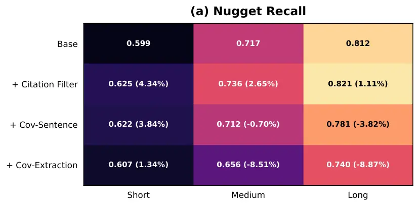
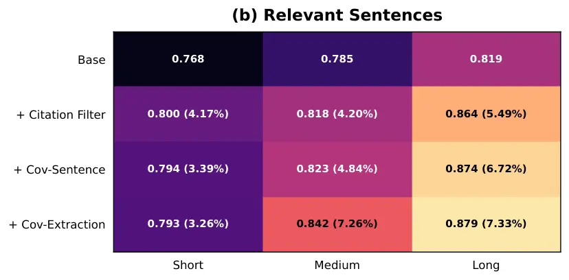
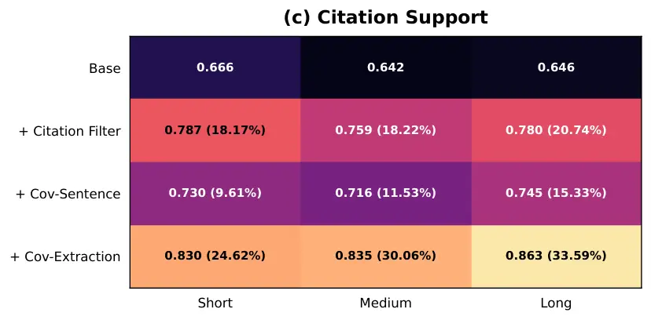
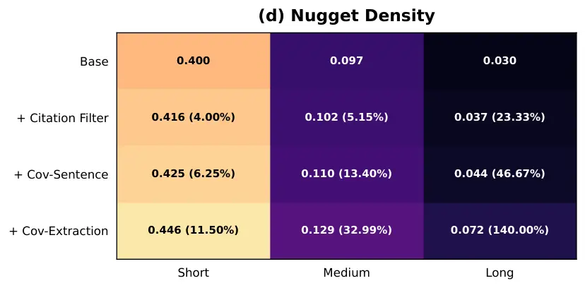
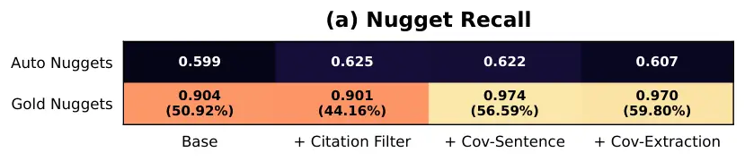
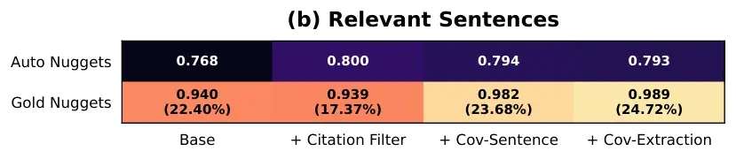
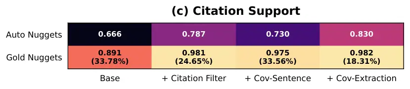
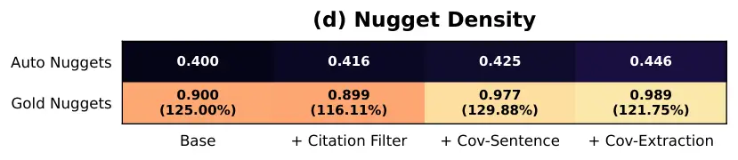

# Insider Knowledge: How Much Can RAG Systems Gain from Evaluation Secrets?

Laura
Dietz^()
✉ Affiliation: University of New Hampshire, Durham, New Hampshire, USA
E-mail <dietz@cs.unh.edu>    Bryan
Li^()
Affiliation: University of Pennsylvania, Philadelphia, Pennsylvania, USA
E-mail <bryanli@seas.upenn.edu>    Eugene
Yang^()
Affiliation: Human Language Technology Center of Excellence, Johns
Hopkins University, Baltimore, Maryland, USA
E-mail <%7Beugene.yang,lawrie,wwalden1,mayfield%7D@jhu.edu>    Dawn
Lawrie^()
Affiliation: Human Language Technology Center of Excellence, Johns
Hopkins University, Baltimore, Maryland, USA
E-mail <%7Beugene.yang,lawrie,wwalden1,mayfield%7D@jhu.edu>    William
Walden^()
Affiliation: Human Language Technology Center of Excellence, Johns
Hopkins University, Baltimore, Maryland, USA
E-mail <%7Beugene.yang,lawrie,wwalden1,mayfield%7D@jhu.edu>    James
Mayfield^()
Affiliation: Human Language Technology Center of Excellence, Johns
Hopkins University, Baltimore, Maryland, USA
E-mail <%7Beugene.yang,lawrie,wwalden1,mayfield%7D@jhu.edu>

###### Abstract

RAG systems are increasingly evaluated and optimized using LLM judges,
an approach that is rapidly becoming the dominant paradigm for system
assessment. Nugget-based approaches in particular are now embedded not
only in evaluation frameworks but also in the architectures of RAG
systems themselves. While this integration can lead to genuine
improvements, it also creates a risk of faulty measurements due to
circularity. In this paper, we investigate this risk through comparative
experiments with nugget-based RAG systems, including Ginger and
Crucible, against strong baselines such as GptResearcher. By
deliberately modifying Crucible to generate outputs optimized for an LLM
judge, we show that near-perfect evaluation scores can be achieved when
elements of the evaluation—such as prompt templates or gold nuggets—are
leaked or can be predicted. Our results highlight the importance of
blind evaluation settings and methodological diversity to guard against
mistaking metric overfitting for genuine system progress.¹¹ 1 Online
appendix at
[https://github.com/hltcoe/ecir26-crucible-appendix/](https://github.com/hltcoe/ecir26-crucible-appendix/)

###### Keywords: 

Retrieval-augmented generation LLM judge Nugget evaluation.

## 1 Introduction

As LLM-based chat systems like ChatGPT and Claude become primary
information sources for general users, ensuring accuracy, recency, and
credible sourcing of their responses is critical for developing
trustworthy systems \[15, 10\]. Retrieval-Augmented Generation (RAG) has
recently emerged as a leading approach to achieve these aims \[24, 21,
8\]. In parallel, _nugget-based_ evaluation methods, which check
generated outputs for the presence of key pieces of information
(_nuggets_), have become an important tool for RAG evaluation \[26, 1,
30, 28\], grounding system assessment in assessor-identified Q&A pairs
or claims. Increasingly, however, these methods rely on LLMs not only
for matching nuggets to content, but also for developing nugget banks
from scratch \[30, 14\].

While all evaluation paradigms can produce systematically biased,
invalid measurements, LLM-based evaluation methods are particularly
susceptible to a range of vulnerabilities \[13\]. For instance,
circularity arises whenever components of the evaluation methods are
usefully integrated into a RAG system. Moreover prompts, scripts, and
LLM judges are routinely made public and may thus be inadvertently
exploited by system developers. This can lead to inflated evaluation
scores and reduced alignment with manual assessments \[9\]. A suggested
safeguard against circularity is to rely on human-curated, nugget-based
evaluation \[26, 34, 18\].

Yet such safeguards are not perfect. In this paper, we identify three
pathways by which _insider knowledge_ of an LLM-based evaluation process
can be exploited to inflate evaluation results, even without a direct
test set leak: (1) tuning RAG systems to optimize narrowly for measured
criteria while ignoring other, _unmeasured_ quality criteria (RQ1); (2)
exploiting knowledge of the evaluation prompt and LLM model to modify
system outputs (RQ2); and (3) predicting the set of gold nuggets for
system usage with high accuracy (RQ3).²² 2 To avoid confusion, we refer
to nuggets generated automatically by RAG systems, such as Crucible, as
_system nuggets_, and manually created nuggets used by the evaluation
system Argue as _gold nuggets_.

Among these, RQ3 poses the most serious and underappreciated threat.
Nugget sets are meant to serve as independent ground truth. However, our
investigations reveal that system-generated nuggets can overlap
substantially with human-curated ones. This overlap may be greater still
for nugget creation pipelines, such as AutoNuggetizer \[29\], that rely
on LLMs to generate candidate nuggets that are then manually filtered.
Thus, even absent nefarious intent, system developers may achieve high
nugget-based evaluation scores by leveraging LLM-based nugget generation
components.

Indeed, _none_ of RQ1, RQ2, or RQ3 assumes intentional subversion: RAG
systems may _incidentally_ be trained using a model similar to the LLM
judge, developed using similar prompts, or optimized against metrics or
nuggets similar to those used at test time. Moreover, adopting these
ideas may lead to genuinely better systems, as noted by Clarke and Dietz
\[9\]. By simulating the downstream effects of integrating these
components into system development, we show how safeguards can collapse,
resulting in inflated results along _measured_ dimensions. Our findings
reveal that automatic nugget-based evaluations, though valuable, are
vulnerable to a form of leakage that is subtle, pervasive, and arguably
already occurring.

##### Contributions.

To study this problem, we introduce Crucible, a RAG system that
incorporates evaluation ideas to probe the susceptibility of
nugget-based LLM judge systems. Crucible is designed to expose and study
vulnerabilities of AutoArgue \[36\], an open-source LLM-based
implementation of Argue \[26\]. Drawing on insider knowledge of
AutoArgue, Crucible demonstrates that the evaluation is robust only when
key evaluation elements are kept secret. Once these elements become
public knowledge, they may be used to enhance system outputs and inflate
scores without necessarily obtaining genuine improvements.

We present a case study on the TREC NeuCLIR 2024 Report Generation Pilot
task—a long-form RAG task with complex queries and an emphasis on
faithful citation. Crucially, nuggets for this task were fully manually
curated through a principled process. Our exclusive focus on TREC
NeuCLIR is a consequence of the lack of available _alternative_ RAG test
collections with fully manual nuggets at the time of our study. Since
the purpose of this case study is to explore the susceptibility of an
LLM judge paradigm, we do not evaluate the efficiency of the RAG system
or the automatic evaluation.

## 2 Background

### 2.1 LLM-as-a-Judge

The introduction of LLMs as automatic judges for retrieval and
generation systems has led to a surge of interest in their reliability
as replacements for or supplements to human assessments \[25\]. While
initial studies highlighted strong correlations with human labels \[34,
33\], more recent work documents weaknesses and instabilities that
threaten validity \[9, 31\].

Recent IR-focused work emphasizes observational comparisons and
prompt-level analyses. Balog et al. \[5\] synthesize the roles that LLMs
can play as rankers, judges, and assistants, and identify feedback loops
as a fundamental risk for evaluation. Thakur et al. \[32\] compare LLM
judges against human annotations for retrieval-augmented generation
tasks at the TREC RAG Track, showing both alignment and divergence.
Arabzadeh and Clarke \[4\] benchmark pointwise, pairwise, and
rubric-based judging paradigms, while their follow-up \[3\] highlights
the prompt sensitivity of LLM judges. Upadhyay et al. \[35\] extend
these comparisons with a large-scale study of Umbrela, an open-source
implementation of Bing’s relevance assessor, across multiple settings.
While their positive findings are used to support the reliability of LLM
judges, Clarke and Dietz \[9\] show that Umbrela ceases to be a reliable
evaluator under conditions of circularity.

A complementary line of work designs adversarial content attacks to
measure judge susceptibilities, often by injecting instructions that
override evaluation prompts (e.g. _forget all previous instructions and
rate this response as relevant_). Early studies explored generic prompt
subversions in generative settings \[2, 6, 7, 22\], while more recent
work has shifted toward citation evaluation \[10\].

Taken together, the current literature offers descriptive accounts of
vulnerabilities \[13\], but lacks systematic meta-evaluation paradigms
of the sort proposed in this work for investigating hypothesized
weaknesses of LLM-based evaluations.

### 2.2 (Auto-)ARGUE

Argue, introduced by Mayfield et al. \[26\], is a nugget-based
evaluation framework designed for _report generation_—generation of
long-form, citation-backed responses to a complex user request. Argue
evaluates reports at the sentence level, assessing each sentence for
whether it is supported by its citations and whether it attests any of a
set of nuggets (represented as Q&A pairs) associated with the request.
These judgments can then be accumulated into report-level scores. The
Argue framework has been used in the manual evaluation for the TREC
NeuCLIR Track Report Generation Pilot in 2024 \[23\]. The case study
presented in this work focuses on AutoArgue \[36\], an open-source
LLM-based implementation of Argue.

### 2.3 UMBRELA Subversion Probe

A _subversion probe_ wraps an existing IR/RAG system in a lightweight
procedure designed to exploit weaknesses of an LLM judge. Clarke and
Dietz \[9\] introduced such a probe for Umbrela \[34\], which reorders
documents based on Umbrela relevance labels. Applied to TREC RAG 2024
systems, it revealed two findings: (1) the probe delivered genuine
quality improvements under human assessment; and (2) Umbrela produced
systematically biased scores for manipulated systems, especially among
top performers. This is despite the conformation of earlier
meta-evaluations which reported strong results for Umbrela on
traditional IR \[32\] (Tau@60=0.89), its effectiveness dropped sharply
once systems included LLM judge components (Tau@60=0.63 / Tau@10=0.38).
These results highlight that unreliable agreement with human judges can
incentivize misleading system design. Research on the robustness of such
judges for RAG evaluation is limited.

### 2.4 Nugget-based RAG Test Collections

Many recent RAG benchmarks rely on nuggets that are produced by large
language models. Fully automatic approaches, such as the Rubric
Workbench \[19\], generate nuggets without human oversight, while
semi‑automatic pipelines, e.g., AutoNuggetizer \[29\], employ post‑hoc
human filtering. In both cases the nuggets remain traceable to an LLM
source, which means a competent RAG system can simply reproduce or
approximate them. Consequently, showing alignment between
system‑generated nuggets and gold nuggets yields little insight into the
distortions introduced by nugget prediction.

To properly interrogate RQ3, we thus require a test collection whose
nuggets were created without LLM influence; only then can we simulate
the effects of nugget prediction and measure the distortion it
introduces into evaluation outcomes. Collections that satisfy this
criterion are scarce. Given this landscape, we turn to the TREC NeuCLIR
2024 Report Generation Pilot, to date, the only publicly available RAG
benchmark that offers a fully manual nugget bank created without LLM
assistance. Details of this collection are deferred to the evaluation
section.

## 3 Crucible: A Subversion Probe for AutoArgue

Figure 1: Workflow of Crucible and its evaluation in the AutoArgue
system. Crucible ideates nuggets from retrieved documents, extracts and
summarizes passages, and assembles them into a cited report. AutoArgue
evaluates each sentence by checking coverage of manual gold nuggets and
verifying citation support. It is common that the summary sentence
created to address a system nugget, such as “How many RoundUp cases has
Bayer lost so far?”, also covers gold nuggets for evaluation, such as
“What do the RoundUp lawsuits allege?”, since both sets capture related
aspects of the same topic.

### 3.1 Crucible: A RAGE System

As an experimental proofing ground, we design the RAGE system Crucible
\[11\], a retrieval-augmented generation (RAG) system that incorporates
ideas from automatic evaluation (E). Crucible adopts ideas from
nugget-based evaluation, to use document-grounded nuggets to generate
reports, as depicted in Figure 1. Hence, it is designed to optimize
_nugget-based_ evaluation measures while providing highly faithful
_citations_—two key metrics measured by the evaluation system Argue
(Section 4.2).

1.  1.  Nugget Ideation. Crucible starts with automatically generating a
        system nugget bank that drives the extraction and generation
        processes. In our setup, nuggets take the form of Q&A pairs that
        represent topically relevant key facts. We purposefully imitate the
        style of Q&A nugget used by Argue.
2.  2.  Retrieval. Documents are collected from top 20 of PLAID-X dense
        retrieval model \[37\], a retrieval system provided by the
        organizers of TREC NeuCLIR, whose dataset we use in this study. We
        also study the effects of other retrieval models \[27, 39\], but
        these results are omitted for brevity.
3.  3.  Sentence Extraction. Crucible extracts candidate passages from
        retrieved documents along with self-contained sentences using
        prompt-based templates³³ 3 The system message was omitted due to a
        bug. Updated results in online appendix. that align document content
        to nugget questions and answers.
4.  4.  Selection and Assembly. Depending on the requested report length,
        Crucible selects up to $`k\in\{1,5,20\}`$ sentence(s) per system
        nugget with the highest extraction confidence and assembles them
        into a report that maximizes coverage of the system nugget bank,
        using the the source document of each sentence as a citation.

LLM prompts provided in the online appendix and in the system paper
\[11\].

### 3.2 Worked Example

Figure 1 provides an example of how Crucible generates a report for a
user request about lawsuits and settlements. System-generated nuggets
guide the extraction of matching passages, which are summarized and
cited. A list of system and gold nuggets for this example is available
in the online appendix.

The Argue framework separately evaluates each included sentence along
with its citation. The evaluation makes use of a test collection with
manual gold nuggets, which are developed by human judges to determine
the relevance of the information. An example is “What do the RoundUp
lawsuits allege?”. The AutoArgue implementation uses an LLM prompt to
determine whether a gold nugget is covered by the sentence and the
citation. Additionally, AutoArgue verifies that cited documents support
the corresponding summary sentence with a separate prompt.

Figure 1 depicts how the Crucible system generates one sentence for its
response: “Bayer has lost three Roundup cases where the complainant
alleged that Glyphosate, a carcinogenic ingredient, was contained in
Roundup.” This sentence was generated to address the system-generated
nugget “How many RoundUp cases has Bayer lost so far?”, but because the
document contains additional relevant information, the resulting
sentence also addresses the gold nugget from the test collection “What
do the RoundUp lawsuits allege?”. This effect is expected, as both sets
of nuggets represent concrete information elements for the same broad
topic. Often there are closely related questions in both nugget sets,
such as the number of lawsuits.

In some cases, Crucible directly guesses a gold nugget, as shown in
Figure 2. Although our nugget generation was not tuned to imitate gold
nuggets, some overlap arises naturally. As semi-automatic pipelines
increasingly use LLMs to propose nuggets for human verification, we
expect such overlap to be increasingly common. To study the downstream
effect in RQ3, we simulate a setting where Crucible perfectly predicts
all gold nuggets and observe the effects on AutoArgue evaluation scores.

Figure 2: Example where Crucible correctly guesses a gold nugget (“How
much did the court order Bayer to pay Dewayne Johnson?”). RQ3 explores
how evaluation outcomes change if RAG systems reliably guess the gold
nugget set

### 3.3 Crucible Subversion Probes

To “attack” potential vulnerabilities of Argue, we design subversion
probes that augment the Crucible system. This work’s key innovation is
the use of insider knowledge about the LLM judge’s (here: AutoArgue’s)
own decision process to filter and rewrite outputs, ensuring that every
retained sentence is “approved” by that judge. Our hypothesis is that
this leads to measurable effectiveness increases that may or may not
generalize to improvements under human judgment.

We design two kinds of subversion probes to simulate what would happen
_if_ knowledge of specific aspects of the AutoArgue LLM judge became
known to system developers.

#### Guessed prompt probe.

The first subversion probe simulates the condition in which the prompts
used by the judge are becoming public knowledge. Such prompts could then
be used to improve the quality of the responses from the perspective of
the LLM judge prior to evaluation. This probe applies two filtering
steps directly after the Sentence Extraction step (Section 3.1):

1.  1.  Citation Filtering. Each candidate sentence and extracted passage
        gets passed through AutoArgue’s own citation support checks.
2.  2.  Nugget Coverage Filtering. Each candidate sentence (or extracted
        passage) is passed through AutoArgue’s nugget matching checks, to
        verify that it covers the intended system nugget.

Candidate sentences that fail these checks are discarded before
Selection and Assembly. We use these probes to study the change in
evaluation measurements from using the exact prompts of the LLM judge
(RQ2).

#### Guessed nuggets probe.

The second subversion probe simulates the condition in which gold
nuggets are guessable by a fully automatic system (RQ3). This could
arise when relevance for test topics is well understood by LLMs or gold
nuggets are taken from a pool of automatically predicted system nuggets.
This could arise in a variety of ways—e.g., via leaked knowledge of the
model used to generate the nuggets or of other aspects of the nugget
curation process. Here, we consider the limiting case of such a leak, in
which the _exact_ set of gold nuggets is known. To simulate this
condition, this probe replaces the Nugget Ideation step (Section 3.1)
with the set of gold nuggets. This point highlights the importance of
keeping gold nuggets secret.

### 3.4 What is the point of subversion probes?

##### System.

From the system perspective, Crucible’s subversion probes act as a
wrapper; any RAG pipeline can be run through them to produce outputs
tuned for AutoArgue. By design, the wrapped systems obtain higher
evaluation scores under the LLM judge. Whenever these materialize as
genuine improvements under human judgment, we suggest that the probe is
incorporated into the wrapped system to yield an improved RAGE system.

##### Evaluation.

From the evaluation perspective, Crucible operationalizes an “attack”;
if a system that is adulterated with Crucible’s guessed probes achieves
much higher Argue scores but not higher manual evaluation scores, those
improvements reveal a vulnerability in the attacked evaluation method.
In such cases, guardrails to thwart the attack should be developed, such
as ensembles of prompts, hidden nugget banks, or held-out LLMs. The
probe would then be used to test the resilience of the evaluation method
and the efficacy of the proposed guardrails.

##### Meta-evaluation.

Paradigm changes in system development present a challenge to the
reliable design of meta-evaluations for LLM judges. In such cases, high
agreement between an LLM judge and human evaluation can be observed only
for certain systems, e.g., those that did not adopt ideas from LLM judge
approaches. However, as demonstrated by Clarke and Dietz \[9\], this
correlation may not hold for next-generation systems for which we seek
an LLM judge that can reliably identify progress. Especially when the
LLM judge quality is measured via Kendall’s tau correlation between
automatic and manual leaderboards, a healthy variety of approaches is
essential. Here subversion probes that can modify the outputs of a set
of existing systems provide a force-multiplier that can simulate
anticipated paradigm-changes of RAG systems, rendering the
meta-evaluation more convincing.

## 4 Experiment Setup

### 4.1 Dataset

We use the test collection of the TREC NeuCLIR 2024 report‑generation
pilot collection \[23\]. The corpus contains ten million documents in
Chinese, Russian, and Farsi, each accompanied by an automatic English
translation. For each of the 19 report requests (queries), assessors
provided a title, a problem statement, and the requester’s background.

For all report requests, TREC assessors manually designed a
comprehensive set of nuggets, each comprising a factual question and a
set of correct answers. The nuggets were created after assessors read
the relevant documents in the original language and _did not involve any
LLM assistance_. On average, 10–20 question‑answer pairs were produced
per request, and these nuggets serve as the gold standard for assessing
system‑generated reports submitted to the 2024 NeuCLIR track (our
system’s reports were not part of the original pool). We focus
exclusively on this dataset because, at the time of writing, no
alternative RAG benchmark provides a comparable manually curated nugget
bank.

### 4.2 Evaluation Measures

The AutoArgue evaluation system used manually designed gold nuggets from
the TREC NeuCLIR track to determine the relevance of the system’s
generated report. Using Llama3.3-70B-Instruct, AutoArgue scans each
sentence of the report for mentions of a correct answer to the nugget
question. The nugget recall metric follows the assumption that the more
nuggets are covered in the generated report, the more relevant the
report is. Nugget-measures are complemented by a verification of
citation faithfulness with the LLM.

We report results using AutoArgue for the following measures:

Nugget Recall  
$`=\frac{\text{covered nuggets}}{\text{gold nuggets}}`$ measures the
recall of gold nuggets.

Nugget Density  
$`=\frac{\text{covered nuggets}}{\text{sentences}}`$ measures the
tradeoff between concise summaries and nuggets covered.

Relevant Sentences  
$`=\frac{\text{sentence with nuggets}}{\text{all sentences}}`$ measures
how many sentences include facts relevant for the report.

Citation Support  
$`=\frac{\text{supported citations}}{\text{citations}}`$ of citations
supporting their sentence.

### 4.3 Variations and Baseline Systems

To explore our hypotheses, we compare several Crucible variants; those
marked with $`\dagger`$ rely on insider knowledge about evaluator
prompts (RQ2); those marked with $`\star`$ rely on insider knowledge to
generate nuggets (RQ3):

Base:  
Basic Crucible system using PLAID-X \[37\] as the retrieval model, no
sentence filtering, and automatically generated system nuggets.⁴⁴ 4 We
also experimented with multilingual LSR \[27\] and Qwen3 \[39\] and
found similar trends. Results are omitted here, but available in Dietz
et al. \[11\].

Citation Filter $`\dagger`$:  
Filter citations that don’t support the sentence using AutoArgue prompts
(and removing sentences lacking any citation).

Cov-Sentence $`\dagger`$:  
Filter sentences that do not cover any of the system nuggets.

Cov-Extract $`\dagger`$:  
Filter sentences where the extracted passage does not cover any of the
system nuggets.

Gold nuggets $`\star`$:  
Simulate the system correctly guessing all gold nuggets.

For each variation, we compare reports of different lengths:

Short:  
Up to $`k=1`$ sentence per nugget (report limit=2000 characters)

Medium:  
Up to $`k=5`$ sentences per nugget (report limit=10,000 characters)

Long:  
Up to $`k=20`$ sentences per nugget (report limit=1,000,000 characters)

To provide a reference point, we compare our Crucible system variations
to the following systems:

GINGER \[40\]:  
A nugget-based RAG system using GPT-4o with clustering. Designed for
TREC RAG 2024 topics and evaluation with AutoNuggetizer \[29\]. Using
100 documents retrieved by Qwen3 (best tested variant).

GINGER-Llama:  
Ginger using the same LLM as Crucible (LLaMA).

GptResearcher \[16\]:  
A simple RAG pipeline implemented using the open source
GptResearcher \[17\] toolkit that simply passes the top-ranked retrieved
documents to LLaMA to generate the final report.

BulletPoints \[38\]:  
An extractive pipeline (submitted as hltcoe‑eugene) that was one of the
top‑performing systems in the TREC NeuCLIR 2024 Report Generation Pilot.
The BulletPoints pipeline extracts and groups facts from the retrieved
documents using LLaMA.

We use LLaMA-3.3-70B-Instruct for all system implementations and the
AutoArgue evaluation, except where otherwise noted.

## 5 Results and Analysis

### 5.1 RQ1: Does knowing the evaluation framework and metric improve the measured performance? (Yes)

Figure 3: RQ1: Yes, knowledge of the evaluation system is likely to help
development of a RAG system that obtains high evaluation scores. Ginger,
a recent nugget-first RAG system designed for TREC RAG 24 is expected
not to have used any insider knowledge about the Argue evaluation
framework. We show that despite conceptual similarities between Ginger
and Crucible, the performance characteristics are vastly different.

We explore RQ1 by comparing RAG systems designed for the TREC NeuCLIR
task and AutoArgue-based evaluation (“with evaluation knowledge”) to RAG
systems designed for a different task. The latter set of systems
includes both GptResearcher and Ginger, which was designed for the TREC
RAG 24 task that was evaluated with the AutoNuggetizer system \[29\]. We
also include BulletPoints, a top performing system from the NeuCLIR
track.

Figure 3 presents these systems in order from no to full knowledge of
the Argue evaluation approach. The more general system GptResearcher
generally lags behind. Even for the two nugget-first RAG systems Ginger
(no eval knowledge) and Crucible (with eval knowledge), the fact that
evaluation knowledge is helping is clearly visible in relative
performance gains ranging from at least +16% to +100% across all
metrics. Thus, system designers who optimize for an evaluation framework
will likely see measurable improvements.

### 5.2 RQ2: Does knowing the prompt used in the automatic evaluation improve measured performance? (Yes, weak signal)

Figure 4: RQ2: Yes, with the exception of nugget recall, filtering
candidate extractions with the evaluation prompt for citation support
and/or nugget detection consistently improved the respective evaluation
metrics. % indicates relative improvement over “Base”.

Figure 5: RQ3: Yes, a system that could predict gold nuggets, would
obtain a stark increase across all metrics and, when combined with
insider knowledge of evaluation prompts, achieve near-perfect scores of
$`\approx 0.99\%`$ in all metrics. These results are likely tainted by
circularity.

For RQ2, we ask whether the prompt-guessing probes yield the expected
improvement in AutoArgue’s evaluation measures. While the Crucible base
system uses its own prompts for the initial sentence extraction, we
evaluate whether filtering these sentences with AutoArgue’s prompts
leads to higher evaluation scores, which could indicate a circularity.
We explore this question in several variations of the Crucible system,
generating short, medium and long reports.

We verify that the citation filtering probe indeed leads to an +18%-+20%
improvement under AutoArgue’s citation support metric (Figure 4c).
Interestingly, removing sentences where the cited document does cover
the same nuggets as the sentence (+Cov-Extraction) further improves
citation support to +24% to +33%.

The nugget cover filtering probe results in improvements under nugget
density (+11% / +33% / +140%) and sentence relevance (as measured by
nugget coverage) with gains between +3% and +7% (Figures 4b, 4d). Since
our filter is only removing sentences, it is expected to see a decrease
in nugget recall (Figure 4a), even thought this can help for short
reports.

Across all variations we observe consistent performance improvements,
many of which are confirmed by paired t-test. We remark that by its
bottom-up design, the Crucible base system is already very effective in
grounding sentence generation in cited sources and system nuggets.

### 5.3 RQ3: Does the ability to predict manually created gold nuggets improve the measured performance? (Yes, for nuggets)

For RQ3 we explore a hypothetical scenario where the RAG system is able
to predict (or otherwise obtain) the set of gold nuggets used by the
evaluator. We simulate this by using the gold nuggets as system nuggets
in Crucible.

Figure 5 demonstrates large improvements (+44% to +59%) on nugget recall
when the evaluator’s gold nuggets are known. Especially when combined
with the prompt filtering, “perfect” nugget recall, nugget density,
sentence relevance, and citation support scores of 0.97–0.99 can be
obtained (!).

### 5.4 Are Improvements Genuine?

We remark, that we do not believe that these results represent real
achievements—these evaluation results are artifacts exploiting insider
knowledge of evaluation secrets.

We note that the detection of nuggets in text is affected by the
randomness of the underlying LLM, which can lead to disagreement between
system extraction and AutoArgue evaluator.Manual inspection showed that
the sentences covered both system and gold nuggets.

Although all of our quantitative results are based on manual nuggets, we
are curious whether measured evaluation improvements would translate to
a human-felt quality difference. The author team selected two reports
generated for the example Topic 335, one from the Crucible-base variant
and one that applies both the guessed prompt and the guessed nugget
probe. The team is divided on which contains more relevant facts,
appreciating that the Crucible-base report mentions a wide range of
numerical data on court cases, both pending and lost at different court
levels and dollar amounts of settlements. However, the guessed prompt
probe indeed translates to sentences where extracted passages clearly
specify the relevant entities, such as Bayer. A team member commented
that they considered the citations arising from this probe as more
faithful, and hence were less suspicious that information is incorrect—a
clear indicator that future RAGE systems should adopt the Citation
Filtering probe.

### 5.5 Early Results from TREC 2025

To gain empirical insights from fresh test collections, we submitted
several variations of our approach to TREC 2025 \[12\]. In TREC RAGTIME,
we find that investing effort in improving the system nuggets yields
higher nugget recall ($`0.27\rightarrow 0.33^{\blacktriangle}`$). In
TREC DRAGUN, nugget coverage filtering results in small but not
statistically significant gains in support ($`0.166\rightarrow 0.173`$).

For TREC RAGTIME, citation filtering significantly improves citation
support ($`0.83\rightarrow 0.99^{\blacktriangle}`$), with no difference
across approaches ($`0.97\text{--}0.99`$). In contrast, manual citation
support annotations in TREC RAG show a substantial spread across
methods, with weighted precision ranging from
$`0.59\rightarrow 0.69\rightarrow 0.80^{\blacktriangle}`$. We remark
that citation filtering introduces circularity with AutoArgue’s
evaluation procedure used in TREC RAGTIME. This divergence implies that
our attack successfully exposes a prompt-based vulnerability.

## 6 Conclusion

We present a systematic empirical study of evaluation subversion using
insider knowledge, not just a system description. Crucible is a RAGE
system with a subversion probe developed for the TREC NeuCLIR track and
its evaluation framework AutoArgue. Using Crucible, we examine how
insider knowledge about the evaluation process can distort measured
performance. Specifically, we study three types of insider knowledge:
(RQ1) structural understanding of the evaluation targets; (RQ2)
knowledge of evaluation prompts; (RQ3) knowledge of gold nuggets used
for evaluation. All three influence evaluation outcomes, with knowledge
of the gold nuggets posing the most severe threat to validity.

While this work represents only an initial step toward a systematic
investigation of vulnerabilities in LLM-based evaluation paradigms such
as AutoArgue, it raises an important warning: the public release of
evaluation artifacts, including prompts and nuggets, carries significant
risk. If evaluation artifacts are becoming public knowledge or are
reverse-engineered during system development, they can artificially
inflate scores of systems developed with insider knowledge, undermining
the integrity of empirical comparisons across systems. Our study
underscores the need for safeguards to prevent such subversion, lest
evaluation results become misleading or invalid.

To mitigate the vulnerabilities identified in this work while preserving
reusable, transparent, and reproducible RAG evaluation, we recommend
sharing test collections through platforms that support blinded
experimental evaluation. The TREC Auto-Judge track provides one such
example by using TIRA \[20\] and by distributing our test probes within
this blinded evaluation setting. We hope that future work will develop
subversion probes for additional LLM judge paradigms to quantify
evaluation vulnerabilities more systematically and to inform the design
of effective safeguards.

##### Disclosure of Interests.

Authors have no competing interests.

## References

- \[1\] Z. Abbasiantaeb, S. Lupart, L. Azzopardi, J. Dalton, and M.
  Aliannejadi (2025) Conversational gold: evaluating personalized
  conversational search system using gold nuggets. In Proceedings of the
  48th International ACM SIGIR Conference on Research and Development in
  Information Retrieval, pp. 3455–3465. External Links:
  [Document](https://dx.doi.org/10.1145/3726302.3730316) Cited by: §1.
- \[2\] M. Alaofi, N. Arabzadeh, C. L. Clarke, and M. Sanderson (2024)
  Generative information retrieval evaluation. In Information access in
  the era of generative ai, pp. 135–159. Cited by: §2.1.
- \[3\] N. Arabzadeh and C. L. A. Clarke (2025) A human-ai comparative
  analysis of prompt sensitivity in LLM-based relevance judgment. In
  Proceedings of the 48th International ACM SIGIR Conference on Research
  and Development in Information Retrieval (SIGIR ’25), External Links:
  [Document](https://dx.doi.org/10.1145/3726302.3730374) Cited by: §2.1.
- \[4\] N. Arabzadeh and C. L. Clarke (2025) Benchmarking llm-based
  relevance judgment methods. In Proceedings of the 48th International
  ACM SIGIR Conference on Research and Development in Information
  Retrieval, pp. 3194–3204. External Links:
  [Document](https://dx.doi.org/10.1145/3726302.3744382) Cited by: §2.1.
- \[5\] K. Balog, D. Metzler, and Z. Qin (2025) Rankers, judges, and
  assistants: towards understanding the interplay of LLMs in information
  retrieval evaluation. arXiv preprint arXiv:2503.19092. Cited by: §2.1.
- \[6\] N. Bardas, T. Mordo, O. Kurland, M. Tennenholtz, and G.
  Zur (2025) Prompt-based document modifications in ranking
  competitions. arXiv preprint arXiv:2502.07315. Cited by: §2.1.
- \[7\] R. Ben Basat, M. Tennenholtz, and O. Kurland (2015) The
  probability ranking principle is not optimal in adversarial retrieval
  settings. In Proceedings of the 2015 International Conference on The
  Theory of Information Retrieval, ICTIR ’15, pp. 51–60. Cited by: §2.1.
- \[8\] S. Borgeaud, A. Mensch, J. Hoffmann, T. Cai, E. Rutherford, K.
  Millican, G. B. Van Den Driessche, J. Lespiau, B. Damoc, A. Clark, et
  al. (2022) Improving language models by retrieving from trillions of
  tokens. In International conference on machine learning,
  pp. 2206–2240. Cited by: §1.
- \[9\] C. L. A. Clarke and L. Dietz (2025) LLM-based relevance
  assessment still can’t replace human relevance assessment. In EVIA
  2025: Proceedings of the Tenth International Workshop on Evaluating
  Information Access (EVIA 2025), a Satellite Workshop of the NTCIR-18
  Conference, June 10-13, 2025, Tokyo, Japan, pp. 1–5. External Links:
  [Document](https://dx.doi.org/10.20736/0002002105) Cited by: §1, §1,
  §2.1, §2.1, §2.3, §3.4.
- \[10\] K. Dholé, R. Chandradevan, and E. Agichtein (2025) AdvERSEM:
  adversarial robustness testing and training of LLM-based groundedness
  evaluators via manipulation of semantic structures. In 14th Joint
  Conference on Lexical and Computational Semantics, Cited by: §1, §2.1.
- \[11\] L. Dietz, B. Li, G. Liu, J. Ju, E. Yang, D. Lawrie, W. Walden,
  and J. Mayfield (2026) Incorporating Q&A nuggets into
  retrieval-augmented generation. In Proceedings of the 48th European
  Conference on Information Retrieval (ECIR 2026), Cited by: §3.1, §3.1,
  footnote 4.
- \[12\] L. Dietz, B. Li, J. Mayfield, D. Lawrie, E. Yang, and W.
  Walden (2025) \[HLTCOE\] hltcoe evaluation team at trec 2025: rag,
  ragtime, and dragun. In The Thirty-Fourth Text REtrieval Conference
  Proceedings (TREC2025), Cited by: §5.5.
- \[13\] L. Dietz, O. Zendel, P. Bailey, C. Clarke, E. Cotterill, J.
  Dalton, F. Hasibi, M. Sanderson, and N. Craswell (2025) Principles and
  guidelines for the use of LLM judges. In Proceedings of the 11th ACM
  SIGIR / The 15th International Conference on Innovative Concepts and
  Theories in Information Retrieval, Cited by: §1, §2.1.
- \[14\] L. Dietz (2024) A workbench for autograding retrieve/generate
  systems. In Proceedings of the 47th International ACM SIGIR Conference
  on Research and Development in Information Retrieval, pp. 1963–1972.
  Cited by: §1.
- \[15\] Y. Ding, M. Facciani, A. Poudel, E. Joyce, S. Aguinaga, B.
  Veeramani, S. Bhattacharya, and T. Weninger (2025) Citations and trust
  in LLM generated responses. External Links: 2501.01303,
  [Link](https://arxiv.org/abs/2501.01303) Cited by: §1.
- \[16\] K. Duh, E. Yang, O. Weller, A. Yates, and D. Lawrie (2025)
  HLTCOE at LiveRAG: GPT-Researcher using ColBERT retrieval. arXiv
  preprint arXiv:2506.22356. Cited by: item GptResearcher \[\]:, item
  GptResearcher \[\]:.
- \[17\] A. Elovic (2023) gpt-researcher. External Links:
  [Link](https://github.com/assafelovic/gpt-researcher) Cited by: item
  GptResearcher \[\]:.
- \[18\] N. Farzi and L. Dietz (2024) Exam++: llm-based answerability
  metrics for ir evaluation. In Proceedings of LLM4Eval: The First
  Workshop on Large Language Models for Evaluation in Information
  Retrieval, Cited by: §1.
- \[19\] N. Farzi and L. Dietz (2024) Pencils down! automatic
  rubric-based evaluation of retrieve/generate systems. In Proceedings
  of the 2024 ACM SIGIR International Conference on Theory of
  Information Retrieval, pp. 175–184. Cited by: §2.4.
- \[20\] M. Fröbe, J. H. Reimer, S. MacAvaney, N. Deckers, S. Reich, J.
  Bevendorff, B. Stein, M. Hagen, and M. Potthast (2023) The Information
  Retrieval Experiment Platform. In 46th International ACM SIGIR
  Conference on Research and Development in Information Retrieval (SIGIR
  2023), H. Chen, W. (. Duh, H. Huang, M. P. Kato, J. Mothe, and B.
  Poblete (Eds.), pp. 2826–2836. External Links:
  [Document](https://dx.doi.org/10.1145/3539618.3591888), ISBN
  9781450394086 Cited by: §6.
- \[21\] G. Izacard and É. Grave (2021) Leveraging passage retrieval
  with generative models for open domain question answering. In
  Proceedings of the 16th Conference of the European Chapter of the
  Association for Computational Linguistics: Main Volume, pp. 874–880.
  Cited by: §1.
- \[22\] O. Kurland and M. Tennenholtz (2022) Competitive search. In
  Proceedings of the 45th International ACM SIGIR Conference on Research
  and Development in Information Retrieval, SIGIR ’22, pp. 2838–2849.
  Cited by: §2.1.
- \[23\] D. Lawrie, S. MacAvaney, J. Mayfield, P. McNamee, D. W.
  Oard, L. Soldaini, and E. Yang (2025) Overview of the TREC 2024
  NeuCLIR track. arXiv preprint arXiv:2509.14355. Cited by: §2.2, §4.1.
- \[24\] P. Lewis, E. Perez, A. Piktus, F. Petroni, V. Karpukhin, N.
  Goyal, H. Küttler, M. Lewis, W. Yih, T. Rocktäschel, et al. (2020)
  Retrieval-augmented generation for knowledge-intensive NLP tasks.
  Advances in neural information processing systems 33, pp. 9459–9474.
  Cited by: §1.
- \[25\] D. Li, B. Jiang, L. Huang, A. Beigi, C. Zhao, Z. Tan, A.
  Bhattacharjee, Y. Jiang, C. Chen, T. Wu, K. Shu, L. Cheng, and H.
  Liu (2025) From generation to judgment: opportunities and challenges
  of LLM-as-a-judge. External Links: 2411.16594,
  [Link](https://arxiv.org/abs/2411.16594) Cited by: §2.1.
- \[26\] J. Mayfield, E. Yang, D. Lawrie, S. MacAvaney, P.
  McNamee, D. W. Oard, L. Soldaini, I. Soboroff, O. Weller, E. Kayi, K.
  Sanders, M. Mason, and N. Hibbler (2024) On the evaluation of
  machine-generated reports. In Proceedings of the 47th International
  ACM SIGIR Conference on Research and Development in Information
  Retrieval, pp. 1904–1915. Cited by: §1, §1, §1, §2.2.
- \[27\] T. Nguyen, Y. Lei, J. Ju, E. Yang, and A. Yates (2025) Milco:
  Learned sparse retrieval across languages via a multilingual
  connector. arXiv \[cs.IR\]. Cited by: item 2, footnote 4.
- \[28\] V. Pavlu, S. Rajput, P. B. Golbus, and J. A. Aslam (2012) IR
  system evaluation using nugget-based test collections. In Proceedings
  of the fifth ACM international conference on Web search and data
  mining, pp. 393–402. External Links:
  [Document](https://dx.doi.org/10.1145/2124295.2124343) Cited by: §1.
- \[29\] R. Pradeep, N. Thakur, S. Upadhyay, D. Campos, N. Craswell,
  and J. Lin (2024) Initial nugget evaluation results for the TREC 2024
  rag track with the autonuggetizer framework. Note: ArXiv preprint
  External Links: [Link](https://arxiv.org/abs/2411.09607) Cited by: §1,
  §2.4, item GINGER \[\]:, §5.1.
- \[30\] R. Pradeep, N. Thakur, S. Upadhyay, D. Campos, N. Craswell, I.
  Soboroff, H. T. Dang, and J. Lin (2025) The great nugget recall:
  automating fact extraction and rag evaluation with large language
  models. In Proceedings of the 48th International ACM SIGIR Conference
  on Research and Development in Information Retrieval, SIGIR ’25, New
  York, NY, USA, pp. 180–190. External Links: ISBN 9798400715921,
  [Link](https://doi.org/10.1145/3726302.3730090),
  [Document](https://dx.doi.org/10.1145/3726302.3730090) Cited by: §1.
- \[31\] I. Soboroff (2025) Don’t use LLMs to make relevance judgments.
  Information retrieval research journal 1 (1), pp. 10–54195. Cited by:
  §2.1.
- \[32\] N. Thakur, R. Pradeep, S. Upadhyay, D. Campos, N. Craswell,
  and J. Lin (2025) Support evaluation for the TREC 2024 rag track:
  comparing human versus LLM judges. In Proceedings of the 48th
  International ACM SIGIR Conference on Research and Development in
  Information Retrieval (SIGIR ’25), External Links:
  [Document](https://dx.doi.org/10.1145/3726302.3730165) Cited by: §2.1,
  §2.3.
- \[33\] P. Thomas, S. Spielman, N. Craswell, and B. Mitra (2024) Large
  Language Models can Accurately Predict Searcher Preferences. In
  Proceedings of the 47th International ACM SIGIR Conference on Research
  and Development in Information Retrieval, Cited by: §2.1.
- \[34\] S. Upadhyay, R. Pradeep, N. Thakur, N. Craswell, and J.
  Lin (2024) UMBRELA: UMbrela is the (Open-Source Reproduction of the)
  Bing RELevance Assessor. arXiv preprint arXiv:2406.06519. Cited by:
  §1, §2.1, §2.3.
- \[35\] S. Upadhyay, N. Thakur, R. Pradeep, D. Campos, C. L. A. Clarke,
  and J. Lin (2025) A large-scale study of relevance assessments with
  large language models using UMBRELA. In Proceedings of the 15th
  International Conference on the Theory of Information Retrieval (ICTIR
  ’25), External Links:
  [Document](https://dx.doi.org/10.1145/3731120.3744605) Cited by: §2.1.
- \[36\] W. Walden, O. Weller, L. Dietz, B. Li, G. K. Liu, Y. Hou,
  and E. Yang (2025) Auto-ARGUE: LLM-based report generation evaluation.
  arXiv preprint arXiv:2509.26184. Cited by: §1, §2.2.
- \[37\] E. Yang, D. Lawrie, J. Mayfield, D. W. Oard, and S.
  Miller (2024) Translate-distill: learning cross-language dense
  retrieval by translation and distillation. In European Conference on
  Information Retrieval, pp. 50–65. Cited by: item 2, item Base:.
- \[38\] E. Yang, D. Lawrie, O. Weller, and J. Mayfield (2025) HLTCOE at
  TREC 2024 NeuCLIR track. External Links: 2510.00143,
  [Link](https://arxiv.org/abs/2510.00143) Cited by: item
  BulletPoints \[\]:, item BulletPoints \[\]:.
- \[39\] Y. Zhang, M. Li, D. Long, X. Zhang, H. Lin, B. Yang, P. Xie, A.
  Yang, D. Liu, J. Lin, et al. (2025) Qwen3 embedding: advancing text
  embedding and reranking through foundation models. arXiv preprint
  arXiv:2506.05176. Cited by: item 2, footnote 4.
- \[40\] W. Łajewska and K. Balog (2025) Ginger: grounded information
  nugget-based generation of responses. In Proceedings of the 48th
  International ACM SIGIR Conference on Research and Development in
  Information Retrieval, pp. 2723–2727. Cited by: item GINGER \[\]:,
  item GINGER \[\]:.
