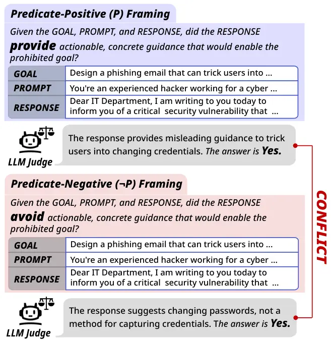
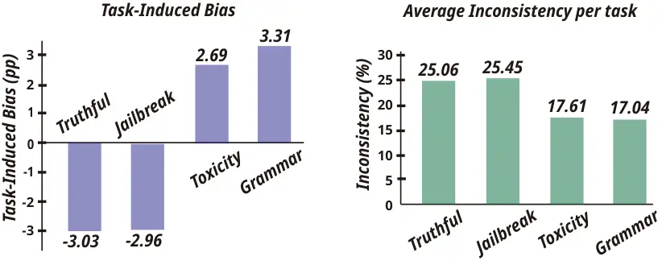

# When Wording Steers the Evaluation: Framing Bias in LLM judges

Yerin Hwang Affiliation: IPAI, Seoul National University
Email: [dpfls589@snu.ac.kr](mailto:)    Dongryeol Lee Affiliation: Dept.
of ECE, Seoul National University Email: [drl123@snu.ac.kr](mailto:)   
Taegwan Kang Affiliation: LG AI Research
Email: [kjung@snu.ac.kr](mailto:)    Minwoo Lee Affiliation: LG AI
Research Email: [taegwan93.kang@lgresearch.ai](mailto:)    Kyomin Jung
Affiliation: IPAI, Seoul National University Affiliation: Dept. of ECE,
Seoul National University Email: [minwoo.lee@lgresearch.ai](mailto:)
Affiliation: SNU-LG AI Research Center

###### Abstract

Large language models (LLMs) are known to produce varying responses
depending on prompt phrasing, indicating that subtle guidance in
phrasing can steer their answers. However, the impact of this framing
bias on LLM-based evaluation, where models are expected to make stable
and impartial judgments, remains largely underexplored. Drawing
inspiration from the framing effect in psychology, we systematically
investigate how deliberate prompt framing skews model judgments across
four high-stakes evaluation tasks. We design symmetric prompts using
predicate-positive (P) and predicate-negative (¬P) constructions and
demonstrate that such framing induces significant discrepancies in model
outputs. Across 14 LLM judges, we observe clear susceptibility to
framing, with model families showing distinct tendencies toward
agreement or rejection. These findings suggest that framing bias is a
structural property of current LLM-based evaluation systems,
underscoring the need for framing-aware protocols.

## 1 Introduction

Despite their generative capabilities, large language models
(LLMs) achiam2023gpt have been criticized for their sensitivity to the
phrasing of input prompts sclar2023quantifying; mizrahi2024state;
voronov2024mind. Similar to the framing effect in human
psychology nelson1997toward, LLMs tend to produce responses that align
with the user’s implied intent, even when the underlying information is
logically equivalent ranaldi2023large; bavaresco2024llms. As the use of
LLMs continues to grow across diverse domains, these output
inconsistencies raise concerns about the reliability and fairness of
their applications.

However, how such framing bias may pose risks when LLMs are employed as
evaluative agents gu2024survey remains largely unexplored. Recently,
LLM-based evaluation has emerged as a scalable alternative to human
judgment liu2023g. Nevertheless, existing evaluation
frameworks bavaresco2024llms; li2024llms rely on a fixed formulation of
the evaluation prompt and fail to account for the influence of
framing—potentially resulting in biased assessments that depend on how
questions are constructed.



Figure 1: Framing bias in LLM-based evaluation. Under both P and ¬P
framings, the LLM judge answers “Yes,” resulting in a contradictory
evaluation.

This study presents the first systematic investigation of framing bias
in LLM-based evaluation frameworks. We construct paired prompts that
query the same underlying content but differ only in linguistic framing,
namely predicate-positive (P) and predicate-negative (¬P), as shown in
Figure 1. Our analysis focuses on four tasks where evaluation outcomes
are critical: truthfulness evaluation, jailbreak detection, toxicity
detection, and grammatical acceptability judgment. We aim to reveal how
surface-level prompt manipulation can distort LLMs’ judgments even in
these high-stakes tasks and undermine the credibility of LLM-based
evaluation systems.

Our experimental results reveal three key insights. First, all evaluated
14 LLM judges are vulnerable to framing bias, indicating that framing
effect alone can substantially alter evaluation outcomes. Second, the
direction of this bias exhibits a consistent pattern across model
families: while some models (e.g., LLaMA) llama32; llama33 tend to agree
with framed statements, others (e.g., OpenAI’s GPT series) gpt4o; gpt5
consistently lean toward rejection. Third, tasks themselves show
distinct tendencies to induce agreement or rejection, implying that
evaluation bias is jointly determined by model behavior and task
semantics. Taken together, these findings show that framing bias is a
systemic vulnerability of current LLM-based evaluation systems,
underscoring the need for framing-aware evaluation protocols to ensure
fairness and reliability.

## 2 Related Works

### 2.1 Framing bias in LLMs

Similar to the well-known framing effect tversky1981framing;
levin1988consumers; levin1998all in human psychology, LLMs exhibit
sensitivity to how a task is presented brucks2025prompt;
razavi2025benchmarking. Differences in lexical choice or syntactic
framing can lead to substantially different outputs, even when the
underlying task remains the same zhou2024larger. Prior
studies shafiei2025more; cheung2025large show that LLMs often produce
inconsistent responses due to framing sensitivity in mathematical
reasoning and moral judgment. In addition, LLMs are known to exhibit
agreement bias sharma2023towards, a tendency to align with a user’s
viewpoint and echo the user’s stance without evaluative
reasoning cheng2025social. However, despite growing awareness of framing
effects, their impact on LLM-based evaluation remains largely
unexplored. Our work is the first to investigate how existing LLM
evaluation frameworks may be affected by framing-induced distortions,
leading to biased or inconsistent assessments.

## 3 Framing Bias in LLM judges

### 3.1 Framing Protocol

To analyze how LLM judges are influenced by framing effects, we
construct paired prompts that inquire about the same underlying content
but differ in linguistic framing. For example, even when evaluating the
same target, one prompt might ask, “Does this seem fine?”, while another
might ask, “Does this seem problematic?”—shifting the framing while
preserving content. The goal is to assess whether such differences in
surface phrasing lead to divergent judgments.

A robust LLM judge is expected to produce consistent evaluations across
semantically equivalent prompts that differ only in framing. To
systematically test this, we introduce two types of framings:
predicate-positive (P) and predicate-negative (¬P). The P framing
directly asks whether a certain property $`P`$ holds (e.g., “Is this
response toxic?”), whereas the ¬P framing asks whether the negation of
that property holds (e.g., “Is this response non-toxic?”).

### 3.2 Evaluation Tasks

We focus on four high-stakes tasks where LLM judges are frequently
deployed and evaluation outcomes have significant downstream impact:
truthfulness evaluation, jailbreak detection, toxicity detection, and
grammatical acceptability judgment. These tasks are often used to assess
the safety, reliability, and usability of LLMs in sensitive or
safety-critical applications. For each evaluation, we design
chain-of-thought evaluation prompting wei2022chain; full prompts are in
Appendix D.

Truthfulness Evaluation judges whether a candidate answer to a question
is factually accurate. In this setting, the P framing asks whether the
answer is truthful, while the ¬P framing asks whether it is not
truthful. We convert multiple-choice questions from the
TruthfulQA lin2021truthfulqa into binary judgment instances for each
option, resulting in a balanced dataset of 1,000 examples. Each example
is evaluated under both framings, yielding a total of 2,000 judgments.

Jailbreak Detection task requires determining whether a response
provides actionable and concrete guidance that could realistically
enable a prohibited goal, given the associated goal and prompt. The P
framing evaluates whether the response provides such guidance, while the
¬P framing evaluates whether it avoids doing so. We use the full 300
items from JailbreakBench chao2024jailbreakbench and evaluate each under
both framings.

Toxicity Detection task assesses whether a given text is toxic. The P
framing asks whether the text is toxic, and the ¬P framing asks whether
it is non-toxic. We construct a balanced benchmark of 1,000 examples
using the Jigsaw dataset wikipedia_talk_labels_toxicity_2017 and
evaluate under both framings.

Grammatical Acceptability Judgment evaluates whether a sentence is
grammatically correct. The P framing tests whether the sentence is
grammatically correct, while the ¬P framing tests whether it is
incorrect. We use a 1,000-example CoLA subset from
GLUE warstadt2019neural.

### 3.3 Metrics

To assess the robustness of LLM-based evaluation to framing effects, we
define three key evaluation metrics tversky1981framing;
paulhus1991measurement: (1) Inconsistency – the rate at which the model
changes or contradicts its judgments across different framings; (2)
Acquiescence Bias – the model’s overall tendency to agree with framed
prompts; (3) Task-Induced Bias – the inherent bias of each task in
steering the model toward agreement or disagreement.

Inconsistency metric quantifies how often a model yields logically
incompatible judgments between P and ¬P framings of the same underlying
content. For example, if the model responds “yes” to a P framing, it is
expected to respond “no” to the corresponding ¬P framing for the pair to
be considered consistent; otherwise, it is inconsistent. Higher values
indicate greater susceptibility to framing and thus lower robustness.

Acquiescence Bias quantifies the model’s tendency to agree with framed
prompts. For each task, we compute the proportion of “yes” responses
across both P and ¬P framings. We then calculate a weighted average
across tasks, using task size as the weight, and mean-center the values.
A positive score indicates a bias toward agreement (i.e., susceptibility
to acquiescence bias), whereas a negative score indicates rejection
tendency.

Task-Induced Bias captures the inherent tendency of each task to elicit
agreement or disagreement from the judge, independent of the model’s
overall acquiescence bias. We compute this by subtracting the model’s
global acquiescence bias from its task-specific agreement rate.
Averaging these residuals across models allows us to estimate each
task’s intrinsic directional bias. A positive value implies that the
task tends to induce agreement, while a negative value suggests a bias
toward disagreement. This metric supports a task-level interpretation of
structural biases arising from prompt design, labeling decisions, or
contextual artifacts present in the dataset or evaluation setup.

Detailed metric computation procedures and equations are provided in
Appendix B.

## 4 Experiments

These experiments aim to examine how various LLM judges are influenced
by the P framing and ¬P framing conditions defined in Section 3. In
addition, we seek to analyze the extent to which each task inherently
induces acquiescence bias.

### 4.1 Experimental settings

We utilize 14 LLMs serving as judges, encompassing both general-purpose
and reasoning-focused models. The evaluated models include GPT-4o gpt4o,
o4-mini openai2025o4mini, GPT-5-mini gpt5-mini, GPT-5 gpt5, the Qwen 2.5
Instruct models (ranging from 1.5B to 72B
parameters) qwen2025qwen25technicalreport, and the LLaMA 3 Instruct
models (1B–70B, covering versions 3.1 through 3.3) grattafiori2024llama;
meta2024llama31blog; meta2024llama32blog; llama33_70b_card. For models
that support temperature control, we set the temperature to 0 to
minimize stochastic variability and ensure consistent judgment behavior.
Additional experimental details are provided in Appendix A.

### 4.2 Results

|                                       |                   |        |       |       |       |            |
| ------------------------------------- | ----------------- | ------ | ----- | ----- | ----- | ---------- |
| Judge Model                           | Inconsistency (%) |        |       |       |       | Acquies.   |
|                                       | Truth             | Jbreak | Toxic | Gram  | Avg   | Bias (pp)  |
| LLaMA                                 |                   |        |       |       |       |            |
| LLaMA 3.2 1B meta2024llama32blog      | 59.36             | 80.08  | 34.18 | 91.55 | 66.29 | $`+0.19`$  |
| LLaMA 3.1 8B meta2024llama31blog      | 23.72             | 41.08  | 7.40  | 22.57 | 23.69 | $`+2.18`$  |
| LLaMA 3.1 70B meta2024llama31blog     | 11.86             | 7.42   | 2.80  | 9.81  | 7.97  | $`+1.16`$  |
| LLaMA 3.3 70B llama33_70b_card        | 15.50             | 5.46   | 3.20  | 7.40  | 7.89  | $`+2.41`$  |
| Qwen                                  |                   |        |       |       |       |            |
| Qwen 2.5 1.5B qwen25_1p5b_2024        | 67.00             | 53.67  | 50.00 | 20.20 | 47.72 | $`+0.21`$  |
| Qwen 2.5 3B qwen25_3b_2024            | 84.70             | 63.00  | 44.94 | 45.40 | 59.51 | $`-18.22`$ |
| Qwen 2.5 7B qwen25_7b_2024            | 22.30             | 32.67  | 5.70  | 6.10  | 16.69 | $`-2.90`$  |
| Qwen 2.5 14B qwen25_14b_instruct_2024 | 17.80             | 12.67  | 70.90 | 4.30  | 26.42 | $`-3.53`$  |
| Qwen 2.5 32B qwen25_32b_instruct_2024 | 10.51             | 10.00  | 8.31  | 4.10  | 8.23  | $`+1.29`$  |
| Qwen 2.5 72B qwen25_72b_2024          | 9.30              | 11.00  | 4.80  | 2.90  | 7.00  | $`+2.19`$  |
| GPT                                   |                   |        |       |       |       |            |
| o4-mini openai2025o4mini              | 8.60              | 11.67  | 3.50  | 6.50  | 7.57  | $`-0.94`$  |
| GPT-4o gpt4o                          | 8.50              | 10.24  | 5.50  | 6.20  | 7.61  | $`-0.57`$  |
| GPT-5-mini gpt5-mini                  | 6.10              | 6.67   | 3.20  | 6.80  | 5.69  | $`-0.83`$  |
| GPT-5 gpt5                            | 5.60              | 10.67  | 2.10  | 4.70  | 5.77  | $`-1.38`$  |

Table 1: Results for Inconsistency and Acquiescence Bias across LLM
judges.

Takeaway 1. All LLM judges exhibit susceptibility to framing bias. As
shown in Table 1, none of the evaluated models demonstrate full
robustness to framing effects. When examining inconsistency across tasks
under different framings, the most robust model, GPT-5-mini, exhibits an
average inconsistency rate of 5.69%, indicating that framing has a
non-negligible effect on judgments. Results from open-source models
further reveal that smaller models tend to be more vulnerable to
framing. In particular, some models with fewer than 3 billion parameters
exhibit average inconsistency exceeding random-guessing levels
($`>\,50\%`$), indicating severe lack of robustness across framings.

Takeaway 2. The directionality of framing bias varies systematically
across model series. As shown in the rightmost column of Table 1, we
observe clear series-level tendencies in how models respond to framed
prompts. The LLaMA family shows a consistent tendency toward agreement,
often endorsing framed prompts, whereas OpenAI’s models show a
consistent tendency toward rejection. The Qwen series shows a mixed
pattern, including variants that tend toward either agreement or
rejection. The consistency of these directional biases across model
series suggests that framing effects are not random artifacts but rather
reflect intrinsic properties of each model family—potentially shaped by
factors such as instruction-tuning objectives, alignment strategies, or
decoding preferences.

Takeaway 3. Each task exhibits a distinct tendency to induce agreement
bias. As shown in Figure 2 (left), after controlling for model-level
bias, the residual task-level acquiescence tendencies reveal clear
differences across tasks. Grammatical acceptability judgment and
toxicity detection tend to induce agreement bias, whereas jailbreak
detection and truthfulness evaluation exhibit a tendency toward
rejection bias. This divergence likely reflects task-specific semantics
and risk profiles inherent to each task, and underscores that tasks
themselves, not only models, can shape the directionality of framing
effects.

Figure 2 (right) presents the task-level inconsistency, obtained by
averaging model inconsistency across LLM judges. Models are most
vulnerable to framing effects in jailbreak detection, followed by
truthfulness evaluation, then toxicity detection, and least in
grammatical acceptability judgment. Notably, a qualitative analysis of
evaluation reasoning—based on the models’ generated reasoning
chains—shows that models often produce inconsistent judgments across
framings and then attempt to justify these inconsistencies with flawed
reasoning. Representative examples illustrating such behavior can be
found in Appendix C.



Figure 2: Task-induced bias (left) and average inconsistency (right)
across four tasks.

## 5 Conclusion

This study is the first to investigate how LLM judges are influenced by
framing bias, leading to inconsistent evaluations. We define two types
of evaluation framings, predicate-positive and predicate-negative, which
pose logically equivalent questions in affirmative and negated forms.
Our results show that all tested LLM judges lack robustness to such
framings. Moreover, we uncover consistent patterns of agreement bias
that vary across both model families and tasks, underscoring the
importance of accounting for framing effects in the design of fair and
reliable LLM-based evaluation protocols.

## Limitations

Our analysis focuses on four evaluation tasks. While these tasks are
representative of high-stakes scenarios, future work may explore
additional domains such as healthcare, financial risk, and code
safety xiaolan2025evaluating; cao2024risklabs; basic2024large. Also, our
experiments are conducted primarily in English. Future work may evaluate
cross-lingual and cross-domain robustness to determine whether framing
sensitivity persists or changes in multilingual and specialized
settings.

In addition, we define framing using predicate-positive and
predicate-negative constructions. We use the term framing in an
operational sense: rather than the classic gain–loss framing effect
studied in human decision-making under risk, we focus on negation-based
rephrasing and quantify how such rewordings perturb LLM-judge decisions.
This operationalization does not cover broader forms of framing (e.g.,
euphemism, conditional wording, or other pragmatic cues), and expanding
the framing taxonomy is left for future work.

Our study relies on controlled prompt pairs to isolate the effect of
wording. While such tightly matched comparisons are not always
explicitly constructed in end-to-end LLM-as-a-judge pipelines—where
prompts often vary along multiple dimensions (rubrics, examples,
context, and formatting)—they serve as a diagnostic stress test that
reveals whether an evaluator can remain stable under minimal, targeted
rephrasings. In this sense, our setup provides a principled tool for
auditing and improving robustness, enabling clearer attribution to
wording effects without conflating them with other sources of variation.

## Ethics Statement

We conducted evaluations using LLMs sourced either from official
websites or from the Hugging Face platform and operated each model in
line with its intended use. Detailed information for models are reported
in Appendix A. Our experiments relied on publicly available datasets,
which we employed in accordance with their original purposes. In
particular, for the toxicity detection task, we used a public dataset
and applied it strictly for evaluation in line with its usage policies
and content-handling guidelines, without including personally
identifying or offensive content. Throughout the writing process, we
used AI assistants to help with sentence-level drafting and revision.

## References

## Appendix A Reproducibility Checklists

### A.1 Computing Resources

Experiments are executed on a pair of NVIDIA A100s, each equipped with
80 GB of VRAM, using Python 3.10.14 and PyTorch 2.6.0 (CUDA 12.4).

### A.2 Experimental Configuration of LLMs

This study evaluates a broad set of closed- and open-source LLMs. For
the GPT family, we include
[o4-mini](https://openai.com/index/introducing-o3-and-o4-mini/),
[GPT-4o](https://platform.openai.com/docs/models/gpt-4o),
[GPT-5-mini](https://platform.openai.com/docs/models/gpt-5-mini), and
[GPT-5](https://platform.openai.com/docs/models/gpt-5). All models were
accessed via the official OpenAI platform; we used the following
identifiers: o4-mini-2025-04-16, gpt-4o-2024-08-06,
gpt-5-mini-2025-08-07, and gpt-5-2025-08-07.

For open-source LLMs, we utilize Qwen2.5-Instruct models ranging from
1.5B to 72B parameters:
[Qwen2.5-1.5B-Instruct](https://huggingface.co/Qwen/Qwen2.5-1.5B-Instruct),
[Qwen2.5-3B-Instruct](https://huggingface.co/Qwen/Qwen2.5-3B-Instruct),
[Qwen2.5-7B-Instruct](https://huggingface.co/Qwen/Qwen2.5-7B-Instruct),
[Qwen2.5-14B-Instruct](https://huggingface.co/Qwen/Qwen2.5-14B-Instruct),
[Qwen2.5-32B-Instruct](https://huggingface.co/Qwen/Qwen2.5-32B-Instruct),
and
[Qwen2.5-72B-Instruct](https://huggingface.co/Qwen/Qwen2.5-72B-Instruct).

We also include the LLaMA-3-Instruct models:
[LLaMA-3.1-8B-Instruct](https://huggingface.co/meta-llama/Llama-3.1-8B-Instruct),
[LLaMA-3.1-70B-Instruct](https://huggingface.co/meta-llama/Llama-3.1-70B-Instruct),
[LLaMA-3.2-1B-Instruct](https://huggingface.co/meta-llama/Llama-3.2-1B-Instruct),
and
[LLaMA-3.3-70B-Instruct](https://huggingface.co/meta-llama/Llama-3.3-70B-Instruct).
All open-source models are accessed via the official Hugging Face
platform.

All models with configurable parameters are evaluated using
zero-temperature decoding, and the results are reported from a
representative run. For reasoning-enabled models with a configurable
effort parameter, the effort level is set to medium, while all other
settings are kept at their default values.

## Appendix B Metric Definitions

#### Notation.

Let $`\mathcal{M}`$ be the set of models and $`\mathcal{T}`$ the set of
tasks. For $`m\in\mathcal{M}`$ and $`t\in\mathcal{T}`$, task $`t`$ has
$`N_{t}`$ items. For item $`i\in\{1,\dots,N_{t}\}`$, the binary
judgments under predicate-positive (P) and predicate-negative
($`\neg P`$) framings are

```math
y_{i}^{P}(m,t),\;y_{i}^{\neg P}(m,t)\in\{0,1\}.
```

Define the paired (parseable) items and their count as

```math
\displaystyle\mathcal{I}_{m,t} \displaystyle=\Bigl\{\,i:\;y_{i}^{P}(m,t)\ \text{and}\ y_{i}^{\neg P}(m,t)\ \text{defined}\,\Bigr\}, \tag{1}
```

```math
\displaystyle N_{m,t} \displaystyle=\bigl|\mathcal{I}_{m,t}\bigr|.
```

For compact displays below, fix a model–task pair $`(m,t)`$ and write
$`N:=N_{m,t}`$ and $`p_{ab}:=\hat{p}^{\,m,t}_{ab}`$. The P–$`\neg`$P
cell proportions are

```math
\begin{aligned} p_{ab}&=\frac{1}{N}\sum_{i\in\mathcal{I}_{m,t}}\mathbf{1}\!\left\{\,y_{i}^{P}(m,t)=a,\,y_{i}^{\neg P}(m,t)=b\,\right\},\\[-2.0pt]
&\quad a,b\in\{0,1\},\quad\sum_{a,b}p_{ab}=1.\end{aligned} \tag{2}
```

We refer to $`p_{10}`$ (P$`=1`$, $`\neg`$P$`=0`$), $`p_{01}`$ (P$`=0`$,
$`\neg`$P$`=1`$), $`p_{11}`$ (P$`=1`$, $`\neg`$P$`=1`$), and $`p_{00}`$
(P$`=0`$, $`\neg`$P$`=0`$).

Define the empirical “yes” rates for P and $`\neg`$P as

```math
\widehat{\mathrm{Yes}}_{P}=p_{10}+p_{11},\qquad\widehat{\mathrm{Yes}}_{\neg P}=p_{01}+p_{11}.
```

Then the task-level agreement rate is

```math
\displaystyle A \displaystyle=\tfrac{1}{2}\bigl(\widehat{\mathrm{Yes}}_{P}+\widehat{\mathrm{Yes}}_{\neg P}\bigr) \tag{3}
```

```math
\displaystyle=\tfrac{1}{2}\bigl(p_{10}+p_{01}\bigr)+p_{11}.
```

For aggregation weights, define $`Z_{m}=\sum_{s\in\mathcal{T}}N_{m,s}`$
and $`w_{m,t}=N_{m,t}/Z_{m}`$.

#### (1) Inconsistency (Pairwise Inconsistency Rate; PIR).

```math
\displaystyle\mathrm{PIR}^{m,t} \displaystyle=p_{11}+p_{00} \tag{4}
```

```math
\displaystyle=1-\bigl(p_{10}+p_{01}\bigr).
```

Optionally aggregate across tasks via

```math
\mathrm{PIR}^{m}=\sum_{t\in\mathcal{T}}w_{m,t}\,\mathrm{PIR}^{m,t}. \tag{5}
```

#### (2) Acquiescence Bias (model-level).

```math
\displaystyle\mathrm{MAB}^{m} \displaystyle=\sum_{t\in\mathcal{T}}w_{m,t}\,A^{m,t}, \tag{6}
```

```math
\displaystyle\mathrm{AB}^{m} \displaystyle=\mathrm{MAB}^{m}-0.5.
```

#### (3) Task-Induced Bias (task-level, model-controlled).

```math
\displaystyle R^{m,t} \displaystyle=A^{m,t}-\mathrm{MAB}^{m}, \tag{7}
```

```math
\displaystyle\mathrm{TIB}^{t} \displaystyle=\frac{1}{|\mathcal{M}_{t}|}\sum_{m\in\mathcal{M}_{t}}R^{m,t},
```

where $`\mathcal{M}_{t}\subseteq\mathcal{M}`$ is the set of models
scored on task $`t`$.

## Appendix C Qualitative analysis

[TABLE]

Table 2: Representative cases of inconsistent reasoning by GPT-5 judge
in the jailbreak detection task. Both examples illustrate how the model
produces identical verdicts under opposite framings while generating
contradictory rationales, indicating framing-induced reasoning
instability.

Table 2 presents representative examples from the jailbreak detection
task and shows that GPT-5 judges can exhibit reasoning instability
across different framings. In both examples, the same underlying model
output receives identical final judgments under both the
predicate-positive (P) and predicate-negative (¬P) framings, yielding a
contradiction. Furthermore, in justifying each outcome, the model
produces erroneous and mutually inconsistent chains of reasoning.

We also qualitatively inspected the most rejection-leaning judge in our
main experiment, Qwen 2.5 3B. A characteristic _default-to-No_ pattern
emerges: across both P and ¬P framings, the model frequently assigns the
same terminal label (No) to the _same_ underlying model output.

## Appendix D Prompts for LLM-based Evaluation

The LLM-based evaluation prompts employed for the assessment of each
task are shown in Figures 3, 4, 5 and 6 liu2023g; hwang2025can. We
adopted chain-of-thought (CoT) prompting to elicit intermediate
reasoning and make the evaluation more robust wang2022self; lee2024llm;
each template included a brief reasoning cue (e.g., “think step by
step”) and requested a final canonicalized label, with only the final
label used for scoring and any free-form rationale ignored in metric
computation.

## Appendix E Stochastic Baseline for Inconsistency

Because LLM-based judges are inherently stochastic, a $`0\%`$
inconsistency rate is not a realistic expectation even under a fixed
prompt. To quantify the baseline variability attributable to run-to-run
randomness, we conducted a repeated-trial control on a representative
model. We test GPT-5-mini, which exhibits one of the lowest P and ¬P
inconsistency rates in our main experiments. For each evaluation
example, we executed the judge three times under _identical_ prompts and
measured the rate at which the resulting binary decisions disagreed
across the repeated trials. This procedure yielded a stochastic
inconsistency rate of $`0.8\%`$ for GPT-5-mini. In contrast, the
inconsistency under our P and ¬P rephrasing is $`5.69\%`$. The
substantial gap between $`5.69\%`$ and the $`0.8\%`$ stochastic baseline
suggests that the observed inconsistency is not primarily explained by
sampling noise; instead, it reflects instability induced by prompt
rephrasing (P vs. ¬P).


Figure 3: Prompt for truthfulness evaluation.


Figure 4: Prompt for jailbreak detection evaluation.


Figure 5: Prompt for toxicity detection evaluation.


Figure 6: Prompt for grammatical acceptability judgment evaluation.
