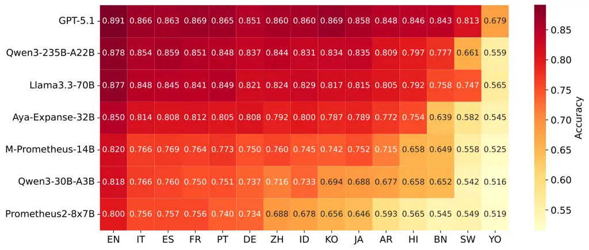
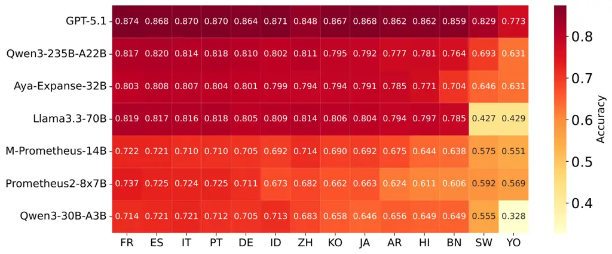
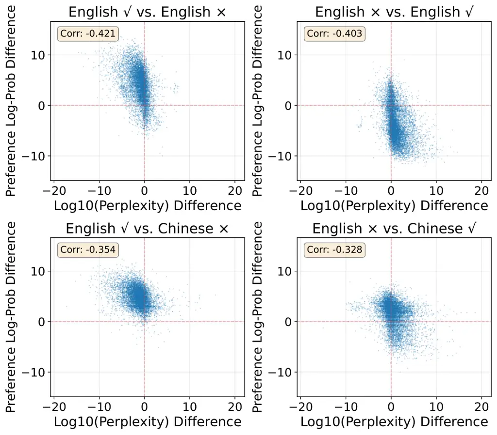
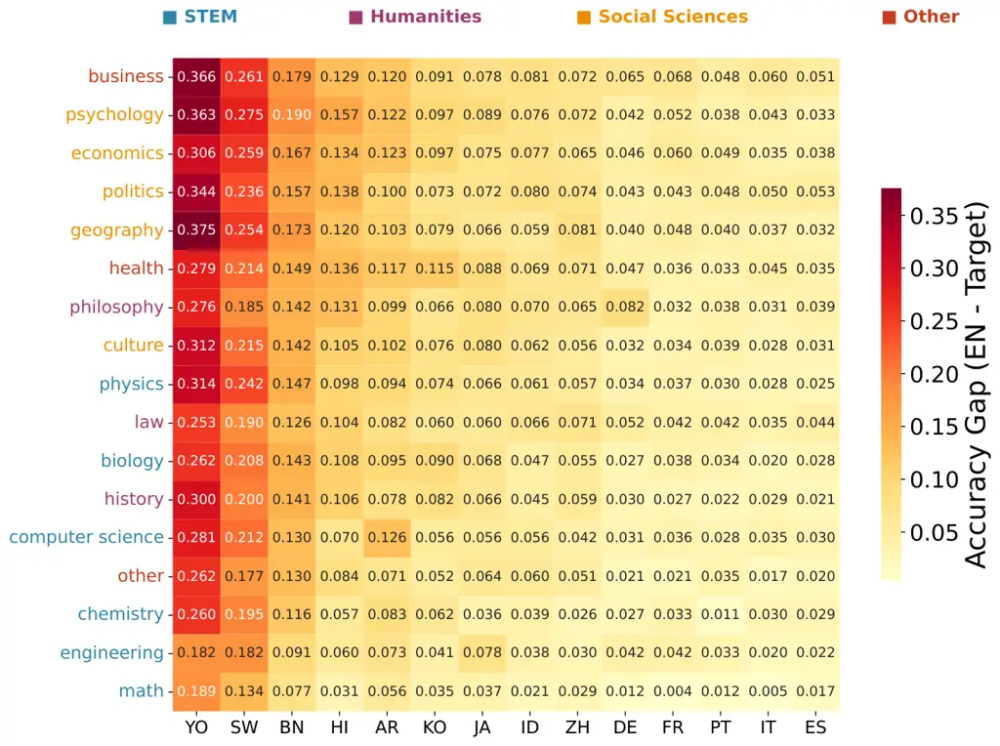
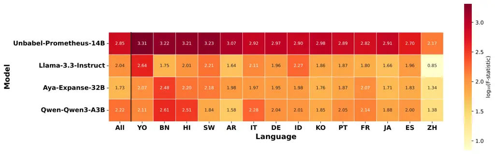
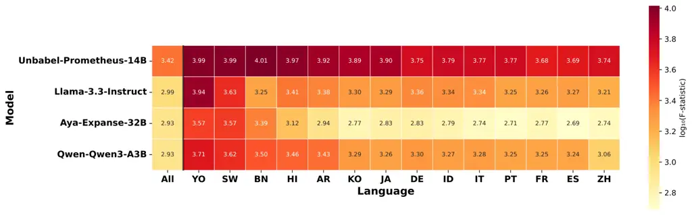

# Fairness or Fluency? An Investigation into Language Bias of Pairwise LLM-as-a-Judge

Xiaolin Zhou ^(†)^(†)thanks: Equal contribution Affiliation: University
of Southern California Email: [xzhou733@usc.edu](mailto:)    Zheng
Luo¹¹footnotemark: 1 Affiliation: University of Southern California
Email: [luozheng@usc.edu](mailto:)    Yicheng Gao¹¹footnotemark: 1
Affiliation: University of Southern California
Email: [gaoyiche@usc.edu](mailto:)    Qixuan Chen
Affiliation: University of Southern California
Email: [qixuanch@usc.edu](mailto:)    Xiyang Hu Affiliation: Arizona
State University Email: [yue.z@usc.edu](mailto:)    Yue Zhao
Affiliation: University of Southern California
Email: [ruishanl@usc.edu](mailto:)    Ruishan Liu
Affiliation: University of Southern California
Email: [xiyanghu@asu.edu](mailto:)

###### Abstract

Recent advances in Large Language Models (LLMs) have incentivized the
development of LLM-as-a-judge, an application of LLMs where they are
used as judges to decide the quality of a certain piece of text given a
certain context. However, previous studies have demonstrated that
LLM-as-a-judge can be biased towards different aspects of the judged
texts, which often do not align with human preference. One of the
identified biases is language bias, which indicates that the decision of
LLM-as-a-judge can differ based on the language of the judged texts. In
this paper, we study two types of language bias in pairwise
LLM-as-a-judge: (1) performance disparity between languages when the
judge is prompted to compare options from the same language, and (2)
bias towards options written in major languages when the judge is
prompted to compare options of two different languages. We find that for
same-language judging, there exist significant performance disparities
across language families, with European languages consistently
outperforming African languages, and this bias is more pronounced in
culturally-related subjects. For inter-language judging, we observe that
most models favor English answers, and that this preference is
influenced more by answer language than question language. Finally, we
investigate whether language bias is in fact caused by low-perplexity
bias, a previously identified bias of LLM-as-a-judge, and we find that
while perplexity is slightly correlated with language bias, language
bias cannot be fully explained by perplexity only.

## 1 Introduction

Figure 1: Illustration of language bias in the same-language judging and
inter-language judging scenario.

Large Language Models (LLMs) have demonstrated remarkable capabilities
across a wide range of natural language processing tasks. One of the
important applications of LLMs is LLM-as-a-judge. In this framework,
LLMs are prompted to assess the quality of text inputs, either by
assigning scores (pointwise), selecting the better option from a pair
(pairwise), or ranking multiple candidates (listwise) (Li et al., 2024).
Pairwise LLM-as-a-judge has attracted particular attention due to its
natural alignment with applications such as automatic model
evaluation (Li et al., 2023b) and reinforcement learning from AI
feedback (Lee et al., 2024). For these applications to be trustworthy,
however, the judge model must provide fair and unbiased decisions that
align well with human preferences.

Unfortunately, prior research has revealed that LLM judges exhibit
multiple types of systematic biases that compromise their
reliability (Zheng et al., 2023; Ye et al., 2024; Wang et al., 2024; Shi
et al., 2025). One of them is language bias, where LLMs are demonstrated
to show undesired preferences when given texts written in different
languages. Specifically, several recent works (Fu and Liu, 2025;
Doddapaneni et al., 2025; Padarha et al., 2025) have revealed that in a
pointwise judging scenario, LLMs can assign higher scores to answers
written in higher-resource languages.

Despite growing awareness of language bias, many critical questions
remain unanswered. For example, first, existing studies have primarily
examined pointwise judging; the extent of language bias in pairwise
comparison settings, where two options are directly compared, remains
unclear. Second, it is unknown whether language bias is uniform across
domains or more pronounced in subjects tied to cultural and linguistic
contexts (such as history or social sciences) compared with
language-agnostic domains like mathematics or physics. Third, it is yet
unclear whether language bias can be attributed to low-perplexity
bias (Panickssery et al., 2024; Wataoka et al., 2025), a previously
identified bias of LLM-as-a-judge to favor answers with low perplexity.
In other words, is language bias simply a special case where options in
high-resource languages happen to have lower perplexity, and thus
undesirably preferred by the judge model?

In this paper, we present a comprehensive investigation of language bias
in pairwise LLM-as-a-judge. We study two distinct scenarios, shown in
Figure 1: same-language judging, where both candidate answers are
written in the same language, and inter-language judging, where the two
answers are presented in different languages. For same-language judging,
we examine performance disparities across languages. For inter-language
judging, we investigate whether models exhibit systematic preferences
for answers written in high-resource languages. For both settings, we
also study the factors that affect the extent of language bias. Finally,
we conduct an analysis to determine whether language bias can be reduced
to low-perplexity bias.

## 2 Related Works

### 2.1 LLM-as-a-Judge

Most previous works (Li et al., 2024) apply LLM-as-a-judge in three
different forms: pointwise judging, pairwise judging, and listwise
judging. In this paper, we focus on pairwise judging, which is the
process where the judge LLM is prompted to choose a better one from two
candidate text inputs. Pairwise judging has drawn significant attention
recently for its potential applications such as automatic model
evaluation (Li et al., 2023b; Zhao et al., 2025), learning from AI
feedback (Lee et al., 2024; Xu et al., 2024), etc.

A bottleneck of the application of pairwise LLMs to broader application
lies in their performance, often measured by their correlation with
human preference. In light of this, some previous works proposed expert
models for LLM-as-a-judge, such as Auto-J (Li et al., 2023a),
JudgeLM (Zhu et al., 2025), Prometheus (Kim et al., 2024a),
Prometheus-2 (Kim et al., 2024b), and multilingual expert judge model
M-Prometheus (Pombal et al., 2025). Other previous works analyze the
cause of mismatch with human preferences, and identify certain biases
commonly observed in LLM-as-a-judge.

### 2.2 Biases of LLM-as-a-Judge

Previous studies have identified a series of biases in LLM-as-a-judge,
which limit the accuracy and potential application scope of the
technique. For example, position bias (Wang et al., 2024) is a well
known issue in pairwise LLM-as-a-judge, where the judge LLM tends to
unproportionately favor the option at a certain position.

One line of previous research studies self-preference bias (Panickssery
et al., 2024), which shows that LLMs tends to unfairly favor options
that are generated by themselves. Another previous work (Wataoka et al., 2025) show that the favor of the models’ own generations can be
potentially generalized to the favor of low-perplexity options over
high-perplexity ones for the judge LLM. This indicates that judge LLMs
might favor the responses that they are more “familiar” with rather than
the ones that are factually better.

Another type of bias in LLM-as-a-judge is language bias. It has been
shown that in a pointwise LLM-as-a-judge setting where the judge model
is prompted to assign a score to a given input, the judge model tends to
assign lower scores to inputs written in low-resource languages (Fu and
Liu, 2025; Doddapaneni et al., 2025; Padarha et al., 2025; Faisal
et al., 2025). However, a lot of questions remain unclear. For example,
(1) whether this phenomenon generalizes to pairwise LLM-as-a-judge, (2)
is this phenomenon more significant in specific settings (e.g. in texts
related to social or cultural backgrounds compared with texts that are
cultural-agnostic such as mathematics or physics), and (3) whether this
phenomenon is another special case of the low-perplexity bias described
above.

## 3 Experiment Settings

### 3.1 Dataset

In our experiments, we use the MMMLU dataset (OpenAI, 2024). MMMLU is a
multilingual multiple-choice question answering benchmark obtained by
professionally translating the MMLU (Hendrycks et al., 2020) test set
into 14 languages. Specifically, 14 target languages span multiple
regions: Europe (DE, ES, FR, IT, PT), Asia (ZH, JA, KO, HI, BN, ID), the
Middle East (AR) and Africa (SW, YO). Consequently, the dataset provides
14,042 parallel questions per language across 57 subjects. More details
regarding dataset preprocessing are discussed in Appendix A.

### 3.2 Compared Models

In our experiments, we study the language bias of a series of LLMs when
they are used as judges. The studied models include one closed-source
model (GPT-5.1 (OpenAI, 2025)), three general open-source models
(Qwen3-30B-A3B, Qwen3-235B-A22B (Team, 2025),
Llama-3.3-70B-Instruct (Grattafiori et al., 2024)), one open-source
model specifically designed for multilinguality (Aya-expanse-32B (Dang
et al., 2024)), and two expert LLM-as-a-judge models, including one
general judge (Prometheus-8$`\times`$7B-v2.0 (Kim et al., 2024a)) and
one multilingual judge (M-Prometheus-14B (Pombal et al., 2025)). More
details regarding setup and hyperparameters of the models are in
Appendix B.



Figure 2: Same-language judging performance of tested models on MMMLU.
Models are sorted by average performance across all languages (top to
bottom), languages are sorted by average performance across all models
(left to right).

## 4 Same-Language Judging: Performance Disparities Between Languages

In this section, we study how LLM-as-a-judge based on the tested LLMs
perform when both answers are presented in the same language. Our goal
is to investigate performance disparities across different languages in
pairwise LLM-as-a-judge evaluation.

### 4.1 Model and Language Performances

We first measure the performance of all tested LLMs across all 15
languages in MMMLU. In order to factor out the effect of position bias,
we conduct two experiments with swapped positions of the two compared
answers, and report the average accuracy of each model. The detailed
prompt templates are shown in Appendix B. The results are shown in
Figure 2. From the results, we can observe the following.

#### Model performance strongly correlates with region of language.

We observe that the languages with highest average model performances
are all European languages (e.g. EN, IT), followed by Asian languages
(e.g. ZH, ID), and finally African languages (SW, YO). This holds even
for higher-resource Asian languages like Japanese (JP) or Chinese (ZH),
compared with lower-resource European languages like Italian
(IT) (Common Crawl, 2025). This indicates that other factors such as
proximity to English might be significant in the models’ performance in
pairwise LLM-as-a-judge, other than the representations of languages in
training data.

#### The relative performance ranking of the models remains consistent across all languages.

For all compared languages, among the open-source models, the model with
best performance is always either Qwen3-235B-A22B or Llama3.3-70B, and
the model with worst performance is always either Qwen3-30B-A3B or
Prometheus2-8x7B. This indicates that models that excel at same-language
pairwise LLM-as-a-judge often maintain their relative standing across
all languages.

Figure 3: Question Effect versus Answer Effect in same-language judging.
Points above the diagonal indicate greater sensitivity to answer
language; points below indicate greater sensitivity to question
language.

### 4.2 Effect of Question Language and Answer Language

When evaluating multilingual content, language bias can stem from two
aspects: the language of the question, or the language of the answer. In
this section, we investigate which of these two aspects contribute more
to language bias in the same-language comparison setting. Concretely,
for each target language in all languages other than English, we conduct
experiments with three different settings: English question, English
answer; English question, target language answer; target language
question, English answer. For each setting, we conduct two sets of
experiments with flipped positions and report the average accuracy of
each setting. For convenience, we denote the accuracy of the model under
these three settings as $`\text{Acc}_{EN,EN}`$, $`\text{Acc}_{EN,TG}`$,
and $`\text{Acc}_{TG,EN}`$, respectively. We then calculate the effect
of question language and answer language, defined as follows.

```math
\text{Question Effect}=\text{Acc}_{EN,EN}-\text{Acc}_{EN,TG} \tag{1}
```

```math
\text{Answer Effect}=\text{Acc}_{EN,EN}-\text{Acc}_{TG,EN} \tag{2}
```

Here, a positive Question Effect shows that translating the question
language, from English into other target languages, while keeping the
answer in English will reduce the performance. Similarly, a positive
score of Answer Effect shows the translated answer while maintaining
English Question, which will reduce the performance. The result of each
effect reflects the relative contribution of the component to the
overall language bias.

The results are shown in Figure 3. We can see that for most languages
and most tested models, the language of the answer is more important
than the language of the question. The only exceptions are Llama3.3-70B
and Qwen3-30B-A3B on Yoruba (YO) and Swahili (SW), where the models only
have near-random performances.

Figure 4: Accuracy gap between English and target language by subject
category for Prometheus2-8x7B. Bars represent performance difference
across STEM, Humanities, Social Sciences, and Other subjects for each
language.

### 4.3 Effect of Question Subject

As we discussed in Section 3.1, the MMMLU dataset contains 57 subjects,
which can be divided into 17 subcategories. Each subcategory fall into
one of the four categories: STEM, humanities, social sciences, and
others. In this section, we investigate whether language bias is less
significant for subjects that are not related to social or cultural
backgrounds (e.g. mathematics) compared with those that are (e.g.
culture).

In order to compare language bias in different categories of subjects,
we calculate the accuracy of each tested LLM and each language averaged
over each subject subcategory. The results for Prometheus2-8x7B in
Figure 4 and full results in Appendix C show that language bias is lower
for STEM subjects, and higher for Humanities and Social Sciences. As
shown in Figure 9, the subjects with highest language bias include
Psychology, Business, and Economics, which are all Social Science or
Humanities subjects. On the contrary, the subjects with lowest language
bias are math and engineering. This indicates LLM-as-a-judge shows less
performance gap between languages in questions that contain more
language-invariant information and less cultural- or social-related
context.

## 5 Inter-Language Judging: Bias Across Option Languages

In this section, we evaluate the performance of LLMs when facing answers
in different languages simultaneously, which reflects the real-world
scenario that LLM-as-a-judge must evaluate multilingual content.

### 5.1 Inter-Language Performance



Figure 5: Inter-language judging performance across models and
languages. Each cell shows accuracy when comparing English and target
language answers, averaged across all four configurations. Models are
sorted by average performance across all languages (top to bottom),
languages are sorted by average performance across all models (left to
right).

We first measure the performance of all compared LLMs in the
inter-language judging setting. Specifically, in this setting, we
consider the case where the model is asked to choose from an English
answer and an answer in another language. We perform four sets of
experiments as shown in Table 1. The prompt templates used are shown in
Appendix B. We conduct two experiments for each setting with swapped
positions to factor out position bias, and report the average accuracy
of the LLM judge. The only exception is GPT-5.1, where we only conduct
experiments with the original option order due to budget limit. For
simplicity, we denote the results of each setting with
$`\text{Acc}_{EN,EN\checkmark}`$, $`\text{Acc}_{EN,TG\checkmark}`$,
$`\text{Acc}_{TG,EN\checkmark}`$, $`\text{Acc}_{TG,TG\checkmark}`$,
respectively. Here, $`\text{Acc}_{EN,TG\checkmark}`$ indicates the
accuracy on questions written in English where the correct answer is in
the target language. The results are shown in Figure 5. We observe
similar conclusions as in the same-language setting reported in
Section 4.1. First, model performances are strongly correlated with
region of language. Second, the relative performance of each model
generally persist for all tested languages, though with some exceptions.
For example, M-Prometheus-14B has the highest accuracy in English among
open-source models, but relatively lower accuracies in other languages.
This might be because the Prometheus models are finetuned on
same-language comparison scenarios only, and therefore they’re less
familiar with inter-language settings.

| Question | Correct Answer | Incorrect Answer |
| -------- | -------------- | ---------------- |
| English  | English        | Target           |
| English  | Target         | English          |
| Target   | English        | Target           |
| Target   | Target         | English          |

Table 1: Inter-language experiment configurations.

### 5.2 Effect of Question Language and Answer Language

Figure 6: Question language effect versus answer language effect in the
inter-language setting. Points above the diagonal indicate more effect
caused by answer language; points below indicate more effect caused by
question language.

In this section, we study the effect of question language and answer
language on language bias under the inter-language setting. We use
similar definitions and setups as used in Section 4.2. The only
difference is that here we consider both when the correct answer is in
English or in the target language. Concretely, we calculate the question
effect and answer effect as follows:

```math
\displaystyle\begin{split}\text{Question Effect}&=\frac{1}{2}[(\text{Acc}_{EN,EN\checkmark}-\text{Acc}_{TG,EN\checkmark})\\
&\quad+(\text{Acc}_{EN,TG\checkmark}-\text{Acc}_{TG,TG\checkmark})]\end{split} \tag{3}
```

```math
\displaystyle\begin{split}\text{Answer Effect}&=\frac{1}{2}[(\text{Acc}_{EN,EN\checkmark}-\text{Acc}_{EN,TG\checkmark})\\
&\quad+(\text{Acc}_{TG,EN\checkmark}-\text{Acc}_{TG,TG\checkmark})]\end{split} \tag{4}
```

The results are shown in Figure 6. From the results, we observe that for
languages like Portuguese (PT) or French (FR), the question effect is
negative for all the models. This indicates that when conducting
inter-language judging involving languages that are comparatively
lower-resource but not too low-resource, having the question presented
in the target language might help the model perform better. In contrast,
the answer effect is mostly positive, which means that the English
answers is undesirably preferred, regardless of whether they are truly
correct.

### 5.3 Answer Language Preference

From our experiment results, we can also study the following question:
is the LLM judge biased towards choosing the English answer compared
with answers of other languages? Concretely, we compute the preference
of the model towards English answers under two circumstances: when the
question is in English ($`\text{ENPref}_{EN}`$) and when the question is
in the target language ($`\text{ENPref}_{TG}`$).

```math
\displaystyle\text{ENPref}_{EN} \displaystyle=\text{Acc}_{EN,EN\checkmark}-\text{Acc}_{EN,TG\checkmark} \tag{5}
```

```math
\displaystyle\text{ENPref}_{TG} \displaystyle=\text{Acc}_{TG,EN\checkmark}-\text{Acc}_{TG,TG\checkmark} \tag{6}
```

The intuition is that, if the accuracy of the judge model is higher when
the correct answers are in English compared with when the answers are in
the target language, it means the model is actually inclined to choosing
English answers rather than being able to solve every question
correctly. We than compare $`\text{ENPref}_{EN}`$ with
$`\text{ENPref}_{TG}`$ to investigate how does the model’s bias change
when the question language changes. The results are shown in Figure 12.
We can observe that the scatter points mostly fall into the first and
fourth quadrants, which shows that in most cases, LLMs are biased
towards selecting the English answer when the question is presented in
English. Regarding the models’ preference when the question is presented
in the target language, some models almost always prefer English answers
(e.g. Aya-Expanse-32B), some others almost always prefer target language
answers (e.g. M-Prometheus-14B), while others fall in the middle where
their preferences depend on specific target languages (e.g.
Prometheus2-8x7B).

## 6 Is Language Bias really Low Perplexity Bias?

In this section, we examine whether language bias in judging answers
stems solely from an LLM’s unfamiliarity with a language, as manifested
by high perplexity on answers in that language.

### 6.1 Data preprocessing

To investigate this problem, we need to calculate two things. First, we
need the judge models’ preferences for the first option compared to the
other, as defined by the difference in log probability between choosing
the two options. Second, we need to compute the judge models’
perplexities of each option. This is done through three steps: (1) input
the question to the model and get its answer; (2) substitute the answer
component in the model’s output with the content of the option; (3)
calculate the model’s perplexity with respect to the option content. We
also need to filter the dataset to remove questions that do not fit in
this process. Implementation details regarding data preprocessing are
shown in Appendix E.

### 6.2 Preference-Perplexity Relationship

We first examine the relationship between LLM judge preference and the
perplexity difference between the two options.

Figure 7 shows the scatter plot of all data points’ model preferences
and log perplexity differences across all four inter-language settings
described in Table 1. We can observe the following:

#### Slight negative correlation between log perplexity difference and model preference.

For all the settings, we only observe a slight negative correlation of
around -0.3 to -0.4 between the two compared variables. This is a
initial sign that the preference of the judge model can not be fully
explained by perplexity.

#### Judge model exhibits language bias beyond perplexity.

Comparing the two figures in each column in Figure 7, we can observe
that the scatter plot shifts upward in the top figure compared to the
bottom figure in each column. This means that given a fixed log
perplexity difference value, the model is more inclined to choosing the
first English option when the other answer is in Chinese compared with
when the other answer is in English. This further demonstrates that
language bias exists even when log perplexity difference between options
are the same, which indicates that there exists language bias beyond
perplexity.



Figure 7: M-Prometheus-14B’s preference log probability difference vs.
perplexity log difference when the Chinese answer is correct and the
English answer is incorrect, with the Pearson correlation coefficient in
the yellow box.

### 6.3 Quantifying Language Bias Beyond Perplexity

In this section, we quantify how significantly perplexity and other
language effects beyond perplexity affect the judging process. We
introduce two linear regression models: a reduced model with only
perplexity as variable, and a full model with both perplexity and
language as variables, represented in Equation 7 and 8, respectively.

```math
\displaystyle y \displaystyle=\alpha_{0}+\alpha_{1}\,\Delta\text{ppl} \tag{7}
```

```math
\displaystyle y \displaystyle=\beta_{0}+\beta_{1}\,\Delta\text{ppl}+\sum_{n=1}^{N}\gamma_{n}\,\mathbbm{1}(l=n) \tag{8}
```

Here, $`y`$ denotes signed preference ($`y>0`$ implies preference for
answer 1), $`\Delta\text{ppl}`$ is the log perplexity difference, and
$`\mathbbm{1}(l=n)`$ indicates whether the current data point is in
language $`n`$ or not, where the value is 1 if yes and 0 if not. We then
calculate the incremental $`R^{2}`$ of the full model compared to the
reduced model, which measures how much additional variance of $`y`$ is
explained by the introduction of the language terms
$`\mathbbm{1}(l=n)`$. The results for M-Prometheus-14B are shown in
Figure 8, and other results are shown in Appendix G. In order to verify
the statistical significance of the incremental $`R^{2}`$, we also
conduct a F-test detailed in Appendix F and G.

From the results, we observe that low-resource languages such as Yoruba
(YO) exhibit the largest incremental $`R^{2}`$, indicating that the
judge model’s disfavor toward answers in these languages cannot be
explained by perplexity alone. In contrast, high-resource languages such
as Chinese (ZH) show substantially smaller incremental $`R^{2}`$,
suggesting that language identity contributes less additional
explanatory power beyond perplexity in these cases. Overall, language
bias affecting low-resource languages is less attributable to
perplexity, whereas for high-resource languages, while language-specific
bias beyond perplexity is present, its contribution to the overall
variance of model preference is comparatively limited.

Figure 8: M-Prometheus-14B’s $`R^{2}`$ decomposition: perplexity
contribution (bottom) and additional language contribution (top) when
first-language answers are correct and second-language answers are
incorrect.

## 7 Conclusion

In this paper, we conducted a systematic study of language bias in
pairwise LLM-as-a-judge. We studies two different settingsL
same-language judging and inter-language judging.

Our analysis reveals several consistent patterns. First, in
same-language judging, we observe substantial performance disparities
across languages from different regions, with European languages
consistently outperforming Asian and African languages. These
disparities are more pronounced in culturally and socially grounded
subjects that involve more language-specific features than in STEM
domains.

Second, in inter-language judging, most models exhibit a clear
preference for English answers when presented alongside answers in other
languages, regardless of which answer is correct. We also show that
answer language plays a more dominant role than question language in
driving this bias.

Finally, we investigated whether language bias can be reduced to
low-perplexity bias. While we find a measurable correlation between
preference and perplexity difference, our regression and F-test analyses
demonstrate that language identity explains significant additional
variance beyond perplexity alone, especially for low-resource languages.
This provides strong evidence that language bias is not merely an
artifact of fluency or likelihood, but reflects deeper representational
and evaluative asymmetries within judge models.

In summary, our findings highlight that language bias remains a
fundamental limitation of current pairwise LLM-as-a-judge systems. We
hope that our findings provide insights for future research and
applications in multilingual LLM-as-a-judge.

## Limitations

Limitations and potential future directions of our paper include the
following:

- •
  In the data preprocessing process in Section 6.1, we cannot fully
  mitigate the portion of perplexity that are not related to the answer
  choices, like answer framing style mismatch and answer phrasing style
  mismatch. We also cannot manually verify the correctness of the
  automatically generated “styled responses” by GPT-4.1 because of the
  infeasible workload. Therefore, there might be noises in the collected
  perplexity data that may cause the $`R^{2}`$ in the reduced linear
  regression to be smaller than the ground truth value, and causing the
  F-statistic of the languages to be falsely higher.
- •
  Most recent LLMs include reasoning, which could potentially influence
  the output of LLM-as-a-judge. In our experiments, although we included
  GPT-5.1 with reasoning mode, we did not consider the potential impact
  of reasoning in our perplexity experiments.

## References

- Common Crawl (2025) Common Crawl. 2025. Distribution of languages in
  common crawl monthly archives.
  [https://commoncrawl.github.io/cc-crawl-statistics/plots/languages](https://commoncrawl.github.io/cc-crawl-statistics/plots/languages).
  Accessed: 2026-01-04.
- Dang et al. (2024) John Dang, Shivalika Singh, Daniel D’souza, Arash
  Ahmadian, Alejandro Salamanca, Madeline Smith, Aidan Peppin, Sungjin
  Hong, Manoj Govindassamy, Terrence Zhao, Sandra Kublik, Meor Amer,
  Viraat Aryabumi, Jon Ander Campos, Yi-Chern Tan, Tom Kocmi, Florian
  Strub, Nathan Grinsztajn, Yannis Flet-Berliac, and 26 others. 2024.
  [Aya expanse: Combining research breakthroughs for a new multilingual
  frontier](https://arxiv.org/abs/2412.04261). _Preprint_,
  arXiv:2412.04261.
- Doddapaneni et al. (2025) Sumanth Doddapaneni, Mohammed Safi Ur Rahman
  Khan, Dilip Venkatesh, Raj Dabre, Anoop Kunchukuttan, and Mitesh M
  Khapra. 2025. [Cross-lingual auto evaluation for assessing
  multilingual LLMs](https://doi.org/10.18653/v1/2025.acl-long.1419). In
  _Proceedings of the 63rd Annual Meeting of the Association for
  Computational Linguistics (Volume 1: Long Papers)_, pages 29297–29329,
  Vienna, Austria. Association for Computational Linguistics.
- Faisal et al. (2025) Fahim Faisal, Md Mushfiqur Rahman, and Antonios
  Anastasopoulos. 2025. [Dialectal toxicity detection: Evaluating
  LLM-as-a-judge consistency across language
  varieties](https://doi.org/10.18653/v1/2025.findings-emnlp.664). In
  _Findings of the Association for Computational Linguistics: EMNLP
  2025_, pages 12429–12452, Suzhou, China. Association for Computational
  Linguistics.
- Fu and Liu (2025) Xiyan Fu and Wei Liu. 2025. [How reliable is
  multilingual
  LLM-as-a-judge?](https://doi.org/10.18653/v1/2025.findings-emnlp.587)
  In _Findings of the Association for Computational Linguistics: EMNLP
  2025_, pages 11040–11053, Suzhou, China. Association for Computational
  Linguistics.
- Grattafiori et al. (2024) Aaron Grattafiori, Abhimanyu Dubey, Abhinav
  Jauhri, Abhinav Pandey, Abhishek Kadian, Ahmad Al-Dahle, Aiesha
  Letman, Akhil Mathur, Alan Schelten, Alex Vaughan, Amy Yang, Angela
  Fan, Anirudh Goyal, Anthony Hartshorn, Aobo Yang, Archi Mitra, Archie
  Sravankumar, Artem Korenev, Arthur Hinsvark, and 538 others. 2024.
  [The llama 3 herd of models](https://arxiv.org/abs/2407.21783).
  _Preprint_, arXiv:2407.21783.
- Hendrycks et al. (2020) Dan Hendrycks, Collin Burns, Steven Basart,
  Andy Zou, Mantas Mazeika, Dawn Song, and Jacob Steinhardt. 2020.
  Measuring massive multitask language understanding. _arXiv preprint
  arXiv:2009.03300_.
- Kim et al. (2024a) Seungone Kim, Jamin Shin, Yejin Cho, Joel Jang,
  Shayne Longpre, Hwaran Lee, Sangdoo Yun, Seongjin Shin, Sungdong Kim,
  James Thorne, and Minjoon Seo. 2024a. [Prometheus: Inducing
  fine-grained evaluation capability in language
  models](https://arxiv.org/abs/2310.08491). _Preprint_,
  arXiv:2310.08491.
- Kim et al. (2024b) Seungone Kim, Juyoung Suk, Shayne Longpre,
  Bill Yuchen Lin, Jamin Shin, Sean Welleck, Graham Neubig, Moontae Lee,
  Kyungjae Lee, and Minjoon Seo. 2024b. [Prometheus 2: An open source
  language model specialized in evaluating other language
  models](https://arxiv.org/abs/2405.01535). _Preprint_,
  arXiv:2405.01535.
- Lee et al. (2024) Harrison Lee, Samrat Phatale, Hassan Mansoor, Thomas
  Mesnard, Johan Ferret, Kellie Ren Lu, Colton Bishop, Ethan Hall,
  Victor Carbune, Abhinav Rastogi, and Sushant Prakash. 2024. [RLAIF vs.
  RLHF: Scaling reinforcement learning from human feedback with AI
  feedback](https://proceedings.mlr.press/v235/lee24t.html). In
  _Proceedings of the 41st International Conference on Machine
  Learning_, volume 235 of _Proceedings of Machine Learning Research_,
  pages 26874–26901. PMLR.
- Li et al. (2024) Haitao Li, Qian Dong, Junjie Chen, Huixue Su, Yujia
  Zhou, Qingyao Ai, Ziyi Ye, and Yiqun Liu. 2024. [Llms-as-judges: A
  comprehensive survey on llm-based evaluation
  methods](https://arxiv.org/abs/2412.05579). _Preprint_,
  arXiv:2412.05579.
- Li et al. (2023a) Junlong Li, Shichao Sun, Weizhe Yuan, Run-Ze Fan,
  Hai Zhao, and Pengfei Liu. 2023a. Generative judge for evaluating
  alignment. _arXiv preprint arXiv:2310.05470_.
- Li et al. (2023b) Xuechen Li, Tianyi Zhang, Yann Dubois, Rohan Taori,
  Ishaan Gulrajani, Carlos Guestrin, Percy Liang, and Tatsunori B.
  Hashimoto. 2023b. Alpacaeval: An automatic evaluator of
  instruction-following models.
  [https://github.com/tatsu-lab/alpaca_eval](https://github.com/tatsu-lab/alpaca_eval).
- OpenAI (2024) OpenAI. 2024. Multilingual massive multitask language
  understanding (mmmlu).
  [https://huggingface.co/datasets/openai/MMMLU](https://huggingface.co/datasets/openai/MMMLU).
  Accessed: 2025-12-18.
- OpenAI (2025) OpenAI. 2025. [GPT-5.1 instant and GPT-5.1 thinking
  system card
  addendum](https://cdn.openai.com/pdf/4173ec8d-1229-47db-96de-06d87147e07e/5_1_system_card.pdf).
  Technical report, OpenAI.
- Padarha et al. (2025) Shreyansh Padarha, Elizaveta Semenova, Bertie
  Vidgen, Adam Mahdi, and Scott A. Hale. 2025. [Evaluating
  LLM-as-a-judge under multilingual, multimodal and multi-domain
  constraints](https://openreview.net/forum?id=cAIjWwoZNf). In _NeurIPS
  2025 Workshop on LLM Evaluation_. Poster.
- Panickssery et al. (2024) Arjun Panickssery, Samuel R. Bowman, and Shi
  Feng. 2024. Llm evaluators recognize and favor their own generations.
  In _Proceedings of the 38th International Conference on Neural
  Information Processing Systems_, NIPS ’24, Red Hook, NY, USA. Curran
  Associates Inc.
- Pombal et al. (2025) José Pombal, Dongkeun Yoon, Patrick Fernandes,
  Ian Wu, Seungone Kim, Ricardo Rei, Graham Neubig, and André F. T.
  Martins. 2025. [M-prometheus: A suite of open multilingual llm
  judges](https://arxiv.org/abs/2504.04953). _Preprint_,
  arXiv:2504.04953.
- Shi et al. (2025) Lin Shi, Chiyu Ma, Wenhua Liang, Xingjian Diao,
  Weicheng Ma, and Soroush Vosoughi. 2025. [Judging the judges: A
  systematic study of position bias in
  llm-as-a-judge](https://arxiv.org/abs/2406.07791). _Preprint_,
  arXiv:2406.07791.
- Team (2025) Qwen Team. 2025. [Qwen3 technical
  report](https://arxiv.org/abs/2505.09388). _Preprint_,
  arXiv:2505.09388.
- Wang et al. (2024) Peiyi Wang, Lei Li, Liang Chen, Zefan Cai, Dawei
  Zhu, Binghuai Lin, Yunbo Cao, Lingpeng Kong, Qi Liu, Tianyu Liu, and
  Zhifang Sui. 2024. [Large language models are not fair
  evaluators](https://doi.org/10.18653/v1/2024.acl-long.511). In
  _Proceedings of the 62nd Annual Meeting of the Association for
  Computational Linguistics (Volume 1: Long Papers)_, pages 9440–9450,
  Bangkok, Thailand. Association for Computational Linguistics.
- Wataoka et al. (2025) Koki Wataoka, Tsubasa Takahashi, and Ryokan
  Ri. 2025. [Self-preference bias in
  llm-as-a-judge](https://arxiv.org/abs/2410.21819). _Preprint_,
  arXiv:2410.21819.
- Xu et al. (2024) Tengyu Xu, Eryk Helenowski, Karthik Abinav
  Sankararaman, Di Jin, Kaiyan Peng, Eric Han, Shaoliang Nie, Chen Zhu,
  Hejia Zhang, Wenxuan Zhou, Zhouhao Zeng, Yun He, Karishma Mandyam,
  Arya Talabzadeh, Madian Khabsa, Gabriel Cohen, Yuandong Tian, Hao Ma,
  Sinong Wang, and Han Fang. 2024. [The perfect blend: Redefining rlhf
  with mixture of judges](https://arxiv.org/abs/2409.20370). _Preprint_,
  arXiv:2409.20370.
- Ye et al. (2024) Jiayi Ye, Yanbo Wang, Yue Huang, Dongping Chen, Qihui
  Zhang, Nuno Moniz, Tian Gao, Werner Geyer, Chao Huang, Pin-Yu Chen,
  Nitesh V Chawla, and Xiangliang Zhang. 2024. [Justice or prejudice?
  quantifying biases in
  llm-as-a-judge](https://arxiv.org/abs/2410.02736). _Preprint_,
  arXiv:2410.02736.
- Zhao et al. (2025) Ruochen Zhao, Wenxuan Zhang, Yew Ken Chia, Weiwen
  Xu, Deli Zhao, and Lidong Bing. 2025. [Auto-arena: Automating LLM
  evaluations with agent peer battles and committee
  discussions](https://doi.org/10.18653/v1/2025.acl-long.223). In
  _Proceedings of the 63rd Annual Meeting of the Association for
  Computational Linguistics (Volume 1: Long Papers)_, pages 4440–4463,
  Vienna, Austria. Association for Computational Linguistics.
- Zheng et al. (2023) Lianmin Zheng, Wei-Lin Chiang, Ying Sheng, Siyuan
  Zhuang, Zhanghao Wu, Yonghao Zhuang, Zi Lin, Zhuohan Li, Dacheng Li,
  Eric P. Xing, Hao Zhang, Joseph E. Gonzalez, and Ion Stoica. 2023.
  Judging llm-as-a-judge with mt-bench and chatbot arena. In
  _Proceedings of the 37th International Conference on Neural
  Information Processing Systems_, NIPS ’23, Red Hook, NY, USA. Curran
  Associates Inc.
- Zhu et al. (2025) Lianghui Zhu, Xinggang Wang, and Xinlong Wang. 2025.
  [Judgelm: Fine-tuned large language models are scalable
  judges](https://arxiv.org/abs/2310.17631). _Preprint_,
  arXiv:2310.17631.

## Appendix A Dataset Preprocessing

As discussed in Section 3.1, in this paper, we conduct pairwise
LLM-as-a-judge on MMMLU. In order to convert MMMLU into a pairwise
comparison format, we keep the ground-truth (GT) option as the chosen
answer, and choose the adjacent incorrect answer as the rejected answer
in a cyclic order, for example, if GT is A, the rejected answer is B; if
GT is D, then the incorrect answer is A. The total number of questions
in the processed dataset remains unchanged.

In our experiments, we require the dataset to contain questions and
options that are written in the target language, instead of only
non-language-relevant content such as math formulations. To satisfy this
requirement, we first preprocess the original MMMLU dataset. Concretely,
for each question, we check if all four options contain characters from
the target language. Questions will only be retained when they pass the
character verification of all 14 target languages simultaneously. After
preprocessing, the dataset contain 11,478 parallel questions for each
language.

## Appendix B Prompt Templates and Model Configuration

In this section, we list the prompt templates and model configurations
used in all our experiments.

#### Pairwise Comparison

We adopt a pairwise LLM-as-a-judge paradigm, in which models act as
judges to choose a better answer between two compared options. The basic
prompt template is:


The basic prompt explicitly requires models to ignore answer language,
separating the language bias from the fair judgment of the answer.

#### Inference Configuration

For all models, we use greedy decoding (temperature = 0.0) with
max_tokens = 3, as the task only requires outputting “1” or “2”. We also
collect top-5 log probabilities for further analysis.

| Experiment | Question Lang | Answer Lang |
| ---------- | ------------- | ----------- |
| Exp 1      | English       | English     |
| Exp 2      | Target        | English     |
| Exp 3      | English       | Target      |

Table 2: Experiment setting

## Appendix C Full Results for Effect of Question Subject

In this section we show the complete result of the question subject
experiments in Section 4.3. The heatmap of language bias averaged over
all models for each subject subcategory is shown in Figure 9. The
performance of all compared models other than Prometheus2-8x7B (see
Figure 4) on each subject category is shown in Figure 10 and Figure 11.



Figure 9: Heatmap of language bias measured as the accuracy gap between
English-only evaluation and same-language non-English evaluation. Each
cell reports the difference in LLM-as-a-judge performance when both the
question and answers are in English versus when both are in the target
language, across subject subcategories and languages.

(a) Aya-Expanse-32B

(b) Llama3.3-70B

(c) M-Prometheus-14B

Figure 10: Language bias heatmaps for Aya-Expanse-32B, Llama3.3-70B, and
Prometheus-14B across subject categories and languages.

(a) Qwen3-30B-A3B

(b) Qwen3-235B-A22B

Figure 11: Language bias heatmaps for Qwen3 models across subject
categories and languages.

## Appendix D Full Results for Answer Language Preference

In this Section we show the full results of the answer language
preference experiment in the inter-language setting. The results are
shown in Figure 12.

(a) Aya Expanse 32B

(b) LLaMA 3.3 70B

(c) M-Prometheus 14B

(d) Prometheus2 8×7B

(e) Qwen3 30B A3B

(f) Qwen3 235B A22B

Figure 12: English answer preferences under different question
languages. Each point represents a target language. The x-axis shows
$`\text{ENPref}_{EN}`$, the preference for English answers when the
question is in English, and the y-axis shows $`\text{ENPref}_{TG}`$, the
preference for English answers when the question is in the target
language.

## Appendix E Perplexity Collection Pipeline Details

Perplexity measures how “surprised” an LLM is by a candidate answer when
conditioned on the question, providing a likelihood-based signal of
answer compatibility with the model’s internal distribution. To isolate
the answer content from prompt boilerplate, we compute masked perplexity
only over the answer span. Let $`x_{1},\dots,x_{T}`$ denote the prompt
tokens and $`m_{i}\in\{0,1\}`$ indicate whether token $`i`$ belongs to
the core answer:

```math
\text{PPL}_{\text{mask}}=\exp\!\left(-\frac{1}{\sum_{i=1}^{T}m_{i}}\sum_{i=1}^{T}m_{i}\log p(x_{i}\mid x_{<i})\right).
```

A key challenge is that naively concatenating the question with the
dataset answer can yield artificially high perplexity, not because the
answer is incorrect, but because it does not match the model’s
characteristic response style. To address this, we employ a three-step
pipeline that fuses the model’s natural answering style with the dataset
answer:

1.  1.  Collect natural response: Present the question to the LLM without
        revealing candidate answers to obtain its natural response.
2.  2.  Fuse response style: Use GPT-4.1 to synthesize a response that
        preserves the model’s style while replacing substantive content with
        the dataset answer.
3.  3.  Generate perplexity: Feed the synthesized response to the LLM,
        extract logits over the core answer tokens (marked by “\<answer\>”
        tags), and compute masked perplexity.

This approach ensures that perplexity reflects the model’s assessment of
answer content rather than stylistic mismatch. Below we provide
implementation details for each step.

### E.1 Step 1: Collecting Natural Responses

We present each question to the LLM without revealing candidate answers
to obtain the model’s natural response. These responses typically begin
with boilerplate phrasing reflecting the model’s stylistic tendencies
(e.g., “The answer is…” or “This phenomenon occurs because…”).

Prompt used to collect natural responses:


### E.2 Step 2: Fusing Response Style with Dataset Answers

Given the model’s natural response, we use GPT-4.1 to synthesize a
response that preserves the model’s style while replacing the
substantive content with the dataset answer.

Prompts used for style fusion:


### E.3 Example of Styled Response Synthesis

The following real example illustrates how we synthesize styled
responses:


### E.4 Step 3: Computing Masked Perplexity

After obtaining synthesized responses, we concatenate the question
prompt with each response (removing the “\<answer\>” tags) and feed the
combined prompt to the LLM to obtain logits. We construct a mask over
the core answer span (previously enclosed by the tags) and compute
masked perplexity using only those logits.

## Appendix F F-Test Details

To determine whether the language bias observed in judge LLMs can be
fully attributed to the model’s unfamiliarity with specific languages,
we employ a nested F-test framework. Our approach compares two linear
regression models: a reduced model that depends solely on perplexity,
and a full model that incorporates both perplexity and language-specific
effects. By comparing the goodness-of-fit between these models, we can
quantify the extent to which language identity contributes to preference
bias beyond what perplexity alone can explain.

### F.1 Model Specifications

We define two linear models:

Reduced Model (Perplexity Only):

```math
y_{i}=\alpha_{0}+\alpha_{1}\Delta\text{ppl}_{i}+\epsilon_{i}
```

Full Model (Perplexity + Language):

```math
y_{i}=\beta_{0}+\beta_{1}\Delta\text{ppl}_{i}+\sum_{n=1}^{N}\gamma_{n}\,\mathbbm{1}(l_{i}=n)+\epsilon_{i}
```

where:

- •
  $`y_{i}`$ is the preference for answer 1 over answer 2, measured as
  the log probability difference
- •
  $`\Delta\text{ppl}_{i}`$ is the log perplexity difference between the
  two answers
- •
  $`\mathbbm{1}(l_{i}=n)`$ is an indicator variable that equals 1 if
  sample $`i`$ belongs to language pair $`n`$, and 0 otherwise
- •
  $`N`$ is the total number of distinct language pairs in the experiment
- •
  $`\epsilon_{i}`$ is the error term

Language Pair Encoding: We use language pairs rather than individual
languages because preference statistics inherently require comparing two
answers in potentially different languages. Language-specific bias is
characterized by how the preference-perplexity relationship varies
across language pairs. For instance, if this relationship differs
between “English (correct) vs. English (incorrect)” and “English
(correct) vs. Chinese (incorrect),” we can attribute the variance to
Chinese-specific effects beyond perplexity.

We use English as the reference language in all pairs because it is the
most prevalent language in LLM pre-training corpora. Each indicator
variable $`\mathbbm{1}(l_{i}=n)`$ corresponds to a language pair
“English vs. language $`n`$,” where language $`n`$ represents one of the
14 non-English languages in our dataset.

The reduced model has $`k_{\text{red}}=2`$ parameters ($`\alpha_{0}`$,
$`\alpha_{1}`$), while the full model has $`k_{\text{full}}=2+N`$
parameters ($`\beta_{0}`$, $`\beta_{1}`$, and $`N`$ language
coefficients $`\gamma_{n}`$).

### F.2 Experimental Design

For each judge model and correctness configuration (e.g., English
correct vs. non-English incorrect, or vice versa), we conduct two
complementary experiments:

#### Aggregated Analysis

We pool samples from all language pairs (English vs. each of 14
non-English languages) into a single aggregated dataset. Each sample
retains its language pair identity through indicator variables. The full
model learns 16 parameters: one intercept ($`\beta_{0}`$), one
perplexity coefficient ($`\beta_{1}`$), and 14 language pair
coefficients ($`\gamma_{1},\ldots,\gamma_{14}`$). This yields a single
$`R^{2}`$ improvement metric that captures the overall contribution of
language identity across all non-English languages.

#### Pairwise Analysis

To isolate the effect of each individual language, we perform targeted
comparisons between the baseline pair (English vs. English) and each
target pair (English vs. language $`n`$). This setup uses 4 parameters:
one intercept, one perplexity coefficient, and two language pair
indicators. By measuring how the preference-perplexity relationship
shifts from the baseline to each target language, we obtain
language-specific $`R^{2}`$ improvements for all 14 non-English
languages.

### F.3 Model Training

Both the reduced and full models are trained on identical datasets using
the Adam optimizer with the following configuration:

- •
  Learning rate: 0.001
- •
  Loss function: mean squared error (MSE)
- •
  Convergence criterion: early stopping triggered when validation loss
  plateaus

After training, we evaluate model fit using the coefficient of
determination:

```math
R^{2}=1-\frac{\sum_{i}(y_{i}-\hat{y}_{i})^{2}}{\sum_{i}(y_{i}-\bar{y})^{2}}
```

where $`\hat{y}_{i}`$ denotes the model’s prediction for sample $`i`$
and $`\bar{y}`$ is the mean of all observed values. The $`R^{2}`$ metric
quantifies the proportion of variance in preference scores explained by
the model.

### F.4 Statistical Testing

To assess whether language identity contributes significantly to
preference beyond perplexity, we perform a nested F-test comparing the
reduced and full models.

Hypotheses:

```math
\displaystyle H_{0} \displaystyle:\ \gamma_{1}=\gamma_{2}=\cdots=\gamma_{N}=0\quad
```

```math
\displaystyle H_{1} \displaystyle:\ \exists\,n\in\{1,\ldots,N\}\text{ such that }\gamma_{n}\neq 0\quad
```

where $`H_{0}`$ is the hypothesis that language has no additional effect
and $`H_{1}`$ is the hypothesis that language contributes beyond
perplexity.

Test Statistic:

```math
F=\frac{(R^{2}_{\text{full}}-R^{2}_{\text{red}})/(k_{\text{full}}-k_{\text{red}})}{(1-R^{2}_{\text{full}})/(N_{\text{samples}}-k_{\text{full}})}
```

The numerator captures the incremental variance explained per additional
parameter in the full model, while the denominator normalizes by the
unexplained variance per degree of freedom. Here, $`N_{\text{samples}}`$
denotes the total number of samples in the dataset.

Under $`H_{0}`$, the F-statistic follows an $`F`$-distribution with
degrees of freedom
$`(k_{\text{full}}-k_{\text{red}},\,N_{\text{samples}}-k_{\text{full}})`$,
which simplifies to $`F(N,\,N_{\text{samples}}-2-N)`$ in our
experimental setup.

### F.5 Interpretation

A statistically significant F-test (large F-statistic, small p-value)
rejects $`H_{0}`$ and provides evidence that:

1.  1.  Language-specific bias exists: Language identity contributes to
        preference beyond what perplexity alone can explain.
2.  2.  Systematic variation across languages: The model’s preference
        behavior differs systematically across language pairs, even after
        controlling for perplexity differences.
3.  3.  Bias is not reducible to familiarity: The observed language bias
        cannot be fully attributed to varying perplexity levels (i.e., model
        unfamiliarity with certain languages).

The magnitude and sign of individual language coefficients
$`\gamma_{n}`$ reveal language-specific bias patterns. Positive
$`\gamma_{n}`$ values indicate that the model favors language pair $`n`$
beyond what perplexity predicts, while negative values indicate
disfavor. The $`R^{2}`$ improvement quantifies the practical
significance of language effects: larger improvements indicate that
language identity plays a substantial role in shaping model preferences.

## Appendix G F-Test Results

The $`R^{2}`$ difference results for tested models can be seen in figure
8, 13, 14, 15, 16, 17, 18 and 19.

The F-statistic results for tested models can be seen in figure 20 and 21.

Figure 13: M-Prometheus-14B’s $`R^{2}`$ decomposition: perplexity
contribution (bottom) and additional language contribution (top) when
first-language answers are incorrect and second-language answers are
correct.

Figure 14: Llama 3.3 70B’s $`R^{2}`$ decomposition: perplexity
contribution (bottom) and additional language contribution (top) when
first-language answers are correct and second-language answers are
incorrect.

Figure 15: Llama 3.3 70B’s $`R^{2}`$ decomposition: perplexity
contribution (bottom) and additional language contribution (top) when
first-language answers are incorrect and second-language answers are
correct.

Figure 16: Aya-Expanse-32B’s $`R^{2}`$ decomposition: perplexity
contribution (bottom) and additional language contribution (top) when
first-language answers are correct and second-language answers are
incorrect.

Figure 17: Aya-Expanse-32B’s $`R^{2}`$ decomposition: perplexity
contribution (bottom) and additional language contribution (top) when
first-language answers are incorrect and second-language answers are
correct.

Figure 18: Qwen3-30B-A3B’s $`R^{2}`$ decomposition: perplexity
contribution (bottom) and additional language contribution (top) when
first-language answers are correct and second-language answers are
incorrect.

Figure 19: Qwen3-30B-A3B’s $`R^{2}`$ decomposition: perplexity
contribution (bottom) and additional language contribution (top) when
first-language answers are incorrect and second-language answers are
correct.



Figure 20: All models’ F-statistics corresponding to each language when
first-language answers are correct and second-language answers are
incorrect.



Figure 21: All models’ F-statistics corresponding to each language when
first-language answers are incorrect and second-language answers are
correct.

## Appendix H Prompt for Filtering Dataset for Perplexity

Many of the questions in the original dataset are not suitable for
collecting perplexity because they are open-ended to an extent that it
is impossible for the LLM to come up with the exact same answer as the
ground truth. For example, the question “Which of the following is
true?" would greatly confuse an LLM, and instead of giving a random true
statement, it is more likely to ask for choices or clarification, so the
perplexity of answering one of the choices will be very large and not
meaningful. To identify and filter out such question and answer pairs,
we use GPT-5 and give it the following prompt:


## Appendix I AI Usage Statement

During the completion of this project, we used LLMs to 1) summarize and
facilitate understanding of related works, 2) accelerate coding and
debugging, and 3) polish our writing and check for grammar errors. The
core ideas of this paper are our own, and we have double-checked all
LLM-generated outputs to make sure they are consistent with our
intentions.
