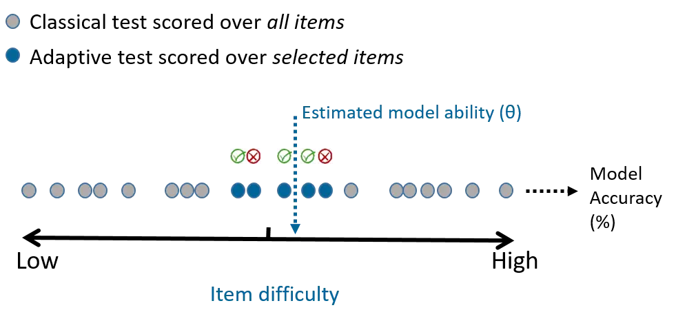
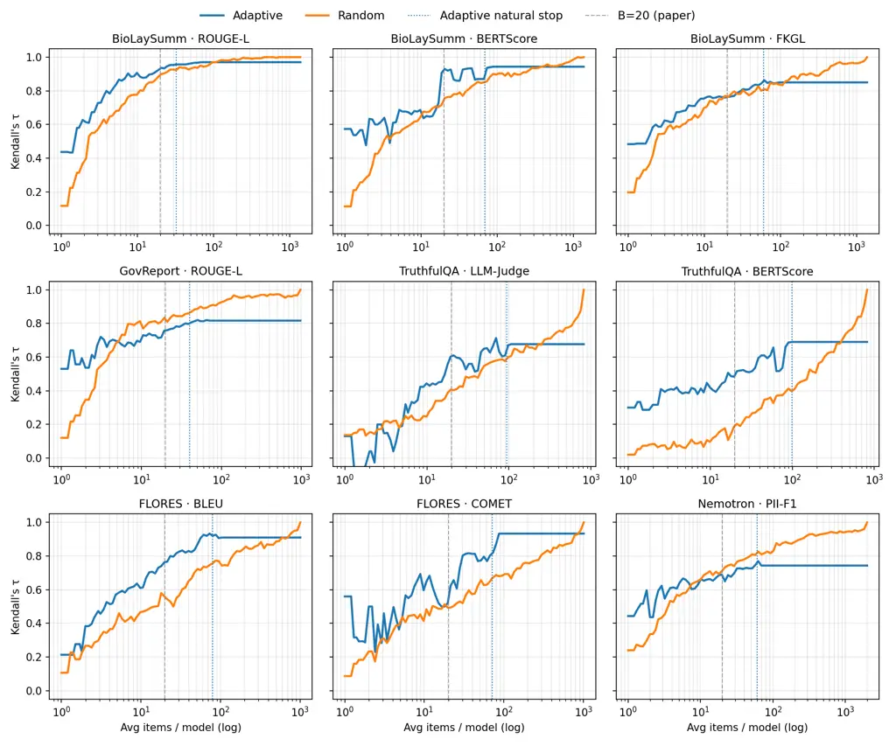
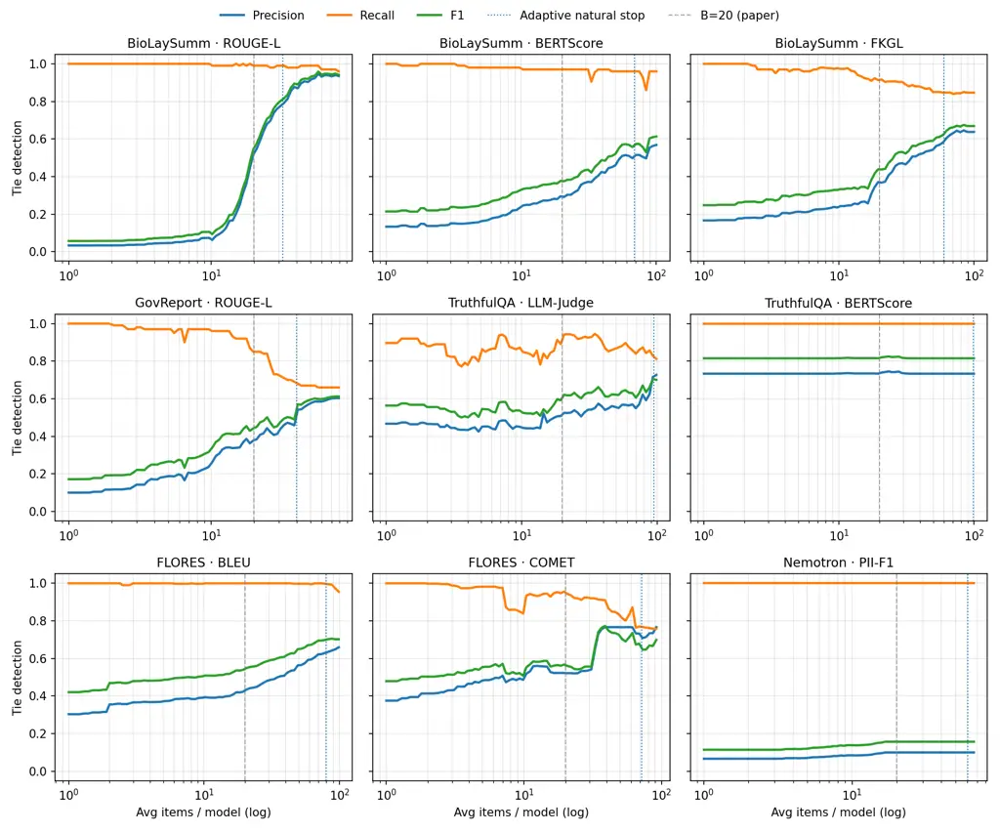

# Confident Rankings with Fewer Items: Adaptive LLM Evaluation with Continuous Scores

Esma Balkır Affiliation: Trismik    Alice Pernthaller
Affiliation: Trismik    Marco Basaldella ^(†)^(†)thanks: Work done while
at Trismik.    José Hernández-Orallo ^(†)^(†)thanks: Joint senior
authors. Affiliation: Leverhulme Centre for the Future of Intelligence,
University of Cambridge Affiliation: Universitat Politècnica de València
   Nigel Collier²²footnotemark: 2 Affiliation: Trismik
Affiliation: University of Cambridge{esma, alice}@trismik.com, {jh2135,
nhc30}@cam.ac.uk

###### Abstract

Computerized Adaptive Testing (CAT) has proven effective for efficient
LLM evaluation on multiple-choice benchmarks, but modern LLM evaluation
increasingly relies on generation tasks where outputs are scored
continuously rather than marked correct/incorrect. We present a
principled extension of IRT-based adaptive testing to continuous bounded
scores (ROUGE, BLEU, LLM-as-a-Judge) by replacing the Bernoulli response
distribution with a heteroskedastic normal distribution. Building on
this, we introduce an uncertainty aware ranker with adaptive stopping
criteria that achieves reliable model ranking while testing as few items
and as cheaply as possible. We validate our method on five benchmarks
spanning n-gram-based, embedding-based, and LLM-as-judge metrics. Our
method improves ranking correlation by 0.13 $`\tau`$ over random
sampling and has 99% accuracy on confident predictions while using 2% of
the items after a one-time calibration step.

## 1 Introduction

Rigorous evaluation of large language models is essential, but current
practice faces many challenges. One is cost: exhaustive evaluation
becomes expensive as the number of models, test items, and metrics
grows. Another is methodological: score differences are often reported
without significance testing, leading many studies to mistake
statistical noise with improved performance and produce non-replicable
results (Dror et al., 2018). Efficient evaluation methods that maintain
statistical validity remain underexplored.

Computerized Adaptive Testing (CAT) and Item Response Theory (IRT)
originate in psychometrics, where they estimate test-takers’ latent
ability on a construct of interest. In ML evaluation Liu et al. (2024),
the same statistical machinery has been adopted as scaffolding for
efficient sampling: identifying representative subsets or adaptively
selecting items so that rankings can be recovered with far fewer
evaluations than exhaustive benchmarking (Martínez-Plumed et al., 2016;
Maia Polo et al., 2024; Rodriguez et al., 2021; Kipnis et al., 2025),
with recent work extending this to fully adaptive item selection
(Hofmann et al., 2025). We follow this efficiency-focused lineage: we
assume that the benchmark scores reflect a capability that the
practitioner is interested in, and aim to recover the ranking that full
evaluation would produce.

Existing CAT approaches for LLM evaluation focus exclusively on
multiple-choice datasets where responses can only be correct or
incorrect. However, many of the tasks that reflect real use cases of
LLMs such as summarization, dialogue, instruction following and machine
translation must be scored on a continuous scale. These scoring
strategies cover traditional metrics such as BLEU (Papineni et al., 2002) and ROUGE (Lin, 2004), and embedding similarity-based scores such
as BERTScore (Zhang et al., 2020) and COMET (Rei et al., 2020).
LLM-as-judge evaluation (Zheng et al., 2023; Liu et al., 2023), now
widely adopted for assessing instruction following and open-ended
generation, also produces ordinal ratings that can be normalized and
treated as continuous.

We present a continuous extension of IRT-based adaptive testing that
accommodates real-valued scores while preserving the mathematical
structure of binary CAT. Our key insight is to replace the Bernoulli
response distribution with a heteroskedastic normal distribution that
maintains the same logistic mean function while introducing variance
that mimics the Bernoulli structure. This preserves the natural property
that variance is highest when the expected score $`\mu`$ is most
uncertain ($`\mu=0.5`$) and shrinks at the boundaries.

Continuous CAT already reduces evaluation cost substantially, but
further savings are possible when we consider how evaluation results are
typically used. Model evaluation is fundamentally comparative: the
primary goal is often to determine whether one model is better than
others on a given benchmark. Building on continuous CAT, we introduce an
adaptive multi-model ranking method that efficiently obtains
statistically significant rankings by monitoring uncertainty estimates
around model scores. Rather than testing each model to a fixed precision
threshold, we stop as soon as models are well-differentiated based on
pairwise confidence at a user-specified level. This focuses the testing
effort on close competitors while reducing items for clearly separated
models. Within this framework, we further observe that when
distinguishing two models, testing either one yields useful information,
allowing cost-aware allocation that preferentially tests cheaper models
to maximize uncertainty reduction per dollar spent.

We validate our approach on five generation benchmarks that span
summarization (GovReport, BioLaySumm2025), named entity recognition
(Nemotron PII), question answering (TruthfulQA) and translation
(FLORES). For each dataset, we evaluate 5 disjoint sets of 4 hold-out
models and multiple metric types (ROUGE, BLEU, BERTScore, COMET,
readability indices, LLM-as-judge). Our adaptive ranker achieves 0.75
Kendall’s $`\tau`$ correlation with ground-truth rankings while using
only 2% of the full evaluation budget at evaluation time, outperforming
random sampling by 0.13 $`\tau`$. This figure excludes the one-time cost
of calibrating item parameters, which is amortized over subsequent
evaluations and breaks even after roughly 70 model evaluations on a
dataset (Appendix C). Compared to fixed-length CAT, adaptive stopping
provides an additional 32% item reduction and 39% cost savings.

Our contributions are:

1.  1.  A principled extension of IRT-based CAT from binary to continuous
        bounded outcomes via heteroskedastic normal distribution
2.  2.  Adaptive multi-model ranking algorithm with pairwise stopping and
        cost-aware allocation
3.  3.  Empirical validation across diverse generation tasks, metrics, and
        model scales

The continuous CAT framework opens adaptive testing to the full spectrum
of modern LLM evaluation, and the adaptive multi-model ranker enables
efficient comparisons of generation quality across model candidates. We
make our code available.¹¹ 1
[https://github.com/trismik/continuous-cat](https://github.com/trismik/continuous-cat)

## 2 Related Work

Early studies on efficient model evaluation used IRT to analyze
benchmark properties such as item difficulty and discrimination
(Martínez-Plumed et al., 2016; Lalor et al., 2016; Vania et al., 2021;
Rodriguez et al., 2021). Maia Polo et al. (2024) and Kipnis et al.
(2025) used IRT to identify representative static subsets, while Hofmann
et al. (2025) developed a fully adaptive framework that dynamically
selects items during evaluation. However, all existing approaches assume
binary outcomes and cannot accommodate the continuous scores. Lalor et
al. (2016) applied IRT to construct evaluation scales for NLP systems,
and Prudêncio et al. (2015) and Lalor et al. (2019) showed that IRT
models can be fit using response patterns from model ensembles rather
than human annotations. Chen et al. (2019) proposed a Beta-distributed
IRT model applied to modelling classifier confidence scores.

This follows the tradition in psychometrics, with Samejima (1973)
introducing the continuous response model, and Noel and Dauvier (2007)
proposing Beta-distributed models that naturally respect $`[0,1]`$
bounds. Both introduce additional complexity to Fisher Information
calculations, complicating item selection. Beta models also cannot
accommodate exact boundary values, requiring either ad hoc
transformations or zero-and-one inflated extensions (Molenaar et al.,
2022). Related continuous-response formulations include linear
factor-analytic indices for difficulty and information, and Rasch-type
models for continuous responses in large-scale learning systems
(Ferrando, 2009; Deonovic et al., 2020). These typically assume
homoskedastic residuals or prioritize scalable scoring over closed-form
CAT information. Mellenbergh (1994) developed generalized linear IRT
with simpler closed-form solutions, but assumes constant variance across
the score range. Our heteroskedastic normal formulation combines
simplicity with appropriate variance structure and maintains direct
compatibility with standard CAT algorithms.

## 3 Background

#### Item Response Theory (IRT)

(Hambleton et al., 1991) models the probability of a correct response as
a function of the test-taker’s latent ability $`\theta`$ and item
parameters. The simplest model, the 1-Parameter Logistic (1PL) model,
defines this probability as:

```math
P(X=1|\theta,a,b)=\frac{1}{1+\exp(-a(\theta-b))} \tag{1}
```

where $`b`$ is item difficulty and $`a`$ is a discrimination parameter
shared across all items. When ability matches difficulty ($`\theta=b`$),
the probability of success is exactly 0.5. Higher $`a`$ yields steeper
response curves that better differentiate between ability levels.



Figure 1: Adaptive testing focuses on items around the model ability,
skipping those for which it would most certainly (i.e., uninformatively)
get high or low scores.

#### Computerized adaptive testing (CAT)

(Wainer, 2000) dynamically selects items to efficiently estimate a
test-taker’s ability (see Figure 1). The algorithm initializes with a
prior distribution over $`\theta`$, typically
$`\mathcal{N}(0,\sigma_{0}^{2})`$ where the prior variance is a
hyperparameter controlling initial uncertainty. At each iteration, it
selects the item that maximizes Fisher Information at the current
ability estimate $`i^{*}=\arg\max_{i}I(\hat{\theta}|b_{i})`$. After
observing the response, the ability estimate and posterior are updated
via Bayesian updating. As items accumulate, the standard error
$`\text{SE}(\hat{\theta})=1/\sqrt{\sum_{i=1}^{n}I_{i}(\hat{\theta})}`$
decreases. Testing terminates when it falls below a predetermined
threshold.

#### Fisher Information

quantifies how much an observation tells us about $`\theta`$. For the
1PL model with binary outcomes, this is derived directly from Bernoulli
variance:

```math
I(\theta|a,b)=a^{2}\cdot P(\theta,b)\cdot(1-P(\theta,b)) \tag{2}
```

Information is highest when $`P=0.5`$ (maximum uncertainty about the
outcome) and approaches zero as $`P`$ approaches 0 or 1 (outcome nearly
certain). This creates heteroskedastic variance as a function of the
predicted probability $`P(\theta,b)`$.

Figure 2: The adaptive multi-model ranker on four models $`A`$–$`D`$
(illustrative). After warm-up, posteriors over ability $`\theta`$ are
wide and every adjacent pair in the ranking is uncertain (left). Testing
then concentrates on the remaining uncertain pair: clearly separated
models stop receiving items, and the next item goes to the cheaper model
of the pair, chosen at maximum Fisher information (middle). The run
stops when every adjacent pair is either confidently ordered or reported
as a tie at the budget (right). $`n`$ is the number of items
administered to each model.

## 4 Continuous CAT

To extend CAT to continuous outcomes, we require a response distribution
for scores in $`[0,1]`$ rather than binary $`\{0,1\}`$. We retain the
logistic mean function from standard IRT, which captures the
relationship between ability, difficulty, and expected performance, and
replace the Bernoulli distribution with a normal distribution:

```math
X|\theta,b,k\sim\mathcal{N}(\mu(\theta,b),\sigma^{2}(\theta,b)) \tag{3}
```

where the mean follows the logistic function:

```math
\mu(\theta,b)=\frac{1}{1+\exp(-(\theta-b))} \tag{4}
```

We preserve the Bernoulli variance structure $`\text{Var}(X)=P(1-P)`$ by
defining:

```math
\sigma^{2}(\theta,b)=k\cdot\mu(\theta,b)\cdot(1-\mu(\theta,b)) \tag{5}
```

where $`k=1/a^{2}`$ is a noise parameter capturing measurement
precision. We estimate a single $`k`$ per dataset-metric combination
from calibration data.

Since both the mean and the variance of the response distribution depend
on $`\theta`$, the Fisher Information for this model has two terms:

```math
I(\theta|b,k)=\frac{\mu(1-\mu)}{k}+\frac{(1-2\mu)^{2}}{2} \tag{6}
```

Throughout, we use the first term $`\tilde{I}(\theta|b,k)=\mu(1-\mu)/k`$
and ignore the second term. This simplification is safe since the full
information is linear in $`u=\mu(1-\mu)`$, so it orders items
identically to $`\tilde{I}\propto u`$ whenever $`a=1/\sqrt{k}>\sqrt{2}`$
(8 of our 9 dataset-metric pairs), and the omitted term is nonnegative,
so $`\tilde{I}`$ only overstates standard errors. Appendix E gives the
derivation and an empirical comparison confirming that the full FI
changes nothing on the $`a>\sqrt{2}`$ pairs and destabilizes the one
low-discrimination dataset.

Comparing $`\tilde{I}`$ with the 1PL Fisher Information
$`I=a^{2}\cdot P(1-P)`$, we see that $`k=1/a^{2}`$: high discrimination
($`a>1`$) corresponds to low noise ($`k<1`$), and vice versa. Both
parameterizations capture the same underlying question: how reliably
does an observed response reflect $`\theta`$? This equivalence indicates
that our continuous extension constitutes a natural generalization that
unifies the treatment of measurement precision across binary and
continuous settings.

A limitation of the normal distribution is its unbounded support: it can
technically assign probability to values outside $`[0,1]`$. However, the
heteroskedastic variance structure mitigates this concern: as $`\mu`$
approaches the boundaries, $`\sigma^{2}=k\cdot\mu(1-\mu)`$ shrinks,
concentrating the distribution within the valid range. Alternatives such
as the $`\beta`$-distribution are naturally bounded but do not preserve
the connection to binary IRT and complicate the Fisher Information
derivation. In practice, we find that the normal approximation performs
well across the metrics we consider.

The CAT algorithm itself remains unchanged. Item selection still
maximizes Fisher Information at the current ability estimate, with the
information formula now incorporating $`k`$. Posterior updates follow
the same Bayesian logic with normal likelihoods. The standard error
formula $`\text{SE}(\hat{\theta})=1/\sqrt{\sum_{i}I_{i}}`$ applies as
before.

## 5 Parameter Estimation

We estimate both $`b_{i}`$ and $`k`$ from historical evaluation data by
fitting the model to observed score distributions across a population of
models.

#### Item Difficulty.

We adopt the 1PL model and estimate item difficulties from observed
scores across calibration models. Following standard IRT convention, we
center the ability scale such that the mean model ability is zero. Under
this parameterization, the maximum likelihood estimate for item
difficulty simplifies to:

```math
b_{i}=-\text{logit}(\hat{p}_{i})=\log\left(\frac{1-\hat{p}_{i}}{\hat{p}_{i}}\right) \tag{7}
```

where $`\hat{p}_{i}`$ is the average score on item $`i`$ across all
calibration model-temperature configurations. When scores cluster in a
narrow range (e.g. like ROUGE where most models achieve 0.3–0.5), the
resulting difficulties may not span the full ability range. We therefore
apply min-max normalization to $`[\epsilon,1-\epsilon]`$ before the
logit transformation.

#### Noise Parameter.

We estimate a global $`k`$ from the calibration data using
method-of-moments. Given item difficulties $`\{b_{i}\}`$ and model
ability estimates $`\{\theta_{j}\}`$ (computed as
$`\theta_{j}=\text{logit}(\bar{y}_{j})`$ where $`\bar{y}_{j}`$ is the
model’s average scaled score), we obtain:

```math
k=\frac{\sum_{i,j}(y_{ij}-\mu_{ij})^{2}}{\sum_{i,j}\mu_{ij}(1-\mu_{ij})} \tag{8}
```

where $`\mu_{ij}=\text{logit}^{-1}(\theta_{j}-b_{i})`$ is the predicted
mean score for model $`j`$ on item $`i`$. This formula directly
estimates the variance inflation factor: when $`k=1`$, observed variance
matches the Bernoulli structure exactly; $`k>1`$ indicates noisier
measurements than binary responses; $`k<1`$ indicates more precise
measurements.

#### Filtering Negative Discrimination Items.

Some items may anti-correlate with model ability. On these items, weaker
models score higher than stronger models, rendering them effectively
uninformative. Because we use a 1PL model with a global discrimination
parameter, we filter such items by computing the Pearson correlation
between item scores and model abilities across the calibration set, and
excluding items with negative correlation from the adaptive item pool.

## 6 Adaptive Ranker

0:  Models $`\{1,\ldots,M\}`$, item bank $`\{b_{i}\}`$ with global noise
$`k`$, costs $`\{c_{m}\}`$, confidence $`\gamma`$, max items
$`n_{\text{max}}`$

1:  Initialize
$`\hat{\theta}_{m}\sim\mathcal{N}(\text{median}({b}_{i}),25)`$,

2:  Warm-up: Administer $`n_{\text{init}}`$ items to each model using
MFI selection

3:  while not all adjacent pairs confident or at max items do

4:   Rank models by $`\hat{\theta}_{m}`$

5:   Identify uncertain pairs:
$`\mathcal{U}=\{(i,j):\gamma>P(\theta_{i}>\theta_{j})>1-\gamma\text{ and }n_{i}<n_{\text{max}}\text{ and }n_{j}<n_{\text{max}}\}`$

6:   if $`\mathcal{U}=\emptyset`$ then

7:    break

8:   end if

9:   Collect candidate models:
$`\mathcal{C}=\{m:m\in(i,j)\text{ for some }(i,j)\in\mathcal{U}\}`$

10:   Select model:
$`m^{*}=\arg\max_{m\in\mathcal{C}}\frac{\text{SE}_{m}^{2}}{(n_{m}+1)\cdot c_{m}}`$

11:   Select item: $`i^{*}=\arg\max_{i}I(\hat{\theta}_{m^{*}}|b_{i},k)`$

12:   Administer item $`i^{*}`$ to model $`m^{*}`$, observe score $`y`$

13:   Update $`\hat{\theta}_{m^{*}}`$ and $`\text{SE}_{m^{*}}`$

14:  end while

15:  return Ranking with pairwise confidence scores

Algorithm 1 Adaptive Multi-Model Ranking

Standard CAT runs each model independently until its own standard error
falls below the fixed precision threshold $`\epsilon`$ introduced in §4.
However, when model ranking is the main goal and $`\hat{\theta}`$ values
are an intermediate quantity used to place all models on a shared scale,
this is inefficient: a model whose ability lies several standard errors
above the next-best receives the same item budget as two models within
half a standard error of each other, even though only the latter pair
requires further testing to establish their relative order. We propose
an adaptive multi-model ranking algorithm (Algorithm 1) that directly
optimizes for the comparative goal. Given $`M`$ models to evaluate on a
shared item bank, the algorithm runs independent CAT estimators for each
model, but monitors pairwise confidence in the ranking and terminates
when all adjacent model pairs are statistically well-differentiated at a
user-specified confidence level. Figure 2 illustrates the procedure.

#### Pairwise confidence.

Given ability estimates $`\hat{\theta}_{i}`$ and $`\hat{\theta}_{j}`$
with standard errors $`\text{SE}_{i}`$ and $`\text{SE}_{j}`$, we compute
the probability that model $`i`$ outperforms model $`j`$ under a normal
approximation:

```math
P(\theta_{i}>\theta_{j})=\Phi\left(\frac{\hat{\theta}_{i}-\hat{\theta}_{j}}{\sqrt{\text{SE}_{i}^{2}+\text{SE}_{j}^{2}}}\right) \tag{9}
```

where $`\Phi`$ is the standard normal CDF. This quantifies our
confidence in the pairwise ordering given current uncertainty in both
estimates.

#### Adaptive stopping.

Traditional CAT terminates when each model’s standard error falls below
a threshold $`\epsilon`$, regardless of how the models compare. We
instead terminate when all adjacent pairs in the current ranking satisfy
$`P(\theta_{i}>\theta_{j})>1-\frac{1-\gamma}{2}`$ or
$`P(\theta_{i}>\theta_{j})<\frac{1-\gamma}{2}`$, corresponding to a
two-sided confidence interval at level $`\gamma`$, or we reach a maximum
item budget $`n_{\text{max}}`$. This focuses testing effort where it
matters: models that are clearly separated require fewer items to
establish their relative ordering, while close competitors receive
additional testing until their difference reaches statistical
significance or the budget is exhausted. If two models remain
indistinguishable at the budget limit, they can be reported as tied
rather than forced into an arbitrary ordering.

#### Cost-aware allocation.

When a pair $`(i,j)`$ requires additional testing to reach confidence
threshold $`\gamma`$, we must choose which model to evaluate next. Since
testing either model reduces uncertainty in the pairwise comparison, we
select the model that provides the greatest expected uncertainty
reduction per unit cost:

```math
\text{value}_{m}=\frac{\text{SE}_{m}^{2}}{(n_{m}+1)\cdot c_{m}} \tag{10}
```

where $`n_{m}`$ is the number of items already administered to model
$`m`$ and $`c_{m}`$ is its per-item evaluation cost. The numerator
reflects current uncertainty; the denominator captures diminishing
returns (each additional item contributes less) weighted by cost. This
criterion naturally allocates more items to cheaper models when
resolving uncertain comparisons, yielding additional cost savings beyond
item reduction alone.

#### Algorithm.

The complete procedure combines continuous CAT estimation with pairwise
stopping and cost-aware allocation under a total budget constraint.
Rather than allocating a fixed maximum number of items per model, we
specify a total cost budget $`B`$ that can be flexibly distributed
across models. After a warm-up phase that administers initial items to
all models via MFI selection, the algorithm iteratively identifies
uncertain pairs, selects the most cost-effective model to test, chooses
the maximally informative item for that model, and updates posteriors.
Testing continues until either all adjacent pairs reach the confidence
threshold, or the total budget $`B`$ is exhausted.

## 7 Experiments

We evaluate our continuous CAT extension and adaptive ranker across five
generation tasks spanning summarization, machine translation, question
answering, and named entity recognition. Our goal is to approximate
ground-truth rankings from full dataset evaluation using as few items as
possible.

### 7.1 Experimental Protocol

We select tasks representing diverse generation settings and metric
types (Table 1). This selection covers n-gram overlap (ROUGE, BLEU),
learned embeddings (BERTScore, COMET), readability indices (FKGL),
LLM-as-judge, and span-level F1. We exclude BERTScore from GovReport as
all models achieved near-identical scores (range $`<`$0.02), yielding no
meaningful ground-truth ranking. Full prompts and scoring details are
provided in Appendix A.

|                                    |       |                                               |                                   |                              |
| ---------------------------------- | ----- | --------------------------------------------- | --------------------------------- | ---------------------------- |
| Dataset                            | Size  | Split                                         | Task                              | Metrics                      |
| BioLaySumm (Goldsack et al., 2024) | 1,376 | val                                           | Lay summarization                 | ROUGE-L, BERTScore, FKGL     |
| GovReport (Huang et al., 2021)     | 973   | val                                           | Document summarization            | ROUGE-L                      |
| TruthfulQA (Lin et al., 2022)      | 817   | val                                           | Open-ended QA                     | LLM-Judge, BERTScore (diff.) |
| FLORES (NLLB Team et al., 2022)    | 1,012 | devtest                                       | Translation (TR$`\rightarrow`$EN) | COMET, BLEU                  |
| Nemotron-PII (Steier et al., 2025) | 2,000 | test²² 2 Randomly sampled from full test set. | NER/PII detection                 | F1 (span-level)              |

Table 1: Evaluation datasets. FKGL: Flesch-Kincaid Grade Level (Kincaid
et al., 1975).

We evaluate 21 models from 6 families: OpenAI GPT, Google Gemini, Amazon
Nova, Meta Llama, Mistral, and Qwen (see Appendix A for full list). For
each dataset-metric pair, we collect exhaustive evaluation scores by
running all models on all items, establishing ground-truth rankings.
Each model is evaluated at four temperature settings
($`T\in\{0.0,0.4,0.7,1.0\}`$), which yields 84 model-temperature
configurations per item. Our main experiment uses five-fold
cross-validation over models. In each fold, we randomly select 4 models
as the hold-out set to be ranked adaptively; all temperature variants of
hold-out models are excluded from calibration. The remaining 17 models
(68 configurations) provide calibration data for estimating item
parameters $`(b_{i},k)`$. We fit parameters via maximum likelihood on
the calibration set, then simulate adaptive evaluation on the hold-out
models at $`T=0`$. We set the confidence threshold $`\gamma=0.95`$ for
pairwise decisions and require a minimum of 10 items per model before
stopping.

For each hold-out set, we compare the adaptive ranker to two baselines
at the same matched cost. _Random sampling_ allocates the total budget
$`B`$ across models by iteratively selecting a random affordable model
and a random unseen item to administer, stopping at the first draw whose
cost exceeds the remaining budget. A _most-informative static subset_
transposes static subset selection (Maia Polo et al., 2024; Kipnis et
al., 2025) to continuous scores: per fold, items are ranked by their
corrected item–total correlation on the calibration models and
accumulated greedily until the next item would exceed the budget; the
identical subset is administered to every holdout model, which is then
ranked by its mean normalized score. We assess ranking quality using
Kendall’s $`\tau`$ correlation between predicted and ground-truth
rankings computed from point estimates (mean $`\hat{\theta}`$). For
efficiency, we report the mean number of items administered per model.

#### Budget.

We set $`B`$ to the cost equivalent of 20 items per model. At this
budget the adaptive ranker is in a budget-constrained regime: its
pairwise-confidence stopping rule would naturally fire at roughly 30–100
items per model depending on dataset. Appendix D traces ranking quality
as a function of $`B`$ and shows that adaptive outperforms random
sampling across the small-to-mid budget regime that motivates this work,
with the gap shrinking as $`B`$ approaches full evaluation.

### 7.2 Main Results

|                |           |      |       |                                |                              |                              |              |                       |
| -------------- | --------- | ---- | ----- | ------------------------------ | ---------------------------- | ---------------------------- | ------------ | --------------------- |
| Dataset        | Metric    | Size | $`a`$ | Adaptive $`\tau`$ $`\uparrow`$ | Random $`\tau`$ $`\uparrow`$ | Static $`\tau`$ $`\uparrow`$ | Items        | % Used $`\downarrow`$ |
| BioLaySumm     | ROUGE-L   | 1376 | 4.10  | 0.957$`\pm`$0.11               | 0.853$`\pm`$0.20             | 0.800$`\pm`$0.16             | 81$`\pm`$18  | 1.5$`\pm`$0.3%        |
| BioLaySumm     | BERTScore | 1376 | 3.57  | 0.930$`\pm`$0.14               | 0.750$`\pm`$0.36             | 0.533$`\pm`$0.45             | 90$`\pm`$10  | 1.6$`\pm`$0.2%        |
| BioLaySumm     | FKGL      | 1376 | 2.42  | 0.777$`\pm`$0.28               | 0.750$`\pm`$0.38             | 0.733$`\pm`$0.39             | 91$`\pm`$15  | 1.6$`\pm`$0.3%        |
| GovReport      | ROUGE-L   | 973  | 4.67  | 0.813$`\pm`$0.18               | 0.820$`\pm`$0.24             | 0.667$`\pm`$0.21             | 95$`\pm`$29  | 2.4$`\pm`$0.8%        |
| TruthfulQA     | LLM-Judge | 817  | 2.63  | 0.637$`\pm`$0.39               | 0.417$`\pm`$0.43             | 0.600$`\pm`$0.25             | 93$`\pm`$12  | 2.8$`\pm`$0.4%        |
| TruthfulQA     | BERTScore | 817  | 2.68  | 0.520$`\pm`$0.38               | 0.193$`\pm`$0.46             | 0.533$`\pm`$0.45             | 93$`\pm`$7   | 2.9$`\pm`$0.2%        |
| FLORES         | BLEU      | 1012 | 3.15  | 0.760$`\pm`$0.23               | 0.563$`\pm`$0.43             | 0.933$`\pm`$0.13             | 91$`\pm`$8   | 2.2$`\pm`$0.2%        |
| FLORES         | COMET     | 1012 | 3.96  | 0.670$`\pm`$0.28               | 0.513$`\pm`$0.41             | 0.800$`\pm`$0.27             | 101$`\pm`$10 | 2.5$`\pm`$0.3%        |
| Nemotron       | F1        | 2000 | 1.39  | 0.673$`\pm`$0.27               | 0.717$`\pm`$0.28             | 0.800$`\pm`$0.16             | 52$`\pm`$4   | 0.6$`\pm`$0.1%        |
| Overall (mean) |           |      | 3.17  | 0.75                           | 0.62                         | 0.71                         | 87           | 2.0%                  |

Table 2: Ranking performance across benchmarks. Higher discrimination
($`a`$, mean over calibration folds) indicates more informative items.
Items is the total number of items administered across the four hold-out
models. % Used is Items divided by ($`4\times`$ Size), i.e., the
fraction of the full hold-out evaluation. Random and Static are the two
matched-cost baselines of §7.1; the static subset (15–21 items) is
deterministic within a fold, so its $`\tau`$ is aggregated over the 5
folds.

Table 2 presents results across all dataset-metric combinations. On 7 of
9 dataset-metric pairs, the adaptive ranker achieves higher Kendall’s
$`\tau`$ than the random sampling baseline. The largest gains occur on
discriminative metrics: +0.10 $`\tau`$ on BioLaySumm ROUGE-L (0.957 vs
0.853), +0.33 on TruthfulQA BERTScore (0.520 vs 0.193), and +0.20 on
FLORES BLEU (0.760 vs 0.563). These results demonstrate that our
adaptive ranker provides genuine performance gains over random sampling.
The adaptive ranker uses 52–101 items per hold-out set, and achieves
0.75 $`\tau`$ with the full dataset ranking while using only 2% of the
items per new-model evaluation (excluding the one-time calibration cost;
Appendix C).

The discrimination parameter $`a`$ predicts where adaptive methods
provide the most benefit. On high-discrimination metrics ($`a>3`$), the
adaptive ranker matches or outperforms random sampling. On
low-discrimination metrics like Nemotron F1 ($`a=1.39`$), individual
items provide less information, limiting the advantage of intelligent
selection.

#### Comparison to the informed static subset.

Although our model cannot target discrimination explicitly, the items it
selects are typically also the items whose scores vary most across
models, so adaptive selection could still act as an implicit proxy for
concentrating evaluation on empirically discriminative items. We test
whether this is the main source of the adaptive method’s gains by
administering a static highest discrimination set with matched cost. We
find that the static subset trails adaptive testing on average
($`\tau=0.71`$ vs 0.75), although it wins on 4 of 9 pairs, against 4 for
adaptive and one for random. However, a fixed subset yields only a point
ranking, identical whether models are cleanly separated or statistically
indistinguishable, whereas the adaptive ranker additionally provides
pairwise confidence, early stopping, cost-aware allocation, and tie
detection. The out-of-family evaluation (§7.5) also shows that the
static subset method is more brittle when ranking models less similar to
those found in the calibration set.

|                |           |            |         |                    |                    |                     |                       |
| -------------- | --------- | ---------- | ------- | ------------------ | ------------------ | ------------------- | --------------------- |
| Dataset        | Metric    | Adapt Tie% | GT Tie% | Tie P $`\uparrow`$ | Tie R $`\uparrow`$ | Tie F1 $`\uparrow`$ | Conf Acc $`\uparrow`$ |
| BioLaySumm     | ROUGE-L   | 13%        | 3%      | 0.63               | 0.99               | 0.66                | 1.00                  |
| BioLaySumm     | BERTScore | 40%        | 13%     | 0.32               | 0.97               | 0.39                | 1.00                  |
| BioLaySumm     | FKGL      | 37%        | 17%     | 0.39               | 0.92               | 0.45                | 0.98                  |
| GovReport      | ROUGE-L   | 18%        | 10%     | 0.42               | 0.76               | 0.47                | 0.94                  |
| TruthfulQA     | LLM-Judge | 79%        | 47%     | 0.52               | 0.91               | 0.61                | 0.98                  |
| TruthfulQA     | BERTScore | 98%        | 73%     | 0.74               | 1.00               | 0.82                | 1.00                  |
| FLORES         | BLEU      | 59%        | 30%     | 0.44               | 1.00               | 0.55                | 1.00                  |
| FLORES         | COMET     | 54%        | 37%     | 0.52               | 0.92               | 0.54                | 0.98                  |
| Nemotron       | F1        | 61%        | 7%      | 0.09               | 1.00               | 0.14                | 0.98                  |
| Overall (mean) |           | 51%        | 26%     | 0.45               | 0.94               | 0.51                | 0.99                  |

Table 3: Tie detection against ground-truth ties from bootstrap CIs on
full evaluation. Adapt/GT Tie% are the fraction of pairs reported as
ties for adaptive ranker and ground truth. Tie P/R/F1 are the precision,
recall and F1 on tie detection quality of the adaptive ranker compared
to the full evaluation. Conf Acc is the accuracy of the adaptive ranker
on its non-tie predictions.

#### Distributional Conformance.

In practice, metrics conform to the assumed variance structure
$`\sigma^{2}=k\cdot\mu(1-\mu)`$ to widely varying degrees, yet ranking
quality does not track this conformance: the best-ranking metric is
among the worst conformers, and it is low discrimination rather than
poor fit that marks the settings where adaptive selection struggles.
Appendix B presents the analysis; violations of the variance assumption
do not degrade ranking performance when items are sufficiently
discriminative.

|            |           |                             |                             |                |              |              |
| ---------- | --------- | --------------------------- | --------------------------- | -------------- | ------------ | ------------ |
| Dataset    | Metric    | Adapt $`\tau`$ $`\uparrow`$ | Fixed $`\tau`$ $`\uparrow`$ | $`\Delta\tau`$ | Item Savings | Cost Savings |
| BioLaySumm | BERTScore | 0.93                        | 0.94                        | +0.01          | 36%          | 42%          |
| BioLaySumm | FKGL      | 0.78                        | 0.78                        | +0.01          | 32%          | 36%          |
| BioLaySumm | ROUGE-L   | 0.96                        | 0.92                        | $`-`$0.03      | 39%          | 43%          |
| FLORES     | BLEU      | 0.76                        | 0.83                        | +0.07          | 31%          | 40%          |
| FLORES     | COMET     | 0.67                        | 0.87                        | +0.20          | 34%          | 46%          |
| GovReport  | ROUGE-L   | 0.81                        | 0.76                        | $`-`$0.05      | 34%          | 41%          |
| Nemotron   | F1        | 0.67                        | 0.74                        | +0.07          | 24%          | 30%          |
| TruthfulQA | BERTScore | 0.52                        | 0.57                        | +0.05          | 28%          | 37%          |
| TruthfulQA | LLM-Judge | 0.64                        | 0.57                        | $`-`$0.06      | 27%          | 39%          |
| Overall    |           | 0.75                        | 0.78                        | +0.03          | 32%          | 39%          |

Table 4: Isolating the stopping rule. Fixed-length CAT administers
$`n=\max`$ items adaptive used per holdout to every model, so it sees a
strict superset of adaptive’s items in the same holdout. Any $`\tau`$
difference ($`\Delta\tau=\text{Fixed}-\text{Adapt}`$) reflects only the
value of those extra items; any cost difference reflects only what
stopping saved.

|            |           |                            |                              |                             |
| ---------- | --------- | -------------------------- | ---------------------------- | --------------------------- |
| Dataset    | Metric    | Base $`\tau`$ $`\uparrow`$ | Static $`\tau`$ $`\uparrow`$ | Adapt $`\tau`$ $`\uparrow`$ |
| BioLaySumm | BERTScore | 0.13$`\pm`$0.64            | 1.00$`\pm`$0.00              | 0.33$`\pm`$0.00             |
| BioLaySumm | FKGL      | 0.90$`\pm`$0.24            | 1.00$`\pm`$0.00              | 1.00$`\pm`$0.00             |
| BioLaySumm | ROUGE-L   | 0.80$`\pm`$0.37            | 1.00$`\pm`$0.00              | 0.70$`\pm`$0.33             |
| FLORES     | BLEU      | 0.83$`\pm`$0.29            | 1.00$`\pm`$0.00              | 1.00$`\pm`$0.00             |
| FLORES     | COMET     | 0.77$`\pm`$0.32            | 1.00$`\pm`$0.00              | 0.90$`\pm`$0.24             |
| GovReport  | ROUGE-L   | 0.77$`\pm`$0.32            | 0.97$`\pm`$0.15              | 0.97$`\pm`$0.15             |
| Nemotron   | F1        | 0.73$`\pm`$0.33            | 0.33$`\pm`$0.00              | 0.53$`\pm`$0.31             |
| TruthfulQA | BERTScore | 0.37$`\pm`$0.61            | $`-`$0.33$`\pm`$0.00         | 0.87$`\pm`$0.27             |
| TruthfulQA | LLM-Judge | $`-`$0.07$`\pm`$0.61       | $`-`$0.27$`\pm`$0.20         | 0.57$`\pm`$0.32             |
| Overall    |           | 0.58                       | 0.63                         | 0.76                        |

Table 5: Family holdout evaluation. Calibration on OpenAI, Llama, Gemini
(14 models); evaluation on hold-out Mistral, Qwen, Nova (3 models). The
protocol matches the main experiment (total budget $`B`$, real per-model
costs); Base is random sampling at matched cost, and Static is the
most-informative subset of §7.1 selected on the calibration families
only (it varies across seeds only through the per-seed matched budget).

### 7.3 Tie Detection

The $`\tau`$ correlation in Table 2 measures ranking accuracy based on
point estimates, but point estimates alone do not indicate when a
ranking is reliable. Our method uses the IRT model’s posterior to detect
statistical ties, where a pair is reported as a tie when confidence
falls below 95%.

Table 3 presents tie detection performance of the adaptive ranker
against ground-truth ties derived from bootstrap confidence intervals on
full evaluation. The adaptive ranker is consistently conservative: Adapt
Tie% exceeds GT Tie% for all metrics. Tie detection recall is high
(0.76–1.00), which means that our method catches most ground-truth ties.
For pairs where one model is ranked strictly higher than the other,
overall accuracy is 99%. TruthfulQA BERTScore reports 98% ties because
all models score within a 0.7% range, and the differences are too small
to resolve within the budget constraints; the few confidently ordered
pairs are all correct.

The weakest case is GovReport ROUGE-L, which has both the lowest tie
recall (0.76) and the lowest confident accuracy (0.94). Even so, the
adaptive ranker achieves 99% overall accuracy on confidently ranked
pairs and 94% recall in detecting ground truth ties.

### 7.4 Ablation: Adaptive vs Fixed-Length CAT

The adaptive ranker terminates based on pairwise confidence, allocating
more items to close competitors and fewer to well-separated models, and
further manages cost by preferentially choosing cheaper models. We run
an experiment to see if this cost saving measure incurs any tradeoffs
with ranking performance. In other words, if we hadn’t stopped early,
would we see significant gains in $`\tau`$?

For each holdout set, we administer the same number of items $`n`$ to
all models, where $`n`$ is set to the maximum items used by the adaptive
ranker for any model in that holdout. Table 4 shows that adaptive
stopping saves 32% of items and 39% of cost while giving up little
ranking quality: fixed-length CAT averages 0.03 higher $`\tau`$ (0.78 vs
0.75), with the difference concentrated in a single dataset-metric pair
(FLORES COMET, +0.20) and within $`\pm`$0.07 elsewhere. This shows that
the adaptive ranking works largely as intended: the items skipped are,
on average, close to superfluous, and the stopping rule trades a
marginal amount of ranking accuracy for substantial savings.

### 7.5 Generalization to Unseen Model Families

Our main experiments use cross-validation over individual models, but
calibration and hold-out models may share architectural similarities
within families. To test whether item parameters generalize to genuinely
novel architectures, we conduct a family-stratified evaluation: we hold
out Mixtral-8x7b-instruct, Qwen3-32b, and Nova-pro-v1 and calibrate only
on OpenAI, Meta/Llama, and Google/Gemini models (14 total).

Table 5 shows results. The adaptive ranker outperforms random sampling
on 7 of 9 dataset-metric pairs, with the largest gains on TruthfulQA
(+0.64 $`\tau`$ on LLM-Judge, +0.50 on BERTScore) and GovReport ROUGE-L
(+0.20). These results suggest that item difficulty parameters transfer
across model families: an item that is difficult for Llama models tends
to also be difficult for Qwen or Nova models. The main exception is
BioLaySumm BERTScore, where adaptive and random both struggle (0.33 and
0.13); random also edges out adaptive on BioLaySumm ROUGE-L and Nemotron
F1, the latter being the low-discrimination case discussed in §7.2.

The static subset makes the value of adaptivity under family shift
explicit: its behaviour is bimodal. Where the item discrimination
estimated on the calibration families happens to transfer, the fixed
subset is essentially perfect ($`\tau=1.0`$ on five pairs); where it
does not, it fails catastrophically, ranking the unseen families in
roughly _reverse_ order on both TruthfulQA metrics ($`-0.27`$ and
$`-0.33`$) — with no signal that anything has gone wrong. Adaptive
selection, which adjusts item choice to each model online, degrades
gracefully in exactly those cases (0.57 and 0.87) and remains the best
method on average (0.76 vs 0.63 static and 0.58 random).

## 8 Conclusion

We present a principled extension of IRT-based adaptive testing from
binary to continuous bounded scores. Building on this foundation, we
introduce an adaptive multi-model ranking algorithm with pairwise
stopping and cost-aware allocation. Across five generation benchmarks
spanning different metrics, our method achieves 0.75 Kendall’s $`\tau`$
correlation with ground-truth rankings and 99% accuracy on confident
predictions while using only 2% of items per new-model evaluation.
Notably, our method can reliably rank models from entirely unseen
families, and remains robust to empirical deviations from the assumed
variance structure.

For future work, extending our model to item-specific discrimination
parameters can improve item selection. Incorporating variable item costs
can enable cost-optimal item selection at a more granular level.
Extending to multi-metric evaluation can allow ranking models on several
metrics simultaneously in a single adaptive run, further increasing
evaluation efficiency. Developing methods for more efficient item
parameter estimation such as transfer learning from related benchmarks
or few-shot calibration can reduce the cold-start cost for new datasets
and enable faster deployment.

## 9 Limitations

Our method requires calibration data from existing model evaluations to
estimate item parameters, creating a cold-start problem for new
benchmarks. This upfront cost of exhaustive evaluation on calibration
models is amortized over subsequent adaptive evaluations, but represents
a barrier to immediate deployment on new datasets. Furthermore, item
parameters must be re-estimated for each metric separately, which might
add overhead when comprehensive multi-metric evaluation is needed.
Finally, our TruthfulQA judge (GPT-4.1-nano) shares a model family with
several evaluated models, which may bias calibration in favor of
same-family models; in practice we advise using a judge from a different
family than the models under evaluation.

Our stopping criterion evaluates each adjacent pair independently at
significance level $`\alpha`$, which controls the per-comparison error
rate but not the family-wise error rate (FWER). With $`M`$ models and
$`M-1`$ adjacent comparisons, the probability of at least one
incorrectly ordered pair under the null hypothesis is approximately
$`1-(1-\alpha)^{M-1}`$, reaching 18% for five models at $`\alpha=0.05`$.
Corrections such as Holm-Bonferroni could provide FWER control by
requiring stricter thresholds for the most confident pairs at the cost
of additional test items, potentially negating much of the efficiency
gain from adaptive selection.

Our method targets the ranking that full evaluation on the chosen
benchmark and metric would produce, not models’ latent ability in the
psychometric sense. We use $`\hat{\theta}`$ as an intermediate quantity
that places models on a shared scale, and our experiments evaluate
ranking fidelity to the full-evaluation ground truth. Whether the
benchmark itself reflects models’ true underlying capabilities
(construct validity) is a separate question requiring a different
experimental setup, and is outside the scope of this work.

## 10 Ethical Considerations

Large language model inference carries substantial environmental costs,
with energy consumption and carbon emissions scaling with the number of
API calls. By reducing per-model evaluation from exhaustive testing to
approximately 2% of items (after a one-time calibration step), our
method directly decreases the environmental footprint of model
comparison. As the number of candidate models, benchmarks, and
evaluation metrics continues to grow, efficient evaluation methods
become increasingly important for sustainable AI development.

Beyond environmental benefits, efficient evaluation has implications for
equity in AI research. Exhaustive evaluation across large benchmarks
favors well-resourced organizations. By dramatically reducing the number
of required items, our approach can lower barriers for smaller
laboratories, students and independent researchers to perform meaningful
model comparisons. Additionally, our method’s explicit uncertainty
quantification and tie detection encourages more honest reporting
practices.

One potential concern is benchmark gaming: if certain items are
predictably selected as most informative, model developers could
optimize specifically for those items rather than general capability.
Periodic re-calibration of data and item banks can mitigate this risk.

## References

- Chen et al. (2019) Y. Chen, T. Silva Filho, R. B. Prudencio, T.
  Diethe, and P. Flach $`\beta^{3}`$-IRT: a new item response model and
  its applications. In The 22nd international conference on artificial
  intelligence and statistics, pp. 1013–1021. Cited by: §2.
- Deonovic et al. (2020) B. Deonovic, M. Bolsinova, T. Bechger, and G.
  Maris A Rasch model and rating system for continuous responses
  collected in large-scale learning systems. Frontiers in Psychology 11,
  pp. 500039. External Links:
  [Document](https://dx.doi.org/10.3389/fpsyg.2020.500039) Cited by: §2.
- Dror et al. (2018) R. Dror, G. Baumer, S. Shlomov, and R. Reichart The
  hitchhiker’s guide to testing statistical significance in natural
  language processing. In Proceedings of the 56th Annual Meeting of the
  Association for Computational Linguistics (Volume 1: Long Papers),
  pp. 1383–1392. Cited by: §1.
- Ferrando (2009) P. J. Ferrando Difficulty, discrimination, and
  information indices in the linear factor analysis model for continuous
  responses. Applied Psychological Measurement 33 (1), pp. 9–24.
  External Links:
  [Document](https://dx.doi.org/10.1177/0146621608314608) Cited by: §2.
- Goldsack et al. (2024) T. Goldsack, C. Scarton, M. Shardlow, and C.
  Lin Overview of the BioLaySumm 2024 shared task on the lay
  summarization of biomedical research articles. In Proceedings of the
  23rd Workshop on Biomedical Natural Language Processing, Bangkok,
  Thailand, pp. 122–131. Cited by: Appendix A, Table 1.
- Hambleton et al. (1991) R. K. Hambleton, H. Swaminathan, and H. J.
  Rogers Fundamentals of item response theory. Sage Publications. Cited
  by: §3.
- Hofmann et al. (2025) V. Hofmann, D. Heineman, I. Magnusson, K. Lo, J.
  Dodge, M. Sap, P. W. Koh, C. Wang, H. Hajishirzi, and N. A. Smith
  Fluid language model benchmarking. In COLM, External Links:
  [Link](https://arxiv.org/abs/2509.11106) Cited by: §1, §2.
- Huang et al. (2021) L. Huang, S. Cao, N. Parulian, H. Ji, and L. Wang
  Efficient attentions for long document summarization. In Proceedings
  of the 2021 Conference of the North American Chapter of the
  Association for Computational Linguistics: Human Language
  Technologies, Online, pp. 1419–1436. External Links:
  [Document](https://dx.doi.org/10.18653/v1/2021.naacl-main.112) Cited
  by: Appendix A, Table 1.
- Kincaid et al. (1975) J. P. Kincaid, R. P. Fishburne Jr, R. L. Rogers,
  and B. S. Chissom Derivation of new readability formulas for Navy
  enlisted personnel. Research Branch Report 8 (75). Cited by: Table 1.
- Kipnis et al. (2025) A. Kipnis, K. Voudouris, L. M. Schulze Buschoff,
  and E. Schulz Metabench: a sparse benchmark of reasoning and knowledge
  in large language models. In Proceedings of the International
  Conference on Learning Representations, Cited by: §1, §2, §7.1.
- Lalor et al. (2016) J. P. Lalor, H. Wu, and H. Yu Building an
  evaluation scale using item response theory. In Proceedings of the
  Conference on Empirical Methods in Natural Language Processing,
  pp. 648–657. Cited by: §2.
- Lalor et al. (2019) J. P. Lalor, H. Wu, and H. Yu Learning latent
  parameters without human response patterns: item response theory with
  artificial crowds. In Proceedings of the 2019 Conference on Empirical
  Methods in Natural Language Processing and the 9th International Joint
  Conference on Natural Language Processing (EMNLP-IJCNLP),
  pp. 4249–4259. Cited by: §2.
- Lin (2004) C. Lin ROUGE: a package for automatic evaluation of
  summaries. In Text Summarization Branches Out, pp. 74–81. Cited by:
  §1.
- Lin et al. (2022) S. Lin, J. Hilton, and O. Evans TruthfulQA:
  measuring how models mimic human falsehoods. In Proceedings of the
  60th Annual Meeting of the Association for Computational Linguistics
  (Volume 1: Long Papers), Dublin, Ireland, pp. 3214–3252. External
  Links: [Document](https://dx.doi.org/10.18653/v1/2022.acl-long.229)
  Cited by: Appendix A, Table 1.
- Liu et al. (2024) Q. Liu, Y. Zhuang, H. Bi, Z. Huang, W. Huang, J.
  Li, J. Yu, Z. Liu, Z. Hu, Y. Hong, Z. A. Pardos, H. Ma, M. Zhu, S.
  Wang, and E. Chen Survey of computerized adaptive testing: a machine
  learning perspective. arXiv preprint arXiv:2404.00712. Cited by: §1.
- Liu et al. (2023) Y. Liu, D. Iter, Y. Xu, S. Wang, R. Xu, and C. Zhu
  G-eval: NLG evaluation using GPT-4 with better human alignment. arXiv
  preprint arXiv:2303.16634. Cited by: §1.
- Maia Polo et al. (2024) F. Maia Polo, L. Weber, L. Choshen, Y. Sun, G.
  Xu, and M. Yurochkin TinyBenchmarks: evaluating LLMs with fewer
  examples. In Proceedings of the 41st International Conference on
  Machine Learning, Vol. 235, pp. 34303–34326. Cited by: §1, §2, §7.1.
- Martínez-Plumed et al. (2016) F. Martínez-Plumed, R. B. Prudêncio, A.
  Martínez-Usó, and J. Hernández-Orallo Making sense of item response
  theory in machine learning. In Proceedings of the Twenty-second
  European Conference on Artificial Intelligence, pp. 1140–1148. Cited
  by: §1, §2.
- Mellenbergh (1994) G. J. Mellenbergh Generalized linear item response
  theory. Psychological Bulletin 115 (2), pp. 300–307. External Links:
  [Document](https://dx.doi.org/10.1037/0033-2909.115.2.300) Cited by:
  §2.
- Molenaar et al. (2022) D. Molenaar, M. Curi, and J. L. Bazán Zero and
  one inflated item response theory models for bounded continuous data.
  Journal of Educational and Behavioral Statistics 47 (6), pp. 693–735.
  External Links:
  [Document](https://dx.doi.org/10.3102/10769986221108455) Cited by: §2.
- NLLB Team et al. (2022) NLLB Team, M. R. Costa-jussà, J. Cross, O.
  Çelebi, M. Elbayad, K. Heafield, K. Heffernan, E. Kalbassi, J. Lam, D.
  Licht, J. Maillard, A. Sun, S. Wang, G. Wenzek, A. Youngblood, B.
  Akula, L. Barrault, G. M. Gonzalez, P. Hansanti, J. Hoffman, S.
  Jarrett, K. R. Sadagopan, D. Rowe, S. Spruit, C. Tran, P.
  Andrews, N. F. Ayan, S. Bhosale, S. Edunov, A. Fan, C. Gao, V.
  Goswami, F. Guzmán, P. Koehn, A. Mourachko, C. Ropers, S. Saleem, H.
  Schwenk, and J. Wang No language left behind: scaling human-centered
  machine translation. arXiv preprint arXiv:2207.04672. Cited by:
  Appendix A, Table 1.
- Noel and Dauvier (2007) Y. Noel and B. Dauvier A beta item response
  model for continuous bounded responses. Applied Psychological
  Measurement 31 (1), pp. 47–73. External Links:
  [Document](https://dx.doi.org/10.1177/0146621605287691) Cited by: §2.
- Papineni et al. (2002) K. Papineni, S. Roukos, T. Ward, and W. Zhu
  BLEU: a method for automatic evaluation of machine translation. In
  Proceedings of the 40th Annual Meeting of the Association for
  Computational Linguistics, pp. 311–318. External Links:
  [Document](https://dx.doi.org/10.3115/1073083.1073135) Cited by: §1.
- Prudêncio et al. (2015) R. Prudêncio, J. Hernández-Orallo, and A.
  Martınez-Usó Analysis of instance hardness in machine learning using
  item response theory. In Second international workshop on learning
  over multiple contexts in ECML, Vol. 3. Cited by: §2.
- Rei et al. (2020) R. Rei, C. Stewart, A. C. Farinha, and A. Lavie
  COMET: a neural framework for MT evaluation. In Proceedings of the
  2020 Conference on Empirical Methods in Natural Language Processing,
  pp. 2685–2702. Cited by: §1.
- Rodriguez et al. (2021) P. Rodriguez, J. Barrow, A. M. Hoyle, J. P.
  Lalor, R. Jia, and J. Boyd-Graber Evaluation examples are not equally
  informative: how should that change NLP leaderboards?. In Proceedings
  of the 59th Annual Meeting of the Association for Computational
  Linguistics and the 11th International Joint Conference on Natural
  Language Processing (Volume 1: Long Papers), pp. 4486–4503. External
  Links: [Document](https://dx.doi.org/10.18653/v1/2021.acl-long.346)
  Cited by: §1, §2.
- Samejima (1973) F. Samejima Homogeneous case of the continuous
  response model. Psychometrika 38 (2), pp. 203–219. External Links:
  [Document](https://dx.doi.org/10.1007/BF02291114) Cited by: §2.
- Steier et al. (2025) A. Steier, A. Manoel, A. Haushalter, and M. V.
  Segbroeck Nemotron-PII: synthesized data for privacy-preserving AI.
  NVIDIA. External Links:
  [Link](https://huggingface.co/datasets/nvidia/Nemotron-PII) Cited by:
  Appendix A, Table 1.
- Vania et al. (2021) C. Vania, P. M. Htut, W. Huang, D. Mungra, R. Y.
  Pang, J. Phang, H. Liu, K. Cho, and S. Bowman Comparing test sets with
  item response theory. In Proceedings of the 59th Annual Meeting of the
  Association for Computational Linguistics and the 11th International
  Joint Conference on Natural Language Processing (Volume 1: Long
  Papers), pp. 1141–1158. Cited by: §2.
- Wainer (2000) H. Wainer Computerized adaptive testing: a primer. 2nd
  edition, Lawrence Erlbaum Associates. Cited by: §3.
- Zhang et al. (2020) T. Zhang, V. Kishore, F. Wu, K. Q. Weinberger,
  and Y. Artzi BERTscore: evaluating text generation with BERT. In
  International Conference on Learning Representations, Cited by: §1.
- Zheng et al. (2023) L. Zheng, W. Chiang, Y. Sheng, S. Zhuang, Z.
  Wu, Y. Zhuang, Z. Lin, Z. Li, D. Li, E. P. Xing, H. Zhang, J. E.
  Gonzalez, and I. Stoica Judging LLM-as-a-judge with MT-bench and
  chatbot arena. In Advances in Neural Information Processing Systems,
  Vol. 36. Cited by: §1.

## Appendix A Experimental Setup

All datasets were evaluated using the same set of 21 models spanning 6
families: OpenAI GPT (GPT-5-mini, GPT-5-nano, GPT-4.1-mini,
GPT-4.1-nano, GPT-4o-mini), Google Gemini (Gemini-2.5-flash,
Gemini-2.5-flash-lite, Gemini-2.0-flash, Gemini-2.0-flash-lite), Amazon
Nova (Nova-pro-v1, Nova-lite-v1, Nova-micro-v1), Meta Llama
(Llama-4-maverick-17b, Llama-4-scout-17b, Llama-3.3-70b, Llama-3.2-3b,
Llama-3.1-8b), Mistral (Mistral-7b-instruct-v0.2,
Mixtral-8x7b-instruct-v0.1), and Qwen (Qwen3-32b, Qwen3-coder-30b-a3b).
Models were accessed via their native APIs (OpenAI, Google) or Amazon
Bedrock (Nova, Llama, Mistral, Qwen). Each model was queried at 4
temperature settings: $`T\in\{0.0,0.4,0.7,1.0\}`$, resulting in 84
model-temperature configurations per item. Note that GPT-5 models do not
expose a temperature parameter; for these models, the temperature
setting was ignored, effectively treating all 4 configurations as
identical.

#### BioLaySumm2025-PLOS.

We used the BioLaySumm2025-PLOS dataset (Goldsack et al., 2024), a
biomedical lay summarization benchmark containing scientific articles
paired with plain-language summaries. We evaluated on the validation
split, which contains 1,376 items. Each model was prompted with the
instruction: “Summarize the following scientific article in plain
language for a general audience:” followed by the full article text.
This yielded 115,584 total inference responses (1,376 items $`\times`$
21 models $`\times`$ 4 temperatures). After scoring, all metrics were
linearly scaled to $`[0,1]`$ based on the observed minimum and maximum
values across all model-temperature configurations for each item.

#### FLORES-Turkish-English.

We used the FLORES-200 dataset (NLLB Team et al., 2022), a massively
multilingual translation benchmark. We evaluated on the
Turkish-to-English language pair using the devtest split, which contains
1,012 sentence pairs. Each model was prompted with the instruction:
“Translate the following Turkish text to English. Output only the
translation, nothing else.” followed by the source Turkish sentence.
This yielded 85,008 total inference responses (1,012 items $`\times`$ 21
models $`\times`$ 4 temperatures).

#### GovReport-Summarization.

We used the GovReport dataset (Huang et al., 2021), a long-document
summarization benchmark containing U.S. government reports paired with
expert-written summaries. We evaluated on the validation split, which
contains 973 documents. Each model was prompted with the instruction:
“Summarize the following government report:” followed by the full report
text. This yielded 81,732 total inference responses (973 items
$`\times`$ 21 models $`\times`$ 4 temperatures).

#### Nemotron-PII.

We used the Nemotron-PII dataset (Steier et al., 2025), a named entity
recognition benchmark for detecting personally identifiable information
(PII) and protected health information (PHI) across 54 entity types. We
evaluated on a random sample of 2,000 items from the test split. Each
model received a system prompt containing the complete list of valid
entity labels and 4 few-shot examples demonstrating the expected output
format (EXTRACTED_TEXT \| LABEL), followed by the document text. This
yielded 168,000 total inference responses (2,000 items $`\times`$ 21
models $`\times`$ 4 temperatures). Responses were scored using a
span-level PII score that averages two components: (i) a detection F1
that matches predicted spans to gold spans on text alone, with full
credit for exact matches and half credit for partial, containment-based
matches; and (ii) a classification accuracy, the fraction of matched
spans that are exact text matches carrying the correct entity type.

#### TruthfulQA.

We used the TruthfulQA dataset (Lin et al., 2022), a benchmark designed
to evaluate model truthfulness on questions that commonly elicit false
or misleading answers. We evaluated on the validation split of the
generation configuration, which contains 817 questions. Each model was
given a system message “You are a helpful assistant.” and prompted
directly with the question. This yielded 68,628 total inference
responses (817 items $`\times`$ 21 models $`\times`$ 4 temperatures).

Responses were scored using two metrics. First, we computed a
differential BERTScore using DeBERTa-xlarge-mnli embeddings: for each
response, we calculate the maximum BERTScore F1 against all correct
answers and the maximum F1 against all incorrect answers, then compute
the differential as
$`(\max_{\text{correct}}-\max_{\text{incorrect}}+1)/2`$, normalized to
$`[0,1]`$. This rewards responses semantically closer to correct answers
while penalizing those closer to known misconceptions. Second, we used
LLM-as-judge with GPT-4.1-nano, employing a 10-point rubric that
penalizes answers matching known incorrect responses and rewards
alignment with verified correct answers. Although common practice favors
strong judge models, preliminary experiments showed high correlation
between GPT-4.1-nano, GPT-4.1-mini, and GPT-4.1 scores when ground-truth
correct and incorrect answer sets are available, justifying the use of
the more efficient model.

## Appendix B Conformance Analysis Details

Our continuous IRT extension assumes scores follow a heteroskedastic
normal distribution with variance $`\sigma^{2}=k\cdot\mu(1-\mu)`$, where
$`\mu`$ is the predicted mean and $`k`$ is the estimated noise
parameter. To examine how well each metric conforms to this assumption,
we bin items by their predicted mean $`\mu`$ and compute the observed
variance within each bin. We then measure conformance as the $`R^{2}`$
between observed and predicted variance across bins.

Table 6 reports conformance alongside discrimination and ranking
quality. Conformance varies substantially: three pairs show moderate fit
($`R^{2}=0.24`$–$`0.36`$; BioLaySumm BERTScore, FLORES BLEU, GovReport
ROUGE-L), while the remainder show poor to severely violated
conformance, in several cases despite high ranking accuracy. Conformance
does not determine ranking quality: the best-ranking metric (BioLaySumm
ROUGE-L, $`\tau=0.957`$) is a strongly non-conforming one
($`R^{2}=-8.2`$), whereas the best conformer (BioLaySumm BERTScore,
$`R^{2}=0.36`$) ranks slightly worse. Qualitatively, it is low
discrimination rather than poor conformance that marks the settings
where adaptive selection struggles (Nemotron F1, $`a\approx 1.4`$).

|            |           |       |           |          |
| ---------- | --------- | ----- | --------- | -------- |
| Dataset    | Metric    | $`a`$ | $`R^{2}`$ | $`\tau`$ |
| BioLaySumm | ROUGE-L   | 4.13  | $`-8.2`$  | 0.957    |
| BioLaySumm | BERTScore | 3.40  | 0.36      | 0.930    |
| BioLaySumm | FKGL      | 2.34  | $`-666`$  | 0.777    |
| GovReport  | ROUGE-L   | 4.79  | 0.24      | 0.813    |
| TruthfulQA | LLM-Judge | 2.59  | $`-1.2`$  | 0.637    |
| TruthfulQA | BERTScore | 2.65  | $`-1524`$ | 0.520    |
| FLORES     | BLEU      | 3.12  | 0.34      | 0.760    |
| FLORES     | COMET     | 4.07  | $`-20.3`$ | 0.670    |
| Nemotron   | F1        | 1.36  | $`-20.5`$ | 0.673    |

Table 6: Distributional conformance. $`R^{2}`$ measures fit between
observed and predicted variance across score bins. Here $`a`$ and
$`R^{2}`$ are computed on all 21 models (no fold holdout), so $`a`$
differs slightly from the fold means in Table 2; $`\tau`$ is the
adaptive ranking correlation from Table 2.

## Appendix C Computational Cost

Table 7 shows API spend per dataset and per method, averaged across 5
holdouts $`\times`$ 20 seeds. Adaptive and the random baseline both
operate under the same cost budget (matched per-holdout to adaptive’s
actual spend). Full-evaluation reference is the cost of running the four
hold-out models on every item in the dataset, averaged across the five
holdouts. For TruthfulQA LLM-Judge, costs include both the holdout model
generations and the judge model (GPT-4.1-nano) API spend; the judge
spend is computed separately from the judge’s token usage, while the
per-item costs bundled with our released code cover generation only.

|            |           |          |       |
| ---------- | --------- | -------- | ----- |
| Dataset    | Metric    | Adaptive | Full  |
| BioLaySumm | ROUGE-L   | 0.18     | 13.84 |
| BioLaySumm | BERTScore | 0.20     | 13.84 |
| BioLaySumm | FKGL      | 0.20     | 13.84 |
| GovReport  | ROUGE-L   | 0.26     | 15.05 |
| TruthfulQA | LLM-Judge | 0.0025   | 0.090 |
| TruthfulQA | BERTScore | 0.0003   | 0.014 |
| FLORES     | BLEU      | 0.0011   | 0.056 |
| FLORES     | COMET     | 0.0011   | 0.056 |
| Nemotron   | F1        | 0.015    | 1.52  |
| Total      |           | 0.86     | 58.31 |

Table 7: API spend per method per dataset (USD). Adaptive saves
$`\approx`$98% relative to full hold-out evaluation across all
dataset-metric pairs.

|            |           |             |              |               |                   |
| ---------- | --------- | ----------- | ------------ | ------------- | ----------------- |
| Dataset    | Metric    | $`C`$ (USD) | Full / model | Adapt / model | $`N_{\text{BE}}`$ |
| BioLaySumm | ROUGE-L   | 227.47      | 3.46         | 0.044         | 67                |
| BioLaySumm | BERTScore | 227.47      | 3.46         | 0.050         | 67                |
| BioLaySumm | FKGL      | 227.47      | 3.46         | 0.050         | 67                |
| GovReport  | ROUGE-L   | 247.53      | 3.76         | 0.066         | 67                |
| TruthfulQA | LLM-Judge | 1.51        | 0.022        | 0.0006        | 70                |
| TruthfulQA | BERTScore | 0.22        | 0.003        | 0.0001        | 67                |
| FLORES     | BLEU      | 0.92        | 0.014        | 0.0003        | 67                |
| FLORES     | COMET     | 0.92        | 0.014        | 0.0003        | 67                |
| Nemotron   | F1        | 24.97       | 0.378        | 0.0038        | 67                |

Table 8: Calibration cost and amortization break-even per dataset. $`C`$
is the cost of running the 17 calibration models on all items at 4
temperatures, averaged across the 5 holdouts. Adapt and Full give the
per-model evaluation cost. $`N_{\text{BE}}`$ is the number of new-model
evaluations after which calibration pays back relative to full
evaluation: $`C/(\text{Full}-\text{Adapt})`$.

#### Calibration cost and amortization.

Table 7 reports per-evaluation spend only. Calibration is an additional
one-time cost incurred per dataset, consisting of evaluating the
calibration models on every item at the configured set of temperatures.
With our setup (17 calibration models at 4 temperatures), this is
equivalent to running 68 full single-model evaluations on the dataset.

Compared against running a full evaluation for each new model, the
break-even point is
$`C/(\text{full}_{\text{per-model}}-\text{adaptive}_{\text{per-model}})`$
model-evaluations, which works out to approximately 70 across our
datasets. The number is essentially constant because the per-item cost
cancels in the ratio: it reduces to (# calibration models) $`\times`$ (#
temperatures) $`/(1-\text{fraction of items used})`$.

Importantly, “evaluations” here counts every time a model is run
end-to-end on the dataset, not only published results. Development
cycles routinely accumulate tens to hundreds of evaluations per model
from hyperparameter sweeps, ablations, and intermediate checkpoints, so
even a single research group can cross the 70-evaluation threshold
during the development of one model. For a benchmark adopted across the
community (for example, HuggingFace’s Open LLM Leaderboard hosts
thousands of model submissions per component benchmark), the threshold
is exceeded by orders of magnitude.

The break-even is sensitive to the calibration setup. Trimming to fewer
calibration models or fewer temperatures lowers it proportionally; we
treat the choice of 17 models and 4 temperatures as an experimental
default rather than a recommendation and leave optimization of the
calibration step to future work.

## Appendix D Budget Sweep Ablation

To characterize how the choice of total budget $`B`$ affects ranking
quality and to compare adaptive and random allocation across the full
operating range, we run an extended sweep. For each dataset and metric
we run the adaptive ranker with the pairwise-confidence stopping rule
disabled, while keeping cost-aware item and model selection, and log
Kendall’s $`\tau`$ at a logarithmic grid of average items per model, up
to 100 items per model for the adaptive ranker (well past its natural
stopping points) and up to the full dataset for the random baseline. We
run the matched-cost random baseline at the same checkpoints.
Aggregation across seeds and holdouts follows the main experiment.



Figure 3: Kendall’s $`\tau`$ against the full-evaluation ranking as a
function of average items per model, for the adaptive ranker (with
stopping disabled) and a matched-cost random baseline. The dashed
vertical line marks $`B=20`$, the operating point used in the main
results.

Results in Figure 3 show that across the budget range adaptive
allocation typically reaches higher $`\tau`$ than random sampling at the
same cost, with the largest gaps in the small-budget regime that
motivates this work. As $`B`$ grows the gap shrinks. GovReport (ROUGE-L)
and Nemotron (PII) are the two exceptions, with random matching or
slightly beating adaptive at $`B=20`$; both correspond to limitations
already discussed in §7.3 and §7.2.



Figure 4: Tie-detection precision and recall against the bootstrap-CI
ground truth, as a function of average items per model.

Figure 4 reports the same sweep for tie detection. Precision rises with
$`B`$ on most datasets, consistent with the prediction that additional
items sharpen the posterior and reduce false ties. Recall is generally
stable across the range; the notable exception is GovReport (ROUGE-L),
where recall declines steadily with $`B`$. Precision is flat on
TruthfulQA (BERTScore), where ground-truth ties dominate due to the
small score range (all models within $`0.7\%`$, §7.3), and on Nemotron
(PII), the low-discrimination case discussed in §7.2.

## Appendix E Full Fisher Information: Derivation and Empirical Comparison

#### Derivation.

For a normal response distribution in which both parameters depend on
$`\theta`$, $`X\sim\mathcal{N}(\mu(\theta),\sigma^{2}(\theta))`$, the
Fisher Information is

```math
I(\theta)=\frac{(\mu^{\prime})^{2}}{\sigma^{2}}+\frac{\left[(\sigma^{2})^{\prime}\right]^{2}}{2\sigma^{4}}, \tag{11}
```

where the cross term vanishes because $`E[X-\mu]=E[(X-\mu)^{3}]=0`$, and
the second term uses $`\text{Var}\left[(X-\mu)^{2}/\sigma^{2}\right]=2`$
for a normal distribution. In our model
$`\mu=\text{logistic}(\theta-b)`$, so
$`\mu^{\prime}=\mu(1-\mu)\equiv u`$, and $`\sigma^{2}=k\,u`$ gives
$`(\sigma^{2})^{\prime}=k(1-2\mu)u`$. Substituting,

```math
\frac{(\mu^{\prime})^{2}}{\sigma^{2}}=a^{2}u,\quad\frac{\left[(\sigma^{2})^{\prime}\right]^{2}}{2\sigma^{4}}=\frac{(1-2\mu)^{2}}{2}, \tag{12}
```

where the first (mean) term is exactly the $`\tilde{I}`$ of §4. Using
$`(1-2\mu)^{2}=1-4u`$,

```math
I_{\text{full}}=u\,(a^{2}-2)+\tfrac{1}{2}. \tag{13}
```

#### Equivalence condition for item selection.

Item selection depends only on the ordering of candidate items by
information. Since $`I_{\text{full}}`$ is linear in $`u`$ with slope
$`a^{2}-2`$: when $`a>\sqrt{2}`$ the full information is strictly
increasing in $`u`$, exactly like $`\tilde{I}\propto u`$, so the two
criteria induce the _identical_ item ordering and the entire ranking
procedure is provably unchanged. When $`a<\sqrt{2}`$ the ordering
reverses, slightly favoring near-deterministic tail items — but the
curve is then nearly flat: over $`u\in[0,0.25]`$, $`I_{\text{full}}`$
spans only $`[\tfrac{1}{2}+\tfrac{a^{2}-2}{4},\;\tfrac{1}{2}]`$, so no
item is meaningfully more informative than another. Eight of our nine
dataset-metric pairs have $`a>\sqrt{2}`$; only Nemotron F1
($`a\approx 1.39`$) sits in the second regime.

#### Effect on inference.

The omitted variance term is nonnegative, so $`\tilde{I}`$ understates
information and _overstates_ standard errors: pairwise confidences are
understated, stopping is if anything too cautious, and ties are over-
rather than under-reported — every downstream use errs conservative.
Empirically the effect is negligible: substituting the full information
into the posterior update shifts $`\theta`$ estimates by a median of at
most $`0.004`$ and changes item counts by at most one on all
$`a>\sqrt{2}`$ pairs. This is because the variance term
$`(1-2\mu)^{2}/2`$ vanishes at $`\mu=0.5`$, precisely where
maximum-information selection concentrates the administered items.

|            |           |       |                          |                  |                  |
| ---------- | --------- | ----- | ------------------------ | ---------------- | ---------------- |
| Dataset    | Metric    | $`a`$ | $`\tau`$ ($`\tilde{I}`$) | $`\tau`$ (full)  | Ident. / Overlap |
| BioLaySumm | ROUGE-L   | 4.10  | 0.957$`\pm`$0.11         | 0.957$`\pm`$0.11 | 100% / 1.00      |
| BioLaySumm | BERTScore | 3.57  | 0.930$`\pm`$0.14         | 0.930$`\pm`$0.14 | 100% / 1.00      |
| BioLaySumm | FKGL      | 2.42  | 0.777$`\pm`$0.28         | 0.777$`\pm`$0.28 | 100% / 1.00      |
| GovReport  | ROUGE-L   | 4.67  | 0.813$`\pm`$0.18         | 0.813$`\pm`$0.18 | 100% / 1.00      |
| TruthfulQA | LLM-Judge | 2.63  | 0.637$`\pm`$0.39         | 0.637$`\pm`$0.39 | 100% / 1.00      |
| TruthfulQA | BERTScore | 2.68  | 0.520$`\pm`$0.38         | 0.520$`\pm`$0.38 | 100% / 1.00      |
| FLORES     | BLEU      | 3.15  | 0.760$`\pm`$0.23         | 0.760$`\pm`$0.23 | 100% / 1.00      |
| FLORES     | COMET     | 3.96  | 0.670$`\pm`$0.28         | 0.670$`\pm`$0.28 | 100% / 1.00      |
| Nemotron   | F1        | 1.39  | 0.673$`\pm`$0.27         | 0.377$`\pm`$0.57 | 52% / 0.45       |

Table 9: Item selection under the mean term $`\tilde{I}`$ vs. the full
Fisher Information ($`n=100`$ runs per dataset: 5 folds $`\times`$ 20
seeds, identically seeded). Ident. is the fraction of runs with
identical final rankings; Overlap is the mean Jaccard overlap of
administered item sets.

#### Empirical comparison.

Table 9 replays the main experiment with item selection under the full
Fisher Information, from identically reset random states. On the eight
$`a>\sqrt{2}`$ pairs the results are bit-identical — the same items are
administered (Jaccard 1.0) and the same rankings produced on 100% of
runs — confirming the exact equivalence predicted by the derivation.
Nemotron F1, whose per-fold $`a`$ straddles $`\sqrt{2}`$ (1.33–1.44), is
the only dataset where selection differs, and there the full information
_hurts_: with slope $`a^{2}-2\approx-0.07`$ the information curve is
essentially flat, its slight negative tilt sends selection toward
near-deterministic tail items whose scores carry no ranking signal, and
$`\tau`$ drops from 0.673 to 0.377 with much higher variance. Using the
full information in the posterior update as well additionally
destabilizes this dataset ($`\theta`$ diverges in 40% of runs, as the
flat precision term no longer damps the ill-conditioned updates that
tail items induce). The simplification to $`\tilde{I}`$ therefore costs
nothing on well-discriminating datasets and is the more robust choice on
poorly-discriminating ones.

## Appendix F Use of AI Assistants

AI Assistants have been used in this paper to paraphrase text written by
the authors, and to generate experimental details from code for
Appendix A. All AI generated text was reviewed and corrected by the
authors.
