# Exploring the Effects of Alignment on Numerical Bias in Large Language Models

Ayako Sato Affiliation: Tokyo Metropolitan University
Affiliation: Hitotsubashi University Affiliation: CyberAgent Inc.
Email: [satoayakoxa@cyberagent.co.jp](mailto:)    Hwichan Kim
Affiliation: Tokyo Metropolitan University Affiliation: Hitotsubashi
University Email: [kim@edu.sds](mailto:)    Zhousi Chen
Affiliation: Tokyo Metropolitan University Affiliation: Hitotsubashi
University Email: [zhousi.chen@r](mailto:)    Masato Mita
Affiliation: Tokyo Metropolitan University Affiliation: Hitotsubashi
University Email: [mita@edu.sds](mailto:)    Mamoru Komachi
Affiliation: Hitotsubashi University
Email: [mamoru.komachi@r.hit-u.ac.jp](mailto:)

###### Abstract

“LLM-as-a-judge,” which utilizes large language models (LLMs) as
evaluators, has proven effective in many evaluation tasks. However,
evaluator LLMs exhibit numerical bias, a phenomenon where certain
evaluation scores are generated disproportionately often, leading
reduced evaluation performance. This study investigates the cause of
this bias. Given that most evaluator LLMs are aligned through
instruction tuning and preference tuning, and that prior research
suggests alignment reduces output diversity, we hypothesize that
numerical bias arises from alignment. To test this, we compare outputs
from pre- and post-alignment LLMs, and observe that alignment indeed
increases numerical bias. We also explore mitigation strategies for
post-alignment LLMs, including temperature scaling, distribution
calibration, and score range adjustment. Among these, score range
adjustment is most effective in reducing bias and improving performance,
though still heuristic. Our findings highlight the need for further work
on optimal score range selection and more robust mitigation strategies.

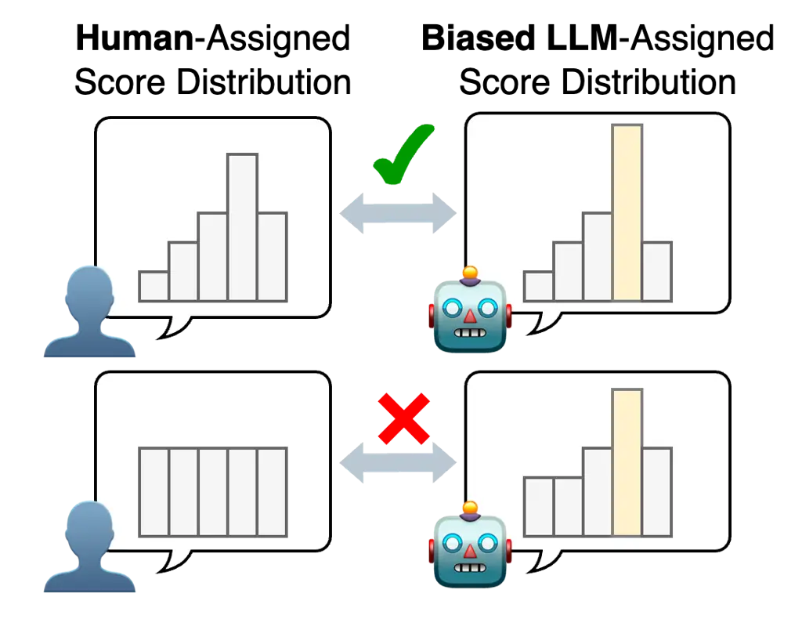

Figure 1: LLM evaluators with numerical biases tend to produce skewed
scores regardless of input. In some cases, the results deviate from the
distribution of manually assigned scores, questioning the robustness of
the evaluation framework.

## 1 Introduction

As a novel approach for evaluating text quality, “LLM-as-a-judge” Zheng
et al. (2023), which uses large language models (LLMs) as evaluators,
has been gaining attention. Traditional automatic evaluation metrics,
such as BLEU Papineni et al. (2002) and ROUGE Lin (2004), assess quality
based on overlap with reference texts. In contrast, LLM-as-a-judge
directly evaluates input without references, generating scores or
natural language outputs. This approach reduces annotator workload and
enables scalability. Its effectiveness has been demonstrated across
various evaluation tasks Kocmi and Federmann (2023a); Kocmi and
Federmann (2023b); Sato et al. (2024); Kobayashi et al. (2024); Enomoto
et al. (2024). However, LLM-as-a-judge has certain challenges, such as
_numerical bias_—a tendency to overuse specific numeric tokens Kocmi and
Federmann (2023b); Stureborg et al. (2024). An uneven distribution
caused by numerical bias lacks distinguishability, leading to higher
overall correlation when matching the human evaluation distribution but
raising robustness concerns as correlation may drop in case of a
mismatch (Figure 1). Thus, identifying and mitigating numerical bias is
crucial.

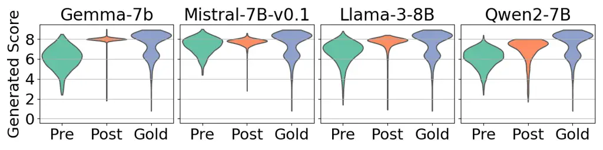

(a) English to German (En-De)

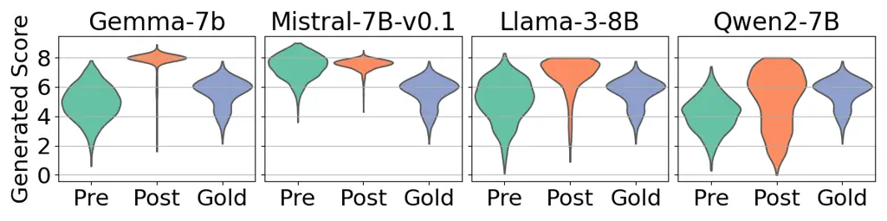

(b) English to Chinese (En-Zh)

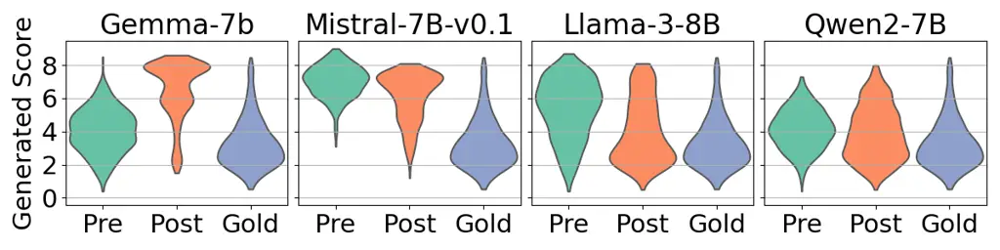

(c) Nepali to English (Ne-En)

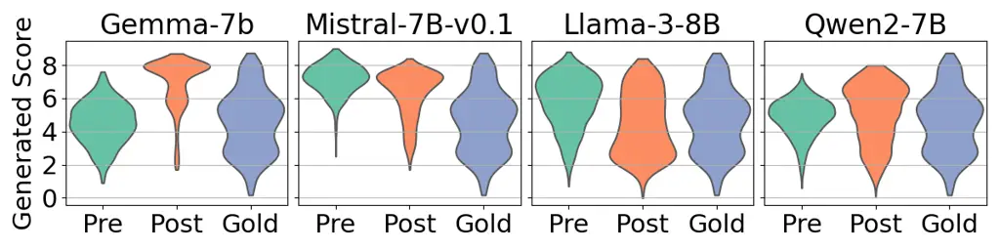

(d) Sinhala to English (Si-En)

Figure 2: MTQE score distribution.

Evaluators are primarily post-alignment LLMs, which undergo alignment
methods such as instruction tuning Wei et al. (2022) and preference
tuning Ouyang et al. (2022); Rafailov et al. (2023). _Alignment_ adjusts
models to generate responses aligned with human intentions and values,
improving instruction-following and evaluation performance. However,
existing studies have pointed out concerns about potential “side
effects” of alignment. Specifically, alignment can bias model outputs
toward certain patterns, potentially reducing diversity Santurkar et al.
(2023) and creativity Mohammadi (2024).

Building on this background, this study hypothesizes that numerical bias
in LLM evaluators is also a side effect of alignment and investigates
the impact of LLM alignment on numerical bias by comparing the
evaluation score distributions and evaluation performance of pre- and
post-alignment models (§3). Our findings indicate that alignment
amplifies numerical bias and harms evaluation performance (as shown in
Figure 2). However, despite this bias, the post-alignment model still
outperforms the pre-alignment model. This suggests that while alignment
introduces numerical bias, the resulting performance degradation is
generally not severe enough to outweigh the benefits of improved
instruction-following ability. Therefore, there is still room improve
post-alignment model performance by mitigating the bias.

To address this challenge, we investigate potential solutions to
mitigate numerical bias and evaluate the effectiveness of three
approaches: modifying the temperature, calibrating the output
distribution, and adjusting the score range (§4). Our experiments show
that adjusting the score range can reduce numerical bias and, in some
cases, enhance correlation with human judgments. These findings suggest
that the score range, which has often been treated as a fixed design
choice in prior work, should instead be reconsidered as a tunable
hyperparameter in LLM-as-a-judge settings.

Our key findings are as follows:

- •
  Numerical bias appears in LLM outputs after alignment, though it was
  weaker or absent before. The bias is stronger for high-resource
  languages than for low-resource languages.
- •
  The strength of numerical bias varies by model, and stronger bias
  correlates with lower evaluation accuracy. This suggests that users
  can select LLM evaluators based on bias strength, even without gold
  data.
- •
  Adjusting the score range in the prompt mitigates numerical bias and
  improves evaluation accuracy. Optimizing the score range is key to
  maximizing accuracy with the same model.

## 2 Related Work

Several studies have demonstrated the effectiveness of LLMs as
evaluators. Chiang and Lee (2023) conducted experiments on a story and
adversarial sample evaluation, showing that LLM assessments align with
human experts. Their study highlights advantages like high
reproducibility and low cost but notes limitations in fact-dependent
evaluations and potentially harmful responses. The effectiveness of LLMs
as evaluators has been demonstrated in the tasks examined in this study.
Kocmi and Federmann (2023a); Kocmi and Federmann (2023b) demonstrated
that using GPT-3.5 and GPT-4 as evaluators in MTQE outperformed existing
methods. Kobayashi et al. (2024) found similar results when using GPT-4
as an evaluator for GECQE. Furthermore, Enomoto et al. (2024) showed
that employing GPT-4 as an evaluator achieved first place in an LCP
shared task, reinforcing its effectiveness in evaluation. These findings
support the viability of LLMs as evaluators for diverse linguistic
tasks.

Despite their effectiveness, LLM evaluators exhibit biases that affect
reliability. Stureborg et al. (2024) identified three key biases in the
LLM-as-a-judge: (i) a preference for lower-perplexity texts, (ii)
improved evaluation performance with a smaller output value range, and
(iii) influence from prior evaluations in multi-instance assessments.
Their study quantified these biases and proposed mitigation guidelines.
Ohi et al. (2024) observed a likelihood bias in scoring-based
evaluations for data-to-text and grammatical error correction tasks,
where LLMs favor texts with higher likelihoods. They showed this bias
can be reduced using biased instances as few-shot examples. While these
studies provide insights into LLM evaluation biases, they do not address
numerical bias, where certain values are overused unnaturally. Our study
focuses on this issue, analyzing its causes and hypothesizing its link
to alignment.

## 3 Analysis of Alignment Influence

As discussed in the Introduction, this study aims to uncover the causes
of numerical bias. Specifically, we hypothesize that alignment processes
induce numerical bias because previous studies suggest that alignment
reduces the diversity of model outputsSanturkar et al. (2023); Mohammadi
(2024). In line with this, our first research question—RQ1: How does LLM
alignment influence numerical bias?—guides our investigation. Based on
this hypothesis, this section examines how alignment influences
numerical bias.

### 3.1 Experimental Design for RQ1

To verify whether alignment induces numerical bias, we compare the
distributions of output scores from pre- and post-alignment models.
Specifically, we visualize these distributions and measure the kurtosis
of the output scores, as kurtosis serves as a metric for numerical
bias¹¹ 1 Kurtosis is more appropriate than variance or interquartile
range for quantifying local concentration around specific values rather
than overall distribution narrowness.. If the kurtosis of the
post-alignment model is higher than that of the pre-alignment model, it
indicates that alignment increases numerical bias.

Additionally, we evaluate the performance of both pre- and
post-alignment models on scoring (regression) tasks, such as MTQE, by
measuring Pearson’s correlation coefficient $`r`$ between human scores
and the model’s scores. Based on the results of the distribution and
evaluation performance comparisons, we analyze how alignment affects
numerical bias and evaluation performance.

### 3.2 Experimental Setup for RQ1

#### 3.2.1 Data

The target evaluation tasks are the following three regression tasks:
MTQE, GECQE, and LCP. In these tasks, LLM takes text as input and
outputs the evaluation results as a numerical score.

##### MTQE

MTQE aims to automatically evaluate the quality of system-generated
translations without relying on reference translations. The resulting
quality scores indicate the reliability of a translation system and the
potential need for human post-editing. Quality estimation can be
performed at different granularity, including word, phrase, sentence,
and document levels. In this study, we use sentence-level²² 2 It can
evaluate translations with contextual awareness while also being
efficient for LLM-based evaluation in terms of processing speed. Direct
Assessment (DA) Fomicheva et al. (2022) scores from the WMT 2020 Shared
Task on Quality Estimation Specia et al. (2020) for seven language
pairs³³ 3 En-De, En-Zh, Et-En, Ne-En, Ro-En, Ru-En, Si-En. We instruct
the LLM to output scores within the specified range and analyze
numerical bias. The distribution of gold scores varies across language
pairs, reflecting the unique challenges and quality variability of
translations in each language. This diversity serves as a critical
benchmark for evaluating whether the model can accurately capture
differences in translation quality.

##### GECQE

GECQE aims to automatically evaluate the quality of GEC system outputs
without reference. The goal is to assess the quality of the corrected
sentence is and whether further revisions are necessary. We use TMUGFM
Yoshimura et al. (2020) and autoJQE Suzuki et al. (2022). TMUGFM focuses
on English GEC and provides human evaluations for grammaticality,
fluency, and meaning preservation. We use grammaticality, which plays
the most critical role in overall evaluation, as the overall evaluation
score. Conversely, autoJQE provides manually assigned quality scores for
two Japanese GEC datasets: FLUTEC⁴⁴ 4
[https://github.com/kiyama-hajime/FLUTEC](https://github.com/kiyama-hajime/FLUTEC)
and TECJL Koyama et al. (2020).

##### LCP

LCP automatically predicts the complexity of words in a sentence, given
a sentence and a target word pair. Accurate lexical complexity
prediction helps guide users to suitable texts or adapt content to their
needs. There are two complexity estimation types: single-word and
multi-word, with this study focusing on single-word complexity. For this
study, we use test data from the MLSP2024 shared task Shardlow et al.
(2020), covering nine languages⁵⁵ 5 Ca, En, Fil, Fr, De, It, Si, Es, Ja.
All LCP results are presented in Appendix C.

#### 3.2.2 Score Generation Procedure

|         |                 |                          |
| ------- | --------------- | ------------------------ |
| Series  | Pre-alignment   | Post-alignment           |
| Gemma   | gemma-7b        | gemma-7b-it              |
| Mistral | Mistral-7B-v0.1 | Mistral-7B-Instruct-v0.1 |
| Llama 3 | Meta-Llama-3-8B | Meta-Llama-3-8B-Instruct |
| Qwen 2  | Qwen2-7B        | Qwen2-7B-Instruct        |

Table 1: List of LLM evaluators used in the experiments.

We explain the procedure for text evaluation with LLM-generated scores,
taking the MTQE task as an example. In the experiments, we use four open
LLMs listed in Table 1. To suppress non-numeric outputs, we set
max_token=5. For the experiments addressing RQ1, the temperature is
fixed at $`0.7`$.

##### Step 1: Prompt Design

|                                                                                                                                                                    |
| ------------------------------------------------------------------------------------------------------------------------------------------------------------------ |
| Please analyze the given source and translated sentences and output a translation quality score on a continuous scale ranging from {{min score}} to {{max score}}. |
| Translation quality should be evaluated based on both fluency and adequacy.                                                                                        |
| A score close to {{min score}} indicates a low quality translation, while a score close to {{max score}} indicates a high quality translation.                     |
| Do not provide any explanations or text apart from the score.                                                                                                      |
| {{source language}} Sentence: {{$`src_{i}`$}}                                                                                                                      |
| {{target language}} Sentence: {{$`hyp_{i}`$}}                                                                                                                      |
| Score:                                                                                                                                                             |

Table 2: Prompt Template for MTQE.

We use the prompt template shown in Table 2⁶⁶ 6 Prompts for other tasks
are shown in the Appendix B.. Based on GEMBA Kocmi and Federmann
(2023b), the following arguments are configured for each dataset and
embedded into the prompt template:

- •
  source language name: {{source language}}
- •
  target language name: {{target language}}
- •
  min value of the score range: {{min score}}
- •
  max value of the score range: {{max score}}
- •
  source sentences: $`src_{1..N}`$
- •
  translated sentences: $`hyp_{1..N}`$

For RQ1, the score range is $`0\text{--}9`$ for all tasks⁷⁷ 7 To match
the evaluation range specified for the model, gold scores are rescaled
before calculating kurtosis..

##### Step 2: Calculation of Evaluation Scores

Using the prompt from Step 1, numerical values are generated 10 times.
From the 10 generated results, non-numeric tokens are excluded. For
numeric values outside the specified range, clipping is applied to bring
them within the range by replacing them with the upper or lower boundary
value. The final score is the average of the processed scores.

### 3.3 Experimental Results for RQ1

|       |         |          |       |        |          |          |
| ----- | ------- | -------- | ----- | ------ | -------- | -------- |
|       |         | Kurtosis |       |        | $`r`$    |          |
| Lang  | Model   | gold     | pre   | post   | pre      | post     |
| En-De | Gemma   | 1.48     | 0.27  | 128.17 | 0.33^(∗) | 0.08     |
|       | Mistral | 1.48     | 0.41  | 52.92  | 0.11^(∗) | 0.20^(∗) |
|       | Llama   | 1.48     | 2.53  | 21.05  | 0.33^(∗) | 0.35^(∗) |
|       | Qwen    | 1.48     | 0.53  | 21.05  | 0.33^(∗) | 0.38^(∗) |
| En-Zh | Gemma   | 0.20     | −0.06 | 21.57  | 0.30^(∗) | 0.23^(∗) |
|       | Mistral | 0.20     | 0.73  | 11.33  | 0.04     | 0.22^(∗) |
|       | Llama   | 0.20     | −0.06 | 3.96   | 0.27^(∗) | 0.37^(∗) |
|       | Qwen    | 0.20     | −0.05 | −0.84  | 0.34^(∗) | 0.41^(∗) |
| Et-En | Gemma   | −1.24    | −0.11 | 11.64  | 0.45^(∗) | 0.37^(∗) |
|       | Mistral | −1.24    | 0.53  | 4.93   | 0.23^(∗) | 0.49^(∗) |
|       | Llama   | −1.24    | 0.98  | −1.09  | 0.55^(∗) | 0.66^(∗) |
|       | Qwen    | −1.24    | 0.47  | −0.32  | 0.55^(∗) | 0.61^(∗) |
| Ne-En | Gemma   | 0.97     | −0.34 | 0.45   | 0.21^(∗) | 0.37^(∗) |
|       | Mistral | 0.97     | 0.58  | −0.19  | 0.17^(∗) | 0.40^(∗) |
|       | Llama   | 0.97     | −0.64 | −0.95  | 0.32^(∗) | 0.45^(∗) |
|       | Qwen    | 0.97     | −0.39 | −0.77  | 0.44^(∗) | 0.52^(∗) |
| Ro-En | Gemma   | −0.16    | −0.59 | 2.73   | 0.49^(∗) | 0.59^(∗) |
|       | Mistral | −0.16    | 0.71  | 1.12   | 0.30^(∗) | 0.66^(∗) |
|       | Llama   | −0.16    | 0.56  | −1.45  | 0.57^(∗) | 0.77^(∗) |
|       | Qwen    | −0.16    | 0.10  | −0.84  | 0.74^(∗) | 0.78^(∗) |
| Ru-En | Gemma   | −0.57    | 0.40  | 9.70   | 0.31^(∗) | 0.23^(∗) |
|       | Mistral | −0.57    | 0.17  | 6.33   | 0.19^(∗) | 0.37^(∗) |
|       | Llama   | −0.57    | 3.95  | 3.11   | 0.13^(∗) | 0.45^(∗) |
|       | Qwen    | −0.57    | 1.81  | 1.80   | 0.46^(∗) | 0.53^(∗) |
| Si-En | Gemma   | −0.72    | −0.37 | 1.97   | 0.24^(∗) | 0.38^(∗) |
|       | Mistral | −0.72    | 1.38  | 0.03   | 0.12^(∗) | 0.35^(∗) |
|       | Llama   | −0.72    | −0.36 | −1.13  | 0.36^(∗) | 0.47^(∗) |
|       | Qwen    | −0.72    | 0.48  | −0.85  | 0.45^(∗) | 0.48^(∗) |

Table 3: Kurtosis of MTQE score distributions and Pearson correlation
coefficient ($`r`$). For each language pair and model, the smallest
absolute kurtosis and the highest $`r`$ are highlighted in bold. ^(∗)
indicate statistically significant correlations ($`p<0.01`$).

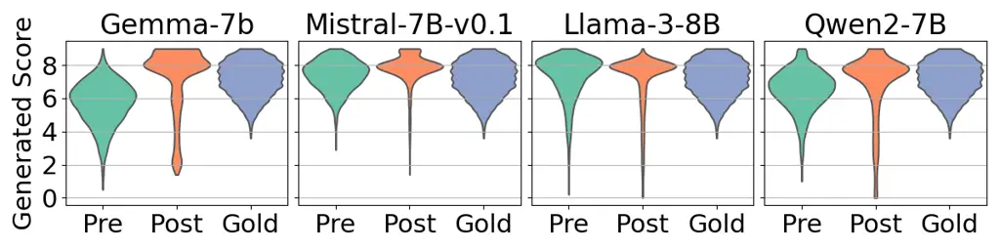

(a) TMUGFM (English)

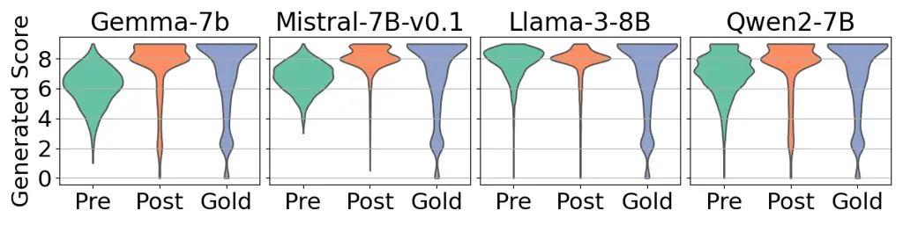

(b) TECJL (Japanese)

Figure 3: Distribution of GECQE scores.

|        |         |          |      |       |          |          |
| ------ | ------- | -------- | ---- | ----- | -------- | -------- |
|        |         | Kurtosis |      |       | $`r`$    |          |
| Data   | Model   | gold     | pre  | post  | pre      | post     |
| TMUGFM | Gemma   | −0.47    | 0.32 | 1.03  | 0.22^(∗) | 0.43^(∗) |
|        | Mistral | −0.47    | 0.34 | 8.49  | 0.03     | 0.25^(∗) |
|        | Llama   | −0.47    | 2.23 | 3.51  | 0.32^(∗) | 0.18^(∗) |
|        | Qwen    | −0.47    | 0.91 | 2.20  | 0.31^(∗) | 0.37^(∗) |
| FLUTEC | Gemma   | −0.55    | 0.15 | 4.41  | 0.25^(∗) | 0.49^(∗) |
|        | Mistral | −0.55    | 0.14 | 14.13 | −0.01    | 0.29^(∗) |
|        | Llama   | −0.55    | 3.15 | 11.72 | 0.14^(∗) | 0.12^(∗) |
|        | Qwen    | −0.55    | 0.59 | 3.27  | 0.53^(∗) | 0.52^(∗) |
| TECJL  | Gemma   | 0.40     | 0.09 | 3.04  | 0.28^(∗) | 0.44^(∗) |
|        | Mistral | 0.40     | 0.08 | 12.73 | 0.03     | 0.32^(∗) |
|        | Llama   | 0.40     | 8.01 | 9.10  | 0.30^(∗) | 0.21^(∗) |
|        | Qwen    | 0.40     | 1.11 | 2.54  | 0.56^(∗) | 0.57^(∗) |

Table 4: Kurtosis of GECQE score distributions and Pearson correlation
coefficient ($`r`$). ^(∗) indicate statistically significant
correlations ($`p<0.01`$).

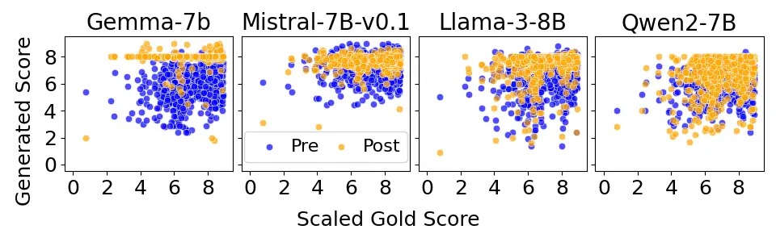

Figure 4: Scatter plots of MTQE score for En-De.

##### Alignment induces numerical bias.

Figures 2 and 3 illustrate the distribution of evaluation scores within
the score range of $`0\text{--}9`$ in the MTQE and GECQE tasks,
respectively⁸⁸ 8 Results for MTQE (other languages) and GECQE (FLUTEC)
are shown in Appendix Figures 8 and 9.. These figures show the same
trends. Specifically, in pre-alignment models, score distributions are
more varied, reflecting diversity across models and language pairs. This
result—the apparent absence of bias in the pre-alignment model—may be
attributed to its weak instruction-following ability, leading to random
output scores. Conversely, post-alignment models generate scores that
are heavily concentrated around $`8`$, suggesting that alignment
introduces excessive consistency. Notably, while the gold score
distributions vary across data, post-alignment models produce evaluation
score distributions with strikingly similar shapes. This suggests that
post-alignment models may fail to adequately capture differences in
translation quality, leading to numerical bias, where scores cluster
excessively around specific values, regardless of the input.

Tables 3 and 4 present kurtosis of evaluation score distributions.
Higher kurtosis indicates a sharper distribution and stronger numerical
bias. Across most datasets, the post-alignment models exhibit higher
kurtosis compared to their pre-alignment counterparts, further
supporting the presence of numerical bias induced by alignment.

##### Models with stronger numerical bias tend to have lower evaluation accuracy.

Tables 3 and 4 further confirm that models and language pairs with
higher kurtosis tend to have lower evaluation accuracy, as seen in their
Pearson correlation coefficient ($`r`$) with gold scores. Kurtosis and
$`r`$ show a strong negative correlation of $`-0.60`$ for both MTQE and
GECQE, indicating that greater numerical bias leads to lower accuracy.
Although alignment improves instruction-following abilities and can
enhance evaluation accuracy, excessive numerical bias can undermine its
benefits.

To investigate the impact of numerical bias on evaluation accuracy, we
created scatter plots of LLM-generated scores (vertical axis) against
human evaluation scores (horizontal axis), as shown in Figure 4⁹⁹ 9
Results for GECQE and LCP are in Appendix Figure 10.. Pre-alignment
models exhibit low kurtosis and can be considered unbiased. However, the
points in the scatter plot do not align with the $`y=x`$ line,
indicating that their evaluation task performance is not necessarily
high.

##### The strength of bias varies across models.

As shown in Figures 2, along with Table 3, bias varies considerably
across models. Post-alignment Gemma exhibits the highest kurtosis for
most language pairs, indicating the strongest numerical bias. Mistral
follows Gemma, with generally high kurtosis and particularly strong bias
for En-De and En-Zh. In contrast, Llama and Qwen show lower kurtosis for
most language pairs except En-De compared to the other two models.

##### The strength of bias varies across languages.

The degree of numerical bias introduced by alignment varies across
language pairs. For En-De, En-Zh, Et-En, Ro-En, and Ru-En,
post-alignment models exhibit highly skewed distributions, with scores
heavily concentrated on specific values. In contrast, for Ne-En and
Si-En, distributions differ among post-alignment models, with no
excessive concentration on specific values. Compared to high-resource
languages like English (En), German (De), and Chinese (Zh), which have
stronger biases, Nepali (Ne) and Sinhala (Si) are low-resource
languages. Their lower representation in alignment data may contribute
to differences in how alignment affects numerical bias.

## 4 Assessing Solutions for Bias Mitigation

The experiments addressing RQ1 confirmed that alignment introduces
numerical bias in the evaluation score distribution. However, despite
the absence of numerical bias, pre-alignment models demonstrate lower
evaluation task performance compared to their post-alignment
counterparts. Thus, post-alignment models remain effective as evaluator
LLMs, even in the presence of numerical bias. Mitigating numerical bias
in post-alignment models has the potential to further enhance evaluation
task performance. Based on RQ2: What is a potential solution to mitigate
numerical bias?, we explore solutions that might further improve
evaluation task performance by reducing the numerical bias in the
post-alignment model.

### 4.1 Experimental Design for RQ2

To mitigate bias and boost evaluation performance, we investigate two
approaches: adjustment of the output distribution—using techniques such
as temperature scaling and distribution calibration—and adjustment of
the score range.

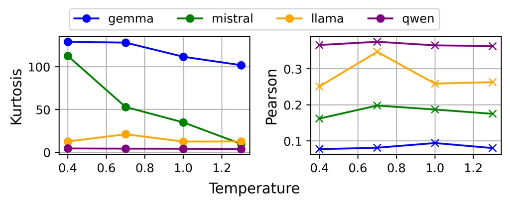

Figure 5: Kurtosis and Pearson correlation coefficient ($`r`$) for each
temperature in MTQE (En-De).

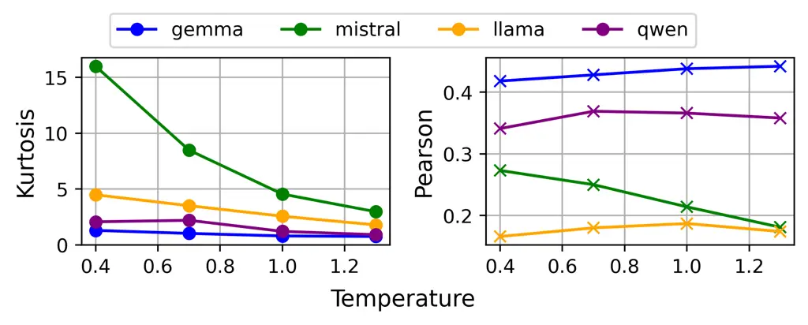

Figure 6: Kurtosis and Pearson correlation coefficient ($`r`$) for each
temperature in GECQE (TMUGFM).

|         |          |            |          |            |
| ------- | -------- | ---------- | -------- | ---------- |
|         | Kurtosis |            | $`r`$    |            |
|         | original | calibrated | original | calibrated |
| Gemma   | 128.174  | 47.932     | 0.081    | 0.076      |
| Mistral | 52.923   | 3.394      | 0.198    | 0.147      |
| Llama   | 21.051   | 11.886     | 0.347    | 0.380      |
| Qwen    | 4.213    | 2.704      | 0.375    | 0.377      |

Table 5: Kurtosis and Pearson correlation coefficients ($`r`$) before
and after calibration of the distribution in MTQE (En-De).

|         |          |            |          |            |
| ------- | -------- | ---------- | -------- | ---------- |
|         | Kurtosis |            | $`r`$    |            |
|         | original | calibrated | original | calibrated |
| Gemma   | 1.028    | 2.092      | 0.428    | 0.430      |
| Mistral | 8.485    | 0.106      | 0.250    | 0.297      |
| Llama   | 3.510    | 0.994      | 0.180    | 0.021      |
| Qwen    | 2.204    | 8.156      | 0.369    | 0.353      |

Table 6: Kurtosis and Pearson correlation coefficients ($`r`$) before
and after calibration of the distribution in GECQE (TMUGFM).

##### Adjustment of output distribution

The most straightforward approach to reducing bias is to adjust the
output distribution. Appropriately calibrating the distribution yields a
more diverse range of numerical outputs and mitigates numerical bias.
Therefore, this study explores bias mitigation by adjusting the output
distribution. Specifically, as outlined below, we attempt to modify the
temperature parameter and apply a calibration method to adjust the
distribution.

The simplest way to adjust the distribution to obtain diverse outputs is
to adjust the temperature parameter. The temperature parameter is a
hyperparameter used in probabilistic text generation models, to control
the diversity of the output. It scales the logits before applying
softmax function, influencing the probability distribution of the next
token selection. Increasing the temperature parameter is expected to
produce more diverse numerical output as the output distribution
approaches uniformity.

Another way to mitigate numerical bias is to adopt the calibration
method proposed by Jiang et al. (2023). Their generative calibration
approach adjusts the in-context predictive distribution by recalibrating
the label marginal $`p(y)`$, estimated via Monte-Carlo sampling over LLM
outputs. Since numerical bias can be viewed as a label shift induced by
the alignment data distribution, we apply this approach to correct the
distribution of numeric tokens in LLM-based evaluation. This method
calibrates the probability distribution of score $`y`$ given input
$`x`$, denoted as $`p(y\mid x)`$, using the language model distribution
$`p(y)`$ and the true data distribution $`q(y)`$. In this study, to
approximate $`p(y\mid x)`$, we sample $`n`$ evaluation scores per
input¹⁰¹⁰ 10 $`p(y\mid x)`$ can be obtained via softmax or logits, but
approximating it through sampling allows application to closed models.
We use $`n`$ valid numerical scores from the evaluation scores produced
by the method described in §3.2.2. and compute the final score
$`\hat{y}`$ as a weighted average:

```math
\hat{y}=\sum_{i=1}^{n}w_{i}y_{i},\quad w_{i}=\frac{q(y_{i})}{p(y_{i})}\Bigg/\sum_{j=1}^{n}\frac{q(y_{j})}{p(y_{j})} \tag{1}
```

where $`p(y)`$ is estimated by sampling $`1,000`$ times, and $`q(y)`$ is
modeled as a Beta distribution¹¹¹¹ 11 Due to the asymmetry of gold
scores, the Beta distribution is more appropriate than the normal
distribution for this tasks. with parameters $`\alpha`$ and $`\beta`$
estimated via maximum likelihood. The marginal probability $`q(y)`$ is
computed by integrating the Beta density function over the appropriate
range¹²¹² 12 Since $`y`$ is an integer, the probability density is
integrated over $`(y,y+1]`$ for $`y>0`$ and $`[0,1]`$ for $`y=0`$.. This
sampling-based approach reduces computational cost while effectively
calibrating score distributions.

##### Adjustment of output range

Modifying the evaluation score range specified in the prompt alters the
set of possible output tokens. Stureborg et al. (2024) found that
expanding the score range reduced evaluation accuracy. They cautioned
against the possibility of numerical bias from expanding the score
range. However, they did not empirically validate whether a direct
relationship exists between the score range and numerical bias. Thus, we
test the hypothesis that score range adjustments influence evaluation
accuracy by including or excluding biased scores. By quantifying
numerical bias using the kurtosis of the distribution, we can
investigate the impact of score range adjustments on numerical bias and
evaluation performance.

### 4.2 Experimental Setup for RQ2

We analyze En-De for MTQE and TMUGFM for GECQE as data for which bias is
significant. When testing the effect of temperature scaling, the score
range is fixed at $`0\text{--}9`$ and the temperature values are varied
by four values $`\{0.4,0.7,1.0,1.3\}`$. When testing the effect of score
range adjustment, fix the temperature value at $`0.7`$ and specify a
score range of $`\{1\text{--}5,0\text{--}9,1\text{--}100\}`$.

### 4.3 Experimental Results for RQ2

##### Temperature Scaling and Distribution Calibration are effective in mitigating numerical bias.

Results of temperature scaling are shown in Figures 5 and 6. This
suggests that setting a higher temperature parameter can serve as a
mitigation strategy to reduce the impact of alignment-induced numerical
bias. The strategy is particularly effective for models with stronger
bias. However, excessively high temperatures may decrease evaluation
accuracy. In this experiment, the optimal temperature for maximizing
$`r`$ is 1.0 for Gemma and 0.7 for the other models, aligning with their
default settings. Thus, when prioritizing evaluation accuracy, using the
default temperature values is most effective. Temperature scaling
mitigated bias but did not necessarily improve evaluation performance.

Tables 5 and 6 show the effects of calibration on kurtosis and Pearson
correlation in MTQE and GECQE. In MTQE, all models exhibit reduced
kurtosis, and in GECQE, Mistral and Llama—both of which initially had
relatively high kurtosis—also show improvement. This indicates that
distribution calibration is effective in mitigating numerical bias.
However, its impact on evaluation performance varies. In the models
whose original accuracy is relatively high, such as Llama and Qwen,
calibration results in a slight improvement. Conversely, when the
original accuracy is low, calibration tends to further degrade
performance. This suggests that while calibration reshapes the score
distribution, it does not always improve performance.

|         |          |        |       |       |      |       |
| ------- | -------- | ------ | ----- | ----- | ---- | ----- |
|         | Kurtosis |        |       | $`r`$ |      |       |
| Model   | 1–5      | 0–9    | 1–100 | 1–5   | 0–9  | 1–100 |
| Gemma   | 71.79    | 128.17 | 87.45 | 0.05  | 0.08 | 0.14  |
| Mistral | 11.95    | 52.92  | 42.00 | 0.22  | 0.20 | 0.21  |
| Llama   | 10.19    | 21.05  | 23.96 | 0.27  | 0.35 | 0.33  |
| Qwen    | 6.87     | 4.21   | 5.28  | 0.34  | 0.38 | 0.37  |

Table 7: Kurtosis and Pearson correlation coefficient ($`r`$) for each
score ranges in MTQE (En-De) .

|         |          |      |       |       |      |       |
| ------- | -------- | ---- | ----- | ----- | ---- | ----- |
|         | Kurtosis |      |       | $`r`$ |      |       |
| Model   | 1–5      | 0–9  | 1–100 | 1–5   | 0–9  | 1–100 |
| Gemma   | −0.58    | 1.03 | 5.38  | 0.45  | 0.43 | 0.44  |
| Mistral | 1.95     | 8.49 | 12.09 | 0.33  | 0.25 | 0.33  |
| Llama   | 0.73     | 3.51 | 2.24  | 0.25  | 0.18 | 0.18  |
| Qwen    | 2.13     | 2.20 | 4.63  | 0.35  | 0.37 | 0.30  |

Table 8: Kurtosis and Pearson correlation coefficient ($`r`$) for each
score ranges in GECQE (TMUGFM) .

##### Score Range Adjustment is effective in mitigating bias and improving evaluation accuracy.

Tables 7 and 8 present the kurtosis and $`r`$ values for MTQE and GECQE
under three score ranges: $`\{1\text{--}5,0\text{--}9,1\text{--}100\}`$.
Although the $`1\text{--}5`$ scale achieved the lowest kurtosis across
most tasks and models, it did not necessarily produce the best
evaluation performance. This finding implies that while a low-kurtosis
score range can sometimes enhance performance, it also carries the risk
of producing random outputs. However, the score ranges associated with
the highest evaluation performances (e.g., the $`1\text{--}100`$ scale
in Gemma with the MTQE task) also exhibited relatively lower kurtosis.
This pattern indicates that each model and task may have an optimal
score range that both mitigates numerical bias and improves evaluation
performance. Moreover, the evaluation performances achieved with this
optimal score range generally surpassed those obtained using the best
temperature setting or the calibration method. For instance, in Gemma
with the MTQE task, the $`1\text{--}100`$ scale achieved 0.14 in $`r`$,
outperforming the results in Figure 5 and Table 5. Therefore, our
experimental results suggest that adjusting the score range is the most
promising strategy for mitigating numerical bias and enhancing
evaluation performance. While these results highlight score range
adjustment as a comparatively effective mitigation strategy under
current settings, it remains a heuristic and task-specific solution.
Identifying the optimal score range is nontrivial, and relying solely on
range adjustment may not offer a generalizable fix. To advance beyond
symptom-level remedies, future work should also seek more fundamental
approaches that directly address the causes of alignment-induced
numerical bias.

## 5 Discussion

### 5.1 Analysis of Input Features

To detect inputs prone to bias, we analyze examples with strong bias.
Kurtosis captures dataset-level bias, but this analysis needs an
example-level metric. Thus, we use the mode ratio, the proportion of
generated scores matching the data’s mode (the most frequently generated
score in the dataset), as an indicator of bias strength. This choice is
motivated by our observation that in highly biased cases, a specific
value appears frequently within 10 generations, often aligning with the
data’s mode. Assuming input complexity and edit extent affect bias, we
compute the features in Table 9 and calculate their Pearson correlation
with the mode ratio.

Table 10 presents the results in the MTQE. Except for Gemma, perplexity
negatively correlates with the mode ratio, suggesting that more fluent
sentences (lower perplexity) exhibit stronger numerical bias via
frequent value repetition.

In GECQE, word overlap negatively correlates with the mode ratio across
all models (Table 11), indicating that more corrections (lower overlap)
lead to stronger numerical bias. Since GECQE emphasizes grammatical
correctness, local lexical edits outweigh sentence-level fluency,
possibly heightening the impact of word overlap.

|               |                                          |
| ------------- | ---------------------------------------- |
| Feature       | Description                              |
| Source Length | Number of words in the source sentence.  |
| Word Overlap  | Overlap ratio between source and target. |
| Source PPL    | Perplexity of the source sentence.       |
| Target PPL    | Perplexity of the target sentence.       |
| Overall PPL   | Perplexity of both source and target.    |

Table 9: List of features of input cases.

|         |       |       |       |       |       |
| ------- | ----- | ----- | ----- | ----- | ----- |
| Model   | SLen  | WOL   | SPPL  | TPPL  | OPPL  |
| Gemma   | 0.15  | −0.19 | −0.02 | −0.01 | 0.00  |
| Mistral | 0.00  | −0.08 | 0.00  | 0.00  | −0.19 |
| Llama   | −0.14 | 0.00  | −0.05 | −0.12 | −0.21 |
| Qwen    | 0.12  | 0.08  | −0.10 | −0.17 | −0.31 |

Table 10: Pearson’s correlation coefficient between input features and
mode ratio in MTQE (En-De).

|         |       |       |       |       |       |
| ------- | ----- | ----- | ----- | ----- | ----- |
| Model   | SLen  | WOL   | SPPL  | TPPL  | OPPL  |
| Gemma   | 0.05  | −0.15 | −0.03 | −0.03 | 0.00  |
| Mistral | 0.13  | −0.34 | −0.01 | −0.03 | 0.02  |
| Llama   | 0.14  | −0.30 | −0.02 | −0.07 | −0.04 |
| Qwen    | −0.02 | −0.18 | 0.01  | −0.06 | −0.10 |

Table 11: Pearson’s correlation coefficient between input features and
mode ratio in GECQE (TMUGFM).

### 5.2 Guidelines for Selecting Evaluator LLMs to Improve Accuracy and Reliability

Based on our results, we summarize key points for improving the accuracy
and robustness of evaluations in LLM-as-a-judge. First, pre-alignment
models generally struggle with accuracy due to their limited
instruction-following abilities. In contrast, post-alignment models’
stronger instruction-following abilities improve evaluation accuracy,
making them the preferred choice as evaluators.

Second, while alignment induces numerical bias, the extent of its impact
varies across models, highlighting the importance of careful model
selection. When gold scores are available, evaluation accuracy can be
measured using correlation coefficients. However, correlation alone is
insufficient to assess robustness. Combining correlation with kurtosis,
which quantifies numerical bias, helps identify models that are accurate
and unbiased across any data distribution. When gold scores are
unavailable, kurtosis serves as a useful proxy metric for model
selection. Our results indicate that models with high kurtosis,
indicative of strong numerical bias, tend to have lower evaluation
accuracy.

Furthermore, adjusting the evaluation score range can improve accuracy
for a given model, as it often reduces numerical bias. However, the
optimal setting varies by dataset and model, and thus requires careful
tuning using validation data. While this approach offers a practical way
to improve evaluation stability, its effectiveness is task-specific, and
score range should be treated as a configurable parameter rather than a
fixed design choice.

## 6 Conclusion

This study clarified that post-alignment models exhibit an excessive
concentration of scores, leading to numerical bias that compromises
evaluation accuracy. These findings suggest that the overconsistency
induced by alignment may limit LLMs’ practical utility in quality
evaluation tasks. Future work should explore various alignment strengths
and develop bias-mitigation strategies.

## Limitations

Our study has several limitations. (i) The public models used in our
experiments do not disclose all of the methods and data used for
alignment, making it impossible to analyze in depth the causes of the
effects of alignment on data quality and methodological characteristics.
Additionally, performing in-house alignment of pre-trained large
language models is computationally expensive. (ii) This study is limited
to the target task using only numerical scores, and the effect of
alignment on evaluations with natural language labels and rankings
remains unresolved. (iii) Both pre- and post-alignment models need to
produce numerical outputs, which restricts the range of LLMs that can be
used in the experiment. (iv) Our mitigation methods, such as score range
adjustment, are heuristic and task-specific. They represent a practical
first step rather than a fundamental solution to numerical bias.
Although effective in our setting, its generalizability remains
uncertain, so further exploration in this direction is meaningful future
work.

## References

- Chiang and Lee (2023) C. Chiang and H. Lee Can large language models
  be an alternative to human evaluations?. In Proceedings of the 61st
  Annual Meeting of the Association for Computational Linguistics
  (Volume 1: Long Papers), A. Rogers, J. Boyd-Graber, and N. Okazaki
  (Eds.), Toronto, Canada, pp. 15607–15631. External Links:
  [Link](https://aclanthology.org/2023.acl-long.870),
  [Document](https://dx.doi.org/10.18653/v1/2023.acl-long.870) Cited by:
  §2.
- Enomoto et al. (2024) T. Enomoto, H. Kim, T. Hirasawa, Y. Nagai, A.
  Sato, K. Nakajima, and M. Komachi TMU-HIT at MLSP 2024: how well can
  GPT-4 tackle multilingual lexical simplification?. In Proceedings of
  the 19th Workshop on Innovative Use of NLP for Building Educational
  Applications (BEA 2024), pp. 590–598. External Links:
  [Link](https://aclanthology.org/2024.bea-1.52) Cited by: §1, §2.
- Fomicheva et al. (2022) M. Fomicheva, S. Sun, E. Fonseca, C. Zerva, F.
  Blain, V. Chaudhary, F. Guzmán, N. Lopatina, L. Specia, and A. F. T.
  Martins MLQE-PE: a multilingual quality estimation and post-editing
  dataset. In Proceedings of the Thirteenth Language Resources and
  Evaluation Conference, pp. 4963–4974. External Links:
  [Link](https://aclanthology.org/2022.lrec-1.530) Cited by: §3.2.1.
- Jiang et al. (2023) Z. Jiang, Y. Zhang, C. Liu, J. Zhao, and K. Liu
  Generative calibration for in-context learning. In Findings of the
  Association for Computational Linguistics: EMNLP 2023, H. Bouamor, J.
  Pino, and K. Bali (Eds.), Singapore, pp. 2312–2333. External Links:
  [Link](https://aclanthology.org/2023.findings-emnlp.152/),
  [Document](https://dx.doi.org/10.18653/v1/2023.findings-emnlp.152)
  Cited by: §4.1.
- Kobayashi et al. (2024) M. Kobayashi, M. Mita, and M. Komachi Large
  language models are state-of-the-art evaluator for grammatical error
  correction. In Proceedings of the 19th Workshop on Innovative Use of
  NLP for Building Educational Applications (BEA 2024), E. Kochmar, M.
  Bexte, J. Burstein, A. Horbach, R. Laarmann-Quante, A. Tack, V.
  Yaneva, and Z. Yuan (Eds.), Mexico City, Mexico, pp. 68–77. External
  Links: [Link](https://aclanthology.org/2024.bea-1.6) Cited by: §1, §2.
- Kocmi and Federmann (2023a) T. Kocmi and C. Federmann GEMBA-MQM:
  detecting translation quality error spans with GPT-4. In Proceedings
  of the Eighth Conference on Machine Translation, P. Koehn, B.
  Haddow, T. Kocmi, and C. Monz (Eds.), Singapore, pp. 768–775. External
  Links: [Link](https://aclanthology.org/2023.wmt-1.64),
  [Document](https://dx.doi.org/10.18653/v1/2023.wmt-1.64) Cited by: §1,
  §2.
- Kocmi and Federmann (2023b) T. Kocmi and C. Federmann Large language
  models are state-of-the-art evaluators of translation quality. In
  Proceedings of the 24th Annual Conference of the European Association
  for Machine Translation, pp. 193–203. External Links:
  [Link](https://aclanthology.org/2023.eamt-1.19) Cited by: §1, §2,
  §3.2.2.
- Koyama et al. (2020) A. Koyama, T. Kiyuna, K. Kobayashi, M. Arai,
  and M. Komachi Construction of an evaluation corpus for grammatical
  error correction for learners of Japanese as a second language. In
  Proceedings of the Twelfth Language Resources and Evaluation
  Conference, N. Calzolari, F. Béchet, P. Blache, K. Choukri, C.
  Cieri, T. Declerck, S. Goggi, H. Isahara, B. Maegaard, J. Mariani, H.
  Mazo, A. Moreno, J. Odijk, and S. Piperidis (Eds.), Marseille, France,
  pp. 204–211 (English). External Links:
  [Link](https://aclanthology.org/2020.lrec-1.26), ISBN
  979-10-95546-34-4 Cited by: §3.2.1.
- Lin (2004) C. Lin ROUGE: a package for automatic evaluation of
  summaries. In Text Summarization Branches Out, Barcelona, Spain,
  pp. 74–81. External Links: [Link](https://aclanthology.org/W04-1013)
  Cited by: §1.
- Mohammadi (2024) B. Mohammadi Creativity has left the chat: the price
  of debiasing language models. External Links: 2406.05587,
  [Link](https://arxiv.org/abs/2406.05587) Cited by: §1, §3.
- Ohi et al. (2024) M. Ohi, M. Kaneko, R. Koike, M. Loem, and N. Okazaki
  Likelihood-based mitigation of evaluation bias in large language
  models. In Findings of the Association for Computational Linguistics
  ACL 2024, L. Ku, A. Martins, and V. Srikumar (Eds.), Bangkok, Thailand
  and virtual meeting, pp. 3237–3245. External Links:
  [Link](https://aclanthology.org/2024.findings-acl.193),
  [Document](https://dx.doi.org/10.18653/v1/2024.findings-acl.193) Cited
  by: §2.
- Ouyang et al. (2022) L. Ouyang, J. Wu, X. Jiang, D. Almeida, C.
  Wainwright, P. Mishkin, C. Zhang, S. Agarwal, K. Slama, A. Ray, J.
  Schulman, J. Hilton, F. Kelton, L. Miller, M. Simens, A. Askell, P.
  Welinder, P. F. Christiano, J. Leike, and R. Lowe Training language
  models to follow instructions with human feedback. In Advances in
  Neural Information Processing Systems, S. Koyejo, S. Mohamed, A.
  Agarwal, D. Belgrave, K. Cho, and A. Oh (Eds.), Vol. 35,
  pp. 27730–27744. External Links:
  [Link](https://proceedings.neurips.cc/paper%5C_files/paper/2022/file/b1efde53be364a73914f58805a001731-Paper-Conference.pdf)
  Cited by: §1.
- Papineni et al. (2002) K. Papineni, S. Roukos, T. Ward, and W. Zhu
  Bleu: a method for automatic evaluation of machine translation. In
  Proceedings of the 40th Annual Meeting of the Association for
  Computational Linguistics, P. Isabelle, E. Charniak, and D. Lin
  (Eds.), Philadelphia, Pennsylvania, USA, pp. 311–318. External Links:
  [Link](https://aclanthology.org/P02-1040),
  [Document](https://dx.doi.org/10.3115/1073083.1073135) Cited by: §1.
- Rafailov et al. (2023) R. Rafailov, A. Sharma, E. Mitchell, C. D.
  Manning, S. Ermon, and C. Finn Direct preference optimization: your
  language model is secretly a reward model. In Thirty-seventh
  Conference on Neural Information Processing Systems, External Links:
  [Link](https://openreview.net/forum?id=HPuSIXJaa9) Cited by: §1.
- Santurkar et al. (2023) S. Santurkar, E. Durmus, F. Ladhak, C. Lee, P.
  Liang, and T. Hashimoto Whose opinions do language models reflect?. In
  Proceedings of the 40th International Conference on Machine
  Learning, A. Krause, E. Brunskill, K. Cho, B. Engelhardt, S. Sabato,
  and J. Scarlett (Eds.), Proceedings of Machine Learning Research, Vol.
  202, pp. 29971–30004. External Links:
  [Link](https://proceedings.mlr.press/v202/santurkar23a.html) Cited by:
  §1, §3.
- Sato et al. (2024) A. Sato, K. Nakajima, H. Kim, Z. Chen, and M.
  Komachi TMU-HIT’s submission for the WMT24 quality estimation shared
  task: is GPT-4 a good evaluator for machine translation?. In
  Proceedings of the Ninth Conference on Machine Translation, B.
  Haddow, T. Kocmi, P. Koehn, and C. Monz (Eds.), Miami, Florida, USA,
  pp. 529–534. External Links:
  [Link](https://aclanthology.org/2024.wmt-1.38),
  [Document](https://dx.doi.org/10.18653/v1/2024.wmt-1.38) Cited by: §1.
- Shardlow et al. (2020) M. Shardlow, M. Cooper, and M. Zampieri CompLex
  — a new corpus for lexical complexity prediction from Likert Scale
  data. In Proceedings of the 1st Workshop on Tools and Resources to
  Empower People with REAding DIfficulties (READI), Marseille, France,
  pp. 57–62 (English). External Links:
  [Link](https://aclanthology.org/2020.readi-1.9), ISBN
  979-10-95546-45-0 Cited by: §3.2.1.
- Specia et al. (2020) L. Specia, F. Blain, M. Fomicheva, E. Fonseca, V.
  Chaudhary, F. Guzmán, and A. F. T. Martins Findings of the WMT 2020
  shared task on quality estimation. In Proceedings of the Fifth
  Conference on Machine Translation, L. Barrault, O. Bojar, F.
  Bougares, R. Chatterjee, M. R. Costa-jussà, C. Federmann, M.
  Fishel, A. Fraser, Y. Graham, P. Guzman, B. Haddow, M. Huck, A. J.
  Yepes, P. Koehn, A. Martins, M. Morishita, C. Monz, M. Nagata, T.
  Nakazawa, and M. Negri (Eds.), Online, pp. 743–764. External Links:
  [Link](https://aclanthology.org/2020.wmt-1.79) Cited by: §3.2.1.
- Stureborg et al. (2024) R. Stureborg, D. Alikaniotis, and Y. Suhara
  Large language models are inconsistent and biased evaluators. External
  Links: 2405.01724, [Link](https://arxiv.org/abs/2405.01724) Cited by:
  §1, §2, §4.1.
- Suzuki et al. (2022) D. Suzuki, Y. Takahashi, I. Yamashita, T.
  Aida, T. Hirasawa, M. Nakatsuji, M. Mita, and M. Komachi Construction
  of a quality estimation dataset for automatic evaluation of Japanese
  grammatical error correction. In Proceedings of the Thirteenth
  Language Resources and Evaluation Conference, Marseille, France,
  pp. 5565–5572. External Links:
  [Link](https://aclanthology.org/2022.lrec-1.596) Cited by: §3.2.1.
- Wei et al. (2022) J. Wei, M. Bosma, V. Zhao, K. Guu, A. W. Yu, B.
  Lester, N. Du, A. M. Dai, and Q. V. Le Finetuned language models are
  zero-shot learners. In International Conference on Learning
  Representations, External Links:
  [Link](https://openreview.net/forum?id=gEZrGCozdqR) Cited by: §1.
- Yoshimura et al. (2020) R. Yoshimura, M. Kaneko, T. Kajiwara, and M.
  Komachi SOME: reference-less sub-metrics optimized for manual
  evaluations of grammatical error correction. In Proceedings of the
  28th International Conference on Computational Linguistics, Barcelona,
  Spain (Online), pp. 6516–6522. External Links:
  [Link](https://aclanthology.org/2020.coling-main.573),
  [Document](https://dx.doi.org/10.18653/v1/2020.coling-main.573) Cited
  by: §3.2.1.
- Zheng et al. (2023) L. Zheng, W. Chiang, Y. Sheng, S. Zhuang, Z.
  Wu, Y. Zhuang, Z. Lin, Z. Li, D. Li, E. Xing, H. Zhang, J. E.
  Gonzalez, and I. Stoica Judging LLM-as-a-judge with MT-bench and
  chatbot arena. In Thirty-seventh Conference on Neural Information
  Processing Systems Datasets and Benchmarks Track, External Links:
  [Link](https://openreview.net/forum?id=uccHPGDlao) Cited by: §1.

## Appendix A Implementation Details

##### Models

We conducted experiments with Gemma¹³¹³ 13
[https://huggingface.co/google/gemma-7b](https://huggingface.co/google/gemma-7b)^(,)¹⁴¹⁴
14
[https://huggingface.co/google/gemma-7b-it](https://huggingface.co/google/gemma-7b-it),
Mistral¹⁵¹⁵ 15
[https://huggingface.co/mistralai/Mistral-7B-v0.1](https://huggingface.co/mistralai/Mistral-7B-v0.1)^(,)¹⁶¹⁶
16
[https://huggingface.co/mistralai/Mistral-7B-Instruct-v0.1](https://huggingface.co/mistralai/Mistral-7B-Instruct-v0.1),
Llama-3¹⁷¹⁷ 17
[https://huggingface.co/meta-llama/Meta-Llama-3-8B](https://huggingface.co/meta-llama/Meta-Llama-3-8B)^(,)¹⁸¹⁸
18
[https://huggingface.co/meta-llama/Meta-Llama-3-8B-Instruct](https://huggingface.co/meta-llama/Meta-Llama-3-8B-Instruct)
and Qwen-2¹⁹¹⁹ 19
[https://huggingface.co/Qwen/Qwen2-7B](https://huggingface.co/Qwen/Qwen2-7B)^(,)²⁰²⁰
20
[https://huggingface.co/Qwen/Qwen2-7B-Instruct](https://huggingface.co/Qwen/Qwen2-7B-Instruct)
from huggingface and used a single Quadro RTX $`8000`$ in the all
experiments. Gemma and Llama-3 are published by their own licenses²¹²¹
21
[https://ai.google.dev/gemma/terms](https://ai.google.dev/gemma/terms)^(,)²²²²
22
[https://www.llama.com/llama3/license/](https://www.llama.com/llama3/license/).
Mistral and Qwen-2 are published by the Apache 2.0 license.

##### Data

In MTQE, we used the test data from WMT QE 2020²³²³ 23
[https://github.com/WMT-QE-Task/wmt-qe-2022-data/tree/main/train-dev_data/task1_da/train](https://github.com/WMT-QE-Task/wmt-qe-2022-data/tree/main/train-dev_data/task1_da/train),
obtained from the training data of WMT QE 2022. For calibration, the WMT
QE 2021 dev data was used to estimate the true data distribution
$`q(y)`$, while the WMT QE 2021 train data was used to estimate the beta
distribution. Each language pair contains $`1,000`$ pairs of source
texts and translations. In GECQE, we used the TMU-GFM-Dataset²⁴²⁴ 24
[https://huggingface.co/datasets/tmu-nlp/tmu_gfm_dataset](https://huggingface.co/datasets/tmu-nlp/tmu_gfm_dataset)
and autoJQE²⁵²⁵ 25
[https://github.com/tmu-nlp/autoJQE/tree/main](https://github.com/tmu-nlp/autoJQE/tree/main).
Since these datasets are not pre-split into train, dev, or test sets, we
allocated 80% of the data as test data for experiments, considering the
possibility of using some data as dev data or as a pool for few-shot
examples. As a result, the dataset sizes were $`3,377`$ for TMUGFM,
$`3,773`$ for autoJQE-FLUTEC, and $`3,513`$ for autoJQE-TECJL. In LCP,
we used MLSP2024²⁶²⁶ 26
[https://huggingface.co/datasets/MLSP2024/MLSP2024](https://huggingface.co/datasets/MLSP2024/MLSP2024).
We use nine languages except for Portuguese, for which data was
partially corrupted. The data size for each language is shown in Table 12.

|                |           |
| -------------- | --------- |
| Language       | Data size |
| Catalan (Ca)   | 445       |
| English (En)   | 570       |
| Filipino (Fil) | 570       |
| French (Fr)    | 569       |
| German (De)    | 570       |
| Italian (It)   | 570       |
| Japanese (Ja)  | 570       |
| Sinhala (Es)   | 600       |
| Spanish (Es)   | 593       |

Table 12: The data size for each language in MLSP2024.

## Appendix B Prompt Template

We define the prompt template for the GECQE task as shown in Table 13,
and for the LCP task as shown in Table 14.

|                                                                                                                                                                                   |
| --------------------------------------------------------------------------------------------------------------------------------------------------------------------------------- |
| Please analyze the given original and corrected sentences and output a grammatical error correction quality score on a integer scale ranging from {{min score}} to {{max score}}. |
| A score close to {{min score}} indicates a low quality correction , while a score close to {{max score}} indicates a high quality correction.                                     |
| Do not provide any explanations or text apart from the score.                                                                                                                     |
| Original sentence: {{$`org_{i}`$}}                                                                                                                                                |
| Corrected sentence: {{$`cor_{i}`$}}                                                                                                                                               |
| Score:                                                                                                                                                                            |

Table 13: Prompt Template for GECQE.

|                                                                                                                                                                   |
| ----------------------------------------------------------------------------------------------------------------------------------------------------------------- |
| Please analyze the given sentence and word included in the sentence and output a complexity score on a integer scale ranging from {{min score}} to {{max score}}. |
| The complexity score should be evaluated based on the difficulty of the word included in the sentence.                                                            |
| A score closer to {{min score}} indicates that the word is easy, while a score closer to {{max score}} indicates that the word is difficult.                      |
| Do not provide any explanations or text apart from the score.                                                                                                     |
| Sentence: {{$`sent_{i}`$}}                                                                                                                                        |
| Word: {{$`word_{i}`$}}                                                                                                                                            |
| Score:                                                                                                                                                            |

Table 14: Prompt Template for LCP.

## Appendix C Supplementary Experimental Results

Figure 7 and Table 15 present the LCP task results for RQ1. In many
languages, the score distributions tend to become skewed after
alignment, a phenomenon also observed in the MTQE and GECQE tasks. In
addition, the MTQE results for other languages and the GECQE results for
FLUTEC are shown in Figures 8 and 9, respectively. Furthermore, Figure
10 displays scatter plots for the GECQE (TMUGFM) and for the LCP
(English).

|          |         |          |       |       |          |          |
| -------- | ------- | -------- | ----- | ----- | -------- | -------- |
|          |         | Kurtosis |       |       | $`r`$    |          |
| Lang     | Model   | gold     | pre   | post  | pre      | post     |
| Catalan  | Gemma   | −0.50    | −0.21 | −0.18 | 0.06     | 0.16^(∗) |
|          | Mistral | −0.50    | −0.04 | 2.60  | 0.02     | 0.17^(∗) |
|          | Llama   | −0.50    | 1.17  | 11.92 | 0.14^(∗) | 0.19^(∗) |
|          | Qwen    | −0.50    | 0.08  | 6.70  | 0.26^(∗) | 0.28^(∗) |
| English  | Gemma   | 1.36     | −0.20 | −0.42 | 0.19^(∗) | 0.35^(∗) |
|          | Mistral | 1.36     | 0.02  | 0.58  | 0.14^(∗) | 0.36^(∗) |
|          | Llama   | 1.36     | −0.07 | −0.89 | 0.43^(∗) | 0.64^(∗) |
|          | Qwen    | 1.36     | 0.27  | −0.56 | 0.62^(∗) | 0.68^(∗) |
| Filipino | Gemma   | 0.00     | −0.12 | 1.42  | 0.12^(∗) | 0.32^(∗) |
|          | Mistral | 0.00     | 0.01  | 1.17  | 0.04     | 0.23^(∗) |
|          | Llama   | 0.00     | −0.31 | 2.47  | 0.25^(∗) | 0.42^(∗) |
|          | Qwen    | 0.00     | −0.37 | −1.10 | 0.37^(∗) | 0.39^(∗) |
| French   | Gemma   | −0.58    | −0.32 | 0.57  | 0.07     | 0.33^(∗) |
|          | Mistral | −0.58    | −0.48 | 2.85  | 0.08\*   | 0.06     |
|          | Llama   | −0.58    | 0.23  | 2.83  | 0.24^(∗) | 0.32^(∗) |
|          | Qwen    | −0.58    | −0.71 | −0.87 | 0.28^(∗) | 0.33^(∗) |
| German   | Gemma   | −0.33    | −0.26 | 2.83  | 0.11     | 0.30^(∗) |
|          | Mistral | −0.33    | 0.27  | 6.25  | 0.10     | 0.14^(∗) |
|          | Llama   | −0.33    | −0.60 | 1.88  | 0.27^(∗) | 0.34^(∗) |
|          | Qwen    | −0.33    | 0.83  | 2.64  | 0.28^(∗) | 0.31^(∗) |
| Italian  | Gemma   | 0.29     | −0.16 | 0.22  | 0.10^(∗) | 0.28^(∗) |
|          | Mistral | 0.29     | 0.31  | 7.29  | 0.09^(∗) | 0.22^(∗) |
|          | Llama   | 0.29     | −0.16 | 5.95  | 0.19^(∗) | 0.27^(∗) |
|          | Qwen    | 0.29     | −0.10 | 0.26  | 0.31^(∗) | 0.36^(∗) |
| Japanese | Gemma   | −0.55    | 0.33  | 1.53  | 0.08     | 0.26^(∗) |
|          | Mistral | −0.55    | −0.25 | 1.37  | 0.11     | 0.12^(∗) |
|          | Llama   | −0.55    | −0.33 | 0.37  | 0.22^(∗) | 0.42^(∗) |
|          | Qwen    | −0.55    | −0.57 | −0.36 | 0.31^(∗) | 0.36^(∗) |
| Sinhala  | Gemma   | 3.43     | 0.02  | 1.73  | 0.02^(∗) | 0.02^(∗) |
|          | Mistral | 3.43     | −0.18 | 2.62  | 0.00^(∗) | 0.00^(∗) |
|          | Llama   | 3.43     | 2.22  | 18.41 | 0.06^(∗) | 0.08^(∗) |
|          | Qwen    | 3.43     | 0.22  | 2.73  | 0.03^(∗) | 0.09^(∗) |
| Spanish  | Gemma   | 0.50     | 0.11  | 0.59  | 0.22^(∗) | 0.40^(∗) |
|          | Mistral | 0.50     | 0.02  | 4.04  | 0.14^(∗) | 0.35^(∗) |
|          | Llama   | 0.50     | −0.66 | −0.26 | 0.35^(∗) | 0.48^(∗) |
|          | Qwen    | 0.50     | −0.88 | −1.31 | 0.45^(∗) | 0.53^(∗) |

Table 15: Kurtosis of LCP score distributions and Pearson correlation
coefficient ($`r`$). For each language pair and model, the smallest
absolute kurtosis and the highest $`r`$ are highlighted in bold. ^(∗)
indicate statistically significant correlations ($`p<0.01`$).

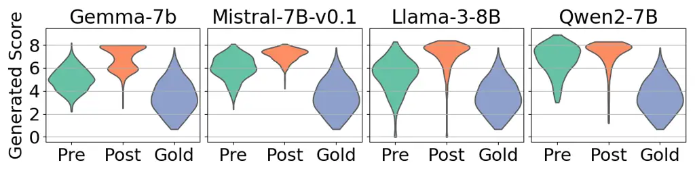

(a) Calalan

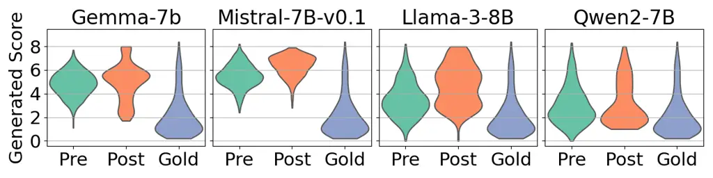

(b) English

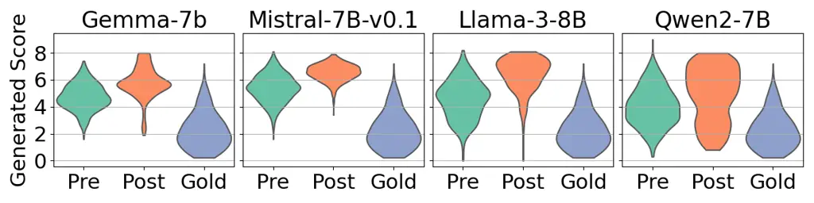

(c) Filipino

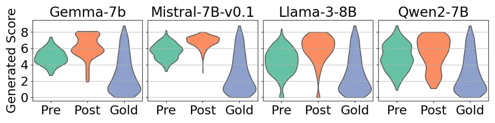

(d) French

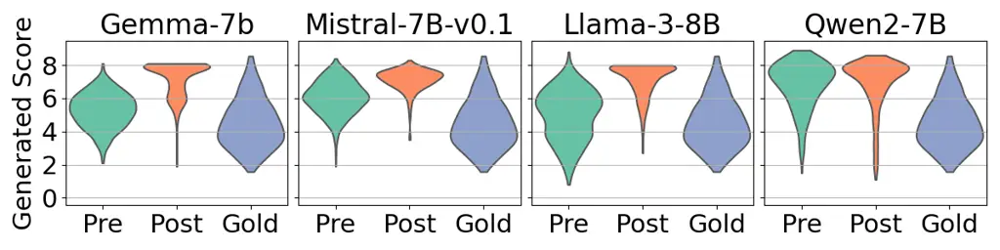

(e) German

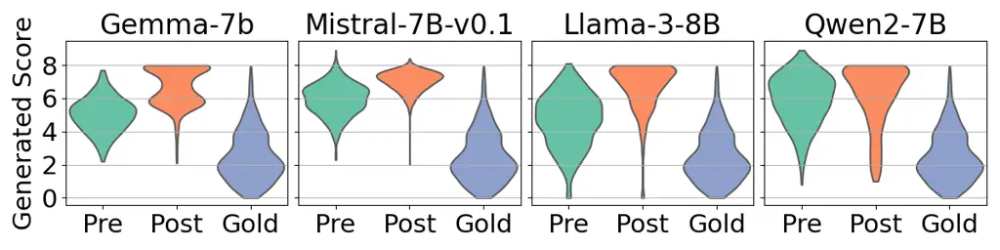

(f) Italian

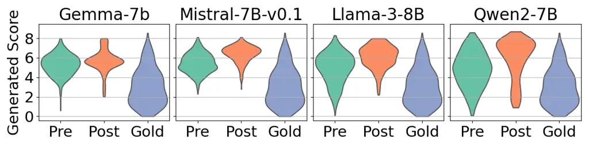

(g) Japanese

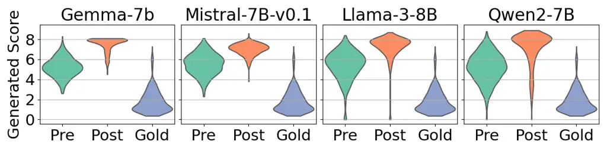

(h) Sinhala

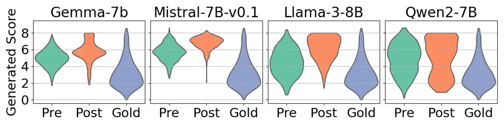

(i) Spanish

Figure 7: LCP score distribution.

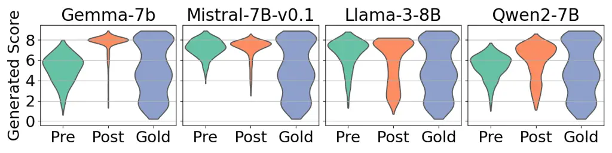

(a) Estonian to English (Et-En)

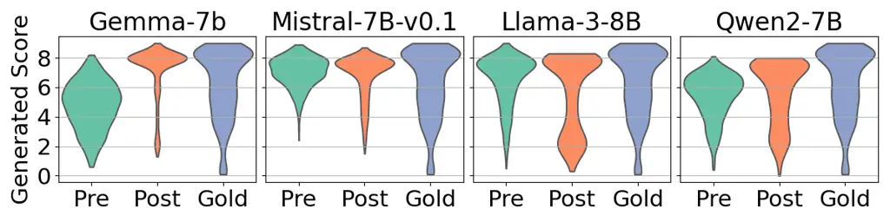

(b) Romanian to English (Ro-En)

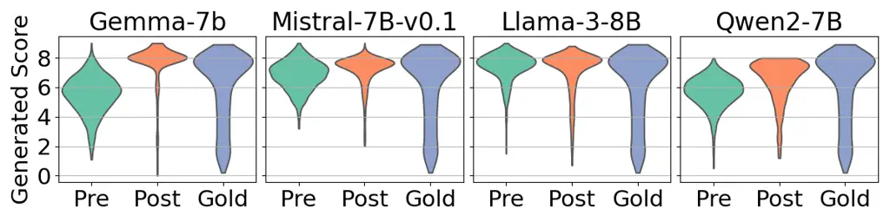

(c) Russian to English (Ru-En)

Figure 8: MTQE score distribution.

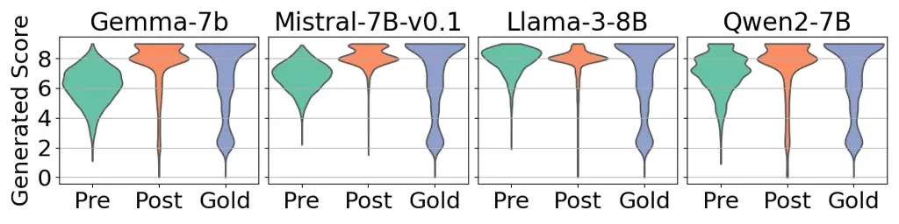

Figure 9: Distribution of GECQE scores in FLUTEC (Japanese).

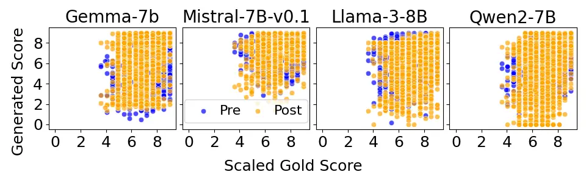

(a) GECQE (TMUGFM; English)

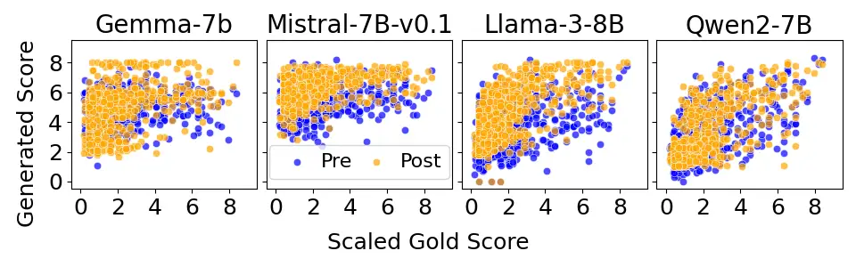

(b) LCP (English)

Figure 10: Scatter plots of GECQE and LCP scores.
