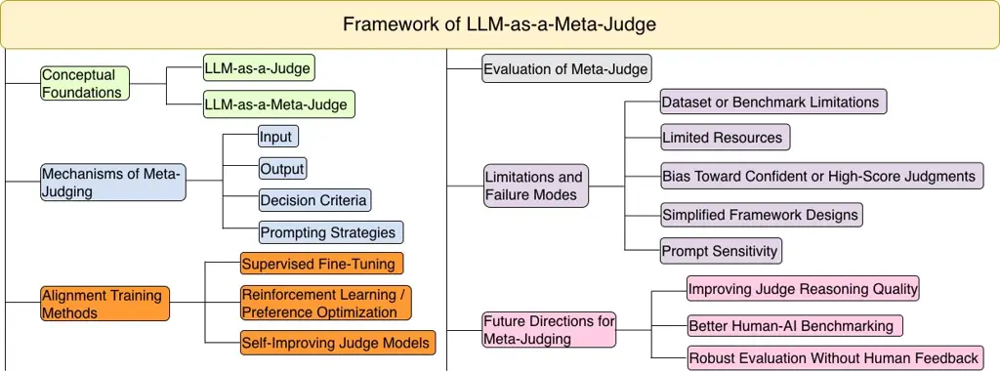

# Meta-Judging with Large Language Models: Concepts, Methods, and Challenges

Hugo Silva Affiliation: University of Coimbra, CISUC/LASI – Centre for
Informatics and Systems of the University of Coimbra, Department of
Informatics Engineering Email: <hugosilva@dei.uc.pt>    Mateus Mendes
Affiliation: Polytechnic University of Coimbra, Rua da Misericórdia,
Lagar dos Cortiços, S. Martinho do Bispo, 3045-093 Coimbra, Portugal.
Email: <mmendes@isec.pt>    Hugo Gonçalo Oliveira
Affiliation: University of Coimbra, CISUC/LASI – Centre for Informatics
and Systems of the University of Coimbra, Department of Informatics
Engineering Email: <hroliv@dei.uc.pt> Affiliation: RCM -- Research
Centre in Asset Management and Systems Engineering

###### Abstract

Large language models (LLMs) are evolving fast and are now frequently
used as evaluators, in a process typically referred to as
LLM-as-a-Judge, which provides quality assessments of model outputs.
However, recent research points out significant vulnerabilities in such
evaluation, including sensitivity to prompts, systematic biases,
verbosity effects, and unreliable or hallucinated rationales. These
limitations motivated the development of a more robust paradigm, dubbed
LLM-as-a-Meta-Judge. This survey reviews recent advances in meta-judging
and organizes the literature, by introducing a framework along six key
perspectives: (i) Conceptual Foundations, (ii) Mechanisms of
Meta-Judging, (iii) Alignment Training Methods, (iv) Evaluation,
(v) Limitations and Failure Modes, and (vi) Future Directions. By
analyzing the limitations of LLM-as-a-Judge and summarizing recent
advances in meta-judging by LLMs, we argue that LLM-as-a-Meta-Judge
offers a promising direction for more stable and trustworthy automated
evaluation, while highlighting remaining challenges related to cost,
prompt sensitivity, and shared model biases, which must be addressed to
advance the next generation of LLM evaluation methodologies.

## 1 Introduction

Before the rise of ChatGPT in 2022, research on autonomous AI agents
focused mainly on traditional frameworks like multi-agent systems (MAS)
and expert systems Lopez-Ortega and Villar-Medina (2009), emphasizing
social interaction and distributed intelligence. The concept of an AI
agent, introduced by Castelfranchi (1998), has since evolved: modern AI
agents now combine LLMs with external tools, function calling, and
stepwise reasoning to perform complex, multi-stage tasks autonomously.
By late 2023, Agentic AI emerged, where specialized agents collaborate
to break down goals and coordinate efforts, letting multiple LLMs and
intelligence counterparts leverage their unique strengths for more
effective problem-solving Chan et al. (2023).

Because human evaluators are limited and costly, the LLM-as-a-Judge
approach has gained traction, using LLMs to simulate human judgment Chen
et al. (2025). Building on this, the concept of LLM-as-a-Meta-Judge
represents a promising step toward achieving more consistent and
reliable automated evaluation. It underscores critical limitations that
remain, namely high computational cost, strong sensitivity to prompt
design, and the persistence of shared model biases. These factors
continue to challenge alignment approaches like Direct Preference
Optimization (DPO) Rafailov et al. (2023), highlighting the ongoing need
for LLMs to serve as meta-judges that can mediate these shortcomings.

In essence, the meta-judge acts as a “judge of judges”, ensuring
evaluations are coherent, justified, and rubric-aligned. Despite growing
interest, research in meta-judging remains sparse, and this work aims to
define the concepts and unify disperse literature into a cohesive
framework. The contributions of this paper can be summarized as follows:

1.  1.  At the definition level, we provide conceptual definitions of
        LLM-as-a-Judge and LLM-as-a-Meta-Judge;
2.  2.  At the framework level, we conduct a systematic organization of
        fragmented literature, which is lacking from the literature, into a
        unified conceptual structure, namely the mechanisms of meta-judging,
        alignment training methods, evaluation of meta-judge, limitations
        and failure modes, and future directions.

In Section 2, Figure 1 summarizes the proposed framework of
LLM-as-a-Meta-Judge and the structure of the paper. Section 3 provides a
review of survey research on LLM-as-a-Judge. Section 4 presents the
conceptual foundations of LLM-as-a-Judge and LLM-as-a-Meta-Judge.
Section 5 describes the mechanisms of meta-judging, and Section 6 the
alignment training methods. Section 7 is dedicated to evaluating the
performance of the meta-judge, Section 8 discusses the limitations and
failure methods, and Section 9 drafts the future directions for
meta-judging. Finally, Section 10 presents the conclusions.

## 2 Overview of the proposed LLM-as-a-Meta-Judge framework

Figure 1 provides a structured overview of the proposed
LLM-as-a-Meta-Judge framework and serves as a conceptual map for the
organization of this survey. Rather than presenting meta-judging as a
single technique, the figure highlights it as a layered and evolving
research paradigm that builds upon prior work on LLM-as-a-Meta-Judge.
The framework is organized into six interconnected branches, each
corresponding to a major research dimension discussed in this paper.

Figure 1: Proposed framework of LLM-as-a-Meta-Judge categorized in six
main branches.

The framework for LLM-based meta-judging begins with Conceptual
Foundations, which clarify the motivations, definitions, and assumptions
behind judging and meta-judging. It then describes Mechanisms of
Meta-Judging and Alignment Training Methods, detailing how models can
assess other models’ judgments and be trained for consistency and
reliability. Evaluation of Meta-Judge covers metrics and protocols for
assessing performance, while Limitations and Failure Modes address
challenges like bias and error propagation. Finally, Future Directions
for Meta-Judging highlights open research opportunities, illustrating a
structured progression from foundational concepts to practical
mechanisms, evaluation, and emerging questions.

## 3 LLM-as-a-Judge

This section reviews recent surveys on LLMs as evaluators, outlining
their definitions, development, validation, and practical use, while
underscoring persistent challenges around bias, reliability,
reproducibility, and ethics despite their scalability advantages.

The Need for Automated Evaluation is becoming increasingly clear.
Traditional metrics such as BLEU Papineni et al. (2002) and ROUGE Lin
(2004) remain useful for surface-level assessment but often show weak
correlation with human judgments in complex or creative tasks Gu et al.
(2025); Schluter (2017). As human evaluation is costly and difficult to
scale, this gap has driven the adoption of the LLM-as-a-Judge paradigm,
where LLMs are used to evaluate generated outputs according to explicit
criteria Zheng et al. (2023); Zhou et al. (2023).

LLM-as-a-Judge Paradigm and Taxonomies explore the use of LLMs to
evaluate, critique, or rank outputs rather than generate them,
leveraging careful prompting, strong models, and structured evaluation
pipelines to reduce human annotation effort Gu et al. (2025); Zhuge et
al. (2024); Shinn et al. (2023). These approaches support evaluation,
training, and dataset construction through single models, ensembles, or
human–AI collaboration, and are increasingly formalized through unified
frameworks that define what to judge, how to judge, and how to assess
outcomes Li et al. (2024); Li et al. (2025a).

Biases, Robustness, and Improvement Strategies are critical
considerations for LLM-as-a-Judge systems, which, while effective,
suffer from recurring biases such as length, position, concreteness, and
model-specific issues like egocentric bias and preference leakage Li et
al. (2025a). Existing mitigation approaches fall into prompt design,
model-based enhancements, and output optimization, where techniques such
as prompt engineering, fine-tuning, and aggregation of evaluation
signals can improve reliability but may also introduce new biases or
limit generalization Gu et al. (2025); Hu et al. (2024).

Meta-Evaluation and Benchmarks are central to assessing the reliability
of LLM-as-a-Judge systems, typically involving meta-evaluation against
human judgments, alongside bias and robustness analyses. Prior and
recent work relies on statistical agreement metrics (e.g., accuracy,
correlation coefficients, Cohen’s kappa) and benchmark-based evaluations
to measure alignment with human preferences, identify biases, and test
performance under challenging or domain-specific conditions Li et al.
(2024); Li et al. (2025a).

Limitations and Open Challenges in LLM-based evaluation include issues
such as sensitivity to prompt changes, susceptibility to adversarial
attacks, and reliance on specific model architectures, with research
often focusing more on downstream tasks than on robust benchmarking Gu
et al. (2025). Ethical concerns stemming from biases in training data
and opaque proprietary models have led to investigations into
inference-time techniques like chain-of-thought (CoT) reasoning,
self-consistency, debate-based judging, and human-in-the-loop
approaches, though these solutions remain under-explored Li et al.
(2025a).

## 4 Conceptual Foundations

This section introduces the conceptual foundations of automated
evaluation with LLMs, focusing on two closely-related paradigms,
LLM-as-a-Judge and LLM-as-a-Meta-Judge, as proposed in recent work on
meta-judging. These concepts point to a transition away from fixed
metrics and fully human-driven evaluation toward scalable, model-based
assessment frameworks that rely on the reasoning capacity of LLMs.

### 4.1 Concept of LLM-as-a-Judge

The LLM-as-a-Judge paradigm uses LLMs to evaluate outputs from humans or
other models, offering flexible criteria and interpretable feedback,
sometimes even replacing human evaluation Li et al. (2025b); Li et al.
(2024). However, LLM judges can be biased, favor models similar to
themselves, and occasionally hallucinate evaluation criteria.

Research has investigated a range of judging strategies, including
prompting approaches such as zero-shot, few-shot, and CoT, as well as
evaluation setups involving multiple judges or debate-based mechanisms.
This work has also analyzed common biases, including verbosity,
positional, and self-enhancement biases Stahl et al. (2024); Zheng et
al. (2023); Verga et al. (2024). LLM judges also enable iterative
self-improvement frameworks, like Self-Rewarding, though most focus on
improving the evaluated outputs rather than the judge itself Yuan et al.
(2024).

Training LLM judges remains challenging: supervised fine-tuning (SFT)
often lacks exposure to ambiguous or incorrect answers, limiting
generalization, while methods like Self-Consistency and Best-of-N only
partially address this Wang et al. (2022). Preference-based approaches
like DPO help models learn better from diverse outputs. DPO is a method
used in training AI models to directly optimize for human preferences.
Instead of just predicting what comes next in a text (like traditional
language models), DPO tries to make the model align with what humans
like or prefer. Overall, LLM-as-a-Judge is promising for flexible,
explainable evaluation, but single-agent setups are still vulnerable to
bias and reliability issues Ma et al. (2025); Huang et al. (2023); Ye et
al. (2024).

### 4.2 Concept of LLM-as-a-Meta-Judge

Research on using LLM-as-a-Judge has advanced quickly, but a key issue
remains: while LLMs are widely used to assess other systems, their own
judgments are rarely scrutinized. Most studies focus on producing scores
or feedback, with little attention to whether those evaluations are
accurate, consistent, or biased. In effect, evaluation is automated
without critically examining the evaluator itself, beyond comparing its
output to human labels.

To address this, a new approach called LLM-as-a-Meta-Judge has emerged.
Here, LLMs don’t judge content directly. Instead, they evaluate other
judgments, namely the scores, rationales, or critiques produced by LLMs
or humans, acting as “judges of judges”. Meta-judges can detect flawed
reasoning, identify systematic bias, and even revise judgments. Table 1
summarizes the differences between traditional LLM judges and
meta-judges. Although promising, this approach is still in its early
stages.

| Aspect            | LLM-as-a-Judge                     | LLM-as-a-Meta-Judge                                   |
| ----------------- | ---------------------------------- | ----------------------------------------------------- |
| What is evaluated | Model outputs                      | Judge evaluation of model outputs                     |
| Goal              | Produce a score, ranking, or judge | Validate, correct, or critique the judge’s evaluation |
| Input             | Prompt and model answers           | Prompt, model answers, and judge’s evaluation         |
| Role              | Primary evaluator                  | Secondary evaluator or auditor                        |
| Tries to address  | Need for automated judgments       | Bias, inconsistency, or error in LLM judges           |

Table 1: Key differences between LLM-as-a-Judge and LLM-as-a-Meta-Judge.

Compared to humans, LLM-based meta-judging is faster and more scalable.
However, prior work has focused on aligning LLM judgments with human
preferences, often ignoring the biases present in human evaluations.
Selecting reliable judgments from multiple LLM evaluations is another
underexplored challenge. To tackle this, Li et al. (2025b) propose a
three-stage pipeline to filter and audit judgments, while Wu et al.
(2025) introduce a Meta-Rewarding stage where a model can iteratively
improve its own evaluations during training. Other methods, like Trivedi
et al. (2024), show that using a judge’s own rationales via
Self-Rationalization and DPO can significantly improve accuracy. Bias in
meta-judging remains an open question, where Ma et al. (2025) provide
one of the first systematic analyses, examining position, verbosity,
chain-of-thought, and bandwagon effects.

Several meta-judging implementations exist. Li et al. (2025b) use a
multi-agent setup, where multiple LLMs independently or collaboratively
score judgments, and then aggregate results to estimate reliability. Wu
et al. (2025) propose an unsupervised, iterative pipeline where a single
model alternates between acting as actor, judge, and meta-judge,
creating preference pairs to train judges via DPO. Trivedi et al. (2024)
generate multiple judgments with rationales for the same input, refining
reasoning-to-score alignment. Ma et al. (2025) explore two meta-judging
variants: selecting the best judgment from a pool, or synthesizing a
final judgment from multiple inputs, evaluating the ability to integrate
and reconcile diverse information.

Empirical results are encouraging. Li et al. (2025b) report over 15%
precision gains on JudgeBench and 8% improvement over single-agent
baselines. Wu et al. (2025) show win-rate improvements from 22.9% to
39.4% on AlpacaEval 2 and 20.6% to 29.1% on Arena-Hard using
Meta-Rewarding. Trivedi et al. (2024) find Self-Rationalization improves
rationales, with a 62% win rate, outperforming even larger models
trained with other methods. Ma et al. (2025) find that meta-judging
achieves bias consistency comparable to single-model judging, with
modest improvements in position bias.

Recent work has explored a range of models for evaluation and judgment
tasks. For example, Li et al. (2025b) benchmarked several advanced LLMs,
including GPT-4o, Claude-3.5-Sonnet, and LLaMa-3.1-405B-Instruct, while
Wu et al. (2025) and Yuan et al. (2024) investigated
instruction-finetuned Llama-based judges and their correlation with
GPT-4-1106-preview. Other studies trained specialized Llama-3.1 judge
models for pairwise and point-wise evaluation and compared them with
widely used open-source judges such as Prometheus and Auto-J Trivedi et
al. (2024). Additionally, meta-judge configurations combining models
like GPT-4o-mini, LLaMA-3.3-70B, and DeepSeek-V3 have been examined,
with some models reserved for reference judgments rather than
meta-evaluation Ma et al. (2025).

Overall, while using LLMs as meta-judges is still an emerging area,
current results indicate it is a promising direction for building more
reliable, transparent, and self-aware evaluation systems.

## 5 Mechanisms of Meta-Judging

The mechanisms of meta-judging can be categorized into four components:
the input structure for the meta-judge, output, decision criteria, and
prompting strategies.

### 5.1 Input Structure for Meta-Judge

These works explore how meta-judging can be improved by giving judges
richer and more transparent inputs, rather than limiting them to just
the original prompt and a single candidate answer. Across studies,
judges are provided with additional context such as model rationales or
critiques Li et al. (2025b), the actor model’s original response and
prompt, pairs of judgments with the largest score variance, and the
evaluation rubric itself Wu et al. (2025). Other approaches include
supplying multiple judgments, each with an explicit score and rationale
Trivedi et al. (2024), or combining responses with responses to the
prompt, earlier referees’ judgments, scores and critiques Ma et al.
(2025).

Overall, these methods emphasize evaluating the reasoning process behind
an answer, not just the final output. As noted by Li et al. (2025b),
this shift toward multi-component and transparent inputs helps judges
better understand how conclusions are reached.

Some works also focus on reducing bias in the judging process. For
example, Wu et al. (2025) address positional bias by asking the model to
judge the same pair of responses twice with their order swapped, and by
applying weighted scoring depending on whether a response appears first
or second.

Finally, Trivedi et al. (2024) describe a Self-Rationalization approach
in which the same model generates multiple independent judgments for a
single input, each with its own score and rationale. This allows for
more diverse perspectives on the same response and can lead to more
robust evaluations.

### 5.2 Output

The outputs of meta-judge are the meta-judge score used to filter
unreliable judgments by retaining only those with high-quality,
well-explained, and decisive conclusions Li et al. (2025b), generation
of preference pairs of judgments, with CoT reasoning, followed by its
choice of better and worst judgment, to train the judge model via DPO Wu
et al. (2025); Trivedi et al. (2024), best judgment from a pool as the
final verdict, or generation of its own judgment based on the pool to
serve as the final verdict Ma et al. (2025). Li et al. (2025b) refer
that by defining a threshold, judgments scoring above this value are
considered reliable and correct, while those below are discarded. This
enables precision-focused evaluation by minimizing false positives,
ensuring that incorrect meta-judgments are classified as correct. Wu et
al. (2025) mention that their approach allows to compute scores that
account for the positional bias in the meta-judge evaluations, providing
a more accurate reward signal representing the judgment quality. Trivedi
et al. (2024) claim that the preference pairs are used to finetune the
model via DPO resulting in an improvement of the rationale generation
and response evaluation.

### 5.3 Decision Criteria

Recent work on meta-judging shows that there is no single standard for
how evaluation decisions should be made. Instead, different studies
adopt different assumptions about what makes a judgment reliable and how
to reduce bias and uncertainty when combining multiple evaluations.

Li et al. (2025b) propose a multi-agent setup where several agents act
as meta-judges. Agents can score responses independently or interact,
and the final score is determined via one of three strategies: weighted
averaging (scores are combined based on criterion importance and agent
reliability), majority voting (responses passing a threshold from most
agents get a high score), or panel discussion (agents assume roles,
discuss, and reach consensus, sometimes summarized by a dedicated
agent). This discussion-based approach helps reduce bias and improve
score quality.

Wu et al. (2025) take a different route, avoiding scalar scores. They
focus on pairwise comparison of judgments, especially those with high
uncertainty. Each comparison involves a meta-judge evaluating which
judgment is better, considering the prompt, response, and evaluation
rubric. To reduce positional bias, the order of judgments is swapped and
weighted, and pairwise results are converted into continuous
meta-rewards via Elo scores and maximum likelihood estimation Zheng et
al. (2023). They also identify and correct for a length bias that favors
longer judgments.

Trivedi et al. (2024) emphasize generating high-quality preference data
through “Self-Rationalization”. They create preference pairs by linking
a chosen judgment with a rejected one, using: (1) ground-truth
correctness, optionally applying a margin to emphasize differences; (2)
a meta-judge model Wu et al. (2025) to rank judgments based on
correctness and reasoning quality; or (3) majority
voting/self-consistency, selecting the most common score among multiple
judgments. These methods aim to produce cleaner, more informative
training signals.

Ma et al. (2025) investigate the fundamental structure of meta-judging.
They avoid techniques like rubric engineering Li et al. (2025b) to
isolate bias effects, control for positional bias by shuffling outputs,
and vary the number of judges to study how judge pool size influences
observed biases.

### 5.4 Prompting Strategies

Research has explored a range of meta-judge frameworks that vary in how
judgments are compared, scored, and synthesized, spanning single-agent
prompting strategies, rubric-based comparisons, and multi-judgment
aggregation.

Prior work has explored meta-judging mainly in single-agent settings. Li
et al. (2025b) identify four prompt strategies for this scenario. The
baseline meta-judge Wu et al. (2025) produces a single overall score
without breaking it down by criteria such as accuracy or instruction
adherence. The short scoring rubric introduces a concise set of criteria
to generate a soft label score, while the long scoring rubric expands
this idea with detailed, multi-sentence descriptions for each criterion
and score range. Finally, the binary rubric asks the judge to decide
whether all criteria are met using a simple True/False judgment. Wu et
al. (2025) propose a meta-judge prompt for comparing two existing
judgments of the same model response. The evaluator reviews the original
question, the response, and both judgments, then decides which judgment
is better. This decision is justified by checking how well each judgment
follows the rubric, how accurate it is, and how consistent its reasoning
is, ending with a clear statement of the preferred judgment. Trivedi et
al. (2024) describe that in the LLM-as-a-Meta-Judge self-assessment
setting, the model evaluates the quality of its own judgments, rating
them based on factors such as reasoning quality and scoring accuracy. Ma
et al. (2025) introduce two meta-judging settings. In the “Select”
setting, the meta-judge looks over multiple judgments, summarizes their
key points, notes where it agrees or disagrees, and then picks the
strongest option. In the “Conclude” setting, it combines all the
judgments into a single final decision, scores assistants on dimensions
like helpfulness and accuracy, and reflects on the referees’ judgments.
Together, these settings test how well a meta-judge can reason over,
integrate, and reconcile multiple perspectives.

## 6 Alignment Training Methods

Supervised Fine-Tuning serves as the foundational alignment stage in
meta-judge training, equipping the base model with initial evaluative
capabilities by learning to produce human-aligned judgments from labeled
evaluation data.

Wu et al. (2025) describe a preparation process for Meta-Rewarding
training. First, the seed model (Llama-3-8B-Instruct) undergoes
supervised fine-tuning on the Evaluation Fine-Tuning (EFT) dataset from
Yuan et al. (2024), which is built from Open Assistant Köpf et al.
(2023). This dataset contains ranked human responses and is designed to
train the model as an LLM-as-a-Judge, providing the evaluative
capability needed before applying Meta-Rewarding.

Trivedi et al. (2024) show that Self-Rationalizing Evaluators (SREs)
perform better than standard SFT-trained LLM-as-a-Judge models, both in
the coherence of their rationales and in scoring accuracy. They point
out a core weakness of standard SFT: it mainly teaches the model to
recognize correct judgments, without explicitly exposing it to incorrect
or borderline cases. As a result, such judges often struggle with
ambiguous or non-binary evaluations. In their setup, a base judge model
is first trained via SFT on labeled pointwise (e.g., Likert-scale) and
pairwise evaluation data, and then further calibrated in later stages to
improve the consistency and reliability of its judgments.

Reinforcement Learning/Preference Optimization methods train models
using preference data, often produced by judge models, to better align
outputs with desired behaviors. While Li et al. (2025b) do not directly
propose DPO or Reinforcement Learning from Human Feedback (RLHF), their
analysis of failure modes in LLM-based judges sheds light on the types
of errors these approaches seek to address and how improved preference
datasets can be constructed. RLHF explicitly optimizes for human-aligned
objectives such as helpfulness, safety, and overall quality, making it
more complex than DPO, which instead learns directly from preference
pairs without an explicit reinforcement learning loop. Wu et al. (2025)
propose Meta-Rewarding, an iterative framework where a single LLM cycles
through the roles of actor, judge, and meta-judge to progressively
improve evaluation quality. The actor generates multiple responses, the
judge ranks them to form preference pairs, and the meta-judge compares
alternative judgments to produce training data that refines the judge,
optimized using DPO for stability and simplicity. The method explicitly
mitigates length bias by favoring shorter outputs when scores are
similar Singhal et al. (2023). Experiments show that Meta-Rewarding
significantly outperforms Self-Rewarding in agreement with GPT-4 and
human evaluators, although improvements slow down in later iterations,
likely due to distribution shifts between model-generated and
human-written responses. Trivedi et al. (2024) propose combining SFT
with DPO to improve judging performance. SFT first establishes basic
task competence, after which DPO refines the model using preference
pairs that distinguish better judgments from worse ones, allowing the
model to learn more effectively from negative examples. These preference
pairs are built using three strategies: pairing correct judgments
against incorrect ones based on ground truth, meta-judge ranking
following Wu et al. (2025), and majority voting across multiple
judgments. Results show that using SFT and DPO together outperforms
either method alone. While SFT teaches general task behavior, DPO better
aligns the model with preference-based reasoning and avoids the diluted
training signals that can arise from long rationales in SFT or RLHF.

Self-Improving Judge Models represent approaches in which LLMs
iteratively refine their own evaluations, enhancing judgment quality and
reducing biases without relying on external human supervision. Recent
research has explored how LLMs can act as judges and even improve their
own evaluation abilities. Li et al. (2025b) point out that most existing
work tries to align LLM judgments with human preferences, but often
ignores the fact that human judgments themselves can be biased or
inconsistent. Earlier studies have also identified several weaknesses in
LLM-as-a-Judge systems, including positional and verbosity biases,
self-enhancement, and shallow reasoning, especially for open-ended
evaluations Zheng et al. (2023). To address these issues, recent work
has proposed letting models reflect on and revise their own judgments
through meta-judging, reducing reliance on human supervision. Along
these lines, Wu et al. (2025) propose Meta-Rewarding, a method that
allows a model to assess and refine its own judgments using internal
feedback. Their results suggest that models can meaningfully improve
their evaluation skills autonomously. Similarly, Trivedi et al. (2024)
introduce SRE, where a model generates, compares, and learns from its
own evaluations, using DPO to iteratively improve reasoning quality and
scoring accuracy without additional human input. Finally, Ma et al.
(2025) show that using LLMs as meta-judges improves consistency and can
reduce intrinsic biases, particularly when evaluating larger judgment
pools.

## 7 Evaluation of Meta-Judge

This section reviews recent empirical efforts to evaluate meta-judging
frameworks, focusing on their effectiveness across different tasks,
datasets and benchmarks, judging strategies, and agent configurations.

Li et al. (2025b) propose evaluating LLM judgments beyond accuracy by
considering reasoning quality, interpretability, and error detection.
They use JudgeBench Tan et al. (2024), which integrates MMLU-Pro,
LiveBench, and LiveCodeBench Wang et al. (2024); White et al. (2024);
Jain et al. (2024), covering knowledge, reasoning, math, and coding
tasks with responses from GPT-4o and Claude-3.5-Sonnet annotated by
humans. Benchmarking GPT-4o, GPT-4o-mini, Claude-3.5-Sonnet, and
LLaMa-3.1-405B-Instruct, they find that judging strategies should match
task type: task-aligned models help for knowledge tasks, stronger models
and longer rubrics aid complex reasoning, and detailed rubrics benefit
math. Multi-agent approaches, like majority voting, weighted averaging,
and panel discussions, further improve precision depending on the task.
Wu et al. (2025) introduce Meta-Rewarding, a self-play framework that
improves a model’s ability both to answer questions and to evaluate
responses. Building on prior self-rewarding work Yuan et al. (2024),
they fine-tune Llama-3-8B-Instruct using AlpacaEval 2, Arena-Hard, and
MT-Bench. The model alternates between three roles (actor, judge, and
meta-judge), generating its own preference data while explicitly
controlling for length and positional bias. Actor training uses scored
responses with length-controlled preference selection, while judge
training focuses on cases with high uncertainty and relies on pairwise
meta-judging with Elo ranking. Meta-Rewarding substantially outperforms
Self-Rewarding and Self-Play Preference Optimization (SPPO) baselines,
raising win rates from 22.9% to 39.4% and approaching the performance of
Claude Opus. It improves performance across most instruction categories,
strengthens judging quality, and maintains multi-turn ability, though
alignment gains with human judgments diminish in later iterations due to
distribution shift. Trivedi et al. (2024) explore SREs, which learn to
judge responses with explicit reasoning but without human-annotated
preference data. They evaluate on RewardBench, BiGGen Bench, and
Feedback Bench. Starting from a base judge trained via SFT, they
iteratively generate multiple judgments with rationales and construct
preference pairs using three strategies: matching ground truth scores,
meta-judge selection Wu et al. (2025), and majority voting. Training
with DPO on these preferences leads to evaluators that outperform the
seed model and stronger baselines while using fewer samples and less
computation. The results show that explicit rationales help judging
performance when paired with high-quality preference data, whereas long
rationales trained via SFT or RLHF can add noise. Higher-margin
preference pairs consistently lead to better alignment and evaluation
quality. Ma et al. (2025) investigate whether meta-judge frameworks can
reduce bias in LLM evaluation. They train meta-judges on pairwise
comparisons from multiple LLM judges using MT-Bench and CALM-Alignment.
Results show that diverse judge pools can match the bias consistency of
strong single judges, with larger pools notably improving position-bias
consistency. Overall consistency may slightly decrease, and adding a
bias-free agent has limited effect unless the meta-judge can explicitly
identify and weight it.

As summarized in Table 2, different meta-judging frameworks emphasize
distinct goals, ranging from bias reduction to autonomous judge
improvement.

| Work                  | Core Contribution                                  | Main Results / Findings                                                                                                                                                                                                                                   |
| --------------------- | -------------------------------------------------- | --------------------------------------------------------------------------------------------------------------------------------------------------------------------------------------------------------------------------------------------------------- |
| Li et al. (2025b)     | Analysis of failure modes and design choices       | Providing judges with clear rationales or rubrics increases reliability, precision-oriented filtering lowers false positives, and multi-agent judging consistently outperforms single evaluators, though the best aggregation method depends on the task. |
| Wu et al. (2025)      | Meta-Rewarding framework for self-improving judges | Iterative meta-judging with bias-controlled pairwise comparisons boosts judging quality and actor performance, nearing strong proprietary model results, though gains plateau over iterations.                                                            |
| Trivedi et al. (2024) | Self-Rationalizing Evaluators                      | Training with DPO on multiple rationalized judgments improves scoring accuracy and reasoning quality over standard SFT, with larger-margin preference pairs boosting alignment, and combining SFT with DPO outperforming each individually.               |
| Ma et al. (2025)      | Structural study of meta-judging and bias          | Meta-judging can reduce positional bias and improve consistency with larger, diverse judge pools, though overall consistency gains are not guaranteed and adding “bias-free” agents alone has limited effect.                                             |

Table 2: Summary of main results in meta-judging research.

## 8 Limitations and Failure Modes

Dataset or Benchmark Limitations play a central role in shaping the
conclusions of meta-judge studies, as the scope and composition of the
datasets can constrain generalization and affect evaluation outcomes.
Several limitations and open questions emerge from prior work. Li et al.
(2025b) evaluate a meta-judge selection framework using a relatively
small set of 350 judgments based on response pairs generated by
GPT-4o-mini. This limited judgment pool may restrict how well their
findings generalize, as the framework itself constrains the diversity
and scale of evaluations. Trivedi et al. (2024) point out a gap in
understanding how self-curated datasets, especially those expanded
through sampling techniques, affect the quality of rationales and
scoring in LLM-as-a-Judge settings. Their observations suggest
opportunities to study whether combining DPO with more advanced sampling
strategies can lead to better rationales and stronger overall
performance. Similarly, Ma et al. (2025) report that their experiments
were conducted on only two benchmarks, which may limit the robustness of
their conclusions. While additional benchmarks such as Judge-Bench Tan
et al. (2024), which focuses on problem-solving ability, are available,
they were intentionally excluded to avoid confounding bias measurements
with task-solving errors. Finally, limited computational resources
remain a major challenge. As noted by Ma et al. (2025), multi-agent
inference is expensive and heavily dependent on strong
instruction-following, which restricts evaluation scale. This makes
fine-grained statistical analysis difficult leading to higher variance
and less reliable results.

Bias Toward Confident or High-Score Judgments is a key factor
influencing meta-judge performance, as judges often favor responses they
perceive as more confident or assign higher scores more readily. Wu et
al. (2025) identify several limitations in their experimental setup from
using a 5-point judging system. The scoring scale led to frequent ties
and score saturation, making it difficult to distinguish small quality
differences or detect improvements as training progressed. Despite
attempts to mitigate positional bias in the meta-judge, the bias
persisted and avoided further gains by the third iteration.
Additionally, the judge showed a tendency to over-assign high scores,
further reducing the ability to discriminate between responses, and
exhibited limited improvement when evaluating responses not generated by
itself. Ma et al. (2025), regarding how biases manifest in multi-agent
frameworks when used in the context of LLM-as-a-Judge systems, highlight
that previous work is limited by examining only a small set of biases,
position, bandwagon, CoT, and verbosity, which fails to capture the full
range of possible biases. They also note that bias mitigation is
underexplored, as only a single method for reducing position bias is
evaluated, leaving effective bias mitigation an open and ongoing
challenge.

Simplified Framework Designs are central to this discussion, as Ma et
al. (2025) points out the applied simplified multi-agent framework, in
order to maintain clarity and control over confounding variables,
limiting the direct applicability of the results to more advanced
multi-agent architectures, but this choice allows to isolate
bias-related effects without interference from more elaborate
coordination strategies.

Prompt sensitivity is a key factor, as Ma et al. (2025) discusses how
the structure of prompts given to automated judge models can itself
limit evaluation outcomes.

## 9 Future Directions for Meta-Judging

Improving Judge Reasoning Quality is a central challenge in meta-judging
research. Recent work shows that stronger evaluation depends on a
judge’s ability to generate and distinguish high- versus low-quality
reasoning, supported by high-quality preference data and training
strategies such as DPO combined with advanced sampling Trivedi et al.
(2024). Other studies reveal that judgment errors often stem from
systematic biases, such as position, bandwagon, CoT, and verbosity
effects, and argue that mitigating these issues will require better
prompt design, alternative judge architectures, and exploration of
additional bias sources Ma et al. (2025).

Regarding Better Human-AI Benchmarking, recent work points to the need
for more robust and nuanced approaches to evaluating human–AI systems,
both by leveraging strong LLMs as meta-judges to produce high-quality
preference data and by designing benchmarks that disentangle evaluator
bias from underlying model capabilities. Li et al. (2025b) argue that
the strong performance of LLMs as meta-judges can be leveraged to
generate high-quality preference datasets. Ma et al. (2025) highlight
the need for more benchmarks to distinguish bias effects from capability
failures. They suggest creating controlled, bias-only environments to
separate evaluator bias from task performance and propose scalable
strategies for multi-agent LLM evaluation dues to computational
constraints.

Robust Evaluation Without Human Feedback represents a promising future
direction for meta-judging, focusing on the development of autonomous
and scalable evaluation frameworks that minimize or eliminate reliance
on human supervision. Li et al. (2025b) highlight the potential of using
LLMs to train other LLMs as evaluators, aiming at fully autonomous,
scalable, and accurate assessment systems without human supervision. Wu
et al. (2025) highlight that models improving them selves without human
feedback is a promising approach to address the super alignment
challenge Burns et al. (2023), aiming for models that can potentially
surpass human-level judgment abilities.

## 10 Conclusion

The evolution from LLM-as-a-Judge to LLM-as-a-Meta-Judge marks a shift
from using LLMs to make judgments to using them to evaluate such
judgments. While early LLM judges offered scalable, flexible
alternatives to humans, they struggled with bias, inconsistency, and
unquestioned authority. Meta-judges address this by scrutinizing
judgments for correctness, reasoning, and fairness, adding a layer of
oversight. However, they come with higher costs, sensitivity to prompts,
and imperfect bias detection, so they should be seen as a complement,
not a replacement, to careful evaluation.

To support this shift, the paper offers a comprehensive survey of
meta-judging, an area that has received little systematic attention so
far. It first clarifies the concepts of LLM-as-a-Judge and
LLM-as-a-Meta-Judge, introducing a contextualized definition that
considers the evaluation target, goals, inputs, and model properties.
Second, it then organizes prior work into a coherent framework along the
key dimensions of meta-judging, as summarized in Figure 1 of Section 2.
This framework structures the literature around conceptual foundations,
meta-judging mechanisms, alignment training methods, evaluation
protocols, and known limitations, bringing together previously
fragmented research while highlighting open problems and promising
directions for future work.

Using multiple layers of LLMs to judge each other has limited value,
since these models share similar biases, and meta-judging mostly checks
internal consistency rather than truth. Human judgment remains
essential, especially for subtle or value-laden tasks. Ultimately,
understanding and refining how we evaluate AI is the key to building
systems we can trust.

## Acknowledgments

This work is financed through national funds by FCT - Fundação para a
Ciência e a Tecnologia, I.P., in the framework of the Project
UIDB/00326/2025 and UIDP/00326/2025.

## References

- Burns et al. (2023) C. Burns, P. Izmailov, J. H. Kirchner, B.
  Baker, L. Gao, L. Aschenbrenner, Y. Chen, A. Ecoffet, M. Joglekar, J.
  Leike, et al. Weak-to-strong generalization: eliciting strong
  capabilities with weak supervision. arXiv preprint arXiv:2312.09390.
  Cited by: §9.
- Castelfranchi (1998) C. Castelfranchi Modelling social action for AI
  agents. Artificial intelligence 103 (1-2), pp. 157–182. Cited by: §1.
- Chan et al. (2023) C. Chan, W. Chen, Y. Su, J. Yu, W. Xue, S.
  Zhang, J. Fu, and Z. Liu Chateval: towards better LLM-based evaluators
  through multi-agent debate. arXiv preprint arXiv:2308.07201. Cited by:
  §1.
- Chen et al. (2025) J. Chen, Y. Lu, X. Wang, H. Zeng, J. Huang, J.
  Gesi, Y. Xu, B. Yao, and D. Wang Multi-agent-as-judge: aligning
  LLM-agent-based automated evaluation with multi-dimensional human
  evaluation. arXiv preprint arXiv:2507.21028. Cited by: §1.
- Gu et al. (2025) J. Gu, X. Jiang, Z. Shi, H. Tan, X. Zhai, C. Xu, W.
  Li, Y. Shen, S. Ma, H. Liu, S. Wang, K. Zhang, Y. Wang, W. Gao, L. Ni,
  and J. Guo A survey on LLM-as-a-judge. External Links: 2411.15594,
  [Link](https://arxiv.org/abs/2411.15594) Cited by: §3, §3, §3, §3.
- Hu et al. (2024) X. Hu, M. Gao, S. Hu, Y. Zhang, Y. Chen, T. Xu,
  and X. Wan Are LLM-based evaluators confusing nlg quality criteria?.
  arXiv preprint arXiv:2402.12055. Cited by: §3.
- Huang et al. (2023) J. Huang, X. Chen, S. Mishra, H. S. Zheng, A. W.
  Yu, X. Song, and D. Zhou Large language models cannot self-correct
  reasoning yet. arXiv preprint arXiv:2310.01798. Cited by: §4.1.
- Jain et al. (2024) N. Jain, K. Han, A. Gu, W. Li, F. Yan, T. Zhang, S.
  Wang, A. Solar-Lezama, K. Sen, and I. Stoica Livecodebench: holistic
  and contamination free evaluation of large language models for code.
  arXiv preprint arXiv:2403.07974. Cited by: §7.
- Köpf et al. (2023) A. Köpf, Y. Kilcher, D. Von Rütte, S.
  Anagnostidis, Z. R. Tam, K. Stevens, A. Barhoum, D. Nguyen, O.
  Stanley, R. Nagyfi, et al. Openassistant conversations-democratizing
  large language model alignment. Advances in neural information
  processing systems 36, pp. 47669–47681. Cited by: §6.
- Li et al. (2025a) D. Li, B. Jiang, L. Huang, A. Beigi, C. Zhao, Z.
  Tan, A. Bhattacharjee, Y. Jiang, C. Chen, T. Wu, et al. From
  generation to judgment: opportunities and challenges of
  LLM-as-a-judge. In Proceedings of the 2025 Conference on Empirical
  Methods in Natural Language Processing, pp. 2757–2791. Cited by: §3,
  §3, §3, §3.
- Li et al. (2024) H. Li, Q. Dong, J. Chen, H. Su, Y. Zhou, Q. Ai, Z.
  Ye, and Y. Liu LLMs-as-judges: a comprehensive survey on LLM-based
  evaluation methods. arXiv preprint arXiv:2412.05579. Cited by: §3, §3,
  §4.1.
- Li et al. (2025b) Y. Li, J. H. Mohamud, C. Sun, D. Wu, and B. Boulet
  Leveraging LLMs as meta-judges: a multi-agent framework for evaluating
  LLM judgments. arXiv preprint arXiv:2504.17087. Cited by: §4.1, §4.2,
  §4.2, §4.2, §4.2, §5.1, §5.1, §5.2, §5.3, §5.3, §5.4, §6, §6, Table 2,
  §7, §8, §9, §9.
- Lin (2004) C. Lin Rouge: a package for automatic evaluation of
  summaries. In Text summarization branches out, pp. 74–81. Cited by:
  §3.
- Lopez-Ortega and Villar-Medina (2009) O. Lopez-Ortega and I.
  Villar-Medina A multi-agent system to construct production orders by
  employing an expert system and a neural network. Expert Systems with
  Applications 36 (2), pp. 2937–2946. Cited by: §1.
- Ma et al. (2025) C. Ma, E. Zhang, Y. Zhao, W. Liu, Y. Jia, P. Qing, L.
  Shi, A. Cohan, Y. Yan, and S. Vosoughi Judging with many minds: do
  more perspectives mean less prejudice?. arXiv preprint
  arXiv:2505.19477. Cited by: §4.1, §4.2, §4.2, §4.2, §4.2, §5.1, §5.2,
  §5.3, §5.4, §6, Table 2, §7, §8, §8, §8, §8, §9, §9.
- Papineni et al. (2002) K. Papineni, S. Roukos, T. Ward, and W. Zhu
  Bleu: a method for automatic evaluation of machine translation. In
  Proceedings of the 40th annual meeting of the Association for
  Computational Linguistics, pp. 311–318. Cited by: §3.
- Rafailov et al. (2023) R. Rafailov, A. Sharma, E. Mitchell, C. D.
  Manning, S. Ermon, and C. Finn Direct preference optimization: your
  language model is secretly a reward model. Advances in neural
  information processing systems 36, pp. 53728–53741. Cited by: §1.
- Schluter (2017) N. Schluter The limits of automatic summarisation
  according to Rouge. In Proceedings of the 15th Conference of the
  European Chapter of the Association for Computational Linguistics,
  pp. 41–45. Cited by: §3.
- Shinn et al. (2023) N. Shinn, F. Cassano, A. Gopinath, K. Narasimhan,
  and S. Yao Reflexion: language agents with verbal reinforcement
  learning. Advances in Neural Information Processing Systems 36,
  pp. 8634–8652. Cited by: §3.
- Singhal et al. (2023) P. Singhal, T. Goyal, J. Xu, and G. Durrett A
  long way to go: investigating length correlations in RLHF. arXiv
  preprint arXiv:2310.03716. Cited by: §6.
- Stahl et al. (2024) M. Stahl, L. Biermann, A. Nehring, and H.
  Wachsmuth Exploring LLM prompting strategies for joint essay scoring
  and feedback generation. arXiv preprint arXiv:2404.15845. Cited by:
  §4.1.
- Tan et al. (2024) S. Tan, S. Zhuang, K. Montgomery, W. Y. Tang, A.
  Cuadron, C. Wang, R. A. Popa, and I. Stoica Judgebench: a benchmark
  for evaluating LLM-based judges. arXiv preprint arXiv:2410.12784.
  Cited by: §7, §8.
- Trivedi et al. (2024) P. Trivedi, A. Gulati, O. Molenschot, M. A.
  Rajeev, R. Ramamurthy, K. Stevens, T. S. Chaudhery, J. Jambholkar, J.
  Zou, and N. Rajani Self-rationalization improves LLM as a fine-grained
  judge. arXiv preprint arXiv:2410.05495. Cited by: §4.2, §4.2, §4.2,
  §4.2, §5.1, §5.1, §5.2, §5.3, §5.4, §6, §6, §6, Table 2, §7, §8, §9.
- Verga et al. (2024) P. Verga, S. Hofstatter, S. Althammer, Y. Su, A.
  Piktus, A. Arkhangorodsky, M. Xu, N. White, and P. Lewis Replacing
  judges with juries: evaluating LLM generations with a panel of diverse
  models. arXiv preprint arXiv:2404.18796. Cited by: §4.1.
- Wang et al. (2022) X. Wang, J. Wei, D. Schuurmans, Q. Le, E. Chi, S.
  Narang, A. Chowdhery, and D. Zhou Self-consistency improves chain of
  thought reasoning in language models. arXiv preprint arXiv:2203.11171.
  Cited by: §4.1.
- Wang et al. (2024) Y. Wang, X. Ma, G. Zhang, Y. Ni, A. Chandra, S.
  Guo, W. Ren, A. Arulraj, X. He, Z. Jiang, et al. MMLU-Pro: a more
  robust and challenging multi-task language understanding benchmark.
  Advances in Neural Information Processing Systems 37, pp. 95266–95290.
  Cited by: §7.
- White et al. (2024) C. White, S. Dooley, M. Roberts, A. Pal, B.
  Feuer, S. Jain, R. Shwartz-Ziv, N. Jain, K. Saifullah, S. Dey, et al.
  LiveBench: a challenging, contamination-limited LLM benchmark. arXiv
  preprint arXiv:2406.19314. Cited by: §7.
- Wu et al. (2025) T. Wu, W. Yuan, O. Golovneva, J. Xu, Y. Tian, J.
  Jiao, J. E. Weston, and S. Sukhbaatar Meta-rewarding language models:
  self-improving alignment with LLM-as-a-meta-judge. In Proceedings of
  the 2025 Conference on Empirical Methods in Natural Language
  Processing, pp. 11548–11565. Cited by: §4.2, §4.2, §4.2, §4.2, §5.1,
  §5.1, §5.2, §5.3, §5.3, §5.4, §6, §6, §6, Table 2, §7, §8, §9.
- Ye et al. (2024) J. Ye, Y. Wang, Y. Huang, D. Chen, Q. Zhang, N.
  Moniz, T. Gao, W. Geyer, C. Huang, P. Chen, et al. Justice or
  prejudice? Quantifying biases in LLM-as-a-judge. arXiv preprint
  arXiv:2410.02736. Cited by: §4.1.
- Yuan et al. (2024) W. Yuan, R. Y. Pang, K. Cho, X. Li, S.
  Sukhbaatar, J. Xu, and J. E. Weston Self-rewarding language models. In
  Forty-first International Conference on Machine Learning, Cited by:
  §4.1, §4.2, §6, §7.
- Zheng et al. (2023) L. Zheng, W. Chiang, Y. Sheng, S. Zhuang, Z.
  Wu, Y. Zhuang, Z. Lin, Z. Li, D. Li, E. Xing, et al. Judging
  LLM-as-a-judge with MT-Bench and Chatbot Arena. Advances in neural
  information processing systems 36, pp. 46595–46623. Cited by: §3,
  §4.1, §5.3, §6.
- Zhou et al. (2023) C. Zhou, P. Liu, P. Xu, S. Iyer, J. Sun, Y. Mao, X.
  Ma, A. Efrat, P. Yu, L. Yu, et al. Lima: less is more for alignment.
  Advances in Neural Information Processing Systems 36, pp. 55006–55021.
  Cited by: §3.
- Zhuge et al. (2024) M. Zhuge, C. Zhao, D. Ashley, W. Wang, D.
  Khizbullin, Y. Xiong, Z. Liu, E. Chang, R. Krishnamoorthi, Y. Tian, et
  al. Agent-as-a-judge: evaluate agents with agents. arXiv preprint
  arXiv:2410.10934. Cited by: §3.
