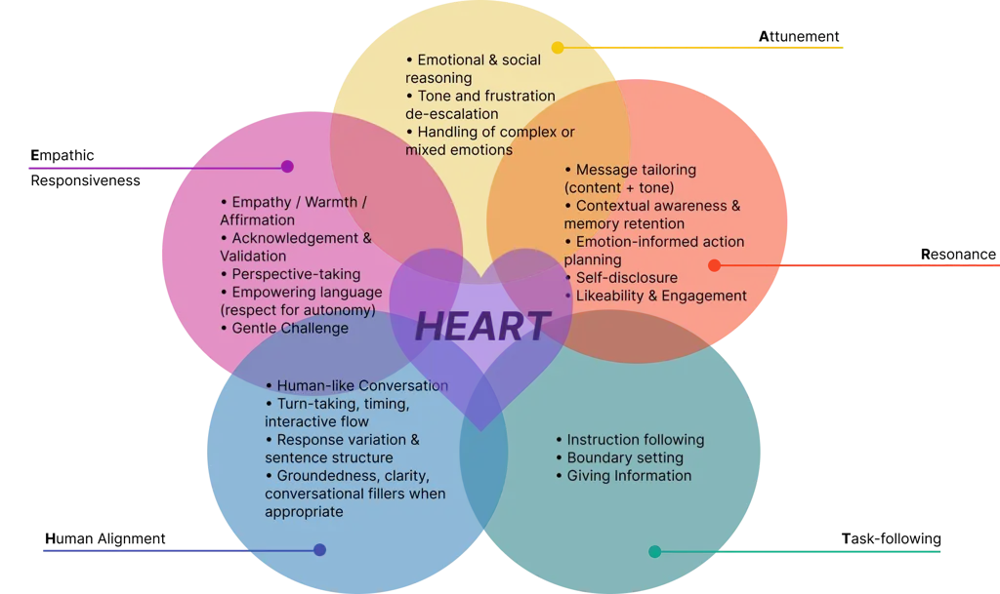
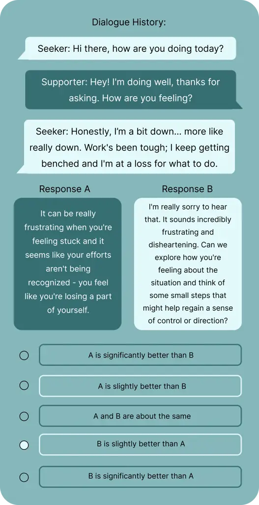
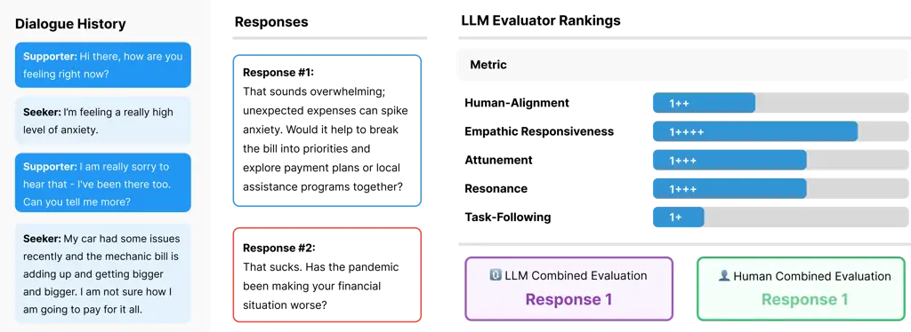
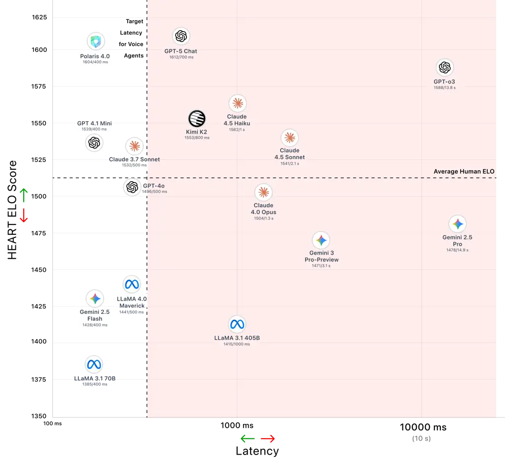
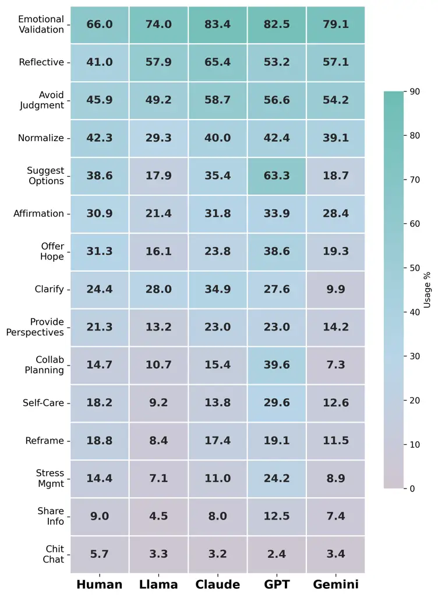
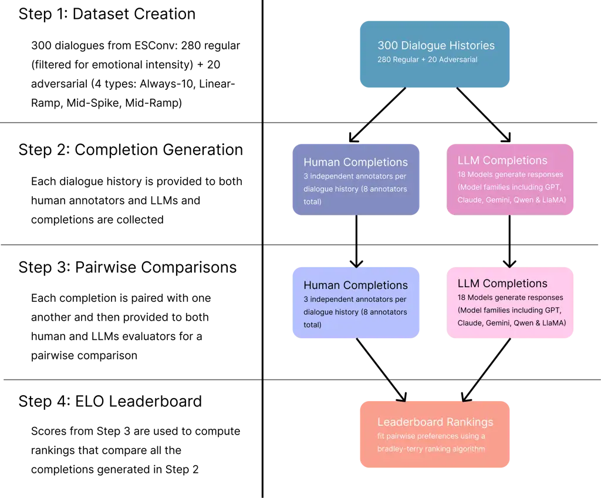

¹¹footnotetext: Hippocratic AI²²footnotetext: Stanford
University³³footnotetext: University of California, San
Diego⁴⁴footnotetext: University of Texas at Austin

# HEART: A Unified Benchmark for Assessing Humans and LLMs in Emotional Support Dialogue

Laya Iyer Email: <laya@stanford.edu>    Kriti Aggarwal
Email: <kriti@hippocraticai.com>    Sanmi Koyejo
Email: <sanmi@cs.stanford.edu>    Gail Heyman    Desmond C. Ong   
Subhabrata Mukherjee Email: [gheyman@ucsd.edu, desmond.ong@utexas.edu,
subho@hippocraticai.com\* Equal contribution  \$†\$ Corresponding
author](mailto:)

February 2026

## 1 Abstract

Supportive conversation depends on skills that go beyond language
fluency: reading emotions, adjusting tone, and navigating moments of
resistance, frustration, or distress. Despite rapid progress in language
models, we still lack a clear way to understand how their abilities in
these interpersonal domains compare to those of humans. We introduce
HEART, the first-ever framework that directly compares humans and LLMs
on the same multi-turn emotional-support conversations. For each
dialogue history, we pair human and model responses and evaluate them
through blinded human raters and an ensemble of LLM-as-judge evaluators.
All assessments follow a rubric grounded in interpersonal communication
science across five dimensions: Human Alignment, Empathic
Responsiveness, Attunement, Resonance, and Task-Following. HEART
uncovers striking behavioral patterns. Several frontier models approach
or surpass the average human responses in perceived empathy and
consistency. At the same time, humans maintain advantages in adaptive
reframing, tension-naming, and nuanced tone shifts, particularly in
adversarial turns. Human and LLM-as-judge preferences align on about 80%
of pairwise comparisons, matching inter-human agreement, and their
written rationales emphasize similar HEART dimensions. This pattern
suggests an emerging convergence in the criteria used to assess
supportive quality. By placing humans and models on equal footing, HEART
reframes supportive dialogue as a distinct capability axis, separable
from general reasoning or linguistic fluency. It provides a unified
empirical foundation for understanding where model-generated support
aligns with human social judgment, where it diverges, and how affective
conversational competence scales with model size.

## 2 Introduction

Large language models (LLMs) have achieved substantial progress in
reasoning, planning, and language generation. Yet real-world interaction
often requires more than producing accurate information: it requires
responding to people in ways that feel supportive, attuned, and
relationally appropriate. In high-stakes settings such as healthcare,
counseling, and education, supportive communication is associated with
trust, adherence, and improved outcomes (Hojat et al., 2019; Howick et
al., 2018; Elliott et al., 2018). These cases highlight that successful
conversation is not solely defined by informational correctness, but
also by the ability to recognize emotional cues, acknowledge concerns,
and respond constructively across a developing interaction.

However, whether contemporary models generate text that is socially
aligned, i.e., consistent with human judgments about emotionally
appropriate, supportive responses in context, remains insufficiently
understood. Prior benchmarks have primarily emphasized cognitive or
factual tasks, such as classification, summarization, or multi-step
reasoning, leaving the interpersonal dimension of dialogue largely
untested (Castillo-Bolado et al., 2024; Paech, 2024). As a result, there
is limited empirical evidence on how LLMs perform when the goal is not
to provide information, but to offer emotional support in evolving,
potentially vulnerable contexts.

Evaluating these behaviors poses fundamental challenges. Supportive
dialogue unfolds across multiple turns and depends on pacing,
acknowledgment, and responsiveness to emotional signals. Yet existing
NLP datasets—such as EmpatheticDialogues (Rashkin et al., 2019) and
EmotionLines (Hsu et al., 2018)—measure discrete markers of emotion
(e.g., label prediction, lexical warmth), rather than whether an
interaction adapts to the speaker’s emotional needs over time. Standard
metrics such as BLEU or BERTScore provide little insight into whether a
conversational exchange feels validating, grounding, or helpfully
oriented. Psychological research emphasizes perspective-taking,
emotional attunement, and responsive validation as central to supportive
interaction (Davis, 1983; Reis and Shaver, 1988). Measuring whether
language models approximate these observable behaviors requires
frameworks that assess sustained interaction, not single-sentence affect
or surface-level sentiment cues.

To address this gap, we introduce the HEART benchmark, a unified
framework that evaluates humans and LLMs side by side in multi-turn
supportive dialogue, including settings where the speaker expresses
resistance or distress. By placing both humans and models in the same
emotionally sensitive conversational tasks, the benchmark enables a
rigorous comparison of real supportive behavior, rather than isolated
sentiment classification or one-turn empathy judgments. Importantly,
HEART allows direct comparison between humans and models on the same
conversational tasks, providing a shared evaluative setting for studying
supportive dialogue. HEART evaluates conversations along five dimensions
grounded in communication science—human alignment, empathic
responsiveness, attunement, resonance, and task-following—capturing how
interpersonal support unfolds across turns (Figure 1).

Our methodology incorporates three core elements. First, we use
emotionally complex, multi-turn support conversations drawn from ESConv,
covering challenges such as grief, frustration, conflict, and
uncertainty. Second, we introduce adversarial emotional variants in
which surface-level warmth fails; these cases test whether a system
adapts to pushback, distress, or interpersonal tension rather than
relying on polite pattern imitation. Third, we evaluate both
model-generated and human-generated responses through pairwise
preference judgments. Human annotators were not exposed to any rubric or
guidelines, ensuring natural evaluation, while LLM-based judges received
the rubric to test structured evaluative alignment. Human annotators
were told that they would see a dialogue between a seeker and a
supporter, and that their task was to choose the final supporter message
that best continues the conversation in a natural and empathic way. This
design permits analysis of two questions: how models perform relative to
humans, and how well models identify supportive behavior when acting as
evaluators.

Finally, we assess alignment between human preferences and LLM
evaluations by collecting human pairwise judgments without rubric
exposure and comparing them to LLM-as-judge ratings informed by
structured criteria. This design tests whether models internalize
evaluative patterns that reflect human social preferences and how such
capabilities scale. Through direct human-model comparison, scaling
analysis, and strategy-level examination, we identify both progress and
persistent weaknesses in model performance under emotional resistance
and ambiguity.

Together, HEART offers a principled foundation for evaluating socially
aligned conversational behavior, clarifying where LLMs approximate
human-preferred support strategies, where they diverge, and how
emotional-support competence scales with model capability. By providing
a shared evaluation space for humans and LLMs, HEART advances
measurement of interpersonal reasoning in language models and highlights
emerging pathways for socially grounded AI development.

## 3 Related Works

Affective reasoning provides a broad umbrella for the social–cognitive
skills our benchmark evaluates. It encompasses how agents perceive,
interpret, and respond to human emotional states, including empathy,
perspective-taking, social inference, emotional regulation, and
context-sensitive action selection (Davis, 1983; Zaki and Ochsner, 2012;
Zaki, 2014; Cuff et al., 2016). Decades of psychological research show
that affective reasoning underpins trust formation, adherence, and
disclosure in interpersonal and clinical interactions (Hojat et al.,
2019; Howick et al., 2018; Elliott et al., 2018; Street et al., 2009;
Taylor, 2011; Baddeley and Pennebaker, 2011; Reis and Shaver, 1988).
These frameworks emphasize observable behaviors — validation, emotional
attunement, reframing, collaborative problem-solving, and gentle
challenge — rather than latent emotional states (Wetzel, 2016; Rogers,
1957). HEART adopts this behavioral view by operationalizing affective
reasoning into measurable conversational dimensions.

#### Emotion recognition and empathy modeling.

Early NLP research focused on single-turn emotion classification using
datasets such as EmpatheticDialogues (Rashkin et al., 2019),
EmotionLines (Hsu et al., 2018), DailyDialog (Li et al., 2017),
GoEmotions (Demszky et al., 2020), MELD (Poria et al., 2019), and
IEMOCAP (Busso et al., 2008). These datasets capture lexical emotions
but encourage pattern-matching over context-sensitive reasoning (Picard,
2010; Wang et al., 2023; Ghosal et al., 2020; García-Hernández et al.,
2024). EMOBench (Sabour et al., 2024) highlights that many empathy tasks
rely on multiple-choice or explicit cues, limiting ecological validity.
Recent work measuring empathy in LLMs shows that model-generated
responses can be rated as more empathic than human ones (Ong et al.,
2025; Lee et al., 2024; Welivita and Pu, 2024; Xie et al., 2024;
Ovsyannikova et al., 2025), but these evaluations rarely include
multi-turn interaction or emotionally resistant users.

#### Support-focused dialogue and therapeutic strategies.

Datasets centered on emotional support, including ESConv (Liu et al.,
2021), CounselChat (Bertagnolli, 2020), and crisis-support corpora
(Althoff et al., 2016), allow modeling of reflective listening,
validation, and coping-strategy deployment. Strategy-based prompting
frameworks, such as Chain-of-Empathy (Lee et al., 2023) and ESConv-SRA
(Madani and Srihari, 2025), as well as conflict-simulation systems like
Rehearsal (Shaikh et al., 2024), aim to scaffold therapeutic
micro-skills. However, evaluation is typically coarse (e.g., classifier
scores, lexical proxies), making it difficult to compare models and
humans under identical conversational constraints. Counseling literature
provides further evidence that empathic support depends on strategy
diversity and adaptive challenge, not uniform warmth (Miller and
Rollnick, 2013; Rogers, 1957; Elliott et al., 2018).

#### Evaluating affective and social reasoning in LLMs.

Recent work suggests that LLMs seem to be competent at inferring how
people might feel in a given situation (Gandhi et al., 2024; Tak et al.,
2025; Zhan et al., 2023). Work on alignment and LLM-as-judge
methodologies (Bai et al., 2022; Ouyang et al., 2022; Li et al., 2024;
Fu et al., 2023; Kumar et al., 2025) demonstrates that structured
rubrics can approximate human expert evaluations. MT-Bench and
MT-Bench-101 (Li et al., 2024; Bai et al., 2024) achieve 80–87%
human–model agreement but focus on general helpfulness and reasoning
rather than interpersonal nuance. MultiChallenge (Sirdeshmukh et al.,
2025), PersonConvBench (Li et al., 2025), Beyond Prompts
(Castillo-Bolado et al., 2024), EQBench (Paech, 2024), and SENSE-7 (Suh
et al., 2025) emphasize multi-turn evaluation, personalization, and
topic shifts. Yet, these benchmarks do not systematically measure
attunement, relational repair, or emotional resistance.

#### Conversational naturalness and human–AI dialogue.

Conversation-analysis literature identifies turn-taking, micro-timing,
repair sequences, and interactional alignment as hallmarks of natural
dialogue (SACKS et al., 1978; Schegloff, 2007; Brandt et al., 2023). In
HCI, conversational agents are evaluated on naturalness, fluency, and
human-likeness (Hung et al., 2009; Skantze, 2021; Clark et al., 2019).
Voice-centered benchmarks, such as CAVA (Held et al., 2025) and DORA
(Brandt et al., 2024), demonstrate that delays of even a few seconds can
undermine perceived naturalness. Emotional expressiveness in TTS has a
strong influence on user engagement and subconscious behavior (Zhu et
al., 2022). These findings motivate the evaluation of affective
reasoning beyond text-only settings.

#### Affective reasoning in health and safety-critical contexts.

Empathic and relational communication predicts improved health outcomes
(Hojat et al., 2019; Street et al., 2009; Howick et al., 2018). Recent
work proposes foundational metrics for evaluating AI healthcare
conversations (Abbasian et al., 2024) and examines the path toward
medically reliable conversational intelligence (King and Nori, 2025).
Clinical communication research further stresses boundary-setting, moral
sensitivity, and risk-aware guidance (Elliott et al., 2018; Rider and
Keefer, 2006). These considerations inform HEART’s Task-following and
Attunement axes.

Across these lines of work, HEART extends prior approaches by (i)
placing humans and models under the same multi-turn, emotionally complex
conditions; (ii) evaluating affective reasoning across five validated
interpersonal dimensions; (iii) including adversarial
emotional-resistance cases; and (iv) jointly analyzing human and LLM
evaluators to reveal alignment gaps in social judgment.



Figure 1: HEART dimensions and rubric. Venn-style overview of the five
evaluation axes—Human alignment, Empathic Responsiveness, Attunement,
Resonance, and Task-following—with representative sub-criteria used by
raters.

## 4 Results

Our central question is: how can we systematically evaluate whether
language models match humans in providing emotionally attuned, safe, and
effective support in high-stakes conversations? The HEART benchmark
addresses this question through 300 dialogues that encompass a range of
situations, including a support seeker hesitating to open up, a student
overwhelmed with work, a parent exhausted from parenting, or a friend on
the verge of giving up. For each situation, we get human-written
responses and model-generated responses from multiple people and models.
Pairs of responses are then presented to blinded judges, who are asked
to judge which response feels more supportive and why.

### 4.1 HEART Benchmark and evaluation metrics

We introduce HEART as a novel five-axis rubric (Figure 1) for evaluating
emotional support in dialogue, designed to capture complementary facets
of interpersonal quality. The dimensions were derived from a review of
counselling-psychology and communication literature, refined through
consultations with practising clinicians and peer-support practitioners,
and iteratively piloted on a subset of dialogues until annotators
reached clear, reliable usage of each axis.

HEART is comprised of 5 dimensions for evaluating supportive dialogue:

- •
  Human Alignment (H): Does the response sound like something a
  thoughtful human might say in this situation, in terms of tone,
  phrasing, and conversational flow?
- •
  Empathic Responsiveness (E): Does the supporter acknowledge and
  validate the seeker’s feelings, convey understanding, and avoid
  judgment or minimization?
- •
  Attunement (A): Does the response track the specific details and
  emotional signals in the context (e.g., naming what feels heavy,
  noticing shifts in mood) rather than offering generic reassurance?
- •
  Resonance (R): Does the supporter move the conversation forward in a
  helpful way—for example, by asking a relevant follow-up question,
  offering a concrete next step, or helping the seeker clarify what they
  need?
- •
  Task-following (T): Does the response stay within scope (e.g., not
  overstepping clinical boundaries), respect safety and role
  constraints, and address the seeker’s explicit or implicit goals?

For each pairwise comparison, LLM judges select a single winner and
provide scores for each dimension. Each HEART dimension was judged via
pairwise comparison where the judge was required to choose a winner (no
ties) on a 5-point ordinal preference scale (ranging from a minimal
advantage to a decisive advantage for one response over the other).
Additional details on the construction and explanation of these
subcriteria along with examples are included in Section 9.1).

### 4.2 How do we compare LLMs and humans on the same benchmark?

To evaluate conversational competence under emotionally charged
conditions, we constructed a balanced dataset of 300 dialogue histories,
280 regular and 20 adversarial, each completed by both human
participants and 16 large language models across 5 model families
(dataset construction details in Section 9.2).

All 300 dialogue histories were completed by three independent people
(out of a pool of 12), resulting in 900 completed dialogues. Every
completion was compared in a pairwise fashion (model vs. model and model
vs. human) by 15 independent annotators. Human annotators were not
provided with the HEART rubric and were asked for a justification along
with their pairwise preferences (as shown in Figure 2). This was a total
of 42,000 pairwise comparisons (additional details in Section 9.6).

Human responses exhibited wide stylistic variation but high internal
consistency, with inter-rater reliability (Fleiss’ $`\kappa`$) of 0.673.
Qualitatively, humans used a broader emotional vocabulary and shifted
tone more flexibly, especially when the seeker disclosed distress or
conflict. In contrast, model completions tended to follow a consistent
template but applied that template with high fluency and affective
stability.

Annotators repeatedly compared pairs of responses (human vs. model, or
model vs. model) for the same situation and marked which felt more
empathic or supportive. Those head-to-head results were aggregated
statistically using a Bradley–Terry model (Bradley and Terry, 1952) to
produce Elo-style ratings. Figure 4 summarizes these results, showing
overall Elo ratings alongside percentile performance on each HEART
dimension.



Figure 2: Example pairwise comparison evaluation. Pairwise comparison
task used for human judges, where two responses (A and B) are rated
using a five-point preference scale. This setup allows direct comparison
between human and LLM completions across identical dialogue histories.

### 4.3 Correlation in human and model rationales



Figure 3: Example evaluation. Each dialogue presents a multi-turn
emotional support exchange between a seeker and supporter (left). Two
candidate responses are evaluated by both human and LLM judges. LLM
evaluators provide graded comparative scores on the five HEART
dimensions (“1+” to “1++++”) together with chain-of-thought rationales,
which are aggregated into Elo-style scores and coded for themes in
parallel with human rationales.

We examine whether model evaluators and human judges converge not only
on which reply is better in a given dialogue, but also on the
justification for that decision (Figure 3). For each pairwise
comparison, human judges provided free-text rationales (without being
provided the HEART rubric), and the LLM-judge ensemble produced
chain-of-thought style rationales structured around the HEART rubric. We
mapped both to a shared codebook linking phrases (for example, “names
the feeling,” “asks for one concrete detail,” “offers a doable next
step,” “sounds natural”) to HEART axes and a small set of affective
micro-skills, and residualised length, position, and verbosity so that
associations reflect evaluative content rather than presentation. This
setup reduces the likelihood that either humans or models are relying on
superficial cues such as response length or formal politeness alone.

Thematic analysis revealed substantial overlap: humans and LLMs
co-mentioned or co-omitted the same coded themes in 68% of these agreed
cases. This is a substantial co-occurence rate given the fact that
humans are NOT provided the HEART metrics. This suggests that when
humans and LLMs agree on which response is better, they are often
attending to similar affective and communicative properties of the
dialogue.

### 4.4 HEART evaluation agreement rate compared to humans in judging empathetic responses

To assess whether models share human evaluative judgments, we compared
pairwise preference outcomes between human annotators and model-based
evaluators (GPT, Claude, and Gemini). Across 1,125 comparisons, the
average human–model agreement rate was 78.7%, closely matching
inter-human agreement of 79.5%. Agreement with humans was highest for
GPT-o3 and lowest for Claude 4.5 Sonnet.

Disagreement patterns cluster primarily around emotionally ambiguous
cases. These are cases where our 5 human annotators did not have a clear
consensus and per-category rankings by the LLM evaluators were mixed
with no clear winner. Within these ambiguous pairwise comparisons,
human–model agreement dropped to 61.3%. When disagreement occurred,
models were more likely to favor stylistically warm responses that were
not specific to the dialogue context (for example: I’m really sorry
you’re feeling this way. That sounds really tough.).

Cross-model agreement was consistently high across evaluator pairs:
Gemini–OpenAI (86.9%), Gemini–Claude (85.9%), and Claude–OpenAI (85.0%),
with an average pairwise agreement of 85.9%. Three-way agreement reached
78.8%. These results suggest that independent architectures converge on
broadly similar heuristics for EQ, while potentially differing in their
underlying reasoning processes.

### 4.5 LLMs showcase better affective reasoning than humans

Human judges frequently preferred LLM-generated responses over
human-written ones in matched scenarios. Across all human–model
head-to-head comparisons on HEART, human raters chose model responses in
46.8% of cases, with human completions preferred in only 35.8% of cases
(17.4% were ties). When judged by other LLMs, model completions were
rated as superior to human completions on all HEART dimensions in 53.3%
of comparisons, mirroring this human preference pattern.

![[Uncaptioned
image]](arxiv-2601-19922v2--86a565f87164.figures/figure-4.webp)

Figure 4: HEART leaderboard with per-dimension percentiles. Each row
shows a model’s percentile on Human alignment (H), Empathic
Responsiveness (E), Attunement (A), Resonance (R), and Task-following
(T), alongside overall Elo. Darker colors indicate higher percentile
performance. Humans show relatively balanced performance across
dimensions, whereas models display characteristic profiles associated
with model family and alignment. Overall win rate reflects the raw
proportion of pairwise A/B comparisons in which a system’s response was
preferred on the primary HEART judgment.



Figure 5: Performance rises with latency used as a proxy for capacity.
Scatter of HEART Elo versus median time-to-first-token (log scale),
derived from AA Analysis Artificial Analysis (2024). Each point
represents a model variant, colored by provider. The dashed horizontal
line marks the field mean. See Section 9.7 for discussion of real-time
latency constraints. Latency is shown on a log scale to accommodate
variation across models.

This convergence between human and model evaluators suggests that
current frontier systems have achieved substantial competence in
affective reasoning and empathic communication: both audiences tend to
recognize model responses as providing stronger emotional support than
the average human baseline.

As shown in our analysis of evaluative rationales, this overlap is not
driven solely by superficial cues such as length or generic warmth; when
humans and LLM judges agree on a winner, they also tend to highlight
similar conversational features (e.g., naming feelings, offering
concrete next steps, or sounding natural) in their justifications
(Section 4.3). Consistent with emerging work on AI-mediated emotional
support, prior controlled studies have also found that AI-generated
responses are often rated as more empathic and helpful than peer-written
replies in matched scenarios (Ong et al., 2025; Sorin et al., 2024,
e.g.,).

The resulting Elo leaderboard (Figure 4) illustrates this tension:
frontier models approach or exceed human scores under model-based
evaluation but remain below human-level when rated by humans on the most
demanding items. Our “overall win rate” metric is an additional metric
we gather from all the LLM judges as part of their scoring, which is
meant to aggregate their preferences across each category of HEART
(details in Section 9.5). The dual-judge comparison thus exposes a key
limitation of self-assessment within AI systems: LLMs recognize and
reward linguistic proxies for empathy more readily than genuine
emotional insight.

As shown in the HEART leaderboard Figure 4, HEART performance tends to
improve with effective model capacity, and the frontier systems
achieving the highest Elo scores—such as GPT-5 (1611.8 Elo; median TTFT
$`\approx`$700 ms), GPT-o3 (1587.5 Elo; $`\approx`$13.8 s), Gemini 2.5
Pro (1477.7 Elo; $`\approx`$14.9 s), and Claude 4.5 Sonnet (1540.9 Elo;
$`\approx`$2.1 s)—all incur latencies that far exceed thresholds
tolerable for synchronous speech.

In stark contrast, Hippocratic AI’s Polaris 4.0 occupies a qualitatively
different region of this landscape. It delivers 1604.0 Elo at a median
TTFT of $`\sim`$400 ms, making it more than an order of magnitude faster
than the slowest frontier models with comparable supportive-dialogue
quality. Among all evaluated systems, Polaris 4.0 is the only model
operating in the sub-500,ms latency regime while scoring above the human
baseline and clustering near much slower large-capacity models (e.g.,
Claude3.7Sonnet at $`\sim`$600,ms, Claude4Opus at $`\sim`$1.3,s). This
positions Polaris 4 uniquely within the target TTFT band for real-time
healthcare voice agents, where delays exceeding 500,ms measurably
degrade turn-taking, perceived empathy, and conversational naturalness.

Taken together, Figure 4 and Figure 5 illustrate that high-quality
supportive dialogue does not require extreme inference latency: with
domain-specific alignment and optimization, emotionally competent voice
agents can achieve both frontier-level Elo performance and
near-instantaneous responsiveness.

### 4.6 Real-Time Empathic Performance on the HEART Landscape

Because parameter counts for many closed-weight systems are undisclosed,
we follow Artificial Analysis (Artificial Analysis, 2024) in using
median time-to-first-token (TTFT) latency as a practical—if noisy—proxy
for effective model capacity. Latency conflates model size, alignment
depth, and infrastructure choices, and therefore cannot be interpreted
causally; nonetheless, it offers a useful lens for identifying broad
performance trends across systems.

Across models, a pattern emerges. As shown in Figure 5, HEART Elo
generally increases with log-scaled TTFT: systems that respond more
slowly—often because they are larger or more deeply optimized—tend to
achieve stronger supportive-dialogue performance. The association is
moderate (Spearman $`\rho=0.53`$) when averaged over model families.
Comparisons within single model families further reveal that
instruction-tuning and alignment can improve Elo without changes in
latency, reinforcing that TTFT is a coarse correlate rather than a
causal driver.

This pattern carries important implications for real-time voice agents.
The frontier models with the highest HEART Elo cluster in the
multi-second TTFT regime, where delays disrupt natural turn-taking and
degrade perceived empathy. Beyond timing alone, voice interaction
conveys emotional meaning through channels unavailable in text.
Prosody—the contour of pitch, pacing, loudness, hesitation, and
breath—is one of the richest carriers of affective nuance in human
communication (Cowen et al., 2019). These micro-cues shape how listeners
infer warmth, safety, attentiveness, and emotional presence. Even a
300–500 ms delay can fracture these cues: it breaks conversational
rhythm, reduces perceived attunement, and makes supportive responses
feel less immediate or sincere. In sensitive contexts such as healthcare
or crisis support, users often rely on tone of voice to determine
whether a supporter is calm, steady, and “with” them in the moment. Low
latency is therefore not merely a technical requirement but a
psychological one for preserving the emotional fidelity of voice
interaction.

Against this backdrop, several mid-latency models—including
Polaris 4—achieve human-level or near-frontier HEART Elo while
maintaining sub-500,ms responsiveness, more than an order of magnitude
faster than the slowest high-performing systems. Polaris 4 uniquely
occupies the region where high supportive-dialogue quality and real-time
turn-taking are simultaneously achievable, despite most frontier models
exhibiting a strong latency–quality tradeoff.

This separation between supportive-dialogue quality and response speed
underscores the need to evaluate systems jointly on HEART performance
and latency under real-world interaction constraints: empathy at scale
requires not only competence, but immediacy.

### 4.7 Affective reasoning versus general reasoning

To test whether empathic competence simply tracks general
problem-solving ability, we compared HEART Elo and win rate against the
Artificial Analysis (AA) Intelligence Index—a multi-benchmark composite
covering knowledge, reasoning, math and coding (v3.0). Across fifteen
contemporaneous frontier and open-weight models, HEART Elo correlates
positively with AA Intelligence (Pearson $`r=0.70`$), indicating that
models scoring highly on broad cognitive benchmarks also tend to be
preferred in supportive dialogue (see Table 1). Yet the relationship is
not perfectly deterministic: models with similar AA scores can diverge
substantially on HEART due to differences in tone control, reframing,
and attunement. For example, Gemini 3 Pro Preview and GPT-o3 share the
same AA score (65), yet GPT-o3 achieves a HEART Elo of 1587.5 compared
to Gemini 3’s 1471.0—a gap of over 115 points. Similarly, GPT-4.1 mini
(AA 42) outperforms Gemini 2.5 Pro (AA 60) on HEART (Elo 1539.1 vs
1477.7), suggesting that alignment and instruction tuning can boost
affective-reasoning ability even when general intelligence scores lag.

The strong cross-axis association suggests shared ingredients between
cognitive skill and supportive dialogue (e.g., instruction following,
long-range consistency). However, residuals matter: models with similar
AA scores can differ by $`>`$50 Elo on HEART, driven by affective
micro-skills (attunement, reframing, de-escalation) that are weakly
probed by conventional benchmarks. This gap motivates domain-specific
tuning and evaluation for empathic reliability rather than assuming
transfer from general intelligence alone.

| Model                | HEART Elo | Win%  | AA  |
| -------------------- | --------- | ----- | --- |
| GPT-5                | 1611.8    | 85.9% | 66  |
| GPT-o3               | 1587.5    | 79.1% | 65  |
| Claude 4.5 Haiku     | 1561.8    | 69.6% | 55  |
| Kimi K2              | 1552.7    | 62.2% | 48  |
| Claude 4.5 Sonnet    | 1540.9    | 62.9% | 63  |
| GPT-4.1 mini         | 1539.1    | 62.8% | 42  |
| Claude 3.7 Sonnet    | 1531.8    | 59.4% | 41  |
| Claude 4 Opus        | 1504.0    | 49.2% | 42  |
| GPT-4o               | 1495.9    | 48.5% | 36  |
| Gemini 2.5 Pro       | 1477.7    | 39.5% | 60  |
| Gemini 3 Pro Preview | 1471.0    | 45.2% | 65  |
| Llama-4 Maverick     | 1441.2    | 28.4% | 36  |
| Gemini 2.5 Flash     | 1427.9    | 25.1% | 40  |
| Llama-3.1-405B       | 1415.0    | 24.2% | 28  |
| Llama-3.1-70B        | 1384.6    | 13.8% | 23  |

Table 1: Affective reasoning (HEART) versus general-intelligence
benchmark performance. AA Intelligence Index values are from Artificial
Analysis v3.0; dashes indicate models without a published AA score.
HEART scores are from our benchmark. The positive but imperfect
association between the two measures ($`r=0.70`$) highlights the role of
alignment and domain-specific tuning in augmenting affective reasoning.

### 4.8 Support strategies used by humans vs LLMs

We operationalize supportive behavior using a 15-category taxonomy of
counseling strategies, such as Clarification Questions, Reflective
Listening, Emotion Naming, Reframing, etc (full taxonomy and examples in
Section 9.10). Human support strategies were more varied and
situationally adaptive than those exhibited by LLMs: humans flexibly
combined validation, reframing, and self-empowerment, modulating tone
according to the seeker’s affect and conversational history. By
contrast, models relied on a narrower band of high-frequency
strategies—chiefly reassurance, acknowledgment, and
encouragement—yielding responses that sounded consistently warm but
often lacked deeper personalization.



Figure 6: Each row represents one of the 15 support strategies (sorted
by overall usage), and each column represents a model family. Colors
indicate usage percentage (darker teal = higher usage, lighter pink =
lower usage). Humans draw on a more balanced range of strategies,
whereas models rely more heavily on a narrower subset.

Yet this consistency also helps explain why LLMs were sometimes rated as
more empathic: their politeness, lexical fluency, and balanced tone
avoid the hesitations, bluntness, or emotional fatigue that can appear
in human dialogue. In other words, models achieve perceived empathy
through stylistic coherence and affective mimicry, whereas humans
express experienced empathy through contextual attunement and diversity
of strategy. This distinction aligns with counseling research suggesting
that effective empathy involves the dynamic regulation of warmth and
challenge rather than uniform positivity (Elliott et al., 2018). Current
LLMs thus approximate the form of empathic communication, but not yet
the adaptive reasoning that underlies it.

As shown in Figure 6, humans demonstrate the most balanced use of
strategies across the taxonomy. Based on analysis of strategy usage,
humans exhibited the lowest standard deviation (SD = 16.33) in strategy
rates compared to all AI model families: GPT (SD = 20.82), Llama (SD =
21.18), Gemini (SD = 22.54), and Claude (SD = 22.93). This pattern is
further reflected in the range between maximum and minimum strategy
usage, where humans showed the smallest range (60.30 percentage points),
followed by Llama (70.71), Gemini (75.60), GPT (80.12), and Claude
(80.25). These metrics indicate that while AI models tend to over-rely
on a subset of strategies and underuse others, human supporters maintain
a more balanced repertoire, adapting their strategy mix more evenly
across different counseling needs.

### 4.9 Similar patterns with exploratory adversarial datapoints

Adversarial items (an exploratory subsection of data we
introduced)—where seekers expressed anger, skepticism, or explicit
resistance to help—proved challenging for both humans and models. On the
20 adversarial contexts, overall HEART Elo scores is similar relative to
regular items for all systems, and human–model agreement fell slightly
to 76% from 78%. Humans were more likely to pivot toward boundary
setting and tension-naming (e.g., explicitly acknowledging frustration
or mistrust), while models tended to repeat reassurance and
problem-solving strategies that worked on regular items. As a result,
frontier LLMs that outran the _Average Human_ on regular dialogues
achieved only parity on adversarial ones. This pattern supports the
intuition that emotional resistance stresses adaptive skills—such as
reframing, calibration of directness, and tactful disagreement—that are
not fully captured by generic politeness or warmth.

## 5 Discussion

Our results show that, on HEART, frontier LLMs are often preferred over
average human supporters by both human and model judges, and that humans
and models show roughly 80% raw agreement on which responses are more
supportive. At the same time, disagreement clusters reveal systematic
gaps in how models handle ambiguity, mixed emotions, and adversarial
behavior. HEART contributes to emerging work on affective reasoning in
LLMs by placing humans and models on a shared, multi-dimensional scale
for supportive dialogue, combining human and model evaluators, and
probing emotionally charged and adversarial contexts. This design makes
it possible to distinguish cases where models merely reproduce
empathic-sounding language from those where they approximate the
contextual judgment of human supporters.

A central implication is that current models perform very well on what
we might call _surface empathy_. When judged on isolated turns, average
human responses often score below frontier LLM responses on perceived
empathy and linguistic fluency: models are consistently polite, verbally
fluent, and emotionally steady—qualities that raters reliably associate
with empathy—whereas human dialogue is more variable in tone and style.
Preference, however, does not equal effectiveness. An empathic-sounding
response may feel good to read yet fail to change the seeker’s
understanding or behavior, while a slightly awkward human reply that
names a hard truth, pushes for specificity, or draws on shared history
might be more impactful. Our findings therefore point to two
complementary dimensions: _perceived empathy as consistency_ (how
reliably a response sounds empathic by surface cues) and _experienced
empathy as contextual judgment_ (how well the supporter reads the
situation, calibrates boundaries, and helps the seeker move forward).
Frontier LLMs are strong on the former; expert human supporters remain
stronger on the latter.

The remaining  20% of human–model disagreement is concentrated in cases
where human-to-human understanding is also fragile. In such items,
responses often split wins across HEART axes—one reply reads more
human-like and warm, while the other is better attuned and more
action-oriented—and LLM judges tend to weight axes more uniformly than
humans, who implicitly prioritize attunement and next-step resonance.
Adversarial and emotionally resistant cases make this especially clear:
when faced with anger, sarcasm, or pushback, models generally maintain
politeness and validation but show limited boundary setting or
tension-naming, whereas humans more often combine empathy with gentle
firmness. Effective de-escalation requires both alignment and
self-protection, and most current systems enact primarily the former.
This reveals a limitation not only of today’s models but also of our
benchmark, which does not yet explicitly measure “empathic
containment”—the ability to hold strong emotion, set boundaries, and
stay engaged.

These patterns have implications for both AI design and human
supporters. For AI, optimizing purely for static preference risks
producing increasingly polished, uniformly warm responses that are
empathic-sounding but not always maximally helpful. Bridging this gap
will likely require training on more diverse, ambiguous, and
cross-cultural dialogues and objectives that reward interpretive
accuracy, calibrated challenge, and appropriate boundary setting rather
than generic warmth alone. For human supporters, AI systems may offer
useful scaffolding—consistent, low-variance phrasing that feels
validating and safe—but could also create pressure to mimic AI-style
smoothness, crowding out the messier, relational aspects of care. Taken
together, HEART suggests that the question is not whether humans or LLMs
are “more empathic,” but how their complementary strengths can be
understood and combined. Preference data reveal what people currently
experience as empathic in text; linking benchmarks like HEART to
longitudinal measures of well-being and relationship quality will be
essential for understanding which kinds of support actually help—and for
ensuring that empathic AI augments, rather than replaces, human care.

## 6 Safety and ethics

The evaluation of empathy in language models raises distinctive ethical
considerations. First, measurement risks: human raters may project their
own cultural or emotional expectations onto responses, leading to biased
judgments that models then reinforce. Second, simulation risks: models
that convincingly mimic empathy can foster over-trust or emotional
dependency in users, especially in health- or support-related contexts.
While such responsiveness can improve engagement, it blurs the line
between instrumental empathy (helping comprehension) and affective
deception (simulating care without understanding). Accordingly, systems
evaluated with HEART should be deployed only where transparency about AI
identity and limits is explicit.

We also emphasize data provenance and consent. Our benchmark uses
anonymized, synthetic, or voluntarily contributed dialogues, and future
expansions must avoid reproducing interactions without proper oversight.
Finally, we recommend that HEART scores never be used as marketing
claims (“empathetic AI”) without clear documentation of evaluation
conditions and human-comparison baselines. Empathy, even in
computational form, is a relational capacity—not a product feature. All
materials underwent automated safety screening and human review. Judges
were instructed to down-weight unsafe or scope-violating content and to
favour boundary-respecting responses under task-following. Human
contributors provided informed consent; no personally identifiable or
clinical data are released. Harmful content and prompts failing safety
review are excluded from release.

## 7 Limitations

Our study has several limitations that should be considered when
interpreting these findings. HEART, while designed to measure the
interpersonal intelligence of dialogue systems, is evaluated primarily
on English-language conversations situated within Western norms of
emotional expression and support. Empathic communication varies widely
across cultures, languages, and contexts, and future extensions must
capture these cross-cultural dimensions to avoid reifying a narrow
linguistic standard of empathy. Moreover, the present analyses focus on
short, text-based interactions; human empathy typically unfolds over
longer relationships and through multimodal channels such as tone,
prosody, gesture, and timing. Extending HEART to audio, video, and
longitudinal dialogues would therefore enhance ecological validity.
Although inter-rater reliability was high, empathy judgments remain
inherently subjective and may be influenced by stylistic cues such as
verbosity or politeness rather than true emotional attunement.

These design constraints intersect with important ethical risks. Our
results show that frontier LLM responses are frequently preferred over
average human responses on HEART, which raises the possibility that
users may substitute AI for human care, especially when access to
therapy or peer support is limited. Preference, however, does not
guarantee safety or appropriateness. If “empathic-sounding” systems are
deployed without clear guardrails, users may come to rely on them as de
facto counsellors or therapists, despite the models’ lack of clinical
training, accountability, and duty of care. This risk is especially
salient for vulnerable populations, including minors, individuals in
acute crisis, and people with impaired judgment (e.g., due to severe
depression, psychosis, substance use, or cognitive impairment). In these
groups, delayed escalation, over-reassurance in the face of serious
risk, or misinterpretation of disclosures could have serious
consequences. HEART does not stratify performance by user population,
and our benchmark should not be interpreted as certifying safety for
these high-risk contexts.

Finally, HEART evaluates _perceived_ empathy—the extent to which
responses _sound_ empathic to evaluators—rather than _experienced_
empathy, or how supported users actually feel after an interaction. We
view this not as a deficiency of the benchmark but as an important next
step: a complementary line of work should track affective outcomes, user
state changes, and moment-to-moment interpersonal dynamics to understand
when empathic language translates into meaningful emotional impact. Such
extensions would transform HEART from a perceptual benchmark into a
broader framework for studying how support LLMs evolve over time.

## 8 Conclusion

Our results demonstrate that large language models now approximate human
judgments of empathy to a striking degree: across thousands of pairwise
comparisons, frontier models reached roughly 78.7% agreement with human
evaluators and, in some cases, surpassed average human performance in
perceived empathy. This convergence suggests that models have reproduced
many of the linguistic and social cues that humans associate with
emotional understanding. Yet deeper analysis reveals that this alignment
is partial—models achieve consistency through stylistic warmth and
fluency, while humans express empathy through greater strategic
diversity, contextual inference, and moral sensitivity. In short, LLMs
mirror the form of empathic behavior more faithfully than its function.

These findings redefine the boundary between human and machine
conversation. They show that empathy, once considered uniquely human,
can be approximated behaviorally through learned communication patterns,
while still lacking the adaptive reasoning and situational judgment that
give empathy its depth. As conversational AI becomes more pervasive,
understanding this distinction will be crucial—not only for improving
model design but for clarifying what kind of emotional intelligence
society expects from its machines. In this sense, the HEART benchmark
provides more than a metric: it offers a lens on how humans and models
converge and diverge in the art of understanding one another.

## 9 Methods

### 9.1 Benchmark design

We assess conversational competence under emotionally charged conditions
using HEART, a five-axis framework—human alignment (H), empathic
responsiveness (E), attunement (A), resonance (R), and task-following
(T). Each trial presents a multi-turn context followed by two anonymized
completions (A/B). Judges provide a forced preference on overall
empathic quality with strength and optionally mark axis-specific
advantages (H/E/A/R/T). All identities are blinded and A/B order is
randomized (Fig. 2, 3).



Figure 7: Evaluation protocol and ranking pipeline. We curate 300
dialogue histories (280 regular, 20 adversarial). For each history,
three independent humans and 18 LLMs produce one completion. Blinded
human judges (eight total) make A/B pairwise preferences using the HEART
rubric. Preferences are fit with a Bradley–Terry model to yield
Elo-style rankings and per-axis summaries; estimates aggregate across
regular and adversarial subsets with bootstrap confidence intervals.

### 9.2 Dataset construction

We start from ESConv, a corpus of emotional-support dialogues between a
help-seeker and a trained peer supporter (Liu et al., 2021). ESConv
contains roughly 1,300 English conversations (910 train, 195 validation,
195 test) collected via a crowdsourcing platform, where one worker plays
a “seeker” describing a real or plausible stressful situation and
another plays a non-clinical “supporter” trained with a short protocol
on counseling micro-skills (validation, reflective listening,
problem-focused coping). The conversations span grief, relationship
conflict, academic pressure, financial stress, job instability,
depression, friendship problems, and family or health-related
challenges. Dialogues are multi-turn (mean $`\approx 7`$ turns),
alternate between seeker and supporter, and include emotional
disclosures, coping attempts, and follow-up questions. Each conversation
has high-level situational labels (emotion category, problem type),
which we later use to stratify topic coverage.

To focus evaluation on emotionally consequential moments, we enumerate
all seeker–supporter couplets in ESConv and screen them for “response
potential”: turns where the seeker reveals distress, conflict, or an
explicit request for help (such as “I feel like giving up,” “I don’t
know what to do,” or “Should I leave this relationship?”). Automated
filters then select up to two high-stakes turns per dialogue that (i)
contain a clear emotional signal, (ii) admit multiple plausible
supportive strategies, and (iii) do not require specialized clinical
expertise. We remove safety-critical or NSFW content (explicit self-harm
plans, hate speech, identifying information). This yields 280 regular
evaluation items, each consisting of a multi-turn context followed by a
single supporter turn to be completed by humans and models.

We additionally construct 20 adversarial emotional-resistance items by
using an LLM-based transformation pipeline to rewrite only the seeker
turns in a stratified subset of ESConv conversations while preserving
the underlying situation and supporter role. Four escalation profiles
over seeker turns—_Always-10_ (high hostility from the outset),
_Linear-Ramp_ (gradual increase), _Mid-Spike_ (sudden escalation
mid-conversation), and _Mid-Ramp_ (late-onset escalation)—control how
frustration intensifies across the dialogue; transformed items are
required to alternate strictly between supporter and seeker, start with
a supporter greeting, end with a high-adversarial seeker turn, and
contain at least four turns.

### 9.3 Human completions

| Axis                        | Description                                                                            | High-scoring example                                                                                                                                                                                             | Low-scoring example                                                                                                                                                                |
| --------------------------- | -------------------------------------------------------------------------------------- | ---------------------------------------------------------------------------------------------------------------------------------------------------------------------------------------------------------------- | ---------------------------------------------------------------------------------------------------------------------------------------------------------------------------------- |
| Human Alignment (H)         | Natural, human-like tone and flow (clear, grounded, non-robotic).                      | “I hear you, and it sounds like you’re feeling really stuck and disconnected right now. That heaviness can be so overwhelming.”                                                                                  | “Whats been going on. You are feeling bad. This is not good situation.”                                                                                                            |
| Empathic Responsiveness (E) | Warm, non-judgmental acknowledgement and validation of feelings.                       | “I’m so sorry you’re going through this—that must feel absolutely devastating, especially being separated from your kids.”                                                                                       | “That sucks. Anyway, lots of people go through this, so you’ll probably get over it.”                                                                                              |
| Attunement (A)              | Tracks _this_ seeker’s specific details and emotions, not just generic platitudes.     | “I hear you—feeling stuck at home while your friends move on can drain your motivation and make everything feel overwhelming. You’re not lazy; you’re exhausted and discouraged.”                                | “I get that life can be hard sometimes. Just try to stay positive and things will work out eventually.”                                                                            |
| Resonance (R)               | Feels personally relevant and tailored to the seeker’s goals, identity, and situation. | “You’ve mentioned how much finishing this degree matters to you and your family. What if we pick one small step that fits your style—like outlining just the first section tonight so it feels less impossible?” | “Everyone feels stressed about school. You should just work harder and stay motivated like other successful people do.”                                                            |
| Task-following (T)          | Stays within role and safety boundaries while addressing the seeker’s stated goals.    | “I understand your concerns about the vaccine—that’s ultimately your decision. Since I can’t give medical advice, we could instead focus on ways to help you feel less isolated right now.”                      | “You should definitely get the vaccine; it’s safe for almost everyone and will fix a lot of your problems. If your doctor disagrees, they’re probably just being overly cautious.” |

Table 2: HEART rubric summary. Judges are given brief descriptions and
contrasting examples for each axis to guide pairwise preferences between
two candidate responses.

For each selected context, three independent human completions are
collected via a web interface from a pool of 12 vetted contributors
(general crowdsource workers and clinicians). Instructions emphasise
natural, speech-like tone; 1–3 sentences (about 40 words);
boundary-respecting guidance; and no AI assistance. Each dialogue is
completed by three distinct humans, and each contributor writes for
multiple dialogues but never for the same context twice. We report
Average Human which is the top-scoring completion per context.

### 9.4 Model completions

We evaluate a set of closed- and open-weight models spanning multiple
families and sizes: GPT-5, GPT-o3, GPT-4o; Claude 4.5 Sonnet, Claude 4
Opus, Claude 4.5 Haiku; Gemini 2.5 Pro; Polaris 4; Kimi k2; and three
open-weight Llama baselines (Llama-4 Maverick, Llama-3.1-405B,
Llama-3.3-70B). We also have the original dataset completions for each
dialogue history. Generations use deterministic settings (temperature
$`=0`$, top-$`p=1.0`$). Each model produces exactly one completion per
context; tool use and chain-of-thought are disabled. The system prompt
instructs the model to respond as a supportive listener in 1–3
sentences, and to acknowledge feelings.

### 9.5 HEART rubric and judging interface

The HEART rubric provides concise anchors and counter-examples for each
axis to reduce construct leakage. While Figure 1 illustrates the
conceptual structure of the five HEART dimensions, the full operational
rubric used by judges—including brief descriptions and high- vs.
low-scoring examples for each axis—is presented in Table 2. This table
serves as the primary reference evaluators use when deciding which
response better satisfies Human Alignment, Empathic Responsiveness,
Attunement, Resonance, and Task-following.

During evaluation, judges choose a winner (A or B; ties disallowed) and
then rate the strength of the win on a 5-point scale (“+” to “+++++”).
Axis-level icons are marked only when the advantage on that particular
dimension is clear. A short checklist built into the interface reminds
judges to avoid being influenced by verbosity, formatting, or position
biases, ensuring that ratings reflect conversational quality rather than
presentation artifacts.

### 9.6 Judges and quality control

We use two sources of evaluation. Human pairwise judges: we recruited a
pool of 15 raters, and each response pair received 5 independent human
judgments. Responses quality checks were done before the recruitment of
these raters. Raters who failed $`\geq 50\%`$ of the quality checks or
showed anomalous completion times were excluded from analysis. LLM
judges (ensemble): independent evaluators from the GPT and Claude
families applied the identical HEART rubric and JSON schema; to reduce
bias, evaluators did not judge outputs from their own model family. We
report human-only, LLM-only, and combined analyses in the Results.

### 9.7 Latency Requirements for Real-Time Voice Agents

In interpreting these latency numbers, we treat a median LLM
time-to-first-token (TTFT) of roughly $`500,\mathrm{ms}`$ as a practical
design target for real-time voice interaction. Conversation analysis
shows that human turn-taking involves extremely short gaps—typically
$`\sim`$$`200,\mathrm{ms}`$ between one speaker finishing and the next
beginning (SACKS et al., 1978; Stivers et al., 2009; Levinson and
Torreira, 2015). Human–computer interaction research similarly finds
that delays below about $`1,\mathrm{s}`$ feel fluid, whereas longer
pauses begin to feel disruptive (Nielsen, 1993). Telecommunication
standards also treat end-to-end delays above $`150`$–$`400,\mathrm{ms}`$
as noticeably degrading conversational quality. Together, these strands
motivate a sub-second latency budget if we want AI voice agents to feel
conversational rather than transactional.

In deployed systems, however, LLM latency is only one contributor to
total time-to-first-audio (TTFA). Endpointing and ASR typically consume
$`150`$–$`300,\mathrm{ms}`$, and TTS may require another
$`100`$–$`200,\mathrm{ms}`$ before producing the first audio frame. To
keep overall TTFA comfortably below $`\sim`$$`1,\mathrm{s}`$ under
median conditions, the model itself must therefore operate within a few
hundred milliseconds. A median TTFT near $`500,\mathrm{ms}`$ is thus a
reasonable operating point: fast enough to maintain conversational
rhythm while leaving headroom for variability in network conditions and
device performance.

We emphasize that $`500,\mathrm{ms}`$ TTFT is not a biological constant
but a pragmatic threshold where technical feasibility and conversational
psychology align. Models with multi-second TTFT may achieve higher raw
HEART scores but fall outside the latency envelope required for
synchronous speech. By contrast, systems like Polaris 4, which achieve
near-frontier HEART performance at sub-$`500,\mathrm{ms}`$ median TTFT,
occupy the regime where voice agents can respond quickly enough to
preserve turn-taking rhythm, prosodic coherence, and the sense that the
supporter is “with” the user in real time. In domains such as
healthcare—where users rely on tone, pacing, and immediate
back-and-forth to judge empathy and safety—this combination of high
HEART scores and $`\approx`$$`500,\mathrm{ms}`$ model latency represents
a natural design target.

### 9.8 Primary endpoint and ranking

Pairwise preferences are fit with a Bradley–Terry model,

```math
\Pr(i\succ j)=\frac{\exp(\theta_{i})}{\exp(\theta_{i})+\exp(\theta_{j})},
```

weighted by win strength (1–5). Elo-style ratings are derived as

```math
\mathrm{Elo}_{i}=400\,\frac{\theta_{i}-\bar{\theta}}{\ln 10}+1500,
```

where $`\theta_{i}`$ denotes the Bradley–Terry strength parameter for
model $`i`$. We compute 95% confidence intervals using asymptotic normal
approximation with standard error $`\text{SE}=\sqrt{1/n_{i}}`$ on the
log-strength scale, where $`n_{i}`$ is the number of comparisons
involving model $`i`$.

### 9.9 Agreement and reliability

Inter-human agreement is reported using Fleiss’ $`\kappa`$ (overall and
per-axis), the multi-rater generalization of Cohen’s $`\kappa`$, and
Krippendorff’s $`\alpha`$ for the overall preference label. Human–LLM
agreement is defined as the fraction of response pairs where the
LLM-ensemble majority matches the human majority; uncertainty is
estimated by nonparametric bootstrap. We additionally report cross-model
(GPT–Claude) agreement and stability under judge subsampling.

### 9.10 Strategy taxonomy and diversity

Completions are labelled with a 15-strategy taxonomy that captures
common counseling and supportive behaviors. We define the following
categories:

Affirmation  
This involves acknowledging and positively reinforcing an individual’s
strengths, feelings, or actions. Example: ’You’ve shown incredible
resilience in facing these challenges.’

Avoid Judgment and Criticism  
This strategy focuses on providing support without expressing negative
judgments or criticisms of the person’s thoughts, feelings, or actions.
Example: ’It’s understandable that you felt that way in that situation.’

Clarification  
This entails asking questions or restating what was said to ensure clear
understanding of the person’s feelings or situation. Example: ’Could you
explain a bit more about what you mean by that?’

Collaborative Planning  
This involves working together to develop strategies or plans to address
specific issues or challenges. Example: ’Let’s brainstorm some
strategies that could help you manage this stress.’

Emotional Validation  
This strategy involves acknowledging and accepting the person’s emotions
as legitimate and important. Example: ’It’s completely normal to feel
sad in a situation like this.’

Normalize Experiences  
This approach helps the person understand that their experiences or
feelings are common and not something to be ashamed of. Example: ’Many
people go through similar challenges, and it’s okay to feel this way.’

Offer Hope  
This involves providing reassurance that things can improve and that
there is hope for a better future. Example: ’I’m confident that you’ll
find a way through this challenge.’

Promote Self-Care Practices  
Encouraging the person to engage in activities that promote physical,
emotional, and mental well-being. Example: ’Have you considered setting
aside some time for relaxation or a hobby you enjoy?’

Provide Different Perspectives  
Offering new viewpoints or ways of thinking about a situation to help
broaden understanding and possibly reduce distress. Example: ’Have you
considered looking at the situation from this angle?’

Reflective Statements  
Mirroring back what the person has said to show understanding and
empathy. Examples: ’It sounds like you’re feeling really overwhelmed by
your workload.’

Reframe Negative Thoughts  
Helping to shift negative or unhelpful thought patterns into more
positive or realistic ones. Examples: ’Instead of thinking of it as a
failure, could we see it as a learning opportunity?’

Share Information  
Providing factual information or resources that might be helpful in
understanding or coping with a situation. Examples: ’I read an article
about coping strategies that might be useful for you.’

Stress Management  
Offering techniques or suggestions to help reduce or manage stress.
Examples: ’Have you tried deep breathing or mindfulness exercises to
manage stress?’

Suggest Options  
Presenting various possibilities or alternatives that the person might
consider in their situation. Examples: ’One option might be to talk to
someone you trust about what you’re going through.’

Chit Chat  
Engaging in light, casual conversation to build rapport and provide a
sense of normalcy and comfort. Examples: ’How’s your day going so far?’

Each strategy has an operational definition and several positive
examples used in annotator prompt.

#### LLM classifier and prompts.

We use a prompted LLM classifier with a strict JSON schema to assign
zero or more strategies to each completion. The system prompt describes
the goal (“label counseling/support strategies in a short response”),
presents the full 15-strategy taxonomy with definitions, and instructs
the model to (i) read a single completion, (ii) decide for each strategy
whether it is clearly present, clearly absent, or uncertain, and (iii)
output only a JSON object. The user prompt provides the completion text
and reiterates that the classifier must: (a) reason step-by-step when
mapping phrases to strategies, (b) abstain (mark “uncertain”) when
evidence is weak, and (c) return a JSON dictionary with probability for
e and optional short evidence snippets per strategy (for example, a
single sentence that triggered the label). The exact prompts and JSON
schema are reproduced verbatim in Listing S#.

#### Human spot checks and agreement.

To validate the LLM-based labels, we randomly sample 300 completions
stratified across models and humans. Two human annotators independently
label each completion using the same 15-strategy rubric. Disagreements
are adjudicated to form a human-consensus label set. Macro-averaged F1
between the LLM classifier and human consensus is 0.86 across the 15
strategies, with per-strategy F1 ranging from 0.78 (for categories that
require finer-grained judgment, such as distinguishing Stress Management
from more generic Suggest Options) to 0.93 (for consistently salient
categories such as Reflective Statements). These results indicate that
the LLM classifier approximates human labels closely enough to support
aggregate analyses of strategy coverage, diversity, and human–model
gaps. In the main text, we report coverage (which strategies appear at
least once per system), per-item unique strategy count, entropy of the
strategy distribution, and differences between humans and models in the
use of specific strategies.

### 9.11 Factor structure of HEART

Axis-level marks are aggregated to per-response z-scores and entered
into exploratory factor analysis to test whether HEART reflects a single
latent “conversational EQ” or separable sub-skills. We report factor
loadings, Cronbach’s $`\alpha`$ and correlations with overall wins.

### 9.12 Statistical reporting

All tests are two-sided. We report effect sizes with 95% confidence
intervals; multiple comparisons within families are controlled using
Benjamini–Hochberg (where applicable). Bootstraps resample at the
conversation level. Pre-specified analyses include Bradley–Terry/Elo,
agreement metrics, and bias audits; ablations (e.g., allowing draws,
alternate rankers) are labelled exploratory.

### 9.13 Data availability

We plan to release contexts with metadata, human and model completions
(de-identified), anonymised pairwise judgments, and judge prompts.
Access to closed-weight model outputs is subject to provider terms; we
include prompts and content hashes to support regeneration.

### 9.14 Code availability

Analysis and plotting code for Bradley–Terry/Elo fitting, agreement
estimates, and figure generation will be available.

## References

- Abbasian et al. (2024) M. Abbasian, E. Khatibi, I. Azimi, and et al.
  Foundation metrics for evaluating effectiveness of healthcare
  conversations powered by generative AI. npj Digital Medicine 7,
  pp. 82. External Links:
  [Document](https://dx.doi.org/10.1038/s41746-024-01074-z) Cited by:
  §3.
- Althoff et al. (2016) T. Althoff, K. Clark, and J. Leskovec
  Large-scale analysis of counseling conversations: an application of
  natural language processing to mental health. Transactions of the
  Association for Computational Linguistics 4, pp. 463–476. External
  Links: ISSN 2307-387X,
  [Document](https://dx.doi.org/10.1162/tacl%5Fa%5F00111),
  [Link](https://doi.org/10.1162/tacl_a_00111),
  https://direct.mit.edu/tacl/article-pdf/doi/10.1162/tacl_a_00111/1567420/tacl_a_00111.pdf
  Cited by: §3.
- Artificial Analysis (2024) Artificial Analysis Artificial analysis: ai
  model & api providers analysis. Note:
  [https://artificialanalysis.ai/](https://artificialanalysis.ai/) Cited
  by: Figure 5, §4.6.
- Baddeley and Pennebaker (2011) J. L. Baddeley and J. W. Pennebaker The
  expressive writing method. In Research on Writing Approaches in Mental
  Health, L. L’Abate and L. G. Sweeney (Eds.), Studies in Writing, Vol.
  23, pp. 85–92. External Links:
  [Document](https://dx.doi.org/10.1163/9780857249562%5F007) Cited by:
  §3.
- Bai et al. (2024) G. Bai, J. Liu, X. Bu, Y. He, J. Liu, Z. Zhou, Z.
  Lin, W. Su, T. Ge, B. Zheng, and W. Ouyang MT-bench-101: a
  fine-grained benchmark for evaluating large language models in
  multi-turn dialogues. In Proceedings of the 62nd Annual Meeting of the
  Association for Computational Linguistics (Volume 1: Long Papers), L.
  Ku, A. Martins, and V. Srikumar (Eds.), Bangkok, Thailand,
  pp. 7421–7454. External Links:
  [Link](https://aclanthology.org/2024.acl-long.401/),
  [Document](https://dx.doi.org/10.18653/v1/2024.acl-long.401) Cited by:
  §3.
- Bai et al. (2022) Y. Bai, S. Kadavath, S. Kundu, A. Askell, J.
  Kernion, A. Jones, A. Chen, A. Goldie, A. Mirhoseini, C. McKinnon, C.
  Chen, C. Olsson, C. Olah, D. Hernandez, D. Drain, D. Ganguli, D.
  Li, E. Tran-Johnson, E. Perez, J. Kerr, J. Mueller, J. Ladish, J.
  Landau, K. Ndousse, K. Lukosuite, L. Lovitt, M. Sellitto, N.
  Elhage, N. Schiefer, N. Mercado, N. DasSarma, R. Lasenby, R.
  Larson, S. Ringer, S. Johnston, S. Kravec, S. E. Showk, S. Fort, T.
  Lanham, T. Telleen-Lawton, T. Conerly, T. Henighan, T. Hume, S. R.
  Bowman, Z. Hatfield-Dodds, B. Mann, D. Amodei, N. Joseph, S.
  McCandlish, T. Brown, and J. Kaplan Constitutional ai: harmlessness
  from ai feedback. External Links: 2212.08073,
  [Link](https://arxiv.org/abs/2212.08073) Cited by: §3.
- Bertagnolli (2020) N. Bertagnolli Counsel chat: bootstrapping
  high-quality therapy data. Towards Data Science.
  https://towardsdatascience. com/counsel-chat …. Cited by: §3.
- Bradley and Terry (1952) R. A. Bradley and M. E. Terry Rank analysis
  of incomplete block designs: the method of paired comparisons.
  Biometrika 39 (3-4), pp. 324–345. External Links: ISSN 0006-3444,
  [Document](https://dx.doi.org/10.1093/biomet/39.3-4.324),
  [Link](https://doi.org/10.1093/biomet/39.3-4.324),
  https://academic.oup.com/biomet/article-pdf/39/3-4/324/930466/39-3-4-324.pdf
  Cited by: §4.2.
- Brandt et al. (2023) A. Brandt, S. Hazel, R. Mckinnon, K.
  Sideridou, J. Tindale, and N. Ventoura From writing dialogue to
  designing conversation: considering the potential of conversation
  analysis for voice user interfaces. In Proceedings of the 5th
  International Conference on Conversational User Interfaces, CUI ’23,
  New York, NY, USA. External Links: ISBN 9798400700149,
  [Link](https://doi.org/10.1145/3571884.3603758),
  [Document](https://dx.doi.org/10.1145/3571884.3603758) Cited by: §3.
- Brandt et al. (2024) A. Brandt, S. Hazel, R. McKinnon, K.
  Sideridou, J. Tindale, and N. Ventoura Educating dora: teaching a
  conversational agent to talk. Discourse & Communication 18 (6),
  pp. 905–916. External Links:
  [Document](https://dx.doi.org/10.1177/17504813241267109) Cited by: §3.
- Busso et al. (2008) C. Busso, M. Bulut, C. Lee, A. Kazemzadeh, E.
  Mower Provost, S. Kim, J. Chang, S. Lee, and S. Narayanan IEMOCAP:
  interactive emotional dyadic motion capture database. Language
  Resources and Evaluation 42, pp. 335–359. External Links:
  [Document](https://dx.doi.org/10.1007/s10579-008-9076-6) Cited by: §3.
- Castillo-Bolado et al. (2024) D. Castillo-Bolado, J. Davidson, F.
  Gray, and M. Rosa Beyond prompts: dynamic conversational benchmarking
  of large language models. External Links: 2409.20222,
  [Link](https://arxiv.org/abs/2409.20222) Cited by: §2, §3.
- Clark et al. (2019) L. Clark, N. Pantidi, O. Cooney, P. Doyle, D.
  Garaialde, J. Edwards, B. Spillane, E. Gilmartin, C. Murad, C.
  Munteanu, V. Wade, and B. R. Cowan What makes a good conversation?:
  challenges in designing truly conversational agents. In Proceedings of
  the 2019 CHI Conference on Human Factors in Computing Systems, CHI
  ’19, pp. 1–12. External Links:
  [Link](http://dx.doi.org/10.1145/3290605.3300705),
  [Document](https://dx.doi.org/10.1145/3290605.3300705) Cited by: §3.
- Cowen et al. (2019) A. S. Cowen, P. Laukka, H. A. Elfenbein, R. Liu,
  and D. Keltner The primacy of categories in the recognition of 12
  emotions in speech prosody across two cultures. Nature human behaviour
  3, pp. 369 – 382. External Links:
  [Link](https://www.nature.com/articles/s41562-019-0533-6) Cited by:
  §4.6.
- Cuff et al. (2016) B. M. P. Cuff, S. J. Brown, L. Taylor, and D. J.
  Howat Empathy: a review of the concept. Emotion Review 8 (2),
  pp. 144–153. External Links:
  [Document](https://dx.doi.org/10.1177/1754073914558466) Cited by: §3.
- Davis (1983) M. H. Davis Measuring individual differences in empathy:
  evidence for a multidimensional approach. Journal of Personality and
  Social Psychology 44 (1), pp. 113–126. External Links:
  [Document](https://dx.doi.org/10.1037/0022-3514.44.1.113) Cited by:
  §2, §3.
- Demszky et al. (2020) D. Demszky, D. Movshovitz-Attias, J. Ko, A.
  Cowen, G. Nemade, and S. Ravi GoEmotions: a dataset of fine-grained
  emotions. External Links: 2005.00547,
  [Link](https://arxiv.org/abs/2005.00547) Cited by: §3.
- Elliott et al. (2018) R. Elliott, A. C. Bohart, J. C. Watson, and D.
  Murphy Therapist empathy and client outcome: an updated meta-analysis.
  Psychotherapy 55 (4), pp. 399–410. External Links:
  [Document](https://dx.doi.org/10.1037/pst0000175) Cited by: §2, §3,
  §3, §3, §4.8.
- Fu et al. (2023) J. Fu, S. Ng, Z. Jiang, and P. Liu GPTScore: evaluate
  as you desire. External Links: 2302.04166,
  [Link](https://arxiv.org/abs/2302.04166) Cited by: §3.
- Gandhi et al. (2024) K. Gandhi, Z. Lynch, J. Fränken, K. Patterson, S.
  Wambu, T. Gerstenberg, D. C. Ong, and N. D. Goodman Human-like
  affective cognition in foundation models. arXiv preprint
  arXiv:2409.11733. Cited by: §3.
- García-Hernández et al. (2024) R. A. García-Hernández, H.
  Luna-García, J. M. Celaya-Padilla, A. García-Hernández, L. C.
  Reveles-Gómez, L. A. Flores-Chaires, J. R. Delgado-Contreras, D.
  Rondon, and K. O. Villalba-Condori A systematic literature review of
  modalities, trends, and limitations in emotion recognition, affective
  computing, and sentiment analysis. Applied Sciences 14 (16), pp. 7165.
  External Links: [Document](https://dx.doi.org/10.3390/app14167165)
  Cited by: §3.
- Ghosal et al. (2020) D. Ghosal, N. Majumder, A. F. Gelbukh, R.
  Mihalcea, and S. Poria COSMIC: commonsense knowledge for emotion
  identification in conversations. In Findings of the Association for
  Computational Linguistics: EMNLP 2020, pp. 2470–2481. Cited by: §3.
- Held et al. (2025) W. Held, M. J. Ryan, A. Shrivastava, A. S. Khan, C.
  Ziems, E. Li, M. Bartelds, M. Sun, T. Li, W. Gan, and D. Yang CAVA:
  comprehensive assessment of voice assistants. Note:
  [https://github.com/SALT-NLP/CAVA](https://github.com/SALT-NLP/CAVA)A
  benchmark for evaluating large audio models (LAMs) capabilities across
  six domains: turn taking, instruction following, function calling,
  tone awareness, safety, and latency External Links:
  [Link](https://talkarena.org/cava) Cited by: §3.
- Hojat et al. (2019) M. Hojat, V. Maio, F. W. Markham, and et al.
  Physician empathy and diabetes outcomes. Journal of General Internal
  Medicine 34 (11), pp. 1966–1975. External Links:
  [Document](https://dx.doi.org/10.1007/s11606-019-05187-0) Cited by:
  §2, §3, §3.
- Howick et al. (2018) J. Howick, L. Steinkopf, A. Ulyte, N. Roberts,
  and K. Meissner How empathic is your healthcare practitioner? a
  systematic review and meta-analysis of patient outcomes in randomized
  controlled trials of empathy-enhancing interventions. BMJ Open 8 (9),
  pp. e022141. External Links:
  [Document](https://dx.doi.org/10.1136/bmjopen-2018-022141) Cited by:
  §2, §3, §3.
- Hsu et al. (2018) C. Hsu, L. Ku, and H. Lin EmotionLines: an emotion
  corpus of multi-party conversations. In Proceedings of the Eleventh
  International Conference on Language Resources and Evaluation (LREC
  2018), Miyazaki, Japan, pp. 1594–1598. Cited by: §2, §3.
- Hung et al. (2009) V. Hung, M. Elvir, A. Gonzalez, and R. DeMara
  Towards a method for evaluating naturalness in conversational dialog
  systems. In Proceedings of the 2009 IEEE International Conference on
  Systems, Man and Cybernetics (SMC), pp. 3580–3585. External Links:
  [Document](https://dx.doi.org/10.1109/ICSMC.2009.5345904) Cited by:
  §3.
- King and Nori (2025) D. King and H. Nori The path to medical
  superintelligence. External Links:
  [Link](https://microsoft.ai/new/the-path-to-medical-superintelligence/)
  Cited by: §3.
- Kumar et al. (2025) A. Kumar, N. Poungpeth, D. Yang, E. Farrell, B.
  Lambert, and M. Groh When large language models are reliable for
  judging empathic communication. arXiv preprint arXiv:2506.10150. Cited
  by: §3.
- Lee et al. (2023) Y. K. Lee, I. Lee, M. Shin, S. Bae, and S. Hahn
  Chain of empathy: enhancing empathetic response of large language
  models based on psychotherapy models. arXiv preprint arXiv:2311.04915.
  External Links: [Link](https://arxiv.org/abs/2311.04915) Cited by: §3.
- Lee et al. (2024) Y. K. Lee, J. Suh, H. Zhan, J. J. Li, and D. C. Ong
  Large language models produce responses perceived to be empathic. In
  2024 12th International Conference on Affective Computing and
  Intelligent Interaction (ACII), pp. 63–71. Cited by: §3.
- Levinson and Torreira (2015) S. C. Levinson and F. Torreira Timing in
  turn-taking and its implications for processing models of language.
  Frontiers in Psychology 6 (731), pp. 1–17. External Links:
  [Document](https://dx.doi.org/10.3389/fpsyg.2015.00731) Cited by:
  §9.7.
- Li et al. (2024) H. Li, Q. Dong, J. Chen, H. Su, Y. Zhou, Q. Ai, Z.
  Ye, and Y. Liu LLMs-as-judges: a comprehensive survey on llm-based
  evaluation methods. External Links: 2412.05579,
  [Link](https://arxiv.org/abs/2412.05579) Cited by: §3.
- Li et al. (2025) L. Li, P. Cai, R. A. Rossi, F. Dernoncourt, B.
  Kveton, J. Wu, T. Yu, L. Song, T. Yang, Y. Qin, N. K. Ahmed, S.
  Basu, S. Mukherjee, R. Zhang, Z. Hu, B. Ni, Y. Zhou, Z. Wang, Y.
  Huang, Y. Wang, X. Zhang, P. S. Yu, X. Hu, and Y. Zhao A personalized
  conversational benchmark: towards simulating personalized
  conversations. External Links: 2505.14106,
  [Link](https://arxiv.org/abs/2505.14106) Cited by: §3.
- Li et al. (2017) Y. Li, H. Su, X. Shen, W. Li, Z. Cao, and S. Niu
  DailyDialog: a manually labelled multi-turn dialogue dataset. External
  Links: 1710.03957, [Link](https://arxiv.org/abs/1710.03957) Cited by:
  §3.
- Liu et al. (2021) S. Liu, C. Zheng, O. Demasi, S. Sabour, Y. Li, Z.
  Yu, Y. Jiang, and M. Huang Towards emotional support dialog systems.
  In Proceedings of the 59th Annual Meeting of the Association for
  Computational Linguistics and the 11th International Joint Conference
  on Natural Language Processing (Volume 1: Long Papers), C. Zong, F.
  Xia, W. Li, and R. Navigli (Eds.), Online, pp. 3469–3483. External
  Links: [Link](https://aclanthology.org/2021.acl-long.269/),
  [Document](https://dx.doi.org/10.18653/v1/2021.acl-long.269) Cited by:
  §3, §9.2.
- Madani and Srihari (2025) N. Madani and R. Srihari Steering
  conversational large language models for long emotional support
  conversations. In Proceedings of the Third Workshop on Social
  Influence in Conversations (SICon 2025), J. Hale, B. D. Kwon, and R.
  Dutt (Eds.), Vienna, Austria, pp. 109–123. External Links:
  [Link](https://aclanthology.org/2025.sicon-1.9/),
  [Document](https://dx.doi.org/10.18653/v1/2025.sicon-1.9), ISBN
  979-8-89176-266-4 Cited by: §3.
- Miller and Rollnick (2013) W. R. Miller and S. Rollnick Motivational
  interviewing: helping people change. 3 edition, Guilford Press, New
  York. Cited by: §3.
- Nielsen (1993) J. Nielsen Usability engineering. Morgan Kaufmann, San
  Francisco. External Links: ISBN 9780125184069 Cited by: §9.7.
- Ong et al. (2025) D. C. Ong, A. Goldenberg, M. Inzlicht, and A. Perry
  AI-generated empathy: opportunities, limits, and future directions.
  PsyArXiv. Note: Preprint External Links:
  [Document](https://dx.doi.org/10.31234/osf.io/8n5jw%5Fv1),
  [Link](https://doi.org/10.31234/osf.io/8n5jw_v1) Cited by: §3, §4.5.
- Ouyang et al. (2022) L. Ouyang, J. Wu, X. Jiang, D. Almeida, C. L.
  Wainwright, P. Mishkin, C. Zhang, S. Agarwal, K. Slama, A. Ray, J.
  Schulman, J. Hilton, F. Kelton, L. Miller, M. Simens, A. Askell, P.
  Welinder, P. Christiano, J. Leike, and R. Lowe Training language
  models to follow instructions with human feedback. External Links:
  2203.02155, [Link](https://arxiv.org/abs/2203.02155) Cited by: §3.
- Ovsyannikova et al. (2025) D. Ovsyannikova, V. O. de Mello, and M.
  Inzlicht Third-party evaluators perceive AI as more compassionate than
  expert humans. Communications Psychology 3, pp. 4. External Links:
  [Document](https://dx.doi.org/10.1038/s44271-024-00182-6) Cited by:
  §3.
- Paech (2024) S. J. Paech EQ-bench: an emotional intelligence benchmark
  for large language models. External Links: 2312.06281,
  [Link](https://arxiv.org/abs/2312.06281) Cited by: §2, §3.
- Picard (2010) R. W. Picard Affective computing: from laughter to ieee.
  IEEE Transactions on Affective Computing 1 (1), pp. 11–17. External
  Links: [Document](https://dx.doi.org/10.1109/T-AFFC.2010.10) Cited by:
  §3.
- Poria et al. (2019) S. Poria, D. Hazarika, N. Majumder, G. Naik, E.
  Cambria, and R. Mihalcea MELD: a multimodal multi-party dataset for
  emotion recognition in conversations. External Links: 1810.02508,
  [Link](https://arxiv.org/abs/1810.02508) Cited by: §3.
- Rashkin et al. (2019) H. Rashkin, E. M. Smith, M. Li, and Y.-L.
  Boureau Towards empathetic open-domain conversation models: a new
  benchmark and dataset. In Proceedings of the 57th Annual Meeting of
  the Association for Computational Linguistics (ACL), Florence, Italy,
  pp. 5370–5381. External Links:
  [Document](https://dx.doi.org/10.18653/v1/P19-1534) Cited by: §2, §3.
- Reis and Shaver (1988) H. T. Reis and P. Shaver Intimacy as an
  interpersonal process. S. Duck (Ed.), pp. 367–389. Cited by: §2, §3.
- Rider and Keefer (2006) E. A. Rider and C. H. Keefer Communication
  skills competencies: definitions and a teaching toolbox. Medical
  Education 40 (7), pp. 624–629. External Links:
  [Document](https://dx.doi.org/10.1111/j.1365-2929.2006.02500.x) Cited
  by: §3.
- Rogers (1957) C. Rogers The necessary and sufficient conditions of
  therapeutic personality change. Journal of Consulting Psychology 21
  (2), pp. 95–103. Cited by: §3, §3.
- Sabour et al. (2024) S. Sabour, S. Liu, Z. Zhang, J. M. Liu, J.
  Zhou, A. S. Sunaryo, J. Li, T. M. C. Lee, R. Mihalcea, and M. Huang
  EmoBench: evaluating the emotional intelligence of large language
  models. External Links: 2402.12071,
  [Link](https://arxiv.org/abs/2402.12071) Cited by: §3.
- SACKS et al. (1978) H. SACKS, E. A. SCHEGLOFF, and G. JEFFERSON A
  simplest systematics for the organization of turn taking for
  conversation. In Studies in the Organization of Conversational
  Interaction, J. SCHENKEIN (Ed.), pp. 7–55. External Links: ISBN
  978-0-12-623550-0,
  [Document](https://dx.doi.org/https%3A//doi.org/10.1016/B978-0-12-623550-0.50008-2),
  [Link](https://www.sciencedirect.com/science/article/pii/B9780126235500500082)
  Cited by: §3, §9.7.
- Schegloff (2007) E. A. Schegloff Sequence organization in interaction:
  a primer in conversation analysis. Cambridge University Press,
  Cambridge. External Links:
  [Document](https://dx.doi.org/10.1017/CBO9780511791208) Cited by: §3.
- Shaikh et al. (2024) O. Shaikh, V. Chai, M. J. Gelfand, D. Yang,
  and M. S. Bernstein Rehearsal: simulating conflict to teach conflict
  resolution. External Links: 2309.12309,
  [Link](https://arxiv.org/abs/2309.12309) Cited by: §3.
- Sirdeshmukh et al. (2025) V. Sirdeshmukh, K. Deshpande, J. Mols, L.
  Jin, E. Cardona, D. Lee, J. Kritz, W. Primack, S. Yue, and C. Xing
  MultiChallenge: a realistic multi-turn conversation evaluation
  benchmark challenging to frontier llms. External Links: 2501.17399,
  [Link](https://arxiv.org/abs/2501.17399) Cited by: §3.
- Skantze (2021) G. Skantze Turn-taking in conversational systems and
  human-robot interaction: a review. Computer Speech & Language 67,
  pp. 101178. External Links: ISSN 0885-2308,
  [Document](https://dx.doi.org/https%3A//doi.org/10.1016/j.csl.2020.101178),
  [Link](https://www.sciencedirect.com/science/article/pii/S088523082030111X)
  Cited by: §3.
- Sorin et al. (2024) V. Sorin, D. Brin, Y. Barash, E. Konen, A.
  Charney, G. Nadkarni, and E. Klang Large language models and empathy:
  systematic review. Journal of Medical Internet Research 26,
  pp. e52597. External Links:
  [Document](https://dx.doi.org/10.2196/52597),
  [Link](https://www.jmir.org/2024/1/e52597) Cited by: §4.5.
- Stivers et al. (2009) T. Stivers, N. J. Enfield, P. Brown, C.
  Englert, M. Hayashi, T. Heinemann, G. Hoymann, F. Rossano, J. P. de
  Ruiter, K. Yoon, and S. C. Levinson Universals and cultural variation
  in turn-taking in conversation. Proceedings of the National Academy of
  Sciences 106 (26), pp. 10587–10592. External Links:
  [Document](https://dx.doi.org/10.1073/pnas.0903616106) Cited by: §9.7.
- Street et al. (2009) R. Street, G. Makoul, N. Arora, and R. Epstein
  How does communication heal? pathways linking clinician-patient
  communication to health outcomes. Patient Education and Counseling 74
  (3), pp. 295–301. Cited by: §3, §3.
- Suh et al. (2025) J. Suh, L. Le, E. Shayegani, G. Ramos, J.
  Amores, D. C. Ong, M. Czerwinski, and J. Hernandez SENSE-7: taxonomy
  and dataset for measuring user perceptions of empathy in sustained
  human-ai conversations. arXiv preprint arXiv:2509.16437. Cited by: §3.
- Tak et al. (2025) A. N. Tak, J. Gratch, and K. R. Scherer Aware yet
  biased: investigating emotional reasoning and appraisal bias in large
  language models. IEEE Transactions on Affective Computing. Cited by:
  §3.
- Taylor (2011) S. E. Taylor Social support: a review. In The Oxford
  Handbook of Health Psychology, H. S. Friedman (Ed.), pp. 189–214.
  Cited by: §3.
- Wang et al. (2023) X. Wang, X. Li, Z. Yin, Y. Wu, and L. Jia Emotional
  intelligence of large language models. External Links: 2307.09042,
  [Link](https://arxiv.org/abs/2307.09042) Cited by: §3.
- Welivita and Pu (2024) A. Welivita and P. Pu Is chatgpt more
  empathetic than humans?. External Links: 2403.05572,
  [Link](https://arxiv.org/abs/2403.05572) Cited by: §3.
- Wetzel (2016) W. Wetzel Empathy in social interactions. Journal of
  Social and Personal Relationships, pp. 1–23. Cited by: §3.
- Xie et al. (2024) H. J. Xie, J. Zhang, X. Zhang, and K. Liu Scoring
  with large language models: a study on measuring empathy of responses
  in dialogues. arXiv preprint arXiv:2412.20264. Cited by: §3.
- Zaki and Ochsner (2012) J. Zaki and K. Ochsner The neuroscience of
  empathy: progress, pitfalls and promise. Nature Neuroscience 15 (5),
  pp. 675–680. External Links:
  [Document](https://dx.doi.org/10.1038/nn.3085) Cited by: §3.
- Zaki (2014) J. Zaki Empathy: a motivated account. Psychological
  Bulletin 140 (6), pp. 1608–1647. External Links:
  [Document](https://dx.doi.org/10.1037/a0037679) Cited by: §3.
- Zhan et al. (2023) H. Zhan, D. Ong, and J. J. Li Evaluating subjective
  cognitive appraisals of emotions from large language models. In
  Findings of the Association for Computational Linguistics: EMNLP 2023,
  pp. 14418–14446. Cited by: §3.
- Zhu et al. (2022) Q. Zhu, A. Chau, M. Cohn, K. Liang, H. Wang, G.
  Zellou, and Z. Yu Effects of emotional expressiveness on voice chatbot
  interactions. In Proceedings of the 4th Conference on Conversational
  User Interfaces, CUI ’22, New York, NY, USA. External Links: ISBN
  9781450397391, [Link](https://doi.org/10.1145/3543829.3543840),
  [Document](https://dx.doi.org/10.1145/3543829.3543840) Cited by: §3.
