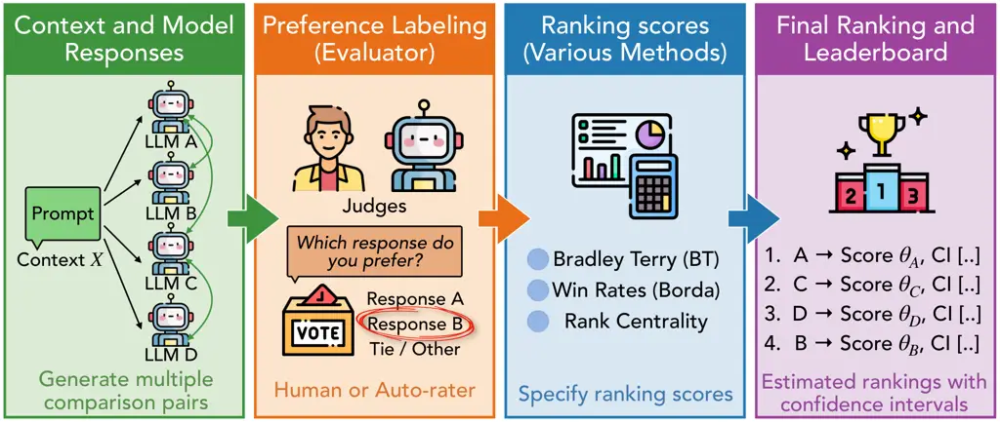
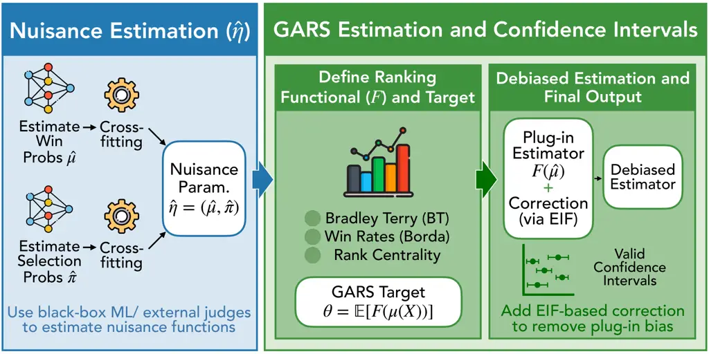

# Nonparametric LLM Evaluation from Preference Data

Dennis Frauen Affiliation: LMU Munich Affiliation: Munich Center for
Machine Learning Correspondence to: <frauen@lmu.de>    Athiya Deviyani
Affiliation: Carnegie Mellon University    Mihaela van der Schaar
Affiliation: University of Cambridge    Stefan Feuerriegel
Affiliation: LMU Munich Affiliation: Munich Center for Machine Learning

###### Abstract

Evaluating the performance of large language models (LLMs) from human
preference data is crucial for obtaining LLM leaderboards. However, many
existing approaches either rely on restrictive parametric assumptions or
lack valid uncertainty quantification when flexible machine learning
methods are used. In this paper, we propose a nonparametric statistical
framework called DMLRank for comparing and ranking LLMs from preference
data using debiased machine learning (DML). For this, we introduce
_generalized average ranking scores (GARS)_, which generalize commonly
used ranking models, including the Bradley-Terry model or PageRank/ Rank
centrality, with complex human responses such as ties. DMLRank comes
with the following advantages: (i) It produces statistically efficient
estimates of GARS ranking scores. (ii) It naturally allows the
incorporation of black-box machine learning methods for estimation.
(iii) It can be combined with pre-trained LLM evaluators (e.g., using
LLM-as-a-judge). (iv) It suggests optimal policies for collecting
preference data under budget constraints. We demonstrate these
advantages both theoretically and empirically using both synthetic and
real-world preference datasets. In summary, our framework provides
practitioners with powerful, state-of-the-art methods for comparing or
ranking LLMs for leaderboards.

###### Keywords: 

LLM evaluation, preference data, debiased machine learning,
semiparametric efficiency, experimental design

## 1 Introduction

Large language models (LLM) are commonly evaluated using _preference
data_, where models are compared by directly judging which of two
generated responses is better for a given prompt. This paradigm is
widely used in leaderboards such as LM Arena (Chiang et al., 2024) and
related benchmarks for model comparison (Ouyang et al., 2022; Rafailov
et al., 2023; Dubois et al., 2023). In practice, collecting preferences
is often simpler and more reliable than assigning absolute quality
scores to individual LLM outputs (Christiano et al., 2017).

In a typical setup, two LLMs (say, A and B) are prompted with the same
task, their generated responses are presented to an evaluator, and the
evaluator indicates whether the response of A or B is preferred (see
Fig. 1). The evaluator may be a human (e.g., a crowdworker or a domain
expert) or an automated system (such as an LLM-as-a-judge). The outcome
of this process is typically a leaderboard or ranking of models, where
practitioners are often interested not only in the relative ordering of
models but also in confidence intervals for the underlying model scores
(e.g., as in the case of LM Arena) (Chiang et al., 2024).

Despite its practical success, statistical ranking from preference data
poses substantial challenges. The main difficulty is that preference
data contains only _relative_ information: we never directly observe an
absolute quality score for a model’s output, but only that one response
was judged better than another. As a result, this typically requires
practitioners to define a notion of a ranking score that can be inferred
from pairwise comparisons (Bradley and Terry, 1952). These ranking
scores are often complex functionals of the data distribution, which
makes statistical inference challenging. Hence, estimation procedures
must be carefully tailored to the ranking target of interest to
guarantee efficient estimation and valid uncertainty quantification
(Frick et al., 2025; Kallus, 2025).

Many existing LLM leaderboards and other preference-based benchmarks
build on the parametric Bradley–Terry (BT) model, which posits that each
LLM’s underlying ranking score determines the preference probabilities
additively on the logit scale (Chiang et al., 2024; Frick et al., 2025).
However, the parametric BT model comes with important limitations:
(i) It can be biased under misspecification, such as when the BT link is
incorrect for the data-generating process or if the chosen parametric
model is too restrictive (Xu et al., 2025a); (ii) The BT is parametric
and generally not compatible with flexible machine learning (ML)
estimators that model context-dependent preferences, as this typically
breaks standard inferential guarantees and can lead to invalid
confidence intervals (van der Vaart, 1998; Chernozhukov et al., 2018).
(iii) Many modern evaluation pipelines combine scarce but high-quality
human labels with proxy labels from auto-raters or LLM-as-a-judge
systems (Zheng et al., 2023). However, for parametric models,
incorporating such proxy signals while obtaining valid statistical
inference is not straightforward.



Figure 1: Overview of preference-based LLM evaluation.

In this paper, we propose a nonparametric statistical framework called
DMLRank to compare and rank LLMs from preference data while addressing
the above limitations. Our key idea is to define the ranking target
directly as a functional of the contextual preference probabilities,
which we call generalized average ranking scores (GARS). GARS naturally
accommodate different notions of ranking scores such as average win
rates (Borda scores), stationary-distribution scores (Rank Centrality /
PageRank-style) (Negahban et al., 2017), or BT-type scores as a special
case.

Building on debiased machine learning (DML), we then derive
statistically efficient estimators of GARS ranking scores by deriving
the corresponding efficient influence function (van der Vaart, 1998). We
further construct confidence intervals that remain valid when preference
probabilities are estimated with black-box machine learning methods. We
also show how DMLRank can incorporate external judges such as
LLM-as-judge, or other pre-trained LLM evaluators. Finally, we also
propose an extension for _optimal preference data acquisition_ by
deriving collection policies that minimize the width of the resulting
confidence intervals under budget constraints, thereby enabling
cost-efficient preference data collection.

Our main contributions¹¹ 1 Code is available at
[https://github.com/DennisFrauen/NonparametricLLMEval](https://github.com/DennisFrauen/NonparametricLLMEval).
are: (i) We propose a generalized nonparametric framework for
statistical ranking from preference data. Specifically, we introduce
_generalized average ranking scores (GARS)_, a nonparametric estimand
that captures many existing ranking models. (ii) We develop a
statistically efficient estimator for GARS, which directly yields
simultaneously valid confidence intervals for ranking scores. (iii) We
propose a cost-optimal policy for collecting preference labels under
budget constraints.

##### Conflict of Interest Disclosure.

The authors declare no financial conflicts of interest related to this
work. In particular, no author has a financial interest that could
reasonably be perceived as influencing the research, results, or
conclusions of this paper.

## 2 Related work

We review the main related literature streams on debiased machine
learning and LLM evaluation. We refer to Appendix A for details on
optimal experimental design.

Debiased machine learning. Debiased/double machine learning (DML) has a
long tradition in semiparametric statistics (Bickel et al., 1998). DML
leverages the so-called efficient influence function (EIF) (Hampel, 1974) to obtain semiparametrically efficient estimators (van der Vaart, 1998) or Neyman-orthogonal risk functionals (Foster and Syrgkanis,
2023). DML is generally useful when the estimation target is defined via
unknown nuisance components (Chernozhukov et al., 2018). Examples of
such problems include missing data analysis (Robins et al., 1994),
semi-supervised learning (prediction-powered inference) (Angelopoulos et
al., 2023; Angelopoulos et al., 2024; Xu et al., 2025b; van der Laan and
Van Der Laan, 2026), and causal inference (Robins et al., 2000; van der
Laan and Rubin, 2006; Nie and Wager, 2021; Kennedy, 2023). Our work
brings these ideas to preference-based evaluation using various ranking
scores.

Semi-supervised model evaluation. A growing literature combines small
amounts of high-quality labels with large unlabeled data or cheap proxy
labels. For instance, Shanmugam et al. (2025) studied semi-supervised
evaluation for standard labels, but not preference data, and without
DML. Another literature stream builds upon prediction-powered inference
(PPI) to develop debiased methods that leverage black-box predictors to
reduce labeling cost (Fisch et al., 2024; Guerdan et al., 2026).
Finally, Chatzi et al. (2024) uses PPI for preference-based ranking with
uncertainty quantification but focuses on specific ranking definitions.
In contrast, we provide a unified EIF-based framework covering multiple
ranking estimands (including BT-type, win-rate/Borda, and
stationary-distribution scores) and also address optimal data
collection.

LLM evaluation from preference data. LLM leaderboards, such as LM Arena,
have popularized pairwise comparison data as a practical evaluation
signal. The same paradigm has also been used in specialized domains,
including search-augmented models (Miroyan et al., 2026), text-to-music
(Kim et al., 2025), and coding assistants (Chi et al., 2025). However,
current methods for estimating ranking scores rely on the parametric BT
model. As a consequence, these methods are either sensitive to
misspecification or do not yield valid asymptotic confidence intervals
if flexible ML models are used. In parallel, simulation- and
benchmark-driven pipelines such as AlpacaFarm/AlpacaEval (Dubois et al.,
2023; Dubois et al., 2024) commonly employ nonparametric win-rate or
average-pairwise-win estimands, but are typically treated without a
debiased efficiency perspective. Hence, the underlying ranking methods
are neither statistically efficient nor yield principled, efficient
uncertainty quantification when black-box ML models are used.

Semiparametric ranking. There is extensive work on semiparametric
estimation for discrete choice and comparison models in econometrics
(Horowitz, 1992; Klein and Spady, 1993). These works typically focus on
identifying and estimating low-dimensional preference parameters rather
than providing a unified inference framework for _arbitrary_ ranking
functionals of high-dimensional, context-dependent preference
probabilities, and they generally do not address missing labels or the
use of auxiliary judges. More closely related, several recent papers
study semiparametric inference and optimization for preference learning
and LLM alignment under BT-style models (Sawarni et al., 2025; Kallus,
2025). Two recent works derive inference procedures for
semiparametric/covariate-adjusted BT models (Li and Li, 2025; Spokoiny,
2025). In contrast to this paper, these approaches remain tied to
BT-type score models and do not offer a unified treatment of alternative
ranking functionals (e.g., Borda/win-rate or Rank Centrality), and do
not address optimal preference data acquisition.

## 3 Problem setting

Setting. Our aim is to rank $`K`$ items in $`\mathcal{I}=\{1,\dots,K\}`$
using preference data with $`C`$ different categories
$`\mathcal{C}=\{1,\dots,C\}`$. Given an item pair $`(j,k)`$ with
$`j,k\in\mathcal{I}`$, a common example is three categories
$`\mathcal{C}=\{1,2,3\}`$ with categories labeled as _“1: $`j`$
preferred over $`k`$,”_ _“2: $`k`$ preferred over $`j`$,”_ or _“3: tie
(no preference).”_ The data consists of a context $`X\in\mathcal{X}`$,
binary selection indicators $`S_{jk}\in\{0,1\}`$ with zero diagonals
$`S_{jj}=0`$ and $`S_{jk}=1`$ if the item pair $`(j,k)`$ is labeled, and
one-hot encoded categorical preference labels
$`Y_{jk}\in\{e_{1},\dots,e_{C}\}`$, where $`Y_{jk}=e_{c}\in\{0,1\}^{C}`$
denotes assignment of category $`c`$ to the pair $`(j,k)`$. Finally, we
note that we allow for selecting multiple pairs of items per context
$`X`$, but we also discuss the case of selecting one or fewer pairs per
context in Appendix G.

Running example: LLM evaluation. Here, the set of items $`\mathcal{I}`$
is the different LLMs that we want to compare using human feedback. The
context $`X`$ is a prompt that is given to pairs of LLMs $`(j,k)`$
selected for comparison. $`S_{jk}`$ indicates whether human preference
was acquired and $`Y_{jk}`$ is the human preference category. As an
extension, we (optionally) may have access to a black-box model
$`f(x,j,k)`$ that predicts the preference $`Y_{jk}`$ given a context
$`X=x`$ and items $`(j,k)`$. We make no assumptions on the model $`f`$
(i.e., on its prediction performance). The black-box model $`f`$ may be
an auto-rater or an LLM-as-a-judge.

Observed data. We write the observed data as $`O=(X,S,\widetilde{Y})`$
with $`S\in\{0,1\}^{K\times K}`$ and $`Y\in\{0,1\}^{K\times K\times C}`$
denoting stacked tensors of selection indicators and preference labels,
and $`\widetilde{Y}=S\circ Y`$ such that $`Y_{jkc}`$ is only observed
for all $`c\in\mathcal{C}`$ whenever $`S_{jk}=1`$. We assume that the
population $`(X,S,\widetilde{Y})\sim\mathbb{P}`$ follows some
ground-truth distribution $`\mathbb{P}`$ and that we have access to a
preference dataset
$`\mathcal{D}=\{(x_{i},s_{i},\widetilde{y}_{i})_{i=1}^{n}\}`$ sampled
i.i.d. from $`\mathbb{P}`$.

Nuisance functions. We denote

```math
\mu_{jkc}(x)=\mathbb{P}(Y_{jkc}=1\mid X=x) \tag{1}
```

as probability of preference category $`c`$ for pair $`(j,k)`$ given
context $`x`$. Furthermore, we denote

```math
\pi_{jk}(x)=\mathbb{P}(S_{jk}=1\mid X=x) \tag{2}
```

as the selection probability of pair $`(j,k)`$ given context $`x`$. We
define $`\mu(x)\in[0,1]^{K\times K\times C}`$ and
$`\pi(x)\in[0,1]^{K\times K}`$ as the corresponding stacked tensors with
convention $`\mu_{jjc}(x)=\pi_{jj}(x)=0`$ for all $`j,c`$. We denote the
collection $`\eta=(\mu,\pi)`$ as _nuisance functions_. We make the
standard assumptions of positivity and missing at random (Rubin, 1974),
under which we can write

```math
\mu_{jkc}(x)=\mathbb{P}(Y_{jkc}=1\mid X=x,S_{jk}=1) \tag{3}
```

(see Appendix B.1).

BT model. The _Bradley-Terry (BT) model_ (Bradley and Terry, 1952) is
commonly used ranking model in the simplified case of binary preference
categories $`\mathcal{C}=\{1,2\}`$, where $`Y_{jk1}=1`$ denotes
preference of $`j`$ over $`k`$ (and vice versa for $`Y_{jk2}=1`$). BT is
defined via

```math
\mu_{jk1}(x)=\sigma\!\big(r_{j}(x)-r_{k}(x)+b(x)\big) \tag{4}
```

with the convention $`\sum_{m=1}^{K}r_{m}(x)=0`$ and where
$`\sigma(t)=\frac{1}{1+e^{-t}}`$ denotes the sigmoid function. The
vector $`r(x)=(r_{1}(x),\dots,r_{K}(x))`$ denotes the _ranking score
functions_ of the items, and $`b(x)`$ models the position bias due to
showing items in a certain order. The target of interest is the average
ranking score vector $`\theta=\mathbb{E}[r(X)]\in\mathbb{R}^{K}`$, which
allows ranking of items according to the components of $`\theta`$.
Popular leaderboards such as LM Arena (Chiang et al., 2024; Frick et
al., 2025) leverage _parametric_ BT models to perform statistical
inference on the target $`\theta`$. That is, the score function
$`r_{\rho}(x)`$ is parametrized with some trainable parameters $`\rho`$
(e.g., a neural network). An estimator $`\hat{\rho}`$ can be obtained
via maximum likelihood estimation, and the target parameter can be
estimated via

```math
\hat{\theta}=\frac{1}{n}\sum_{i=1}^{n}r_{\hat{\rho}}(x_{i}). \tag{5}
```

Research questions. We address _three main questions_:


Nonparametric ranking scores ($`\rightarrow`$Sec. 4). How can we define
a vector of ranking scores $`\theta\in\mathbb{R}^{K}`$
_nonparametrically_ only in terms of the nuisance functions $`\eta`$?
How does $`\theta`$ generalize established notions of ranking scores
such as
BT?
Efficient statistical inference ($`\rightarrow`$Sec. 5). How can we
leverage preference dataset $`\mathcal{D}`$ and an (optional) black-box
judge $`f`$ in the most efficient way to perform statistical inference
on the ranking scores $`\theta`$ (estimator and confidence intervals
with black-box machine
learning)?
Optimal data acquisition ($`\rightarrow`$Sec. 6). How can we design an
optimal labeling rule $`\pi`$ to obtain preference data for optimal
inference on $`\theta`$ subject to budget constraints (e.g., costly
human annotations)?

## 4 Generalized Average Ranking Scores

### 4.1 Motivation

Why parametric approaches have drawbacks. Parametric approaches such as
the parametric BT model have multiple drawbacks: (i) the parametric
estimator will generally be biased if the parametric model
$`r_{\rho}(x)`$ is misspecified (i.e., the model class chosen is too
small); (ii) it is generally difficult to obtain valid (asymptotic)
confidence intervals for $`\hat{\theta}`$ if flexible models such as
neural networks are used for $`r_{\rho}(x)`$ (Chernozhukov et al.,
2018); and (iii) it is unclear how pre-trained evaluation models (e.g.,
auto-rater of LLM-as-a-judge) can be incorporated into this procedure.

Idea behind our nonparametric approach. Motivated by the drawbacks of
the parametric BT model, we propose a _nonparametric_ modeling approach.
The key idea is to express the target parameter $`\theta`$ as a function
of the preference probabilities $`\mu`$, that is,
$`\theta=\mathbb{E}[F(\mu(X))]`$ for some known function $`F`$. Then, we
could use any black-box machine learning method or pre-trained
auto-rater to obtain estimated preferences $`\hat{\mu}(x)`$ and use
these to obtain an estimator $`\hat{\theta}`$.

Indeed, it is possible to construct such a function $`F`$ as follows:
Let $`B\in\mathbb{R}^{\binom{K}{2}\times K}`$ be the incidence matrix
(row $`(j,k)`$ equals $`e_{j}-e_{k}`$) and let $`L_{0}\;=\;B^{\top}B`$
be the graph Laplacian. Let
$`\ell(\mu(x))=\left(\mathrm{logit}(\mu_{jk1}(x))/2+\mathrm{logit}(\mu_{kj2}(x))/2\right)_{j<k}\in\mathbb{R}^{\binom{K}{2}}`$
and let

```math
H\;=\;\begin{bmatrix}I_{K-1}\\[2.0pt]
-\mathbf{1}_{K-1}^{\top}\end{bmatrix}, \tag{6}
```

so that
$`\{r\in\mathbb{R}^{K}:\mathbf{1}^{\top}r=0\}=\{H\alpha:\alpha\in\mathbb{R}^{K-1}\}`$.
We can then define the function $`F`$ via

```math
F\big(\mu(x)\big)\;=\;H\,\big(H^{\top}L_{0}H\big)^{-1}H^{\top}B^{\top}\,\ell(\mu(x)), \tag{7}
```

which coincides with the $`L^{2}`$-projection of the edge log-odds
vector $`\ell(\mu(x))`$ onto the subspace
$`\{B\phi:\mathbf{1}^{\top}\phi=0\}`$ and recovers the BT-scores
$`\mathbb{E}[r(X)]`$ if the BT model from Eq. (4) holds (see
Appendix D).

Ranking beyond BT. The BT model is a convenient and widely used model
for pairwise comparisons, but it is not universally appropriate. In
practice, it can be misspecified and yield biased rankings if, e.g.,
preferences exhibit cycles (Xu et al., 2025a). This has motivated a
broad literature on alternative definitions of ranking scores. As
emphasized in social choice theory, no single ranking method is optimal
across all desiderata; different models trade off interpretability,
robustness, and other desired properties (Zhang and Hardt, 2024).
Motivated by this insight, we now develop a generalized framework that
accommodates a range of ranking score definitions within one common
inferential framework.

### 4.2 Formulation of GARS

In this paper, we propose _generalized average ranking score (GARS)_,
which we define as follows: Given a known function
$`F\colon[0,1]^{K\times K\times C}\to\mathbb{R}^{d}`$ for some dimension
$`d>0`$, GARS is defined as the parameter vector

```math
\theta=\mathbb{E}[F(\mu(X))]\in\mathbb{R}^{d}. \tag{8}
```

Examples. In the following, we consider examples for GARS with binary
preference categories $`\mathcal{C}=\{1,2\}`$. For additional examples,
including ties, we refer to Appendix C.

$`\bullet`$ Bradley–Terry projections. as described in Sec. 4.1.

$`\bullet`$ Borda scores. Borda scores are defined as the average
probability of an item $`j`$ to be preferred over the other items:

```math
F_{j}\big(\mu(x)\big)\;=\;\frac{1}{2(K-1)}\sum_{k\neq j}(\mu_{jk1}(x)+\mu_{kj2}(x)). \tag{9}
```

$`\bullet`$ Rank centrality (RC) (Negahban et al., 2017). Here, we first
construct a stochastic matrix from $`\mu`$; e.g., for $`j\neq i`$,
$`T_{ij}(\mu(x))=\frac{\mu_{ji1}(x)+\mu_{ij2}(x)}{\sum_{\ell\neq i}\mu_{\ell i1}(x)+\mu_{i\ell 2}(x)}`$,
with zero diagonal $`T_{ii}(x)=0`$. We define the function

```math
F(\mu(x))=\left(I-T(\mu(x))^{\top}+\mathbf{1}\mathbf{1}^{\top}\right)^{-1}\mathbf{1}, \tag{10}
```

where we assume matrix invertibility. The resulting $`F(\mu(x))`$ is the
stationary distribution of the associated Markov chain with transition
matrix $`T`$. Intuitively, human raters randomly switch between LLMs
according to their symmetrized preference probabilities. The stationary
distribution $`F(\mu(x))`$ can then be interpreted as the long-term time
spent on each LLM (larger implying better).

## 5 Efficient statistical inference

### 5.1 Overview

Why naïve, plug-in estimators have drawbacks. To obtain rankings, our
goal is now to develop an estimator $`\hat{\theta}`$ of the GARS
$`\theta=\mathbb{E}[F(\mu(X))]`$ based on the preference dataset
$`\mathcal{D}`$ and an optional pre-trained judge $`f`$. As outlined in
the previous section, our non-parametric framework allows us to estimate
$`\theta`$ only by obtaining an estimator $`\hat{\mu}`$ of the
preference probabilities $`\mu`$. The natural plug-in estimator is the
following: in a first step, one can leverage any black-box machine
learning classifier to fit $`\hat{\mu}`$ on $`\mathcal{D}`$ or simply
use the judge predictions $`\hat{\mu}_{jk}(x)=f(x,j,k)`$ (we will
discuss more sophisticated combinations of these two approaches later).
Then, in a second step, one can estimate the GARS via the _plug-in
estimator_

```math
\hat{\theta}=\frac{1}{n}\sum_{i=1}^{n}F(\hat{\mu}(x_{i})). \tag{11}
```

Unfortunately, the plug-in estimator from Eq. (11) has two fundamental
drawbacks: (i) It is well known that plug-in estimators suffer from
so-called _plug-in bias_ (Kennedy, 2024). If errors in estimating
$`\hat{\mu}`$ (e.g., due to limited preference data or due to bias in
the judge $`f`$), these errors will propagate through $`F`$ to the final
estimator $`\hat{\theta}`$, leading to biased and suboptimal statistical
inference. (ii) Due to the plug-in bias, it is generally difficult to
obtain valid (asymptotic) confidence intervals for $`\hat{\theta}`$. For
example, if the judge $`f`$ is fundamentally biased, the plug-in
estimator does not correct for this bias and is thus unable to obtain
intervals with valid coverage.

Debiased estimators. To remedy the drawbacks of the plug-in estimator
above, we propose an estimator based on _semiparametric efficiency
theory_ (van der Vaart, 1998). Specifically, we build on the idea of
_debiased estimators_, which correct for the plug-in bias by adding a
debiasing term. In our setting, we propose the use of a debiased
estimator

```math
\hat{\theta}=\frac{1}{n}\sum_{i=1}^{n}F(\hat{\mu}(x_{i}))+\alpha\Big(y_{i}-\hat{\mu}(x_{i})\Big), \tag{12}
```

where $`\alpha`$ is an appropriate scaling matrix that we have to
derive. Intuitively, if $`\hat{\mu}`$ is estimated with error, the
second term uses the labeled data to reduce the error from the plug-in
term. Debiased estimators will often guarantee statistical efficiency
and valid confidence intervals _even if we use black-box ML to estimate_
$`\hat{\mu}`$ (Chernozhukov et al., 2018).

### 5.2 Main result

Deriving the debiased estimator. We now derive the correct debiased
estimator for $`\theta`$. This is connected to obtaining the so-called
_efficient influence function (EIF)_ of $`\theta`$ (Bickel et al.,
1998). Importantly, we also show in the following theorem that our
estimator allows for (asymptotic) statistical efficiency (i.e., the
lowest variance any unbiased estimator can achieve) and asymptotic
normality (leading to valid confidence intervals) under weak
assumptions.

###### Theorem 5.1 (Efficient statistical inference for GARS).

Let $`F:[0,1]^{K\times K\times C}\to\mathbb{R}^{d}`$ be differentiable
with Jacobian columns
$`J_{jk}(\mu)\;=\;\nabla_{\mu_{jk}}F(\mu)\;\in\;\mathbb{R}^{d\times C}`$.
The efficient influence function (EIF) for $`\theta`$ is

```math
\displaystyle\quad\phi(O,\eta,\theta)=F\!\big(\mu(X)\big)\;-\;\theta \tag{13}
```

```math
\displaystyle+\sum_{j\neq k}\frac{S_{jk}}{\pi_{jk}(X)}\;J_{jk}\!\big(\mu(X)\big)\,\Big(Y_{jk}-\mu_{jk}(X)\Big)\in\mathbb{R}^{d},
```

The (one-step) debiased estimator
$`\hat{\theta}_{\mathrm{EIF}}\in\mathbb{R}^{d}`$ is given via

```math
\displaystyle\hat{\theta}_{\mathrm{EIF}}=\frac{1}{n}\sum_{i=1}^{n}\Bigg[F\!\big(\hat{\mu}(x_{i})\big) \tag{14}
```

```math
\displaystyle\quad+\sum_{j\neq k}\frac{s_{i,jk}}{\hat{\pi}_{jk}(x_{i})}\;J_{jk}\!\big(\hat{\mu}(x_{i})\big)\,\Big(y_{i,jk}-\hat{\mu}_{jk}(x_{i})\Big)\Bigg],
```

Under standard assumptions (see Appendix B for details),
$`\hat{\theta}_{\mathrm{EIF}}`$ is asymptotically efficient and normally
distributed via

```math
\sqrt{n}(\hat{\theta}_{\mathrm{EIF}}-\theta)\to\mathcal{N}_{d}(0_{\mathbb{R}^{d}},\Sigma), \tag{15}
```

where
$`\Sigma=\mathbb{E}\left[\phi(O,\eta,\theta)\phi^{\top}(O,\eta,\theta)\right]\in\mathbb{R}^{d\times d}`$.

###### Proof.

See Appendix B. ∎

Interpretation. The debiased estimator from Eq. (14) weights the
individual debiasing terms with the selection probability $`\pi_{jk}`$
to increase bias correction for rarely observed item pairs. This is
similar to the AIPTW estimator in causal inference (Robins, 1994).
Different however is the re-weighting using the Jacobian $`J_{jk}`$,
which adjusts strength the bias correction according to how strongly the
preference probability affects the target $`\theta`$ via $`F`$. In the
extreme case where $`\theta`$ does not depend on $`\mu_{jk}`$, the
Jacobian will be zero, and no bias correction is applied. The Jacobians
$`J_{jk}`$ often admit closed-form solutions and thus allow for scalable
computation (see Appendix E).

### 5.3 Implementation

We now present a practical _two-stage procedure_ (see Fig. 2) that turns
Theorem 5.1 into an estimator with valid confidence intervals.



Figure 2: Overview of statistical inference for GARS.

Stage
:
Nuisance estimation with cross-fitting. We need estimates $`\hat{\mu}`$
of the preference probabilities $`\mu`$ and, if unknown, estimates
$`\hat{\pi}`$ of the selection propensities $`\pi`$. In some scenarios
(e.g., when designing preference data as in Sec. 6), $`\pi`$ may be
known in which case we can set $`\hat{\pi}=\pi`$. As it is standard in
semiparametric inference, we use _cross-fitting_ (Chernozhukov et al., 2018) to obtain $`\hat{\mu}`$ and $`\hat{\pi}`$ while guaranteeing valid
statistical inference. We randomly split the data $`\mathcal{D}`$ into
$`V\geq 2`$ folds $`\{\mathcal{D}_{v}\}_{v=1}^{V}`$. For each fold
$`v`$, we use the out-of-fold data
$`\{\mathcal{D}_{v}^{\prime}\}_{v^{\prime}\neq v}`$ to fit models models
$`\widehat{\mu}^{(-v)}`$ and (if needed) $`\widehat{\pi}^{(-v)}`$. Then,
for each $`i\in\mathcal{\mathcal{}}{D}_{v}`$, we obtain predictions
$`\widehat{\mu}(x_{i})=\widehat{\mu}^{(-v)}(x_{i})`$ and
$`\widehat{\pi}(x_{i})=\widehat{\pi}^{(-v)}(x_{i})`$ on the held-out
fold $`v`$.

Training the nuisance models. $`\bullet`$ *Estimating $`\mu`$.* Recall
$`\mu_{jkc}(x)=\mathbb{P}(Y_{jkc}=1\mid X=x,S_{jk}=1)`$ with categorical
labels $`Y_{jk}\in\{0,1\}^{C}`$ that are only observed when
$`S_{jk}=1`$. Hence, training $`\mu`$ can be cast as a $`C`$-class
classification problem trained only on labeled pairs:
$`\{(x_{i},j,k,y_{i,jk}):i\notin\mathcal{I}_{v},\;s_{i,jk}=1\}`$.
$`\bullet`$ *Estimating $`\pi`$.* If
$`\pi_{jk}(x)=\mathbb{P}(S_{jk}=1\mid X=x)`$ is unknown, we estimate it
via binary classification on the fully observed pairs
$`\{(x_{i},j,k,s_{i,jk}):i\notin\mathcal{I}_{v}\}`$. For additional
details regarding nuisance model training, we refer to Appendix K.

Stage
:
Estimation and confidence intervals. Using cross-fitted
$`\widehat{\mu}`$, $`\widehat{\pi}`$, and preference data
$`\mathcal{D}`$, we can now compute the debiased GARS estimator
$`\hat{\theta}_{\mathrm{EIF}}`$ from Eq. (14). We can also estimate the
asymptotic covariance matrix

```math
\widehat{\Sigma}\;=\;\frac{1}{n}\sum_{i=1}^{n}\phi\left(o_{i},\hat{\eta},\hat{\theta}_{\mathrm{EIF}}\right)\phi^{\top}\left(o_{i},\hat{\eta},\hat{\theta}_{\mathrm{EIF}}\right). \tag{16}
```

Theorem 5.1 then implies that the set

```math
\mathcal{E}=\Big\{\vartheta\in\mathbb{R}^{d}:\;n\,(\widehat{\theta}-\vartheta)^{\top}\widehat{\Sigma}^{-1}(\widehat{\theta}-\vartheta)\;\leq\;\chi^{2}_{d,\,1-\alpha}\Big\} \tag{17}
```

is an asymptotic $`1-\alpha`$ confidence ellipsoid for the unknown GARS
$`\theta`$, where $`\chi^{2}_{d,\,1-\alpha}`$ denotes the
$`d`$-dimensional Chi-Squared quantile. It is also possible to use
$`\widehat{\Sigma}`$ for constructing simultaneously valid confidence
intervals for the components (ranking scores) of $`\theta`$. We refer to
Appendix I for additional details.

### 5.4 Incorporating external judges

If a black-box judge prediction $`f(x_{i},j,k)`$ for $`\mu_{jk}(x_{i})`$
is available, we use _judge-as-features_: we add $`f(x_{i},j,k)`$ to the
model’s input features, i.e., setting
$`\widehat{\mu}_{jk}^{(-v)}(\widetilde{x}_{i})`$ with
$`\widetilde{x}_{i}=(x_{i},f(x_{i},j,k))`$. If the judge’s prediction is
of high quality, the model $`\widehat{\mu}_{jk}^{(-v)}`$ should learn to
leverage it for prediction, thus reducing finite sample error. If,
however, the judge’s prediction is of low quality, the model
$`\widehat{\mu}_{jk}^{(-v)}`$ should learn to ignore it as an input,
thus retaining consistent estimation and valid confidence intervals.
Cross-fitting ensures any overfitting of the feature-augmenter is
confined to the training folds.

## 6 Optimal preference data acquisition

Labeling under a budget. So far, we assumed that existing preference
data were generated using some fixed _labeling policy_
$`\pi\colon\mathcal{X}\to[0,1]^{K\times K}`$, where the labeling
probabilities $`\pi_{jk}(x)=\mathbb{P}(S_{jk}=1\mid X=x)`$, denote the
probability of labeling a pair of items $`(j,k)`$ given context $`x`$.
Now, we consider the problem of _designing_ such a labeling policy
$`\pi`$ ourselves, which we then can use to acquire new preferences. In
practice, however, acquiring human preference labels for LLM pairs may
be costly if we, e.g., query domain experts. Hence, we assume that
labeling the item pair $`(j,k)`$ is associated with a cost $`c_{jk}>0`$.
We then want our labeling policy $`\pi`$ to fulfill a _budget
constraint_, which captures how many preferences we can afford to
collect across different contexts and LLM pairs. That is, we define the
set of feasible labeling policies as

```math
\Pi_{\alpha,\beta}\;=\;\Big\{\pi:\mathcal{X}\to[\alpha,1]^{K\times K}\;:\;\mathbb{E}\!\big[\sum_{j\neq k}c_{jk}\pi_{jk}(X)\big]\leq\beta\Big\}
```

for some budget $`\beta\geq 0`$ and where $`\alpha>0`$ is a
user-selected threshold to ensure positivity.

Optimal labeling policies. Our goal is now to derive an optimal labeling
policy among the feasible set. For this, we first need to formalize the
notion of an optimal labeling policy. Our approach is as follows: an
optimal $`\pi`$ should ensure that the corresponding debiased GARS
estimator from Eq. (14) achieves minimal variance when using the newly
collected data (and thus the smallest confidence interval width).

For a dataset generated by a fixed $`\pi`$, this variance is given by
the semiparametric efficiency bound $`\Sigma=\Sigma(\pi)`$ from
Theorem 5.1, which can be written as a function of $`\pi`$ and also
characterizes the best variance _any_ regular estimator can achieve.
Hence, an optimal $`\pi^{\ast}`$ should minimize some meaningful
function of the matrix $`\Sigma(\pi)`$ over the feasible set
$`\Pi_{\alpha,\beta}`$.

###### Definition 6.1.

_A labeling policy $`\pi^{\ast}`$ is A-optimal if_

```math
\pi^{\ast}\in\arg\min_{\pi\in\Pi_{\alpha,\beta}}\mathrm{tr}\left(\Sigma(\pi)\right), \tag{18}
```

_where $`\mathrm{tr}`$ is the trace operator. That is, an A-optimal
labeling policy minimizes the sum of variances of the individual ranking
score estimators._

An A-optimal $`\pi^{\ast}`$ minimizes the sum of the individual variance
components of the debiased GARS estimator, thereby ensuring
component-wise small confidence intervals. Different notions of
optimality are possible and have their origin in the literature on
optimal experimental design (Atkinson et al., 2007). For example, we
could minimize the determinant of $`\Sigma(\pi)`$ instead of the trace,
leading to a smaller _volume of the confidence ellipsoid_ from Eq. (17).
In the following, we restrict ourselves to A-optimality as defined
above, but we provide extensions to other optimality definitions in
Appendix H.

Deriving optimal labeling policies. The following result explicitly
characterizes A-optimal labeling functions.

###### Theorem 6.2 (A-optimal labeling policy).

Assume $`\Pi_{\alpha,\beta}\neq\emptyset`$ (e.g.
$`\alpha\sum c_{ij}\leq\beta`$) and let
$`V_{jk}(\mu(x))\;=\;\mathrm{Var}(Y_{jk}\mid X=x)\;=\;\mathrm{Diag}\big(\mu_{jk}(x)\big)-\mu_{jk}(x)\mu_{jk}(x)^{\top}\;\in\;\mathbb{R}^{C\times C}`$.

Under Assumption B.1 (Appendix), any A-optimal policy satisfies, for
almost all $`x`$ and all $`j\neq k`$,

```math
\pi^{\ast}_{jk}(x)=\mathrm{clip}_{[\alpha,1]}\sqrt{\frac{\mathrm{tr}\!\Big(J_{jk}(\mu(x))\,V_{jk}(\mu(x))\,J_{jk}(\mu(x))^{\top}\Big)}{\lambda_{A}\,c_{jk}}}, \tag{19}
```

where $`\mathrm{clip}_{[\alpha,1]}(x)=\min\{1,\max\{\alpha,x\}\}`$ and
where $`\lambda_{A}\geq 0`$ is chosen so that
$`\mathbb{E}\!\big[\sum_{j\neq k}c_{jk}\,\pi^{\ast}_{jk}(X)\big]=\beta`$.

###### Proof.

See Appendix B. ∎

Interpretation. The A-optimal policy allocates more probability to pairs
$`(j,k)`$ that are (i) intrinsically informative, meaning that
$`V_{jk}(\mu(x))=\mathrm{Var}(Y_{jk}\mid X=x)`$ is large (i.e., where
humans tend to disagree more on their preferences); and (ii) influential
for the GARS $`\theta`$, which is measured by the Jacobian $`J_{jk}`$.
Additionally, the costs $`c_{jk}`$ down-weight expensive pairs via the
denominator, and $`\lambda_{A}`$ scales the probabilities to satisfy the
budget constraint.

Implementation. In practice, implementing the A-optimal labeling policy
requires an estimate of the preference probabilities $`\mu`$. This can
be obtained either (i) from historical preference data by fitting
$`\mu_{jkc}(x)=\mathbb{P}(Y_{jkc}=1\mid X=x,S_{jk}=1)`$, or (ii)
directly from an external judge such as an LLM-as-a-judge or auto-rater
that outputs estimated category probabilities $`\hat{\mu}_{jk}(x)`$.

Given $`\hat{\mu}`$, we then plug it into the closed-form rule in
Theorem 6.2 to obtain $`\hat{\pi}^{\ast}_{jk}(x)`$. Since the left-hand
side is monotone in $`\lambda_{A}`$, we estimate $`\lambda_{A}`$
efficiently via a one-dimensional binary search using the empirical
average
$`\frac{1}{n}\sum_{i=1}^{n}\sum_{j\neq k}c_{jk}\hat{\pi}^{\ast}_{jk}(x_{i})`$.
We then acquire new preference labels by _independent Bernoulli
sampling_: for each context $`x`$ and each pair $`(j,k)`$, we draw
$`S_{jk}\sim\mathrm{Bernoulli}(\hat{\pi}^{\ast}_{jk}(x))`$ and query a
human label only if $`S_{jk}=1`$. Optionally, to encourage exploration
or improve robustness to misspecification of $`\hat{\mu}`$, one may mix
the resulting policy with a baseline random policy, e.g.,
$`\pi_{\mathrm{mix}}(x)=(1-\varepsilon)\hat{\pi}^{\ast}(x)+\varepsilon\pi_{\mathrm{rand}}(x)`$
for some small $`\varepsilon\in(0,1)`$, while still enforcing the lower
bound $`\alpha`$ and the budget constraint.

## 7 Experiments

Figure 3: Results for Chatbot Arena preference data. Shown: estimated
ranking scores for different GARS functionals (Borda, BT, and rank
centrality) and estimators (debiased and plug-in). Changes in ranking
are indicated in red and green as compared to the baseline ranking from
Zheng et al. (2023). We report 95% simultaneous confidence intervals,
which attain near-zero width for plug-in estimators.

Implementation details. We estimate nuisance functions using LightGBM,
trained with standard gradient-boosted tree objectives for
classification. As described in Sec. 5, we apply cross-fitting and train
nuisance models held-out folds for predictions. The LightGBM
hyperparameters are tuned via 3-fold cross-validation within the
training folds (see Appendix K for details). We compute valid $`95\%`$
simultaneous confidence intervals (CIs) for all ranking scores using
multiple-testing adjustments (see Appendix I).

Data. As standard in the literature on debiased machine learning, we use
various synthetic datasets for evaluating our proposed methodology
(Chernozhukov et al., 2018). This is because synthetic data allows for
comparison with ground-truth ranking scores, which are not available on
real-world data. Nevertheless, we also apply our methodology to
real-world datasets, including public preference data from Chatbot Arena
and MT-Bench (Zheng et al., 2023). However, we emphasize that the score
of our experiments is the evaluation of our methodology, not to provide
a state-off-the-art leaderboard. We refer to Appendix L for details on
synthetic data and to Appendix M for details on real-world data.

Baselines. We follow common benchmarking practices in debiased machine
learning (Nie and Wager, 2021; Kennedy, 2023) and compare debiased
estimators from Theorem 5.1 with plug-in estimators from Eq. (11) using
the _same nuisance estimators $`\hat{\eta}`$_. We refrain from comparing
different ML models for $`\eta`$ (e.g., different model architectures)
as our primary goal is to show the advantages of model-agnostic debiased
estimation.

### 7.1 Synthetic data

$`\bullet`$ Effectiveness of debiasing. Experimental setup. We compare
the debiased GARS estimators for Borda scores, BT-scores, and RC-scores
with their corresponding plug-in versions. For this, we generate
synthetic preference data with varying sample sizes, $`m=3`$ categories
(win, loss, tie), and $`5`$ synthetic covariates $`X`$. Results. The
results are in Table 1. Across all GARS estimands and sampling regimes,
debiased estimators significantly outperform their plug-in counterparts.
Furthermore, debiased estimators achieve coverage close to the target of
$`95\%`$, while the coverage of the plug-in estimator is invalid. This
confirms our main results from Theorem 5.1 (statistical efficiency and
asymptotic normality).

|       |           |                   |                   |                   |                   |                   |                   |
| ----- | --------- | ----------------- | ----------------- | ----------------- | ----------------- | ----------------- | ----------------- |
| GARS  | Estimator | $`n=1000`$        |                   | $`n=2000`$        |                   | $`n=3000`$        |                   |
|       |           | Error             | Coverage          | Error             | Coverage          | Error             | Coverage          |
| Borda | Plug-in   | 0.38 $`\pm`$ 0.08 | 0.17 $`\pm`$ 0.09 | 0.16 $`\pm`$ 0.04 | 0.20 $`\pm`$ 0.09 | 0.10 $`\pm`$ 0.02 | 0.15 $`\pm`$ 0.08 |
|       | Debiased  | 0.15 $`\pm`$ 0.03 | 0.94 $`\pm`$ 0.06 | 0.08 $`\pm`$ 0.02 | 0.95 $`\pm`$ 0.06 | 0.05 $`\pm`$ 0.01 | 0.97 $`\pm`$ 0.05 |
| BT    | Plug-in   | 0.62 $`\pm`$ 0.13 | 0.09 $`\pm`$ 0.07 | 0.30 $`\pm`$ 0.07 | 0.07 $`\pm`$ 0.07 | 0.22 $`\pm`$ 0.04 | 0.05 $`\pm`$ 0.06 |
|       | Debiased  | 0.25 $`\pm`$ 0.05 | 0.90 $`\pm`$ 0.07 | 0.12 $`\pm`$ 0.02 | 0.85 $`\pm`$ 0.08 | 0.08 $`\pm`$ 0.01 | 0.90 $`\pm`$ 0.07 |
| RC    | Plug-in   | 0.52 $`\pm`$ 0.12 | 0.12 $`\pm`$ 0.08 | 0.26 $`\pm`$ 0.06 | 0.06 $`\pm`$ 0.06 | 0.18 $`\pm`$ 0.04 | 0.05 $`\pm`$ 0.06 |
|       | Debiased  | 0.27 $`\pm`$ 0.06 | 0.91 $`\pm`$ 0.07 | 0.13 $`\pm`$ 0.02 | 0.95 $`\pm`$ 0.06 | 0.09 $`\pm`$ 0.02 | 0.95 $`\pm`$ 0.06 |

Table 1: Experimental results for debiasing. Shown: Estimation error an
CI coverage (mean $`\pm`$ $`95\%`$ CIs over 100 runs). Best in bold.
Valid coverage (within CI) in green, otherwise in red.

$`\bullet`$ Using external judges. Experimental setup. We evaluate the
effectiveness of augmenting debiased estimators with external judges of
different quality. To simulate judges, we add noise of different
strengths to the ground-truth nuisance $`\mu`$ and use judge-as-features
as described in Sec. 5. Results. Figure 4(a) shows the results across
different judge noise levels. All debiased estimators achieve lower
estimation error when incorporating higher quality judges, thus
confirming the effectiveness of our method to leverage external judges.

(a) Results for synthetic judges

(b) Results for BT misspecification

Figure 4: Synthetic experimental results. (a) Relative ranking error
normalized by the no-judge baseline (mean and $`95\%`$ CIs over
$`n=100`$ runs). (b) BT-projection estimation error (mean and $`95\%`$
CIs over $`30`$ runs).

$`\bullet`$ Optimal data acquisition. Experimental setup. We compare the
A-optimal data-collection policy from Theorem 6.2 with a uniform
baseline that collects preference data at random. For this, we label
$`n=1500`$ contexts $`X`$ two times with both policies using a budget of
$`\beta=2000`$ each for three different GARS types. We then compare the
estimation error of the corresponding debiased estimators. Results. The
results are shown in Table 2. The A-optimal policy outperforms random
collection across all GARS types, thus confirming our result from
Theorem 6.2.

|                  |                     |                     |                     |
| ---------------- | ------------------- | ------------------- | ------------------- |
| Policy           | Borda               | BT                  | Rank Centrality     |
| A-optimal policy | 0.130 $`\pm`$ 0.031 | 2.861 $`\pm`$ 0.670 | 0.017 $`\pm`$ 0.004 |
| Random policy    | 0.141 $`\pm`$ 0.030 | 2.974 $`\pm`$ 0.585 | 0.020 $`\pm`$ 0.005 |

Table 2: Experimental results for preference data acquisition. Shown:
Ranking MSE (Mean and $`95\%`$ confidence intervals over 50 runs
$`(\cdot 10^{2})`$) of debiased GARS estimators using the data from two
labeling policies at budget $`n=2000`$. Best in bold.

$`\bullet`$ BT model misspecification. Experimental setup. Finally, we
evaluate the effect of misspecification of the BT model. We create
synthetic datasets with binary preferences deviating from a true BT
model by a parameter $`\gamma`$, where $`\gamma=0`$ equals a true BT
model. We then compare three estimators: (i) the debiased BT projection
estimator from Sec.4.1, (ii) the corresponding plug-in estimator, and
(iii) a restricted debiased estimator which assumes that a BT model
holds (see Appendix F for details). Results. Fig.4(b) shows that the
restricted debiased estimator achieves the best performance under a
correct BT model specification due to a lower efficiency bound in the
setting. However, under BT misspecification, the debiased projection
estimator outperforms both the plug-in and the misspecified debiased
estimator. This highlights the robustness of the debiased projection
estimator to BT model misspecifications.

### 7.2 Real-world data

Experimental setup. We demonstrate DMLRank using a public, real-world
preference dataset with conversations from Chatbot Arena (Zheng et al.,
2023). The dataset includes $`n=32980`$ different prompts, $`K=20`$
different models a categorical preference outcome in {first model wins,
second model wins, tie, tie (both bad)}. Context features $`X`$ combine
a toxicity probability (from a RoBERTa-based tag) with a model-agnostic
low-rank 100-dimensional representation of the prompt, obtained via
TF-IDF followed by a truncated SVD. We report estimated GARS scores and
$`95\%`$ simultaneous confidence intervals for Borda, BT, and Rank
Centrality using both plug-in and debiased estimators.

Results. The results are shown in Fig. 3, with the baseline ranking of
models taken from (Zheng et al., 2023) (note that this is _not_ a
ground-truth ranking). We make the following observations: (i) all
obtained rankings are largely consistent with the baseline ranking, thus
indicating a reasonable base performance. (ii) BT deviates further from
the baseline than Borda and RC, thus highlighting that different GARS
types can yield different rankings even on the same data. (iii) While
the point ranking scores of the plug-in estimators do not deviate too
much from their debiased counterparts, their confidence intervals
collapse and are most likely invalid. In summary, the results showcase
the applicability and flexibility of the proposed GARS framework for
real-world preference data.

## 8 Discussion

We proposed a nonparametric statistical framework for preference-based
LLM evaluation that targets ranking functionals directly from contextual
preference data. By formulating evaluation through generalized average
ranking scores, our approach unifies several common ranking procedures
while allowing flexible nonparametric estimation. We developed debiased
estimators with valid uncertainty quantification, showed how auxiliary
judges can be incorporated without treating them as ground truth, and
studied optimal data collection policies for improving the efficiency of
leaderboard estimation.

Limitations and future work. Our work does not capture all aspects of
evaluating modern AI systems. In particular, many evaluations involve
complex systems with tools, memory, multi-agent interactions,
long-horizon tasks, or deployment-specific feedback loops. Extending the
framework to such settings is an important direction for future work.
Another key practical limitation is lack of overlap. When some model
pairs, contexts, or annotator subpopulations have very small selection
probabilities, estimators based on inverse propensity weighting can
become unstable. Practical implementations may require additional
stabilization, such as trimming, clipping, or propensity calibration as
establised in causal inference literature. Finally, our results rely on
missing-at-random assumptions for the observed preference labels.
Violations can introduce bias that cannot be removed by debiasing alone.
A promising direction is to adapt partial identification approaches to
preference-based LLM evaluation, yielding uncertainty sets or bounds for
ranking scores when missingness assumptions are weakened.

Conclusion. By combining flexible ranking estimands, debiased
estimation, uncertainty quantification, auxiliary judges, and efficient
data collection, the proposed framework offers methodology for more
reliable and transparent leaderboards.

## Impact Statement

This paper presents work whose goal is to advance the field of machine
learning. There are many potential societal consequences of our work,
none of which we feel must be specifically highlighted here.

## References

- Angelopoulos et al. (2023) A. N. Angelopoulos, S. Bates, C.
  Fannjiang, M. I. Jordan, and T. Zrnic Prediction-powered inference.
  Science 382 (6671), pp. 669–674. Cited by: §2.
- Angelopoulos et al. (2024) A. N. Angelopoulos, J. C. Duchi, and T.
  Zrnic PPI++: Efficient prediction-powered inference. arXiv preprint
  arXiv:2311.01453. Cited by: §2.
- Angelopoulos et al. (2025) A. N. Angelopoulos, J. Eisenstein, J.
  Berant, A. Agarwal, and A. Fisch Cost-optimal active AI model
  evaluation. arXiv preprint arXiv:2506.07949. Cited by: Appendix A.
- Atkinson et al. (2007) A. C. Atkinson, A. N. Donev, and R. D. Tobias
  Optimum experimental designs, with SAS. Oxford University Press.
  External Links: ISBN 978-0-19-929659-0 Cited by: Appendix A, Appendix
  H, §6.
- Bickel et al. (1998) P. J. Bickel, C. A. J. Klaassen, Y. Ritov, and
  JohnA. Wellner Efficient and adaptive estimation for semiparametric
  models. Springer New York. External Links: ISBN 978-0-387-98473-5
  Cited by: §2, §5.2.
- Bradley and Terry (1952) R. A. Bradley and M. E. Terry Rank analysis
  of incomplete block designs: I. The method of paired comparisons.
  Biometrika 39 (3/4), pp. 324–345. Cited by: §1, §3.
- Chatzi et al. (2024) I. Chatzi, E. Straitouri, S. Thejaswi, and M. G.
  Rodriguez Prediction-powered ranking of large language models. In
  NeurIPS, Cited by: §2.
- Chernozhukov et al. (2018) V. Chernozhukov, D. Chetverikov, M.
  Demirer, E. Duflo, C. Hansen, W. Newey, and J. M. Robins
  Double/debiased machine learning for treatment and structural
  parameters. The Econometrics Journal 21 (1), pp. 1–68. Cited by: §B.1,
  §1, §2, §4.1, §5.1, §5.3, §7.
- Chi et al. (2025) W. Chi, V. Chen, A. N. Angelopoulos, W. Chiang, A.
  Mittal, N. Jain, T. Zhang, I. Stoica, C. Donahue, and A. Talwalkar
  Copilot Arena: A platform for code LLM evaluation in the wild. In
  ICML, Cited by: §2.
- Chiang et al. (2024) W. Chiang, L. Zheng, Y. Sheng, A. N.
  Angelopoulos, T. Li, D. Li, B. Zhu, H. Zhang, M. I. Jordan, J. E.
  Gonzalez, and I. Stoica Chatbot Arena: An open platform for evaluating
  LLMs by human preference. In ICML, Cited by: §1, §1, §1, §3.
- Christiano et al. (2017) P. F. Christiano, J. Leike, T. Brown, M.
  Martic, S. Legg, and D. Amodei Deep reinforcement learning from human
  preferences. In NeurIPS, Cited by: §1.
- Cook et al. (2024) T. Cook, A. Mishler, and A. Ramdas Semiparametric
  efficient inference in adaptive experiments. In CLeaR, Cited by:
  Appendix A.
- Dubois et al. (2023) Y. Dubois, X. Li, R. Taori, T. Zhang, I.
  Gulrajani, J. Ba, C. Guestrin, P. Liang, and T. B. Hashimoto
  AlpacaFarm: A simulation framework for methods that learn from human
  feedback. In NeurIPS, Cited by: §1, §2.
- Dubois et al. (2024) Y. Dubois, P. Liang, and T. B. Hashimoto
  Length-controlled AlpacaEval: A simple way to debias automatic
  evaluators. In COLM, Cited by: §2.
- Dudık et al. (2015) M. Dudık, K. Hofmann, K. Hofmann, R. E.
  Schapire, A. Slivkins, M. Zoghi, M. Zoghi, and U. Nl Contextual
  dueling bandits. In COLT, Cited by: Appendix A.
- Fisch et al. (2024) A. Fisch, J. Maynez, R. A. Hofer, B. Dhingra, A.
  Globerson, and W. W. Cohen Stratified prediction-powered inference for
  hybrid language model evaluation. In NeurIPS, Cited by: §2.
- Foster and Syrgkanis (2023) D. J. Foster and V. Syrgkanis Orthogonal
  statistical learning. The Annals of Statistics 53 (3), pp. 879–908.
  Cited by: §2.
- Frick et al. (2025) E. Frick, C. Chen, J. Tennyson, T. Li, W.
  Chiang, A. N. Angelopoulos, and I. Stoica Prompt-to-leaderboard:
  Prompt-adaptive LLM evaluations. In ICML, Cited by: §1, §1, §3.
- Graßhoff and Schwabe (2008) U. Graßhoff and R. Schwabe Optimal design
  for the Bradley–Terry paired comparison model. Statistical Methods and
  Applications 17 (3), pp. 275–289. Cited by: Appendix A.
- Guerdan et al. (2026) L. Guerdan, J. Whitehouse, K. Truong, K.
  Holstein, and Z. S. Wu Doubly-robust LLM-as-a-judge: Externally valid
  estimation with imperfect personas. In ICLR, Cited by: §2.
- Guo et al. (2018) Y. Guo, P. Tian, J. Kalpathy-Cramer, S. Ostmo, J.
  Campbell, M. F.Chiang, D. Erdogmus, J. Dy, and S. Ioannidis
  Experimental design under the bradley-terry model. In IJCAI, Cited by:
  Appendix A.
- Hampel (1974) F. R. Hampel The influence curve and its role in robust
  estimation. Journal of the American Statistical Association 69 (346),
  pp. 383–393. Cited by: §2.
- Horowitz (1992) J. L. Horowitz A smoothed maximum score estimator for
  the binary response model. Econometrica 60 (3), pp. 505–531. Cited by:
  §2.
- Jamieson and Nowak (2011) K. G. Jamieson and R. D. Nowak Active
  Ranking using Pairwise comparisons. In NeurIPS, Cited by: Appendix A.
- Jiang et al. (2010) X. Jiang, L. Lim, Y. Yao, and Y. Ye Statistical
  ranking and combinatorial Hodge theory. Mathematical Programming 127
  (1), pp. 203–244. Cited by: Appendix D.
- Kallus (2025) N. Kallus Semiparametric preference optimization: Your
  language model is secretly a single-index model. arXiv preprint
  arXiv:2512.21917. Cited by: §1, §2.
- Kennedy (2023) E. H. Kennedy Towards optimal doubly robust estimation
  of heterogeneous causal effects. Electronic Journal of Statistics 17
  (2), pp. 3008–3049. Cited by: §2, §7.
- Kennedy (2024) E. H. Kennedy Semiparametric doubly robust targeted
  double machine learning: A review. In Handbook of Statistical Methods
  for Precision Medicine, Cited by: §5.1.
- Kim et al. (2025) Y. Kim, W. Chi, A. N. Angelopoulos, W. Chiang, K.
  Saito, S. Watanabe, Y. Mitsufuji, and C. Donahue Music Arena: Live
  evaluation for text-to-music. arXiv preprint arXiv:2507.20900. Cited
  by: §2.
- Klein and Spady (1993) R. W. Klein and R. H. Spady An efficient
  semiparametric estimator for binary response models. Econometrica 61
  (2), pp. 387–421. Cited by: §2.
- Li and Li (2025) X. Li and S. Li Efficient inference for
  covariate-adjusted bradley-terry model with covariate shift. arXiv
  preprint arXiv:2503.18256. Cited by: §2.
- Miroyan et al. (2026) M. Miroyan, T. Wu, L. King, T. Li, J. Pan, X.
  Hu, W. Chiang, A. N. Angelopoulos, T. Darrell, N. Norouzi, and J. E.
  Gonzalez Search Arena: Analyzing search-augmented LLMs. In ICLR, Cited
  by: §2.
- Mukherjee et al. (2024) S. Mukherjee, A. Lalitha, K. Kalantari, A. A.
  Deshmukh, G. Liu, Y. Ma, and B. Kveton Optimal design for human
  preference elicitation. In NeurIPS, Cited by: Appendix A.
- Negahban et al. (2017) S. Negahban, S. Oh, and D. Shah Rank
  centrality: Ranking from pairwise comparisons. Operations Research 65
  (1), pp. 266–287. Cited by: §1, §4.2.
- Neyman (1934) J. Neyman On the two different aspects of the
  representative method: The method of stratified sampling and the
  method of purposive selection. Journal of the Royal Statistical
  Society 97 (4), pp. 558–625. Cited by: Appendix A.
- Nie and Wager (2021) X. Nie and S. Wager Quasi-oracle estimation of
  heterogeneous treatment effects. Biometrika 108 (2), pp. 299–319.
  Cited by: §2, §7.
- Oprescu et al. (2025) M. Oprescu, B. M. Cho, and N. Kallus Efficient
  adaptive experimentation with noncompliance. In NeurIPS, Cited by:
  Appendix A.
- Ouyang et al. (2022) L. Ouyang, J. Wu, X. Jiang, D. Almeida, C. L.
  Wainwright, P. Mishkin, C. Zhang, S. Agarwal, K. Slama, A. Ray, J.
  Schulman, J. Hilton, F. Kelton, L. Miller, M. Simens, A. Askell, P.
  Welinder, P. Christiano, J. Leike, and R. Lowe Training language
  models to follow instructions with human feedback. In NeurIPS, Cited
  by: §1.
- Rafailov et al. (2023) R. Rafailov, A. Sharma, E. Mitchell, S.
  Ermon, C. D. Manning, and C. Finn Direct preference optimization: Your
  language model is secretly a reward model. In NeurIPS, Cited by: §1.
- Robins et al. (2000) J. M. Robins, M. A. Hernán, and B. Brumback
  Marginal structural models and causal inference in epidemiology.
  Epidemiology 11 (5), pp. 550–60. Cited by: §2.
- Robins et al. (1994) J. M. Robins, A. Rotnitzky, and L. P. Zhao
  Estimation of reression coefficients when some regressors are not
  always observed. Journal of the American Statistical Association 89
  (427), pp. 846–688. Cited by: Appendix J, §2.
- Robins (1994) J. M. Robins Correcting for non-compliance in randomized
  trials using structural nested mean models. Communications in
  Statistics - Theory and Methods 23 (8), pp. 2379–2412. Cited by: §5.2.
- Rubin (1974) D. B. Rubin Estimating causal effects of treatments in
  randomized and nonrandomized studies. Journal of Educational
  Psychology 66 (5), pp. 688–701. Cited by: Appendix J, §B.1, §B.1, §3.
- Sawarni et al. (2025) A. Sawarni, S. Sarmasarkar, and V. Syrgkanis
  Preference learning with response time. In NeurIPS, Cited by: §2.
- Shanmugam et al. (2025) D. Shanmugam, S. Sadhuka, M. Raghavan, J.
  Guttag, B. Berger, and E. Pierson Evaluating multiple models using
  labeled and unlabeled data. In NeurIPS, Cited by: §2.
- Spokoiny (2025) V. Spokoiny Semiparametric plug-in estimation,
  sup-norm risk bounds, marginal optimization, and inference in BTL
  model. arXiv preprint arXiv:2503.15045. Cited by: §2.
- van der Laan and Van Der Laan (2026) L. van der Laan and M. Van Der
  Laan Calibeating prediction-powered inference. arXiv preprint
  arXiv:2604.21260. Cited by: §2.
- van der Laan and Rubin (2006) M. J. van der Laan and D. B. Rubin
  Targeted maximum likelihood learning. The International Journal of
  Biostatistics 2 (1). Cited by: §2.
- van der Vaart (1998) A. van der Vaart Asymptotic statistics. Cambridge
  University Press, Cambridge. External Links: ISBN 0-521-49603-9 Cited
  by: §B.1, §1, §1, §2, §5.1.
- Xu et al. (2025a) Y. Xu, L. Ruis, T. Rocktäschel, and R. Kirk
  Investigating non-transitivity in LLM-as-a-judge. In ICML, Cited by:
  §1, §4.1.
- Xu et al. (2025b) Z. Xu, D. Witten, and A. Shojaie A unified framework
  for semiparametrically efficient semi-supervised learning. arXiv
  preprint arXiv:2502.17741. Cited by: §2.
- Yue and Joachims (2009) Y. Yue and T. Joachims Interactively
  optimizing information retrieval systems as a dueling bandits problem.
  In ICML, Cited by: Appendix A.
- Zhang and Hardt (2024) G. Zhang and M. Hardt Inherent trade-offs
  between diversity and stability in multi-task benchmarks. In ICML,
  Cited by: §4.1.
- Zheng et al. (2023) L. Zheng, W. Chiang, Y. Sheng, S. Zhuang, Z.
  Wu, Y. Zhuang, Z. Lin, Z. Li, D. Li, E. P. Xing, H. Zhang, J. E.
  Gonzalez, and I. Stoica Judging LLM-as-a-Judge with MT-Bench and
  Chatbot Arena. In NeurIPS, Cited by: §M.1, Figure 6, Figure 6, §1,
  Figure 3, Figure 3, §7.2, §7.2, §7.
- Zrnic and Candès (2024) T. Zrnic and E. J. Candès Active statistical
  inference. In ICML, Cited by: Appendix A.

## Appendix A Extended related work on experimental design

Optimal experimental design has a long history (Atkinson et al., 2007),
including classical variance-minimizing allocation rules such as Neyman
allocation (Neyman, 1934) and their extensions to semiparametric causal
inference and semi-supervised learning settings (Cook et al., 2024;
Oprescu et al., 2025; Zrnic and Candès, 2024). In the context of LLM
evaluation, Angelopoulos et al. (2025) study cost-optimal active
evaluation, but not preference-based ranking targets. There is also a
line of work on actively selecting pairwise comparisons for ranking
(Jamieson and Nowak, 2011) and on optimal design under parametric BT/BTL
models (Graßhoff and Schwabe, 2008; Guo et al., 2018). Finally, dueling
bandits (Yue and Joachims, 2009; Dudık et al., 2015; Mukherjee et al., 2024) study interactive comparison feedback but typically target regret
minimization rather than efficient statistical inference for a fixed
ranking estimand. In contrast, our design problem is _efficient
influence function (EIF)-driven_: we derive labeling policies that
minimize the asymptotic variance of semiparametrically efficient
estimators for general (nonparametric) ranking functionals.

## Appendix B Theoretical results

### B.1 Setup

Identifiability assumptions. We make the following assumptions (Rubin,
1974): (i) Positivity: $`\pi_{jk}(x)>0`$ whenever $`\mathbb{P}(X=x)>0`$
(every pair of items has a positive selection probability), and
(ii) Missing at random: $`Y\perp\!\!\!\perp S\mid X`$ (the preference
label does not affect missingness). Note that (ii) implies that
$`\mu_{jkc}(x)=\mathbb{P}(Y_{jkc}=1\mid X=x,S_{jk}=1)`$ which can be
estimated from the observed data $`\mathcal{D}`$.

Assumptions (i) and (ii) are standard in the literature on missing data
and causal inference (Rubin, 1974). If they fail, the population ranking
target may no longer be identifiable from the observed data alone. In
practice, this means observed labels are then systematically biased, and
_no method can guarantee unbiased estimation_ without adding further
assumptions or information. Note that (i) can be ensured by design
(e.g., via randomized exploration to ensure all pairs have
non-negligible selection probability).

DML assumptions. We work under the standard conditions used for one-step
/ DML estimators with cross-fitting (van der Vaart, 1998; Chernozhukov
et al., 2018):

1.  (A1)
    Sampling. The observations $`o_{i}=(x_{i},a_{i},\widetilde{y}_{i})`$
    are i.i.d. draws from $`\mathbb{P}`$.
2.  (A2)
    Smoothness of the target map. The function
    $`F:[0,1]^{K\times K\times C}\to\mathbb{R}^{d}`$ is (Fréchet)
    differentiable on a neighborhood of $`\{\mu(x):x\in\mathcal{X}\}`$
    with Jacobian blocks
    $`J_{jk}(\mu)=\nabla_{\mu_{jk}}F(\mu)\in\mathbb{R}^{d\times C}`$.
    Moreover, the Jacobian is locally Lipschitz: there is $`L<\infty`$
    such that for all $`\mu,\mu^{\prime}`$ in this neighborhood,

    ```math
    \|J_{jk}(\mu)-J_{jk}(\mu^{\prime})\|\leq L\|\mu-\mu^{\prime}\|,\qquad\forall j\neq k,
    ```

    and $`\sup_{x}\|J_{jk}(\mu(x))\|<\infty`$ for all $`j\neq k`$.

3.  (A3)
    Moments. $`\mathbb{E}[\|\phi(O,\eta)\|^{2}]<\infty`$.
4.  (A4)
    Cross-fitted nuisance estimation. The nuisance estimators
    $`\hat{\eta}=(\hat{\mu},\hat{\pi})`$ are obtained by cross-fitting
    on $`V\geq 2`$ folds as described in Sec.5. In addition, the
    nuisance estimators satisfy the usual product-rate conditions

    ```math
    \sum_{j\neq k}\|\hat{\mu}_{jk}-\mu_{jk}\|_{L^{2}(P)}^{2}=o_{p}(n^{-1/2}),\qquad\sum_{j\neq k}\|\hat{\mu}_{jk}-\mu_{jk}\|_{L^{2}(P)}\,\|\hat{\pi}_{jk}-\pi_{jk}\|_{L^{2}(P)}=o_{p}(n^{-1/2}),
    ```

    which is implied, for instance, by
    $`\|\hat{\mu}-\mu\|_{L^{2}}=o_{p}(n^{-1/4})`$ and
    $`\|\hat{\pi}-\pi\|_{L^{2}}=o_{p}(n^{-1/4})`$ in fixed $`K`$
    settings. Furthermore, we assume that
    $`\inf_{x,j\neq k}\hat{\pi}_{jk}(x)\geq\underline{\pi}/2`$ with
    probability tending to one (e.g., via truncation).

Optimal data acquisition. For deriving the A-optimal policy in
Theorem 6.2, we impose the following assumption.

###### Assumption B.1 (Independent selection).

_For all $`x\in\mathcal{X}`$ and $`s\in\{0,1\}^{K\times K}`$, it holds_

```math
\mathbb{P}\big(S=s\mid X=x\big)=\prod_{j\neq k}\pi_{jk}(x)^{\,s_{jk}}\big(1-\pi_{jk}(x)\big)^{1-s_{jk}}.
```

Assumption B.1 ensures that labeling a preference for pair $`(j,k)`$
does not affect the labeling for a different pair $`(\ell,m)`$. This is
satisfied in many practical applications, for example, in adaptive
experimentation, where the data is already generated by a previous
labeling policy that we control. However, we emphasize that we only rely
on Assumption B.1 for _optimality_ of our labeling policy. Even under
violations of Assumption B.1, our labeling policy may still yield
high-quality labels, especially when compared to a policy that collects
labels at random.

### B.2 Proof of Theorem 5.1

###### Proof.

We prove (i) the efficient influence function (EIF) in Eq. ((13)), and
(ii) asymptotic linearity, normality, and efficiency of the one-step
estimator from Eq. ((14)) under standard regularity conditions.

We start by defining the parameter map

```math
\theta(\mathbb{P})\;=\;\mathbb{E}_{\mathbb{P}}\!\left[F\!\big(\mu_{\mathbb{P}}(X)\big)\right]\in\mathbb{R}^{d},
```

where $`\mu_{\mathbb{P}}`$ denotes the regression function under
$`\mathbb{P}`$.

##### Step 1: Derivation of the EIF.

Consider a regular parametric submodel
$`\{\mathbb{P}_{\varepsilon}:\varepsilon\in(-\delta,\delta)\}`$ through
$`\mathbb{P}_{0}=\mathbb{P}`$ with score
$`s(O)=\left.\partial_{\varepsilon}\log\mathbb{P}_{\varepsilon}(O)\right|_{\varepsilon=0}`$.
Under missing at random, the observed-data likelihood factorizes as

```math
\mathbb{P}(o)=\mathbb{P}(x)\,\mathbb{P}(s\mid x)\,\mathbb{P}(\widetilde{y}\mid x,s),
```

and the corresponding score decomposes as

```math
s(O)=s_{X}(X)+s_{S\mid X}(S\mid X)+s_{\widetilde{Y}\mid X,S}(\widetilde{Y}\mid X,S),
```

with $`\mathbb{E}[s_{X}(X)]=0`$,
$`\mathbb{E}[s_{S\mid X}(S\mid X)\mid X]=0`$, and
$`\mathbb{E}[s_{\widetilde{Y}\mid X,S}(\widetilde{Y}\mid X,S)\mid X,S]=0`$.

We compute the pathwise derivative of
$`\theta(\mathbb{P}_{\varepsilon})`$ at $`\varepsilon=0`$. Write
$`\mu_{\varepsilon}`$ for the regression under
$`\mathbb{P}_{\varepsilon}`$ and
$`\theta_{\varepsilon}=\theta(\mathbb{P}_{\varepsilon})`$. By the
product rule, we have

```math
\displaystyle\left.\partial_{\varepsilon}\theta_{\varepsilon}\right|_{0} \displaystyle=\left.\partial_{\varepsilon}\mathbb{E}_{\varepsilon}\!\left[F\!\big(\mu_{\varepsilon}(X)\big)\right]\right|_{0}
```

```math
\displaystyle=\mathbb{E}\!\left[\big(F(\mu(X))-\theta\big)\,s_{X}(X)\right]\;+\;\mathbb{E}\!\left[\left.\partial_{\varepsilon}F\!\big(\mu_{\varepsilon}(X)\big)\right|_{0}\right].
```

Since $`F`$ is differentiable, the chain rule yields

```math
\left.\partial_{\varepsilon}F\!\big(\mu_{\varepsilon}(X)\big)\right|_{0}=\sum_{j\neq k}J_{jk}\!\big(\mu(X)\big)\,\left.\partial_{\varepsilon}\mu_{jk,\varepsilon}(X)\right|_{0}.
```

_Key identity (regression under MAR)._ Fix $`(j,k)`$ and any component
$`c\in\{1,\dots,C\}`$. Because $`Y\perp S\mid X`$ and
$`\widetilde{Y}_{jk}=S_{jk}Y_{jk}`$, we have, for all $`x`$, that

```math
\mu_{jk,c}(x)=\mathbb{E}[Y_{jk,c}\mid X=x]=\mathbb{E}[Y_{jk,c}\mid X=x,S_{jk}=1].
```

For a regular submodel that perturbs the conditional law of labels
(and/or $`\mathbb{P}(x)`$), standard likelihood calculus gives

```math
\left.\partial_{\varepsilon}\mu_{jk,c,\varepsilon}(x)\right|_{0}=\mathbb{E}\!\left[\frac{S_{jk}}{\pi_{jk}(X)}\,(Y_{jk,c}-\mu_{jk,c}(X))\;s(O)\,\Big|\,X=x\right].
```

This follows from (i) $`\mathbb{E}[S_{jk}/\pi_{jk}(X)\mid X]=1`$, (ii)
$`\mathbb{E}[Y_{jk,c}-\mu_{jk,c}(X)\mid X]=0`$, and (iii) the fact that
$`s_{\widetilde{Y}\mid X,S}`$ spans mean-zero perturbations of the
conditional law of the observed labels given $`(X,S)`$; the factor
$`S_{jk}/\pi_{jk}(X)`$ is the usual coarsening adjustment under
MAR/positivity.

Multiplying by $`J_{jk}(\mu(X))`$ and taking expectation over $`X`$
yields

```math
\mathbb{E}\!\left[\sum_{j\neq k}J_{jk}\!\big(\mu(X)\big)\left.\partial_{\varepsilon}\mu_{jk,\varepsilon}(X)\right|_{0}\right]=\mathbb{E}\!\left[\sum_{j\neq k}\frac{S_{jk}}{\pi_{jk}(X)}J_{jk}\!\big(\mu(X)\big)\big(Y_{jk}-\mu_{jk}(X)\big)\;s(O)\right],
```

where $`Y_{jk},\mu_{jk}(X)\in\mathbb{R}^{C}`$ and the product is
matrix–vector multiplication.

Putting the pieces together, we obtain

```math
\left.\partial_{\varepsilon}\theta_{\varepsilon}\right|_{0}=\mathbb{E}\!\left[\left\{F\!\big(\mu(X)\big)-\theta+\sum_{j\neq k}\frac{S_{jk}}{\pi_{jk}(X)}J_{jk}\!\big(\mu(X)\big)\big(Y_{jk}-\mu_{jk}(X)\big)\right\}s(O)\right].
```

Therefore, the candidate influence function

```math
\phi(O,\eta)=F\!\big(\mu(X)\big)-\theta+\sum_{j\neq k}\frac{S_{jk}}{\pi_{jk}(X)}J_{jk}\!\big(\mu(X)\big)\big(Y_{jk}-\mu_{jk}(X)\big)
```

satisfies the defining property of the (canonical) gradient: for every
regular submodel with score $`s`$, the pathwise derivative equals
$`\mathbb{E}[\phi s]`$.

It remains to verify $`\phi`$ is efficient. Because
$`\theta(\mathbb{P})`$ does not depend on $`\mathbb{P}(s\mid x)`$, the
nuisance tangent space contains $`\{h(X,S):\mathbb{E}[h\mid X]=0\}`$. We
have $`\mathbb{E}[\phi(O,\eta)\mid X,S]=F(\mu(X))-\theta`$ since
$`\mathbb{E}[Y_{jk}-\mu_{jk}(X)\mid X,S_{jk}=1]=0`$ and the summand
vanishes when $`S_{jk}=0`$. Hence, $`\mathbb{E}[\phi\,h(X,S)]=0`$ for
all such $`h`$, i.e., $`\phi`$ is orthogonal to the missingness tangent
space. Thus $`\phi`$ is the projection of the gradient onto the
orthocomplement of the nuisance tangent space, i.e., the EIF. This
proves Eq. (13).

##### Step 2: One-step estimator, asymptotic linearity and normality.

Define the one-step estimator

```math
\hat{\theta}_{\mathrm{EIF}}=\frac{1}{n}\sum_{i=1}^{n}\Bigg[F\!\big(\hat{\mu}(x_{i})\big)+\sum_{j\neq k}\frac{s_{i,jk}}{\hat{\pi}_{jk}(x_{i})}J_{jk}\!\big(\hat{\mu}(x_{i})\big)\big(y_{i,jk}-\hat{\mu}_{jk}(x_{i})\big)\Bigg],
```

where $`(\hat{\mu},\hat{\pi})`$ are cross-fitted nuisance estimates.

Let $`P_{n}`$ denote the empirical measure and $`P`$ the true
distribution. Write $`\phi(O,\eta)`$ for the EIF and
$`\phi(O,\hat{\eta})`$ for the same expression with $`(\mu,\pi)`$
replaced by $`(\hat{\mu},\hat{\pi})`$ and $`\theta`$ replaced by
$`\hat{\theta}_{\mathrm{EIF}}`$ where appropriate. A standard one-step
expansion yields

```math
\hat{\theta}_{\mathrm{EIF}}-\theta=(\mathbb{P}_{n}-\mathbb{P})\phi(O,\eta)\;+\;\underbrace{\mathbb{P}\{\phi(O,\hat{\eta})-\phi(O,\eta)\}}_{=:R_{n}}\;+\;\underbrace{(\mathbb{P}_{n}-\mathbb{P})\{\phi(O,\hat{\eta})-\phi(O,\eta)\}}_{=:r_{n}}.
```

Cross-fitting implies $`r_{n}=o_{p}(n^{-1/2})`$ under mild moment
conditions because, on each fold, $`\phi(O_{i},\hat{\eta})`$ is
evaluated using nuisance estimates trained on independent data, allowing
a conditional central limit theorem (CLT)/conditional law of large
numbers (LLN) argument (see, e.g., standard cross-fitting results for
one-step/DML estimators).

##### Control of the remainder $`R_{n}`$.

Recall
$`R_{n}:=\mathbb{P}\{\phi(O,\hat{\eta})-\phi(O,\eta)\}=\mathbb{P}\phi(O,\hat{\eta})`$
since $`\mathbb{P}\phi(O,\eta)=0`$. Using iterated expectations and MAR,
for each $`(j,k)`$, we have

```math
\mathbb{E}\!\left[\frac{S_{jk}}{\hat{\pi}_{jk}(X)}\big(Y_{jk}-\hat{\mu}_{jk}(X)\big)\,\Big|\,X\right]=\frac{\pi_{jk}(X)}{\hat{\pi}_{jk}(X)}\big(\mu_{jk}(X)-\hat{\mu}_{jk}(X)\big),
```

and therefore

```math
R_{n}=\mathbb{E}\!\Big[F(\hat{\mu}(X))-F(\mu(X))\Big]+\sum_{j\neq k}\mathbb{E}\!\Big[\frac{\pi_{jk}(X)}{\hat{\pi}_{jk}(X)}J_{jk}(\hat{\mu}(X))\big(\mu_{jk}(X)-\hat{\mu}_{jk}(X)\big)\Big].
```

Add and subtract the linear term
$`\sum_{j\neq k}J_{jk}(\mu(X))(\hat{\mu}_{jk}(X)-\mu_{jk}(X))`$ to
obtain a decomposition $`R_{n}=A_{n}+B_{n}+C_{n}`$, where $`A_{n}`$ is
the second-order Taylor remainder of $`F`$ around $`\mu`$, $`B_{n}`$
collects the error from replacing $`J_{jk}(\mu(X))`$ by
$`J_{jk}(\hat{\mu}(X))`$, and $`C_{n}`$ collects the error from
replacing $`\pi_{jk}(X)`$ by $`\hat{\pi}_{jk}(X)`$ in the inverse-weight
factor. By the locally Lipschitz property of the Jacobian (Taylor
theorem in integral form), there exists a constant $`L<\infty`$ such
that

```math
\big\|F(\hat{\mu}(X))-F(\mu(X))-\sum_{j\neq k}J_{jk}(\mu(X))(\hat{\mu}_{jk}(X)-\mu_{jk}(X))\big\|\;\leq\;L\|\hat{\mu}(X)-\mu(X)\|^{2},
```

and similarly
$`\|J_{jk}(\hat{\mu}(X))-J_{jk}(\mu(X))\|\leq L\|\hat{\mu}(X)-\mu(X)\|`$.
Moreover, under positivity and truncation
$`\inf_{x,j\neq k}\hat{\pi}_{jk}(x)\geq\underline{\pi}/2`$ with high
probability, the ratios $`\pi_{jk}(X)/\hat{\pi}_{jk}(X)`$ are uniformly
bounded and
$`\big|\pi_{jk}(X)/\hat{\pi}_{jk}(X)-1\big|\lesssim|\hat{\pi}_{jk}(X)-\pi_{jk}(X)|`$.
Combining these bounds and applying Cauchy–Schwarz to the terms
involving $`\hat{\pi}-\pi`$ yields the generic estimate

```math
\|R_{n}\|\;\lesssim\;\sum_{j\neq k}\Big(\|\hat{\mu}_{jk}-\mu_{jk}\|_{L^{2}(P)}^{2}+\|\hat{\mu}_{jk}-\mu_{jk}\|_{L^{2}(P)}\,\|\hat{\pi}_{jk}-\pi_{jk}\|_{L^{2}(P)}\Big),
```

which is $`o_{p}(n^{-1/2})`$ under the rate conditions in
Assumption (A5).

Consequently,

```math
\sqrt{n}(\hat{\theta}_{\mathrm{EIF}}-\theta)=\frac{1}{\sqrt{n}}\sum_{i=1}^{n}\phi(O_{i},\eta)+o_{p}(1).
```

By the multivariate central limit theorem and
$`\mathbb{E}[\phi(O,\eta)]=0`$, we obtain

```math
\sqrt{n}(\hat{\theta}_{\mathrm{EIF}}-\theta)\;\rightsquigarrow\;\mathcal{N}_{d}\!\big(0,\Sigma\big),\qquad\Sigma=\mathbb{E}\!\left[\phi(O,\eta)\phi(O,\eta)^{\top}\right].
```

##### Step 3: Efficiency.

Since $`\phi(O,\eta)`$ is the EIF (canonical gradient), $`\Sigma`$ is
the semiparametric efficiency bound. The asymptotic linear
representation above therefore shows that
$`\hat{\theta}_{\mathrm{EIF}}`$ achieves this bound, i.e., it is
asymptotically efficient.

This completes the proof. ∎

### B.3 Proof of Theorem 6.2

###### Proof.

Fix $`\pi\in\Pi_{\alpha,\beta}`$ and recall from Theorem 5.1 that the
EIF is

```math
\phi(O,\eta,\theta)=F(\mu(X))-\theta+\sum_{j\neq k}\frac{S_{jk}}{\pi_{jk}(X)}\,J_{jk}(\mu(X))\big(Y_{jk}-\mu_{jk}(X)\big).
```

Write

```math
A(X):=F(\mu(X))-\theta,\qquad B_{\pi}(O):=\sum_{j\neq k}\frac{S_{jk}}{\pi_{jk}(X)}\,J_{jk}(\mu(X))\big(Y_{jk}-\mu_{jk}(X)\big),
```

so that $`\phi(O,\eta,\theta)=A(X)+B_{\pi}(O)`$. Recall that the
efficiency bound equals

```math
\Sigma(\pi)=\mathbb{E}\!\left[\phi(O,\eta,\theta)\phi(O,\eta,\theta)^{\top}\right].
```

which can be expanded to

```math
\Sigma(\pi)=\mathbb{E}[A(X)A(X)^{\top}]+\mathbb{E}[B_{\pi}(O)B_{\pi}(O)^{\top}]+2\,\mathbb{E}[A(X)B_{\pi}(O)^{\top}].
```

By the missing at random assumption ($`Y\perp\!\!\!\perp S\mid X`$) we
have, for each $`j\neq k`$,

```math
\mathbb{E}\!\left[J_{jk}(\mu(X))\big(Y_{jk}-\mu_{jk}(X)\big)\mid X\right]=J_{jk}(\mu(X))\,\mathbb{E}\!\left[Y_{jk}-\mu_{jk}(X)\mid X\right]=0,
```

hence $`\mathbb{E}[B_{\pi}(O)\mid X]=0`$ and thus

```math
\mathbb{E}[A(X)B_{\pi}(O)^{\top}]=\mathbb{E}\!\big[A(X)\mathbb{E}[B_{\pi}(O)^{\top}\mid X]\big]=0.
```

Therefore, the $`\pi`$-dependence of $`\Sigma(\pi)`$ is entirely through
$`\mathbb{E}[B_{\pi}(O)B_{\pi}(O)^{\top}]`$.

Step 1: Reducing $`\mathrm{tr}(\Sigma(\pi))`$ to a separable objective.
Condition on $`X=x`$ and define

```math
U_{jk}(x):=J_{jk}(\mu(x))\big(Y_{jk}-\mu_{jk}(x)\big)\in\mathbb{R}^{d}.
```

Then
$`B_{\pi}(O)\mid(X=x)=\sum_{j\neq k}\frac{S_{jk}}{\pi_{jk}(x)}\,U_{jk}(x)`$,
so

```math
\displaystyle\mathbb{E}\!\big[B_{\pi}(O)B_{\pi}(O)^{\top}\mid X=x\big] \displaystyle=\sum_{j\neq k}\sum_{\ell\neq m}\mathbb{E}\!\left[\frac{S_{jk}S_{\ell m}}{\pi_{jk}(x)\pi_{\ell m}(x)}\Bigm|X=x\right]\mathbb{E}\!\big[U_{jk}(x)U_{\ell m}(x)^{\top}\mid X=x\big],
```

where we used $`Y\perp\!\!\!\perp S\mid X`$ to separate selection and
label moments. Under Assumption B.1,

```math
\mathbb{E}\!\left[\frac{S_{jk}S_{\ell m}}{\pi_{jk}(x)\pi_{\ell m}(x)}\Bigm|X=x\right]=\begin{cases}\frac{1}{\pi_{jk}(x)},&(j,k)=(\ell,m),\\[4.0pt]
1,&(j,k)\neq(\ell,m).\end{cases}
```

Hence

```math
\mathbb{E}\!\big[B_{\pi}(O)B_{\pi}(O)^{\top}\mid X=x\big]=\sum_{j\neq k}\frac{1}{\pi_{jk}(x)}\,\mathbb{E}\!\big[U_{jk}(x)U_{jk}(x)^{\top}\mid X=x\big]+\sum_{\begin{subarray}{c}(j,k)\neq(\ell,m)\\
j\neq k,\;\ell\neq m\end{subarray}}\mathbb{E}\!\big[U_{jk}(x)U_{\ell m}(x)^{\top}\mid X=x\big].
```

The second (off-diagonal) term does not involve $`\pi`$, so taking
traces and then expectations over $`X`$ yields

```math
\mathrm{tr}(\Sigma(\pi))=\text{const}+\mathbb{E}\!\left[\sum_{j\neq k}\frac{1}{\pi_{jk}(X)}\,\mathrm{tr}\!\Big(\mathbb{E}\!\big[U_{jk}(X)U_{jk}(X)^{\top}\mid X\big]\Big)\right],
```

where “const” collects all $`\pi`$-free terms.

Next, we compute the conditional variance. Since

```math
\mathrm{Var}(Y_{jk}\mid X=x)=V_{jk}(\mu(x))=\mathrm{Diag}(\mu_{jk}(x))-\mu_{jk}(x)\mu_{jk}(x)^{\top},
```

we have

```math
\displaystyle\mathbb{E}\!\big[U_{jk}(x)U_{jk}(x)^{\top}\mid X=x\big] \displaystyle=J_{jk}(\mu(x))\,\mathbb{E}\!\big[(Y_{jk}-\mu_{jk}(x))(Y_{jk}-\mu_{jk}(x))^{\top}\mid X=x\big]\,J_{jk}(\mu(x))^{\top}
```

```math
\displaystyle=J_{jk}(\mu(x))\,V_{jk}(\mu(x))\,J_{jk}(\mu(x))^{\top}.
```

Define the nonnegative scalar weight

```math
a_{jk}(x):=\mathrm{tr}\!\Big(J_{jk}(\mu(x))\,V_{jk}(\mu(x))\,J_{jk}(\mu(x))^{\top}\Big)\geq 0.
```

Then minimizing $`\mathrm{tr}(\Sigma(\pi))`$ over $`\Pi_{\alpha,\beta}`$
is equivalent to solving

```math
\min_{\pi:\,\mathcal{X}\to[\alpha,1]^{K\times K}}\mathbb{E}\!\left[\sum_{j\neq k}\frac{a_{jk}(X)}{\pi_{jk}(X)}\right]\quad\text{s.t.}\quad\mathbb{E}\!\left[\sum_{j\neq k}c_{jk}\pi_{jk}(X)\right]\leq\beta. \tag{20}
```

Step 2: Lagrangian and pointwise minimization. Introduce a multiplier
$`\lambda_{A}\geq 0`$ for the budget constraint in Eq. ((20)). The
Lagrangian is

```math
\mathcal{L}(\pi,\lambda_{A})=\mathbb{E}\!\left[\sum_{j\neq k}\left(\frac{a_{jk}(X)}{\pi_{jk}(X)}+\lambda_{A}c_{jk}\pi_{jk}(X)\right)\right]-\lambda_{A}\beta,
```

with box constraints $`\pi_{jk}(x)\in[\alpha,1]`$ imposed explicitly.
For fixed $`\lambda_{A}`$, the integrand is separable across
$`(x,j,k)`$, so, for $`x`$ almost everywhere (a.e.) and each $`(j,k)`$,
we minimize

```math
g_{jk,x}(\pi):=\frac{a_{jk}(x)}{\pi}+\lambda_{A}c_{jk}\pi\quad\text{over}\quad\pi\in[\alpha,1].
```

On $`(0,\infty)`$,
$`g^{\prime}_{jk,x}(\pi)=-a_{jk}(x)/\pi^{2}+\lambda_{A}c_{jk}`$, so the
unique unconstrained minimizer satisfies

```math
\pi=\sqrt{\frac{a_{jk}(x)}{\lambda_{A}c_{jk}}}.
```

Projecting onto $`[\alpha,1]`$ yields

```math
\pi^{\ast}_{jk}(x)=\mathrm{clip}_{[\alpha,1]}\sqrt{\frac{a_{jk}(x)}{\lambda_{A}c_{jk}}}=\mathrm{clip}_{[\alpha,1]}\sqrt{\frac{\mathrm{tr}\!\Big(J_{jk}(\mu(x))\,V_{jk}(\mu(x))\,J_{jk}(\mu(x))^{\top}\Big)}{\lambda_{A}\,c_{jk}}}.
```

Step 3: Choosing $`\lambda_{A}`$ to satisfy the budget. Define

```math
G(\lambda):=\mathbb{E}\!\left[\sum_{j\neq k}c_{jk}\,\mathrm{clip}_{[\alpha,1]}\sqrt{\frac{a_{jk}(X)}{\lambda\,c_{jk}}}\right].
```

For each $`(j,k)`$ and a.e. $`x`$, the map
$`\lambda\mapsto\mathrm{clip}_{[\alpha,1]}\sqrt{a_{jk}(x)/(\lambda c_{jk})}`$
is nonincreasing, hence $`G(\lambda)`$ is nonincreasing in $`\lambda`$.
Moreover,
$`\lim_{\lambda\to\infty}G(\lambda)=\mathbb{E}[\sum_{j\neq k}c_{jk}\alpha]`$
and
$`\lim_{\lambda\downarrow 0}G(\lambda)=\mathbb{E}[\sum_{j\neq k}c_{jk}]`$
due to clipping at $`1`$. Since $`\Pi_{\alpha,\beta}\neq\emptyset`$
implies $`\beta\geq\mathbb{E}[\sum_{j\neq k}c_{jk}\alpha]`$, there
exists $`\lambda_{A}\geq 0`$ such that $`G(\lambda_{A})=\beta`$ whenever
the constraint is binding; if the budget is slack, the minimizer is
$`\pi^{\ast}_{jk}(x)\equiv 1`$ (corresponding to $`\lambda_{A}=0`$).
This proves the stated characterization of any A-optimal policy. ∎

### B.4 Robustness of plug-in A-optimal acquisition

The following result quantifies robustness of our data-collection policy
w.r.t. nuisance estimation error.

###### Theorem B.2.

For any measurable $`\nu:\mathcal{X}\to[0,1]^{K\times K\times C}`$,
define

```math
V_{jk}(\nu(x)):=Diag(\nu_{jk}(x))-\nu_{jk}(x)\nu_{jk}(x)^{\top},
```

and

```math
a_{jk}(x;\nu):=tr\!\Big(J_{jk}(\nu(x))\,V_{jk}(\nu(x))\,J_{jk}(\nu(x))^{\top}\Big).
```

Let

```math
Q(\pi;\nu):=\mathbb{E}\!\left[\sum_{j\neq k}\frac{a_{jk}(X;\nu)}{\pi_{jk}(X)}\right],\qquad\pi\in\Pi_{\alpha,\beta}.
```

Let $`\pi^{\ast}\in\arg\min_{\pi\in\Pi_{\alpha,\beta}}Q(\pi;\mu)`$ be
the oracle A-optimal policy, and let

```math
\tilde{\pi}\in\arg\min_{\pi\in\Pi_{\alpha,\beta}}Q(\pi;\hat{\mu})
```

be the plug-in A-optimal policy computed from an estimate $`\hat{\mu}`$.

For a fixed labeling policy $`q\in\Pi_{\alpha,\beta}`$, let
$`\hat{\theta}_{\mathrm{EIF}}^{(q)}`$ denote the debiased estimator in
Eq. (14) computed from data collected under $`q`$, with known realized
propensities, i.e., with $`\hat{\pi}=q`$. Assume the conditions of
Theorem 5.1 hold for every fixed $`q\in\Pi_{\alpha,\beta}`$, and
moreover that

```math
R_{n}(q):=\mathbb{E}\!\left[\left\|\hat{\theta}_{\mathrm{EIF}}^{(q)}-\theta\right\|_{2}^{2}\right]=\frac{1}{n}tr\!\big(\Sigma(q)\big)+o(n^{-1}).
```

Then

```math
R_{n}(\tilde{\pi})-R_{n}(\pi^{\ast})\;\leq\;\frac{2}{\alpha n}\,\mathbb{E}\!\left[\sum_{j\neq k}\big|a_{jk}(X;\hat{\mu})-a_{jk}(X;\mu)\big|\right]+o(n^{-1}).
```

In particular, if there exists $`L_{a}<\infty`$ such that

```math
|a_{jk}(x;\nu)-a_{jk}(x;\nu^{\prime})|\leq L_{a}\|\nu(x)-\nu^{\prime}(x)\|_{\infty}\qquad\text{for all }x,\;j\neq k,
```

then any uniform error bound
$`\|\hat{\mu}-\mu\|_{\infty}\leq\varepsilon`$ implies

```math
R_{n}(\tilde{\pi})-R_{n}(\pi^{\ast})\;\leq\;\frac{2K(K-1)L_{a}}{\alpha n}\,\varepsilon+o(n^{-1}).
```

###### Proof.

As shown in Step 1 of the proof of Theorem 6.2,

```math
tr\!\big(\Sigma(\pi)\big)=\mathrm{const}+Q(\pi;\mu),
```

where the constant does not depend on $`\pi`$. Hence it is enough to
bound

```math
Q(\tilde{\pi};\mu)-Q(\pi^{\ast};\mu).
```

Add and subtract the plug-in objective:

```math
\displaystyle Q(\tilde{\pi};\mu)-Q(\pi^{\ast};\mu) \displaystyle=\big(Q(\tilde{\pi};\mu)-Q(\tilde{\pi};\hat{\mu})\big)+\big(Q(\tilde{\pi};\hat{\mu})-Q(\pi^{\ast};\hat{\mu})\big)
```

```math
\displaystyle\qquad+\big(Q(\pi^{\ast};\hat{\mu})-Q(\pi^{\ast};\mu)\big).
```

Since $`\tilde{\pi}`$ minimizes $`Q(\cdot;\hat{\mu})`$ over
$`\Pi_{\alpha,\beta}`$, the middle term is non-positive. Therefore

```math
Q(\tilde{\pi};\mu)-Q(\pi^{\ast};\mu)\leq 2\sup_{\pi\in\Pi_{\alpha,\beta}}|Q(\pi;\mu)-Q(\pi;\hat{\mu})|.
```

For any feasible $`\pi`$, using $`\pi_{jk}(x)\geq\alpha`$,

```math
\displaystyle|Q(\pi;\mu)-Q(\pi;\hat{\mu})| \displaystyle=\left|\mathbb{E}\!\left[\sum_{j\neq k}\frac{a_{jk}(X;\mu)-a_{jk}(X;\hat{\mu})}{\pi_{jk}(X)}\right]\right|
```

```math
\displaystyle\leq\mathbb{E}\!\left[\sum_{j\neq k}\frac{|a_{jk}(X;\mu)-a_{jk}(X;\hat{\mu})|}{\pi_{jk}(X)}\right]
```

```math
\displaystyle\leq\frac{1}{\alpha}\mathbb{E}\!\left[\sum_{j\neq k}|a_{jk}(X;\mu)-a_{jk}(X;\hat{\mu})|\right].
```

Combining the last two displays yields

```math
tr\!\big(\Sigma(\tilde{\pi})\big)-tr\!\big(\Sigma(\pi^{\ast})\big)\leq\frac{2}{\alpha}\mathbb{E}\!\left[\sum_{j\neq k}|a_{jk}(X;\mu)-a_{jk}(X;\hat{\mu})|\right].
```

By the assumed first-order MSE expansion,

```math
R_{n}(q)=\frac{1}{n}tr\!\big(\Sigma(q)\big)+o(n^{-1}),
```

for every fixed $`q\in\Pi_{\alpha,\beta}`$. Therefore

```math
R_{n}(\tilde{\pi})-R_{n}(\pi^{\ast})\leq\frac{2}{\alpha n}\mathbb{E}\!\left[\sum_{j\neq k}|a_{jk}(X;\mu)-a_{jk}(X;\hat{\mu})|\right]+o(n^{-1}),
```

which proves the first claim.

If, in addition, $`a_{jk}(x;\cdot)`$ is uniformly $`L_{a}`$-Lipschitz
and $`\|\hat{\mu}-\mu\|_{\infty}\leq\varepsilon`$, then

```math
|a_{jk}(x;\hat{\mu})-a_{jk}(x;\mu)|\leq L_{a}\varepsilon\qquad\text{for all }x,\;j\neq k,
```

so

```math
\mathbb{E}\!\left[\sum_{j\neq k}|a_{jk}(X;\hat{\mu})-a_{jk}(X;\mu)|\right]\leq K(K-1)L_{a}\varepsilon.
```

Substituting this into the previous bound gives

```math
R_{n}(\tilde{\pi})-R_{n}(\pi^{\ast})\leq\frac{2K(K-1)L_{a}}{\alpha n}\,\varepsilon+o(n^{-1}),
```

as claimed. ∎

## Appendix C Additional examples of GARS

So far, our examples of GARS implicitly focused on settings with binary
preference categories (e.g., “$`j`$ wins” vs. “$`k`$ wins”). In
practice, human feedback often includes richer labels such as ties, or
categories indicating that both items are good or both are bad. In this
section, we introduce a weighted version of GARS that is compatible with
an arbitrary number of categories $`C`$ and that unifies all examples.

### C.1 Unifying multiple categories via weighted preferences

##### Category weights.

Recall that $`Y_{jk}\in\{e_{1},\dots,e_{C}\}`$ is a one-hot categorical
label for pair $`(j,k)`$, and that

```math
\mu_{jkc}(x)\;=\;\mathbb{P}\big(Y_{jkc}=1\mid X=x\big),\qquad c=1,\dots,C
```

denotes the corresponding preference probabilities. For each category
$`c`$, we allow separate weights for the first and the second item in
the ordered pair:

```math
w^{(1)},\,w^{(2)}\;\in\;\mathbb{R}^{C},\qquad w^{(1)}=(w^{(1)}_{1},\dots,w^{(1)}_{C}),\quad w^{(2)}=(w^{(2)}_{1},\dots,w^{(2)}_{C}).
```

Intuitively, $`w^{(1)}_{c}`$ measures how much category $`c`$
contributes in favor of the first item in the ordered pair $`(j,k)`$,
while $`w^{(2)}_{c}`$ measures how much category $`c`$ contributes in
favor of the second item.

Given weights $`(w^{(1)},w^{(2)})`$, we define _directional weighted
scores_

```math
\displaystyle s_{jk}^{(1)}(x) \displaystyle\;=\;\sum_{c=1}^{C}w^{(1)}_{c}\,\mu_{jkc}(x), \displaystyle s_{jk}^{(2)}(x) \displaystyle\;=\;\sum_{c=1}^{C}w^{(2)}_{c}\,\mu_{jkc}(x). \tag{21}
```

Here, $`s_{jk}^{(1)}(x)`$ aggregates the probabilities of all categories
which favor the first item in $`(j,k)`$, weighted according to
$`w^{(1)}`$, and $`s_{jk}^{(2)}(x)`$ analogously aggregates categories
in favor of the second item.

To account for possible position-bias (or display-order), we symmetrize
the directional scores across both orders $`(j,k)`$ and $`(k,j)`$ via

```math
s^{\mathrm{sym}}_{jk}(x)\;=\;\frac{1}{2}\Big(s^{(1)}_{jk}(x)+s^{(2)}_{kj}(x)\Big),\qquad j\neq k, \tag{22}
```

and we set $`s^{\mathrm{sym}}_{jj}(x)=0`$. The quantity
$`s^{\mathrm{sym}}_{jk}(x)`$ can be interpreted as a symmetrized,
position-bias-corrected score by how much item $`j`$ is preferred over
item $`k`$ under context $`x`$.

##### Default weights for common label semantics.

The choice of $`(w^{(1)},w^{(2)})`$ is user–specified and encodes how
each category is interpreted. In our implementation, we provide the
following default weights for common label schemes:

- •
  _Binary preferences_ ($`C=2`$): categories _win / loss_ for the first
  item.

  ```math
  w^{(1)}=(1,0),\qquad w^{(2)}=(0,1).
  ```

- •
  _Ternary preferences_ ($`C=3`$): categories _win / loss / tie_.

  ```math
  w^{(1)}=(1,0,1/2),\qquad w^{(2)}=(0,1,1/2).
  ```

- •
  _Quaternary preferences_ ($`C=4`$): categories _win / loss / both good
  / both bad_.

  ```math
  w^{(1)}=(1,0,1,0),\qquad w^{(2)}=(0,1,1,0).
  ```

- •
  _Quinary preferences_ ($`C=5`$): categories _win / loss / both good /
  both bad / tie_.

  ```math
  w^{(1)}=(1,0,1,0,1/2),\qquad w^{(2)}=(0,1,1,0,1/2).
  ```

### C.2 GARS examples for weighted category preferences

The weighted scores
$`s^{\mathrm{sym}}(x)=\big(s^{\mathrm{sym}}_{jk}(x)\big)_{j,k=1}^{K}`$
provide a generic building block from which we can construct different
ranking models, all within our GARS framework.

1.  (E1)
    Weighted Borda scores. For item $`j`$, the weighted Borda score is
    defined as the average symmetrized score of $`j`$ against all other
    items:

    ```math
    F_{j}\big(\mu(x)\big)\;=\;\frac{1}{K-1}\sum_{k\neq j}s^{\mathrm{sym}}_{jk}(x),\qquad j=1,\dots,K. \tag{23}
    ```

    The corresponding GARS are
    $`\theta=\mathbb{E}[F(\mu(X))]\in\mathbb{R}^{K}`$ with
    $`F(\mu(x))=(F_{1}(\mu(x)),\dots,F_{K}(\mu(x)))`$. When the
    categories are binary win/loss and we use the default weights above,
    Eq. (23) coincides with the standard Borda scores.

2.  (E2)
    Weighted Bradley–Terry scores. To obtain a generalized BT–type
    model, we first form directional “win probabilities” from the
    weighted scores:

    ```math
    \displaystyle p_{jk}^{(1)}(x) \displaystyle=s^{(1)}_{jk}(x), \displaystyle p_{jk}^{(2)}(x) \displaystyle=s^{(2)}_{kj}(x), \tag{24}
    ```

    and define edge logits by averaging over the two display orders,

    ```math
    \ell_{jk}(\mu(x))\;=\;\frac{1}{2}\Big(\mathrm{logit}\big(p_{jk}^{(1)}(x)\big)+\mathrm{logit}\big(p_{jk}^{(2)}(x)\big)\Big),\qquad j<k. \tag{25}
    ```

    Let $`B\in\mathbb{R}^{\binom{K}{2}\times K}`$ be the incidence
    matrix of the complete graph (row $`(j,k)`$ equals $`e_{j}-e_{k}`$
    for $`j<k`$), $`L_{0}=B^{\top}B`$ the unweighted Laplacian, and

    ```math
    H\;=\;\begin{bmatrix}I_{K-1}\\[2.0pt]
    -\mathbf{1}_{K-1}^{\top}\end{bmatrix}\in\mathbb{R}^{K\times(K-1)},
    ```

    so that
    $`\{\phi\in\mathbb{R}^{K}:\mathbf{1}^{\top}\phi=0\}=\{H\alpha:\alpha\in\mathbb{R}^{K-1}\}`$
    as before. Setting

    ```math
    \ell(\mu(x))=\big(\ell_{jk}(\mu(x))\big)_{j<k}\in\mathbb{R}^{\binom{K}{2}}, \tag{26}
    ```

    we define the generalized BT scores via

    ```math
    F(\mu(x))\;=\;H\big(H^{\top}L_{0}H\big)^{-1}H^{\top}B^{\top}\,\ell(\mu(x))\;\in\;\mathbb{R}^{K}. \tag{27}
    ```

    The corresponding GARS are $`\theta=\mathbb{E}[F(\mu(X))]`$. In the
    special case $`C=2`$ with binary win/loss labels and default
    weights, $`F(\mu(x))`$ reduces to the BT scores from Section 4.1.

3.  (E3)
    Weighted rank centrality / PageRank scores. We can likewise define a
    weighted version of rank centrality by using the symmetrized scores
    to build a Markov transition matrix. For each context $`x`$, let

    ```math
    R_{ij}(\mu(x))\;=\;s^{\mathrm{sym}}_{ji}(x),\qquad i\neq j, \tag{28}
    ```

    and $`R_{ii}(\mu(x))=0`$. Intuitively, $`R_{ij}`$ measures how much
    item $`j`$ is preferred over item $`i`$. We form row–stochastic
    transition probabilities

    ```math
    T_{ij}(\mu(x))\;=\;\frac{R_{ij}(\mu(x))}{\sum_{\ell\neq i}R_{i\ell}(\mu(x))},\qquad i\neq j, \tag{29}
    ```

    with $`T_{ii}(\mu(x))=0`$. (If the denominator is zero, we may,
    e.g., define the $`i`$-th row to be uniform over all $`j`$.) As in
    Section 4, we define

    ```math
    F(\mu(x))\;=\;\big(I-T(\mu(x))^{\top}+\mathbf{1}\mathbf{1}^{\top}\big)^{-1}\mathbf{1}\;\in\;\mathbb{R}^{K}, \tag{30}
    ```

    which yields the stationary distribution of the Markov chain with
    transition matrix $`T(\mu(x))`$. The associated GARS are again
    $`\theta=\mathbb{E}[F(\mu(X))]`$. When $`C=2`$ and the weights
    correspond to binary win/loss, Eq. ((30)) reduces to the standard
    rank centrality construction.

Custom ranking estimands. The GARS form makes it straightforward to
construct new application-specific ranking criteria.

For example, one can define a _thresholded dominance score_ that rewards
only sufficiently confident wins:

```math
F^{\mathrm{thr}}_{j}(\mu(x))=\frac{1}{K-1}\sum_{k\neq j}\phi_{\tau}\!\left(\mu_{jk}(x)\right), \tag{31}
```

where $`\mu_{jk}(x)`$ is the probability that item $`j`$ beats item
$`k`$ in context $`x`$, and $`\phi_{\tau}`$ is a thresholding function,
e.g.

```math
\phi_{\tau}(u)=\mathbf{1}\{u\geq\tau\}\qquad\text{or}\qquad\phi_{\tau}(u)=\sigma\!\left(\alpha(u-\tau)\right), \tag{32}
```

for a threshold $`\tau>1/2`$, logistic function $`\sigma`$, and
sharpness parameter $`\alpha>0`$. The corresponding GARS estimand is

```math
\theta^{\mathrm{thr}}_{j}=\mathbb{E}\!\left[F^{\mathrm{thr}}_{j}(\mu(X))\right]. \tag{33}
```

This score emphasizes _clear_ pairwise wins rather than marginal ones.

A second example is a _robust / worst-case score_, which favors items
that do not have a clear weakness against any competitor:

```math
F^{\mathrm{rob}}_{j}(\mu(x))=\min_{k\neq j}\mu_{jk}(x), \tag{34}
```

with corresponding estimand

```math
\theta^{\mathrm{rob}}_{j}=\mathbb{E}\!\left[F^{\mathrm{rob}}_{j}(\mu(X))\right]. \tag{35}
```

A smooth alternative is the soft minimum

```math
F^{\mathrm{softrob}}_{j}(\mu(x))=-\frac{1}{\lambda}\log\!\left(\sum_{k\neq j}\exp\!\left(-\lambda\,\mu_{jk}(x)\right)\right),\qquad\lambda>0. \tag{36}
```

This score emphasizes robustness by penalizing poor matchups more
strongly than average-based criteria.

## Appendix D Derivation of closed-form BT-projection scores.

Here we provide a short derivation of the BT projection scores from
Eq. (7). Fix a context $`x`$, and let

```math
r(x)=(r_{1}(x),\ldots,r_{K}(x))^{\top}
```

denote the Bradley–Terry (BT) score vector. For each unordered pair
$`(j,k)`$ with $`j<k`$, let $`B`$ be the signed incidence matrix whose
$`(j,k)`$-row satisfies

```math
B_{(j,k),i}=\begin{cases}1,&i=j,\\
-1,&i=k,\\
0,&\text{otherwise}.\end{cases}
```

Thus,

```math
(Br(x))_{jk}=r_{j}(x)-r_{k}(x),\qquad j<k.
```

Under the BT model with an order-dependent bias term $`b(x)`$, the
pairwise preference probabilities satisfy

```math
\displaystyle\mu_{jk1}(x) \displaystyle=\sigma\!\left(r_{j}(x)-r_{k}(x)+b(x)\right), \tag{37}
```

```math
\displaystyle\mu_{kj2}(x) \displaystyle=\sigma\!\left(r_{j}(x)-r_{k}(x)-b(x)\right), \tag{38}
```

where $`\sigma(t)=(1+\exp(-t))^{-1}`$. The second probability uses the
reversed ordering. Since $`\mathrm{logit}(\sigma(t))=t`$, the
symmetrized log-odds are

```math
\displaystyle\ell(\mu(x)) \displaystyle=\left(\frac{\mathrm{logit}(\mu_{jk1}(x))+\mathrm{logit}(\mu_{kj2}(x))}{2}\right)_{j<k} \tag{39}
```

```math
\displaystyle=\left(\frac{r_{j}(x)-r_{k}(x)+b(x)+r_{j}(x)-r_{k}(x)-b(x)}{2}\right)_{j<k} \tag{40}
```

```math
\displaystyle=\left(r_{j}(x)-r_{k}(x)\right)_{j<k} \tag{41}
```

```math
\displaystyle=Br(x). \tag{42}
```

Thus, under the BT model, the objective in Eq. (3) becomes

```math
\displaystyle\min_{\phi:\,\mathbf{1}^{\top}\phi=0}\left\|B\phi-\ell(\mu(x))\right\|_{2}^{2} \displaystyle=\min_{\phi:\,\mathbf{1}^{\top}\phi=0}\left\|B\phi-Br(x)\right\|_{2}^{2}. \tag{43}
```

Since $`r(x)`$ is feasible and achieves objective value zero, it is a
minimizer. With the zero-sum normalization $`\mathbf{1}^{\top}r(x)=0`$,
this minimizer is unique. Therefore, Eq. (7) exactly recovers the BT
score vector whenever the BT model holds.

##### Relation to existing ranking formulations.

The purpose of Eq. (7) is to obtain a closed-form BT-type projection
written directly in terms of the preference probabilities $`\mu`$.
Related formulations appear, for example, in HodgeRank-style methods,
where an observed pairwise comparison flow is projected onto the
score-difference subspace (Jiang et al., 2010). In contrast, Eq. Eq. (7)
projects the symmetrized log-odds $`\ell(\mu(x))`$ and does so in the
contextual, nonparametric setting considered here.

## Appendix E Jacobians of weighted GARS examples

Recall that for any GARS of the form

```math
\theta(\mathbb{P})\;=\;\mathbb{E}\big[F(\mu(X))\big]\in\mathbb{R}^{d},
```

the efficient influence function and debiased estimator depend on the
Jacobian

```math
J_{jk}(\mu)\;=\;\frac{\partial F(\mu)}{\partial\mu_{jk}}\;\in\;\mathbb{R}^{d\times C},\qquad j\neq k,
```

where $`\mu_{jk}=(\mu_{jk1},\dots,\mu_{jkC})^{\top}`$ is the vector of
category probabilities for pair $`(j,k)`$. Below we derive
$`J_{jk}(\mu)`$ for the three weighted GARS functionals from
Section C.1. Throughout, we write $`e_{r}`$ for the $`r`$-th standard
basis vector in $`\mathbb{R}^{K}`$.

##### Preliminaries.

We recall the weighted and symmetrized scores from Eq. ((22)). Given
category weights $`w^{(1)},w^{(2)}\in\mathbb{R}^{C}`$, we define

```math
\displaystyle s_{jk}^{(1)}(\mu) \displaystyle\;=\;\sum_{c=1}^{C}w^{(1)}_{c}\,\mu_{jkc}\;=\;\langle w^{(1)},\mu_{jk}\rangle,
```

```math
\displaystyle s_{jk}^{(2)}(\mu) \displaystyle\;=\;\sum_{c=1}^{C}w^{(2)}_{c}\,\mu_{jkc}\;=\;\langle w^{(2)},\mu_{jk}\rangle,
```

and the symmetrized score

```math
s^{\mathrm{sym}}_{jk}(\mu)\;=\;\frac{1}{2}\Big(s^{(1)}_{jk}(\mu)+s^{(2)}_{kj}(\mu)\Big),\qquad j\neq k,
```

with $`s^{\mathrm{sym}}_{jj}(\mu)=0`$. Simple differentiation gives, for
any $`j\neq k`$ and $`c=1,\dots,C`$,

```math
\displaystyle\frac{\partial s^{\mathrm{sym}}_{jk}(\mu)}{\partial\mu_{jkc}} \displaystyle\;=\;\frac{1}{2}\,w^{(1)}_{c}, \displaystyle\frac{\partial s^{\mathrm{sym}}_{jk}(\mu)}{\partial\mu_{kjc}} \displaystyle\;=\;\frac{1}{2}\,w^{(2)}_{c}, \tag{44}
```

and $`\partial s^{\mathrm{sym}}_{ab}/\partial\mu_{jkc}=0`$ for all other
$`(a,b)`$.

### E.1 Weighted Borda scores

The weighted Borda scores from Eq. (23) are

```math
F_{j}(\mu)=\frac{1}{K-1}\sum_{k\neq j}s^{\mathrm{sym}}_{jk}(\mu),\qquad j=1,\dots,K.
```

Fix a pair $`(j,k)`$ with $`j\neq k`$ and a category index $`c`$. Using
Eq. (44) and the definition of $`F`$, we obtain

```math
\displaystyle\frac{\partial F_{j}(\mu)}{\partial\mu_{jkc}} \displaystyle=\frac{1}{K-1}\,\frac{\partial s^{\mathrm{sym}}_{jk}(\mu)}{\partial\mu_{jkc}}=\frac{1}{K-1}\cdot\frac{1}{2}w^{(1)}_{c}=\frac{w^{(1)}_{c}}{2(K-1)},
```

```math
\displaystyle\frac{\partial F_{k}(\mu)}{\partial\mu_{jkc}} \displaystyle=\frac{1}{K-1}\,\frac{\partial s^{\mathrm{sym}}_{kj}(\mu)}{\partial\mu_{jkc}}=\frac{1}{K-1}\cdot\frac{1}{2}w^{(2)}_{c}=\frac{w^{(2)}_{c}}{2(K-1)},
```

and $`\partial F_{r}(\mu)/\partial\mu_{jkc}=0`$ for all
$`r\notin\{j,k\}`$.

Equivalently, the Jacobian $`J_{jk}(\mu)\in\mathbb{R}^{K\times C}`$ has
only two non-zero rows and can be written compactly as

```math
J_{jk}(\mu)=\frac{1}{2(K-1)}\Big(e_{j}\,w^{(1)\top}+e_{k}\,w^{(2)\top}\Big),\qquad j\neq k, \tag{45}
```

where $`w^{(1)\top},w^{(2)\top}\in\mathbb{R}^{1\times C}`$ are viewed as
row vectors.

### E.2 Weighted Bradley–Terry scores

The weighted BT scores from Eq. (27) are constructed as follows. For
each unordered edge $`\{a,b\}`$ with $`a<b`$, define

```math
\ell_{ab}(\mu)=\frac{1}{2}\Big(\mathrm{logit}\big(s^{(1)}_{ab}(\mu)\big)+\mathrm{logit}\big(s^{(2)}_{ba}(\mu)\big)\Big), \tag{46}
```

and collect these into

```math
\ell(\mu)=\big(\ell_{ab}(\mu)\big)_{a<b}\in\mathbb{R}^{\binom{K}{2}}.
```

Let $`B\in\mathbb{R}^{\binom{K}{2}\times K}`$ be the incidence matrix of
the complete graph, $`L_{0}=B^{\top}B`$ the Laplacian, $`H`$ the
zero-sum basis as in Eq. (27), and define the constant matrix

```math
P\;=\;H\big(H^{\top}L_{0}H\big)^{-1}H^{\top}B^{\top}\in\mathbb{R}^{K\times\binom{K}{2}}.
```

Then

```math
F(\mu)\;=\;P\,\ell(\mu)\in\mathbb{R}^{K}
```

gives the (generalized) BT scores.

Fix an ordered pair $`(j,k)`$ with $`j\neq k`$ and a category index
$`c`$. The vector $`\ell(\mu)`$ depends on $`\mu_{jk}`$ through exactly
one edge, namely the unordered edge $`\{j,k\}`$. Let
$`e(j,k)\in\{1,\dots,\binom{K}{2}\}`$ denote the index of edge
$`\{j,k\}`$ with the convention $`a<b`$ inside the indexing. Then

```math
\frac{\partial F(\mu)}{\partial\mu_{jkc}}=P_{\cdot,e(j,k)}\,\frac{\partial\ell_{j\wedge k,\,j\vee k}(\mu)}{\partial\mu_{jkc}},
```

where $`P_{\cdot,e(j,k)}\in\mathbb{R}^{K}`$ is the corresponding column
of $`P`$ and $`j\wedge k=\min\{j,k\}`$, $`j\vee k=\max\{j,k\}`$.

We write, for brevity,

```math
\displaystyle p^{(1)}_{ab}(\mu) \displaystyle=s^{(1)}_{ab}(\mu)=\langle w^{(1)},\mu_{ab}\rangle,
```

```math
\displaystyle p^{(2)}_{ab}(\mu) \displaystyle=s^{(2)}_{ab}(\mu)=\langle w^{(2)},\mu_{ab}\rangle,
```

so that $`\mathrm{logit}^{\prime}(p)=1/\{p(1-p)\}`$ wherever
$`p\in(0,1)`$. Differentiating Eq. (46) gives

```math
\displaystyle\frac{\partial\ell_{ab}(\mu)}{\partial\mu_{abc}} \displaystyle=\frac{1}{2}\,\mathrm{logit}^{\prime}\big(p^{(1)}_{ab}(\mu)\big)\,\frac{\partial p^{(1)}_{ab}(\mu)}{\partial\mu_{abc}}=\frac{1}{2}\,\frac{w^{(1)}_{c}}{p^{(1)}_{ab}(\mu)\big(1-p^{(1)}_{ab}(\mu)\big)},
```

```math
\displaystyle\frac{\partial\ell_{ab}(\mu)}{\partial\mu_{bac}} \displaystyle=\frac{1}{2}\,\mathrm{logit}^{\prime}\big(p^{(2)}_{ba}(\mu)\big)\,\frac{\partial p^{(2)}_{ba}(\mu)}{\partial\mu_{bac}}=\frac{1}{2}\,\frac{w^{(2)}_{c}}{p^{(2)}_{ba}(\mu)\big(1-p^{(2)}_{ba}(\mu)\big)},
```

and $`\partial\ell_{ab}/\partial\mu_{jkc}=0`$ for all other $`(j,k)`$.

Thus the Jacobian $`J_{jk}(\mu)\in\mathbb{R}^{K\times C}`$ is an outer
product of the relevant column of $`P`$ and a category-weighted
derivative factor:

- •
  If $`j<k`$, then $`\mu_{jk}`$ appears as “first item” in edge
  $`(j,k)`$ and

  ```math
  J_{jk}(\mu)=P_{\cdot,e(j,k)}\;\Bigg(\frac{1}{2}\,\frac{w^{(1)\top}}{p^{(1)}_{jk}(\mu)\big(1-p^{(1)}_{jk}(\mu)\big)}\Bigg), \tag{47}
  ```

  where the right-hand side is a $`K\times C`$ outer product.

- •
  If $`j>k`$, then $`\mu_{jk}`$ appears as “second item” in edge
  $`(k,j)`$ and

  ```math
  J_{jk}(\mu)=P_{\cdot,e(k,j)}\;\Bigg(\frac{1}{2}\,\frac{w^{(2)\top}}{p^{(2)}_{kj}(\mu)\big(1-p^{(2)}_{kj}(\mu)\big)}\Bigg). \tag{48}
  ```

In both cases, $`J_{jk}(\mu)`$ is rank–one as a matrix in
$`\mathbb{R}^{K\times C}`$.

### E.3 Weighted Rank Centrality / PageRank scores

For the weighted rank centrality functional in Eq. (30), we first
construct

```math
R_{ij}(\mu)\;=\;s^{\mathrm{sym}}_{ji}(\mu),\qquad i\neq j,\quad R_{ii}(\mu)=0,
```

and define row sums

```math
d_{i}(\mu)=\sum_{\ell\neq i}R_{i\ell}(\mu).
```

On the set where $`d_{i}(\mu)>0`$ for all $`i`$, we define the
row-stochastic transition matrix

```math
T_{ij}(\mu)=\frac{R_{ij}(\mu)}{d_{i}(\mu)},\qquad i\neq j,\quad T_{ii}(\mu)=0,
```

and set

```math
A(\mu)=I-T(\mu)^{\top}+\mathbf{1}\mathbf{1}^{\top}.
```

Then the rank centrality scores are

```math
F(\mu)=A(\mu)^{-1}\mathbf{1}\in\mathbb{R}^{K}.
```

Fix an ordered pair $`(j,k)`$ with $`j\neq k`$ and category $`c`$. We
first differentiate $`R`$ and $`d`$ using Eq. (44). Since
$`R_{ij}(\mu)=s^{\mathrm{sym}}_{ji}(\mu)`$, we obtain

```math
\displaystyle\frac{\partial R_{jk}(\mu)}{\partial\mu_{jkc}} \displaystyle=\frac{\partial s^{\mathrm{sym}}_{kj}(\mu)}{\partial\mu_{jkc}}=\frac{1}{2}\,w^{(2)}_{c},
```

```math
\displaystyle\frac{\partial R_{kj}(\mu)}{\partial\mu_{jkc}} \displaystyle=\frac{\partial s^{\mathrm{sym}}_{jk}(\mu)}{\partial\mu_{jkc}}=\frac{1}{2}\,w^{(1)}_{c},
```

and all other partial derivatives
$`\partial R_{i\ell}/\partial\mu_{jkc}`$ vanish. Consequently, the row
sums satisfy

```math
\displaystyle\frac{\partial d_{j}(\mu)}{\partial\mu_{jkc}} \displaystyle=\frac{\partial R_{jk}(\mu)}{\partial\mu_{jkc}}=\frac{1}{2}\,w^{(2)}_{c},
```

```math
\displaystyle\frac{\partial d_{k}(\mu)}{\partial\mu_{jkc}} \displaystyle=\frac{\partial R_{kj}(\mu)}{\partial\mu_{jkc}}=\frac{1}{2}\,w^{(1)}_{c},
```

and $`\partial d_{i}(\mu)/\partial\mu_{jkc}=0`$ for all
$`i\notin\{j,k\}`$.

For $`d_{i}(\mu)>0`$, the quotient rule gives, for any $`i,\ell`$,

```math
\frac{\partial T_{i\ell}(\mu)}{\partial\mu_{jkc}}=\frac{\frac{\partial R_{i\ell}(\mu)}{\partial\mu_{jkc}}\,d_{i}(\mu)-R_{i\ell}(\mu)\,\frac{\partial d_{i}(\mu)}{\partial\mu_{jkc}}}{d_{i}(\mu)^{2}}.
```

Using the structure above, the non-zero derivatives are confined to rows
$`i=j`$ and $`i=k`$:

```math
\displaystyle\frac{\partial T_{jk}(\mu)}{\partial\mu_{jkc}} \displaystyle=\frac{\frac{1}{2}w^{(2)}_{c}\,d_{j}(\mu)-R_{jk}(\mu)\,\frac{1}{2}w^{(2)}_{c}}{d_{j}(\mu)^{2}}=\frac{1}{2}w^{(2)}_{c}\,\frac{d_{j}(\mu)-R_{jk}(\mu)}{d_{j}(\mu)^{2}},
```

```math
\displaystyle\frac{\partial T_{j\ell}(\mu)}{\partial\mu_{jkc}} \displaystyle=-\frac{R_{j\ell}(\mu)\,\frac{1}{2}w^{(2)}_{c}}{d_{j}(\mu)^{2}},\qquad\ell\neq k,
```

```math
\displaystyle\frac{\partial T_{kj}(\mu)}{\partial\mu_{jkc}} \displaystyle=\frac{\frac{1}{2}w^{(1)}_{c}\,d_{k}(\mu)-R_{kj}(\mu)\,\frac{1}{2}w^{(1)}_{c}}{d_{k}(\mu)^{2}}=\frac{1}{2}w^{(1)}_{c}\,\frac{d_{k}(\mu)-R_{kj}(\mu)}{d_{k}(\mu)^{2}},
```

```math
\displaystyle\frac{\partial T_{k\ell}(\mu)}{\partial\mu_{jkc}} \displaystyle=-\frac{R_{k\ell}(\mu)\,\frac{1}{2}w^{(1)}_{c}}{d_{k}(\mu)^{2}},\qquad\ell\neq j,
```

and $`\partial T_{i\ell}(\mu)/\partial\mu_{jkc}=0`$ whenever
$`i\notin\{j,k\}`$.

Since $`A(\mu)=I-T(\mu)^{\top}+\mathbf{1}\mathbf{1}^{\top}`$, only the
transpose $`T(\mu)^{\top}`$ depends on $`\mu`$, and therefore

```math
\frac{\partial A(\mu)}{\partial\mu_{jkc}}=-\frac{\partial T(\mu)^{\top}}{\partial\mu_{jkc}},
```

i.e., the $`(a,b)`$-entry of $`\partial A(\mu)/\partial\mu_{jkc}`$
equals $`-\partial T_{ba}(\mu)/\partial\mu_{jkc}`$.

Finally, differentiating $`F(\mu)=A(\mu)^{-1}\mathbf{1}`$ with respect
to $`\mu_{jkc}`$ using the identity
$`\partial A^{-1}=-A^{-1}(\partial A)A^{-1}`$ yields

```math
\frac{\partial F(\mu)}{\partial\mu_{jkc}}=-\,A(\mu)^{-1}\left(\frac{\partial A(\mu)}{\partial\mu_{jkc}}\right)F(\mu)\;\in\;\mathbb{R}^{K}. \tag{49}
```

Thus the Jacobian $`J_{jk}(\mu)\in\mathbb{R}^{K\times C}`$ has columns

```math
J_{jk}(\mu)_{\cdot c}=\frac{\partial F(\mu)}{\partial\mu_{jkc}}=-\,A(\mu)^{-1}\left(\frac{\partial A(\mu)}{\partial\mu_{jkc}}\right)F(\mu),\qquad c=1,\dots,C,
```

with $`\partial A(\mu)/\partial\mu_{jkc}`$ determined via the explicit
expressions for $`\partial T_{i\ell}(\mu)/\partial\mu_{jkc}`$ above. In
practice, these formulas can be implemented by (1) computing $`A(\mu)`$
and $`F(\mu)`$, (2) constructing the sparse matrix
$`\partial A(\mu)/\partial\mu_{jkc}`$, and (3) solving the linear system
in Eq. (49) for each $`c`$.

## Appendix F Efficient inference under the Bradley–Terry restricted model

This appendix derives the semiparametrically efficient influence
function (EIF), the corresponding one–step estimator, and the A–optimal
acquisition rule when the data–generating process is known to satisfy
the Bradley–Terry (BT) model. Throughout this section, we focus on
binary categories $`\mathcal{C}=\{1,2\}`$.

### F.1 BT projection as a misspecification–robust target map

Recall the construction in Sec. 4.1. Let
$`B\in\mathbb{R}^{\binom{K}{2}\times K}`$ be the (unordered) incidence
matrix whose row $`(j,k)`$ equals $`e_{j}-e_{k}`$ for $`j<k`$, and let
$`L_{0}=B^{\top}B`$ be the (unweighted) graph Laplacian. Define the
symmetrized log–odds vector

```math
\ell(\mu(x))=\left(\frac{\mathrm{logit}(\mu_{jk1}(x))+\mathrm{logit}(\mu_{kj2}(x))}{2}\right)_{j<k}\in\mathbb{R}^{\binom{K}{2}}, \tag{50}
```

and let

```math
H=\begin{bmatrix}I_{K-1}\\[2.0pt]
-\mathbf{1}_{K-1}^{\top}\end{bmatrix},\qquad\{r\in\mathbb{R}^{K}:\mathbf{1}^{\top}r=0\}=\{H\alpha:\alpha\in\mathbb{R}^{K-1}\}. \tag{51}
```

The main text defines the _BT projection map_

```math
F_{\mathrm{BT}}\big(\mu(x)\big)=H\,(H^{\top}L_{0}H)^{-1}H^{\top}B^{\top}\,\ell(\mu(x))\in\mathbb{R}^{K}. \tag{52}
```

Importantly, $`F_{\mathrm{BT}}`$ is well-defined for any
$`\mu(x)\in(0,1)^{K\times K\times 2}`$ (after truncation to avoid
$`\mathrm{logit}(0),\mathrm{logit}(1)`$) and does _not_ assume that the
BT model holds. If BT is misspecified, the map
$`F_{\mathrm{BT}}(\mu(x))`$ returns the $`L^{2}`$-projection of the edge
log–odds vector $`\ell(\mu(x))`$ onto the BT subspace
$`\{Br:\mathbf{1}^{\top}r=0\}`$, yielding a principled “BT-like” score
vector even under misspecification.

### F.2 Assuming the BT model holds

Now assume the BT model from Eq. (4) holds:

```math
\mu_{jk1}(x)=\sigma\!\big(r_{j}(x)-r_{k}(x)+b(x)\big),\qquad\sum_{m=1}^{K}r_{m}(x)=0,
```

where $`b(x)`$ is a (possibly unknown) position-bias term. Under this
model,

```math
\mathrm{logit}(\mu_{jk1}(x))=r_{j}(x)-r_{k}(x)+b(x),\qquad\mathrm{logit}(\mu_{kj2}(x))=r_{j}(x)-r_{k}(x)-b(x),
```

so the symmetrization in Eq. (50) cancels $`b(x)`$ and yields

```math
\ell_{jk}(\mu(x))=r_{j}(x)-r_{k}(x)\qquad(j<k). \tag{53}
```

Consequently, the BT projection is exact:

```math
F_{\mathrm{BT}}\big(\mu(x)\big)=r(x),\qquad\text{and hence}\qquad\theta=\mathbb{E}[r(X)]=\mathbb{E}\!\big[F_{\mathrm{BT}}(\mu(X))\big]. \tag{54}
```

### F.3 EIF under the BT restriction, parametrized by $`(\mu,\pi)`$

The EIF in Theorem 5.1 applies to the _unrestricted_ (nonparametric)
model for $`\mu`$ and uses the Jacobian
$`J_{jk}(\mu)=\nabla_{\mu_{jk}}F(\mu)`$. Under the BT restriction,
$`\mu(x)`$ is constrained to a lower-dimensional manifold. The efficient
EIF in this _restricted_ model retains the same AIPW/EIF-like structure
as Eq. (13), but with the _same target map_ $`F_{\mathrm{BT}}`$ and a
_different_ “Jacobian” that accounts for the restriction.

To define it, first map $`\mu(x)`$ to the BT-consistent (bias-cancelled)
pairwise probabilities

```math
\bar{\mu}_{jk}(x)=\sigma\!\big(\ell_{jk}(\mu(x))\big),\qquad(j<k), \tag{55}
```

which equals $`\sigma(r_{j}(x)-r_{k}(x))`$ when BT holds by (53). Let
$`W(\mu(x))\in\mathbb{R}^{\binom{K}{2}\times\binom{K}{2}}`$ be diagonal
with entries

```math
W_{(j,k),(j,k)}(\mu(x))=\bar{\mu}_{jk}(x)\big(1-\bar{\mu}_{jk}(x)\big),\qquad(j<k), \tag{56}
```

and define the _BT information Laplacian_

```math
L_{\mathrm{BT}}(\mu(x))=B^{\top}W(\mu(x))B\in\mathbb{R}^{K\times K}. \tag{57}
```

This Laplacian is singular in the all-ones direction; on the constraint
subspace $`\{r:\mathbf{1}^{\top}r=0\}`$ its inverse is

```math
L_{\mathrm{BT}}^{\dagger}(\mu(x))=H\big(H^{\top}L_{\mathrm{BT}}(\mu(x))H\big)^{-1}H^{\top}. \tag{58}
```

For an ordered pair $`(j,k)`$, let $`b_{jk}=e_{j}-e_{k}`$. In the binary
case, define the BT-restricted Jacobian blocks
$`J^{\mathrm{BT}}_{jk}(\mu(x))\in\mathbb{R}^{K\times 2}`$ by

```math
J^{\mathrm{BT}}_{jk}(\mu(x))=\left[\;\frac{1}{2}\,L_{\mathrm{BT}}^{\dagger}(\mu(x))\,b_{jk}\;,\;-\frac{1}{2}\,L_{\mathrm{BT}}^{\dagger}(\mu(x))\,b_{jk}\;\right]. \tag{59}
```

With this choice, the BT-restricted EIF can be written in the same
template as Eq. (13):

###### Theorem F.1 (EIF under the BT restriction).

Assume $`\mathcal{C}=\{1,2\}`$ and the BT model (4) holds. Then, the
efficient influence function for
$`\theta=\mathbb{E}[r(X)]=\mathbb{E}[F_{\mathrm{BT}}(\mu(X))]\in\mathbb{R}^{K}`$
in the BT-restricted model is

```math
\displaystyle\phi_{\mathrm{BT}}(O,\eta,\theta) \displaystyle=F_{\mathrm{BT}}\!\big(\mu(X)\big)-\theta+\sum_{j\neq k}\frac{S_{jk}}{\pi_{jk}(X)}\;J^{\mathrm{BT}}_{jk}\!\big(\mu(X)\big)\,\big(Y_{jk}-\mu_{jk}(X)\big). \tag{60}
```

Equivalently, using the scalar residual
$`\varepsilon_{jk}(X)=Y_{jk1}-\mu_{jk1}(X)`$, one may write

```math
\phi_{\mathrm{BT}}(O,\eta,\theta)=r(X)-\theta+\sum_{j\neq k}\frac{S_{jk}}{\pi_{jk}(X)}\;L_{\mathrm{BT}}^{\dagger}\!\big(\mu(X)\big)\,b_{jk}\;\varepsilon_{jk}(X).
```

##### Same $`F`$, different $`J`$.

Comparing Eq. (60) with Eq. (13), the BT restriction does _not_ change
the overall EIF structure; it changes (i) the choice of target map $`F`$
(here: $`F_{\mathrm{BT}}`$) and (ii) the “Jacobian” blocks multiplying
the residual. In the unrestricted model, these blocks are the literal
Jacobian $`J_{jk}(\mu)=\nabla_{\mu_{jk}}F(\mu)`$; in the BT-restricted
model, $`J^{\mathrm{BT}}_{jk}`$ in Eq. (59) is the Riesz representer
(the projection of the unrestricted gradient onto the BT tangent space).

### F.4 Efficiency bounds: unrestricted vs. BT-restricted

Let $`\Sigma_{\mathrm{NP}}(\pi)`$ denote the semiparametric efficiency
bound from Theorem 5.1 when using the BT projection target
$`F=F_{\mathrm{BT}}`$ but treating $`\mu`$ as unrestricted (so
$`J_{jk}=\nabla_{\mu_{jk}}F_{\mathrm{BT}}`$). Let
$`\Sigma_{\mathrm{BT}}(\pi)`$ denote the efficiency bound under the BT
restriction:

```math
\Sigma_{\mathrm{BT}}(\pi)=\mathbb{E}\!\big[\phi_{\mathrm{BT}}(O,\eta,\theta)\,\phi_{\mathrm{BT}}(O,\eta,\theta)^{\top}\big].
```

Since the BT-restricted model has a smaller tangent space, its EIF is
the orthogonal projection of the unrestricted EIF onto that tangent
space, and therefore the bound can only improve:

```math
\Sigma_{\mathrm{BT}}(\pi)\ \preceq\ \Sigma_{\mathrm{NP}}(\pi)\qquad\text{(positive semidefinite order)}. \tag{61}
```

Equivalently, for any contrast $`a\in\mathbb{R}^{K}`$,
$`\mathrm{Var}\!\big(a^{\top}\phi_{\mathrm{BT}}\big)\leq\mathrm{Var}\!\big(a^{\top}\phi_{\mathrm{NP}}\big)`$.

### F.5 BT-restricted debiased estimator

Using cross-fitted nuisance estimates
$`\hat{\eta}=(\hat{\mu},\hat{\pi})`$ as in Sec. 5, the one-step
estimator is obtained by plugging $`\hat{\mu},\hat{\pi}`$ into Eq. (60)
and averaging:

```math
\displaystyle\hat{\theta}_{\mathrm{EIF,BT}}=\frac{1}{n}\sum_{i=1}^{n}\Bigg[F_{\mathrm{BT}}\!\big(\hat{\mu}(x_{i})\big)+\sum_{j\neq k}\frac{s_{i,jk}}{\hat{\pi}_{jk}(x_{i})}\;J^{\mathrm{BT}}_{jk}\!\big(\hat{\mu}(x_{i})\big)\,\big(y_{i,jk}-\hat{\mu}_{jk}(x_{i})\big)\Bigg]. \tag{62}
```

For implementation, one may compute
$`L_{\mathrm{BT}}^{\dagger}(\hat{\mu}(x_{i}))`$ via Eq. (57)–Eq. (58)
and then form $`J^{\mathrm{BT}}_{jk}(\hat{\mu}(x_{i}))`$ using Eq. (59).
A covariance estimator is the empirical covariance of the cross-fitted
influence values, analogously to Theorem 5.1.

### F.6 A-optimal acquisition under the BT restriction

Define the BT-restricted efficiency bound $`\Sigma_{\mathrm{BT}}(\pi)`$
as above, and consider the same feasible class $`\Pi_{\alpha,\beta}`$
from Sec. 6. Under Assumption B.1, minimizing
$`\mathrm{tr}(\Sigma_{\mathrm{BT}}(\pi))`$ yields the same closed-form
structure as Theorem 6.2, but with $`J^{\mathrm{BT}}_{jk}`$ in place of
$`J_{jk}`$:

###### Corollary F.2 (A-optimal policy under BT restriction).

Assume Assumption B.1 and $`\mathcal{C}=\{1,2\}`$. Any A-optimal policy
for the BT-restricted bound satisfies, for a.e. $`x`$ and all
$`j\neq k`$,

```math
\pi^{\ast}_{jk}(x)=\mathrm{clip}_{[\alpha,1]}\;\sqrt{\frac{\mathrm{tr}\!\Big(J^{\mathrm{BT}}_{jk}(\mu(x))\,V_{jk}(\mu(x))\,\big(J^{\mathrm{BT}}_{jk}(\mu(x))\big)^{\top}\Big)}{\lambda_{A}\,c_{jk}}}, \tag{63}
```

where
$`V_{jk}(\mu(x))=\mathrm{Diag}(\mu_{jk}(x))-\mu_{jk}(x)\mu_{jk}(x)^{\top}`$
and $`\lambda_{A}\geq 0`$ is chosen so that
$`\mathbb{E}[\sum_{j\neq k}c_{jk}\pi^{\ast}_{jk}(X)]=\beta`$.

In the binary case, Eq. (63) simplifies to

```math
\mathrm{tr}\!\Big(J^{\mathrm{BT}}_{jk}(\mu(x))\,V_{jk}(\mu(x))\,\big(J^{\mathrm{BT}}_{jk}(\mu(x))\big)^{\top}\Big)=\mu_{jk1}(x)\big(1-\mu_{jk1}(x)\big)\,\big\|L_{\mathrm{BT}}^{\dagger}(\mu(x))\,b_{jk}\big\|_{2}^{2},
```

so the BT-restricted A-optimal rule upweights pairs whose outcomes are
both (i) noisy (large Bernoulli variance) and (ii) influential for the
BT score vector as measured by the weighted-Laplacian pseudoinverse.

## Appendix G Extension to labeling at most one pair of items per context

In this appendix, we consider the design where, for each prompt $`X`$,
_at most one_ unordered pair $`(j<k)`$ is selected for labeling; that
is,

```math
\sum_{j<k}S_{jk}\in\{0,1\}\qquad\text{a.s.}
```

We interpret $`\sum_{j<k}S_{jk}=0`$ as “no label is collected for this
context.”

##### Efficient inference unchanged.

The target remains $`\theta=\mathbb{E}[F(\mu(X))]`$. The efficient
influence function and the one-step estimator of Theorem 5.1, as well as
the covariance estimator and confidence regions in Eq. (17), are
_unchanged in form_. The only change is the selection (propensity) model
and the feasible set for optimal labeling policies. Under at-most-one
selection, the propensity vector $`\pi(x)=\{\pi_{jk}(x)\}_{j<k}`$
satisfies a _sub-simplex_ constraint,

```math
\pi_{jk}(x)=\mathbb{P}(S_{jk}=1\mid X=x),\qquad\sum_{j<k}\pi_{jk}(x)\leq 1.
```

It is convenient to introduce the “no-label” probability

```math
\pi_{0}(x)\;=\;\mathbb{P}\!\Big(\sum_{j<k}S_{jk}=0\ \Big|\ X=x\Big)\;=\;1-\sum_{j<k}\pi_{jk}(x).
```

In Stage 1, we can therefore fit the selection model as a
$`(\binom{K}{2}+1)`$–class (softmax) regression with classes

```math
\{(j,k):j<k\}\ \cup\ \{\text{none}\},
```

using cross-fitting to obtain out-of-fold predictions
$`\widehat{\pi}^{(-v)}(x_{i})`$ (and $`\widehat{\pi}^{(-v)}_{0}(x_{i})`$
if needed). If the labeling policy is known by design, we set
$`\widehat{\pi}\equiv\pi`$.

### At-most-one selection model for optimal labeling

We replace Assumption B.1 by the following.

###### Assumption G.1 (One-hot-or-zero selection).

For $`x\in\mathcal{X}`$ almost everywhere (a.e.), the selection vector
$`S=\{S_{jk}\}_{j<k}`$ satisfies $`\sum_{j<k}S_{jk}\in\{0,1\}`$ and has
conditional distribution

```math
\mathbb{P}(S=s\mid X=x)\;=\;\pi_{0}(x)^{\,s_{0}}\prod_{j<k}\pi_{jk}(x)^{\,s_{jk}},\qquad s_{0}:=1-\sum_{j<k}s_{jk}\in\{0,1\},
```

where $`\pi_{jk}(x)=\mathbb{P}(S_{jk}=1\mid X=x)`$,
$`\pi_{0}(x)=1-\sum_{j<k}\pi_{jk}(x)`$, and

```math
\sum_{j<k}\pi_{jk}(x)\leq 1,\qquad\pi_{jk}(x)\in[\alpha,1]
```

for some user-chosen $`\alpha\in[0,1/\binom{K}{2}]`$.

Let
$`V_{jk}(\mu)=\mathrm{Diag}(\mu_{jk})-\mu_{jk}\mu_{jk}^{\top}\in\mathbb{R}^{C\times C}`$
and define

```math
W_{jk}(x)\;=\;\mathrm{tr}\!\Big(J_{jk}(\mu(x))\,V_{jk}(\mu(x))\,J_{jk}(\mu(x))^{\top}\Big)\;\in\;\mathbb{R}_{\geq 0},
```

where $`J_{jk}(\mu)`$ is the Jacobian block defined below Theorem 5.1.
Under Assumption G.1, the design-dependent contribution to the
(A-optimal) asymptotic variance remains

```math
\mathcal{L}(\pi)\;=\;\mathbb{E}\Big[\sum_{j<k}\frac{W_{jk}(X)}{\pi_{jk}(X)}\Big]. \tag{64}
```

(Only the feasible set for $`\pi`$ changes relative to the
independent-Bernoulli case.)

##### Feasible policies.

Let pair costs be $`c_{jk}>0`$ and let $`\beta>0`$ be an average-cost
budget. We consider

```math
\Pi^{\leq 1}_{\alpha,\beta}=\Big\{\pi:\;\sum_{j<k}\pi_{jk}(x)\leq 1\ \text{a.e.},\;\pi_{jk}(x)\in[\alpha,1],\;\mathbb{E}\big[\sum_{j<k}c_{jk}\pi_{jk}(X)\big]\leq\beta\Big\}.
```

Feasibility requires $`\alpha\,\binom{K}{2}\leq 1`$ and, if
$`\alpha>0`$, also
$`\beta\geq\mathbb{E}[\sum_{j<k}c_{jk}\alpha]=\alpha\sum_{j<k}c_{jk}`$.

###### Definition G.2 (A-optimality under at-most-one selection).

A policy $`\pi^{\ast}\in\Pi^{\leq 1}_{\alpha,\beta}`$ is A-optimal if it
minimizes $`\mathrm{tr}(\Sigma(\pi))`$, equivalently it minimizes
$`\mathcal{L}(\pi)`$ in Eq. (64).

###### Theorem G.3 (A-optimal labeling with at-most-one selection).

Suppose $`\Pi^{\leq 1}_{\alpha,\beta}\neq\emptyset`$. Then there exists
$`\lambda\geq 0`$ and a measurable function
$`\nu:\mathcal{X}\to\mathbb{R}_{\geq 0}`$ such that an A-optimal policy
$`\pi^{\ast}`$ satisfies, for a.e. $`x`$ and all $`j<k`$,

```math
\pi^{\ast}_{jk}(x)=\mathrm{clip}_{[\alpha,1]}\Bigg(\sqrt{\frac{W_{jk}(x)}{\lambda\,c_{jk}+\nu(x)}}\Bigg), \tag{65}
```

with complementary slackness

```math
\nu(x)\Big(\sum_{j<k}\pi^{\ast}_{jk}(x)-1\Big)=0,\qquad\sum_{j<k}\pi^{\ast}_{jk}(x)\leq 1,\qquad\nu(x)\geq 0, \tag{66}
```

and with $`\lambda`$ chosen so that

```math
\mathbb{E}\Big[\sum_{j<k}c_{jk}\,\pi^{\ast}_{jk}(X)\Big]=\beta\quad\text{if the budget is active,}\qquad\lambda=0\ \text{if the budget is slack.}
```

The induced “no-label” probability is
$`\pi_{0}^{\ast}(x)=1-\sum_{j<k}\pi^{\ast}_{jk}(x)\in[0,1]`$.

If $`\alpha=0`$ and the per-context constraint is active (i.e.,
$`\sum_{j<k}\pi^{\ast}_{jk}(x)=1`$), then the interior solution reduces
to a square-root rule:

```math
\pi^{\ast}_{jk}(x)=\frac{\sqrt{W_{jk}(x)}}{\sum_{a<b}\sqrt{W_{ab}(x)}}\qquad(\lambda=0).
```

More generally, when $`\alpha=0`$ and $`\nu(x)=0`$ (i.e., the constraint
$`\sum_{j<k}\pi_{jk}(x)\leq 1`$ is slack at $`x`$), the interior KKT
solution is

```math
\pi^{\ast}_{jk}(x)=\sqrt{\frac{W_{jk}(x)}{\lambda c_{jk}}}\quad\text{and}\quad\pi^{\ast}_{0}(x)=1-\sum_{j<k}\sqrt{\frac{W_{jk}(x)}{\lambda c_{jk}}}.
```

###### Proof sketch.

The objective $`\mathcal{L}(\pi)`$ is convex in $`\pi`$ over the
feasible set. Consider the Lagrangian with multipliers $`\lambda\geq 0`$
(budget), $`\nu(x)\geq 0`$ (per-$`x`$ constraint $`\sum\pi\leq 1`$), and
$`\tau_{jk}(x)\geq 0`$ (lower bounds $`\pi_{jk}\geq\alpha`$).
Stationarity on the active set where $`\pi_{jk}(x)>\alpha`$ gives

```math
-\frac{W_{jk}(x)}{\pi_{jk}(x)^{2}}+\lambda c_{jk}+\nu(x)=0,
```

yielding Eq. (65); clamping handles the lower bound. Complementary
slackness for $`\nu(x)`$ yields Eq. (66). Finally, $`\lambda`$ is chosen
to satisfy the (possibly active) budget constraint. ∎

##### Algorithm: water-filling on the capped sub-simplex.

Given samples $`\{x_{i}\}_{i=1}^{n}`$, costs $`\{c_{jk}\}`$, lower bound
$`\alpha`$, and tolerances
$`\varepsilon_{\text{in}},\varepsilon_{\text{out}}>0`$:

1.  1.  Outer loop (budget via bisection in $`\lambda\geq 0`$). Initialize
        $`0=\lambda_{\text{lo}}<\lambda_{\text{hi}}`$ large enough that the
        budget is satisfied. While the estimated average cost deviates from
        $`\beta`$ by more than $`\varepsilon_{\text{out}}`$:

    1.  (a)
        Set
        $`\lambda\leftarrow(\lambda_{\text{lo}}+\lambda_{\text{hi}})/2`$.
    1.  (b)
        Per-context water-filling. For each $`x_{i}`$:
        1.  i.
            Define the decreasing function

            ```math
            g_{i}(\nu)=\sum_{j<k}\max\!\Big\{\alpha,\ \sqrt{\frac{W_{jk}(x_{i})}{\lambda c_{jk}+\nu}}\Big\}.
            ```

        2.  ii.
            If $`g_{i}(0)\leq 1`$, set $`\nu(x_{i})\leftarrow 0`$ (the
            constraint is slack), and define

            ```math
            \pi_{jk}(x_{i};\lambda)=\max\!\Big\{\alpha,\ \sqrt{\frac{W_{jk}(x_{i})}{\lambda c_{jk}}}\Big\}.
            ```

            Otherwise, find $`\nu(x_{i})>0`$ by bisection so that
            $`g_{i}(\nu(x_{i}))=1`$, and set

            ```math
            \pi_{jk}(x_{i};\lambda)=\max\!\Big\{\alpha,\ \sqrt{\frac{W_{jk}(x_{i})}{\lambda c_{jk}+\nu(x_{i})}}\Big\}.
            ```

        3.  iii.
            Set
            $`\pi_{0}(x_{i};\lambda)=1-\sum_{j<k}\pi_{jk}(x_{i};\lambda)`$.

    1.  (c)
        Estimate the average cost

        ```math
        \widehat{C}(\lambda)=\frac{1}{n}\sum_{i=1}^{n}\sum_{j<k}c_{jk}\,\pi_{jk}(x_{i};\lambda).
        ```

        If $`\widehat{C}(\lambda)>\beta`$, increase
        $`\lambda_{\text{lo}}\leftarrow\lambda`$; else decrease
        $`\lambda_{\text{hi}}\leftarrow\lambda`$.

2.  2.  Output. The policy $`\pi^{\ast}(\cdot)=\pi(\cdot;\lambda)`$ from the
        last iteration (and
        $`\pi_{0}^{\ast}(x)=1-\sum_{j<k}\pi^{\ast}_{jk}(x)`$).

##### Remarks.

\(i\) Feasibility requires $`\alpha\binom{K}{2}\leq 1`$; if equality
holds then $`\sum_{j<k}\pi_{jk}(x)=1`$ a.e. and $`\pi_{0}(x)\equiv 0`$.
(ii) When $`c_{jk}\equiv 1`$, the budget $`\beta`$ can be interpreted as
an _average labeling rate_ (since
$`\mathbb{E}[\sum_{j<k}\pi_{jk}(X)]\leq\beta`$ and
$`\sum_{j<k}\pi_{jk}(x)\leq 1`$). (iii) All results are stated for
unordered pairs ($`j<k`$); if using ordered pairs, replace
$`\sum_{j<k}`$ by $`\sum_{j\neq k}`$ and adjust $`W_{jk}`$ accordingly.

## Appendix H Additional results for optimal data acquisition

##### Beyond A-optimality.

In Sec. 6 we focus on _A-optimal_ labeling, i.e., minimizing
$`\mathrm{tr}(\Sigma(\pi))`$, which targets small _marginal_ variances
(and thus short componentwise CIs). Another standard criterion from
optimal experimental design is _D-optimality_ (Atkinson et al., 2007),
which, in our case, would target the _joint_ uncertainty of the full
GARS vector.

###### Definition H.1 (D-optimal labeling policy).

A feasible labeling policy $`\pi^{D}`$ is _D-optimal_ if

```math
\pi^{D}\in\arg\min_{\pi\in\Pi_{\alpha,\beta}}\det\!\big(\Sigma(\pi)\big)\qquad\text{equivalently}\qquad\pi^{D}\in\arg\min_{\pi\in\Pi_{\alpha,\beta}}\log\det\!\big(\Sigma(\pi)\big). \tag{67}
```

##### Interpretation.

For the confidence ellipsoid in Eq. (17), the volume is proportional to
$`\det(\Sigma(\pi))^{1/2}`$ (up to constants independent of $`\pi`$).
Hence, D-optimal labeling tends to yield small _joint_ uncertainty
(small ellipsoid volume), which is often desirable when one cares about
the entire GARS vector simultaneously.

###### Theorem H.2 (D-optimal labeling policy).

Assume $`\Pi_{\alpha,\beta}\neq\emptyset`$ and Assumption B.1. Define,
for each ordered pair $`(j,k)`$ and context $`x`$,

```math
M_{jk}(x):=J_{jk}(\mu(x))\,V_{jk}(\mu(x))\,J_{jk}(\mu(x))^{\top}\;\in\;\mathbb{R}^{d\times d},\qquad V_{jk}(\mu(x))=\mathrm{Var}(Y_{jk}\mid X=x).
```

Then, any D-optimal policy $`\pi^{D}`$ satisfies, for a.e. $`x`$ and all
$`j\neq k`$,

```math
\pi^{D}_{jk}(x)=\mathrm{clip}_{[\alpha,1]}\sqrt{\frac{\mathrm{tr}\!\Big(\Sigma(\pi^{D})^{-1}\,M_{jk}(x)\Big)}{\lambda_{D}\,c_{jk}}}, \tag{68}
```

where $`\mathrm{clip}_{[\alpha,1]}(t)=\min\{1,\max\{\alpha,t\}\}`$ and
$`\lambda_{D}\geq 0`$ is chosen so that
$`\mathbb{E}\!\big[\sum_{j\neq k}c_{jk}\pi^{D}_{jk}(X)\big]=\beta`$
whenever the budget binds. The characterization in Eq. (68) is a fixed
point since $`\Sigma(\pi^{D})`$ depends on $`\pi^{D}`$.

##### Computation (fixed-point iteration).

Unlike the A-optimal rule in Theorem 6.2, the D-optimal rule in Eq. (68)
depends on $`\Sigma(\pi^{D})^{-1}`$ and is therefore not closed-form. A
simple solver is a fixed-point iteration:

1.  1.  Initialize $`\pi^{(0)}`$ (e.g., the A-optimal policy from
        Theorem 6.2).
2.  2.  For $`t=0,1,2,\dots`$:

    1.  (a)
        Compute $`\Sigma(\pi^{(t)})`$ (e.g., via the population formula
        if available, or via an empirical estimate using samples
        $`\{x_{i}\}_{i=1}^{n}`$).
    1.  (b)
        Update

        ```math
        \tilde{\pi}^{(t+1)}_{jk}(x)=\mathrm{clip}_{[\alpha,1]}\sqrt{\frac{\mathrm{tr}\!\Big(\Sigma(\pi^{(t)})^{-1}\,M_{jk}(x)\Big)}{\lambda\,c_{jk}}}
        ```

        with $`\lambda`$ chosen by one-dimensional bisection so that the
        budget constraint holds.

    1.  (c)
        Set $`\pi^{(t+1)}\leftarrow\tilde{\pi}^{(t+1)}`$ and stop when
        the iterates stabilize.

## Appendix I Simultaneous confidence intervals

This appendix details the covariance estimator and the simultaneous
confidence intervals used in our experiments. Throughout, let
$`\widehat{\theta}:=\hat{\theta}_{\mathrm{EIF}}`$ denote the debiased
estimator from Eq. (14), and let $`\phi(O,\eta,\theta)`$ be the EIF from
Eq. (13).

### I.1 Estimating the asymptotic covariance

For each observation $`O_{i}`$, define the estimated influence vector

```math
\widehat{\phi}_{i}\;:=\;\phi\!\big(O_{i},\widehat{\eta},\widehat{\theta}\big)\in\mathbb{R}^{d},\qquad i=1,\dots,n,
```

where $`\widehat{\eta}=(\widehat{\mu},\widehat{\pi})`$ denotes the
(cross-fitted) nuisance estimates. We estimate the asymptotic covariance
of $`\sqrt{n}\,(\widehat{\theta}-\theta)`$ by

```math
\widehat{\Sigma}\;:=\;\frac{1}{n}\sum_{i=1}^{n}\widehat{\phi}_{i}\,\widehat{\phi}_{i}^{\top},
```

which matches the estimator used in Sec. 5. (Optionally, one may replace
$`\widehat{\phi}_{i}`$ by $`\widehat{\phi}_{i}-\bar{\phi}`$ with
$`\bar{\phi}=\frac{1}{n}\sum_{i}\widehat{\phi}_{i}`$; this does not
change the asymptotics but can improve finite-sample stability.) The
asymptotic covariance of $`\widehat{\theta}`$ itself is
$`\widehat{\Sigma}/n`$, and the componentwise standard errors are

```math
\widehat{\mathrm{se}}_{j}\;:=\;\sqrt{\widehat{\Sigma}_{jj}/n},\qquad j=1,\dots,d.
```

### I.2 Simultaneous coordinatewise confidence intervals

We report simultaneously valid confidence intervals of the generic form

```math
\mathrm{CI}_{j}(\alpha)\;=\;\widehat{\theta}_{j}\pm c_{\alpha}\,\widehat{\mathrm{se}}_{j},\qquad j=1,\dots,d,
```

where the critical value $`c_{\alpha}`$ is chosen to achieve joint
(family-wise) coverage at level $`1-\alpha`$ under the multivariate
normal approximation from Theorem 5.1. We use the following two choices
of $`c_{\alpha}`$.

##### Gaussian-max (rectangular) intervals.

Let $`\widehat{D}:=\mathrm{diag}(\widehat{\Sigma})`$ and define the
estimated correlation matrix

```math
\widehat{R}\;:=\;\widehat{D}^{-1/2}\,\widehat{\Sigma}\,\widehat{D}^{-1/2}.
```

Draw $`Z^{(b)}\sim\mathcal{N}(0,\widehat{R})`$ for $`b=1,\dots,B`$ and
compute

```math
T^{(b)}\;:=\;\max_{1\leq j\leq d}\big|Z^{(b)}_{j}\big|.
```

Set $`c_{\alpha}`$ to the empirical $`(1-\alpha)`$-quantile of
$`\{T^{(b)}\}_{b=1}^{B}`$. We use $`B=100{,}000`$ Monte-Carlo draws.

##### Bonferroni intervals.

Set

```math
c_{\alpha}\;:=\;\Phi^{-1}\!\left(1-\frac{\alpha}{2d}\right),
```

which yields (asymptotically) family-wise error control under Bonferroni
correction.

##### (Optional) marginal intervals.

For non-simultaneous intervals one may use
$`c_{\alpha}=\Phi^{-1}(1-\alpha/2)`$; we do not report these in
experiments.

### I.3 Ellipsoidal confidence region

The same covariance estimate yields the $`(1-\alpha)`$ confidence
ellipsoid stated in Eq. (17):

```math
\mathcal{E}=\Big\{\vartheta\in\mathbb{R}^{d}:\;n\,(\widehat{\theta}-\vartheta)^{\top}\widehat{\Sigma}^{-1}(\widehat{\theta}-\vartheta)\leq\chi^{2}_{d,\,1-\alpha}\Big\}.
```

This ellipsoid provides a joint confidence region for $`\theta`$, while
the Gaussian-max and Bonferroni constructions above provide axis-aligned
simultaneous intervals for the individual coordinates.

## Appendix J Intuition: connection to causal inference

This section clarifies the connection between our setting and standard
causal estimation problems. In causal inference, the average treatment
effect is

```math
\tau=\mathbb{E}\!\left[Y(1)-Y(0)\right],
```

where $`Y(1)`$ and $`Y(0)`$ denote the potential outcomes under
treatment and control. The key feature is that the full
potential-outcome vector is never observed for any unit: for each unit,
only one component is observed. However, the estimand is not the full
distribution of the potential outcomes, but the expectation of a linear
functional of them.

A closely analogous structure appears in our ranking setting. For
example, the simple Borda score for item $`j`$ can be written as

```math
\theta_{j}=\mathbb{E}\!\left[\frac{1}{2(K-1)}\sum_{k\neq j}\left(Y_{jk1}+Y_{kj2}\right)\right],
```

where $`Y_{jk1}`$ and $`Y_{kj2}`$ denote the pairwise comparison
outcomes under the two relevant orderings. As in the causal setting, we
do not observe all components of the outcome vector $`Y`$. Nevertheless,
the target is only the expectation of a linear functional of $`Y`$, not
the full joint distribution of all comparison outcomes.

Under identifiability (i.e., under consistency, positivity, and
ignorability (Rubin, 1974)), the ATE can be written as

```math
\tau=\mathbb{E}\!\left[E[Y|X,A=1]-E[Y|X,A=0]\right]
```

and can thus be estimated from observed data. In our setting, the
corresponding formula for the Borda score becomes

```math
\theta_{j}=\mathbb{E}\!\left[\frac{1}{2(K-1)}\sum_{k\neq j}\left(\mu_{jk1}(X)+\mu_{kj2}(X)\right)\right]=\mathbb{E}\!\left[F(\mu(X))\right].
```

This perspective makes the analogy to causal inference explicit. The
Borda score is marginalized sum of two conditional expectations, while
the ATE is a closely related contrast of two expectations. As a
consequence, debiased estimators of Borda-score are of similar form as
AIPTW for ATE (Robins et al., 1994).

## Appendix K Details on nuisance estimation

This section provides details on training and tuning the nuisance
estimators used for the experiments²² 2 Code is available at
[https://github.com/DennisFrauen/NonparametricLLMEval](https://github.com/DennisFrauen/NonparametricLLMEval)..

### K.1 Overview

Across all experiments we estimate the nuisance functions
$`\mu_{jkc}(x)=\mathbb{P}(Y_{jk}=c\mid X=x,S_{jk}=1)`$ and (when
unknown) $`\pi_{jk}(x)=\mathbb{P}(S_{jk}=1\mid X=x)`$ using global
LightGBM classifiers that share parameters across items and contexts.
Cross-fitting (Sec. 5) is used throughout; nuisance models are fit on
the training folds and evaluated on the held-out fold.

### K.2 Feature construction

For each row corresponding to an observed ordered pair $`(j,k)`$ under
context $`x`$:

```math
\text{features}=\big[\,x,\;j,\;k,\;(\text{optional judge features})\,\big].
```

Item indices $`j`$ and $`k`$ are treated as categorical integer features
(instead of one-hot encoding). If a black-box judge provides class
probabilities $`\widehat{\mu}^{\mathrm{bb}}_{jk}(x)`$, we append the
first $`q=\max\{m-1,1\}`$ components as additional numeric features for
$`\mu`$.

### K.3 Training $`\widehat{\mu}`$

We train a multiclass LightGBM classifier on labeled pairs (i.e., rows
with $`S_{jk}=1`$), using the row-level design above. The model is
always fit with the multiclass objective (even when $`m=2`$) to produce
well-formed class probabilities. Predictions are then produced for _all_
ordered pairs $`(j,k)`$ for each context via batched inference, yielding
$`\widehat{\mu}(x)\in\mathbb{R}^{K\times K\times m}`$. Diagonal entries
are set to zero and off-diagonal rows are renormalized if needed. If
only one class is observed in a training fold, we fall back to a
constant predictor given by empirical class frequencies.

### K.4 Training $`\widehat{\pi}`$

When $`\pi`$ is unknown, we train a binary LightGBM classifier using the
same features (without judge features). Positive examples are the
observed ordered pairs in each context. Negatives are generated by
sampling unobserved ordered pairs within each context at a fixed ratio
neg*per_pos; sample weights correct for the negative subsampling rate.
The model outputs $`\widehat{\pi}*{jk}(x)`$ for the requested rows. If
only one class appears, we return the constant empirical rate.

### K.5 Hyperparameter tuning details

##### Tuning procedure (shared).

We tune LightGBM classifiers with randomized search, using
$`K_{\mathrm{CV}}=3`$ folds, $`N_{\mathrm{iter}}=30`$ draws, and score
$`\mathrm{neg\_log\_loss}`$. We run with $`n_{\mathrm{jobs}}=-1`$ and
use the same procedure for $`\widehat{\mu}`$ (and for $`\widehat{\pi}`$
when applicable).

##### Tuning parameters (grid variables).

Let the tuned hyperparameters be

```math
\Theta=\{M,\eta,L,n_{\min},\rho,\rho_{c},\lambda_{1},\lambda_{2},D\},
```

with the following meanings:

- •
  $`M`$ (n_estimators): number of boosting iterations/trees.
- •
  $`\eta`$ (learning_rate): shrinkage (step size).
- •
  $`L`$ (num_leaves): maximum leaves per tree.
- •
  $`n_{\min}`$ (min_child_samples): minimum samples per leaf.
- •
  $`\rho`$ (subsample): row subsampling fraction per tree.
- •
  $`\rho_{c}`$ (colsample_bytree): feature subsampling fraction per
  tree.
- •
  $`\lambda_{1}`$ (reg*alpha): $`\ell*{1}`$ regularization on leaf
  weights.
- •
  $`\lambda_{2}`$ (reg*lambda): $`\ell*{2}`$ regularization on leaf
  weights.
- •
  $`D`$ (max_depth): maximum tree depth ($`D=-1`$ means no limit).

##### Additional fixed tuning parameter.

For $`\widehat{\pi}`$, negative sampling uses neg_per_pos (number of
negatives per positive); this is fixed per experiment (not tuned).

All experiments use randomized search with 3-fold CV,
$`n_{\mathrm{iter}}=30`$, scoring neg_log_loss, and n_jobs $`=-1`$.

For the synthetic experiments, we use two distinct hyperparameter tuning
grids shown in Table 3.

|                                                  |                                               |
| ------------------------------------------------ | --------------------------------------------- |
| Debiasing and BT misspecification experiments    | Judge and data collection experiments         |
| $`n_{\mathrm{estimators}}\in\{50,100,300,600\}`$ | $`n_{\mathrm{estimators}}\in\{100,300,600\}`$ |
| $`\eta\in\{0.03,0.07,0.1\}`$                     | $`\eta\in\{0.03,0.07,0.1\}`$                  |
| $`L\in\{15,31,63\}`$                             | $`L\in\{15,31,63\}`$                          |
| $`n_{\mathrm{min}}\in\{10,30,60,80\}`$           | $`n_{\mathrm{min}}\in\{10,30,60\}`$           |
| $`\rho\in\{0.7,0.9,1.0\}`$                       | $`\rho\in\{0.7,0.9,1.0\}`$                    |
| $`\rho_{c}\in\{0.7,0.9,1.0\}`$                   | $`\rho_{c}\in\{0.7,0.9,1.0\}`$                |
| $`\lambda_{1}\in\{0.0,0.1,1.0\}`$                | $`\lambda_{1}\in\{0.0,0.1,1.0\}`$             |
| $`\lambda_{2}\in\{0.0,0.1,0.5,1.0\}`$            | $`\lambda_{2}\in\{0.0,0.1,1.0\}`$             |
| $`D\in\{-1,6,10,15\}`$                           | $`D\in\{-1,6,10\}`$                           |

Table 3: LightGBM tuning grids for synthetic experiments.

The tuning grid for real-world data is shown in Table 4.

|                                            |                         |
| ------------------------------------------ | ----------------------- |
| Hyperparameter                             | Search space            |
| $`n_{\mathrm{estimators}}`$ (n_estimators) | $`\{50,100,300,600\}`$  |
| $`\eta`$ (learning_rate)                   | $`\{0.03,0.07,0.1\}`$   |
| $`L`$ (num_leaves)                         | $`\{15,31,63\}`$        |
| $`n_{\min}`$ (min_child_samples)           | $`\{10,30,60,80\}`$     |
| $`\rho`$ (subsample)                       | $`\{0.7,0.9,1.0\}`$     |
| $`\rho_{c}`$ (colsample_bytree)            | $`\{0.7,0.9,1.0\}`$     |
| $`\lambda_{1}`$ (reg_alpha)                | $`\{0.0,0.1,1.0\}`$     |
| $`\lambda_{2}`$ (reg_lambda)               | $`\{0.0,0.1,0.5,1.0\}`$ |
| $`D`$ (max_depth)                          | $`\{-1,6,10,15\}`$      |

Table 4: LightGBM hyperparameter search space used for real-world data
experiments.

## Appendix L Details regarding synthetic data

In this section we provide details regarding synthetic data generation
in our experiments from Sec. 7³³ 3 Code is available at
[https://github.com/DennisFrauen/NonparametricLLMEval](https://github.com/DennisFrauen/NonparametricLLMEval)..

### L.1 Common synthetic data generation pipeline

Contexts and selection. For each dataset, contexts are sampled as
$`X_{i}\sim\mathrm{Unif}([0,1]^{p})`$ for
$`i=1,\dots,n_{\mathrm{ctx}}`$. For each ordered pair $`(j,k)`$, we draw
$`S_{i,jk}\sim\mathrm{Bernoulli}(\pi_{jk}(X_{i}))`$ with $`S_{i,jj}=0`$,
and keep only rows with $`S_{i,jk}=1`$.

Outcomes. Given selected $`(j,k)`$, we draw
$`Y_{i,jk}\sim\mu_{jk}(X_{i})`$, either Bernoulli (binary) or
categorical (one-hot). Ground-truth GRE scores are computed by averaging
$`F(\mu(X))`$ over $`10^{6}`$ fresh contexts.

### L.2 Simulators used (DGPs)

We use two simulators to generate synthetic preference data for our
experiments.

#### L.2.1 Nonlinear ties simulator

Three categories: win/lose/tie.

For item $`j`$ we define the utilities

```math
u_{j}(x)=W_{j}^{\top}x+b_{j}+W^{(q)}_{j}{}^{\top}x_{1:q}^{\odot 2}+s\cdot\sin(2\pi x_{0}+\phi_{j}).
```

with default values $`\sigma_{\ell}{=}1`$ (scale of $`W_{j}`$),
$`\sigma_{q}{=}0.6`$, $`s{=}0.6`$, $`q=\min(2,p)`$.

Outcome model. Define

```math
d_{jk}(x)=\frac{u_{j}(x)-u_{k}(x)}{T}+\beta\,(x_{0}-0.5),\qquad\ell^{\mathrm{tie}}_{jk}(x)=\tau_{0}-\tau_{1}|d_{jk}(x)|+\tau_{c}\cdot\cos(2\pi x_{1\ \mathrm{or}\ 0}),
```

and

```math
\mu_{jk}(x)=\mathrm{softmax}\!\left([d_{jk}(x),-d_{jk}(x),\ell^{\mathrm{tie}}_{jk}(x)]\right).
```

Here, we set $`T{=}1`$, $`\beta{=}0`$, $`\tau_{0}{=}0.2`$,
$`\tau_{1}{=}1.2`$, $`\tau_{c}{=}0.4`$. A minimum mass
$`\varepsilon_{\mu}`$ is enforced (configurable; see Table 5).

Selection model. For a base rate $`\pi_{p}`$ we define

```math
\pi_{jk}(x)=(1-\lambda_{\pi})\pi_{p}+\lambda_{\pi}\,\sigma\!\left(\mathrm{logit}(\pi_{p})-\kappa_{\pi}|d_{jk}(x)|+\eta_{\pi}(x_{0}-0.5)+b^{\pi}_{j}+b^{\pi}_{k}\right),
```

with defaults $`\kappa_{\pi}{=}0.8`$, $`\eta_{\pi}{=}0.4`$,
$`\pi_{\min}{=}0.01`$, $`\pi_{\max}{=}0.5`$. (Configurations override
$`\lambda_{\pi}`$, $`\pi_{\min}`$, $`\pi_{\max}`$ as needed.)

#### L.2.2 BT misspecification simulator

Two categories: win/lose.

Outcome model. With the same $`u_{j}(x)`$ as above,

```math
d_{jk}(x)=\frac{u_{j}(x)-u_{k}(x)}{T}+\beta(x_{0}-0.5),\qquad\mu_{jk}(x)=\sigma\!\left(d_{jk}(x)+\gamma\,C_{jk}\right),
```

where $`C`$ is the cycle matrix and $`\gamma`$ controls BT
misspecification. Defaults: $`T{=}1`$, $`\beta{=}0`$, $`\gamma`$ is set
per experiment.

Selection model. Same $`\pi_{jk}(x)`$ as above with the same defaults.

### L.3 Synthetic experiment data configurations

Table 5 reports the data parameters used in all synthetic experiments
from Sec. 7.

|                            |              |       |       |                      |                                                                                                                       |
| -------------------------- | ------------ | ----- | ----- | -------------------- | --------------------------------------------------------------------------------------------------------------------- |
| Setup                      | Simulator    | $`K`$ | $`p`$ | $`n_{\mathrm{ctx}}`$ | Data parameters                                                                                                       |
| Effectiveness of debiasing | NonlinearTie | 3     | 2     | sweeping             | $`\pi_{p}{=}0.3`$, $`\lambda_{\pi}{=}0.1`$, $`\varepsilon_{\mu}{=}0.05`$, $`\pi_{\min}{=}0.05`$, $`\pi_{\max}{=}0.5`$ |
| External synthetic judges  | NonlinearTie | 3     | 5     | 2000                 | $`\pi_{p}{=}0.3`$, $`\varepsilon_{\mu}{=}0.05`$, $`\pi_{\min}{=}0.05`$                                                |
| Optimal data collection    | BTMisspec    | 3     | 2     | 3000                 | $`\pi_{p}{=}0.3`$, $`\lambda_{\pi}{=}0.1`$, $`\gamma{=}1`$                                                            |
| BT-model misspecification  | BTMisspec    | 4     | 5     | 2000                 | $`\pi_{p}{=}0.3`$, $`\lambda_{\pi}{=}0.1`$, $`\gamma\in\{0,0.5,1,\dots,4\}`$                                          |

Table 5: Synthetic data configurations.

Judge noise. In synthetic*ties_judge, the judge is constructed by adding
Gaussian noise on the logit scale of the ground-truth $`\mu`$ with
$`\sigma*{\mathrm{judge}}\in\{0,0.2,0.4,0.6,0.8,1\}`$.

## Appendix M Details regarding real-world data

In this section we provide details regarding real-world datasets used in
Sec. 7 and Appendix N.

### M.1 Datasets and variables

We evaluate on two public real-world preference datasets, both
originally provided by Zheng et al. (2023).

##### Chatbot Arena conversations.

Each row contains a prompt (up to three turns), a model pair
$`(\mathrm{model\_a},\mathrm{model\_b})`$, and a categorical winner
label in {model_a, model_b, tie, tie (bothbad)}. We deduplicate by
question_id and use one comparison per context, yielding $`n=32{,}980`$
contexts/comparisons and $`K=20`$ distinct models.

##### MT-Bench human judgments.

We compute a majority-vote winner for each
$`(\texttt{question\_id},\texttt{turn},\texttt{model\_a},\texttt{model\_b})`$
over human judges. This yields $`n=2{,}396`$ pairwise comparisons across
$`160`$ unique contexts, with labels in {model_a, model_b, tie} and
$`K=6`$ models.

##### Items and labels.

In both datasets, models are mapped to integer IDs and used as items.
Labels are one-hot encoded with $`C=4`$ categories for Chatbot Arena and
$`C=3`$ for MT-Bench.

|                  |       |       |            |               |                  |
| ---------------- | ----- | ----- | ---------- | ------------- | ---------------- |
| Dataset          | $`K`$ | $`C`$ | \#contexts | \#comparisons | Features ($`p`$) |
| Chatbot Arena    | 20    | 4     | 32,980     | 32,980        | 102              |
| MT-Bench (human) | 6     | 3     | 160        | 2,396         | 101              |

Table 6: Real-world datasets used in experiments.

### M.2 Preprocessing and text representation

We obtain prompt representations vectorized by TF-IDF, then reduced with
truncated SVD (PCA) to 100 dimensions. For Chatbot Arena, we
concatenate: (i) a RoBERTa-based toxicity probability, (ii) the 100-D
SVD prompt vector, and (iii) the turn index, giving $`p=102`$. For
MT-Bench, we concatenate the 100-D SVD prompt vector and the turn index,
giving $`p=101`$.

### M.3 Experimental configuration

We run a single experiment per dataset (n_runs=1) and use cross-fitting
with $`V=2`$ folds for Chatbot Arena and $`V=5`$ folds for MT-Bench. We
report both debiased (AIPTW) and plug-in estimators for Borda, BT, and
rank centrality scores, and compute simultaneous CIs using rect and
bonferroni with $`\alpha=0.05`$.

### M.4 Nuisance training details

We train LightGBM classifiers for $`\widehat{\mu}`$ and
$`\widehat{\pi}`$. Tuning uses randomized search with 3-fold CV and the
neg*log_loss score. For Chatbot Arena, we use $`N*{\mathrm{iter}}=2`$;
for MT-Bench, we use $`N\_{\mathrm{iter}}=30`$. Negative sampling for
$`\widehat{\pi}`$ uses neg_per_pos=10.

## Appendix N Additional experiments

### N.1 Additional real-world dataset

Here, we report the additional real-world data results using the
MT-Bench dataset introduced in Appendix M. The results are shown in
Fig. 5.

Figure 5: Results for MT-Bench preference data. Shown: estimated ranking
scores for different GARS functionals (Borda, BT, and rank centrality)
and estimators (debiased and plug-in). Changes in ranking are indicated
in red and green (for debiased estimators as compared to debiased Borda
scores, for plug-in estimators as compared to the corresponding debiased
estimator). We report 95% simultaneous confidence intervals, which
attain near-zero width for plug-in estimators.

Results. The results are shown in Fig. 5. We make similar observations
as for the real-world experiment in Sec. 7: (i) all obtained rankings
are largely consistent with the baseline ranking, thus indicating a
reasonable base performance. (ii) Rank Centrality deviates slightly more
from the baseline than Borda and RC, thus highlighting that different
GARS types can yield different rankings even on the same data. (iii)
While the point ranking scores of the plug-in estimators do not deviate
too much from their debiased counterparts, their confidence intervals
are very small and are most likely invalid.

### N.2 Real-world results with OpenAI embeddings

Here we show the results for Chatbot Arena preference data from Figure 3
of the main paper but with OpenAI text embeddings. We report 95%
simultaneous confidence intervals, which attain near-zero width for
plug-in estimators. Prompt representations are obtained using OpenAI
text embeddings (text-embedding-3-small⁴⁴ 4
[https://platform.openai.com/docs/guides/embeddings](https://platform.openai.com/docs/guides/embeddings))
with dimensionality set to 100, replacing the TF-IDF+SVD representation
with a semantic encoding of prompt context. The overall results remain
robust.

Figure 6: Results for Chatbot Arena preference data from Figure 3 of the
main paper but with OpenAI text embeddings. Shown: estimated ranking
scores for different GARS functionals (Borda, BT, and rank centrality)
and estimators (debiased and plug-in). Changes in ranking are indicated
in red and green as compared to the baseline ranking from Zheng et al.
(2023).
