# A Judge-Aware Ranking Framework for Evaluating Large Language Models without Ground Truth

Mingyuan Xu Affiliation: Department of Statistics and Data Science,
National University of Singapore    Xinzi Tan Affiliation: Department of
Statistics and Data Science, National University of Singapore    Jiawei
Wu Affiliation: Department of Statistics and Data Science, National
University of Singapore    Doudou Zhou Affiliation: Department of
Statistics and Data Science, National University of Singapore
Correspondence to: <ddzhou@nus.edu.sg>

###### Abstract

Evaluating large language models (LLMs) on open-ended tasks without
ground-truth labels is increasingly done via the LLM-as-a-judge
paradigm. A critical but under-modeled issue is that judge LLMs differ
substantially in reliability; treating all judges equally can yield
biased leaderboards and misleading uncertainty estimates—more data can
make evaluation more confidently wrong under misspecified aggregation.
We propose a judge-aware ranking framework that extends the
Bradley–Terry–Luce model by introducing judge-specific discrimination
parameters, jointly estimating latent model quality and judge
reliability from pairwise comparisons without reference labels. We
establish identifiability up to natural normalizations and prove
consistency and asymptotic normality of the maximum likelihood
estimator, enabling confidence intervals for score differences and rank
comparisons. Across multiple public benchmarks and a newly collected
dataset, our method improves agreement with human preferences, achieves
higher data efficiency than unweighted baselines, and produces
calibrated uncertainty quantification for LLM rankings.

###### Keywords: 

LLM evaluation, pairwise ranking, Bradley–Terry–Luce model, judge
reliability, maximum likelihood estimation

^(†)^(†)affiliationnotice: Equal contribution

## 1 Introduction

Reliable evaluation of large language models (LLMs) has emerged as a
central challenge in AI research. As LLMs are increasingly deployed as
general-purpose assistants, the ability to accurately rank and compare
their capabilities directly impacts both research progress and
deployment decisions. Traditional benchmark suites such as
MMLU (Hendrycks et al., 2021) and BIG-Bench (Srivastava et al., 2023)
provide valuable measurements of specific competencies through tasks
with known ground truth. However, these benchmarks often fail to capture
user preferences in open-ended, real-world interactions. For instance,
chat models fine-tuned with human feedback can be strongly preferred by
users while exhibiting minimal differences on traditional
benchmarks (Zheng et al., 2023), highlighting the gap between static
evaluation metrics and user satisfaction.

To bridge this gap, evaluation protocols based on pairwise comparisons
have gained widespread adoption. Human preference evaluation provides a
direct signal but is expensive, time-consuming, and difficult to
reproduce (Chiang & Lee, 2023). These limitations have motivated the
“LLM-as-a-judge” paradigm, wherein LLMs assess outputs produced by other
models (Gilardi et al., 2023; Huang et al., 2023; Zheng et al., 2023; Gu
et al., 2026). When carefully prompted, LLM judges can approximate
aggregate human preferences on open-ended tasks (Zheng et al., 2023).
Moreover, prompting an LLM to directly compare two responses yields more
stable judgments than single-answer grading, making pairwise comparison
a natural choice for automated evaluation. As a result, LLM-as-a-judge
has become a de facto infrastructure for scalable, reference-free LLM
evaluation.

A critical but under-examined limitation of this paradigm is that _judge
reliability varies substantially across models_. Empirical studies show
that different LLM judges exhibit large variability in their ability to
replicate human preferences across tasks (Bavaresco et al., 2025).
Despite this heterogeneity, most existing ranking pipelines implicitly
treat all judges as equally reliable and pool their comparisons
uniformly. As we show in this work, such aggregation is _statistically
misspecified_: ignoring judge heterogeneity leads to biased rankings and
invalid uncertainty quantification. In particular, more data can make
the resulting rankings _more confidently wrong_, as confidence intervals
shrink around biased estimates under misspecified models.

Classic frameworks such as the Bradley–Terry–Luce (BTL) model (Bradley &
Terry, 1952; Luce, 1959) provide a principled foundation for ranking
from pairwise comparisons, but assume homogeneous evaluators. Existing
approaches for ranking LLMs from automated judgments, such as REM (Yang
et al., 2024) and GTR/FTR (Dhurandhar et al., 2024), either retain this
assumption or rely on heuristic weighting schemes that lack a unified
statistical interpretation and do not support valid inference.

In this paper, we propose a judge-aware ranking framework that extends
the BTL model by introducing judge-specific discrimination parameters,
jointly estimating latent model quality scores and judge reliability
from pairwise comparisons without requiring ground-truth labels. This
formulation automatically down-weights unreliable judges through the
likelihood and yields well-defined rankings under heterogeneous
evaluators.

We establish identifiability up to natural normalization constraints and
prove consistency and asymptotic normality of the maximum likelihood
estimator (MLE), enabling principled uncertainty quantification for LLM
rankings, including confidence intervals for score differences and rank
comparisons.

Empirically, we demonstrate on multiple public benchmarks and a newly
collected dataset that judge-aware aggregation improves alignment with
human preferences and achieves higher data efficiency than unweighted
baselines, particularly in low-budget regimes—with especially clear
gains in heterogeneous judge pools where informative and noisy judges
coexist.

Our main contributions are summarized as follows: (1) We identify judge
heterogeneity as a fundamental source of bias and invalid uncertainty in
LLM-as-a-judge rankings; (2) We propose a judge-aware generalization of
the BTL model that jointly estimates model quality and judge reliability
without ground-truth labels; (3) We establish identifiability and
asymptotic theory for the resulting estimator, enabling valid confidence
intervals for LLM rankings; and (4) We demonstrate empirically that
judge-aware aggregation improves alignment with human preferences and
data efficiency compared to unweighted approaches.

The remainder of this paper is organized as follows. Section 2 reviews
prior work on statistical ranking models and LLM evaluation. Section 3
formulates the proposed judge-aware model, derives the maximum
likelihood estimation algorithm, and establishes asymptotic properties.
Section 4 validates the method through numerical simulations. Section 5
reports evaluation results on real-world datasets. Section 6 concludes
with discussion and future directions. Our code and data are available
on GitHub¹¹ 1
[https://github.com/TanXZfra/Judge-Aware-Ranking-Framework-for-LLMs](https://github.com/TanXZfra/Judge-Aware-Ranking-Framework-for-LLMs).

## 2 Related Work

### 2.1 Statistical Models for Pairwise Ranking

Statistical models for pairwise comparisons provide the foundation for
ranking problems, with the BTL model (Bradley & Terry, 1952; Luce, 1959)
serving as a canonical example. Modern applications have motivated
extensions that handle sparse comparison graphs, covariates, and
structured heterogeneity. Representative works establish uncertainty
quantification under sparse designs (Gao et al., 2023), develop
asymptotic theory for covariate-assisted BTL models (Fan et al., 2024b;
Yan, 2025), and incorporate sparse intrinsic scores or low-rank
structure to capture population-level preference heterogeneity (Fan
et al., 2024a; Fan et al., 2025), with applications to reinforcement
learning from human feedback (Lee et al., 2024).

These extensions primarily address heterogeneity in preferences (e.g.,
different user populations) or comparison structure (e.g., sparse graphs
and covariates), while continuing to assume that all observed
comparisons are equally reliable. In contrast, we focus on heterogeneity
in _judge reliability_, a distinct and orthogonal source of variation
that directly affects ranking validity and uncertainty quantification
when comparisons are produced by multiple LLM judges.

### 2.2 Judge Reliability in Pairwise Ranking

Modeling annotator quality has a long history in crowdsourcing and
psychometrics. Chen et al. (2013) propose the Crowd-BT model, which
captures annotator reliability through an honesty-type parameter
corresponding to label flipping, a formulation tailored to settings with
random or adversarial workers. Such models are ill-suited to LLM judges,
which rarely behave adversarially but instead differ in their ability to
resolve fine-grained quality differences.

Our model adopts a discriminability-type notion of reliability, in which
the parameter $`\gamma_{k}`$ scales a judge’s sensitivity to quality
differences rather than flipping labels. This perspective is closer to
Item Response Theory (IRT)-based aggregation models. Otani et al. (2016)
introduce judge-specific discrimination parameters for aggregating
crowdsourced pairwise evaluations of machine translation systems, but
their framework relies on comparisons against fixed references and does
not consider fully randomized, reference-free designs.

More broadly, existing IRT-inspired approaches either rely on fixed
baselines or do not jointly infer model quality and judge reliability
from uncalibrated comparisons, nor do they provide asymptotic guarantees
for ranking uncertainty. In contrast, we establish consistency,
asymptotic normality, and confidence intervals for both model quality
and judge reliability in the LLM-as-a-judge setting.

### 2.3 Ranking Large Language Models

The LLM-as-a-judge paradigm has emerged as a scalable alternative to
costly human evaluation (Zheng et al., 2023; Gu et al., 2026). Most
existing LLM ranking methods implicitly assume homogeneous judges.
Representative approaches include Ranking-based automatic Evaluation
Method (REM) (Yang et al., 2024), which adapts the Glicko2 rating system
for label-free ranking, and Greedy Triplet Ranking (GTR) (Dhurandhar
et al., 2024), which aggregates triplet comparisons without accounting
for judge quality. Related probabilistic approaches, such as
Product-of-Experts aggregation (Fathullah & Gales, 2025), improve
uncertainty estimates but do not explicitly model individual judge
reliability.

To relax the homogeneity assumption, Dhurandhar et al. (2024) propose
the Full Triplet Ranking (FTR) algorithm, which assigns heuristic
reputation scores to models based on aggregate win rates and uses these
scores when models act as judges. While this introduces adaptive
weighting, the resulting rankings lack a formal probabilistic
interpretation and do not support principled statistical inference. In
addition, FTR uses the evaluated models themselves as judges, whereas
our framework does not require the judge pool and candidate model pool
to coincide.

Overall, existing methods either assume homogeneous judges or rely on
heuristic weighting schemes, obscuring when ranking differences are
statistically meaningful. Our framework addresses this gap by explicitly
modeling judge reliability and enabling valid uncertainty quantification
for LLM rankings.

## 3 Model and Method

We present a judge-aware ranking framework for aggregating pairwise
comparisons produced by heterogeneous LLM judges. We introduce the model
and design, describe maximum likelihood estimation under suitable
normalizations, and establish asymptotic properties enabling valid
uncertainty quantification.

### 3.1 Problem Setup and Model

We consider a pairwise comparison study among $`N\geq 2`$ candidate LLMs
evaluated by $`K\geq 2`$ judges. For each comparison $`t=1,\ldots,T`$,
we observe a triple $`X_{t}=(i_{t},j_{t},k_{t})`$, indicating that judge
$`k_{t}`$ compares models $`i_{t}`$ and $`j_{t}`$ $`(i_{t}<j_{t})`$,
together with a binary outcome $`Y_{t}\in\{0,1\}`$, where $`Y_{t}=1`$
indicates preference for model $`i_{t}`$. Judges may be external
evaluators or overlap with the candidate set.

We assume an i.i.d. random design with

```math
X_{t}\stackrel{{\scriptstyle\mathrm{i.i.d.}}}{{\sim}}\pi,\quad\pi_{ijk}\geq\pi_{\min}>0,
```

for all $`1\leq i<j\leq N`$ and $`k\in[K]`$. Thus, all model-pair–judge
triples have positive sampling probability. For notational convenience,
we represent each unordered pair $`\{i,j\}`$ as $`(i,j)`$ with $`i<j`$.

Conditional on $`X_{t}=(i,j,k)`$, the outcome $`Y_{t}`$ follows a
judge-aware BTL model,

```math
\mathbb{P}_{\theta}\!\left(Y_{t}=1\mid X_{t}=(i,j,k)\right)=\sigma\!\left(\gamma_{k}(s_{i}-s_{j})\right), \tag{1}
```

where $`\sigma(x)=(1+e^{-x})^{-1}`$. The parameter
$`\theta=(\mathbf{s},\boldsymbol{\gamma})`$ consists of latent model
scores $`\mathbf{s}=(s_{1},\ldots,s_{N})`$ and judge-specific
discrimination parameters
$`\boldsymbol{\gamma}=(\gamma_{1},\ldots,\gamma_{K})`$ with
$`\gamma_{k}>0`$. The key departure from the standard BTL model is the
multiplicative factor $`\gamma_{k}`$, which controls how sensitively
judge $`k`$ responds to latent quality differences: when $`\gamma_{k}`$
is large, even modest score gaps lead to decisive preferences; when
$`\gamma_{k}\approx 0`$, the judge’s preferences approach random chance
and contribute little information. The classical BTL model is recovered
as the special case $`\gamma_{k}\equiv 1`$ for all judges. Importantly,
$`\gamma_{k}`$ should be interpreted as discrimination strength relative
to the latent ranking learned by the model, not as a measure of
objective correctness.

Let $`Z_{t}=(X_{t},Y_{t})`$. Under the above assumptions,
$`\{Z_{t}\}_{t=1}^{T}`$ are i.i.d. with joint distribution

```math
p_{\theta}(y,i,j,k)=\pi_{ijk}\,\big[\sigma(\gamma_{k}(s_{i}-s_{j}))\big]^{y}\big[1-\sigma(\gamma_{k}(s_{i}-s_{j}))\big]^{1-y}, \tag{2}
```

for $`y\in\{0,1\}`$, $`1\leq i<j\leq N`$, and $`1\leq k\leq K`$.

We impose a mild regularity condition to rule out degenerate cases.

###### Assumption 3.1 (Non-degenerate quality scores).

There exist $`i\neq j`$ such that $`s_{i}\neq s_{j}`$.

This assumption is necessary because if all quality scores are
identical, the outcome distribution becomes independent of
$`\boldsymbol{\gamma}`$, rendering judge discrimination parameters
unidentifiable. The next result characterizes identifiability of the
model.

###### Theorem 3.2 (Identifiability).

Suppose Assumption 3.1 holds. If two parameter pairs
$`(\mathbf{s},\boldsymbol{\gamma})`$ and
$`(\tilde{\mathbf{s}},\tilde{\boldsymbol{\gamma}})`$ satisfy

```math
\sigma\!\left(\gamma_{k}(s_{i}-s_{j})\right)=\sigma\!\left(\tilde{\gamma}_{k}(\tilde{s}_{i}-\tilde{s}_{j})\right)\quad\text{for all }i\neq j\text{ and all }k,
```

then there exist constants $`a\in\mathbb{R}\setminus\{0\}`$ and
$`b\in\mathbb{R}`$ such that
$`\tilde{\mathbf{s}}=a\mathbf{s}+b\mathbf{1}`$ and
$`\tilde{\boldsymbol{\gamma}}=\boldsymbol{\gamma}/a`$. Conversely, any
such transformation leaves all comparison probabilities unchanged.

The theorem implies that model scores are identifiable up to a global
shift, while judge discrimination parameters are identifiable up to a
common scale. To obtain uniqueness, we impose the normalization

```math
\sum_{i=1}^{N}s_{i}=0,\qquad\sum_{k=1}^{K}\log\gamma_{k}=0, \tag{3}
```

which fixes the location of $`\mathbf{s}`$ and the scale of
$`\boldsymbol{\gamma}`$.

###### Corollary 3.3 (Uniqueness under normalization).

Under Assumption 3.1, imposing the constraints in (3) renders the model
identifiable in the usual sense: if two parameter pairs satisfying these
constraints induce the same distribution of observations, then they must
coincide.

Finally, we note that although the likelihood depends only on the
products $`\gamma_{k}(s_{i}-s_{j})`$ and is therefore formally
well-defined for signed $`\gamma_{k}`$, we restrict attention to
$`\gamma_{k}>0`$. This sign convention ensures that larger values of
$`\gamma_{k}`$ correspond to higher judge discrimination and guarantees
that the logarithmic normalization is well-defined.

### 3.2 Maximum Likelihood Estimation

We derive the MLE for the normalized parameter space and describe the
optimization procedure used in practice. From the joint
distribution (2), the log-likelihood is

```math
\displaystyle\mathcal{L}_{\mathrm{full}}(\mathbf{s},\boldsymbol{\gamma})=\sum_{t=1}^{T}\Big[y_{t}\log\sigma\big(\gamma_{k_{t}}(s_{i_{t}}-s_{j_{t}})\big) \tag{4}
```

```math
\displaystyle+(1-y_{t})\log\big(1-\sigma(\gamma_{k_{t}}(s_{i_{t}}-s_{j_{t}}))\big)\Big]+C,
```

where $`C=\sum_{t=1}^{T}\log\pi_{i_{t},j_{t},k_{t}}`$ does not depend on
$`(\mathbf{s},\boldsymbol{\gamma})`$ and can be ignored for
optimization.

For computational efficiency, we aggregate observations by comparison
triple. Let $`n_{ijk}`$ denote the number of times judge $`k`$ compares
models $`(i,j)`$, and let $`\bar{y}_{ijk}`$ denote the empirical
fraction of times model $`i`$ is preferred over $`j`$ by judge $`k`$.
Define the set of observed triples $`\Omega=\{(i,j,k):n_{ijk}>0\}`$. The
aggregated log-likelihood can then be written as

```math
\displaystyle\mathcal{L}(\mathbf{s},\boldsymbol{\gamma})=\sum_{(i,j,k)\in\Omega}n_{ijk}\Big[\bar{y}_{ijk}\log\sigma(z_{ijk}) \tag{5}
```

```math
\displaystyle+(1-\bar{y}_{ijk})\log(1-\sigma(z_{ijk}))\Big],
```

where $`z_{ijk}=\gamma_{k}(s_{i}-s_{j})`$. This representation
highlights that the objective is a weighted sum of binary cross-entropy
terms, with weights given by the comparison counts $`n_{ijk}`$.
Computationally, each likelihood and gradient evaluation costs $`O(T)`$
on the raw comparison records, or $`O(|\Omega|)`$ after aggregating
repeated observations over the same $`(i,j,k)`$ triple, where
$`|\Omega|\leq K\binom{N}{2}`$.

To enforce the positivity constraint $`\gamma_{k}>0`$, we reparameterize
$`\alpha_{k}=\log\gamma_{k}`$ and optimize over
$`(\mathbf{s},\boldsymbol{\alpha})`$ subject to the constraints in (3)
(equivalently, $`\sum_{k=1}^{K}\alpha_{k}=0`$). We use projected
Adam (Kingma & Ba, 2015) as a numerical solver for the normalized
maximum likelihood problem. Adaptive learning rates are particularly
helpful here because different comparison triples $`(i,j,k)`$ may have
very different frequencies $`n_{ijk}`$, resulting in heterogeneous
gradient magnitudes. Implementation details are provided in Appendix B.

### 3.3 Asymptotic Properties

We now establish the large-sample properties of the MLE, which form the
basis for uncertainty quantification in model ranking. Let
$`\boldsymbol{\theta}_{0}=(\mathbf{s}_{0},\boldsymbol{\gamma}_{0})`$
denote the true parameter in the normalized parameter space, and let
$`\widehat{\boldsymbol{\theta}}_{T}=(\widehat{\mathbf{s}},\widehat{\boldsymbol{\gamma}})`$
be the MLE over this normalized parameter space based on $`T`$
comparisons. For the asymptotic analysis, we work on a compact
normalized parameter space whose interior contains the true parameter.

###### Theorem 3.4 (Consistency and asymptotic normality).

Under the i.i.d. full-support random design described in Section 3.1,
Assumption 3.1, and the compact-localization condition above, the MLE
$`\widehat{\boldsymbol{\theta}}_{T}`$ satisfies:

1.  1.  Consistency:
        $`\widehat{\boldsymbol{\theta}}_{T}\xrightarrow{p}\boldsymbol{\theta}_{0}`$
        as $`T\to\infty`$.
2.  2.  Asymptotic normality:

    ```math
    \sqrt{T}\,(\widehat{\boldsymbol{\theta}}_{T}-\boldsymbol{\theta}_{0})\xrightarrow{d}\mathcal{N}\!\left(0,\boldsymbol{\Sigma}_{\boldsymbol{\theta}_{0}}\right),
    ```

    where $`\boldsymbol{\Sigma}_{\boldsymbol{\theta}_{0}}`$ is the
    asymptotic covariance matrix, given explicitly in Appendix A.3.

Theorem 3.4 enables principled uncertainty quantification for model
scores and judge reliability. For any scalar component $`\theta_{i}`$ of
$`\boldsymbol{\theta}`$, a $`(1-\varsigma)`$ Wald confidence interval is
given by

```math
\widehat{\theta}_{T,i}\ \pm\ z_{1-\varsigma/2}\sqrt{\frac{1}{T}\,\widehat{\boldsymbol{\Sigma}}_{\boldsymbol{\theta},ii}},
```

where $`z_{1-\varsigma/2}`$ is the $`(1-\varsigma/2)`$ quantile of the
standard normal distribution and
$`\widehat{\boldsymbol{\Sigma}}_{\boldsymbol{\theta}}`$ is the plug-in
estimate obtained by evaluating the asymptotic covariance at
$`\widehat{\boldsymbol{\theta}}_{T}`$.

More generally, for any linear functional
$`h(\boldsymbol{\theta})=c^{\top}\boldsymbol{\theta}`$ (e.g., score
differences $`s_{i}-s_{j}`$),

```math
\sqrt{T}\big(c^{\top}\widehat{\boldsymbol{\theta}}_{T}-c^{\top}\boldsymbol{\theta}_{0}\big)\xrightarrow{d}\mathcal{N}\!\big(0,c^{\top}\boldsymbol{\Sigma}_{\boldsymbol{\theta}}c\big).
```

Replacing $`\boldsymbol{\Sigma}_{\boldsymbol{\theta}}`$ with
$`\widehat{\boldsymbol{\Sigma}}_{\boldsymbol{\theta}}`$ yields a
$`(1-\varsigma)`$ Wald confidence interval

```math
c^{\top}\widehat{\boldsymbol{\theta}}_{T}\ \pm\ z_{1-\varsigma/2}\sqrt{\frac{1}{T}\,c^{\top}\widehat{\boldsymbol{\Sigma}}_{\boldsymbol{\theta}}c}.
```

## 4 Simulation Study

We conduct simulation studies to validate the theoretical results
established in Section 3 and to illustrate the practical consequences of
modeling judge heterogeneity. Specifically, we address two questions:
(i) whether the MLE achieves the $`O(1/T)`$ convergence rate implied by
asymptotic normality, and (ii) whether the proposed judge-aware model
yields well-calibrated confidence intervals under the data-generating
model, in contrast to the standard BTL model that ignores judge
reliability.

### 4.1 Convergence Rate of the MLE

We first examine how estimation error scales with the total number of
pairwise comparisons $`T`$, validating the consistency and rate implied
by Theorem 3.4.

For each configuration $`(N,K)`$, we generate a fixed ground-truth
parameter
$`\boldsymbol{\theta}_{0}=(\mathbf{s}_{0},\boldsymbol{\gamma}_{0})`$
satisfying the normalization constraints. The quality scores
$`\mathbf{s}_{0}`$ and discrimination parameters
$`\boldsymbol{\gamma}_{0}`$ are drawn to exhibit realistic
heterogeneity; details are provided in Appendix C. For each sample size
$`T`$, we generate $`T`$ independent comparisons according to the
judge-aware model (1), with uniformly sampled triples $`(i,j,k)`$ and
outcomes
$`Y\sim\mathrm{Bernoulli}(\sigma(\gamma_{0,k}(s_{0,i}-s_{0,j})))`$. We
compute the resulting estimator
$`(\widehat{\mathbf{s}}^{(T)},\widehat{\boldsymbol{\gamma}}^{(T)})`$
using Algorithm A.1.

Estimation accuracy is measured by the mean squared errors
$`\text{MSE}_{s}(T)=\frac{1}{N}\sum_{i=1}^{N}\big(\widehat{s}_{i}^{(T)}-s_{0,i}\big)^{2}`$
and
$`\text{MSE}_{\gamma,\log}(T)=\frac{1}{K}\sum_{k=1}^{K}\big(\log\widehat{\gamma}_{k}^{(T)}-\log\gamma_{0,k}\big)^{2}`$,
where the logarithmic scale for $`\gamma_{k}`$ ensures scale-invariant
comparison. Each $`(N,K,T)`$ configuration is repeated $`R=100`$ times.

Figure 1 plots the MSEs as functions of $`T`$ on logarithmic scales.
After an initial transient regime, both $`\text{MSE}_{s}`$ and
$`\text{MSE}_{\gamma,\log}`$ decay approximately linearly in the log–log
plot, indicating power-law convergence. To quantify the rate, we fit
linear regressions to the last five data points for each curve. The
estimated slopes, reported in Table A.3 (see Appendix C), are all close
to $`-1`$, consistent with the theoretical $`O(1/T)`$ rate implied by
asymptotic normality.

Figure 1: MSE versus the number of comparisons $`T`$ for four
configurations $`(N,K)\in\{(10,5),(20,10),(50,20),(100,20)\}`$. Both
axes are logarithmic. Solid lines show means over $`R=100`$ runs, and
shaded bands indicate interquartile ranges.

### 4.2 Coverage and Width of Confidence Intervals

We evaluate the finite-sample performance of confidence intervals from
the judge-aware model and compare them with those from the standard BTL
model, which assumes homogeneous judges ($`\gamma_{k}\equiv 1`$). For
each $`(N,K,T)`$ configuration, we generate $`B=500`$ independent
datasets using the same data-generating process as in Section 4.1, fit
both models, and construct $`95\%`$ Wald confidence intervals for the
scores $`s_{i}`$. We assess performance using empirical coverage and
average interval width.

Figure 2 summarizes both empirical coverage probabilities (top) and
average interval widths (bottom) as a function of $`T`$. The judge-aware
model maintains coverage close to the nominal $`95\%`$ level across all
sample sizes and configurations. In contrast, the unweighted BTL model
exhibits systematic under-coverage that worsens as $`T`$ increases. This
phenomenon arises from model misspecification: by ignoring judge
heterogeneity, the unweighted model produces biased estimates whose bias
does not vanish asymptotically, while the confidence intervals continue
to shrink. At the same time, despite achieving correct coverage, the
judge-aware model produces consistently shorter intervals than the
unweighted model. This efficiency gain reflects the model’s ability to
downweight unreliable judges and extract more information from
high-quality comparisons, whereas the unweighted model dilutes
informative signals with noise.

Figure 2: Empirical coverage probability (top) and average
confidence-interval width (bottom) versus $`T`$ for four configurations
$`(N,K)\in\{(10,5),(20,10),(50,20),(100,20)\}`$. In the top panel, the
$`x`$-axis is logarithmic; in the bottom panel, both axes are
logarithmic. Each point is based on $`B=500`$ replications.

## 5 Experiments on LLM Ranking Benchmarks

We evaluate the proposed judge-aware ranking framework on three
real-world datasets to assess (i) agreement with established
human-preference benchmarks, (ii) statistical efficiency relative to
unweighted aggregation, and (iii) robustness of the resulting rankings.
We consider MT-Bench and Chatbot Arena (Zheng et al., 2023; Chiang
et al., 2024), UltraFeedback (Cui et al., 2024) (evaluated using a panel
of $`20`$ selected judge LLMs), and a newly collected in-house dataset
with $`45`$ candidate models. For the in-house study, two initially
selected judges were unavailable at collection time due to API access
issues, resulting in $`18`$ judge LLMs in the final panel. Dataset and
judge details are provided in Appendices D and E. Additional results,
including estimated judge reliabilities
$`\widehat{\boldsymbol{\gamma}}`$, are deferred to Appendix F.

### 5.1 Experimental Setup

Each dataset provides comparison instances of the form (prompt,
model*(A), model*(B)) with two candidate responses. For MT-Bench and
Chatbot Arena, we use the original conversations and paired responses.
For UltraFeedback, we follow the dataset authors’ filtering protocol
(e.g., removing contaminated or duplicated items) to mitigate leakage.

Each instance is evaluated by an automated judge LLM using a
standardized prompt template (Appendix E). In the real datasets, the
judge may declare a tie or no preference between the two models. We
encode such outcomes as $`y=0.5`$ so that, when computing the aggregated
response $`\bar{y}_{ijk}`$, a tie contributes equally to both sides. To
verify that this choice does not drive our conclusions, we refit the
model after removing tied comparisons; the resulting rankings and
confidence intervals remain largely unchanged. Details are provided in
Appendix F.4. We use a diverse judge panel spanning multiple model
families and sizes to induce realistic heterogeneity in judge
reliability. Before fitting, we verify that the comparison graph is
connected (via breadth-first search), ensuring all models are comparable
through observed comparisons. We fit both the judge-aware model
(estimating $`\mathbf{s}`$ and $`\boldsymbol{\gamma}`$) and the standard
unweighted BTL model (estimating $`\mathbf{s}`$ with
$`\gamma_{k}\equiv 1`$) using Algorithm A.1.

### 5.2 Alignment with Established Benchmarks

We first examine whether the learned scores align with established
benchmark evaluations. Table 1 compares our fitted scores with the
original MT-Bench metrics reported by Zheng et al. (2023). The ranking
induced by $`\widehat{\mathbf{s}}`$ matches the published MT-Bench
ordering: GPT-4 ranks first, followed by GPT-3.5, Vicuna-13B,
Alpaca-13B, and LLaMA-13B. Both weighted and unweighted fits preserve
this monotone ordering, indicating that our approach recovers the
benchmark preference structure directly from pairwise judgments without
requiring ground-truth labels.

| Model            | \#Token | MMLU | TruthfulQA | MT-Bench Score | $`\hat{s}_{u}`$ | $`\hat{s}_{w}`$ |
| ---------------- | ------- | ---- | ---------- | -------------- | --------------- | --------------- |
| LLaMA-13B        | 1T      | 47.0 | 0.26       | 2.61           | -1.27           | -1.12           |
| Alpaca-13B       | 4.4M    | 48.1 | 0.30       | 4.53           | -0.62           | -0.54           |
| Vicuna-13B (all) | 370M    | 52.1 | 0.35       | 6.39           | -0.29           | -0.25           |
| GPT-3.5          | –       | 70.0 | –          | 7.94           | 0.51            | 0.43            |
| GPT-4            | –       | 86.4 | –          | 8.99           | 0.83            | 0.73            |

Table 1: Evaluation results on MT-Bench. The first three columns are
taken from Zheng et al. (2023). The two rightmost columns report fitted
scores from the MT-Bench judgment data under the unweighted BTL model
($`\hat{s}_{u}`$) and the proposed judge-aware model ($`\hat{s}_{w}`$).

To further validate our model, we compare our estimated scores against
UltraFeedback’s preference ratings across four evaluation dimensions:
helpfulness, truthfulness, honesty, and instruction-following. Figure 3
shows strong positive correlations across all dimensions: models with
higher $`\widehat{\mathbf{s}}`$ consistently receive higher preference
scores. This alignment suggests that the fitted scores reflect
multi-dimensional quality assessments, beyond a single
benchmark-specific ordering.

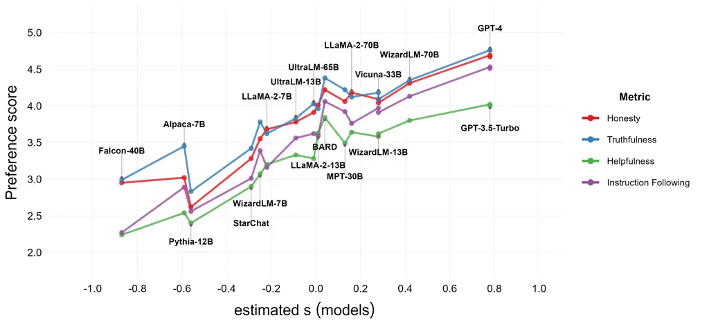

Figure 3: UltraFeedback preference scores versus
$`\widehat{\mathbf{s}}`$ across four evaluation dimensions (helpfulness,
truthfulness, honesty, and instruction-following). Each point
corresponds to a model; higher fitted scores are associated with higher
preference ratings across all dimensions.

### 5.3 Efficiency of Weighted Aggregation

We next quantify whether modeling judge reliability improves sample
efficiency using our in-house dataset with $`45`$ candidate models and
$`18`$ judge LLMs.²² 2 We use hosted models from
[https://www.together.ai/models](https://www.together.ai/models). As
full-data references, we fit (i) the weighted judge-aware model and (ii)
the unweighted BTL model to the complete dataset (all judges and all
comparisons), yielding $`\widehat{\mathbf{s}}^{\mathrm{ref}}_{w}`$ and
$`\widehat{\mathbf{s}}^{\mathrm{ref}}_{u}`$, respectively.

We then run a subsampling study that varies both the judge budget $`K`$
and the number of comparisons $`T`$. For each $`(K,T)`$, we (i) sample
$`K`$ judges uniformly at random from the $`18`$ available, (ii)
restrict to $`T`$ comparisons involving these judges, and (iii) fit both
the weighted and unweighted models to obtain
$`\widehat{\mathbf{s}}_{w}`$ and $`\widehat{\mathbf{s}}_{u}`$. Agreement
is measured by computing the Pearson correlation between
$`\widehat{\mathbf{s}}_{w}`$ and
$`\widehat{\mathbf{s}}^{\mathrm{ref}}_{w}`$ for the weighted model, and
between $`\widehat{\mathbf{s}}_{u}`$ and
$`\widehat{\mathbf{s}}^{\mathrm{ref}}_{u}`$ for the unweighted model.
Each condition is repeated five times and averaged to reduce variability
from judge selection.

Figure 4 displays the average correlation as a function of sample size
$`T`$ for four judge budgets $`K\in\{4,8,12,16\}`$. Weighted aggregation
consistently matches or outperforms unweighted aggregation across all
configurations. The improvement is most pronounced in the
small-to-moderate sample regime: the weighted model reaches a given
correlation level using fewer comparisons, indicating higher statistical
efficiency. As $`T`$ grows, both methods approach near-perfect agreement
with their respective full-data references, consistent with diminishing
returns when data become abundant.

Several additional patterns emerge. First, correlation increases
monotonically with sample size, approaching $`1.0`$ for large $`T`$.
Second, increasing the judge budget $`K`$ improves performance and
reduces the gap between weighted and unweighted methods. These patterns
confirm that the weighted model increases statistical efficiency by
down-weighting unreliable judges, with the largest gains occurring when
data or judges are limited.

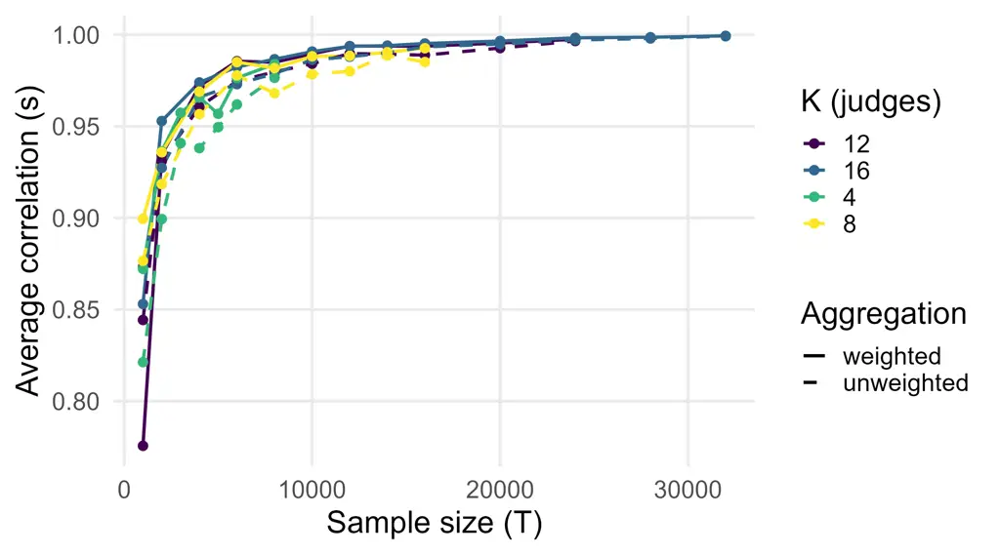

Figure 4: Average correlation of estimated s to the ground truth across
different numbers of judges and sample sizes.

Table A.7 reports the complete set of model estimates with $`95\%`$
confidence intervals under both methods.³³ 3 One judge with
$`\widehat{\gamma}\approx 0`$ was excluded due to numerical instability;
see Appendix F.3 for details. The average CI width for the weighted
model is $`0.185`$, compared to $`0.211`$ for the unweighted model (a
reduction of $`13.5\%`$). Similarly, Table 3 indicates that the weighted
model yields an average CI width of 0.264, whereas the unweighted model
gives 0.278, resulting in a reduction of $`5.4\%`$. This confirms the
simulation findings (Section 4.2): by concentrating statistical weight
on reliable judges, the weighted model extracts more information per
comparison, yielding more precise rankings.

### 5.4 Judge heterogeneity

We further conduct a mixed-quality judge experiment. We construct a
heterogeneous judge pool consisting of 6 lower-quality judges and 2
higher-quality judges, and restrict the evaluation data to comparisons
produced by these selected judges. On this restricted mixed-quality
subset, we fit both the weighted and unweighted models using the same
set of pairwise comparisons. We then evaluate their estimated scores
against the full-data weighted reference scores using Pearson and
Spearman correlations, where the reference scores are obtained by
fitting the judge-aware weighted model on the complete available
comparison dataset.

We observe a clear and consistent improvement when accounting for judge
heterogeneity: Pearson correlation increases from $`0.8992`$ to
$`0.9394`$ and Spearman correlation increases from $`0.8316`$ to
$`0.9212`$, corresponding to gains of $`0.0403`$ and $`0.0896`$,
respectively. Relative to the full-data weighted reference scores, the
unweighted model shows lower agreement, suggesting that ignoring judge
heterogeneity can degrade ranking fidelity in this mixed-quality
setting. Notably, the larger improvement in Spearman correlation
indicates that modeling judge heterogeneity is particularly important
for preserving the relative ordering of models, which is the primary
objective of leaderboard construction. Overall, these results provide
empirical support for the practical importance of judge heterogeneity
and suggest that weighted frameworks can yield more reliable rankings
than unweighted baselines, especially in mixed-quality judge settings.

| Judge                                     | $`\gamma`$ |
| ----------------------------------------- | ---------- |
| Qwen/Qwen2.5-7B-Instruct-Turbo            | 1.419      |
| deepseek-ai/DeepSeek-R1-Distill-Llama-70B | 0.046      |
| moonshot-v1-128k                          | 2.914      |
| kimi-k2-thinking-turbo                    | 3.511      |
| meta-llama/Llama-4-Scout-17B-16E-Instruct | 1.872      |
| google/gemma-3n-E4B-it                    | 0.627      |
| mistralai/Mixtral-8x7B-Instruct-v0.1      | 0.447      |
| Qwen/Qwen3-235B-A22B-Instruct-2507-tput   | 2.844      |

Table 2: $`\gamma`$ of the judges from the heterogeneous judge pool.

The estimated results in Table 2 clearly demonstrate that weighted model
successfully captures heterogeneity in judge quality through the learned
scale parameters $`\gamma_{k}`$. In particular, kimi-k2-thinking-turbo
($`\gamma=3.511`$) and moonshot-v1-128k ($`\gamma=2.914`$) receive the
two highest $`\gamma`$ values among all judges. Notably, these two
judges were manually identified as high-quality judges a priori, and the
model is able to recover this structure purely from pairwise comparison
data. In contrast, judges such as
deepseek-ai/DeepSeek-R1-Distill-Llama-70B ($`\gamma\approx 0.046`$) are
effectively down-weighted, as their comparisons are close to random
noise and provide little useful ranking information.

### 5.5 Case Study: Chatbot Arena

Finally, we study Chatbot Arena to examine whether the judge-aware model
yields rankings consistent with widely accepted model relationships.
Table 3 reports the top $`20`$ models under both weighted and unweighted
fits with $`10`$ judge LLMs.

| rank\_(w) | rank\_(u) | Model                   | $`\hat{s}_{w}`$ | $`\hat{s}_{u}`$ |     | CI$`{}_{w}^{\text{low}}`$ | CI$`{}_{w}^{\text{up}}`$ | CI$`{}_{u}^{\text{low}}`$ | CI$`{}_{u}^{\text{up}}`$ |
| --------- | --------- | ----------------------- | --------------- | --------------- | --- | ------------------------- | ------------------------ | ------------------------- | ------------------------ |
| 1         | 3         | GPT-4                   | 0.728           | 0.942           |     | 0.515                     | 0.941                    | 0.820                     | 1.064                    |
| 2         | 1         | Claude-v1               | 0.725           | 1.106           |     | 0.513                     | 0.938                    | 0.978                     | 1.234                    |
| 3         | 2         | Claude-Instant-v1       | 0.701           | 1.088           |     | 0.488                     | 0.915                    | 0.936                     | 1.239                    |
| 4         | 4         | GPT-3.5-Turbo           | 0.431           | 0.616           |     | 0.296                     | 0.566                    | 0.507                     | 0.724                    |
| 5         | 5         | Guanaco-33B             | 0.213           | 0.246           |     | 0.066                     | 0.360                    | 0.030                     | 0.462                    |
| 6         | 8         | WizardLM-13B            | 0.165           | -0.010          |     | 0.030                     | 0.300                    | -0.216                    | 0.196                    |
| 7         | 6         | Vicuna-13B              | 0.159           | 0.078           |     | 0.086                     | 0.231                    | -0.017                    | 0.173                    |
| 8         | 7         | PaLM 2                  | 0.131           | 0.020           |     | 0.047                     | 0.216                    | -0.107                    | 0.146                    |
| 9         | 10        | Vicuna-7B               | 0.072           | -0.045          |     | -0.010                    | 0.154                    | -0.179                    | 0.088                    |
| 10        | 9         | Koala-13B               | -0.038          | -0.029          |     | -0.098                    | 0.023                    | -0.126                    | 0.068                    |
| 11        | 12        | GPT4All-13B-Snoozy      | -0.078          | -0.127          |     | -0.199                    | 0.043                    | -0.334                    | 0.081                    |
| 12        | 15        | MPT-7B-Chat             | -0.130          | -0.294          |     | -0.218                    | -0.042                   | -0.431                    | -0.157                   |
| 13        | 13        | Alpaca-13B              | -0.230          | -0.165          |     | -0.319                    | -0.140                   | -0.272                    | -0.058                   |
| 14        | 11        | RWKV-4-Raven-14B        | -0.246          | -0.113          |     | -0.344                    | -0.149                   | -0.232                    | 0.006                    |
| 15        | 17        | OASST-Pythia-12B        | -0.259          | -0.429          |     | -0.353                    | -0.165                   | -0.532                    | -0.325                   |
| 16        | 14        | ChatGLM-6B              | -0.335          | -0.242          |     | -0.454                    | -0.216                   | -0.364                    | -0.119                   |
| 17        | 16        | FastChat-T5-3B          | -0.425          | -0.421          |     | -0.565                    | -0.285                   | -0.548                    | -0.295                   |
| 18        | 18        | Dolly-v2-12B            | -0.486          | -0.581          |     | -0.644                    | -0.328                   | -0.721                    | -0.440                   |
| 19        | 20        | StableLM-Tuned-Alpha-7B | -0.516          | -0.822          |     | -0.681                    | -0.350                   | -0.969                    | -0.676                   |
| 20        | 19        | LLaMA-13B               | -0.584          | -0.816          |     | -0.774                    | -0.395                   | -0.982                    | -0.650                   |

Table 3: Chatbot Arena rankings: weighted vs. unweighted. We show
$`\widehat{\mathbf{s}}`$ and confidence intervals for both methods.
Subscripts $`u`$ and $`w`$ denote the unweighted and weighted fits,
respectively.

For the top-tier models, the weighted ranking places the top four models
as: GPT-4, Claude-v1, Claude-Instant-v1, and GPT-3.5-Turbo,
corresponding to the GPT and Claude families widely regarded as the
strongest general-purpose chat models. Notably, the weighted model ranks
GPT-4 first, whereas the unweighted model places it third behind both
Claude variants. This correction aligns with the broad consensus that
GPT-4 was the leading model at the time of data collection.

The weighted ranking also correctly orders the Vicuna family by size:
Vicuna-13B (rank 7) $`>`$ Vicuna-7B (rank 9). The unweighted ranking
reverses this relationship in terms of scores (though not ranks),
suggesting that judge weighting reduces noise from uneven sampling
across model variants.

Moreover, the quartet Koala-13B, Alpaca-13B, Dolly-v2-12B, and LLaMA-13B
preserves the same relative ordering reported in the original Chatbot
Arena paper. This agreement indicates that the learned judge weights
encode evaluation signals consistent with established baselines.

By contrast, the unweighted model exhibits several anomalies:
RWKV-4-Raven-14B moves from rank 14 (weighted) to rank 11 (unweighted),
and GPT-4 drops from rank $`1`$ to rank $`3`$. These shifts likely
reflect the undue influence of a small subset of judges or
over-represented comparison contexts. The weighted model mitigates such
effects by systematically down-weighting unreliable judges.

Finally, we compare the Spearman correlations between the rankings and
the BTL model fitted using human evaluation rankings from (Chiang
et al., 2024): the weighted ranking achieves $`\rho=0.9955`$, while the
unweighted ranking achieves $`\rho=0.9699`$. This indicates that the
weighted ranking aligns more closely with human judgments.

## 6 Conclusion and Discussion

We introduce a judge-aware ranking framework for evaluating large
language models without ground-truth labels. By extending the BTL model
with judge-specific discrimination parameters, our approach jointly
estimates latent model quality scores and judge-specific discrimination,
automatically down-weighting low-discrimination evaluators through the
likelihood function. We establish the statistical foundations of the
proposed model and demonstrate empirical improvements over unweighted
baselines on real-world benchmarks. Beyond evaluating LLMs, the proposed
judge-aware framework is also applicable to other settings where items
are assessed via pairwise comparisons by judges with heterogeneous
discrimination ability, such as expert panels in medicine or
peer-review-style evaluations.

Several limitations point to directions for future investigation. The
judge-specific discrimination parameter $`\gamma_{k}`$ is a global
scalar and does not capture task- or domain-specific variation in judge
reliability; extending to covariate-dependent discrimination is a
natural next step, and Appendix F.6 provides a preliminary illustration
using question length. The current model assumes conditionally
independent judge errors given the latent scores and judge-specific
parameters, leaving correlated errors or shared biases among similar
judges to future work. Finally, Appendix F.7 provides an empirical
robustness check under connected sparse designs, while a systematic
theory for highly imbalanced, limited-overlap, or adaptive comparison
graphs remains future work.

## Acknowledgments

The authors would like to thank the anonymous reviewers and area chairs
for their helpful and constructive comments.

This work was supported by the MOE AcRF Tier 1 Grant A-8003569-00-00 and
the NUS Start-up Grant A-0009985-00-00.

## Impact Statement

This paper presents a statistical framework for ranking large language
models using automated judges, aiming to advance the field of machine
learning evaluation. We identify several potential societal
implications:

First, our framework reduces the cost and time required for LLM
evaluation by enabling scalable automated assessment without human
annotation. This democratizes model evaluation, allowing researchers
with limited resources to conduct rigorous comparisons. The uncertainty
quantification provided by our method also promotes more transparent
reporting of ranking reliability.

However, automated evaluation systems, including ours, may inherit or
amplify biases present in judge models. Rankings produced by our
framework could influence deployment decisions, resource allocation, and
public perception of model capabilities. We encourage practitioners to
use our confidence intervals to avoid over-interpreting small score
differences and to validate rankings against diverse evaluation
criteria.

Thus, we recommend using diverse judge panels spanning multiple model
families to reduce systematic bias, and we will release our code to
enable scrutiny and reproducibility. The judge-specific discrimination
parameters estimated by our model can help identify potentially biased
or unreliable judges for further investigation.

## References

- Bavaresco et al. (2025) Bavaresco, A., Bernardi, R., Bertolazzi, L.,
  Elliott, D., Fernández, R., Gatt, A., Ghaleb, E., Giulianelli, M.,
  Hanna, M., Koller, A., Martins, A., Mondorf, P., Neplenbroek, V.,
  Pezzelle, S., Plank, B., Schlangen, D., Suglia, A., Surikuchi, A. K.,
  Takmaz, E., and Testoni, A. LLMs instead of human judges? A large
  scale empirical study across 20 NLP evaluation tasks. In Che, W.,
  Nabende, J., Shutova, E., and Pilehvar, M. T. (eds.), _Proceedings of
  the 63rd Annual Meeting of the Association for Computational
  Linguistics (Volume 2: Short Papers)_, pp. 238–255, Vienna,
  Austria, 2025. Association for Computational Linguistics.
- Bradley & Terry (1952) Bradley, R. A. and Terry, M. E. Rank analysis
  of incomplete block designs: I. The method of paired comparisons.
  _Biometrika_, 39(3/4):324–345, 1952.
- Chen et al. (2013) Chen, X., Bennett, P. N., Collins-Thompson, K., and
  Horvitz, E. Pairwise ranking aggregation in a crowdsourced setting. In
  _Proceedings of the Sixth ACM International Conference on Web Search
  and Data Mining_, pp. 193–202, New York, NY, USA, 2013. Association
  for Computing Machinery.
- Chiang & Lee (2023) Chiang, C.-H. and Lee, H.-y. Can Large Language
  Models be an alternative to human evaluations? In Rogers, A.,
  Boyd-Graber, J., and Okazaki, N. (eds.), _Proceedings of the 61st
  Annual Meeting of the Association for Computational Linguistics
  (Volume 1: Long Papers)_, pp. 15607–15631, Toronto, Canada, 2023.
  Association for Computational Linguistics.
- Chiang et al. (2024) Chiang, W.-L., Zheng, L., Sheng, Y.,
  Angelopoulos, A. N., Li, T., Li, D., Zhu, B., Zhang, H., Jordan, M.,
  Gonzalez, J. E., et al. Chatbot arena: An open platform for evaluating
  llms by human preference. In _Forty-first International Conference on
  Machine Learning_, 2024.
- Cui et al. (2024) Cui, G., Yuan, L., Ding, N., Yao, G., Zhu, W., Ni,
  Y., Xie, G., Liu, Z., and Sun, M. UltraFeedback: Boosting language
  models with high-quality feedback, 2024. URL
  [https://openreview.net/forum?id=pNkOx3IVWI](https://openreview.net/forum?id=pNkOx3IVWI).
- Dhurandhar et al. (2024) Dhurandhar, A., Nair, R., Singh, M., Daly,
  E., and Natesan Ramamurthy, K. Ranking Large Language Models without
  ground truth. In Ku, L.-W., Martins, A., and Srikumar, V. (eds.),
  _Findings of the Association for Computational Linguistics: ACL 2024_,
  pp. 2431–2452, Bangkok, Thailand, 2024. Association for Computational
  Linguistics.
- Fan et al. (2024a) Fan, J., Hou, J., and Yu, M. Covariate assisted
  entity ranking with sparse intrinsic scores, 2024a. URL
  [https://arxiv.org/abs/2407.08814](https://arxiv.org/abs/2407.08814).
- Fan et al. (2024b) Fan, J., Hou, J., and Yu, M. Uncertainty
  quantification of MLE for entity ranking with covariates. _Journal of
  Machine Learning Research_, 25(358):1–83, 2024b.
- Fan et al. (2025) Fan, J., Kwon, H., and Zhu, X. Uncertainty
  quantification for ranking with heterogeneous preferences, 2025. URL
  [https://arxiv.org/abs/2509.01847](https://arxiv.org/abs/2509.01847).
- Fathullah & Gales (2025) Fathullah, Y. and Gales, M. Generalised
  probabilistic modelling and improved uncertainty estimation in
  comparative LLM-as-a-judge. In _Proceedings of the Forty-first
  Conference on Uncertainty in Artificial Intelligence_, volume 286 of
  _Proceedings of Machine Learning Research_, pp. 1266–1288. PMLR, 2025.
- Gao et al. (2023) Gao, C., Shen, Y., and Zhang, A. Y. Uncertainty
  quantification in the Bradley-Terry-Luce model. _Information and
  Inference: A Journal of the IMA_, 12(2):1073–1140, 2023.
- Gilardi et al. (2023) Gilardi, F., Alizadeh, M., and Kubli, M. ChatGPT
  outperforms crowd workers for text-annotation tasks. _Proceedings of
  the National Academy of Sciences_, 120(30):e2305016120, 2023.
- Gu et al. (2026) Gu, J., Jiang, X., Shi, Z., Tan, H., Zhai, X., Xu,
  C., Li, W., Shen, Y., Ma, S., Liu, H., Wang, S., Zhang, K., Lin, Z.,
  Zhang, B., Ni, L., Gao, W., Wang, Y., and Guo, J. A survey on
  LLM-as-a-Judge. _The Innovation_, pp. 101253, 2026. ISSN 2666-6758.
- Hendrycks et al. (2021) Hendrycks, D., Burns, C., Basart, S., Zou, A.,
  Mazeika, M., Song, D., and Steinhardt, J. Measuring massive multitask
  language understanding. In _International Conference on Learning
  Representations_, 2021.
- Huang et al. (2023) Huang, F., Kwak, H., and An, J. Is ChatGPT better
  than human annotators? Potential and limitations of ChatGPT in
  explaining implicit hate speech. In _Companion Proceedings of the ACM
  Web Conference 2023_, pp. 294–297. Association for Computing
  Machinery, 2023.
- Kingma & Ba (2015) Kingma, D. P. and Ba, J. Adam: A method for
  stochastic optimization. In _Proceedings of the 3rd International
  Conference on Learning Representations (ICLR)_, 2015.
- Lee et al. (2024) Lee, S. J., Sun, W. W., and Liu, Y. Low-Rank
  contextual reinforcement learning from heterogeneous human
  feedback, 2024. URL
  [https://arxiv.org/abs/2412.19436](https://arxiv.org/abs/2412.19436).
- Luce (1959) Luce, R. D. _Individual Choice Behavior: A Theoretical
  Analysis_. John Wiley & Sons, New York, NY, 1959.
- Newey & McFadden (1994) Newey, W. K. and McFadden, D. Large sample
  estimation and hypothesis testing. In _Handbook of Econometrics_,
  volume 4, pp. 2111–2245. Elsevier, 1994.
- Otani et al. (2016) Otani, N., Nakazawa, T., Kawahara, D., and
  Kurohashi, S. IRT-based aggregation model of crowdsourced pairwise
  comparison for evaluating machine translations. In _Proceedings of the
  2016 Conference on Empirical Methods in Natural Language Processing_,
  pp. 511–520, Austin, Texas, November 2016. Association for
  Computational Linguistics.
- Srivastava et al. (2023) Srivastava, A., Rastogi, A., Rao, A.,
  Shoeb, A. A. M., Abid, A., Fisch, A., Brown, A. R., Santoro, A.,
  Gupta, A., Garriga-Alonso, A., et al. Beyond the imitation game:
  Quantifying and extrapolating the capabilities of language models.
  _Transactions on Machine Learning Research_, 2023. ISSN 2835-8856.
- Yan (2025) Yan, T. Inference in a generalized Bradley-Terry model for
  paired comparisons with covariates and a growing number of
  subjects, 2025. URL
  [https://arxiv.org/abs/2507.22472](https://arxiv.org/abs/2507.22472).
- Yang et al. (2024) Yang, J., Tan, Y., Hu, W., Yang, Z., Zhou, X., Luo,
  Z., and Luo, W. REM: A ranking-based automatic evaluation method for
  LLMs. In Wand, M., Malinovská, K., Schmidhuber, J., and Tetko, I. V.
  (eds.), _Artificial Neural Networks and Machine Learning – ICANN
  2024_, pp. 371–385, Cham, 2024. Springer Nature Switzerland.
- Zheng et al. (2023) Zheng, L., Chiang, W.-L., Sheng, Y., Zhuang, S.,
  Wu, Z., Zhuang, Y., Lin, Z., Li, Z., Li, D., Xing, E., Zhang, H.,
  Gonzalez, J. E., and Stoica, I. Judging LLM-as-a-judge with MT-Bench
  and Chatbot Arena. In _Advances in Neural Information Processing
  Systems_, volume 36, pp. 46595–46623. Curran Associates, Inc., 2023.

## Appendix A Proofs of Main Results

### A.1 Proof of Theorem 3.2

###### Proof of Theorem 3.2.

_Sufficiency._ For any $`a\in\mathbb{R}\backslash\{0\}`$ and
$`b\in\mathbb{R}`$,

```math
\tilde{\gamma}_{k}(\tilde{s}_{i}-\tilde{s}_{j})=\frac{\gamma_{k}}{a}\big(as_{i}+b-as_{j}-b\big)=\gamma_{k}(s_{i}-s_{j}),
```

so all choice probabilities remain unchanged.

_Necessity._ If the probabilities coincide for all $`i\neq j`$ and all
$`k`$, then, since $`\sigma`$ is strictly increasing,

```math
\gamma_{k}(s_{i}-s_{j})=\tilde{\gamma}_{k}(\tilde{s}_{i}-\tilde{s}_{j})\qquad(\forall\,i\neq j,\ \forall\,k).
```

Fix a judge $`k`$ and a reference item $`j_{0}`$. For all $`i`$,

```math
\gamma_{k}s_{i}-\tilde{\gamma}_{k}\tilde{s}_{i}=\gamma_{k}s_{j_{0}}-\tilde{\gamma}_{k}\tilde{s}_{j_{0}}=:c_{k},
```

and hence

```math
\tilde{s}_{i}=\frac{\gamma_{k}}{\tilde{\gamma}_{k}}s_{i}-\frac{c_{k}}{\tilde{\gamma}_{k}}=:a_{k}s_{i}+b_{k}\qquad(\forall\,i).
```

For another judge $`\ell`$ we similarly obtain
$`\tilde{s}_{i}=a_{\ell}s_{i}+b_{\ell}`$ for all $`i`$. Subtracting the
two affine representations yields

```math
(a_{k}-a_{\ell})s_{i}+(b_{k}-b_{\ell})=0\qquad(\forall\,i).
```

By Assumption 3.1 there exist $`i_{1}\neq i_{2}`$ with
$`s_{i_{1}}\neq s_{i_{2}}`$, so

```math
(a_{k}-a_{\ell})(s_{i_{1}}-s_{i_{2}})=0\ \Rightarrow\ a_{k}=a_{\ell},
```

and then $`b_{k}=b_{\ell}`$. Thus there exist
$`a\in\mathbb{R}\backslash\{0\}`$ and $`b\in\mathbb{R}`$ such that
$`\tilde{\mathbf{s}}=a\mathbf{s}+b\mathbf{1}`$. Plugging this into
$`\gamma_{k}(s_{i}-s_{j})=\tilde{\gamma}_{k}(\tilde{s}_{i}-\tilde{s}_{j})`$
gives

```math
\gamma_{k}(s_{i}-s_{j})=\tilde{\gamma}_{k}\,a\,(s_{i}-s_{j})\qquad(\forall\,i\neq j),
```

and hence $`a\,\tilde{\gamma}_{k}=\gamma_{k}`$ for each $`k`$, i.e.,
$`\tilde{\boldsymbol{\gamma}}=\boldsymbol{\gamma}/a`$. This completes
the proof. ∎

### A.2 Proof of Corollary 3.3

###### Proof of Corollary 3.3.

By Theorem 3.2, under Assumption 3.1,if two parameter pairs
$`(\mathbf{s},\boldsymbol{\gamma})`$ and
$`(\tilde{\mathbf{s}},\tilde{\boldsymbol{\gamma}})`$ lead to the same
probabilities, then there exist $`a\in\mathbb{R}\backslash\{0\}`$ and
$`b\in\mathbb{R}`$ such that

```math
\tilde{\mathbf{s}}=a\mathbf{s}+b\mathbf{1}\qquad\text{and}\qquad\tilde{\boldsymbol{\gamma}}=\boldsymbol{\gamma}/a.
```

Based on the constraints in (3),

```math
0=\sum_{i=1}^{N}\tilde{s}_{i}=\sum_{i=1}^{N}(as_{i}+b)=a\sum_{i=1}^{N}s_{i}+Nb=a\cdot 0+Nb,
```

we obtain $`b=0`$, and hence $`\tilde{\mathbf{s}}=a\mathbf{s}`$. Next,
considering the constraint on the judge discrimination parameters, we
have

```math
0=\sum_{k=1}^{K}\log\tilde{\gamma}_{k}=\sum_{k=1}^{K}\log\frac{\gamma_{k}}{a}=\sum_{k=1}^{K}\left(\log\gamma_{k}-\log a\right)=0-\log a,
```

which implies $`\log a=0`$ and therefore $`a=1`$. Substituting $`a=1`$
and $`b=0`$ gives $`\tilde{\mathbf{s}}=\mathbf{s}`$ and
$`\tilde{\boldsymbol{\gamma}}=\boldsymbol{\gamma}`$, i.e.,
$`(\mathbf{s},\boldsymbol{\gamma})=(\tilde{\mathbf{s}},\tilde{\boldsymbol{\gamma}})`$.
∎

### A.3 Proof of Theorem 3.4

###### Proof of Theorem 3.4.

Before the proof, we fix the notation. Let $`\mathbf{1}`$ denote the
all-ones vector (with dimension clear from context). For any integer
$`M\geq 1`$, let $`\mathbf{I}_{M}`$ denote the $`M\times M`$ identity
matrix, and let $`\mathbf{e}_{i}\in\mathbb{R}^{M}`$ be the $`i`$-th
standard basis vector, i.e., $`(\mathbf{e}_{i})_{j}=\mathbf{1}\{j=i\}`$
for $`j=1,\ldots,M`$. We use $`\mapsto`$ to denote a mapping, e.g.,
$`t\mapsto e^{t}`$. We write $`\mathrm{Bern}(p)`$ for the Bernoulli
distribution with success probability $`p`$. We write
$`X_{n}\xlongrightarrow{p}X`$ for convergence in probability and
$`X_{n}\xlongrightarrow{d}X`$ for convergence in distribution. For a
symmetric matrix $`\mathbf{W}`$, we write $`\mathbf{W}\succ 0`$ (resp.
$`\mathbf{W}\succeq 0`$) to mean that $`\mathbf{W}`$ is positive
definite (resp. positive semidefinite). We use $`\|\cdot\|`$ for the
Euclidean norm and $`\|\cdot\|_{\infty}`$ for the $`\ell_{\infty}`$
norm.

Following the identifiability conditions in Corollary 3.3, we impose the
zero-sum constraints

```math
\mathbf{1}^{\top}\mathbf{s}=0,\qquad\mathbf{1}^{\top}\boldsymbol{\alpha}=0,\qquad\text{where}\quad\alpha_{k}:=\log\gamma_{k}.
```

Let $`\mathbf{A}_{\mathbf{s}}\in\mathbb{R}^{N\times(N-1)}`$ and
$`\mathbf{A}_{\boldsymbol{\alpha}}\in\mathbb{R}^{K\times(K-1)}`$ have
orthonormal columns spanning the corresponding zero-sum subspaces, i.e.

```math
\mathbf{1}^{\top}\mathbf{A}_{\mathbf{s}}=\mathbf{0},\ \ \mathbf{A}_{\mathbf{s}}^{\top}\mathbf{A}_{\mathbf{s}}=\mathbf{I}_{N-1},\qquad\mathbf{1}^{\top}\mathbf{A}_{\boldsymbol{\alpha}}=\mathbf{0},\ \ \mathbf{A}_{\boldsymbol{\alpha}}^{\top}\mathbf{A}_{\boldsymbol{\alpha}}=\mathbf{I}_{K-1}.
```

Reparameterize

```math
\mathbf{s}=\mathbf{A}_{\mathbf{s}}\mathbf{u},\qquad\boldsymbol{\alpha}=\mathbf{A}_{\boldsymbol{\alpha}}\mathbf{v},\qquad\boldsymbol{\vartheta}:=(\mathbf{u},\mathbf{v})\in\mathbb{R}^{d},\quad d=(N-1)+(K-1).
```

This gives a one-to-one linear mapping between the constrained parameter
$`(\mathbf{s},\boldsymbol{\alpha})`$ and the unconstrained vector
$`\boldsymbol{\vartheta}\in\mathbb{R}^{d}`$. Let
$`\boldsymbol{\vartheta}_{0}`$ denote the image of the true parameter
$`(\mathbf{s}_{0},\boldsymbol{\alpha}_{0})`$.

Write $`Z_{t}=(X_{t},Y_{t})`$ with $`X_{t}=(i_{t},j_{t},k_{t})`$ and
$`\boldsymbol{\Delta}_{ij}:=\mathbf{e}_{i}-\mathbf{e}_{j}`$. Now, we can
rewrite the natural parameter (linear predictor) as

```math
\eta_{\boldsymbol{\vartheta}}(X_{t})=\exp\left(\alpha_{k_{t}}\right)\left(s_{i_{t}}-s_{j_{t}}\right)=\exp\!\big(\mathbf{e}_{k_{t}}^{\top}\mathbf{A}_{\boldsymbol{\alpha}}\mathbf{v}\big)\,\boldsymbol{\Delta}_{i_{t}j_{t}}^{\top}\mathbf{A}_{\mathbf{s}}\mathbf{u}.
```

First, we prove the existence of the MLE. Recall the conditional
log-likelihood (omitting the design constant
$`\sum_{t}\log\pi_{i_{t}j_{t}k_{t}}`$):

```math
\ell_{T}(\mathbf{s},\boldsymbol{\gamma})=\sum_{t=1}^{T}\Big\{Y_{t}\,\gamma_{k_{t}}(s_{i_{t}}-s_{j_{t}})-\log\!\big(1+\exp(\gamma_{k_{t}}(s_{i_{t}}-s_{j_{t}}))\big)\Big\}.
```

Under the reparameterization
$`\mathbf{s}=\mathbf{A}_{\mathbf{s}}\mathbf{u}`$,
$`\boldsymbol{\alpha}=\mathbf{A}_{\boldsymbol{\alpha}}\mathbf{v}`$,
$`\gamma_{k}=e^{\alpha_{k}}`$, let
$`\boldsymbol{\vartheta}=(\mathbf{u},\mathbf{v})`$ and define

```math
\ell_{T}(\boldsymbol{\vartheta})=\sum_{t=1}^{T}\Big\{Y_{t}\,\eta_{\boldsymbol{\vartheta}}(X_{t})-\log\!\big(1+\exp(\eta_{\boldsymbol{\vartheta}}(X_{t}))\big)\Big\}=\sum_{t=1}^{T}m(Z_{t};\boldsymbol{\vartheta}),
```

with
$`m(z;\boldsymbol{\vartheta})=y\,\eta_{\boldsymbol{\vartheta}}(x)-\log\big(1+e^{\eta_{\boldsymbol{\vartheta}}(x)}\big)`$
for $`z=(x,y)`$. Set the sample and population criteria

```math
\widehat{Q}_{T}(\boldsymbol{\vartheta}):=\frac{1}{T}\ell_{T}(\boldsymbol{\vartheta})=\frac{1}{T}\sum_{t=1}^{T}m(Z_{t};\boldsymbol{\vartheta}),\qquad Q_{0}(\boldsymbol{\vartheta}):=\mathbb{E}[m(Z;\boldsymbol{\vartheta})].
```

By a standard compact-localization argument, we fix a compact set
$`\Theta\subset\mathbb{R}^{d}`$ containing the true parameter
$`\vartheta_{0}`$ and consider maximizers of $`\widehat{Q}_{T}`$ over
$`\Theta`$.

###### Proposition A.1 (Existence of an MLE on $`\Theta`$).

For every $`T\geq 1`$, the argmax set
$`\arg\max_{\boldsymbol{\vartheta}\in\Theta}\widehat{Q}_{T}(\boldsymbol{\vartheta})`$
is nonempty. Hence a (localized) MLE
$`\widehat{\boldsymbol{\vartheta}}_{T}\in\Theta`$ exists.

###### Proof.

Fix $`T\geq 1`$ and work on the compact set
$`\Theta\subset\mathbb{R}^{d}`$. For each fixed $`z=(x,y)`$ with
$`x=(i,j,k)`$, write

```math
\boldsymbol{\Delta}_{ij}:=\mathbf{e}_{i}-\mathbf{e}_{j},\qquad a(\boldsymbol{\vartheta}):=\mathbf{e}_{k}^{\top}\mathbf{A}_{\boldsymbol{\alpha}}\mathbf{v},\qquad b(\boldsymbol{\vartheta}):=\boldsymbol{\Delta}_{ij}^{\top}\mathbf{A}_{\mathbf{s}}\mathbf{u},
```

so that

```math
\eta_{\boldsymbol{\vartheta}}(x)=e^{a(\boldsymbol{\vartheta})}\,b(\boldsymbol{\vartheta}),\qquad m(z;\boldsymbol{\vartheta})=y\,\eta_{\boldsymbol{\vartheta}}(x)-\log\!\big(1+e^{\eta_{\boldsymbol{\vartheta}}(x)}\big).
```

Since $`a(\boldsymbol{\vartheta})`$ and $`b(\boldsymbol{\vartheta})`$
are linear in $`\boldsymbol{\vartheta}=(\mathbf{u},\mathbf{v})`$, and
the maps $`t\mapsto e^{t}`$, $`(t,s)\mapsto ts`$, and
$`t\mapsto yt-\log(1+e^{t})`$ are smooth on $`\mathbb{R}`$, the
composition
$`\boldsymbol{\vartheta}\mapsto m(z;\boldsymbol{\vartheta})`$ is
continuous. Consequently
$`\widehat{Q}_{T}(\boldsymbol{\vartheta})=T^{-1}\sum_{t=1}^{T}m(Z_{t};\boldsymbol{\vartheta})`$
is continuous on the compact $`\Theta`$. By the extreme value theorem,
$`\widehat{Q}_{T}`$ attains its maximum on $`\Theta`$, so
$`\arg\max_{\boldsymbol{\vartheta}\in\Theta}\widehat{Q}_{T}(\boldsymbol{\vartheta})\neq\varnothing`$.
∎

We now establish the consistency of the (localized) MLE
$`\widehat{\boldsymbol{\vartheta}}_{T}`$ in the free coordinates
$`\boldsymbol{\vartheta}\in\mathbb{R}^{d}`$.

###### Lemma A.2 (KL characterization of the population criterion).

Let $`X=(I,J,K)\sim\pi`$ and, under the true parameter
$`\boldsymbol{\vartheta}_{0}`$, let
$`Y\mid X\sim\mathrm{Bern}(p_{0}(X))`$ with
$`p_{0}(x):=\sigma(\eta_{\boldsymbol{\vartheta}_{0}}(x))`$. For any
$`\boldsymbol{\vartheta}`$, let
$`p_{\boldsymbol{\vartheta}}(x):=\sigma(\eta_{\boldsymbol{\vartheta}}(x))`$.
Then

```math
Q_{0}(\boldsymbol{\vartheta})-Q_{0}(\boldsymbol{\vartheta}_{0})=-\,\mathbb{E}_{X\sim\pi}\!\left[\mathrm{KL}\!\left(\mathrm{Bern}\!\big(p_{0}(X)\big)\,\big\|\,\mathrm{Bern}\!\big(p_{\boldsymbol{\vartheta}}(X)\big)\right)\right]\ \leq\ 0,
```

with equality iff $`p_{\boldsymbol{\vartheta}}(X)=p_{0}(X)`$
$`\pi`$-a.s. (equivalently
$`\eta_{\boldsymbol{\vartheta}}(X)=\eta_{\boldsymbol{\vartheta}_{0}}(X)`$
$`\pi`$-a.s., since $`\sigma`$ is strictly increasing).

###### Proof.

Recall
$`m(z;\boldsymbol{\vartheta})=y\,\eta_{\boldsymbol{\vartheta}}(x)-\log(1+e^{\eta_{\boldsymbol{\vartheta}}(x)})`$
for $`z=(x,y)`$ with $`x=(i,j,k)`$. Using the logistic identities

```math
\log p_{\boldsymbol{\vartheta}}(x)=\eta_{\boldsymbol{\vartheta}}(x)-\log\!\big(1+e^{\eta_{\boldsymbol{\vartheta}}(x)}\big),\qquad\log\!\big(1-p_{\boldsymbol{\vartheta}}(x)\big)=-\log\!\big(1+e^{\eta_{\boldsymbol{\vartheta}}(x)}\big),
```

we can rewrite the single-observation log-likelihood as

```math
m(z;\boldsymbol{\vartheta})=y\log p_{\boldsymbol{\vartheta}}(x)+(1-y)\log\!\big(1-p_{\boldsymbol{\vartheta}}(x)\big).
```

Taking conditional expectation given $`X=x`$ under the true law
$`Y\mid X=x\sim\mathrm{Bernoulli}(p_{0}(x))`$,

```math
\mathbb{E}\!\left[m(Z;\boldsymbol{\vartheta})\mid X=x\right]=p_{0}(x)\log p_{\boldsymbol{\vartheta}}(x)+\big(1-p_{0}(x)\big)\log\!\big(1-p_{\boldsymbol{\vartheta}}(x)\big).
```

Similarly,

```math
\mathbb{E}\!\left[m(Z;\boldsymbol{\vartheta}_{0})\mid X=x\right]=p_{0}(x)\log p_{0}(x)+\big(1-p_{0}(x)\big)\log\!\big(1-p_{0}(x)\big).
```

Subtracting and using the Bernoulli KL divergence,

```math
\displaystyle\ \ \ \mathbb{E}\!\left[m(Z;\boldsymbol{\vartheta})\mid X=x\right]-\mathbb{E}\!\left[m(Z;\boldsymbol{\vartheta}_{0})\mid X=x\right]
```

```math
\displaystyle=p_{0}(x)\log\!\frac{p_{\boldsymbol{\vartheta}}(x)}{p_{0}(x)}+\big(1-p_{0}(x)\big)\log\!\frac{1-p_{\boldsymbol{\vartheta}}(x)}{1-p_{0}(x)}
```

```math
\displaystyle=-\,\mathrm{KL}\!\left(\mathrm{Bern}\!\big(p_{0}(x)\big)\,\big\|\,\mathrm{Bern}\!\big(p_{\boldsymbol{\vartheta}}(x)\big)\right)\ \leq\ 0.
```

Finally, take expectation over $`X\sim\pi`$ to obtain

```math
Q_{0}(\boldsymbol{\vartheta})-Q_{0}(\boldsymbol{\vartheta}_{0})=-\,\mathbb{E}_{X\sim\pi}\!\left[\mathrm{KL}\!\left(\mathrm{Bern}\!\big(p_{0}(X)\big)\,\big\|\,\mathrm{Bern}\!\big(p_{\boldsymbol{\vartheta}}(X)\big)\right)\right]\ \leq\ 0.
```

Nonnegativity of KL shows equality holds iff
$`p_{\boldsymbol{\vartheta}}(x)=p_{0}(x)`$ for $`\pi`$-a.e. $`x`$. Since
$`\sigma`$ is strictly increasing, this is equivalent to
$`\eta_{\boldsymbol{\vartheta}}(x)=\eta_{\boldsymbol{\vartheta}_{0}}(x)`$
$`\pi`$-a.s. ∎

###### Lemma A.3 (Consistency of the localized MLE).

Let
$`\widehat{Q}_{T}(\boldsymbol{\vartheta})=T^{-1}\sum_{t=1}^{T}m(Z_{t};\boldsymbol{\vartheta})`$
and
$`Q_{0}(\boldsymbol{\vartheta})=\mathbb{E}[m(Z;\boldsymbol{\vartheta})]`$.
Under the i.i.d. random-design model, compact localization
$`\boldsymbol{\vartheta}_{0}\in\Theta`$, and the zero-sum
identification, any maximizer
$`\widehat{\boldsymbol{\vartheta}}_{T}\in\arg\max_{\boldsymbol{\vartheta}\in\Theta}\widehat{Q}_{T}(\boldsymbol{\vartheta})`$
satisfies
$`\widehat{\boldsymbol{\vartheta}}_{T}\xlongrightarrow{p}\boldsymbol{\vartheta}_{0}`$.

###### Proof.

We apply the consistency theorem for M-estimators (Newey & McFadden,
1994, Theorem 2.1).

_(1) Compact parameter set._ By construction, we maximize over the
compact set $`\Theta`$.

_(2) Continuity of $`Q_{0}`$._ For each fixed $`z`$,
$`m(z;\boldsymbol{\vartheta})`$ is continuous in
$`\boldsymbol{\vartheta}`$ (proved in Proposition A.1). Since
$`X=(I,J,K)`$ takes values in the finite set $`[N]\times[N]\times[K]`$
and $`\Theta`$ is compact, there exist constants

```math
C_{\alpha}:=\sup_{\boldsymbol{\vartheta}\in\Theta}\|\mathbf{A}_{\boldsymbol{\alpha}}\mathbf{v}\|_{\infty}<\infty,\qquad C_{u}:=\sup_{\boldsymbol{\vartheta}\in\Theta}\|\mathbf{A}_{\mathbf{s}}\mathbf{u}\|<\infty,
```

so that for all $`x=(i,j,k)`$ and $`\boldsymbol{\vartheta}\in\Theta`$,

```math
|\eta_{\boldsymbol{\vartheta}}(x)|=\exp(\mathbf{e}_{k}^{\top}\mathbf{A}_{\boldsymbol{\alpha}}\mathbf{v})\,|\mathbf{\Delta}_{ij}^{\top}\mathbf{A}_{\mathbf{s}}\mathbf{u}|\leq e^{C_{\alpha}}\,\|\mathbf{\Delta}_{ij}\|\,\|\mathbf{A}_{\mathbf{s}}\mathbf{u}\|\leq e^{C_{\alpha}}\sqrt{2}\,C_{u}=:B<\infty.
```

Hence, for all $`z=(x,y)`$ and $`\boldsymbol{\vartheta}\in\Theta`$,

```math
\left|m(z;\boldsymbol{\vartheta})\right|=\left|y\eta_{\boldsymbol{\vartheta}}(x)-\log\left(1+e^{\eta_{\boldsymbol{\vartheta}}(x)}\right)\right|\leq M_{1}:=B+\log(1+e^{B})<\infty.
```

Thus
$`\sup_{\boldsymbol{\vartheta}\in\Theta}|m(Z;\boldsymbol{\vartheta})|\leq M_{1}`$
almost surely, and $`M_{1}`$ is integrable. Let
$`\boldsymbol{\vartheta}_{n}\to\boldsymbol{\vartheta}`$. For each fixed
$`z`$,
$`m(z;\boldsymbol{\vartheta}_{n})\to m(z;\boldsymbol{\vartheta})`$ by
continuity. By the dominated convergence theorem,

```math
Q_{0}(\boldsymbol{\vartheta}_{n})=\mathbb{E}\big[m(Z;\boldsymbol{\vartheta}_{n})\big]\;\longrightarrow\;\mathbb{E}\big[m(Z;\boldsymbol{\vartheta})\big]=Q_{0}(\boldsymbol{\vartheta}),
```

so $`Q_{0}`$ is continuous on $`\Theta`$.

_(3) Uniform law of large numbers._ Since $`\Theta`$ is compact,
$`m(z;\boldsymbol{\vartheta})`$ is continuous in
$`\boldsymbol{\vartheta}`$ (for each fixed $`z`$), and there exists an
integrable envelope $`M_{1}`$ with
$`\sup_{\boldsymbol{\vartheta}\in\Theta}|m(Z;\boldsymbol{\vartheta})|\leq M_{1}`$,
the i.i.d. uniform LLN (Newey & McFadden, 1994, Lemma 2.4) gives

```math
\sup_{\boldsymbol{\vartheta}\in\Theta}\big|\widehat{Q}_{T}(\boldsymbol{\vartheta})-Q_{0}(\boldsymbol{\vartheta})\big|\xlongrightarrow{p}0.
```

_(4) Unique maximizer of $`Q_{0}`$._ By Lemma A.2,

```math
Q_{0}(\boldsymbol{\vartheta})-Q_{0}(\boldsymbol{\vartheta}_{0})=-\,\mathbb{E}_{X\sim\pi}\!\Big[\mathrm{KL}\big(\mathrm{Bern}(p_{0}(X))\ \|\ \mathrm{Bern}(p_{\boldsymbol{\vartheta}}(X))\big)\Big]\leq 0,
```

with equality iff
$`\eta_{\boldsymbol{\vartheta}}(X)=\eta_{\boldsymbol{\vartheta}_{0}}(X)`$
$`\pi`$-a.s. Under the zero-sum (centering and geometric-mean)
identification constraints, Corollary 3.3 implies
$`(\mathbf{s},\boldsymbol{\alpha})=(\mathbf{s}_{0},\boldsymbol{\alpha}_{0})`$.
Since
$`(\mathbf{s},\boldsymbol{\alpha})=(\mathbf{A}_{\mathbf{s}}\mathbf{u},\mathbf{A}_{\boldsymbol{\alpha}}\mathbf{v})`$
defines a one-to-one linear map between
$`(\mathbf{s},\boldsymbol{\alpha})`$ and
$`\boldsymbol{\vartheta}=(\mathbf{u},\mathbf{v})`$, we then have
$`\boldsymbol{\vartheta}=\boldsymbol{\vartheta}_{0}`$. Hence $`Q_{0}`$
is uniquely maximized at $`\boldsymbol{\vartheta}_{0}`$.

All four conditions hold, so by Newey & McFadden (1994, Theorem 2.1),
$`\widehat{\boldsymbol{\vartheta}}_{T}\xlongrightarrow{p}\boldsymbol{\vartheta}_{0}`$.
∎

Next, we can prove the central limit theorem for the score function. The
per-observation score in the free coordinates is

```math
\psi(Z;\boldsymbol{\vartheta})=\nabla_{\boldsymbol{\vartheta}}m(Z;\boldsymbol{\vartheta})=\big(Y-\sigma(\eta_{\boldsymbol{\vartheta}}(X))\big)\,g(X;\boldsymbol{\vartheta}),\qquad g(X;\boldsymbol{\vartheta}):=\nabla_{\boldsymbol{\vartheta}}\eta_{\boldsymbol{\vartheta}}(X). \tag{A.1}
```

For each $`\boldsymbol{\vartheta}`$, the Fisher information matrix (for
the model indexed by $`\boldsymbol{\vartheta}`$) is

```math
\mathcal{I}_{\boldsymbol{\vartheta}}(\boldsymbol{\vartheta}):=\mathbb{E}_{\boldsymbol{\vartheta}}\!\left[\psi(Z;\boldsymbol{\vartheta})\psi(Z;\boldsymbol{\vartheta})^{\top}\right]=\mathbb{E}_{\boldsymbol{\vartheta}}\!\left[\big(Y-\sigma(\eta_{\boldsymbol{\vartheta}}(X))\big)^{2}\,g(X;\boldsymbol{\vartheta})g(X;\boldsymbol{\vartheta})^{\top}\right],
```

where $`\mathbb{E}_{\boldsymbol{\vartheta}}`$ denotes expectation when
$`(X,Y)`$ is distributed under parameter $`\boldsymbol{\vartheta}`$.

Using the law of total expectation and
$`Y\mid X\sim\mathrm{Bernoulli}(\sigma(\eta_{\boldsymbol{\vartheta}}(X)))`$
under $`P_{\boldsymbol{\vartheta}}`$,

```math
\displaystyle\mathcal{I}_{\boldsymbol{\vartheta}}(\boldsymbol{\vartheta}) \displaystyle=\mathbb{E}_{\boldsymbol{\vartheta}}\!\left[g(X;\boldsymbol{\vartheta})g(X;\boldsymbol{\vartheta})^{\top}\,\mathbb{E}_{\boldsymbol{\vartheta}}\!\left[\left(Y-\sigma(\eta_{\boldsymbol{\vartheta}}(X))\right)^{2}\mid X\right]\right]
```

```math
\displaystyle=\mathbb{E}_{\boldsymbol{\vartheta}}\!\left[\sigma(\eta_{\boldsymbol{\vartheta}}(X))\left(1-\sigma(\eta_{\boldsymbol{\vartheta}}(X))\right)\,g(X;\boldsymbol{\vartheta})g(X;\boldsymbol{\vartheta})^{\top}\right],
```

since for $`Y\in\{0,1\}`$ and $`p\in(0,1)`$,
$`\mathbb{E}[(Y-p)^{2}\mid X]=p(1-p).`$ At the true parameter
$`\boldsymbol{\vartheta}_{0}`$, we write

```math
\mathcal{I}_{\boldsymbol{\vartheta}}(\boldsymbol{\vartheta}_{0})=\mathbb{E}\!\left[\sigma(\eta_{\boldsymbol{\vartheta}_{0}}(X))\big(1-\sigma(\eta_{\boldsymbol{\vartheta}_{0}}(X))\big)\,g(X;\boldsymbol{\vartheta}_{0})g(X;\boldsymbol{\vartheta}_{0})^{\top}\right].
```

###### Lemma A.4 (CLT for the score).

Let $`\psi(Z;\boldsymbol{\vartheta})`$ and
$`g(X;\boldsymbol{\vartheta})`$ be as above. Under the i.i.d.
random-design model and finite design support,

```math
\sqrt{T}\,\nabla_{\boldsymbol{\vartheta}}\widehat{Q}_{T}(\boldsymbol{\vartheta}_{0})=\frac{1}{\sqrt{T}}\sum_{t=1}^{T}\psi(Z_{t};\boldsymbol{\vartheta}_{0})\ \xlongrightarrow{d}\ \mathcal{N}\!\big(0,\ \mathcal{I}_{\boldsymbol{\vartheta}}(\boldsymbol{\vartheta}_{0})\big),
```

where
$`\mathcal{I}_{\boldsymbol{\vartheta}}(\boldsymbol{\vartheta}_{0})=\mathbb{E}\!\big[\sigma(\eta_{\boldsymbol{\vartheta}_{0}}(X))(1-\sigma(\eta_{\boldsymbol{\vartheta}_{0}}(X)))\,g(X;\boldsymbol{\vartheta}_{0})g(X;\boldsymbol{\vartheta}_{0})^{\top}\big]`$.

###### Proof.

Write $`\psi_{t}:=\psi(Z_{t};\boldsymbol{\vartheta}_{0})`$.

_Mean zero._ Since
$`\mathbb{E}[Y_{t}\mid X_{t}]=\sigma(\eta_{\boldsymbol{\vartheta}_{0}}(X_{t}))`$,
we have $`\mathbb{E}[\psi_{t}\mid X_{t}]=0`$ and hence
$`\mathbb{E}[\psi_{t}]=0`$.

_Covariance._ By the law of total variance and the fact that
$`g(X_{t};\boldsymbol{\vartheta}_{0})`$ is $`X_{t}`$-measurable,

```math
\displaystyle\operatorname{Var}(\psi_{t}) \displaystyle=\mathbb{E}\!\left[\operatorname{Var}(\psi_{t}\mid X_{t})\right]=\mathbb{E}\!\left[\operatorname{Var}\!\left((Y_{t}-\sigma(\eta_{\boldsymbol{\vartheta}_{0}}(X_{t})))\,g(X_{t};\boldsymbol{\vartheta}_{0})\ \Big|\ X_{t}\right)\right]
```

```math
\displaystyle=\mathbb{E}\!\left[\sigma(\eta_{\boldsymbol{\vartheta}_{0}}(X_{t}))\big(1-\sigma(\eta_{\boldsymbol{\vartheta}_{0}}(X_{t}))\big)\,g(X_{t};\boldsymbol{\vartheta}_{0})g(X_{t};\boldsymbol{\vartheta}_{0})^{\top}\right]=:\mathcal{I}_{\boldsymbol{\vartheta}}(\boldsymbol{\vartheta}_{0}).
```

_Finite second moment._ Since $`X_{t}`$ takes values in the finite set
$`[N]\times[N]\times[K]`$, there exists $`C_{g}<\infty`$ such that
$`\sup_{x}\|g(x;\boldsymbol{\vartheta}_{0})\|\leq C_{g}`$. Moreover
$`0\leq\sigma(u)(1-\sigma(u))\leq 1/4`$ for all $`u\in\mathbb{R}`$.
Hence

```math
\mathbb{E}\|\psi_{t}\|^{2}=\mathbb{E}\!\left[\sigma(\eta_{\boldsymbol{\vartheta}_{0}}(X_{t}))\big(1-\sigma(\eta_{\boldsymbol{\vartheta}_{0}}(X_{t}))\big)\,\|g(X_{t};\boldsymbol{\vartheta}_{0})\|^{2}\right]\leq\tfrac{1}{4}\,C_{g}^{2}<\infty.
```

_CLT._ The vectors $`\{\psi_{t}\}`$ are i.i.d., mean zero, with
covariance
$`\mathcal{I}_{\boldsymbol{\vartheta}}(\boldsymbol{\vartheta}_{0})`$ and
finite second moment. By the multivariate i.i.d. CLT (Lindeberg–Lévy),

```math
\frac{1}{\sqrt{T}}\sum_{t=1}^{T}\psi_{t}\ \xlongrightarrow{d}\ \mathcal{N}\!\big(0,\ \mathcal{I}_{\boldsymbol{\vartheta}}(\boldsymbol{\vartheta}_{0})\big).
```

Since
$`\nabla_{\boldsymbol{\vartheta}}\widehat{Q}_{T}(\boldsymbol{\vartheta}_{0})=T^{-1}\sum_{t=1}^{T}\psi_{t}`$,
the displayed limit follows. ∎

We can then establish a uniform law of large numbers for the Hessian
matrix.

###### Lemma A.5 (ULLN for the observed information).

Define the per-observation observed information

```math
\mathcal{J}_{T}(\boldsymbol{\vartheta}):=-\,\nabla_{\boldsymbol{\vartheta}}^{2}\widehat{Q}_{T}(\boldsymbol{\vartheta})=\frac{1}{T}\sum_{t=1}^{T}h(Z_{t};\boldsymbol{\vartheta}),\qquad h(z;\boldsymbol{\vartheta}):=-\,\nabla_{\boldsymbol{\vartheta}}^{2}m(z;\boldsymbol{\vartheta}).
```

Then, under the i.i.d. random-design model, compact localization
$`\Theta\ni\boldsymbol{\vartheta}_{0}`$, and finite design support, the
following hold:

1.  (a)
    $`\mathcal{J}_{T}(\boldsymbol{\vartheta}_{0})\xlongrightarrow{p}\mathcal{I}_{\boldsymbol{\vartheta}}(\boldsymbol{\vartheta}_{0})`$.
2.  (b)
    (Uniform LLN)
    $`\displaystyle\sup_{\boldsymbol{\vartheta}\in\Theta}\big\|\mathcal{J}_{T}(\boldsymbol{\vartheta})-\mathbb{E}[h(Z;\boldsymbol{\vartheta})]\big\|\xlongrightarrow{p}0,`$
    and
    $`\boldsymbol{\vartheta}\mapsto\mathbb{E}[h(Z;\boldsymbol{\vartheta})]`$
    is continuous at $`\boldsymbol{\vartheta}_{0}`$.
3.  (c)
    Consequently, for any random sequence
    $`\tilde{\boldsymbol{\vartheta}}_{T}\xlongrightarrow{p}\boldsymbol{\vartheta}_{0}`$,
    $`\mathcal{J}_{T}(\tilde{\boldsymbol{\vartheta}}_{T})\xlongrightarrow{p}\mathcal{I}_{\boldsymbol{\vartheta}}(\boldsymbol{\vartheta}_{0}).`$
    In particular,
    $`\mathcal{J}_{T}(\widehat{\boldsymbol{\vartheta}}_{T})\xlongrightarrow{p}\mathcal{I}_{\boldsymbol{\vartheta}}(\boldsymbol{\vartheta}_{0})`$.

###### Proof.

Let
$`H(X;\boldsymbol{\vartheta}):=\nabla_{\boldsymbol{\vartheta}}^{2}\eta_{\boldsymbol{\vartheta}}(X)`$.
Using (A.1),

```math
-\nabla_{\boldsymbol{\vartheta}}^{2}m(Z;\boldsymbol{\vartheta})=\sigma(\eta_{\boldsymbol{\vartheta}}(X))\big(1-\sigma(\eta_{\boldsymbol{\vartheta}}(X))\big)\,gg^{\top}-\big(Y-\sigma(\eta_{\boldsymbol{\vartheta}}(X))\big)\,H, \tag{A.2}
```

where $`g=g(X;\boldsymbol{\vartheta})`$ and
$`H=H(X;\boldsymbol{\vartheta})`$.

_(a) Pointwise LLN at $`\vartheta_{0}`$._ Taking expectations in (A.2)
at $`\boldsymbol{\vartheta}=\boldsymbol{\vartheta}_{0}`$ and using
$`\mathbb{E}[Y-\sigma(\eta_{\boldsymbol{\vartheta}_{0}}(X))\mid X]=0`$,

```math
\mathbb{E}[h(Z;\boldsymbol{\vartheta}_{0})]=\mathbb{E}\!\left[\sigma(\eta_{\boldsymbol{\vartheta}_{0}}(X))\big(1-\sigma(\eta_{\boldsymbol{\vartheta}_{0}}(X))\big)\,g(X;\boldsymbol{\vartheta}_{0})g(X;\boldsymbol{\vartheta}_{0})^{\top}\right]=\mathcal{I}_{\boldsymbol{\vartheta}}(\boldsymbol{\vartheta}_{0}).
```

To establish the LLN, we construct an integrable envelope. Since
$`\Theta`$ is compact and $`X`$ has finite support, the continuous
functions $`\boldsymbol{\vartheta}\mapsto g(x;\boldsymbol{\vartheta})`$
and $`\boldsymbol{\vartheta}\mapsto H(x;\boldsymbol{\vartheta})`$ are
uniformly bounded on $`\Theta\times\mathcal{X}`$. Define

```math
C_{g}:=\sup_{\boldsymbol{\vartheta}\in\Theta}\sup_{x\in\mathcal{X}}\|g(x;\boldsymbol{\vartheta})\|<\infty,\quad C_{H}:=\sup_{\boldsymbol{\vartheta}\in\Theta}\sup_{x\in\mathcal{X}}\|H(x;\boldsymbol{\vartheta})\|<\infty.
```

Using a matrix norm compatible with the vector norm (e.g., the spectral
norm satisfying $`\|gg^{\top}\|=\|g\|^{2}`$), and noting that
$`0\leq\sigma(1-\sigma)\leq 1/4`$ and $`|Y-\sigma|\leq 1`$ almost
surely, we have

```math
\|h(Z;\boldsymbol{\vartheta})\|\leq\sigma(1-\sigma)\|gg^{\top}\|+|Y-\sigma|\|H\|\leq\tfrac{1}{4}\|g\|^{2}+\|H\|\leq\tfrac{1}{4}C_{g}^{2}+C_{H}=:M_{2}<\infty.
```

Thus $`M_{2}`$ is an integrable envelope for
$`\{h(Z;\boldsymbol{\vartheta}):\boldsymbol{\vartheta}\in\Theta\}`$, and
$`\{h(Z_{t};\boldsymbol{\vartheta}_{0})\}`$ are i.i.d. with finite first
moment. By the LLN for i.i.d. random matrices with finite first moments,

```math
\mathcal{J}_{T}(\boldsymbol{\vartheta}_{0})=\frac{1}{T}\sum_{t=1}^{T}h(Z_{t};\boldsymbol{\vartheta}_{0})\xlongrightarrow{p}\mathbb{E}[h(Z;\boldsymbol{\vartheta}_{0})]=\mathcal{I}_{\boldsymbol{\vartheta}}(\boldsymbol{\vartheta}_{0}).
```

_(b) Uniform LLN._ We first verify pointwise continuity of
$`h(z;\boldsymbol{\vartheta})`$ in $`\boldsymbol{\vartheta}`$. Fix
$`z=(x,y)`$ with $`x=(i,j,k)`$. Recall

```math
h(z;\boldsymbol{\vartheta})=-\nabla_{\boldsymbol{\vartheta}}^{2}m(z;\boldsymbol{\vartheta})=\sigma(\eta_{\boldsymbol{\vartheta}}(x))\big(1-\sigma(\eta_{\boldsymbol{\vartheta}}(x))\big)\,g(x;\boldsymbol{\vartheta})g(x;\boldsymbol{\vartheta})^{\top}-\big(y-\sigma(\eta_{\boldsymbol{\vartheta}}(x))\big)\,H(x;\boldsymbol{\vartheta}),
```

where
$`g(x;\boldsymbol{\vartheta}):=\nabla_{\boldsymbol{\vartheta}}\eta_{\boldsymbol{\vartheta}}(x)`$
and
$`H(x;\boldsymbol{\vartheta}):=\nabla_{\boldsymbol{\vartheta}}^{2}\eta_{\boldsymbol{\vartheta}}(x)`$.
Since
$`\eta_{\boldsymbol{\vartheta}}(x)=\exp(\mathbf{e}_{k}^{\top}\mathbf{A}_{\boldsymbol{\alpha}}\mathbf{v})\,\mathbf{\Delta}_{ij}^{\top}\mathbf{A}_{\mathbf{s}}\mathbf{u}`$
is a composition of linear maps, products, and the exponential,
$`\boldsymbol{\vartheta}\mapsto\eta_{\boldsymbol{\vartheta}}(x)`$ is
smooth. Hence
$`\boldsymbol{\vartheta}\mapsto g(x;\boldsymbol{\vartheta})`$ and
$`\boldsymbol{\vartheta}\mapsto H(x;\boldsymbol{\vartheta})`$ are
continuous. Because $`\sigma(\cdot)`$ is smooth,
$`\boldsymbol{\vartheta}\mapsto\sigma(\eta_{\boldsymbol{\vartheta}}(x))`$
and
$`\vartheta\mapsto\sigma(\eta_{\boldsymbol{\vartheta}}(x))(1-\sigma(\eta_{\boldsymbol{\vartheta}}(x)))`$
are continuous. Therefore $`h(z;\boldsymbol{\vartheta})`$, being a
finite combination of products and sums of continuous terms, is
continuous in $`\boldsymbol{\vartheta}`$.

By part (a), $`h(z;\boldsymbol{\vartheta})`$ is dominated by the
integrable envelope $`M_{2}`$ above. Hence, with the compactness of
$`\Theta`$, the i.i.d. uniform LLN (Newey & McFadden, 1994, Lemma 2.4)
yields

```math
\sup_{\boldsymbol{\vartheta}\in\Theta}\big\|\mathcal{J}_{T}(\boldsymbol{\vartheta})-\mathbb{E}[h(Z;\boldsymbol{\vartheta})]\big\|\ \xlongrightarrow{p}\ 0.
```

Moreover, since $`h(z;\boldsymbol{\vartheta})`$ is continuous in
$`\boldsymbol{\vartheta}`$ and dominated by $`M_{2}`$, the map
$`\boldsymbol{\vartheta}\mapsto\mathbb{E}[h(Z;\boldsymbol{\vartheta})]`$
is continuous at $`\boldsymbol{\vartheta}_{0}`$ by dominated convergence
(the same argument as for $`Q_{0}`$ in Lemma A.3).

_(c) Plug-in at a random consistent sequence._ For any random sequence
$`\tilde{\boldsymbol{\vartheta}}_{T}\xlongrightarrow{p}\boldsymbol{\vartheta}_{0}`$,

```math
\displaystyle\big\|\mathcal{J}_{T}(\tilde{\boldsymbol{\vartheta}}_{T})-\mathcal{I}_{\boldsymbol{\vartheta}}(\boldsymbol{\vartheta}_{0})\big\| \displaystyle=\big\|\mathcal{J}_{T}(\tilde{\boldsymbol{\vartheta}}_{T})-\mathbb{E}[h(Z;\tilde{\boldsymbol{\vartheta}}_{T})]+\mathbb{E}[h(Z;\tilde{\boldsymbol{\vartheta}}_{T})]-\mathbb{E}[h(Z;\boldsymbol{\vartheta}_{0})]\big\|
```

```math
\displaystyle\leq\big\|\mathcal{J}_{T}(\tilde{\boldsymbol{\vartheta}}_{T})-\mathbb{E}[h(Z;\tilde{\boldsymbol{\vartheta}}_{T})]\big\|+\big\|\mathbb{E}[h(Z;\tilde{\boldsymbol{\vartheta}}_{T})]-\mathbb{E}[h(Z;\boldsymbol{\vartheta}_{0})]\big\|.
```

By the i.i.d. uniform LLN in (b),
$`\sup_{\boldsymbol{\vartheta}\in\Theta}\|\mathcal{J}_{T}(\boldsymbol{\vartheta})-\mathbb{E}[h(Z;\boldsymbol{\vartheta})]\|\xlongrightarrow{p}0`$,
so the first term is $`o_{p}(1)`$. By continuity of
$`\boldsymbol{\vartheta}\mapsto\mathbb{E}[h(Z;\boldsymbol{\vartheta})]`$
at $`\vartheta_{0}`$ and
$`\tilde{\boldsymbol{\vartheta}}_{T}\xlongrightarrow{p}\boldsymbol{\vartheta}_{0}`$
(continuous mapping theorem), the second term is also $`o_{p}(1)`$.
Therefore
$`\mathcal{J}_{T}(\tilde{\boldsymbol{\vartheta}}_{T})\xlongrightarrow{p}\mathcal{I}_{\boldsymbol{\vartheta}}(\boldsymbol{\vartheta}_{0})`$.
In particular, since
$`\widehat{\boldsymbol{\vartheta}}_{T}\xlongrightarrow{p}\boldsymbol{\vartheta}_{0}`$,
we have
$`\mathcal{J}_{T}(\widehat{\boldsymbol{\vartheta}}_{T})\xlongrightarrow{p}\mathcal{I}_{\boldsymbol{\vartheta}}(\boldsymbol{\vartheta}_{0})`$.
∎

Notice the fact that the first-order condition gives
$`\nabla_{\boldsymbol{\vartheta}}\widehat{Q}_{T}(\widehat{\boldsymbol{\vartheta}}_{T})=0`$.
By the mean-value (Taylor) expansion around
$`\boldsymbol{\vartheta}_{0}`$, there exists
$`\tilde{\boldsymbol{\vartheta}}_{T}`$ on the line segment between
$`\widehat{\boldsymbol{\vartheta}}_{T}`$ and
$`\boldsymbol{\vartheta}_{0}`$ such that

```math
0=\nabla_{\boldsymbol{\vartheta}}\widehat{Q}_{T}(\vartheta_{0})+\nabla_{\boldsymbol{\vartheta}}^{2}\widehat{Q}_{T}(\tilde{\boldsymbol{\vartheta}}_{T})\,(\widehat{\boldsymbol{\vartheta}}_{T}-\boldsymbol{\vartheta}_{0}).
```

Multiplying by $`-\sqrt{T}`$ and using
$`\mathcal{J}_{T}(\boldsymbol{\vartheta}):=-\nabla_{\boldsymbol{\vartheta}}^{2}\widehat{Q}_{T}(\boldsymbol{\vartheta})`$,

```math
\sqrt{T}\,(\widehat{\boldsymbol{\vartheta}}_{T}-\boldsymbol{\vartheta}_{0})=\mathcal{J}_{T}(\tilde{\boldsymbol{\vartheta}}_{T})^{-1}\,\Big(\sqrt{T}\,\nabla_{\boldsymbol{\vartheta}}\widehat{Q}_{T}(\boldsymbol{\vartheta}_{0})\Big).
```

By Lemma A.3,
$`\widehat{\boldsymbol{\vartheta}}_{T}\xlongrightarrow{p}\boldsymbol{\vartheta}_{0}`$,
hence
$`\tilde{\boldsymbol{\vartheta}}_{T}\xlongrightarrow{p}\boldsymbol{\vartheta}_{0}`$
as well. By the score CLT (Lemma A.4), we have
$`\sqrt{T}\,\nabla_{\boldsymbol{\vartheta}}\widehat{Q}_{T}(\boldsymbol{\vartheta}_{0})\ \xlongrightarrow{d}\ \mathcal{N}(0,\mathcal{I}_{\boldsymbol{\vartheta}}(\boldsymbol{\vartheta}_{0}))`$.

Before applying Slutsky’s theorem, we show that
$`\mathcal{I}_{\boldsymbol{\vartheta}}(\boldsymbol{\vartheta}_{0})`$ is
invertible.

###### Lemma A.6 (Weighted Gram representation and invertibility).

Let $`X=(I,J,K)\sim\pi`$ take values in the finite set

```math
\mathcal{X}=\{(i,j,k):\ 1\leq i<j\leq N,\ k\in[K]\},\qquad\mathrm{supp}(\pi):=\{x\in\mathcal{X}:\ \pi(x)>0\}.
```

Let $`d=(N-1)+(K-1)`$ be the dimension of the free coordinates
$`\boldsymbol{\vartheta}=(\mathbf{u},\mathbf{v})`$ under the zero-sum
constraints, and stack the row vectors
$`g(x;\boldsymbol{\vartheta}_{0})^{\top}`$ for
$`x\in\mathrm{supp}(\pi)`$ into a matrix
$`\mathbf{D}\in\mathbb{R}^{S\times d}`$, where
$`S:=|\mathrm{supp}(\pi)|`$. Define

```math
w(x):=\sigma(\eta_{\boldsymbol{\vartheta}_{0}}(x))\bigl(1-\sigma(\eta_{\boldsymbol{\vartheta}_{0}}(x))\bigr),\qquad\mathbf{W}:=\mathrm{diag}\bigl(\{\pi(x)\,w(x)\}_{x\in\mathrm{supp}(\pi)}\bigr).
```

Then $`\mathbf{W}\succ 0`$ and

```math
\mathcal{I}_{\boldsymbol{\vartheta}}(\boldsymbol{\vartheta}_{0})=\mathbb{E}\!\big[w(X)\,g(X;\boldsymbol{\vartheta}_{0})g(X;\boldsymbol{\vartheta}_{0})^{\top}\big]=\mathbf{D}^{\top}\mathbf{W}\mathbf{D}.
```

Consequently,

```math
\mathcal{I}_{\boldsymbol{\vartheta}}(\boldsymbol{\vartheta}_{0})\succ 0\quad\Longleftrightarrow\quad\mathrm{rank}(\mathbf{D})=d.
```

###### Proof.

With $`w(\cdot)`$, $`\mathbf{D}`$, and $`\mathbf{W}`$ defined in the
statement, we have $`\mathbf{W}\succ 0`$ because $`\pi(x)>0`$ for all
$`x\in\mathrm{supp}(\pi)`$ and $`w(x)>0`$. Then the Fisher information
equals the weighted Gram matrix

```math
\mathcal{I}_{\boldsymbol{\vartheta}}(\boldsymbol{\vartheta}_{0})=\mathbb{E}\!\left[w(X)\,g(X;\boldsymbol{\vartheta}_{0})g(X;\boldsymbol{\vartheta}_{0})^{\top}\right]=\sum_{x\in\mathrm{supp}(\pi)}\pi(x)\,w(x)\,g(x;\boldsymbol{\vartheta}_{0})g(x;\boldsymbol{\vartheta}_{0})^{\top}=\mathbf{D}^{\top}\mathbf{W}\mathbf{D}.
```

For any $`\mathbf{a}\in\mathbb{R}^{d}`$,
$`\mathbf{a}^{\top}\mathcal{I}_{\boldsymbol{\vartheta}}(\boldsymbol{\vartheta}_{0})\mathbf{a}=\|\mathbf{W}^{1/2}\mathbf{D}\mathbf{a}\|_{2}^{2}\geq 0,`$
with equality iff $`\mathbf{D}\mathbf{a}=\mathbf{0}`$, since
$`\mathbf{W}^{1/2}`$ is invertible. Hence
$`\mathcal{I}_{\boldsymbol{\vartheta}}(\boldsymbol{\vartheta}_{0})\succ 0`$
if and only if the null space of $`\mathbf{D}`$ satisfies
$`\ker(\mathbf{D})=\{\mathbf{0}\}`$, i.e.,
$`\mathrm{rank}(\mathbf{D})=d`$, where
$`\ker(\mathbf{D}):=\{\mathbf{x}\in\mathbb{R}^{d}:\ \mathbf{D}\mathbf{x}=\mathbf{0}\}`$
denotes the null space of $`\mathbf{D}`$. ∎

###### Corollary A.7 (Invertibility under full-support design).

Suppose the design triples are drawn i.i.d. from a fixed distribution
$`\pi`$ satisfying

```math
\pi_{ijk}\geq\pi_{\min}>0\qquad\text{for all }1\leq i<j\leq N,\ k\in[K].
```

Under Assumption 3.1, the Fisher information
$`\mathcal{I}_{\boldsymbol{\vartheta}}(\boldsymbol{\vartheta}_{0})`$ is
positive definite and hence invertible.

###### Proof.

Under the i.i.d. full-support design above, $`\pi_{ijk}>0`$ for all
$`1\leq i<j\leq N`$ and $`k\in[K]`$. Hence the support of $`\pi`$ is the
full set of triples
$`\mathcal{X}=\{(i,j,k):1\leq i<j\leq N,\ k\in[K]\}`$: every unordered
item pair $`\{i,j\}`$ appears (the item graph is complete, hence
connected), and every judge $`k`$ appears with positive probability.

By Assumption 3.1 there exists an item edge $`(i^{\ast},j^{\ast})`$ with
$`\mathbf{\Delta}_{i^{\ast}j^{\ast}}^{\top}\mathbf{s}_{0}\neq 0`$, and
$`K\geq 2`$. Because $`\pi_{i^{\ast}j^{\ast}k}>0`$ for all $`k`$, the
same edge belongs to the population support under every judge. In
particular, the row equations are available for two distinct judges
$`k\neq k^{\prime}`$. If $`\mathbf{D}\mathbf{a}=\mathbf{0}`$ for some
$`\mathbf{a}=(\mathbf{a}_{\mathbf{u}},\mathbf{a}_{\mathbf{v}})\in\mathbb{R}^{d}`$,
we first recall the explicit form of the gradient rows. At the true
parameter
$`\boldsymbol{\vartheta}_{0}=(\mathbf{u}_{0},\mathbf{v}_{0})`$,

```math
\eta_{\boldsymbol{\vartheta}_{0}}(i,j,k)=\exp\!\big(\mathbf{e}_{k}^{\top}\mathbf{A}_{\boldsymbol{\alpha}}\mathbf{v}_{0}\big)\,\mathbf{\Delta}_{ij}^{\top}\mathbf{A}_{\mathbf{s}}\mathbf{u}_{0}.
```

Hence the gradient with respect to the free coordinates
$`\boldsymbol{\vartheta}=(\mathbf{u},\mathbf{v})`$ is

```math
g(i,j,k;\boldsymbol{\vartheta}_{0})=\nabla_{\boldsymbol{\vartheta}}\eta_{\boldsymbol{\vartheta}}(i,j,k)\big|_{\boldsymbol{\vartheta}_{0}}=\begin{pmatrix}\exp\!\big(\mathbf{e}_{k}^{\top}\mathbf{A}_{\boldsymbol{\alpha}}\mathbf{v}_{0}\big)\,\mathbf{A}_{\mathbf{s}}^{\top}\mathbf{\Delta}_{ij}\\
\exp\!\big(\mathbf{e}_{k}^{\top}\mathbf{A}_{\boldsymbol{\alpha}}\mathbf{v}_{0}\big)\,\big(\mathbf{\Delta}_{ij}^{\top}\mathbf{A}_{\mathbf{s}}\mathbf{u}_{0}\big)\,\mathbf{A}_{\boldsymbol{\alpha}}^{\top}\mathbf{e}_{k}\end{pmatrix}.
```

The row of $`\mathbf{D}`$ indexed by $`(i,j,k)`$ is
$`g(i,j,k;\boldsymbol{\vartheta}_{0})^{\top}`$, so the equation
$`\mathbf{D}\mathbf{a}=\mathbf{0}`$ means that, for each $`(i,j,k)`$,

```math
0=g(i,j,k;\boldsymbol{\vartheta}_{0})^{\top}\mathbf{a}=\exp\!\big(\mathbf{e}_{k}^{\top}\mathbf{A}_{\boldsymbol{\alpha}}\mathbf{v}_{0}\big)\Big((\mathbf{A}_{\mathbf{s}}^{\top}\mathbf{\Delta}_{ij})^{\top}\mathbf{a}_{\mathbf{u}}+(\mathbf{\Delta}_{ij}^{\top}\mathbf{s}_{0})\,(\mathbf{A}_{\boldsymbol{\alpha}}^{\top}\mathbf{e}_{k})^{\top}\mathbf{a}_{\mathbf{v}}\Big).
```

Since
$`\exp\!\big(\mathbf{e}_{k}^{\top}\mathbf{A}_{\boldsymbol{\alpha}}\mathbf{v}_{0}\big)>0`$,
we can divide by this scalar and obtain

```math
(\mathbf{A}_{\mathbf{s}}^{\top}\mathbf{\Delta}_{ij})^{\top}\mathbf{a}_{\mathbf{u}}+(\mathbf{\Delta}_{ij}^{\top}\mathbf{s}_{0})\,(\mathbf{A}_{\boldsymbol{\alpha}}^{\top}\mathbf{e}_{k})^{\top}\mathbf{a}_{\mathbf{v}}=0\qquad\text{for all }(i,j,k).
```

In particular, writing the row equation for $`(i^{\ast},j^{\ast},k)`$
and $`(i^{\ast},j^{\ast},k^{\prime})`$, we obtain

```math
(\mathbf{A}_{\mathbf{s}}^{\top}\mathbf{\Delta}_{i^{\ast}j^{\ast}})^{\top}\mathbf{a}_{\mathbf{u}}+(\mathbf{\Delta}_{i^{\ast}j^{\ast}}^{\top}\mathbf{s}_{0})\,(\mathbf{A}_{\boldsymbol{\alpha}}^{\top}\mathbf{e}_{k})^{\top}\mathbf{a}_{\mathbf{v}}=0
```

and

```math
(\mathbf{A}_{\mathbf{s}}^{\top}\mathbf{\Delta}_{i^{\ast}j^{\ast}})^{\top}\mathbf{a}_{\mathbf{u}}+(\mathbf{\Delta}_{i^{\ast}j^{\ast}}^{\top}\mathbf{s}_{0})\,(\mathbf{A}_{\boldsymbol{\alpha}}^{\top}\mathbf{e}_{k^{\prime}})^{\top}\mathbf{a}_{\mathbf{v}}=0.
```

Subtracting cancels the item block and yields

```math
(\mathbf{\Delta}_{i^{\ast}j^{\ast}}^{\top}\mathbf{s}_{0})\,\big(\mathbf{A}_{\boldsymbol{\alpha}}^{\top}(\mathbf{e}_{k}-\mathbf{e}_{k^{\prime}})\big)^{\top}\mathbf{a}_{\mathbf{v}}=0\quad\text{for all }k\neq k^{\prime}.
```

Since $`\mathbf{\Delta}_{i^{\ast}j^{\ast}}^{\top}\mathbf{s}_{0}\neq 0`$,
we obtain

```math
\big(\mathbf{A}_{\boldsymbol{\alpha}}^{\top}(\mathbf{e}_{k}-\mathbf{e}_{k^{\prime}})\big)^{\top}\mathbf{a}_{\mathbf{v}}=0\quad\text{for all }k\neq k^{\prime}.
```

Recall that the columns of $`\mathbf{A}_{\boldsymbol{\alpha}}`$ form an
orthonormal basis of the judge zero-sum subspace
$`\mathcal{S}:=\{\mathbf{z}\in\mathbb{R}^{K}:\mathbf{1}^{\top}\mathbf{z}=0\}`$,
so the linear map
$`\mathbf{A}_{\boldsymbol{\alpha}}^{\top}:\mathcal{S}\to\mathbb{R}^{K-1}`$
is an isomorphism. Moreover, the vectors
$`\{\mathbf{e}_{k}-\mathbf{e}_{k^{\prime}}:k\neq k^{\prime}\}`$ span
$`\mathcal{S}`$, so their images
$`\{\mathbf{A}_{\boldsymbol{\alpha}}^{\top}(\mathbf{e}_{k}-\mathbf{e}_{k^{\prime}})\}_{k\neq k^{\prime}}`$
span $`\mathbb{R}^{K-1}`$. Thus
$`\big(\mathbf{A}_{\boldsymbol{\alpha}}^{\top}(\mathbf{e}_{k}-\mathbf{e}_{k^{\prime}})\big)^{\top}\mathbf{a}_{\mathbf{v}}=0`$
for all $`k\neq k^{\prime}`$ implies
$`\mathbf{a}_{\mathbf{v}}=\mathbf{0}`$.

With $`\mathbf{a}_{\mathbf{v}}=\mathbf{0}`$, the remaining equations
read
$`(\mathbf{A}_{\mathbf{s}}^{\top}\mathbf{\Delta}_{ij})^{\top}\mathbf{a}_{\mathbf{u}}=0`$
for all $`1\leq i<j\leq N`$. Since the item graph is complete, the
vectors $`\{\mathbf{\Delta}_{ij}:1\leq i<j\leq N\}`$ span the item
zero-sum subspace in $`\mathbb{R}^{N}`$, and therefore
$`\{\mathbf{A}_{\mathbf{s}}^{\top}\mathbf{\Delta}_{ij}:1\leq i<j\leq N\}`$
span $`\mathbb{R}^{N-1}`$. Hence
$`(\mathbf{A}_{\mathbf{s}}^{\top}\mathbf{\Delta}_{ij})^{\top}\mathbf{a}_{\mathbf{u}}=0`$
for all $`i<j`$ implies $`\mathbf{a}_{\mathbf{u}}=\mathbf{0}`$. Thus
$`\ker(\mathbf{D})=\{\mathbf{0}\}`$, i.e.,
$`\operatorname{rank}(\mathbf{D})=d`$. By Lemma A.6,
$`\mathbf{D}^{\top}\mathbf{W}\mathbf{D}=\mathcal{I}_{\boldsymbol{\vartheta}}(\boldsymbol{\vartheta}_{0})\succ 0`$,
and the Fisher information is invertible. ∎

By Lemma A.5(c),
$`\mathcal{J}_{T}(\tilde{\boldsymbol{\vartheta}}_{T})\ \xlongrightarrow{p}\ \mathcal{I}_{\boldsymbol{\vartheta}}(\boldsymbol{\vartheta}_{0})`$.
Since matrix inversion is continuous on the set of nonsingular matrices
and
$`\mathcal{I}_{\boldsymbol{\vartheta}}(\boldsymbol{\vartheta}_{0})\succ 0`$
(Corollary A.7), the continuous mapping theorem yields
$`\mathcal{J}_{T}(\tilde{\boldsymbol{\vartheta}}_{T})^{-1}\xlongrightarrow{p}\mathcal{I}_{\boldsymbol{\vartheta}}(\boldsymbol{\vartheta}_{0})^{-1}`$.
Therefore, by Slutsky’s theorem,

```math
\sqrt{T}\,(\widehat{\boldsymbol{\vartheta}}_{T}-\boldsymbol{\vartheta}_{0})\ \xlongrightarrow{d}\ \mathcal{N}\!\big(0,\ \mathcal{I}_{\boldsymbol{\vartheta}}(\boldsymbol{\vartheta}_{0})^{-1}\big).
```

Finally, we need to derive the conclusion for
$`(\mathbf{s},\boldsymbol{\gamma})`$. Recall the reparameterization
$`\mathbf{s}=\mathbf{A}_{\mathbf{s}}\mathbf{u}`$ and
$`\boldsymbol{\alpha}=\mathbf{A}_{\boldsymbol{\alpha}}\mathbf{v}`$,
where $`\mathbf{A}_{\mathbf{s}}\in\mathbb{R}^{N\times(N-1)}`$ and
$`\mathbf{A}_{\boldsymbol{\alpha}}\in\mathbb{R}^{K\times(K-1)}`$ have
orthonormal columns spanning the item and judge zero-sum subspaces,
respectively. Writing
$`\boldsymbol{\vartheta}=(\mathbf{u},\mathbf{v})`$, collect the linear
map as

```math
\begin{pmatrix}\mathbf{s}\\[2.0pt]
\boldsymbol{\alpha}\end{pmatrix}=\begin{pmatrix}\mathbf{A}_{\mathbf{s}}&\mathbf{0}_{N\times(K-1)}\\
\mathbf{0}_{K\times(N-1)}&\mathbf{A}_{\boldsymbol{\alpha}}\end{pmatrix}\begin{pmatrix}\mathbf{u}\\[2.0pt]
\mathbf{v}\end{pmatrix}=:\mathbf{J}\,\boldsymbol{\vartheta},\qquad\mathbf{J}:=\operatorname{blkdiag}(\mathbf{A}_{\mathbf{s}},\mathbf{A}_{\boldsymbol{\alpha}}),
```

where $`\mathrm{blkdiag}(B,C):=\begin{pmatrix}B&0\\
0&C\end{pmatrix}`$ denotes the block-diagonal concatenation. Let
$`\mathbf{\Sigma}_{\boldsymbol{\vartheta}_{0}}:=\mathcal{I}_{\boldsymbol{\vartheta}}(\boldsymbol{\vartheta}_{0})^{-1}`$
denote the asymptotic covariance of
$`\widehat{\boldsymbol{\vartheta}}_{T}`$. By the asymptotic normality in
the $`(\mathbf{u},\mathbf{v})`$-coordinates and linearity of
$`\mathbf{J}`$,

```math
\sqrt{T}\begin{pmatrix}\widehat{\mathbf{s}}-\mathbf{s}_{0}\\[2.0pt]
\widehat{\boldsymbol{\alpha}}-\boldsymbol{\alpha}_{0}\end{pmatrix}=\mathbf{J}\,\sqrt{T}(\widehat{\boldsymbol{\vartheta}}_{T}-\boldsymbol{\vartheta}_{0})\ \xlongrightarrow{d}\ \mathcal{N}\!\big(\mathbf{0},\ \mathbf{\Sigma}_{(\mathbf{s}_{0},\boldsymbol{\alpha}_{0})}\big),\qquad\mathbf{\Sigma}_{(\mathbf{s}_{0},\boldsymbol{\alpha}_{0})}=\mathbf{J}\,\mathbf{\Sigma}_{\boldsymbol{\vartheta}_{0}}\,\mathbf{J}^{\top}.
```

Next, consider the transformation from
$`(\mathbf{s},\boldsymbol{\alpha})`$ to
$`(\mathbf{s},\boldsymbol{\gamma})`$, where
$`\gamma_{k}=\exp(\alpha_{k})`$. Define

```math
g\!\left(\begin{pmatrix}\mathbf{s}\\[2.0pt]
\boldsymbol{\alpha}\end{pmatrix}\right)=\begin{pmatrix}\mathbf{s}\\[2.0pt]
\exp(\boldsymbol{\alpha})\end{pmatrix},\qquad\exp(\boldsymbol{\alpha}):=(e^{\alpha_{1}},\dots,e^{\alpha_{K}})^{\top}.
```

The Jacobian of $`g`$ at the true value
$`(\mathbf{s}_{0},\boldsymbol{\alpha}_{0})`$ is

```math
\nabla g(\mathbf{s}_{0},\boldsymbol{\alpha}_{0})=\begin{pmatrix}\mathbf{I}_{N}&\mathbf{0}_{N\times K}\\
\mathbf{0}_{K\times N}&\mathbf{G}\end{pmatrix},\qquad\mathbf{G}:=\operatorname{diag}(\boldsymbol{\gamma}_{0}),
```

where $`\boldsymbol{\gamma}_{0}=\exp(\boldsymbol{\alpha}_{0})`$ and
$`\operatorname{diag}(\boldsymbol{\gamma}_{0})`$ denotes the diagonal
matrix with diagonal entries given by the vector
$`\boldsymbol{\gamma}_{0}`$. Writing the covariance
$`\mathbf{\Sigma}_{(\mathbf{s}_{0},\boldsymbol{\alpha}_{0})}`$ in block
form as

```math
\mathbf{\Sigma}_{(\mathbf{s}_{0},\boldsymbol{\alpha}_{0})}=\begin{pmatrix}\mathbf{\Sigma}_{ss}&\mathbf{\Sigma}_{s\alpha}\\[2.0pt]
\mathbf{\Sigma}_{\alpha s}&\mathbf{\Sigma}_{\alpha\alpha}\end{pmatrix},
```

the multivariate Delta method applied to
$`(\mathbf{s},\boldsymbol{\gamma})=g(\mathbf{s},\boldsymbol{\alpha})`$
yields

```math
\sqrt{T}\begin{pmatrix}\widehat{\mathbf{s}}-\mathbf{s}_{0}\\[2.0pt]
\widehat{\boldsymbol{\gamma}}-\boldsymbol{\gamma}_{0}\end{pmatrix}\ \xlongrightarrow{d}\ \mathcal{N}\!\left(\mathbf{0},\ \mathbf{\Sigma}_{(\mathbf{s}_{0},\boldsymbol{\gamma}_{0})}\right),
```

where

```math
\mathbf{\Sigma}_{(\mathbf{s}_{0},\boldsymbol{\gamma}_{0})}=\nabla g(\mathbf{s}_{0},\boldsymbol{\alpha}_{0})\,\mathbf{\Sigma}_{(\mathbf{s}_{0},\boldsymbol{\alpha}_{0})}\,\nabla g(\mathbf{s}_{0},\boldsymbol{\alpha}_{0})^{\top}=\begin{pmatrix}\mathbf{\Sigma}_{ss}&\mathbf{\Sigma}_{s\alpha}\mathbf{G}\\[2.0pt]
\mathbf{G}\mathbf{\Sigma}_{\alpha s}&\mathbf{G}\mathbf{\Sigma}_{\alpha\alpha}\mathbf{G}\end{pmatrix}.
```

This establishes the asymptotic normality of the estimator in the
original parameterization $`(\mathbf{s},\boldsymbol{\gamma})`$. We
denote this asymptotic covariance matrix by
$`\mathbf{\Sigma}_{\boldsymbol{\theta}_{0}}`$, i.e.
$`\mathbf{\Sigma}_{\boldsymbol{\theta}_{0}}:=\mathbf{\Sigma}_{(\mathbf{s}_{0},\boldsymbol{\gamma}_{0})}`$.

For clarity, we summarize how the two parts of Theorem 3.4 follow:

1.  1.  Consistency of $`\widehat{\boldsymbol{\theta}}_{T}`$ follows from
        Lemma A.3 (consistency of the MLE in the free coordinates
        $`\boldsymbol{\vartheta}=(\mathbf{u},\mathbf{v})`$), combined with
        the linear reparameterization
        $`(\mathbf{s},\boldsymbol{\alpha})=\mathbf{J}\boldsymbol{\vartheta}`$
        and the continuous mapping theorem for
        $`(\mathbf{s},\boldsymbol{\gamma})`$ with
        $`\boldsymbol{\gamma}=\exp(\boldsymbol{\alpha})`$.
2.  2.  Asymptotic normality is obtained by the score CLT in Lemma A.4, the
        Hessian uniform LLN in Lemma A.5, and the one-step Taylor expansion
        around $`\boldsymbol{\vartheta}_{0}`$, which yield
        $`\sqrt{T}(\widehat{\boldsymbol{\vartheta}}_{T}-\boldsymbol{\vartheta}_{0})\xlongrightarrow{d}\mathcal{N}(0,\mathcal{I}_{\boldsymbol{\vartheta}}(\boldsymbol{\vartheta}_{0})^{-1})`$,
        followed by linear transformations and the multivariate Delta method
        for $`(\mathbf{s},\boldsymbol{\gamma})`$.

∎

## Appendix B Algorithm

 Input: Aggregated data
$`\{n_{ijk},\bar{y}_{ijk}\}_{(i,j,k)\in\Omega}`$, where
$`\Omega=\{(i,j,k):1\leq i<j\leq N,\ k\in[K]\}`$; number of items $`N`$;
number of judges $`K`$; Adam parameters
$`\beta_{1},\beta_{2},\eta_{s},\eta_{\alpha},\mathrm{tol},\varepsilon`$;
maximum number of iterations $`\mathrm{max\_iter}`$.

 Initialize: $`\mathbf{s}^{(0)}`$, $`\boldsymbol{\alpha}^{(0)}`$
(zero-sum);
$`\mathbf{m}_{s}^{(0)},\mathbf{m}_{\alpha}^{(0)},\mathbf{v}_{s}^{(0)},\mathbf{v}_{\alpha}^{(0)}\leftarrow\mathbf{0}`$

 for $`t=1,2,\dots,\mathrm{max\_iter}`$ do

  Reset gradients $`\mathbf{g}_{s}\leftarrow\mathbf{0}_{N}`$,
$`\mathbf{g}_{\alpha}\leftarrow\mathbf{0}_{K}`$

  $`\boldsymbol{\gamma}\leftarrow\exp(\boldsymbol{\alpha}^{(t-1)})`$

  for all $`(i,j,k)\in\Omega`$ do

   $`z_{ijk}\leftarrow\gamma_{k}(s^{(t-1)}_{i}-s^{(t-1)}_{j})`$;
 $`p_{ijk}\leftarrow\sigma(z_{ijk})`$; $`\delta_{ijk}\leftarrow n_{ijk}(\bar{y}_{ijk}-p_{ijk})`$

   $`\mathbf{g}_{s}[i]\mathrel{+}=\gamma_{k}\delta_{ijk}`$;
 $`\mathbf{g}_{s}[j]\mathrel{-}=\gamma_{k}\delta_{ijk}`$;
 $`\mathbf{g}_{\alpha}[k]\mathrel{+}=\delta_{ijk}\cdot z_{ijk}`$

  end for

  Update moments:

  $`\mathbf{m}_{s}^{(t)}\leftarrow\beta_{1}\mathbf{m}_{s}^{(t-1)}+(1-\beta_{1})\mathbf{g}_{s}`$; $`\mathbf{m}_{\alpha}^{(t)}\leftarrow\beta_{1}\mathbf{m}_{\alpha}^{(t-1)}+(1-\beta_{1})\mathbf{g}_{\alpha}`$

  $`\mathbf{v}_{s}^{(t)}\leftarrow\beta_{2}\mathbf{v}_{s}^{(t-1)}+(1-\beta_{2})\mathbf{g}_{s}^{\odot 2}`$; $`\mathbf{v}_{\alpha}^{(t)}\leftarrow\beta_{2}\mathbf{v}_{\alpha}^{(t-1)}+(1-\beta_{2})\mathbf{g}_{\alpha}^{\odot 2}`$

  Bias correction:

  $`\widehat{\mathbf{m}}_{s}^{(t)}\leftarrow\mathbf{m}_{s}^{(t)}/(1-\beta_{1}^{t})`$,
$`\widehat{\mathbf{v}}_{s}^{(t)}\leftarrow\mathbf{v}_{s}^{(t)}/(1-\beta_{2}^{t})`$; $`\widehat{\mathbf{m}}_{\alpha}^{(t)}\leftarrow\mathbf{m}_{\alpha}^{(t)}/(1-\beta_{1}^{t})`$,
$`\widehat{\mathbf{v}}_{\alpha}^{(t)}\leftarrow\mathbf{v}_{\alpha}^{(t)}/(1-\beta_{2}^{t})`$

  Gradient-ascent Adam step:

  $`\tilde{\mathbf{s}}\leftarrow\mathbf{s}^{(t-1)}+\eta_{s}\,\widehat{\mathbf{m}}_{s}^{(t)}\oslash(\sqrt{\widehat{\mathbf{v}}_{s}^{(t)}}+\varepsilon)`$; $`\tilde{\boldsymbol{\alpha}}\leftarrow\boldsymbol{\alpha}^{(t-1)}+\eta_{\alpha}\,\widehat{\mathbf{m}}_{\alpha}^{(t)}\oslash(\sqrt{\widehat{\mathbf{v}}_{\alpha}^{(t)}}+\varepsilon)`$

  Projection:

  $`\mathbf{s}^{(t)}\leftarrow\tilde{\mathbf{s}}-\frac{1}{N}\mathbf{1}\mathbf{1}^{\top}\tilde{\mathbf{s}}`$; $`\boldsymbol{\alpha}^{(t)}\leftarrow\tilde{\boldsymbol{\alpha}}-\frac{1}{K}\mathbf{1}\mathbf{1}^{\top}\tilde{\boldsymbol{\alpha}}`$

  Stopping criterion:

  if
$`\max(\|\mathbf{s}^{(t)}-\mathbf{s}^{(t-1)}\|_{\infty},\|\boldsymbol{\alpha}^{(t)}-\boldsymbol{\alpha}^{(t-1)}\|_{\infty})\leq\text{tol}`$
then break

 end for

 Return: $`\widehat{\mathbf{s}}=\mathbf{s}^{(t)}`$,
$`\widehat{\boldsymbol{\gamma}}=\exp(\boldsymbol{\alpha}^{(t)})`$

Algorithm A.1 Projected Adam for numerical MLE approximation with
judge-specific scales

In Algorithm A.1, $`(\cdot)^{\odot 2}`$ denotes element-wise squaring,
i.e., $`x^{\odot 2}=(x_{1}^{2},\ldots,x_{m}^{2})`$ for a vector
$`x\in\mathbb{R}^{m}`$, and $`\oslash`$ denotes element-wise division.
The projection step
$`\mathbf{s}\leftarrow\mathbf{s}-\frac{1}{N}\mathbf{1}\mathbf{1}^{\top}\mathbf{s}`$
and
$`\boldsymbol{\alpha}\leftarrow\boldsymbol{\alpha}-\frac{1}{K}\mathbf{1}\mathbf{1}^{\top}\boldsymbol{\alpha}`$
simply centers the iterates to enforce $`\sum_{i}s_{i}=0`$ and
$`\sum_{k}\alpha_{k}=0`$.

### B.1 Gradient Expressions

For each canonical triple $`(i,j,k)\in\Omega`$, define

```math
\ell_{ijk}(\mathbf{s},\boldsymbol{\alpha})=n_{ijk}\Big[\bar{y}_{ijk}\log p_{ijk}+(1-\bar{y}_{ijk})\log(1-p_{ijk})\Big],\qquad p_{ijk}=\sigma\!\big(e^{\alpha_{k}}(s_{i}-s_{j})\big).
```

The partial derivatives are

```math
\frac{\partial\ell_{ijk}}{\partial s_{i}}=n_{ijk}e^{\alpha_{k}}(\bar{y}_{ijk}-p_{ijk}),\qquad\frac{\partial\ell_{ijk}}{\partial s_{j}}=-n_{ijk}e^{\alpha_{k}}(\bar{y}_{ijk}-p_{ijk}),
```

```math
\frac{\partial\ell_{ijk}}{\partial\alpha_{k}}=n_{ijk}e^{\alpha_{k}}(\bar{y}_{ijk}-p_{ijk})(s_{i}-s_{j}).
```

Algorithm A.1 performs gradient ascent using these expressions (with
gradients accumulated over $`(i,j,k)\in\Omega`$) and enforces the
identifiability constraints by centering after each update.

## Appendix C Additional Simulation Details

This section provides the full simulation setup used in Sections 4.1
and 4.2, including the construction of ground-truth parameters, the data
generating process, the $`T`$ values for each $`(N,K)`$ setting, and
additional results omitted from the main text.

### C.1 Ground-Truth Parameter Construction

We generate the ground truth parameter
$`\boldsymbol{\theta}_{0}=(\mathbf{s}_{0},\boldsymbol{\gamma}_{0})`$ as
follows. First, we draw
$`\tilde{s}_{i}\overset{\text{i.i.d.}}{\sim}\mathcal{N}(0,\sigma_{s}^{2})`$
for $`i\in[N]`$ and set
$`s_{0,i}\;=\;\tilde{s}_{i}-\frac{1}{N}\sum_{j=1}^{N}\tilde{s}_{j}`$, so
that $`\sum_{i=1}^{N}s_{0,i}=0`$. Next, we draw
$`\tilde{\eta}_{k}\overset{\text{i.i.d.}}{\sim}\mathcal{N}(0,\sigma_{\gamma}^{2})`$
for $`k\in[K]`$ and set
$`\eta_{0,k}\;=\;\tilde{\eta}_{k}-\frac{1}{K}\sum_{\ell=1}^{K}\tilde{\eta}_{\ell}`$,
$`\gamma_{0,k}\;=\;\exp(\eta_{0,k})`$, which implies
$`\sum_{k=1}^{K}\log\gamma_{0,k}=0`$. In our experiments, we set
$`\sigma_{s}=1.0`$ for all settings. For $`\sigma_{\gamma}`$, we use
$`\sigma_{\gamma}=1.5`$ for $`(N,K)=(10,5)`$ and $`\sigma_{\gamma}=1.0`$
for the other three settings.

### C.2 Data-Generating Process

For a given $`(N,K)`$ and a target total number of comparisons $`T`$, we
generate integer counts
$`\{n_{ijk}\}_{1\leq i<j\leq N,\ 1\leq k\leq K}`$ as follows. We first
create a random spanning tree over the $`N`$ items: for each
$`i=2,\dots,N`$, sample a parent $`j`$ uniformly from
$`\{1,\dots,i-1\}`$ and a judge $`k`$ uniformly from $`\{1,\dots,K\}`$,
and set $`n_{jik}\leftarrow 1`$. This guarantees that the (undirected)
item comparison graph is connected.

Let $`R=T-(N-1)`$ (we assume $`T\geq N-1`$). We then allocate the
remaining $`R`$ comparisons by sampling $`i<j`$ and $`k`$ uniformly from
all $`\binom{N}{2}K`$ triples with replacement, and incrementing the
corresponding $`n_{ijk}`$ by the number of times each triple is sampled.
Equivalently, the additional counts follow a multinomial distribution
over the $`\binom{N}{2}K`$ triples with equal probabilities. The overall
design differs from uniform sampling only through the initial
spanning-tree step.

For every $`(i,j,k)`$ and every replicate $`t=1,\dots,n_{ijk}`$, we draw

```math
y_{ijkt}\sim\mathrm{Bernoulli}\!\left(\sigma\!\left(\gamma_{0,k}\bigl(s_{0,i}-s_{0,j}\bigr)\right)\right),
```

where $`\sigma(x)=(1+\exp(-x))^{-1}`$. The specific $`T`$ values used
for each $`(N,K)`$ configuration are listed in Table A.1 and A.2.

| $`N`$ | $`K`$ | Comparison budgets $`T`$                       |
| ----- | ----- | ---------------------------------------------- |
| 10    | 5     | $`\{100,200,400,800,1600,3200,6400\}`$         |
| 20    | 10    | $`\{200,400,800,1600,3200,6400,12800\}`$       |
| 50    | 20    | $`\{1000,2000,4000,8000,16000,32000,64000\}`$  |
| 100   | 20    | $`\{1500,3000,6000,12000,24000,48000,96000\}`$ |

Table A.1: Exact simulation settings in Section 4.1.

| $`N`$ | $`K`$ | Comparison budgets $`T`$                 |
| ----- | ----- | ---------------------------------------- |
| 10    | 5     | $`\{1600,3000,5000,8000,13000\}`$        |
| 20    | 10    | $`\{9000,15000,23000,34000,45000\}`$     |
| 50    | 20    | $`\{38000,60000,90000,140000,190000\}`$  |
| 100   | 20    | $`\{40000,65000,100000,150000,200000\}`$ |

Table A.2: Exact simulation settings in Section 4.2.

### C.3 Empirical log–log Slopes

We fit an ordinary least squares line to the last five
$`(\log T,\log\mathrm{MSE})`$ points for each $`(N,K)`$ to summarize the
empirical scaling behavior. Small deviations of the estimated slope from
$`-1`$ are attributable to finite-sample effects.

| $`(N,K)`$    | Slope: MSE($`s`$) | Slope: MSE($`\log\gamma`$) |
| ------------ | ----------------- | -------------------------- |
| $`(10,5)`$   | $`-1.109`$        | $`-1.094`$                 |
| $`(20,10)`$  | $`-1.040`$        | $`-1.223`$                 |
| $`(50,20)`$  | $`-1.042`$        | $`-1.076`$                 |
| $`(100,20)`$ | $`-1.050`$        | $`-1.109`$                 |

Table A.3: Empirical log–log slopes estimated from the last five points
in Figure 1.

## Appendix D Data

### D.1 MT-bench, Chatbot Arena and UltraFeedback

MT-Bench is a multi-turn, open-question benchmark designed to evaluate
conversational and instruction-following capabilities across diverse
tasks, serving as a source of evaluation prompts. Based on MT-bench,
Chatbot Arena is a crowdsourced platform that presents the same prompt
to two sampled models and records human pairwise preferences via
multi-turn interactions, yielding natural pairwise comparison records
for our experiments. UltraFeedback is a large-scale collection created
by sampling prompts across multiple evaluation layers/dimensions of LLM
capability and recording model completions with scalar preference
annotations and critiques. Figures A.1-A.3 respectively show the number
of comparisons for each model pair in the three datasets.

### D.2 Self-collected Data

We also constructed a self-collected in-house dataset, taking questions
from the UltraFeedback pool and collecting responses from 45 candidate
models. For each prompt, we recorded 2 randomly selected models’
completions. From these records, we sampled unordered model pairs per
prompt and formatted each pair using the same anonymized judge prompt
template introduced below.

The annotation followed the identical protocol below. Due to API and
token-budget constraints, two judge models from the original list:
Marin-8B-Instruct and Arcee-Apotlight, were excluded from the in-house
annotation runs; all other judges were used with the same temperature
and max-token settings as before. The model-fitting procedures remained
the same. We report results for this in-house dataset alongside the
UltraFeedback and MT-bench experiments. Table A.4 shows the total number
of pair-wise comparisons of each dataset we used and Figures A.4 shows
the number of comparisons for each model pair in our in-house data.

| Dataset              | No. Total Pairwise Comparisons |
| -------------------- | ------------------------------ |
| MT-Bench             | $`10`$K                        |
| Chatbot Arena        | $`10`$K                        |
| UltraFeedback        | $`10`$K                        |
| In-house Data (ours) | $`36`$K                        |

Table A.4: Total number of pairwise comparisons in each dataset.

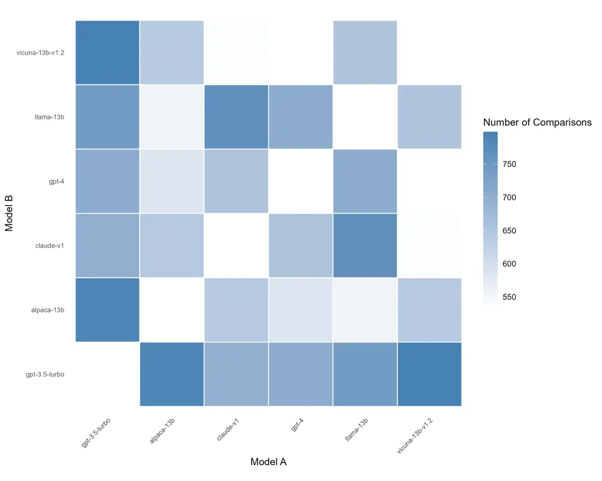

Figure A.1: Heatmap of the number of pairwise comparisons for the
MT-bench dataset.

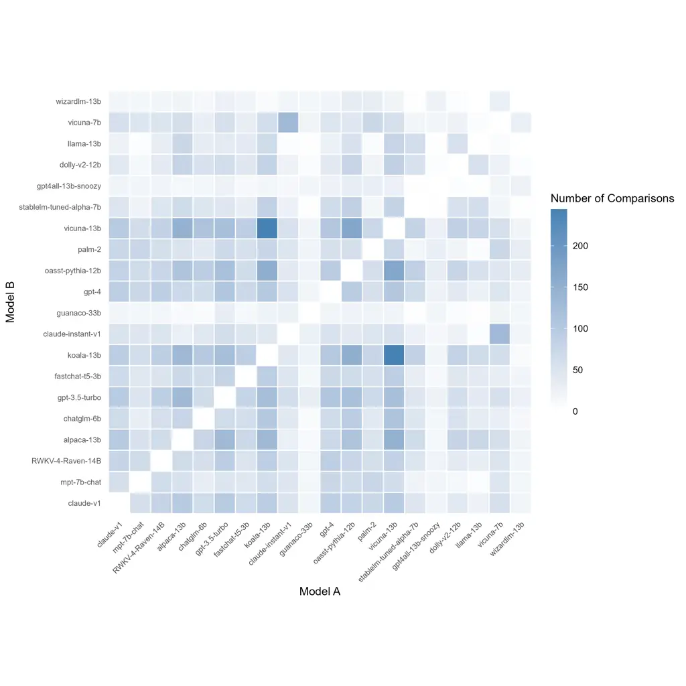

Figure A.2: Heatmap of the number of pairwise comparisons for the
Chatbot Arena dataset.

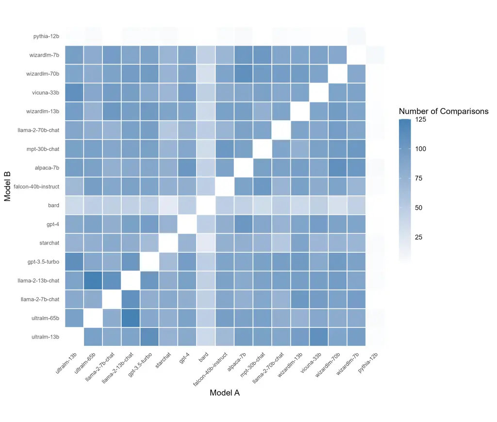

Figure A.3: Heatmap of the number of pairwise comparisons for the
UltraFeedback dataset.

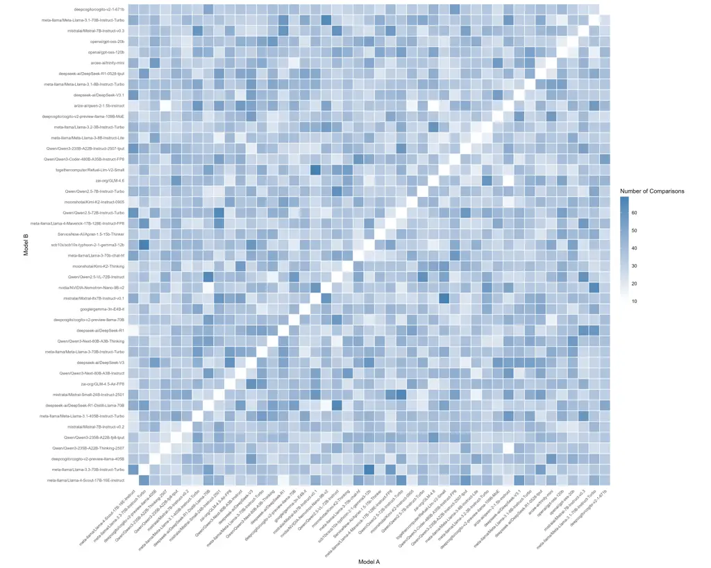

Figure A.4: Heatmap of the number of pairwise comparisons for the
in-house dataset.

## Appendix E Judge LLMs

### E.1 Selection

To study how different judge LLMs behave and to produce a diverse set of
automated judgments, we select 20 judge LLMs (see Table A.5) that cover
a range of model sizes, families, and apparent quality levels. The aim
is to include both strong and weaker judges so that our fitted pairwise
model can learn to accommodate systematic differences among judges. For
all judge LLMs, we fix the same decoding hyperparameters
($`\text{temperature}=0`$ and $`\text{maximum token limit}=1024`$) to
ensure consistency across judgments. We anonymize model names in the
prompts, so the judge cannot rely on the identity of the generating
model when making a preference decision.

| No. | Judge LLM (identifier)                            |
| --- | ------------------------------------------------- |
| 1   | openai/gpt-oss-20b                                |
| 2   | Qwen/Qwen3-235B-A22B-Instruct-2507-tput           |
| 3   | google/gemma-3n-E4B-it                            |
| 4   | meta-llama/Llama-4-Maverick-17B-128E-Instruct-FP8 |
| 5   | zai-org/GLM-4.5-Air-FP8                           |
| 6   | marin-community/marin-8b-instruct                 |
| 7   | mistralai/Mistral-7B-Instruct-v0.1                |
| 8   | arcee-ai/arcee-spotlight                          |
| 9   | kimi-k2-0905-preview                              |
| 10  | deepseek-chat                                     |
| 11  | meta-llama/Llama-3.3-70B-Instruct-Turbo           |
| 12  | Qwen/Qwen3-Next-80B-A3B-Instruct                  |
| 13  | deepseek-ai/DeepSeek-R1-Distill-Llama-70B         |
| 14  | deepcogito/cogito-v2-preview-llama-109B-MoE       |
| 15  | meta-llama/Llama-4-Scout-17B-16E-Instruct         |
| 16  | openai/gpt-oss-120b                               |
| 17  | kimi-k2-thinking-turbo                            |
| 18  | moonshot-v1-32k                                   |
| 19  | moonshot-v1-128k                                  |
| 20  | Qwen/Qwen2.5-7B-Instruct-Turbo                    |

Table A.5: Judge LLMs used in the experiments. Models were chosen to
span sizes, architectures and producers.

### E.2 Judge Prompt Template

We construct a single, fixed-format prompt that includes: (i) the
anonymized question, (ii) the two model responses labeled only as “Model
A Response” and “Model B Response”, and (iii) explicit instructions
asking the judge LLM to (a) choose its preferred response (“a”, “b”, or
“c” for tie), and (b) output a scalar confidence in $`[0,1]`$ indicating
its degree of preference. The instruction explicitly forbids the judge
from providing explanatory text or revealing the (anonymized) model
identities in its answer, thereby forcing a compact pairwise preference
plus confidence output. All judge LLMs receive the same template and
instructions, and we use identical decoding hyperparameters
(temperature, max tokens) across judges. The detailed prompt template is
shown in Figure A.5

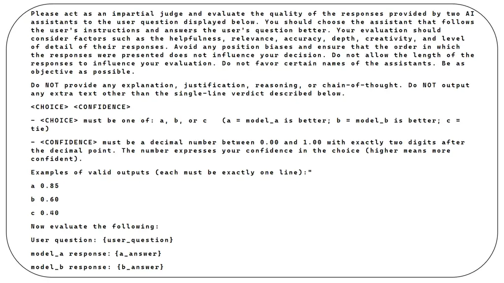

Figure A.5: Template of the prompt provided to the judge LLMs

## Appendix F Extra Results

### F.1 Comparison with Ultrafeedback ranking

Table A.6 summarizes the evaluation results on the UltraFeedback dataset
with 10K pairwise comparisons. The first three columns (AlpacaEval,
Evol-Instruct, UltraChat) report the scores directly taken from
UltraFeeback, while the last two columns show our model estimates:
$`\widehat{\mathbf{s}}_{u}`$ and $`\widehat{\mathbf{s}}_{w}`$. We
observe that the model rankings produced by our method generally align
with the UltraFeedback scores. For example, WizardLM-13B achieves high
scores across all three UltraFeedback metrics and attains the highest
estimated $`\widehat{\mathbf{s}}`$ in both the unweighted and weighted
versions, whereas ULTRALM-13B consistently shows lower preference and,
correspondingly, negative $`\widehat{\mathbf{s}}`$ values.

| Model        | Size | AlpacaEval | Evol-Instruct | UltraChat | $`\widehat{\mathbf{s}}_{u}`$ | $`\widehat{\mathbf{s}}_{w}`$ |
| ------------ | ---- | ---------- | ------------- | --------- | ---------------------------- | ---------------------------- |
| LLaMA2-13B   | 13B  | 81.1       | 44.1          | 34.5      | 0.09                         | 0.01                         |
| WizardLM-13B | 13B  | 89.2       | 55.5          | 59.7      | 0.29                         | 0.28                         |
| LLaMA2-70B   | 70B  | 92.7       | 56.4          | 54.0      | 0.23                         | 0.16                         |
| UltraLM-13B  | 13B  | 80.7       | 39.9          | 38.2      | -0.17                        | -0.09                        |
| Vicuna-33B   | 33B  | 89.0       | 50.0          | 57.7      | 0.25                         | 0.28                         |

Table A.6: Evaluation Results on UltraFeedback Data.
$`\widehat{\mathbf{s}}_{u}`$ denotes the estimated score under the
unweighted BTL model, and $`\widehat{\mathbf{s}}_{w}`$ denotes the
estimated score under the judge-aware weighted model.

### F.2 Rank-based Correlation Analysis

Based on Section 5.3, the rank-based results in Figure A.6 exhibit a
clear interaction between total sample size $`T`$ and judge budget
$`K`$. When the total number of pairwise comparisons is small,
increasing $`K`$ can degrade performance: with fixed $`T`$ the per-judge
contribution falls roughly as $`T/K`$, so larger $`K`$ produces noisier
individual-judge summaries and therefore a noisier aggregated ranking.
In other words, under a tight data budget, spreading comparisons across
many judges reduces the signal available from each judge and may harm
the estimated ranking.

By contrast, once the overall sample size is sufficiently large the
pattern reverses: larger $`K`$ monotonically improves rank correlations
with the gold reference. With ample comparisons per judge the additional
judges primarily reduce estimator variance and increase robustness to
idiosyncratic judge bias, so the aggregated ranking benefits from
greater panel diversity. These two regimes: a small-$`T`$ regime in
which a modest $`K`$ preserves per-judge signal, and a large-$`T`$
regime in which large $`K`$ reduces variance, suggest a practical
trade-off when allocating annotation budget and motivate choosing $`K`$
in proportion to the available sample size rather than fixing $`K`$
independently of $`T`$.

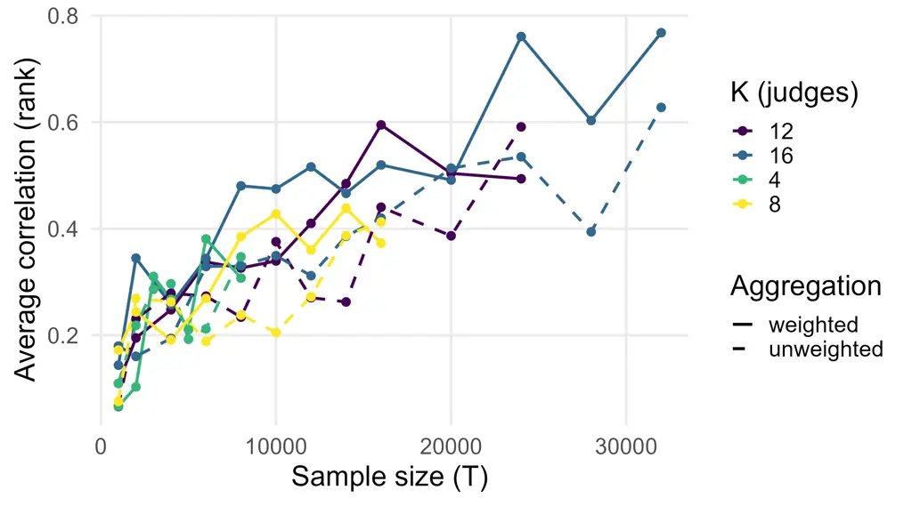

Figure A.6: Average Spearman correlation of rankings to the ground truth
across different numbers of judges and sample sizes.

### F.3 Complete Ranking on In-house Data

Table A.7 reports the complete ranking of the 45 models from the
in-house data, associated with the $`\widehat{\mathbf{s}}`$ estimated
from the weighted and unweighted models. The 95% confidence intervals of
the estimates and the ranking differences are also reported. Note that
the $`\widehat{\boldsymbol{\gamma}}`$ of GLM-4.5-Air-FP8 was
approximately 0, which caused numerical instability for confidence
interval calculation. Hence, it is excluded from the final calculation.

| Model                                             | $`\hat{s}_{w}`$ | $`\hat{s}_{u}`$ | CI$`{}_{w}^{\text{low}}`$ | CI$`{}_{w}^{\text{up}}`$ | CI$`{}_{u}^{\text{low}}`$ | CI$`{}_{u}^{\text{up}}`$ | rank\_(w) | rank\_(u) | rank$`{}_{\text{diff}}`$ |
| ------------------------------------------------- | --------------- | --------------- | ------------------------- | ------------------------ | ------------------------- | ------------------------ | --------- | --------- | ------------------------ |
| Qwen/Qwen3-Next-80B-A3B-Instruct                  | 0.747           | 0.949           | 0.597                     | 0.897                    | 0.839                     | 1.059                    | 1         | 1         | 0                        |
| openai/gpt-oss-120b                               | 0.637           | 0.827           | 0.505                     | 0.768                    | 0.719                     | 0.935                    | 2         | 2         | 0                        |
| moonshotai/Kimi-K2-Instruct-0905                  | 0.593           | 0.717           | 0.467                     | 0.719                    | 0.609                     | 0.826                    | 3         | 4         | 1                        |
| moonshotai/Kimi-K2-Thinking                       | 0.577           | 0.743           | 0.454                     | 0.700                    | 0.634                     | 0.852                    | 4         | 3         | -1                       |
| Qwen/Qwen3-235B-A22B-Instruct-2507-tput           | 0.520           | 0.697           | 0.406                     | 0.633                    | 0.591                     | 0.803                    | 5         | 5         | 0                        |
| zai-org/GLM-4.6                                   | 0.520           | 0.678           | 0.406                     | 0.633                    | 0.571                     | 0.785                    | 6         | 6         | 0                        |
| openai/gpt-oss-20b                                | 0.396           | 0.504           | 0.301                     | 0.491                    | 0.400                     | 0.607                    | 7         | 7         | 0                        |
| deepseek-ai/DeepSeek-V3.1                         | 0.360           | 0.463           | 0.269                     | 0.452                    | 0.359                     | 0.568                    | 8         | 9         | 1                        |
| deepseek-ai/DeepSeek-R1                           | 0.353           | 0.475           | 0.262                     | 0.443                    | 0.371                     | 0.579                    | 9         | 8         | -1                       |
| deepseek-ai/DeepSeek-R1-0528-tput                 | 0.323           | 0.354           | 0.237                     | 0.410                    | 0.252                     | 0.457                    | 10        | 12        | 2                        |
| deepseek-ai/DeepSeek-V3                           | 0.308           | 0.432           | 0.225                     | 0.391                    | 0.331                     | 0.534                    | 11        | 10        | -1                       |
| Qwen/Qwen3-Coder-480B-A35B-Instruct-FP8           | 0.254           | 0.367           | 0.175                     | 0.334                    | 0.262                     | 0.471                    | 12        | 11        | -1                       |
| Qwen/Qwen3-235B-A22B-fp8-tput                     | 0.226           | 0.232           | 0.152                     | 0.301                    | 0.130                     | 0.334                    | 13        | 17        | 4                        |
| Qwen/Qwen3-235B-A22B-Thinking-2507                | 0.224           | 0.255           | 0.145                     | 0.302                    | 0.148                     | 0.363                    | 14        | 16        | 2                        |
| arcee-ai/trinity-mini                             | 0.198           | 0.300           | 0.124                     | 0.272                    | 0.196                     | 0.404                    | 15        | 13        | -2                       |
| deepcogito/cogito-v2-1-671b                       | 0.170           | 0.255           | 0.097                     | 0.242                    | 0.150                     | 0.360                    | 16        | 15        | -1                       |
| google/gemma-3n-E4B-it                            | 0.156           | 0.266           | 0.085                     | 0.226                    | 0.162                     | 0.369                    | 17        | 14        | -3                       |
| Qwen/Qwen3-Next-80B-A3B-Thinking                  | 0.155           | 0.208           | 0.086                     | 0.224                    | 0.106                     | 0.309                    | 18        | 18        | 0                        |
| ServiceNow-AI/Apriel-1.5-15b-Thinker              | 0.144           | 0.204           | 0.074                     | 0.215                    | 0.100                     | 0.309                    | 19        | 19        | 0                        |
| deepcogito/cogito-v2-preview-llama-405B           | 0.115           | 0.144           | 0.046                     | 0.183                    | 0.040                     | 0.248                    | 20        | 22        | 2                        |
| deepcogito/cogito-v2-preview-llama-70B            | 0.114           | 0.173           | 0.047                     | 0.182                    | 0.071                     | 0.276                    | 21        | 21        | 0                        |
| zai-org/GLM-4.5-Air-FP8                           | 0.104           | 0.067           | 0.039                     | 0.170                    | -0.034                    | 0.168                    | 22        | 24        | 2                        |
| deepcogito/cogito-v2-preview-llama-109B-MoE       | 0.098           | 0.173           | 0.030                     | 0.167                    | 0.069                     | 0.278                    | 23        | 20        | -3                       |
| scb10x/scb10x-typhoon-2-1-gemma3-12b              | 0.040           | 0.121           | -0.023                    | 0.104                    | 0.019                     | 0.223                    | 24        | 23        | -1                       |
| Qwen/Qwen2.5-72B-Instruct-Turbo                   | 0.005           | 0.026           | -0.059                    | 0.068                    | -0.074                    | 0.126                    | 25        | 25        | 0                        |
| mistralai/Mistral-Small-24B-Instruct-2501         | -0.037          | -0.025          | -0.101                    | 0.028                    | -0.124                    | 0.075                    | 26        | 26        | 0                        |
| meta-llama/Meta-Llama-3.1-405B-Instruct-Turbo     | -0.079          | -0.088          | -0.142                    | -0.015                   | -0.186                    | 0.010                    | 27        | 27        | 0                        |
| meta-llama/Llama-4-Scout-17B-16E-Instruct         | -0.098          | -0.121          | -0.164                    | -0.031                   | -0.223                    | -0.020                   | 28        | 28        | 0                        |
| meta-llama/Llama-4-Maverick-17B-128E-Instruct-FP8 | -0.105          | -0.140          | -0.172                    | -0.038                   | -0.244                    | -0.037                   | 29        | 29        | 0                        |
| meta-llama/Llama-3.3-70B-Instruct-Turbo           | -0.109          | -0.123          | -0.176                    | -0.042                   | -0.225                    | -0.021                   | 30        | 30        | 0                        |
| meta-llama/Meta-Llama-3-70B-Instruct-Turbo        | -0.111          | -0.137          | -0.176                    | -0.046                   | -0.236                    | -0.038                   | 31        | 31        | 0                        |
| meta-llama/Llama-3-70b-chat-hf                    | -0.125          | -0.169          | -0.193                    | -0.056                   | -0.271                    | -0.068                   | 32        | 32        | 0                        |
| meta-llama/Meta-Llama-3.1-70B-Instruct-Turbo      | -0.171          | -0.240          | -0.243                    | -0.100                   | -0.342                    | -0.138                   | 33        | 33        | 0                        |
| Qwen/Qwen2.5-7B-Instruct-Turbo                    | -0.259          | -0.355          | -0.340                    | -0.179                   | -0.459                    | -0.252                   | 34        | 34        | 0                        |
| deepseek-ai/DeepSeek-R1-Distill-Llama-70B         | -0.307          | -0.452          | -0.393                    | -0.220                   | -0.557                    | -0.347                   | 35        | 35        | 0                        |
| nvidia/NVIDIA-Nemotron-Nano-9B-v2                 | -0.393          | -0.620          | -0.489                    | -0.297                   | -0.726                    | -0.513                   | 36        | 38        | 2                        |
| Qwen/Qwen2.5-VL-72B-Instruct                      | -0.411          | -0.565          | -0.510                    | -0.313                   | -0.670                    | -0.461                   | 37        | 36        | -1                       |
| meta-llama/Meta-Llama-3.1-8B-Instruct-Turbo       | -0.468          | -0.589          | -0.574                    | -0.362                   | -0.693                    | -0.486                   | 38        | 37        | -1                       |
| mistralai/Mixtral-8x7B-Instruct-v0.1              | -0.500          | -0.632          | -0.612                    | -0.388                   | -0.739                    | -0.525                   | 39        | 39        | 0                        |
| meta-llama/Meta-Llama-3-8B-Instruct-Lite          | -0.534          | -0.662          | -0.654                    | -0.415                   | -0.775                    | -0.549                   | 40        | 40        | 0                        |
| meta-llama/Llama-3.2-3B-Instruct-Turbo            | -0.564          | -0.738          | -0.686                    | -0.442                   | -0.847                    | -0.628                   | 41        | 41        | 0                        |
| mistralai/Mistral-7B-Instruct-v0.3                | -0.587          | -0.837          | -0.712                    | -0.461                   | -0.947                    | -0.728                   | 42        | 43        | 1                        |
| mistralai/Mistral-7B-Instruct-v0.2                | -0.608          | -0.802          | -0.738                    | -0.479                   | -0.913                    | -0.691                   | 43        | 42        | -1                       |
| togethercomputer/Refuel-Llm-V2-Small              | -0.783          | -1.070          | -0.941                    | -0.625                   | -1.187                    | -0.952                   | 44        | 44        | 0                        |
| arize-ai/qwen-2-1.5b-instruct                     | -1.089          | -1.263          | -1.301                    | -0.878                   | -1.384                    | -1.141                   | 45        | 45        | 0                        |

Table A.7: Comparison of weighted and unweighted rankings with 95%
confidence intervals. Subscripts $`u`$ and $`w`$ denote the unweighted
and weighted fits, respectively.

### F.4 Robustness to Tie Handling

The resulting rankings remain unchanged on MT-Bench, Chatbot Arena, and
UltraFeedback. On the in-house dataset, only two local swaps occur:
Qwen/Qwen3-Next-80B-A3B-Thinking exchanges position with
google/gemma-3n-E4B-it, and deepcogito/cogito-v2-preview-llama-70B
exchanges position with deepcogito/cogito-v2-preview-llama-405B. The
uncertainty estimates are also stable: the average confidence interval
width on the in-house dataset increases only modestly, from $`0.185`$ to
$`0.195`$, as expected because removing ties reduces the effective
number of comparisons.

### F.5 Results on Judges

We investigated whether judge-specific discrimination scales
($`\widehat{\boldsymbol{\gamma}}`$) correlate with model size (number of
parameters). Table A.8 lists the fitted
$`\widehat{\boldsymbol{\gamma}}`$ values for the two evaluation datasets
(MT-bench and UltraFeedback) and the approximate model sizes where
publicly available.

Figure A.7 presents model parameter count (log-scale) vs.
$`\widehat{\boldsymbol{\gamma}}`$. Here we observe that larger models
(by parameter count) tend to have larger discrimination in some cases,
though the relationship is noisy and not monotonic: certain very large
models exhibit modest $`\widehat{\boldsymbol{\gamma}}`$ while some
mid-sized models show high $`\widehat{\boldsymbol{\gamma}}`$. This
heterogeneity indicates that parameter count alone is an insufficient
predictor of judge discrimination; training recipe and
alignment/post-processing decisions likely play a major role.

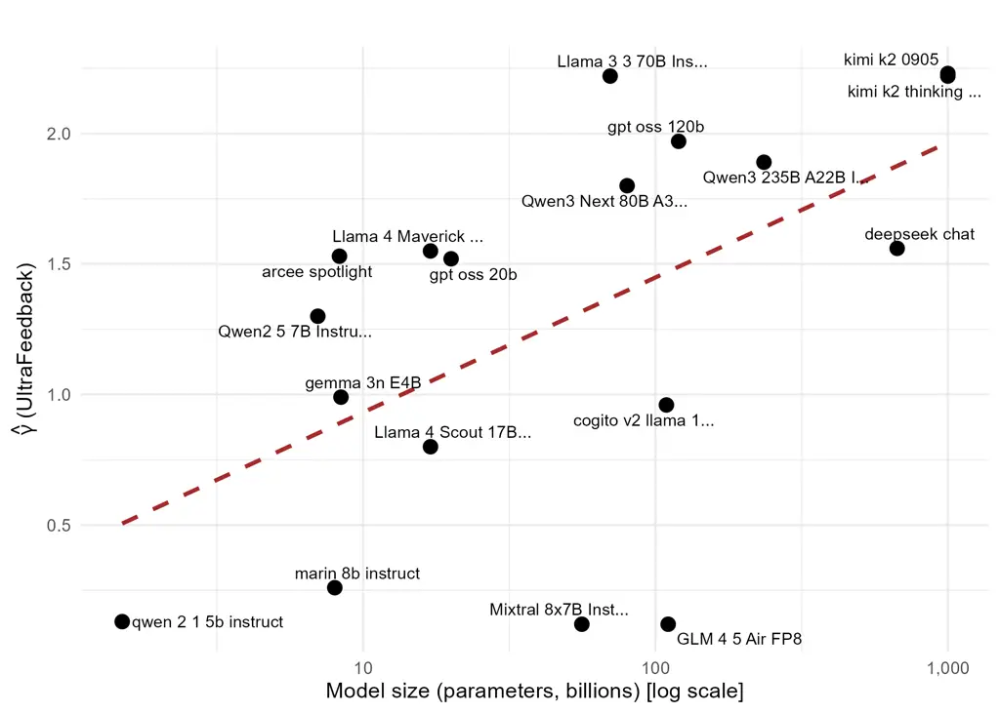

Figure A.7: Model size vs judge discrimination (UltraFeedback).

Figure A.8 directly compares $`\widehat{\boldsymbol{\gamma}}`$ estimated
on MT-bench against $`\widehat{\boldsymbol{\gamma}}`$ estimated on
UltraFeedback for the same judges. The two estimates are strongly
positively correlated (points cluster near the diagonal), indicating
that judge-specific discrimination is largely stable across these two
evaluation datasets. Nevertheless, several judges show dataset-specific
adjustments (points deviating from the diagonal), which suggests that
dataset composition and prompt types modulate judge sharpness.

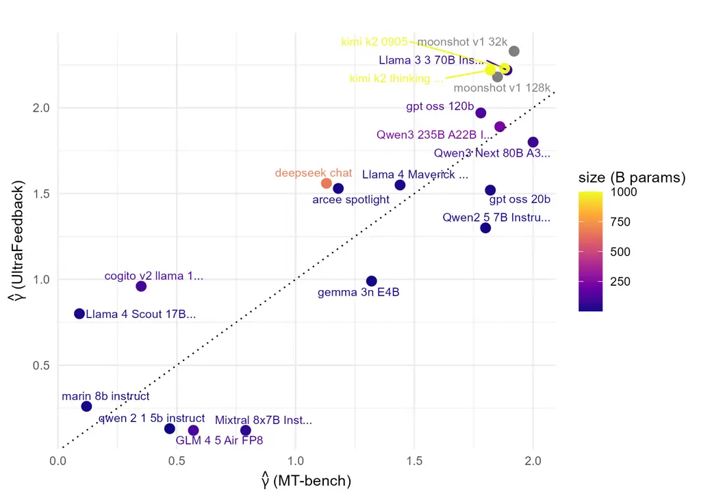

Figure A.8: Judge discrimination: MT-bench vs UltraFeedback.

A positive correlation between pretraining token count and
$`\widehat{\boldsymbol{\gamma}}`$ does not prove that more tokens cause
judges to be more discriminative; other confounders (model architecture,
pretraining corpus composition, alignment/finetuning procedures,
temperature/hyperparameter choices at inference time) can explain the
association. Moreover, judge discrimination is relatively stable across
MT-bench and UltraFeedback (see Figure A.9), which supports using a
single estimated $`\widehat{\boldsymbol{\gamma}}`$ when integrating
multiple judge outputs. However, for high-stakes evaluation, one should
prefer judges with consistently high and dataset-robust
$`\widehat{\boldsymbol{\gamma}}`$.

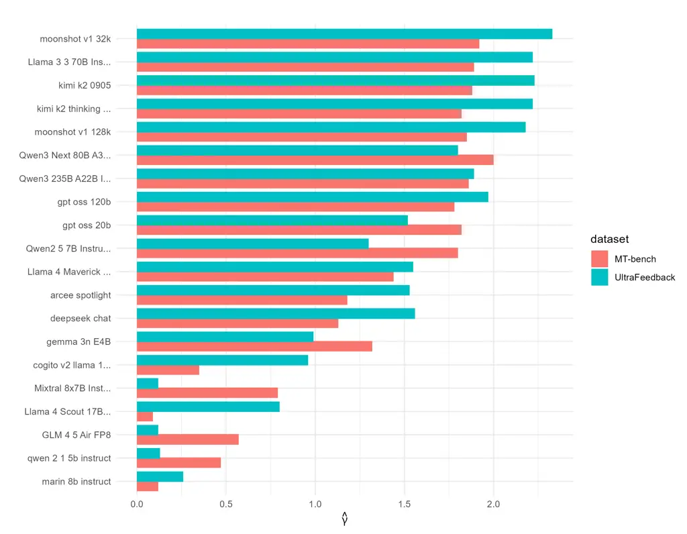

Figure A.9: Judge discrimination scales by model and dataset.

| Model                                  | Size   | Tokens | MT-bench | UltraFeedback |
| -------------------------------------- | ------ | ------ | -------- | ------------- |
| kimi-k2-0905                           | 1T     | –      | 1.88     | 2.23          |
| kimi-k2-thinking-turbo                 | 1T     | –      | 1.82     | 2.22          |
| deepseek-chat                          | 671B   | 14.8T  | 1.13     | 1.56          |
| Qwen3-235B-A22B-Instruct-2507-tput     | 235B   | 15T    | 1.86     | 1.89          |
| gpt-oss-120b                           | 120B   | –      | 1.78     | 1.97          |
| GLM-4.5-Air-FP8                        | 110.5B | –      | 0.57     | 0.12          |
| cogito-v2-llama-109B-MoE               | 109B   | –      | 0.35     | 0.96          |
| Qwen3-Next-80B-A3B-Instruct            | 80B    | –      | 2.00     | 1.80          |
| Llama-3.3-70B-Instruct-Turbo           | 70B    | 15T    | 1.89     | 2.22          |
| Mixtral-8x7B-Instruct-v0.1             | 56B    | –      | 0.79     | 0.12          |
| gpt-oss-20b                            | 20B    | –      | 1.82     | 1.52          |
| Llama-4-Maverick-17B-128E-Instruct-FP8 | 17B    | –      | 1.44     | 1.55          |
| Llama-4-Scout-17B-16E-Instruct         | 17B    | –      | 0.09     | 0.80          |
| gemma-3n-E4B                           | 8.4B   | –      | 1.32     | 0.99          |
| arcee-spotlight                        | 8.3B   | –      | 1.18     | 1.53          |
| marin-8b-instruct                      | 8B     | 13.7T  | 0.12     | 0.26          |
| Qwen2.5-7B-Instruct-Turbo              | 7B     | 18T    | 1.80     | 1.30          |
| qwen-2-1.5b-instruct                   | 1.5B   | –      | 0.47     | 0.13          |
| moonshot-v1-32k                        | –      | –      | 1.92     | 2.33          |
| moonshot-v1-128k                       | –      | –      | 1.85     | 2.18          |

Table A.8: Estimated judge-specific discrimination scales
($`\widehat{\boldsymbol{\gamma}}`$).

### F.6 Length-Augmented Judge Discrimination

#### F.6.1 Model

For each comparison $`t`$, let $`q_{t}`$ denote the associated question
and define

```math
\ell_{t}=\log\{1+\operatorname{len}(q_{t})\},\qquad z_{t}=\frac{\ell_{t}-\bar{\ell}}{\widehat{\operatorname{sd}}(\ell)},
```

where $`\operatorname{len}(q_{t})`$ is the question length and $`z_{t}`$
is the standardized log length.

We parameterize the judge-specific scale as

```math
\gamma_{k}(z_{t})=\exp(\alpha_{k}+\beta_{k}z_{t}),
```

where $`\alpha_{k}`$ is the baseline log-discrimination of judge $`k`$
at average question length and $`\beta_{k}`$ captures how the
discrimination scale changes with question length. The comparison model
becomes

```math
\mathbb{P}(Y_{t}=1\mid i_{t},j_{t},k_{t},z_{t})=\sigma\!\left(\exp(\alpha_{k_{t}}+\beta_{k_{t}}z_{t})(s_{i_{t}}-s_{j_{t}})\right).
```

The scalar judge-aware BTL model is recovered as the special case
$`\beta_{k}=0`$ for all judges.

#### F.6.2 Identifiability

The identifiable judge-scale object in the length-augmented extension is
the function

```math
\gamma_{k}(z)=\exp(\alpha_{k}+\beta_{k}z)
```

over the observed covariate support.

###### Theorem F.1 (Identifiability up to location-scale transformations).

Consider the length-augmented judge-aware BTL model

```math
\Pr(Y=1\mid i,j,k,z)=\sigma\!\left(\exp(\alpha_{k}+\beta_{k}z)(s_{i}-s_{j})\right),
```

where $`s\in\mathbb{R}^{N}`$, $`\alpha,\beta\in\mathbb{R}^{K}`$, and
$`\sigma(x)=(1+e^{-x})^{-1}`$.

Suppose that Assumption 3.1 holds. Suppose also that the covariate
support contains at least two distinct values $`z_{1}\neq z_{2}`$, and
that the comparison probabilities are identified for all $`i\neq j`$,
all $`k\in[K]`$, and all $`z\in\{z_{1},z_{2}\}`$.

If two parameter triples $`(s,\alpha,\beta)`$ and
$`(\widetilde{s},\widetilde{\alpha},\widetilde{\beta})`$ induce the same
comparison probabilities, namely

```math
\sigma\!\left(\exp(\alpha_{k}+\beta_{k}z)(s_{i}-s_{j})\right)=\sigma\!\left(\exp(\widetilde{\alpha}_{k}+\widetilde{\beta}_{k}z)(\widetilde{s}_{i}-\widetilde{s}_{j})\right)
```

for all $`i\neq j`$, all $`k\in[K]`$, and all $`z\in\{z_{1},z_{2}\}`$,
then there exist constants $`a>0`$ and $`b\in\mathbb{R}`$ such that

```math
\widetilde{s}=as+b\mathbf{1},\qquad\widetilde{\alpha}_{k}=\alpha_{k}-\log a,\qquad\widetilde{\beta}_{k}=\beta_{k},\quad k=1,\ldots,K.
```

Conversely, any transformation of this form leaves all comparison
probabilities unchanged.

###### Proof.

Since the logistic link $`\sigma`$ is strictly increasing, equality of
comparison probabilities implies equality of the linear predictors:

```math
\exp(\alpha_{k}+\beta_{k}z)(s_{i}-s_{j})=\exp(\widetilde{\alpha}_{k}+\widetilde{\beta}_{k}z)(\widetilde{s}_{i}-\widetilde{s}_{j})
```

for all $`i\neq j`$, all $`k\in[K]`$, and all $`z\in\{z_{1},z_{2}\}`$.
Hence, for each fixed pair $`(k,z)`$,

```math
\widetilde{s}_{i}-\widetilde{s}_{j}=c_{k,z}(s_{i}-s_{j}),\qquad c_{k,z}=\exp\!\left(\alpha_{k}+\beta_{k}z-\widetilde{\alpha}_{k}-\widetilde{\beta}_{k}z\right)>0.
```

Therefore, for each fixed $`(k,z)`$, there exists a constant
$`b_{k,z}\in\mathbb{R}`$ such that

```math
\widetilde{s}_{i}=c_{k,z}s_{i}+b_{k,z},\qquad i=1,\ldots,N.
```

Because the same vector $`\widetilde{s}`$ must satisfy this affine
representation for every $`(k,z)`$, the slope $`c_{k,z}`$ cannot depend
on $`(k,z)`$. Indeed, for two pairs $`(k,z)`$ and $`(\ell,z^{\prime})`$,

```math
(c_{k,z}-c_{\ell,z^{\prime}})s_{i}+(b_{k,z}-b_{\ell,z^{\prime}})=0,\qquad i=1,\ldots,N.
```

Taking two indices $`i_{1},i_{2}`$ with $`s_{i_{1}}\neq s_{i_{2}}`$
gives

```math
(c_{k,z}-c_{\ell,z^{\prime}})(s_{i_{1}}-s_{i_{2}})=0,
```

and hence $`c_{k,z}=c_{\ell,z^{\prime}}`$. Thus there exist common
constants $`a>0`$ and $`b\in\mathbb{R}`$ such that

```math
\widetilde{s}=as+b\mathbf{1}.
```

Substituting this relation back into the equality of linear predictors
gives, for all $`k`$ and $`z\in\{z_{1},z_{2}\}`$,

```math
\exp(\alpha_{k}+\beta_{k}z)=a\exp(\widetilde{\alpha}_{k}+\widetilde{\beta}_{k}z).
```

Taking logarithms yields

```math
\alpha_{k}+\beta_{k}z=\log a+\widetilde{\alpha}_{k}+\widetilde{\beta}_{k}z.
```

Evaluating this identity at $`z_{1}`$ and $`z_{2}`$ and subtracting
gives

```math
(\beta_{k}-\widetilde{\beta}_{k})(z_{1}-z_{2})=0.
```

Since $`z_{1}\neq z_{2}`$, we obtain

```math
\widetilde{\beta}_{k}=\beta_{k}.
```

Substituting this back gives

```math
\widetilde{\alpha}_{k}=\alpha_{k}-\log a.
```

This proves the necessity.

Conversely, if

```math
\widetilde{s}=as+b\mathbf{1},\qquad\widetilde{\alpha}_{k}=\alpha_{k}-\log a,\qquad\widetilde{\beta}_{k}=\beta_{k},
```

then

```math
\exp(\widetilde{\alpha}_{k}+\widetilde{\beta}_{k}z)(\widetilde{s}_{i}-\widetilde{s}_{j})=\exp(\alpha_{k}-\log a+\beta_{k}z)a(s_{i}-s_{j})=\exp(\alpha_{k}+\beta_{k}z)(s_{i}-s_{j}).
```

Therefore all comparison probabilities are unchanged. ∎

###### Corollary F.2 (Uniqueness under normalization).

Under the conditions of the theorem, impose the normalization
constraints

```math
\sum_{i=1}^{N}s_{i}=0,\qquad\sum_{k=1}^{K}\alpha_{k}=0.
```

Then the length-augmented model is identifiable. That is, if two
normalized parameter triples induce the same comparison probabilities,
then

```math
\widetilde{s}=s,\qquad\widetilde{\alpha}=\alpha,\qquad\widetilde{\beta}=\beta.
```

###### Proof.

By Theorem F.1, there exist $`a>0`$ and $`b\in\mathbb{R}`$ such that

```math
\widetilde{s}=as+b\mathbf{1},\qquad\widetilde{\alpha}_{k}=\alpha_{k}-\log a,\qquad\widetilde{\beta}_{k}=\beta_{k}.
```

Using $`\sum_{i}s_{i}=\sum_{i}\widetilde{s}_{i}=0`$, we have

```math
0=\sum_{i=1}^{N}\widetilde{s}_{i}=a\sum_{i=1}^{N}s_{i}+Nb=Nb,
```

so $`b=0`$. Using
$`\sum_{k}\alpha_{k}=\sum_{k}\widetilde{\alpha}_{k}=0`$, we have

```math
0=\sum_{k=1}^{K}\widetilde{\alpha}_{k}=\sum_{k=1}^{K}\alpha_{k}-K\log a=-K\log a.
```

Thus $`a=1`$. Therefore

```math
\widetilde{s}=s,\qquad\widetilde{\alpha}=\alpha,\qquad\widetilde{\beta}=\beta.
```

∎

#### F.6.3 Algorithm

For the length-augmented model, we use the same projected Adam scheme as
Algorithm A.1, but replace the linear predictor by

```math
\eta_{t}=\exp(\alpha_{k_{t}}+\beta_{k_{t}}z_{t})(s_{i_{t}}-s_{j_{t}}).
```

The gradients are accumulated over row-level observations because
$`z_{t}`$ may vary across comparisons. The projection step is applied
only to $`s`$ and $`\alpha`$, while $`\beta`$ is updated without
centering.

For a single observation, define

```math
\ell_{t}=y_{t}\log\sigma(\eta_{t})+(1-y_{t})\log\{1-\sigma(\eta_{t})\}.
```

The additional gradient contribution for $`\beta_{k}`$ is

```math
\frac{\partial\ell_{t}}{\partial\beta_{k}}=\mathbf{1}\{k_{t}=k\}(y_{t}-\sigma(\eta_{t}))\eta_{t}z_{t}.
```

#### F.6.4 Empirical Results

We fit the length-augmented model on the in-house dataset. Figure A.10
shows the estimated discrimination curves $`\gamma_{k}(z)`$ for four
representative judges. Judges differ substantially in both baseline
discrimination and sensitivity to question length: some judges have
larger estimated discrimination on longer questions
$`(\widehat{\beta}_{k}>0)`$, some have smaller estimated discrimination
$`(\widehat{\beta}_{k}<0)`$, and some remain largely unaffected
$`(\widehat{\beta}_{k}\approx 0)`$.

The resulting model rankings are nearly identical to those from the
scalar judge-aware model: the Spearman rank correlation across the
$`45`$ candidate models is $`0.9996`$, and the maximum absolute rank
change is only one position. This confirms that the scalar model’s main
leaderboard conclusions are robust, while illustrating that question
length can be incorporated as one natural observable covariate in the
proposed framework.

These estimates should be interpreted as a proof of concept rather than
causal evidence: in this design, question length is tied to the specific
question and model-pair instance, and may therefore reflect question
difficulty or pair-specific effects.

Figure A.10: Representative estimated judge-discrimination curves
$`\gamma_{k}(z)=\exp(\alpha_{k}+\beta_{k}z)`$ as a function of
standardized log question length $`z`$. Dashed vertical lines indicate
the $`25`$th and $`75`$th percentiles of $`z`$. Judges vary
substantially in both baseline discrimination and sensitivity to
question length.

### F.7 Robustness to Sparse Comparison Graphs

The main framework assumes a well-covered comparison graph. To assess
robustness to sparser designs, we fix the total number of comparisons
and vary the fraction of retained model-pair edges. Let
$`E_{\mathrm{full}}`$ denote the complete set of model-pair edges and
$`E_{\mathrm{sp}}\subseteq E_{\mathrm{full}}`$ denote the retained
connected edge set. We define the retained edge fraction as

```math
\rho_{\mathrm{edge}}=\frac{|E_{\mathrm{sp}}|}{|E_{\mathrm{full}}|}.
```

For each value of $`\rho_{\mathrm{edge}}`$, we retain a random connected
subgraph, evenly redistribute the fixed comparison budget across the
retained edges, refit the judge-aware model, and compare the resulting
ranking against that from the full design using Pearson and Spearman
correlations. Table A.9 reports the results. Correlation is lowest in
the spanning-tree regime $`(\rho_{\mathrm{edge}}=0.044)`$, where both
correlations are $`0.613`$. As the graph becomes modestly denser, both
correlations rise quickly above $`0.8`$ and remain high over a broad
range of connected sparse designs.

| $`\rho_{\mathrm{edge}}`$ | Pearson | Spearman |
| ------------------------ | ------- | -------- |
| 0.044                    | 0.613   | 0.613    |
| 0.089                    | 0.835   | 0.817    |
| 0.133                    | 0.877   | 0.858    |
| 0.178                    | 0.896   | 0.872    |
| 0.222                    | 0.887   | 0.815    |
| 0.267                    | 0.927   | 0.909    |
| 0.311                    | 0.916   | 0.906    |
| 0.356                    | 0.868   | 0.816    |
| 0.400                    | 0.911   | 0.897    |
| 0.444                    | 0.884   | 0.887    |

Table A.9: Pearson and Spearman correlations between rankings from
sparse and full designs. The retained edge fraction
$`\rho_{\mathrm{edge}}`$ is the fraction of model-pair edges kept in the
connected sparse graph.

These results suggest that, although extremely sparse connected designs
can reduce stability, the method remains fairly stable over a broad
range of sparse but connected comparison graphs that depart
substantially from the idealized setting.
