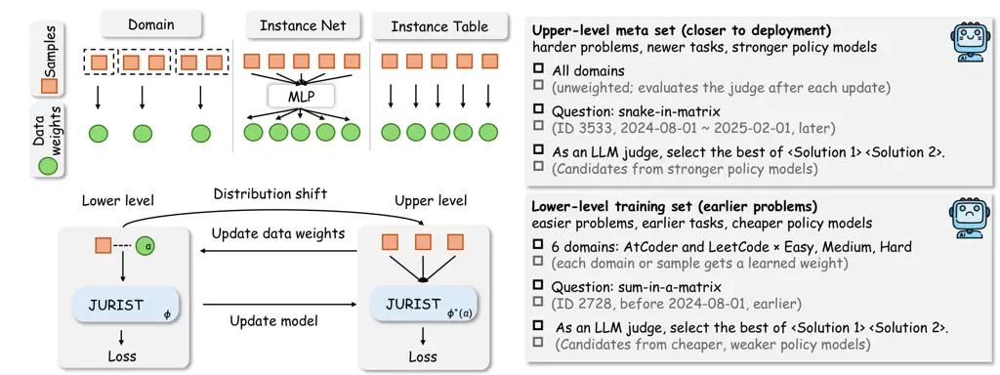
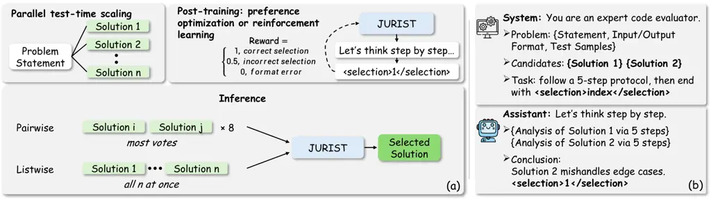
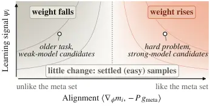
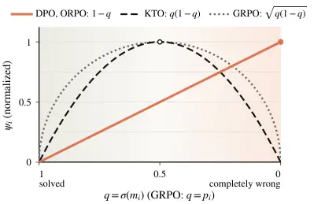
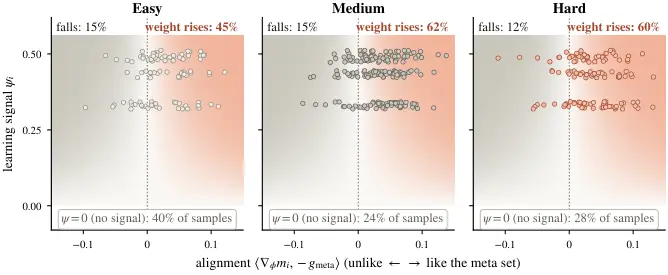
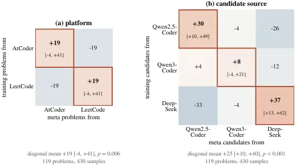

# JURIST: Training Small Data-Reweighted Reasoning Judges for Test-Time Scaling in Code Generation

Peijia Qin    Ruiyi Zhang    Qi Cao    Pengtao Xie
Affiliation: University of California, San Diego

###### Abstract

Best-of-N selection for code generation is only as good as the judge
that picks among the candidates, and the judges accurate enough for this
role are costly frontier LLMs. A small judge can be trained on abundant
earlier data labeled by unit tests, but it is deployed on newer
problems: _the earlier problems are easier and teach it little, their
tasks differ, and their candidates come from weaker policies_, while
data close to deployment are scarce. We present JURIST, a 1.7B reasoning
judge that uses a small meta set close to deployment to learn how much
each earlier training sample should count. In our experiments, we find
that training on the meta set alone, or adding it to the training data,
does not help, while using it to weight the earlier data through a
bi-level objective adds 3.9 Hard points over adding it to the training
data. On LiveCodeBench, JURIST reaches 84.7% Overall and matches Claude
Sonnet 4.6 on Hard problems (73.8%) at 463$`\times`$ lower cost; on
BigCodeBench, it surpasses all test-time scaling baselines (35.9%).
Abundant earlier data, guided by a small deployment-aligned meta set,
can thus train a compact judge that selects accurately at low cost.

^(†)^(†)footnotetext: Correspondence to: Pengtao Xie
$`<`$p1xie@ucsd.edu$`>`$. Preprint. November 8, 2026.

## 1 Introduction

Figure 1: Cost-accuracy comparison among LLM judges on LiveCodeBench
Hard problems. The x-axis is logarithmic; marker area grows with model
size.

Test-time scaling (TTS) spends additional inference-time computation to
improve the outputs of large language models (LLMs) on coding
tasks (Zhang et al., 2025b; Snell et al., 2025; Jaech et al., 2024; Guo
et al., 2025). Selection-based TTS such as Best-of-N (Irvine et al., 2023) samples multiple candidates and lets a judge select one, so the
judge bounds the gain. LLM-as-a-Judge methods use LLMs themselves as
this judge and reason about the candidates before selecting (Zheng
et al., 2023; Wu et al., 2025).



Figure 2: Bi-level data-reweighted training framework.



Figure 3: How JURIST is trained and how it selects a candidate at
inference (a), with its prompt and output (b).

However, training an LLM judge for code generation is hard because _its
training data differ from the data it meets at deployment_. On
LiveCodeBench, which releases new problems over time, a judge trained on
the earlier problems is deployed on the later ones, and the two sets
differ in three ways. The earlier problems are easier, and an untrained
judge already solves many easy problems in every judgment, so they teach
it little (_difficulty mismatch_). Medium and hard problems still teach
it (Appendix G), and they make up 76.3% of the 131 test problems. The
training tasks also differ from the target tasks (_task mismatch_), and
the training candidates, the solutions and reasoning trajectories
written by the _policy models_, come from cheaper, weaker policy models
than the test candidates (_trajectory mismatch_).

We propose JURIST, a small JUdge from Reasoning, Importance reweighting,
and Selection Training, to address these shifts without discarding the
earlier data (Figure 2). The key to an effective small judge is learning
which training samples improve its decisions on the candidates it will
face. JURIST keeps the earlier data and uses the few data close to
deployment as a _meta set_ that learns a weight for each training
sample; the meta set holds harder problems, tasks closer to the
test-time tasks, and candidates from stronger models. These data are too
few to train on: training on the meta set alone lowers Hard accuracy by
2.3 points and pooling it with the training data does not raise it,
while using it to weight the training data raises it by 2.6 points
(Section 4.5). A weight rises when the judge can still learn from the
sample (its _learning signal_) and learning from it lowers the loss on
the meta set (the _alignment_ of its gradient with the meta-loss
gradient; Section 3). The learned weights therefore move training toward
the problems that still teach the judge and address the three shifts at
once. In the middle of training, the weight rises for 62% of medium and
60% of hard training problems, against 45% of easy ones (Appendix G).

Code needs no annotation: unit tests tell whether the judge selects a
passing candidate on every training and meta sample, and this one
outcome defines both the judge’s training loss and the meta loss
(Figure 3). With 1.7B parameters, JURIST outperforms every test-time
scaling baseline on LiveCodeBench and BigCodeBench (Figure 5), and its
bi-level training adds only 20.36% wall-clock over single-level
training, about 16 hours on $`2\times`$A100.

|                                        |                |          |                  |            |               |          |                   |
| -------------------------------------- | -------------- | -------- | ---------------- | ---------- | ------------- | -------- | ----------------- |
|                                        | \(i\) Explains |          | \(ii\) Execution |            | \(iii\) Shift |          | (iv) Cost         |
| Method                                 | Reasoning      | Compares | Exec. labels     | Outcome RL | Domain        | Instance | Size              |
| Generative judges                      |                |          |                  |            |               |          |                   |
| Auto-J (Li et al., 2024)               | ✓              | ✓        | ✗                | ✗          | ✗             | ✗        | 13B               |
| Prometheus 2 (Kim et al., 2024)        | ✓              | ✓        | ✗                | ✗          | ✗             | ✗        | 7B, 8$`\times`$7B |
| Self-Taught Eval. (Wang et al., 2024b) | ✓              | ✓        | ✓                | ✗          | ✗             | ✗        | 70B               |
| GenRM (Zhang et al., 2025a)            | ✓              | ✗        | ✓                | ✗          | ✗             | ✗        | 2B–9B             |
| DeepSeek GRM (Liu et al., 2025b)       | ✓              | ✓        | ✗                | ✓          | ✗             | ✗        | 16B–671B          |
| JudgeLRM (Chen et al., 2025a)          | ✓              | ✓        | ✗                | ✓          | ✗             | ✗        | 3B–14B            |
| J1 (Whitehouse et al., 2025)           | ✓              | ✓        | ✓                | ✓          | ✗             | ✗        | 8B–70B            |
| RM-R1 (Chen et al., 2025b)             | ✓              | ✓        | ✗                | ✓          | ✗             | ✗        | 7B–32B            |
| Scalar reward models                   |                |          |                  |            |               |          |                   |
| PRM800K PRM (Lightman et al., 2024)    | ✗              | ✗        | ✗                | ✗          | ✗             | ✗        | GPT-4             |
| Math-Shepherd (Wang et al., 2024a)     | ✗              | ✗        | ✓                | ✗          | ✗             | ✗        | 7B–70B            |
| FunPRM (Zhang et al., 2026)            | ✗              | ✗        | ✓                | ✗          | ✗             | ✓        | 7B                |
| DreamPRM (Cao et al., 2025)            | ✗              | ✗        | ✓                | ✗          | ✓             | ✗        | 2B                |
| DreamPRM-1.5 (Cao and Xie, 2025)       | ✗              | ✗        | ✓                | ✗          | ✗             | ✓        | 1B                |
| JURIST (ours)                          | ✓              | ✓        | ✓                | ✓          | ✓             | ✓        | 1.7B, 14B         |

Table 1: Prior work on code Best-of-N selection against the four
requirements of Appendix A. ✓   : holds in part.

Our main contributions are:

- •
  Data reweighting for generative judges. We show that the training data
  of a generative judge can be steered toward deployment by weights
  learned against a small meta set, and that the meta gradient of each
  weight factors into a learning signal and an alignment.
- •
  A small judge that matches a frontier judge on Hard problems. On
  LiveCodeBench, our 1.7B judge matches the Hard accuracy of Claude
  Sonnet 4.6 under the same pairwise protocol (73.8%) at 463$`\times`$
  lower cost (Figure 1), and outperforms 16B and 7B reward models
  (Figure 5).
- •
  Learned weights improve Hard selection under every objective. Domain
  reweighting raises Hard accuracy under all four training objectives,
  and every reweighting strategy improves or matches the judge without
  reweighting (Tables 7, 9 and 16). Training on the meta set alone,
  pooling it with the training set, fine-tuning on the strong-policy
  data, a domain filter, or fixed heuristic weights each fall 2.0–5.7
  Hard points short (Sections 4.5 and 9).

## 2 Related Work

JURIST is most related to three areas of prior work. _LLM-as-a-Judge_
methods write their reasoning before the verdict and are trained on
preference data, on synthetic pairs, or by reinforcement learning
against a reward that checks the verdict (Zheng et al., 2023; Li et al.,
2024; Kim et al., 2024; Wang et al., 2024b; Zhang et al., 2025a; Liu
et al., 2025b; Chen et al., 2025a; Whitehouse et al., 2025; Chen et al.,
2025b). _Test-time scaling_ spends more inference compute through longer
reasoning or many sampled candidates, and outcome and process reward
models score the candidates to select one (Wei et al., 2022; Guo et al.,
2025; Brown et al., 2024; Snell et al., 2025; Cobbe et al., 2021;
Lightman et al., 2024; Wang et al., 2024a; He et al., 2024; Zhang
et al., 2026). _Data reweighting_ learns how much each training sample
or data domain contributes to the loss, for classifiers and for
language-model pretraining (Ren et al., 2018; Shu et al., 2019; Xie
et al., 2023; Fan et al., 2024). Table 1 compares JURIST with these
methods; among them, JURIST is a compact generative judge trained on
unit-test outcomes whose training data are weighted toward deployment.
See Appendix A for more detailed discussion of related work.

## 3 Data-Reweighted Training of LLM Judges

#### Problem setup.

JURIST is a reasoning-based LLM judge: given a problem and two candidate
solutions, it writes its reasoning and then selects the preferred
candidate (Figure 3(b); the prompt is in Appendix H). When more than two
candidates are available, the judge runs $`R`$ rounds; each round
compares a new random pair of candidates (all pairs when fewer than
$`R`$ exist), and the preferred one receives a vote. The candidate with
the most votes is selected, with ties broken at random. We denote the
training data by
$`\mathcal{D}_{\text{tr}}=\{(X_{i},Y_{i})\}_{i=1}^{N}`$, where $`X_{i}`$
is a problem paired with candidate solutions and $`Y_{i}`$ is the
judge’s written reasoning and its selection. Because each candidate can
be executed against unit tests, the reward $`\mathcal{R}(X_{i},Y_{i})`$
is verifiable without human annotation: 1 for a correct selection, 0.5
for an incorrect one, and 0 for a format error, following the
reinforcement learning with verifiable rewards paradigm (Guo et al.,
2025). Unit tests serve only training and evaluation: at inference, the
judge sees only the problem and the candidates. The judge parameters
$`\phi`$ are trained either with GRPO on this reward or by preference
optimization on pairs whose chosen response selects correctly and whose
rejected one does not (Appendix B); we write
$`\mathcal{L}(X_{i},Y_{i};\phi)`$ for the per-sample loss of either
objective.

#### Bi-level data reweighting.

JURIST assigns each training sample $`(X_{i},Y_{i})`$ a weight
$`\alpha_{(X_{i},Y_{i})}`$ and learns the weights so that the judge
trained on the weighted data performs well on a held-out meta set
(Figure 2). The training set $`\mathcal{D}_{\text{tr}}`$ holds the many
earlier or easier problems, with candidates from cost-efficient models;
the smaller meta set $`\mathcal{D}_{\text{meta}}`$ holds problems closer
to the test period or harder ones, with candidates from stronger policy
models (Appendix E). We parameterize the weights at three granularities
(Table 2): _domain reweighting_ learns one weight $`\alpha_{k}`$ for
each of $`K`$ domains (on LiveCodeBench, six: 2 platforms $`\times`$ 3
difficulty levels); _instance table_ stores one weight $`\alpha_{i}`$
per sample; and _instance net_ computes
$`\alpha_{i}=\mathrm{MLP}_{\theta}(\mathcal{L}(X_{i},Y_{i};\phi))`$ from
the sample’s current loss, so its parameter count $`|\theta|`$ does not
grow with the dataset size $`N`$. For the instance net, an update of
$`\alpha`$ is an update of $`\theta`$.

|                    |             |        |                                                       |
| ------------------ | ----------- | ------ | ----------------------------------------------------- | --- | ------------------------------------------------------------------- |
| Method             | Granularity | Params | Weight formula                                        |
| Domain reweighting | domain      | $`K`$  | $`\alpha_{k}`$ assigned to domain $`\mathcal{D}_{k}`$ |
| Instance table     | sample      | $`N`$  | $`\alpha_{i}`$ stored per $`(X_{i},Y_{i})`$           |
| Instance net       | sample      | $`     | \theta                                                | `$  | $`\alpha_{i}=\mathrm{MLP}_{\theta}(\mathcal{L}(X_{i},Y_{i};\phi))`$ |

Table 2: Data-reweighting strategies.

|           |                                  |                                 |
| --------- | -------------------------------- | ------------------------------- |
| Objective | Margin $`m_{i}`$                 | Learning signal $`\psi_{i}`$    |
| DPO       | log-ratio, chosen minus rejected | $`1-q_{i}`$                     |
| KTO       | implicit reward minus reference  | $`\lambda\,q_{i}(1-q_{i})`$     |
| ORPO      | log odds ratio                   | $`\lambda_{\text{O}}(1-q_{i})`$ |
| GRPO      | $`\log p_{i}/(1-p_{i})`$         | $`\sqrt{p_{i}(1-p_{i})}`$       |

Table 3: Margin $`m_{i}`$ and learning signal $`\psi_{i}`$ of each
objective; $`q_{i}=\sigma(m_{i})`$, $`p_{i}`$ is the probability that
the judge selects a passing candidate on sample $`i`$ (Appendix G);
$`\lambda`$ and $`\lambda_{\text{O}}`$ are the KTO class weight and the
ORPO odds-ratio weight, respectively.

#### Lower-level optimization.

At the lower level, we train the judge parameters $`\phi`$ on the
weighted training data while $`\alpha`$ stays fixed:

```math
\phi^{*}(\alpha)=\arg\min_{\phi}\sum_{(X_{i},Y_{i})\in\mathcal{D}_{\text{tr}}}\alpha_{(X_{i},Y_{i})}\,\mathcal{L}(X_{i},Y_{i};\phi). \tag{1}
```

We write the weighted sum as
$`\mathcal{L}_{\text{tr}}(\mathcal{D}_{\text{tr}},\phi,\alpha)`$. The
trained judge $`\phi^{*}`$ is a function of $`\alpha`$.

#### Upper-level optimization.

At the upper level, we update the data weights $`\alpha`$ so that the
judge $`\phi^{*}(\alpha)`$ from the lower level minimizes the loss on
the held-out meta set:

```math
\alpha^{*}=\arg\min_{\alpha}\sum_{(X_{i},Y_{i})\in\mathcal{D}_{\text{meta}}}\mathcal{L}(X_{i},Y_{i};\phi^{*}(\alpha)). \tag{2}
```

We write it as
$`\mathcal{L}_{\text{meta}}(\mathcal{D}_{\text{meta}},\phi^{*}(\alpha))`$.
The meta samples carry no weights, so the meta loss measures the judge
on data close to deployment.

#### Optimization algorithm.

Solving Equation 2 exactly requires training the judge to convergence
for every update of $`\alpha`$, which is prohibitive. We approximate
$`\phi^{*}(\alpha)`$ with one unrolled lower-level step, which
meta-learning of sample weights already uses at scale (Ren et al., 2018;
Shu et al., 2019; Choe et al., 2023). At iteration $`t`$, the judge
first takes one gradient step on the weighted training loss with
learning rate $`\beta_{1}`$:

```math
\phi^{(t+1)}=\phi^{(t)}-\beta_{1}\nabla_{\phi}\mathcal{L}_{\text{tr}}(\mathcal{D}_{\text{tr}},\phi^{(t)},\alpha^{(t)}). \tag{3}
```

We then use $`\phi^{(t+1)}`$ in place of $`\phi^{*}(\alpha)`$ and update
the weights with learning rate $`\beta_{2}`$, differentiating the meta
loss through the lower-level step:

```math
\alpha^{(t+1)}=\alpha^{(t)}-\beta_{2}\nabla_{\alpha}\mathcal{L}_{\text{meta}}(\mathcal{D}_{\text{meta}},\phi^{(t+1)}). \tag{4}
```

The two steps alternate until convergence. Algorithm 1 in Appendix C
gives the full procedure.

#### Discussion.

Under the one-step unrolling, the upper-level gradient of each weight
has a closed form. Let $`P`$ be the optimizer’s preconditioner for the
lower-level step ($`P=I`$ for SGD; the diagonal scaling for Adam), held
fixed for the step, ignoring the optimizer’s momentum. With the
gradients

```math
\displaystyle g_{i}=\nabla_{\phi}\mathcal{L}(X_{i},Y_{i};\phi^{(t)}),
```

```math
\displaystyle g_{\text{meta}}=\nabla_{\phi}\mathcal{L}_{\text{meta}}(\mathcal{D}_{\text{meta}},\phi^{(t+1)}),
```

the chain rule through $`\phi^{(t+1)}`$ gives

```math
-\frac{\partial\mathcal{L}_{\text{meta}}}{\partial\alpha_{(X_{i},Y_{i})}}=\beta_{1}\big\langle g_{i},\,P\,g_{\text{meta}}\big\rangle. \tag{5}
```

DPO and KTO depend on $`\phi`$ through a scalar _margin_ $`m_{i}`$ that
grows as the judge favors the correct judgment on sample $`i`$, and GRPO
does so in expectation (Table 3). Hence
$`\nabla_{\phi}\mathcal{L}(X_{i},Y_{i};\phi)=-\psi_{i}\nabla_{\phi}m_{i}`$
with a _learning signal_ $`\psi_{i}\geq 0`$; ORPO adds a likelihood term
that stays outside the product (Appendix G). Substituting gives

```math
-\frac{\partial\mathcal{L}_{\text{meta}}}{\partial\alpha_{(X_{i},Y_{i})}}=\beta_{1}\,\underbrace{\psi_{i}}_{\makebox[0.0pt]{$\begin{subarray}{c}\text{signal}\\
\text{(difficulty)}\end{subarray}$}}\,\underbrace{\big\langle\nabla_{\phi}m_{i},\,-P\,g_{\text{meta}}\big\rangle}_{\begin{subarray}{c}\text{alignment}\\
\text{(task, trajectory)}\end{subarray}}. \tag{6}
```

Since $`\psi_{i}\geq 0`$, the alignment sets the sign of the update and
the learning signal scales it: a weight rises when the objective still
moves the sample and raising its margin moves $`\phi`$ in the direction
that lowers the meta loss.

Table 4 lists the shift each factor addresses and the weighting
granularities that can express it, and Figure 4 shows how the two
factors set the direction of the update. A sample whose margin is
already large has a small $`\psi_{i}`$, so the learning signal moves
weight away from settled samples, the easy problems that an untrained
judge already solves in every judgment (Appendix G). The meta set holds
problems closer to the test period and candidates from stronger policy
models, so the alignment separates samples that resemble the meta set
from those that do not, which addresses task mismatch and trajectory
mismatch. Both factors depend on $`\phi`$ and change as the judge
trains, so learning the weights with the judge lets them follow
(Section 4.5). Appendix G gives the gradient analysis and an empirical
study.

|                              |                                                  |        |       |     |
| ---------------------------- | ------------------------------------------------ | ------ | ----- | --- |
| Factor                       | Shift it addresses                               | Domain | Table | Net |
| Learning signal $`\psi_{i}`$ | Difficulty mismatch                              | ✓      | ✓     | ✓   |
| Alignment                    | Task and trajectory mismatch; difficulty in part | ✓      | ✓     | ✓   |

Table 4: The two factors of Equation 6: the shift each addresses, and
whether domain reweighting (Domain), the instance table (Table) and the
instance net (Net) can express it. ✓: yes; ✓   : in part (Appendix G).



Figure 4: Sign and size of the update of Equation 6 over its two
factors. Curves: levels of their product.

Figure 5: Overall pass@1 (%) on (a) LiveCodeBench and (b) BigCodeBench:
JURIST against zero-shot models that solve each problem directly (grey
shading) and test-time scaling baselines; (H), (M): high, medium
reasoning effort. (c) JURIST against each of the four DeepSeek V3.2
Speciale candidates and an oracle judge on LiveCodeBench. The y-axes do
not start at zero.

## 4 Results

### 4.1 Experimental Settings

We evaluate on LiveCodeBench (Jain et al., 2025) with a temporal split
that mirrors deployment (training problems released before 2024-08-01,
meta problems before 2025-02-01, and 131 test problems after;
Appendix D) and on BigCodeBench (Zhuo et al., 2025) with a
difficulty-based split. The training set holds candidates from open
models (Qwen3-Coder-30B-A3B and Qwen2.5-Coder-32B), and the meta set
holds candidates from stronger policies (o4-mini (high) and DeepSeek
V3.2 Speciale). We train Qwen3-1.7B (Yang et al., 2025) with GRPO and
Qwen2.5-Coder-14B (Hui et al., 2024) with preference optimization.
Baselines are zero-shot frontier models from the official leaderboards,
random selection, Skywork-o1 PRM (He et al., 2024), and DeepSeek
GRM (Liu et al., 2025b). We report pass@1 (%), the share of test
problems whose selected candidate passes all unit tests; entries with
$`\pm`$ give the mean and standard deviation over inference seeds, the
sampling seeds of the judge at evaluation (seeds 42–51 in Table 9, 42–46
elsewhere); a caption marks any other five-seed mean, and every entry
without $`\pm`$ comes from one evaluation pass. Unless noted otherwise,
candidates come from DeepSeek V3.2 Speciale, and JURIST votes over
$`R{=}8`$ rounds (Appendices D and E).

### 4.2 Main Results

On LiveCodeBench (Figure 5), JURIST reaches 84.7% Overall, 7.6 points
above the strongest zero-shot baseline, o4-mini (high), and 1.5 points
above the strongest test-time scaling baseline, DeepSeek GRM 16B
(83.2%), with a backbone about $`9\times`$ smaller. On BigCodeBench,
JURIST reaches 35.9%, above the 35.2% of Skywork-o1 PRM 7B. Appendix F
gives the per-difficulty breakdown.

JURIST is most accurate where selection matters. On the _mixed-outcome_
problems, which have both a passing and a failing candidate, JURIST
selects a passing candidate in 90.2% of cases, against 83.8% for
DeepSeek GRM and 53.2% for random selection, and in 95.9%, 79.1%, and
47.9% of the Hard ones (Table 6); on 63.4% of the test problems every
candidate passes. Against an oracle judge, which selects a correct
candidate whenever one exists, JURIST closes 79% of the gap between
random selection (76.0%) and the oracle (87.0%) Overall and 92% on Hard
problems (54.9% to 75.4%), and it outperforms every individual candidate
(Figure 5(c)).

|                    |         |      |         |           |      |
| ------------------ | ------- | ---- | ------- | --------- | ---- |
| Method             | o4-mini | V3.2 | Qwen2.5 | Qwen3-30B | Avg. |
| Skywork-o1 PRM 7B  | 74.1    | 68.7 | 25.2    | 36.6      | 51.2 |
| DeepSeek GRM 16B   | 75.6    | 83.2 | 25.2    | 38.2      | 55.6 |
| JURIST 1.7B (ours) | 81.7    | 84.7 | 26.7    | 38.9      | 58.0 |

|                    |         |               |      |               |
| ------------------ | ------- | ------------- | ---- | ------------- |
|                    | Overall |               | Hard |               |
| Method             | All     | Mixed-outcome | All  | Mixed-outcome |
| Random             | 76.0    | 53.2          | 54.9 | 47.9          |
| DeepSeek GRM 16B   | 83.2    | 83.8          | 67.2 | 79.1          |
| JURIST 1.7B (ours) | 84.7    | 90.2          | 73.8 | 95.9          |

Table 5: Overall accuracy across policy models on LiveCodeBench.
o4-mini: o4-mini (high); V3.2: DeepSeek V3.2 Speciale; Qwen2.5:
Qwen2.5-Coder-32B; Qwen3-30B: Qwen3-Coder-30B-A3B.

Table 6: Accuracy on all and on mixed-outcome LiveCodeBench problems,
which have passing and failing candidates (DeepSeek V3.2 Speciale
candidates).

#### Comparison with frontier judges.

We run Claude Sonnet 4.6 and Haiku 4.5 under the pairwise voting
protocol of JURIST, on the same LiveCodeBench problems and DeepSeek V3.2
Speciale candidates, and report their listwise results, one judgment
over all candidates of a problem. Cost is in USD per evaluation pass and
covers judging only, not candidate generation: the Claude judges at API
prices, and JURIST at the A100 80GB list rate (\$2/hour¹¹ 1 Lambda Labs
on-demand A100 80GB cloud rental rate
([https://lambdalabs.com](https://lambdalabs.com)).).

Under pairwise voting, Claude Sonnet 4.6 and Haiku 4.5 reach 86.3% and
85.5% Overall, against 84.7% for JURIST (Figure 1; exact values in
Table 12); on Hard problems Sonnet 4.6 matches JURIST at 73.8% and Haiku
4.5 reaches 72.1%. They cost \$62.85 to \$106.48 per pass, 273 to 463
times the \$0.23 of JURIST. Against four public reward models (1.7B–8B;
Appendix F), averaged over four policy models, JURIST has the highest
Overall and Hard accuracy (Table 11).

### 4.3 Results on Different Policy Models

With a 1.7B backbone, JURIST outperforms both baselines in Overall
pass@1 for each of four policy models, o4-mini (high) (OpenAI, 2025),
DeepSeek V3.2 Speciale (DeepSeek-AI, 2025), Qwen2.5-Coder-32B (Hui
et al., 2024), and Qwen3-Coder-30B-A3B (Yang et al., 2025) (Table 6),
although they have 7B (Skywork-o1 PRM) and 16B (DeepSeek GRM)
parameters. Averaged over the four policy models, JURIST reaches 58.0%
Overall, against 51.2% for Skywork-o1 PRM and 55.6% for DeepSeek GRM.

### 4.4 Reweighting across Training Objectives

Learned weights improve the judge under every training objective we
test. We compare four strategies (no reweighting, domain reweighting,
instance table, and instance net) under the preference-optimization
objectives direct preference optimization (DPO) (Rafailov et al., 2023),
KTO (Ethayarajh et al., 2024), and ORPO (Hong et al., 2024) and under
GRPO (Guo et al., 2025); the objectives differ only in the margin and
learning signal of Equation 6 (Table 3).

#### Preference optimization.

Across DPO, KTO, and ORPO, every reweighting strategy outperforms or
matches no reweighting on Overall and Hard accuracy (Table 7), with the
largest gains on Hard problems. Averaged over the three objectives,
instance net reaches the highest Overall accuracy and instance table the
highest Hard accuracy (Table 7).

|                    |      |      |      |         |
| ------------------ | ---- | ---- | ---- | ------- |
| Method             | DPO  | KTO  | ORPO | Average |
| Overall            |      |      |      |         |
| No reweighting     | 81.7 | 83.2 | 81.7 | 82.2    |
| Domain reweighting | 83.2 | 83.2 | 82.4 | 82.9    |
| Instance table     | 82.4 | 84.0 | 83.2 | 83.2    |
| Instance net       | 83.2 | 84.0 | 83.2 | 83.5    |
| Hard               |      |      |      |         |
| No reweighting     | 65.6 | 67.2 | 65.6 | 66.1    |
| Domain reweighting | 67.2 | 68.9 | 68.9 | 68.3    |
| Instance table     | 65.6 | 70.5 | 70.5 | 68.9    |
| Instance net       | 68.9 | 68.9 | 67.2 | 68.3    |

Table 7: Reweighting under three preference-optimization objectives on
LiveCodeBench; all difficulty levels in Table 15.

#### GRPO.

Over ten inference seeds, domain reweighting outperforms no reweighting
by 1.37 points Overall and 2.62 points on Hard problems, and both gains
are significant under a paired $`t`$-test ($`p{=}0.027`$ and
$`p{=}0.008`$; Table 9); the instance table and the instance net also
improve on no reweighting (Appendix F).

|                               |                    |           |                    |           |
| ----------------------------- | ------------------ | --------- | ------------------ | --------- |
| Method                        | Overall            | $`p`$     | Hard               | $`p`$     |
| Reweighting strategy          |                    |           |                    |           |
| No reweighting                | 83.36 $`\pm`$ 1.29 | .027      | 69.02 $`\pm`$ 2.25 | .008      |
| Domain reweighting            | 84.73 $`\pm`$ 0.80 | –         | 71.64 $`\pm`$ 1.11 | –         |
| Single-level alternatives     |                    |           |                    |           |
| Meta set only                 | 82.14 $`\pm`$ 1.73 | .001      | 66.72 $`\pm`$ 3.00 | .002      |
| Pooled training and meta sets | 82.82 $`\pm`$ 0.83 | .001      | 67.70 $`\pm`$ 1.90 | .002      |
| Strong-policy SFT             | 82.06 $`\pm`$ 1.09 | $`<`$.001 | 65.90 $`\pm`$ 2.54 | $`<`$.001 |
| Domain filter                 | 82.21 $`\pm`$ 1.44 | .001      | 66.88 $`\pm`$ 2.42 | $`<`$.001 |

|                                        |         |      |
| -------------------------------------- | ------- | ---- |
| Method                                 | Overall | Hard |
| Meta-set composition (four-policy avg) |         |      |
| BigCodeBench meta set                  | 57.4    | 38.9 |
| LiveCodeBench meta set                 | 58.0    | 38.9 |
| Reweighting strategy (four-policy avg) |         |      |
| Fixed inverse-frequency weights        | 56.5    | 36.9 |
| Domain reweighting                     | 58.0    | 38.9 |
| Inference reasoning (single-policy)    |         |      |
| Direct selection                       | 83.2    | 70.5 |
| Chain-of-thought reasoning             | 84.7    | 73.8 |

Table 8: GRPO ablation on LiveCodeBench, mean $`\pm`$ standard deviation
over ten inference seeds; $`p`$: paired $`t`$-test against domain
reweighting over the seeds.

Table 9: Ablation of the meta set, reweighting strategy and inference
reasoning. Four-policy avg: mean over the four policy models;
single-policy: candidates of DeepSeek V3.2 Speciale.

Figure 6: Training time on 2$`\times`$A100; the upper level adds 20.36%
wall-clock.

### 4.5 Ablation Study

We investigate how a small meta set close to deployment is best used to
train a judge; of the uses we compare, only weighting the training data
against it helps. Each ablation changes one component of the proposed
setting; Appendix E defines each one, and Appendix F varies the number
of voting rounds.

#### Dataset use.

Of four ways to use the two sets, training on the training set alone, on
the meta set alone, on both pooled, or bi-level (Table 9), training on
the meta set alone gives the lowest accuracy (82.14% Overall, 66.72%
Hard); the meta set is small. Pooling the two sets does not exceed
training on the training set alone (82.82% against 83.36% Overall;
67.70% against 69.02% Hard). Domain reweighting reaches 84.73% and
71.64%, 1.91 and 3.94 points above pooling, so the gain comes from using
the meta set to steer the training data, not from training on it.

#### Strong-policy supervision.

Supervised fine-tuning (SFT) of the judge directly on all 442 pairs
built from the strong policy models that supply the meta set
(strong-policy SFT), instead of using them as the meta set, reaches
82.06% Overall and 65.90% Hard, 2.67 and 5.74 points below domain
reweighting (Table 9): these data help more as the upper-level objective
than as training data.

#### Domain filter.

A domain filter that drops training samples until the rest match the
domain composition of the meta set keeps 42.7% of the training set
(Table 9). It does not improve on the unfiltered training set and falls
2.52 points Overall and 4.76 points Hard below domain reweighting, since
a 0/1 rule can downweight a domain only by discarding its samples.

#### Fixed heuristic weights.

Fixed inverse-frequency weights over the six domains (3 difficulty
levels $`\times`$ 2 platforms), each proportional to
$`1/(\text{domain size})`$ and normalized to sum to one, lower the
four-policy averages by 1.5 points Overall and 2.0 points Hard relative
to learned weights (Table 9). Both terms of Equation 6 change as the
judge trains, and neither fixed rule can follow them.

#### Meta-set composition.

With a BigCodeBench meta set, the four-policy averages drop from 58.0%
to 57.4% Overall and stay at 38.9% on Hard, so JURIST loses little with
a meta set from another benchmark.

#### Inference reasoning.

With direct selection, the judge emits its selection without
chain-of-thought reasoning, and accuracy drops by 1.5 points Overall and
3.3 points Hard (Table 9).

#### Listwise judging.

With $`R{=}8`$, a pairwise judge compares every pair of a four-candidate
problem (6 pairs; o4-mini and DeepSeek V3.2 Speciale) but fewer than a
third of the 28 pairs of an eight-candidate problem (Qwen2.5-Coder-32B
and Qwen3-Coder-30B). A listwise judge reads all candidates of a problem
and selects one in a single judgment; we train a listwise variant of
JURIST with the same bi-level framework.

Averaged over four policy models and five seeds (Table 11), the listwise
judge reaches 57.7% Overall and 37.1% Hard with domain weights, and
57.7% and 36.7% with an instance weight table. With one judgment per
problem, the domain-weighted judge exceeds DeepSeek GRM, which also
judges once, by 2.1 and 1.8 points, and RM-R1, which casts up to eight
pairwise votes, by 1.2 and 0.9 points. It uses one seventh of the
pairwise judgments (524 vs. 3,668).

|                      |                     |         |         |       |
| -------------------- | ------------------- | ------- | ------- | ----- |
| Judge                | Tokens per judgment | Minutes | Overall | Hard  |
| Untrained Qwen3-1.7B | 5.7k (5.3k–6.4k)    | 42      | 79.85   | 61.97 |
| RM-R1 7B             | 4.0k (3.1k–4.4k)    | 18      | 82.52   | 68.31 |
| JURIST 1.7B (ours)   | 1.2k (1.2k–1.3k)    | 7       | 84.43   | 71.48 |

|                        |                      |      |           |         |      |
| ---------------------- | -------------------- | ---- | --------- | ------- | ---- |
| Judge                  | Type                 | Size | Judgments | Overall | Hard |
| Random                 | –                    | –    | –         | 53.0    | 32.5 |
| AceCodeRM              | Scalar, code         | 7B   | –         | 54.2    | 32.4 |
| Skywork-Reward-V2      | Scalar               | 8B   | –         | 55.1    | 34.4 |
| Skywork-Reward-V2      | Scalar               | 1.7B | –         | 56.9    | 36.7 |
| DeepSeek GRM           | Generative           | 16B  | 524       | 55.6    | 35.3 |
| RM-R1                  | Pairwise             | 7B   | 3,668     | 56.5    | 36.2 |
| JURIST, domain         | Listwise             | 1.7B | 524       | 57.7    | 37.1 |
| JURIST, instance table | Listwise             | 1.7B | 524       | 57.7    | 36.7 |
| JURIST                 | Pairwise ($`R{=}8`$) | 1.7B | 3,668     | 58.0    | 38.9 |

Table 10: Inference cost on LiveCodeBench. Tokens per judgment: mean
(range) over four policy models; Minutes (one evaluation pass), Overall,
and Hard: DeepSeek V3.2 Speciale candidates. All entries are means over
five inference seeds.

Table 11: Comparison with other judges on LiveCodeBench, averaged over
four policy models. Judgments: judge calls over 131 problems $`\times`$
4 policy models. RM-R1 and the two listwise rows: means over five
inference seeds.

### 4.6 Training and Inference Cost

Bi-level reweighting adds a one-time training cost and no inference
cost. On 2$`\times`$A100 80GB over 20,000 iterations, bi-level training
takes 15.96h against 13.26h for single-level training (+20.36%), and the
upper-level pass lengthens only the training portion (Figure 6). At
inference, JURIST is both more accurate and cheaper than RM-R1 and the
untrained Qwen3-1.7B (Table 11). All three judges reason before a
pairwise verdict, with $`R{=}8`$, on one A100 80GB. JURIST writes 1.2k
tokens per judgment, against 4.0k and 5.7k, and one evaluation pass
takes 7 minutes, against 18 and 42.

## 5 Conclusion

We presented JURIST, a 1.7B data-reweighted reasoning judge for
Best-of-N code selection. JURIST learns training-data weights with a
bi-level objective against a small meta set that is closer to
deployment, which addresses the three mismatches at once. On
LiveCodeBench, the small judge matches Claude Sonnet 4.6 on Hard
problems (73.8%) at 463$`\times`$ lower cost, and reweighting improves
the judge under every training objective we test.

## Limitations

While this work studies code selection, where every candidate can be
executed against unit tests so that the reward, the training pairs and
the meta set all come from execution results without human or LLM
annotation, the bi-level reweighting itself only requires an outcome
that can be checked automatically. The same framework could extend to
other such domains, such as mathematical reasoning with verifiable
answers, and to benchmarks beyond LiveCodeBench and BigCodeBench.

Our experiments also focus on small judges, Qwen3-1.7B and
Qwen2.5-Coder-14B, because a judge that is called many times for every
problem must stay cheap. Although this choice keeps JURIST practical,
larger judges remain a natural next step for data reweighting: stronger
base judges leave more easy samples without a learning signal
(Figure 13).

## References

- Brown et al. (2024) Bradley Brown, Jordan Juravsky, Ryan Ehrlich,
  Ronald Clark, Quoc V Le, Christopher Ré, and Azalia Mirhoseini. 2024.
  Large language monkeys: Scaling inference compute with repeated
  sampling. _arXiv preprint arXiv:2407.21787_.
- Cao et al. (2025) Qi Cao, Ruiyi Wang, Ruiyi Zhang, Sai Ashish
  Somayajula, and Pengtao Xie. 2025. [DreamPRM: Domain-reweighted
  process reward model for multimodal
  reasoning](https://openreview.net/forum?id=ZyiBk1ZinG). In _The
  Thirty-ninth Annual Conference on Neural Information Processing
  Systems_.
- Cao and Xie (2025) Qi Cao and Pengtao Xie. 2025. DreamPRM-1.5:
  Unlocking the potential of each instance for multimodal process reward
  model training. _arXiv preprint arXiv:2509.05542_.
- Chen et al. (2025a) Nuo Chen, Zhiyuan Hu, Qingyun Zou, Jiaying Wu,
  Qian Wang, Bryan Hooi, and Bingsheng He. 2025a. JudgeLRM: Large
  reasoning models as a judge. _arXiv preprint arXiv:2504.00050_.
- Chen et al. (2025b) Xiusi Chen, Gaotang Li, Ziqi Wang, Bowen Jin,
  Cheng Qian, Yu Wang, Hongru Wang, Yu Zhang, Denghui Zhang, Tong Zhang,
  Hanghang Tong, and Heng Ji. 2025b. RM-R1: Reward modeling as
  reasoning. _arXiv preprint arXiv:2505.02387_.
- Choe et al. (2023) Sang Keun Choe, Willie Neiswanger, Pengtao Xie, and
  Eric Xing. 2023. [Betty: An automatic differentiation library for
  multilevel optimization](https://openreview.net/forum?id=LV_MeMS38Q9).
  In _The Eleventh International Conference on Learning
  Representations_.
- Cobbe et al. (2021) Karl Cobbe, Vineet Kosaraju, Mohammad Bavarian,
  Mark Chen, Heewoo Jun, Lukasz Kaiser, Matthias Plappert, Jerry Tworek,
  Jacob Hilton, Reiichiro Nakano, Christopher Hesse, and John
  Schulman. 2021. [Training verifiers to solve math word
  problems](https://arxiv.org/abs/2110.14168). _arXiv preprint
  arXiv:2110.14168_.
- DeepSeek-AI (2025) DeepSeek-AI. 2025. [DeepSeek-V3.2: Pushing the
  frontier of open large language
  models](https://arxiv.org/abs/2512.02556). _arXiv preprint
  arXiv:2512.02556_.
- Ethayarajh et al. (2024) Kawin Ethayarajh, Winnie Xu, Niklas
  Muennighoff, Dan Jurafsky, and Douwe Kiela. 2024. KTO: Model alignment
  as prospect theoretic optimization. In _Proceedings of the 41st
  International Conference on Machine Learning_.
- Fan et al. (2024) Simin Fan, Matteo Pagliardini, and Martin
  Jaggi. 2024. [DOGE: Domain reweighting with generalization
  estimation](https://proceedings.mlr.press/v235/fan24e.html). In
  _Proceedings of the 41st International Conference on Machine
  Learning_, volume 235 of _Proceedings of Machine Learning Research_,
  pages 12895–12915. PMLR.
- Guo et al. (2025) Daya Guo, Dejian Yang, Haowei Zhang, et al. 2025.
  [DeepSeek-R1 incentivizes reasoning in LLMs through reinforcement
  learning](https://doi.org/10.1038/s41586-025-09422-z). _Nature_,
  645:633–638.
- He et al. (2024) Jujie He, Tianwen Wei, Rui Yan, Jiacai Liu, Chaojie
  Wang, Yimeng Gan, Shiwen Tu, Chris Yuhao Liu, Liang Zeng, Xiaokun
  Wang, Boyang Wang, Yongcong Li, Fuxiang Zhang, Jiacheng Xu, Bo An,
  Yang Liu, and Yahui Zhou. 2024. [Skywork-o1 open
  series](https://doi.org/10.5281/zenodo.16998085).
- Hong et al. (2024) Jiwoo Hong, Noah Lee, and James Thorne. 2024.
  [ORPO: Monolithic preference optimization without reference
  model](https://doi.org/10.18653/v1/2024.emnlp-main.626). In
  _Proceedings of the 2024 Conference on Empirical Methods in Natural
  Language Processing_.
- Hu et al. (2022) Edward J Hu, Yelong Shen, Phillip Wallis, Zeyuan
  Allen-Zhu, Yuanzhi Li, Shean Wang, Lu Wang, and Weizhu Chen. 2022.
  [LoRA: Low-rank adaptation of large language
  models](https://openreview.net/forum?id=nZeVKeeFYf9). In
  _International Conference on Learning Representations_.
- Hui et al. (2024) Binyuan Hui, Jian Yang, Zeyu Cui, Jiaxi Yang,
  Dayiheng Liu, Lei Zhang, Tianyu Liu, Jiajun Zhang, Bowen Yu, Keming
  Lu, et al. 2024. Qwen2.5-Coder technical report. _arXiv preprint
  arXiv:2409.12186_.
- Irvine et al. (2023) Robert Irvine, Douglas Boubert, Vyas Raina, Adian
  Liusie, Ziyi Zhu, Vineet Mudupalli, Aliaksei Korshuk, Zongyi Liu,
  Fritz Cremer, Valentin Assassi, et al. 2023. Rewarding chatbots for
  real-world engagement with millions of users. _arXiv preprint
  arXiv:2303.06135_.
- Jaech et al. (2024) Aaron Jaech, Adam Kalai, Adam Lerer, Adam
  Richardson, Ahmed El-Kishky, Aiden Low, Alec Helyar, Aleksander Madry,
  Alex Beutel, Alex Carney, et al. 2024. OpenAI o1 system card. _arXiv
  preprint arXiv:2412.16720_.
- Jain et al. (2025) Naman Jain, King Han, Alex Gu, Wen-Ding Li, Fanjia
  Yan, Tianjun Zhang, Sida Wang, Armando Solar-Lezama, Koushik Sen, and
  Ion Stoica. 2025. [LiveCodeBench: Holistic and contamination free
  evaluation of large language models for
  code](https://openreview.net/forum?id=chfJJYC3iL). In _The Thirteenth
  International Conference on Learning Representations_.
- Kim et al. (2024) Seungone Kim, Juyoung Suk, Shayne Longpre,
  Bill Yuchen Lin, Jamin Shin, Sean Welleck, Graham Neubig, Moontae Lee,
  Kyungjae Lee, and Minjoon Seo. 2024. [Prometheus 2: An open source
  language model specialized in evaluating other language
  models](https://doi.org/10.18653/v1/2024.emnlp-main.248). In
  _Proceedings of the 2024 Conference on Empirical Methods in Natural
  Language Processing_, pages 4334–4353, Miami, Florida, USA.
  Association for Computational Linguistics.
- Kingma and Ba (2015) Diederik P. Kingma and Jimmy Ba. 2015. [Adam: A
  method for stochastic optimization](https://arxiv.org/abs/1412.6980).
  In _3rd International Conference on Learning Representations_.
- Kwon et al. (2023) Woosuk Kwon, Zhuohan Li, Siyuan Zhuang, Ying Sheng,
  Lianmin Zheng, Cody Hao Yu, Joseph Gonzalez, Hao Zhang, and Ion
  Stoica. 2023. [Efficient memory management for large language model
  serving with PagedAttention](https://doi.org/10.1145/3600006.3613165).
  In _Proceedings of the 29th Symposium on Operating Systems
  Principles_, pages 611–626.
- Li et al. (2024) Junlong Li, Shichao Sun, Weizhe Yuan, Run-Ze Fan, Hai
  Zhao, and Pengfei Liu. 2024. [Generative judge for evaluating
  alignment](https://openreview.net/forum?id=gtkFw6sZGS). In _The
  Twelfth International Conference on Learning Representations_.
- Lightman et al. (2024) Hunter Lightman, Vineet Kosaraju, Yura Burda,
  Harri Edwards, Bowen Baker, Teddy Lee, Jan Leike, John Schulman, Ilya
  Sutskever, and Karl Cobbe. 2024. [Let’s verify step by
  step](https://arxiv.org/abs/2305.20050). In _The Twelfth International
  Conference on Learning Representations_.
- Liu et al. (2025a) Chris Yuhao Liu, Liang Zeng, Yuzhen Xiao, Jujie He,
  Jiacai Liu, Chaojie Wang, Rui Yan, Wei Shen, Fuxiang Zhang, Jiacheng
  Xu, Yang Liu, and Yahui Zhou. 2025a. Skywork-Reward-V2: Scaling
  preference data curation via human-AI synergy. _arXiv preprint
  arXiv:2507.01352_.
- Liu et al. (2025b) Zijun Liu, Peiyi Wang, Runxin Xu, Shirong Ma, Chong
  Ruan, Peng Li, Yang Liu, and Yu Wu. 2025b. Inference-time scaling for
  generalist reward modeling. _arXiv preprint arXiv:2504.02495_.
- Mroueh (2025) Youssef Mroueh. 2025. Reinforcement learning with
  verifiable rewards: GRPO’s effective loss, dynamics, and success
  amplification. _arXiv preprint arXiv:2503.06639_.
- OpenAI (2025) OpenAI. 2025. OpenAI o3 and o4-mini system card.
  [https://openai.com/index/o3-o4-mini-system-card/](https://openai.com/index/o3-o4-mini-system-card/).
  Accessed: 2025-12-15.
- Rafailov et al. (2023) Rafael Rafailov, Archit Sharma, Eric Mitchell,
  Christopher D Manning, Stefano Ermon, and Chelsea Finn. 2023. [Direct
  preference optimization: Your language model is secretly a reward
  model](https://openreview.net/forum?id=HPuSIXJaa9). In _Thirty-seventh
  Conference on Neural Information Processing Systems_.
- Ren et al. (2018) Mengye Ren, Wenyuan Zeng, Bin Yang, and Raquel
  Urtasun. 2018. Learning to reweight examples for robust deep learning.
  In _Proceedings of the 35th International Conference on Machine
  Learning_, volume 80 of _Proceedings of Machine Learning Research_,
  pages 4334–4343.
- Shao et al. (2024) Zhihong Shao, Peiyi Wang, Qihao Zhu, Runxin Xu,
  Junxiao Song, Xiao Bi, Haowei Zhang, Mingchuan Zhang, Y. K. Li, Y. Wu,
  and Daya Guo. 2024. DeepSeekMath: Pushing the limits of mathematical
  reasoning in open language models. _arXiv preprint arXiv:2402.03300_.
- Shu et al. (2019) Jun Shu, Qi Xie, Lixuan Yi, Qian Zhao, Sanping Zhou,
  Zongben Xu, and Deyu Meng. 2019. Meta-weight-net: Learning an explicit
  mapping for sample weighting. In _Advances in Neural Information
  Processing Systems_, volume 32.
- Snell et al. (2025) Charlie Victor Snell, Jaehoon Lee, Kelvin Xu, and
  Aviral Kumar. 2025. [Scaling LLM test-time compute optimally can be
  more effective than scaling parameters for
  reasoning](https://openreview.net/forum?id=4FWAwZtd2n). In _The
  Thirteenth International Conference on Learning Representations_.
- Wang et al. (2024a) Peiyi Wang, Lei Li, Zhihong Shao, RX Xu, Damai
  Dai, Yifei Li, Deli Chen, Y Wu, and Zhifang Sui. 2024a.
  [Math-Shepherd: Verify and reinforce LLMs step-by-step without human
  annotations](https://doi.org/10.18653/v1/2024.acl-long.510). In
  _Proceedings of the 62nd Annual Meeting of the Association for
  Computational Linguistics (Volume 1: Long Papers)_.
- Wang et al. (2024b) Tianlu Wang, Ilia Kulikov, Olga Golovneva, Ping
  Yu, Weizhe Yuan, Jane Dwivedi-Yu, Richard Yuanzhe Pang, Maryam
  Fazel-Zarandi, Jason Weston, and Xian Li. 2024b. Self-taught
  evaluators. _arXiv preprint arXiv:2408.02666_.
- Wei et al. (2022) Jason Wei, Xuezhi Wang, Dale Schuurmans, Maarten
  Bosma, Brian Ichter, Fei Xia, Ed H. Chi, Quoc V. Le, and Denny
  Zhou. 2022. [Chain-of-Thought prompting elicits reasoning in large
  language
  models](https://proceedings.neurips.cc/paper_files/paper/2022/file/9d5609613524ecf4f15af0f7b31abca4-Paper-Conference.pdf).
  In _Advances in Neural Information Processing Systems_, volume 35,
  pages 24824–24837. Curran Associates, Inc.
- Whitehouse et al. (2025) Chenxi Whitehouse, Tianlu Wang, Ping Yu, Xian
  Li, Jason Weston, Ilia Kulikov, and Swarnadeep Saha. 2025. J1:
  Incentivizing thinking in LLM-as-a-judge via reinforcement learning.
  _arXiv preprint arXiv:2505.10320_.
- Wu et al. (2025) Tianhao Wu, Weizhe Yuan, Olga Golovneva, Jing Xu,
  Yuandong Tian, Jiantao Jiao, Jason Weston, and Sainbayar
  Sukhbaatar. 2025. [Meta-rewarding language models: Self-improving
  alignment with
  LLM-as-a-meta-judge](https://doi.org/10.18653/v1/2025.emnlp-main.583).
  In _Proceedings of the 2025 Conference on Empirical Methods in Natural
  Language Processing_.
- Xie et al. (2023) Sang Michael Xie, Hieu Pham, Xuanyi Dong, Nan Du,
  Hanxiao Liu, Yifeng Lu, Percy Liang, Quoc V Le, Tengyu Ma, and
  Adams Wei Yu. 2023. [DoReMi: Optimizing data mixtures speeds up
  language model
  pretraining](https://openreview.net/forum?id=lXuByUeHhd). In
  _Thirty-seventh Conference on Neural Information Processing Systems_.
- Yang et al. (2025) An Yang, Anfeng Li, Baosong Yang, Beichen Zhang,
  Binyuan Hui, Bo Zheng, Bowen Yu, Chang Gao, Chengen Huang, Chenxu Lv,
  et al. 2025. Qwen3 technical report. _arXiv preprint
  arXiv:2505.09388_.
- Ye et al. (2025) Ziyi Ye, Xiangsheng Li, Qiuchi Li, Qingyao Ai, Yujia
  Zhou, Wei Shen, Dong Yan, and Yiqun Liu. 2025. [Learning
  LLM-as-a-judge for preference
  alignment](https://openreview.net/forum?id=HZVIQE1MsJ). In _The
  Thirteenth International Conference on Learning Representations_.
- Zeng et al. (2025) Huaye Zeng, Dongfu Jiang, Haozhe Wang, Ping Nie,
  Xiaotong Chen, and Wenhu Chen. 2025. [AceCoder: Acing coder RL via
  automated test-case
  synthesis](https://doi.org/10.18653/v1/2025.acl-long.587). In
  _Proceedings of the 63rd Annual Meeting of the Association for
  Computational Linguistics (Volume 1: Long Papers)_.
- Zhang et al. (2025a) Lunjun Zhang, Arian Hosseini, Hritik Bansal,
  Mehran Kazemi, Aviral Kumar, and Rishabh Agarwal. 2025a. Generative
  verifiers: Reward modeling as next-token prediction. In _The
  Thirteenth International Conference on Learning Representations_.
- Zhang et al. (2025b) Qiyuan Zhang, Fuyuan Lyu, Zexu Sun, Lei Wang,
  Weixu Zhang, Wenyue Hua, Haolun Wu, Zhihan Guo, Yufei Wang, Niklas
  Muennighoff, et al. 2025b. A survey on test-time scaling in large
  language models: What, how, where, and how well? _arXiv preprint
  arXiv:2503.24235_.
- Zhang et al. (2026) Ruiyi Zhang, Peijia Qin, Qi Cao, Eric Xue, and
  Pengtao Xie. 2026. FunPRM: Function-as-step process reward model with
  meta reward correction for code generation. _arXiv preprint
  arXiv:2601.22249_.
- Zheng et al. (2023) Lianmin Zheng, Wei-Lin Chiang, Ying Sheng, Siyuan
  Zhuang, Zhanghao Wu, Yonghao Zhuang, Zi Lin, Zhuohan Li, Dacheng Li,
  Eric Xing, Hao Zhang, Joseph E. Gonzalez, and Ion Stoica. 2023.
  [Judging LLM-as-a-judge with MT-bench and chatbot
  arena](https://openreview.net/forum?id=uccHPGDlao). In _Thirty-seventh
  Conference on Neural Information Processing Systems Datasets and
  Benchmarks Track_.
- Zhuo et al. (2025) Terry Yue Zhuo, Minh Chien Vu, Jenny Chim, Han Hu,
  Wenhao Yu, Ratnadira Widyasari, Imam Nur Bani Yusuf, Haolan Zhan,
  Junda He, Indraneil Paul, et al. 2025. BigCodeBench: Benchmarking code
  generation with diverse function calls and complex instructions. In
  _The Thirteenth International Conference on Learning Representations_.

## Appendix A More Related Work

The columns of Table 1 are defined as follows. _Reasoning_: writes its
reasoning before its verdict. _Compares_: one input holds two or more
candidates. _Exec. labels_: trained only on known answers, unit tests,
or construction, with no human or LLM annotation. _Outcome RL_: trained
by reinforcement learning or preference optimization against an outcome
reward. _Domain_, _Instance_: learns training-data weights per pool or
per sample. _Size_: parameters of the reported judges.

A judge for code Best-of-N selection should meet four requirements. It
should (i) explain each verdict, so that a wrong selection can be
traced, and compare the candidates against each other; (ii) learn from
execution results, which need no human or LLM labels; (iii) stay
accurate when the tasks and the policy that writes the candidates differ
from those seen in training; and (iv) be small enough to run on every
problem. Table 1 checks generative judges and scalar reward models
against them. Earlier generative judges meet (i) and some meet (ii), but
none learns how much each training sample counts; earlier reward models
that learn data weights output a scalar score and give no reasoning.
JURIST meets all four.

#### LLM-as-a-Judge.

LLM judges evaluate open-ended outputs in natural language, and their
agreement with human preferences made them a standard evaluator (Zheng
et al., 2023). Generative judges write their reasoning before the
verdict. Auto-J and Prometheus 2 are fine-tuned on preference data and
on judgments written by GPT-4 (Li et al., 2024; Kim et al., 2024); the
Self-Taught Evaluator is fine-tuned iteratively on synthetic pairs whose
better response is known by construction (Wang et al., 2024b); and GenRM
verifies one solution at a time by next-token prediction (Zhang et al.,
2025a). A more recent line trains the judge by reinforcement learning
against a reward that checks its verdict: DeepSeek GRM (Liu et al.,
2025b), JudgeLRM (Chen et al., 2025a), J1 (Whitehouse et al., 2025), and
RM-R1 (Chen et al., 2025b). All of them train on their data as it is,
with every sample counted equally, and none targets code selection.
JURIST keeps the generative form and the outcome reward, takes its
reward from unit tests, and learns weights that move the training
distribution toward the deployment distribution: harder problems, the
target tasks, and candidates from stronger policies.

#### Test-time scaling and reward models.

Test-time scaling spends more inference compute to get a better output,
either sequentially, by longer reasoning (Wei et al., 2022; Guo et al.,
2025), or in parallel, by sampling many candidates and aggregating
them (Brown et al., 2024; Snell et al., 2025). Parallel scaling needs a
judge to pick the answer. Outcome reward models score a complete
response (Cobbe et al., 2021), and process reward models score each
reasoning step, trained on human step labels (Lightman et al., 2024) or
on Monte Carlo estimates checked against the answer (Wang et al.,
2024a). For code, Skywork-o1 PRM scores code and mathematics steps (He
et al., 2024), and FunPRM treats each function as a step (Zhang et al.,
2026). These models output a scalar per candidate and give no reasoning.
JURIST compares two candidates in writing and returns a selection:
complexity, edge cases, and algorithmic soundness are argued, not
scored.

#### Data reweighting.

Data reweighting changes how much each training sample contributes to
the loss. Learning to reweight examples sets each sample weight from the
inner product of its gradient with the gradient of a validation
loss (Ren et al., 2018). Meta-Weight-Net learns a sample-level weighting
function for classifiers trained on noisy or imbalanced labels (Shu
et al., 2019), and DoReMi and DOGE learn domain-level mixture weights
for language-model pretraining (Xie et al., 2023; Fan et al., 2024).
JURIST learns such weights for a generative judge (Table 1): the model
compares two programs and writes its reasoning, and the lower level
trains it by reinforcement learning or preference optimization against
an outcome reward from unit tests. Both domain-level and instance-level
weights fit in one framework, and the weights target the three shifts
between judge training and deployment. For the judge objectives, we show
that this inner product factors into a learning signal and an alignment
term (Section 3).

## Appendix B Judging Task and Training Objectives

#### Reasoning-based judging.

JURIST belongs to the LLM-as-a-Judge paradigm: it writes explicit
reasoning before its judgment (Liu et al., 2025b; Ye et al., 2025).
Assessing code calls for such reasoning: time and space complexity,
correctness on edge cases, and algorithmic soundness.

As illustrated in Figure 3(b), the judging task is formulated as a chat
completion problem. Given a query and the corresponding candidate
responses, JURIST autoregressively generates a thinking process followed
by a final judgment that identifies the preferred candidate. We use
pairwise comparison, which leaves the output length for reasoning. When
more than two candidates are available, we repeat the following for
$`R`$ rounds: a pair of candidates that no earlier round has compared is
drawn uniformly at random, the judge compares them, and the preferred
candidate receives one vote; when a problem has fewer than $`R`$ pairs,
every pair is compared once (6 rounds for four candidates). After all
rounds, the candidate with the highest cumulative vote count is selected
as the final output, with ties broken at random. The full prompt
template used for reasoning-based judging is provided in Appendix H.

#### Verifiable rewards.

We consider a dataset
$`\mathcal{D}_{\text{tr}}=\{(X_{i},Y_{i})\}_{i=1}^{N}`$, where $`X_{i}`$
denotes a problem statement paired with candidate solutions, and
$`Y_{i}`$ represents the judge’s selection along with a generated
reasoning trajectory. Because each candidate can be executed against
test cases, selection correctness is automatically verifiable without
human annotations. We define the reward function as:

```math
\mathcal{R}(X_{i},Y_{i})=\begin{cases}1,&\text{\mbox{JURIST}{} selects correctly}\\
0.5,&\text{\mbox{JURIST}{} selects incorrectly}\\
0,&\text{format error}\end{cases} \tag{7}
```

The reward $`\mathcal{R}`$ evaluates selection correctness rather than
the quality of the candidate solutions themselves. This formulation
follows the reinforcement learning with verifiable rewards (RLVR)
paradigm (Guo et al., 2025), in which rule-based rewards supervise the
model to develop reasoning patterns that lead to correct final
selections, without requiring labeled reasoning traces.

#### Training objectives.

Building on the above verifiable reward, we consider two training
formulations. We train with Group Relative Policy Optimization (GRPO),
which gives the loss $`\mathcal{L}_{\text{RL}}(X_{i},Y_{i};\phi)`$,
where $`\phi`$ denotes the parameters of the judge model. As an
alternative, we cast judge training as a preference optimization
problem. Preference pairs are constructed by treating correct selections
as chosen responses and incorrect selections or format errors equally as
rejected responses, collapsing the three-level reward into a binary
preference signal. For each sample, the chosen judgment $`y_{i}^{+}`$
selects correctly and the rejected judgment $`y_{i}^{-}`$ selects
incorrectly or has a format error. The loss is
$`\mathcal{L}_{\text{PO}}(X_{i},Y_{i};\phi)`$. For simplicity, we use
$`\mathcal{L}(X_{i},Y_{i};\phi)`$ to denote the training loss,
encompassing both formulations.

## Appendix C Training Algorithm

Algorithm 1 gives the full training procedure of JURIST: each iteration
takes one lower-level step on the judge parameters $`\phi`$ and one
upper-level step on the data weights $`\alpha`$, as described in
Section 3.

0:  Training set $`\mathcal{D}_{\text{tr}}`$, meta set
$`\mathcal{D}_{\text{meta}}`$, learning rates $`\beta_{1}`$,
$`\beta_{2}`$

0:  Optimized judge parameters $`\phi^{*}`$, data weights $`\alpha^{*}`$

1:  $`\phi^{(0)}\leftarrow`$ pretrained LLM checkpoint;
$`\alpha^{(0)}\leftarrow 1/K`$ per domain, $`1`$ per sample, or a random
instance net (Table 2)

2:  while not converged do

3:
  $`\phi^{(t+1)}=\phi^{(t)}-\beta_{1}\nabla_{\phi}\mathcal{L}_{\text{tr}}(\mathcal{D}_{\text{tr}},\phi^{(t)},\alpha^{(t)})`$
$`\triangleright`$ Lower level: train the judge on the weighted data

4:
  $`\alpha^{(t+1)}=\alpha^{(t)}-\beta_{2}\nabla_{\alpha}\mathcal{L}_{\text{meta}}(\mathcal{D}_{\text{meta}},\phi^{(t+1)})`$
$`\triangleright`$ Upper level: update the weights on the meta loss

5:  end while

6:  return $`\phi^{*}`$, $`\alpha^{*}`$

Algorithm 1 Data-Reweighted LLM Judge (JURIST).

## Appendix D Datasets and Benchmarks

#### LiveCodeBench.

LiveCodeBench (Jain et al., 2025) is a benchmark designed to evaluate
large language models on code-related tasks. It continuously collects
problems from LeetCode, AtCoder, and Codeforces, each annotated with
release dates to enable temporal evaluation. The benchmark covers four
coding scenarios: code generation, self-repair, code execution, and test
output prediction, with problems categorized into easy, medium, and hard
difficulty levels. We use the code-generation task, excluding Codeforces
problems due to insufficient samples. In our setup, 601 problems
published before 2025-02-01 are used for training, while 131 problems
published between 2025-02-01 and 2025-05-01 are reserved for testing. We
further construct a hierarchical training split, in which the training
set comprises problems released before 2024-08-01, and the meta set
comprises problems released between 2024-08-01 and 2025-02-01, thereby
providing stronger alignment with the target test distribution. Because
the benchmark keeps adding problems, this split mirrors a judge that is
trained on past problems and deployed on new ones; it separates the
training, meta and test problems by release date, so the meta set
problems are released before the test period and are disjoint from the
test problems.

#### BigCodeBench.

BigCodeBench (Zhuo et al., 2025) evaluates LLMs on practical programming
tasks that require tool use and complex instruction following. The
benchmark contains 1,140 function-level tasks involving the composition
of multiple function calls drawn from 139 libraries. Each task is
associated with an average of 5.6 test cases and achieves approximately
99% branch coverage. BigCodeBench includes two benchmark variants:
BigCodeBench-Complete for code completion and BigCodeBench-Instruct for
instruction following. BigCodeBench-Hard is a subset of BigCodeBench
comprising 148 particularly challenging real-world tasks. In our
experiments, we evaluate on BigCodeBench-Instruct using the hard split,
while the remaining tasks are used for training. We split the training
data into two subsets based on difficulty, measured by the pass rates of
four policy models (o4-mini (high), DeepSeek V3.2 Speciale,
Qwen2.5-Coder-32B, and Qwen3-Coder-30B-A3B). The hardest 20% of the
tasks are used for the meta set, and the remaining 80% are used for the
training set. This is the same situation without release dates:
plentiful training tasks, and a small set of harder tasks as the meta
set.

#### Data domains.

On LiveCodeBench, we define six domains based on the cross product of
platform and difficulty level: AtCoder-easy, AtCoder-medium,
AtCoder-hard, LeetCode-easy, LeetCode-medium, and LeetCode-hard. For
BigCodeBench, we define seven domains by task category: Computation,
Visualization, System, Time, Network, Cryptography, and General.

## Appendix E Implementation Details

#### Models.

Within these benchmark-specific splits, we construct the training set
using reasoning trajectories and candidate solutions from
Qwen3-Coder-30B-A3B (Yang et al., 2025) and Qwen2.5-Coder-32B (Hui
et al., 2024). For the upper-level optimization, we employ o4-mini
(high) (OpenAI, 2025) and DeepSeek V3.2 Speciale (DeepSeek-AI, 2025) to
provide higher-quality data. The meta set therefore lies closer to the
test distribution than the training set. We fine-tune
Qwen2.5-Coder-14B (Hui et al., 2024) with preference optimization (DPO,
KTO and ORPO) and Qwen3-1.7B (Yang et al., 2025) with GRPO.

#### Baselines.

For evaluation, we compare JURIST against two categories of baselines:
zero-shot methods and test-time scaling approaches. Zero-shot baselines
are leading LLMs without test-time scaling, such as o4-mini and
Gemini-2.5-Pro. Reported results are taken directly from the official
LiveCodeBench and BigCodeBench leaderboards. We additionally compare
against representative test-time scaling baselines. Random selects a
candidate solution uniformly at random, reflecting the average
performance of sampled candidates. Skywork-o1 PRM (He et al., 2024) is a
process reward model that assigns step-level scores during generation²²
2
[https://huggingface.co/Skywork/Skywork-o1-Open-PRM-Qwen-2.5-7B](https://huggingface.co/Skywork/Skywork-o1-Open-PRM-Qwen-2.5-7B).
DeepSeek GRM (Liu et al., 2025b) serves as a generative reward model
baseline that does not incorporate data reweighting³³ 3
[https://huggingface.co/BBQGOD/DeepSeek-GRM-16B](https://huggingface.co/BBQGOD/DeepSeek-GRM-16B).

#### Ablation baselines.

Each ablation of Section 4.5 keeps the backbone, the initialization, the
evaluation protocol and the candidates of the proposed setting and
changes one component. _No reweighting_ trains the judge with GRPO on
the training set alone, with every sample weighted equally. _Meta set
only_ trains it with GRPO on the meta set alone. _Pooled training and
meta sets_ pools the two sets into one training set and trains with GRPO
without reweighting. _Strong-policy SFT_ uses the data of the strong
policy models, o4-mini (high) and DeepSeek V3.2 Speciale, which supply
the candidates of the meta set, as training data instead of as the meta
set: it fine-tunes the judge by supervised fine-tuning on all 442
judging pairs built from their candidates, with the correct selection as
the target. _Domain filter_ discards training samples instead of
weighting them: within each of the six domains it keeps a random subset
so that the kept samples have the domain composition of the meta set,
drops the rest, and trains with GRPO on the kept 42.7% of the training
set without reweighting. _Inverse-frequency heuristic_ fixes the weight
of each of the six domains in proportion to $`1/(\text{domain size})`$,
normalized to sum to one, in place of the learned domain weights.
_BigCodeBench meta set_ builds the meta set from BigCodeBench problems
and candidates instead of LiveCodeBench ones, while the training set and
the evaluation stay on LiveCodeBench. _Direct selection_ runs the judge
without chain-of-thought reasoning at inference, so that it emits its
selection directly. _Untrained Qwen3-1.7B_ and _SFT warmup_ are the
judge before any training and after the supervised warmup that
initializes every GRPO run.

#### Training.

The proposed bi-level optimization-based data-reweighted training
framework is implemented using the Betty library (Choe et al., 2023).
Dataset preparation and evaluation follow the official repositories for
LiveCodeBench (Jain et al., 2025)⁴⁴ 4
[https://github.com/LiveCodeBench/LiveCodeBench](https://github.com/LiveCodeBench/LiveCodeBench)
and BigCodeBench (Zhuo et al., 2025)⁵⁵ 5
[https://github.com/bigcode-project/bigcodebench](https://github.com/bigcode-project/bigcodebench).
We use Adam (Kingma and Ba, 2015) as the optimizer, with a learning rate
of $`10^{-6}`$ for the lower-level optimization and a meta-learning rate
of $`10^{-4}`$ for the upper-level optimization. Weight decay is set to
$`0`$, and the batch size is $`1`$. Gradient accumulation is applied
with 16 steps for lower-level optimization and 8 steps for upper-level
optimization. All models are trained for 20,000 iterations. Preference
optimization experiments are conducted using a single NVIDIA A100 GPU,
while reinforcement learning experiments use two NVIDIA A100 GPUs, with
one GPU dedicated to rollout and the other to training. All experiments
are performed using bfloat16 (bf16) precision. The rollout is conducted
with vLLM (Kwon et al., 2023) as the efficient inference engine. For
candidate generation, we sample four candidates per problem for o4-mini
(high) and DeepSeek V3.2 Speciale, and eight candidates per problem for
Qwen2.5-Coder-32B and Qwen3-Coder-30B-A3B. All candidates are decoded
with temperature $`0.7`$, top-$`p`$ $`0.8`$, top-$`k`$ $`20`$,
repetition penalty $`1.05`$, and a maximum output length of $`8{,}192`$
tokens. Candidate selection is performed using the pairwise voting
procedure described in Section 3 with $`R{=}8`$ rounds. We adopt
LoRA (Hu et al., 2022) for parameter-efficient fine-tuning, with rank
32, scaling factor 64, and dropout rate set to $`0.0`$. LoRA adapters
are applied to the query, key, value, and output projection layers, as
well as the gate, up, and down projection layers of the transformer. For
instance-level reweighting, the instance net is a multilayer perceptron
(MLP) with two hidden layers of 10 units.

We consider several preference optimization approaches for training the
judge. Direct Preference Optimization (DPO; Rafailov et al., 2023)
directly optimizes preferences without relying on an explicit reward
model; in our experiments, we set the temperature parameter to
$`\beta_{\text{D}}=0.1`$. Kahneman–Tversky Optimization (KTO; Ethayarajh
et al., 2024) is an alignment method that maximizes generation utility
without requiring paired preference data. For KTO, we use
$`\beta_{\text{K}}=0.1`$, and the class weights $`\lambda_{\text{D}}`$
and $`\lambda_{\text{U}}`$ of the chosen and rejected samples are
balanced. Odds Ratio Preference Optimization (ORPO; Hong et al., 2024)
is a reference-model-free, monolithic preference optimization approach
that removes the need for a separate preference alignment stage. We set
$`\lambda_{\text{O}}=0.1`$ for ORPO to balance the supervised
fine-tuning loss and the preference loss. In addition to preference
optimization, we train the judge using Group Relative Policy
Optimization (GRPO; Shao et al., 2024), an online reinforcement learning
method with verifiable rewards (RLVR). GRPO optimizes policies using
relative comparisons within groups, and we set the group size to 16 in
all experiments.

## Appendix F More Experimental Results

#### Cost and accuracy of frontier judges.

Table 12 gives the exact accuracy and cost of the judges that
Section 4.2 compares in Figure 1.

|                    |                      |         |      |            |               |
| ------------------ | -------------------- | ------- | ---- | ---------- | ------------- |
| Judge              | Protocol             | Overall | Hard | Cost (USD) | vs. JURIST    |
| Random             | Uniform selection    | 76.0    | 54.9 | \$0.00     | –             |
| Claude Haiku 4.5   | Listwise             | 83.2    | 70.5 | \$10.97    | 48$`\times`$  |
| Claude Sonnet 4.6  | Listwise             | 84.7    | 72.1 | \$31.19    | 136$`\times`$ |
| Claude Haiku 4.5   | Pairwise ($`R{=}8`$) | 85.5    | 72.1 | \$62.85    | 273$`\times`$ |
| Claude Sonnet 4.6  | Pairwise ($`R{=}8`$) | 86.3    | 73.8 | \$106.48   | 463$`\times`$ |
| JURIST 1.7B (ours) | Pairwise ($`R{=}8`$) | 84.7    | 73.8 | \$0.23     | 1$`\times`$   |

Table 12: Cost and accuracy of frontier LLM judges on LiveCodeBench.
Last column: cost relative to JURIST.

#### Per-difficulty breakdowns.

The main text reports only Overall pass@1 in Figures 5 and 6 for
compactness. This section provides the corresponding results broken down
by Easy, Medium, and Hard problems. Table 13 expands the main
leaderboard (Figure 5) into Easy / Medium / Hard splits for every
zero-shot and test-time scaling baseline, on both LiveCodeBench and
BigCodeBench. Table 14 expands the cross-policy results (Table 6) into
the same Easy / Medium / Hard splits across all four policy models,
additionally including the Random selection baseline. Table 15 gives the
same splits for the preference-optimization ablation (Table 7).

|                           |         |       |        |      |                   |         |
| ------------------------- | ------- | ----- | ------ | ---- | ----------------- | ------- |
| LiveCodeBench             |         |       |        |      | BigCodeBench      |         |
| Method                    | Overall | Easy  | Medium | Hard | Method            | Overall |
| Zero-shot Methods         |         |       |        |      |                   |         |
| o4-mini (high)            | 77.1    | 100.0 | 89.7   | 57.4 | o3-mini (medium)  | 33.1    |
| Gemini-2.5-Pro-06-05      | 72.5    | 100.0 | 82.1   | 52.5 | o1 (high)         | 32.4    |
| o4-mini (medium)          | 71.8    | 96.8  | 79.5   | 54.1 | o3-mini (high)    | 32.4    |
| o3 (high)                 | 71.8    | 100.0 | 71.8   | 57.4 | Claude-3.7-Sonnet | 32.4    |
| Test-time Scaling Methods |         |       |        |      |                   |         |
| Skywork-o1 PRM            | 68.7    | 100.0 | 84.6   | 42.6 | Skywork-o1 PRM    | 35.2    |
| DeepSeek GRM              | 83.2    | 100.0 | 94.9   | 67.2 | DeepSeek GRM      | 33.8    |
| JURIST                    | 84.7    | 100.0 | 89.7   | 73.8 | JURIST            | 35.9    |

Table 13: Full per-method, per-difficulty performance on LiveCodeBench
and BigCodeBench.

|                                |         |       |        |      |
| ------------------------------ | ------- | ----- | ------ | ---- |
| Method                         | Overall | Easy  | Medium | Hard |
| o4-mini (high)                 |         |       |        |      |
| Random                         | 75.8    | 98.4  | 80.8   | 61.1 |
| Skywork-o1 PRM 7B              | 74.1    | 96.8  | 82.1   | 57.4 |
| DeepSeek GRM 16B               | 75.6    | 100.0 | 79.5   | 60.7 |
| JURIST 1.7B                    | 81.7    | 100.0 | 89.7   | 67.2 |
| DeepSeek V3.2 Speciale         |         |       |        |      |
| Random                         | 76.0    | 100.0 | 89.7   | 54.9 |
| Skywork-o1 PRM 7B              | 68.7    | 100.0 | 84.6   | 42.6 |
| DeepSeek GRM 16B               | 83.2    | 100.0 | 94.9   | 67.2 |
| JURIST 1.7B                    | 84.7    | 100.0 | 89.7   | 73.8 |
| Qwen2.5-Coder-32B              |         |       |        |      |
| Random                         | 23.3    | 75.4  | 14.4   | 2.5  |
| Skywork-o1 PRM 7B              | 25.2    | 80.7  | 20.5   | 0.0  |
| DeepSeek GRM 16B               | 25.2    | 77.4  | 23.1   | 0.0  |
| JURIST 1.7B                    | 26.7    | 83.9  | 20.5   | 1.6  |
| Qwen3-Coder-30B-A3B            |         |       |        |      |
| Random                         | 36.9    | 90.7  | 34.0   | 11.5 |
| Skywork-o1 PRM 7B              | 36.6    | 90.3  | 33.3   | 11.5 |
| DeepSeek GRM 16B               | 38.2    | 90.3  | 35.9   | 13.1 |
| JURIST 1.7B                    | 38.9    | 93.5  | 35.9   | 13.1 |
| Average over all policy models |         |       |        |      |
| Random                         | 53.0    | 91.1  | 54.7   | 32.5 |
| Skywork-o1 PRM 7B              | 51.2    | 92.0  | 55.1   | 27.9 |
| DeepSeek GRM 16B               | 55.6    | 91.9  | 58.4   | 35.3 |
| JURIST 1.7B                    | 58.0    | 94.4  | 59.0   | 38.9 |

Table 14: Results on LiveCodeBench by policy model.

|                                                  |         |       |        |      |
| ------------------------------------------------ | ------- | ----- | ------ | ---- |
| Method                                           | Overall | Easy  | Medium | Hard |
| DPO                                              |         |       |        |      |
| No reweighting                                   | 81.7    | 100.0 | 92.3   | 65.6 |
| Domain reweighting                               | 83.2    | 100.0 | 94.9   | 67.2 |
| Instance table                                   | 82.4    | 100.0 | 94.9   | 65.6 |
| Instance net                                     | 83.2    | 100.0 | 92.3   | 68.9 |
| KTO                                              |         |       |        |      |
| No reweighting                                   | 83.2    | 100.0 | 94.9   | 67.2 |
| Domain reweighting                               | 83.2    | 100.0 | 92.3   | 68.9 |
| Instance table                                   | 84.0    | 100.0 | 92.3   | 70.5 |
| Instance net                                     | 84.0    | 100.0 | 94.9   | 68.9 |
| ORPO                                             |         |       |        |      |
| No reweighting                                   | 81.7    | 100.0 | 92.3   | 65.6 |
| Domain reweighting                               | 82.4    | 100.0 | 89.7   | 68.9 |
| Instance table                                   | 83.2    | 100.0 | 89.7   | 70.5 |
| Instance net                                     | 83.2    | 100.0 | 94.9   | 67.2 |
| Average over all preference optimization methods |         |       |        |      |
| No reweighting                                   | 82.2    | 100.0 | 93.2   | 66.1 |
| Domain reweighting                               | 82.9    | 100.0 | 92.3   | 68.3 |
| Instance table                                   | 83.2    | 100.0 | 92.3   | 68.9 |
| Instance net                                     | 83.5    | 100.0 | 94.0   | 68.3 |

Table 15: Full per-difficulty results of the preference-optimization
ablation on LiveCodeBench.

#### Ten inference seeds.

Table 9 compares domain reweighting with no reweighting under GRPO over
ten inference seeds, with pairwise voting at $`R{=}8`$. Domain
reweighting gains 1.37 points Overall and 2.62 points on Hard problems.
With the two judges paired by inference seed, the Overall gain has
$`t(9){=}2.65`$, $`p{=}0.027`$ and a 95% CI of $`[0.20,2.55]`$, and the
Hard gain has $`t(9){=}3.36`$, $`p{=}0.008`$ and a 95% CI of
$`[0.86,4.39]`$.

|                      |                    |                    |
| -------------------- | ------------------ | ------------------ |
| Method               | Overall            | Hard               |
| Untrained Qwen3-1.7B | 79.85 $`\pm`$ 1.28 | 61.97 $`\pm`$ 2.13 |
| SFT warmup           | 82.44 $`\pm`$ 1.53 | 67.21 $`\pm`$ 2.59 |
| No reweighting       | 83.21 $`\pm`$ 1.08 | 68.52 $`\pm`$ 1.80 |
| Domain reweighting   | 84.43 $`\pm`$ 0.87 | 71.48 $`\pm`$ 1.47 |
| Instance table       | 83.97 $`\pm`$ 0.54 | 69.51 $`\pm`$ 1.47 |
| Instance net         | 84.27 $`\pm`$ 0.68 | 69.83 $`\pm`$ 1.47 |

Table 16: GRPO judges on LiveCodeBench over five inference seeds (mean
$`\pm`$ standard deviation): the initialization and the instance-level
reweighting strategies, with no reweighting and domain reweighting.

#### Instance-level reweighting under GRPO.

Under GRPO, the instance table and the instance net reach 83.97% and
84.27% Overall and 69.51% and 69.83% Hard, between no reweighting and
domain reweighting (Table 16).

#### Comparison with public reward models.

Table 11 compares JURIST with four public reward models on the same 131
LiveCodeBench problems and the same candidates from the four policy
models of Table 6; each number is the average over the four policy
models. Skywork-Reward-V2 (Liu et al., 2025a) and AceCodeRM (Zeng
et al., 2025) score each candidate alone, and the highest-scored
candidate is selected. RM-R1 (Chen et al., 2025b) compares two
candidates at a time, like JURIST: it runs the same pairwise voting with
$`R{=}8`$, with the prompt from its model card, greedy decoding, and up
to 8,192 new tokens, and the candidate with the most wins is selected; a
judgment that ends without a verdict gives no win. When a reward model
ties several candidates, its reported accuracy is the mean over the tied
candidates. RM-R1 is averaged over five inference seeds, which set the
order in which each pair is shown. Averaged over the four policy models,
JURIST reaches the highest Overall and Hard accuracy of all judges in
Table 11, above four that are four to nine times larger.

Figure 7: Public leaderboard results on LiveCodeBench and BigCodeBench.

#### Comparison with public leaderboards.

Figure 7 places JURIST among the methods on the public LiveCodeBench and
BigCodeBench leaderboards. The public leaderboard ranks all submitted
methods, single-shot and test-time scaling alike, by overall accuracy on
a fixed problem set.

Figure 8: Voting-round scaling on LiveCodeBench, averaged over four
policy models.

#### Voting rounds.

In Figure 8, the four-policy accuracy of JURIST grows monotonically with
$`R`$ and exceeds DeepSeek GRM at $`R{=}2`$ on both Overall and Hard, so
$`R`$ can be matched to the compute budget without retraining.

#### Evolution of data weights.

The learned weights provide a complementary view of the behavior
summarized in Appendix G. Domain weights start uniformly and diverge
during training, emphasizing informative and challenging domains such as
hard AtCoder tasks while downweighting easier or less relevant ones
(Figure 10). At the instance level, both the instance net and instance
table exhibit increasing weight dispersion over time (Figure 10), with
training focus shifting from lower-quality to more informative samples.

Figure 9: Learned domain weights during training on (a) LiveCodeBench
and (b) BigCodeBench.

Figure 10: Distribution of the learned instance-level data weights over
the training samples at 25%, 50%, 75% and 100% of training, for the
KTO-trained Qwen2.5-Coder-14B judge on LiveCodeBench: a smoothed density
over the ten-bin histogram (faint bars); x-axis: weight.

## Appendix G Gradient Analysis

This appendix derives the upper-level update of Section 3 step by step
and shows how its two factors address the three shifts. We write
$`\alpha_{i}`$ for $`\alpha_{(X_{i},Y_{i})}`$ and
$`\mathcal{L}_{i}(\phi)`$ for $`\mathcal{L}(X_{i},Y_{i};\phi)`$.

#### One-step update.

_Step 1: lower-level step._ The weighted training loss is
$`\mathcal{L}_{\text{tr}}(\mathcal{D}_{\text{tr}},\phi,\alpha)=\sum_{j}\alpha_{j}\,\mathcal{L}_{j}(\phi)`$,
so its gradient at $`\phi^{(t)}`$ is $`\sum_{j}\alpha_{j}\,g_{j}`$ with
$`g_{j}=\nabla_{\phi}\mathcal{L}_{j}(\phi^{(t)})`$ as in Section 3. One
optimizer step with learning rate $`\beta_{1}`$ and preconditioner $`P`$
gives

```math
\phi^{(t+1)}(\alpha)=\phi^{(t)}-\beta_{1}P\sum_{j}\alpha_{j}\,g_{j}. \tag{8}
```

For SGD, $`P=I`$; for Adam,

```math
P=\operatorname{diag}\big(1/(\sqrt{\hat{v}}+\epsilon)\big)
```

with the bias-corrected second-moment estimate $`\hat{v}`$. Since
$`\hat{v}`$ accumulates past gradients, $`P`$ depends on $`\alpha`$; we
treat it as a constant within the step, a first-order approximation, and
ignore momentum.

_Step 2: derivative of the step._ In Equation 8, $`\phi^{(t)}`$, $`P`$
and every $`g_{j}`$ are computed before the step and do not depend on
$`\alpha`$, and only the term $`j=i`$ contains $`\alpha_{i}`$. Hence

```math
\frac{\partial\phi^{(t+1)}}{\partial\alpha_{i}}=-\beta_{1}P\,g_{i}.
```

_Step 3: chain rule._ The meta loss depends on $`\alpha_{i}`$ only
through $`\phi^{(t+1)}`$. With the meta-loss gradient
$`g_{\text{meta}}`$ at $`\phi^{(t+1)}`$, as defined in Section 3,

```math
\displaystyle\frac{\partial\mathcal{L}_{\text{meta}}}{\partial\alpha_{i}} \displaystyle=\Big\langle\frac{\partial\phi^{(t+1)}}{\partial\alpha_{i}},\,g_{\text{meta}}\Big\rangle
```

```math
\displaystyle=\big\langle-\beta_{1}Pg_{i},\,g_{\text{meta}}\big\rangle=-\beta_{1}\big\langle g_{i},\,Pg_{\text{meta}}\big\rangle,
```

where the last equality uses $`P^{\top}=P`$, since $`P`$ is diagonal.
Negating both sides gives Equation 5.

_Step 4: weight update._ Substituting into the step
$`\alpha_{i}^{(t+1)}=\alpha_{i}^{(t)}-\beta_{2}\,\partial\mathcal{L}_{\text{meta}}/\partial\alpha_{i}`$
gives

```math
\alpha_{i}^{(t+1)}=\alpha_{i}^{(t)}+\beta_{1}\beta_{2}\big\langle g_{i},\,Pg_{\text{meta}}\big\rangle.
```

The weight of sample $`i`$ rises exactly when the inner product is
positive. For small $`\beta_{1}`$, $`g_{\text{meta}}`$ at
$`\phi^{(t+1)}`$ is close to its value at $`\phi^{(t)}`$, so to first
order in $`\beta_{1}`$ the weight rises when the step $`-Pg_{i}`$ that
lowers the loss of sample $`i`$ also lowers the meta loss. This is the
look-ahead of learning to reweight examples (Ren et al., 2018);
Betty (Choe et al., 2023) evaluates the product with a finite
difference.

#### Margin form.

_Step 1: margin._ Suppose the per-sample loss depends on $`\phi`$ only
through a scalar margin, $`\mathcal{L}_{i}(\phi)=f(m_{i}(\phi))`$, with
$`f`$ decreasing. Define the learning signal
$`\psi(m)=-f^{\prime}(m)\geq 0`$ and
$`\psi_{i}=\psi(m_{i}(\phi^{(t)}))`$.

_Step 2: gradient._ By the chain rule,
$`g_{i}=f^{\prime}(m_{i})\,\nabla_{\phi}m_{i}=-\psi_{i}\,\nabla_{\phi}m_{i}`$.

_Step 3: substitution._ Substituting $`g_{i}`$ into Equation 5 and
moving $`\psi_{i}`$ out of the inner product and the minus sign into its
second argument,

```math
\displaystyle-\frac{\partial\mathcal{L}_{\text{meta}}}{\partial\alpha_{i}} \displaystyle=\beta_{1}\big\langle-\psi_{i}\nabla_{\phi}m_{i},\,Pg_{\text{meta}}\big\rangle
```

```math
\displaystyle=\beta_{1}\,\psi_{i}\,\big\langle\nabla_{\phi}m_{i},\,-Pg_{\text{meta}}\big\rangle,
```

which is Equation 6. The vector $`-Pg_{\text{meta}}`$ is the
preconditioned direction that lowers the meta loss, so the alignment is
positive when raising the margin of sample $`i`$ moves $`\phi`$ along
that direction.

#### Learning signal of each objective.

Each case follows from $`\psi=-f^{\prime}(m)`$. Let $`q=\sigma(m)`$, and
recall $`\sigma^{\prime}(m)=q(1-q)`$.

- •
  DPO. With chosen and rejected judgments $`y^{+},y^{-}`$, reference
  policy $`\pi_{\text{ref}}`$ and temperature $`\beta_{\text{D}}`$, the
  margin and loss are

  ```math
  \displaystyle m=\beta_{\text{D}}\Big[\log\frac{\pi_{\phi}(y^{+})}{\pi_{\text{ref}}(y^{+})}-\log\frac{\pi_{\phi}(y^{-})}{\pi_{\text{ref}}(y^{-})}\Big],
  ```

  ```math
  \displaystyle f(m)=-\log\sigma(m),
  ```

  ```math
  \displaystyle f^{\prime}(m)=-(1-q),\quad\psi=1-q.
  ```

  It vanishes only as $`q\to 1`$ and peaks as $`q\to 0`$.

- •
  KTO. With implicit reward
  $`r=\log\frac{\pi_{\phi}(y)}{\pi_{\text{ref}}(y)}`$ and a detached
  reference point $`z`$, a desirable and an undesirable judgment have
  the losses

  ```math
  \displaystyle\mathcal{L}=\lambda_{\text{D}}\big(1-\sigma(\beta_{\text{K}}(r-z))\big),
  ```

  ```math
  \displaystyle\mathcal{L}=\lambda_{\text{U}}\big(1-\sigma(\beta_{\text{K}}(z-r))\big).
  ```

  With $`m=\beta_{\text{K}}(r-z)`$ or $`m=\beta_{\text{K}}(z-r)`$, and
  $`\lambda=\lambda_{\text{D}}`$ or $`\lambda_{\text{U}}`$,

  ```math
  \displaystyle f(m)=\lambda\big(1-\sigma(m)\big),
  ```

  ```math
  \displaystyle f^{\prime}(m)=-\lambda\,q(1-q),\quad\psi=\lambda\,q(1-q).
  ```

  The margin is that of one judgment, and the signal vanishes at both
  ends.

- •
  ORPO. ORPO (Hong et al., 2024) uses the length-normalized likelihood
  and the odds

  ```math
  \displaystyle\bar{P}_{\phi}(y)=\exp\Big(\frac{1}{|y|}\sum_{t}\log\pi_{\phi}(y_{t}\mid y_{<t})\Big),
  ```

  ```math
  \displaystyle\mathrm{odds}_{\phi}(y)=\frac{\bar{P}_{\phi}(y)}{1-\bar{P}_{\phi}(y)}.
  ```

  With the margin and $`q`$

  ```math
  \displaystyle m_{\text{OR}}=\log\mathrm{odds}_{\phi}(y^{+})-\log\mathrm{odds}_{\phi}(y^{-}),
  ```

  ```math
  \displaystyle q=\sigma(m_{\text{OR}}),
  ```

  the loss and its gradient are

  ```math
  \displaystyle\mathcal{L} \displaystyle=-\log\bar{P}_{\phi}(y^{+})-\lambda_{\text{O}}\log\sigma(m_{\text{OR}}),
  ```

  ```math
  \displaystyle\nabla_{\phi}\mathcal{L} \displaystyle=-\nabla_{\phi}\log\bar{P}_{\phi}(y^{+})-\lambda_{\text{O}}(1-q)\nabla_{\phi}m_{\text{OR}}.
  ```

  The margin term follows Equation 6 with
  $`\psi=\lambda_{\text{O}}(1-q)`$. The likelihood term adds
  $`\beta_{1}\langle\nabla_{\phi}\log\bar{P}_{\phi}(y_{i}^{+}),\,-Pg_{\text{meta}}\rangle`$,
  an alignment term with no learning signal.

- •
  GRPO. GRPO samples a group of judgments per sample and normalizes the
  rewards within the group. The next paragraph shows that, in
  expectation, it is a margin loss with $`\psi=\sqrt{p(1-p)}`$.

#### GRPO as a margin loss.

Fix one training sample $`i`$, and let $`p=p_{i}`$ be the probability
that a judgment selects a passing candidate, with $`0<p<1`$. Under
Equation 7, a judgment receives $`r_{+}=1`$ for a passing selection,
$`r_{-}=0.5`$ for a failing one, and $`0`$ for a format error; assume no
format error, so the reward takes two values. For two-valued rewards and
a large group, Mroueh (2025) shows that GRPO without clipping maximizes
(their Eq. 5)

```math
\displaystyle\omega_{+}(p)\,p_{\phi}-\omega_{-}(p)\,(1-p_{\phi}),
```

```math
\displaystyle\omega_{+}(p)+\omega_{-}(p)=1/\sqrt{p(1-p)},
```

where $`p_{\phi}`$ is the success probability under $`\pi_{\phi}`$.
Normalizing the rewards removes their shift and scale, so the values
$`1`$ and $`0.5`$ give the same weights. At $`p_{\phi}=p`$, its gradient
is $`\nabla_{\phi}p_{\phi}/\sqrt{p(1-p)}`$. With the margin
$`m_{i}=\log\frac{p_{\phi}}{1-p_{\phi}}`$,
$`\nabla_{\phi}p_{\phi}=p_{\phi}(1-p_{\phi})\,\nabla_{\phi}m_{i}`$, so
GRPO has the margin form with

```math
\psi_{i}=\sqrt{p_{i}(1-p_{i})}.
```

We ignore the KL term, per-token averaging, and a constant advantage
scale, which scales every $`\psi_{i}`$ equally. Two cases fall outside
this analysis:

- •
  a group with a format error, whose reward takes a third value;
- •
  a finite group whose judgments all receive the same reward, so
  $`\mathrm{std}(r)=0`$. Our implementation gives such a group a
  constant advantage of $`\pm 0.1`$, so it has a small learning signal
  outside the margin form.

#### Domain weights.

_Step 1: domain gradient._ Every sample of domain $`k`$ has the weight
$`\alpha_{k}`$. Our implementation averages the weighted losses over the
minibatch, and we absorb the constant $`1/B`$ for a batch of $`B`$
samples into $`\beta_{1}`$; the sums over $`i\in k`$ below run over the
samples of domain $`k`$ in the batch. The lower-level step is
$`\phi^{(t+1)}=\phi^{(t)}-\beta_{1}P\sum_{k}\alpha_{k}\sum_{i\in k}g_{i}`$.
Steps 2 and 3 of the one-step update, with $`\sum_{i\in k}g_{i}`$ in
place of $`g_{i}`$, and the margin form give

```math
\displaystyle-\frac{\partial\mathcal{L}_{\text{meta}}}{\partial\alpha_{k}}=\beta_{1}a_{k},
```

```math
\displaystyle a_{k}=\sum_{i\in k}\psi_{i}\big\langle\nabla_{\phi}m_{i},\,-Pg_{\text{meta}}\big\rangle.
```

_Step 2: softmax._ With $`\alpha=\operatorname{softmax}(u)`$,
$`\partial\alpha_{l}/\partial u_{k}=\alpha_{l}(\delta_{lk}-\alpha_{k})`$.
By the chain rule,

```math
\displaystyle-\frac{\partial\mathcal{L}_{\text{meta}}}{\partial u_{k}} \displaystyle=\sum_{l}\beta_{1}a_{l}\,\alpha_{l}(\delta_{lk}-\alpha_{k})
```

```math
\displaystyle=\beta_{1}\,\alpha_{k}\Big(a_{k}-\sum_{l}\alpha_{l}a_{l}\Big).
```

A domain therefore gains share when its summed signal-times-alignment
$`a_{k}`$ exceeds the average $`\sum_{l}\alpha_{l}a_{l}`$ of the current
mixture. Since $`a_{k}`$ is a sum, it also grows with the number of
samples of domain $`k`$ in the batch.

#### Instance weights.

_Instance table._ Each sample has its own weight $`\alpha_{i}`$, so
Equation 6 is its update: the weight of a sample rises with the product
of its learning signal and its alignment. Only the samples drawn in the
batch are updated at a step.

_Instance net._ The net maps the loss of a sample,
$`\mathcal{L}_{i}=\mathcal{L}(X_{i},Y_{i};\phi^{(t)})`$, which is fixed
during the step, to its weight
$`\alpha_{i}=\mathrm{MLP}_{\theta}(\mathcal{L}_{i})`$, so the meta loss
depends on $`\theta`$ through the weights of the batch. By the chain
rule through Equation 6,

```math
-\frac{\partial\mathcal{L}_{\text{meta}}}{\partial\theta}=\beta_{1}\sum_{i}\psi_{i}\big\langle\nabla_{\phi}m_{i},-Pg_{\text{meta}}\big\rangle\,\nabla_{\theta}\alpha_{i}.
```

Each sample’s signal-times-alignment therefore moves the net’s output at
that sample’s loss, and samples with similar losses pool their updates:
the net learns, as a function of the loss, the signal-times-alignment of
the samples at that loss. The learning signal and the loss both depend
on the judge through the sample’s margin, so the net can express the
learning signal; the alignment varies among samples with the same loss,
and the net expresses only the part of it that correlates with the loss
(Table 4).

#### The three shifts.

Each shift is addressed mainly by one factor of Equation 6:

- •
  Difficulty mismatch: mainly the learning signal, which is small on the
  easy samples the judge has settled; the alignment helps, since the
  meta set holds harder problems and medium and hard problems align
  alike with it.
- •
  Task mismatch: the alignment, since the meta set holds problems
  released closer to the test period.
- •
  Trajectory mismatch: the alignment, since the meta set holds
  candidates from stronger models.

The two mismatches share one inner product, and the derivation does not
tell their contributions apart. The instance table can express both
factors but updates a weight only when its sample is drawn, and the
instance net sees the alignment only through its correlation with the
loss. How the learning signal treats the two ends of $`q`$ depends on
the objective (Figure 11): every objective gives a sample the judge has
solved a small signal; DPO and ORPO give the largest signal to a sample
the judge gets completely wrong, while KTO and GRPO concentrate the
signal in between. In terms of the judge’s accuracy $`p_{i}`$ on a
sample, which is $`q`$ for GRPO, easy problems lie near $`p_{i}=1`$ and
most hard problems in between: empirically, the judge solves most easy
problems in every judgment, and most hard problems receive both passing
and failing selections (Table 18).



Figure 11: Learning signal $`\psi_{i}`$ of each objective (Table 3),
normalized to its maximum, from samples the judge solves ($`q=1`$) to
samples it gets completely wrong ($`q=0`$). For DPO, KTO and ORPO,
$`q=\sigma(m_{i})`$; for GRPO, $`q=p_{i}`$ in the large-group limit.

#### Empirical analysis.

We now measure the three shifts in the data (Table 17), the errors of
the GRPO judge without reweighting over five inference seeds, and both
factors of Equation 6.

|                   |                 |                   |          |
| ----------------- | --------------- | ----------------- | -------- |
| Shift             | Training        | Meta              | Test     |
| Hard problems     | 23.0%           | 27.9%             | 46.6%    |
| AtCoder-hard      | 9.3%            | 21.3%             | 34.4%    |
| Trajectory source | Qwen2.5/3-Coder | o4-mini, DeepSeek | DeepSeek |

Table 17: Distribution shifts on LiveCodeBench. Test set: 31 easy, 39
medium and 61 hard problems.

The training set contains 23.0% Hard problems, compared with 46.6% at
test, while the meta set lies between them at 27.9%. AtCoder-hard
problems show the same progression, increasing from 9.3% of the training
set to 21.3% of the meta set and 34.4% of the test set. The trajectory
sources shift from Qwen2.5/3-Coder in the training set toward o4-mini
and DeepSeek in the meta set and DeepSeek at test time. These
composition gaps are reflected in the judge’s errors: the no-reweighting
judge’s error rate reaches 31.5% on Hard problems, and Hard problems
account for 86.5% of its errors despite comprising 46.6% of the test
set. Finally, the learned domain weights move toward the same
under-represented region (Figure 10).

Figure 12: Share of training samples at each value of $`q`$, the share
of 8 judgments that are correct, placed on the learning-signal curve
$`\psi=\sqrt{q(1-q)}`$ of GRPO, for the 1.7B and 8B base judges. Bubble
area and number: percentage of the samples of that difficulty. Bold:
samples at $`q=1`$ and $`q=0`$, which carry no signal.

#### Measured learning signal.

We judge each training sample 8 times, take $`p_{i}`$ as the share of
passing selections, and compute $`\psi_{i}=\sqrt{p_{i}(1-p_{i})}`$
(Table 18). Easy problems carry the smallest signal for both judges,
because the judge solves most of them in every judgment: the 8B base
judge selects a passing candidate in all 8 judgments on 66.7% of easy
problems, against 30.9% of hard ones. The same holds where GRPO starts:
after SFT warmup, the 1.7B judge has its smallest signal on easy
problems (0.241, against 0.338 medium and 0.275 hard), and 41.7% of easy
problems carry none. Medium and hard problems carry similar signal for
both judges (0.326 and 0.284 for 1.7B, 0.238 and 0.232 for 8B). By
platform, $`\psi`$ rises from easy to medium to hard on LeetCode (0.151,
0.265, 0.296); on AtCoder it peaks at medium (0.211) and falls on hard
(0.146), whose $`p=0.713`$ is as high as that of medium (0.723). Most
hard problems lie strictly between the two ends of Figure 11: on
LeetCode, 69.7% of hard problems receive both passing and failing
selections, against 38.8% of easy problems. Figure 12 shows the
per-sample distribution behind Table 18: for the 8B base judge, two
thirds of the easy problems sit at the zero-signal end $`q=1`$.
Saturation grows with judge strength (Figure 13): the share of easy
problems with no signal rises from 38% for the 1.7B base judge to 64%
for 4B and 70% for 8B, while medium and hard problems level off at
43–45% from 4B on.

Figure 13: Share of training samples with no learning signal ($`q=1`$ or
$`0`$: all 8 judgments correct or all wrong) for Qwen3 base judges of
three sizes before training.

|               |                     |       |          |
| ------------- | ------------------- | ----- | -------- |
| Judge         | Difficulty / domain | $`p`$ | $`\psi`$ |
| By difficulty |                     |       |          |
| 1.7B base     | Easy                | 0.663 | 0.257    |
|               | Medium              | 0.505 | 0.326    |
|               | Hard                | 0.497 | 0.284    |
| 8B base       | Easy                | 0.849 | 0.118    |
|               | Medium              | 0.668 | 0.238    |
|               | Hard                | 0.618 | 0.232    |
| 1.7B SFT      | Easy                | 0.590 | 0.241    |
|               | Medium              | 0.548 | 0.338    |
|               | Hard                | 0.609 | 0.275    |
| By domain     |                     |       |          |
| 8B base       | LeetCode Easy       | 0.820 | 0.151    |
|               | LeetCode Medium     | 0.613 | 0.265    |
|               | LeetCode Hard       | 0.546 | 0.296    |
|               | AtCoder Easy        | 0.865 | 0.100    |
|               | AtCoder Medium      | 0.723 | 0.211    |
|               | AtCoder Hard        | 0.713 | 0.146    |

Table 18: Mean probability $`p`$ that the judge selects a passing
candidate over 8 judgments, and mean learning signal
$`\psi=\sqrt{p(1-p)}`$, on the training samples, for the 1.7B and 8B
base judges before training and for the 1.7B judge after SFT warmup,
where GRPO starts (120 samples per difficulty). Bold: largest $`\psi`$
per judge.



Figure 14: Training samples of each difficulty on the update map of
Figure 4, for the judge midway through training with domain reweighting.
Each point is a sample with $`\psi_{i}>0`$, jittered vertically. Top:
share of samples whose weight falls or rises; bottom: share with
$`\psi_{i}=0`$. The three shares of a panel sum to 100%.



Figure 15: Alignment of training samples with meta samples of each
group, after the common direction of the meta gradient is removed,
double-centered ($`\times 10^{-3}`$, $`P=I`$). (a) Platform and (b)
candidate source, for the judge midway through training with domain
reweighting. Diagonal: same-group excess with a 95% interval from
resampling problems; $`p`$: permutation test of the diagonal mean.

#### Measured alignment.

We place each training sample on the update map of Figure 4, using the
judge midway through training with domain reweighting (Figure 14). The
alignment of a sample is
$`\langle\nabla_{\phi}m_{i},-Pg_{\text{meta}}\rangle`$ of Equation 6
with $`P=I`$, computed from its GRPO gradient over 8 judgments (which
equals $`-\psi_{i}\nabla_{\phi}m_{i}`$) and the mean gradient of the
meta set. Easy problems move their weight the least: 40% carry no
signal, and the weight rises for 45%, against 62% of medium and 60% of
hard problems. Weighted by the learning signal, the mean alignment of
hard problems is 1.26 times that of easy problems, and the mean of
$`\psi_{i}`$ times the alignment is 1.48 times; the two ratios stay
within 1.20–1.29 and 1.41–1.51 when the meta set is restricted to its
easy, medium or hard problems. Medium and hard problems align alike.


Figure 16: (a) Learning signal $`\psi`$, (b) alignment and (c) their
product by difficulty over training, for a run of domain reweighting
whose meta set holds only hard problems ($`P=I`$). The alignment of a
difficulty is the $`\psi`$-weighted mean alignment of its samples, and
the product is the mean of $`\psi_{i}`$ times the alignment.

#### Task and trajectory similarity.

The alignment also separates training samples by their task and by their
trajectories (Figure 15). We group the training samples and the meta
samples by platform, for the task, and by the policy model that produced
the candidates, for the trajectory; for this grouping we also judge
DeepSeek V3.2 Speciale candidates of the training problems, so that both
sides share a source. Every training gradient aligns with the mean
gradient of the whole meta set, so we remove this common direction from
each training gradient and from the mean meta gradient of each group,
and take the cosine of what remains. We then double-center each matrix:
a cell gives how much a training group aligns with one meta group beyond
its alignment with every meta group. The diagonal is positive in both
panels, so training samples align more with meta samples of their own
platform and source. The excess is clear for the candidate source and
weaker for the platform. For the judge midway through training with
domain reweighting, the same-source excess is $`+0.025`$ (95% interval
over problems $`[+0.010,+0.040]`$, permutation $`p<0.001`$), largest for
DeepSeek V3.2 Speciale, the stronger policy model. The same-platform
excess is $`+0.019`$ (permutation $`p=0.006`$; the interval over
problems, $`[-0.004,+0.041]`$, includes zero); it holds on easy problems
($`+0.022`$ $`[+0.007,+0.040]`$).

#### Change over training.

Both factors change as the judge trains (Figure 16). We repeat the
measurement at steps 0, 640 and 1600 of a run of domain reweighting
whose meta set holds only hard problems. The learning signal stays
between 0.22 and 0.33, while the alignment of every difficulty grows
about tenfold. Hard problems have the highest alignment at every step,
1.7 to 1.8 times that of easy problems, and easy problems have the
lowest product at every step.

## Appendix H Prompt Templates

The judge prompt, shown in Appendix G, instructs the model to follow a
structured five-step evaluation protocol before selecting the best
candidate solution. The five steps are: (1) *Syntax & Completeness
Verification*, which checks that code is syntactically valid, complete,
and has all necessary imports and function signatures; (2) *Algorithm
Correctness Analysis*, which walks through the logic line by line,
looking for off-by-one errors, wrong operators, and other common
mistakes; (3) *Edge Case Enumeration & Testing*, which mentally tests
the code against comprehensive categories of boundary inputs beyond the
public examples; (4) *Input/Output Format Verification*, which confirms
the code reads and writes data in the exact format required; and
(5) *Runtime Safety & Performance*, which checks for division by zero,
index-out-of-bounds, infinite loops, and excessive time or space
complexity. They cover well-formedness, algorithmic soundness,
robustness, format compliance, and efficiency; the judge writes its
analysis before selecting (Appendix B).
