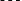
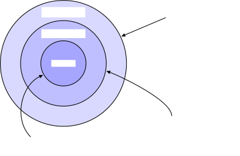

# Dependence-Aware Label Aggregation for LLM-as-a-Judge via Ising Models

Krishnakumar Balasubramanian Affiliation: Department of Statistics,
University of California, Davis Affiliation: Amazon Web Services   
Aleksandr Podkopaev Affiliation: Amazon Web Services    Shiva Prasad
Kasiviswanathan Affiliation: Amazon Web Services

August 24, 2026

###### Abstract

Large-scale AI evaluation increasingly relies on aggregating binary
judgments from $`K`$ annotators, including LLMs used as judges. Most
classical methods, e.g., Dawid-Skene or (weighted) majority voting,
assume annotators are conditionally independent given the true label
$`Y\in\{0,1\}`$, an assumption often violated by LLM judges due to
shared data, architectures, prompts, and failure modes. Ignoring such
dependencies can yield miscalibrated posteriors and even confidently
incorrect predictions. We study label aggregation through a hierarchy of
dependence-aware models based on Ising graphical models and latent
factors. For class-dependent Ising models, the Bayes log-odds is
generally quadratic in votes; for class-independent couplings, it
reduces to a linear weighted vote with correlation-adjusted parameters.
We present finite-$`K`$ examples showing that methods based on
conditional independence can flip the Bayes label despite matching
per-annotator marginals. We prove separation results demonstrating that
these methods remain strictly suboptimal as the number of judges grows,
incurring nonvanishing excess risk under latent factors. Finally, we
evaluate the proposed method on three real-world datasets, demonstrating
improved performance over the classical baselines.

## 1 Introduction

Large-scale evaluation of modern AI systems increasingly relies on
_aggregating binary judgments_ from multiple annotators that are
predominantly LLMs used as judges. Given an item with unknown label
$`Y\in\{0,1\}`$ and $`K`$ noisy votes
$`J=(J_{1},\ldots,J_{K})\in\{0,1\}^{K}`$, the core statistical problem
is to infer $`Y`$ from $`J`$. Many classical aggregators such as
majority vote, weighted majority vote, and Dawid-Skene (DS) \[12\]
estimators are built around the _conditional independence_ (CI)
assumption: they treat annotators as independent voters given $`Y`$,
i.e., $`\mathrm{P}(J|Y)=\prod_{j=1}^{K}\mathrm{P}(J_{j}|Y)`$. Under this
assumption, the weighted majority vote estimator is Bayes-optimal, and
the DS estimator provides a practical approach for estimating the
weights using the popular Expectation-Maximization algorithm, subject to
appropriate identifiability conditions.

The CI assumption is however increasingly mismatched to contemporary
evaluation pipelines, especially for LLM judges, where correlations
arise from shared pretraining corpora, architectures, prompts, and
failure modes \[18, 24, 41\]. Dependence is not a benign nuisance: it
can fundamentally change the information content of the votes. When
judges are redundant or co-vary, aggregation approaches based on the CI
assumption (which we refer to as CI-predictors and which are typically
based on weighted majority voting) can _over-count agreement_ and yield
systematically miscalibrated predictions. In Appendix B, we demonstrate
this through a three-annotator example: when the dependence is captured
via an Ising model explained shortly, the posterior prediction for the
labels (assuming CI) predicts the opposite label with near-certainty,
even given _correct_ per-annotator marginals. This illustrates a key
insight: misspecified dependence structure can dominate correct marginal
modeling.


  $`W^{(1)}`$ (when $`Y=1`$)


  $`W^{(0)}`$ (when $`Y=0`$)

Figure 1: Graphical models for LLM-as-a-judge. Conditional independence
(CI); (left): judges are independent given $`Y`$ (represented by lack
arrows connecting the Judge LLMs). Class-dependent Ising; (right):
judges exhibit pairwise dependence whose pattern can change with the
label ($`W^{(0)}\neq W^{(1)}`$), enabling class information to affect
directly the correlations among judges.

In this work, we revisit label aggregation through the lens of _Ising
graphical models¹¹ 1 We note that the multiclass setting can be handled
by working with Potts models \[36\]._, i.e., quadratic Markov random
fields of the form

```math
\mathrm{P}(J\mid Y=y)\ \propto\ \exp\!\Big(J^{\top}h^{(y)}+J^{\top}W^{(y)}J\Big),
```

for $`J\in\{0,1\}^{K},\ y\in\{0,1\}`$; see Figure 1 for a graphical
model illustration. Here $`h^{(y)}\in\mathbb{R}^{K}`$ is a vector of
_class-$`y`$ local fields_ capturing per-judge bias/strength:
$`h_{j}^{(y)}`$ controls how likely judge $`j`$ is to output $`1`$ under
class $`y`$ (holding other votes fixed). The symmetric matrix
$`W^{(y)}\in\mathbb{R}^{K\times K}`$ (with zero diagonal) is the
_class-$`y`$ coupling_ matrix encoding pairwise dependencies:
$`W_{jk}^{(y)}>0`$ encourages judges $`j`$ and $`k`$ to co-vote $`1`$,
while $`W_{jk}^{(y)}<0`$ discourages co-voting and captures antagonistic
or compensatory behavior. In LLM-as-a-judge settings, $`h^{(y)}`$
reflects each judge’s label-conditional tendency to vote for class 1,
while $`W^{(y)}`$ represents persistent agreement/disagreement patterns
induced by shared, training data, architectures, and failure modes.

Building on this representation, we introduce the model hierarchy in
Figure 2. The most expressive model is the _class-dependent Ising
model_, which allows class-specific interactions
($`W^{(0)}\neq W^{(1)}`$) and yields Bayes log-odds that are generally
_quadratic_ in the votes. An important special case is the
_class-independent Ising model_ where couplings are shared across
classes ($`W^{(0)}=W^{(1)}`$): in this case, the quadratic terms cancel
in the likelihood ratio and the Bayes log-odds reduce to a _linear_
weighted vote in $`J`$. Importantly, dependence still
matters—correlations are absorbed into correlation-corrected weights and
intercepts—allowing this model to discount redundant agreement while
retaining the simplicity of a linear aggregation rule.

### 1.1 Our Contributions

- •
  Dependence-aware Model Hierarchy. In Section 2, we formalize the model
  hierarchy spanning CI model, class-independent Ising model (shared
  interactions), and class-dependent Ising model (class-specific
  interactions). We derive the exact Bayes log-odds for class-dependent
  Ising model which is quadratic in votes, and show that under
  class-independent Ising model, the Bayes rule reduces to a linear
  weighted vote with dependence-adjusted parameters.
- •
  Separation Results. In Section 3, we establish a sharp separation
  result under the class-dependent Ising model. We show that there exist
  regimes where each judge is better than random, yet the CI-predictor
  still makes a constant fraction of errors by misinterpreting
  correlated “wrong-mode” agreement as strong evidence. In contrast, the
  Bayes-optimal predictor exploits the dependence structure and achieves
  vanishing error as the number of judges grows, creating non-vanishing
  risk separation between the two methods.
- •
  Relation to Factor Models. In the crowdsourcing literature, another
  way to model judge dependence is via _latent-factor model_ with a
  shared random effect $`Z`$ (independent of $`Y`$) such that judges are
  conditionally independent only given $`(Y,Z)`$:
  $`\mathrm{P}(J\mid Y,Z)=\prod_{j=1}^{K}\mathrm{P}(J_{j}\mid Y,Z)`$
  \[42, 43\]. We show that the CI-predictor which ignores $`Z`$ can
  remain strictly suboptimal when data are generated from such factor
  model, _even as $`K\to\infty`$_. For weak coupling, we show that
  latent-factor models induce an approximately low-rank Ising structure,
  placing them between CI and class-dependent Ising model. The details
  are deferred to Appendix C.3.
- •
  Experimental Validation. We evaluate the proposed aggregation method
  on three real-world tasks: relevance, toxicity, and summarization
  evaluations, using six judge models: Claude Sonnet 4.5, Claude Haiku
  4.5, OpenAI gpt-oss-120b, Llama 4 Maverick 17B Instruct, Llama 4 Scout
  17B Instruct, and DeepSeek-R1. In Appendix F, we include synthetic
  simulations that illustrate our theoretical separation results.

We defer a discussion placing our work in the context the larger
literature on LLM-as-a-judge, unsupervised label aggregation and
crowdsourcing to Appendix A.



Figure 2: Model hierarchy via set inclusion:
$`\text{Conditional Independence (CI)}\subset\text{Class-independent\ Ising}\subset\text{Class-dependent Ising}`$.

## 2 Dependent LLMs-as-a-Judge Models

Suppose that we observe $`n`$ independent items. Item $`i`$ has an
unobserved label $`Y_{i}\in\{0,1\}`$, with prior
$`\mathrm{P}(Y_{i}=1)=\pi\in(0,1)`$, and is annotated by $`K`$ judges
producing a binary vote vector
$`J_{i}=(J_{i1},\dots,J_{iK})\in\{0,1\}^{K}`$. We assume items are
independent and model _within-item dependencies_ among judges via Ising
(pairwise MRF) distribution conditional on the label:
$`\mathrm{P}(\{J_{i},Y_{i}\}_{i=1}^{n})\;=\;\prod_{i=1}^{n}\mathrm{P}(Y_{i})\,\mathrm{P}(J_{i}\mid Y_{i})`$.
This makes the label inference problem for each item separable given
model parameters²² 2 The literature on Ising models use spins:
$`\pm 1`$. Our inference algorithm is unchanged under the bijection
$`X_{ij}=2J_{ij}-1`$; we keep $`Y,J\in\{0,1\}`$ throughout for
consistency..

In LLM-as-a-judge pipelines, the within-item dependencies arise due to
shared pretraining data, architectures, and prompt templates (leading to
label-independent redundancy and shared failure modes), while in other
settings dependence itself can be label-dependent (e.g., certain classes
trigger common hallucination patterns or refusal behaviors), motivating
two practically distinct regimes: a _class-dependent_ structure
$`W^{(0)}\neq W^{(1)}`$ that allows correlation patterns to change with
the true label and a _class-independent_ interaction structure
$`W^{(0)}=W^{(1)}`$ that captures persistent correlations across all
items.

### 2.1 Class-dependent Ising Model

In the most general form, the class-conditional distribution of the
$`K`$ votes is allowed to differ across labels: for each
$`y\in\{0,1\}`$, we have

```math
\displaystyle\mathrm{P}(J_{i}\mid Y_{i}=y)=\frac{1}{Z^{(y)}}\,\exp\!\Bigg(\sum_{j=1}^{K}h_{j}^{(y)}J_{ij}\;+\;\frac{1}{2}\sum_{j\neq k}W_{jk}^{(y)}\,J_{ij}J_{ik}\Bigg), \tag{1}
```

where $`h^{(y)}\in\mathbb{R}^{K}`$ are class-$`y`$ local fields
(biases), $`W^{(y)}\in\mathbb{R}^{K\times K}`$ is a symmetric coupling
matrix with zero diagonal, and $`Z^{(y)}`$ is the corresponding
partition function. This model captures the possibility that judges are
correlated _even after conditioning on the label_ where the
strength/pattern of correlation may itself depend on the class.

Bayes-optimal Posterior. For a single item, we write
$`J=(J_{1},\ldots,J_{K})`$. The Bayes’ rule gives posterior log-odds:

```math
\displaystyle\Lambda(J):= \displaystyle\log\frac{\mathrm{P}(Y=1\mid J)}{\mathrm{P}(Y=0\mid J)}
```

```math
\displaystyle= \displaystyle\log\frac{\pi}{1-\pi}+\log\frac{P(J\mid Y=1)}{P(J\mid Y=0)}
```

```math
\displaystyle= \displaystyle\log\frac{\pi}{1-\pi}+\sum_{j=1}^{K}\Delta h_{j}\,J_{j}+\frac{1}{2}\sum_{j\neq k}\Delta W_{jk}\,J_{j}J_{k}+\Delta_{Z},
```

where $`\Delta h_{j}:=h_{j}^{(1)}-h_{j}^{(0)}`$,
$`\Delta W_{jk}:=W_{jk}^{(1)}-W_{jk}^{(0)}`$ and
$`\Delta_{Z}:=-\log Z^{(1)}+\log Z^{(0)}`$. The term $`\Delta_{Z}`$ is
constant in $`J`$ (for fixed parameters and fixed $`K`$) and can be
absorbed into the intercept. Since $`W^{(y)}`$ is symmetric with zero
diagonal, one can equivalently rewrite the quadratic term as
$`\frac{1}{2}\sum_{j\neq k}\Delta W_{jk}J_{j}J_{k}=\sum_{1\leq j<k\leq K}\Delta W_{jk}\,J_{j}J_{k}.`$
Therefore, the Bayes-optimal predictor takes form:

```math
\displaystyle g^{\star}(J)= \displaystyle\mathbf{1}\{\Lambda(J)\geq 0\} \tag{2}
```

```math
\displaystyle= \displaystyle\mathbf{1}\Big\{b_{0}+\sum_{j=1}^{K}a_{j}J_{j}+\sum_{1\leq j<k\leq K}b_{jk}J_{j}J_{k}\geq 0\Big\},
```

where $`a_{j}=\Delta h_{j}`$, $`b_{jk}=\Delta W_{jk}`$ and
$`b_{0}=\log\frac{\pi}{1-\pi}+\Delta_{Z}`$. When
$`W^{(1)}\neq W^{(0)}`$, the optimal decision boundary is _quadratic_ in
the votes since class information may be present not only in marginal
accuracies (fields) but also in _label-dependent correlation structure_
(couplings).

### 2.2 Class-Independent Couplings

A common and interpretable special case is one in which the _dependence
structure_ among judges is shared across both classes but individual
biases and accuracies shift with the label. Specifically, we assume

```math
\displaystyle\mathrm{P}(J_{i}\mid Y_{i}=y)=\frac{1}{Z^{(y)}}\exp\!\Big(\sum_{j=1}^{K}\big(h_{j}+(y-\tfrac{1}{2})c_{j}\big)J_{ij}+\frac{1}{2}\sum_{j\neq k}W_{jk}\,J_{ij}J_{ik}\Big), \tag{3}
```

where $`h_{j}`$ represents a label-independent baseline field, $`c_{j}`$
controls how the label shifts judge $`j`$’s field, and $`W`$ is a shared
symmetric coupling matrix (with zero diagonal). Here, the normalizer
$`Z^{(y)}`$ may still depend on $`y`$ since the fields differ across
classes.

Bayes-optimal Posterior. Under (3), the posterior log-odds simplify
substantially:

```math
\displaystyle\log\frac{\mathrm{P}(Y=1\mid J)}{\mathrm{P}(Y=0\mid J)}= \displaystyle\log\frac{\pi}{1-\pi}+\log\frac{\mathrm{P}(J\mid Y=1)}{\mathrm{P}(J\mid Y=0)} \tag{4}
```

```math
\displaystyle= \displaystyle\log\frac{\pi}{1-\pi}+\sum_{j=1}^{K}c_{j}J_{j}+\Delta_{Z},
```

where $`\Delta_{Z}=-\log Z^{(1)}+\log Z^{(0)}`$ is a constant in $`J`$.
The quadratic terms cancel since the coupling matrix is shared across
the two classes. Therefore, the Bayes-optimal predictor is a _linear_
threshold rule:

```math
\displaystyle g^{\star}(J) \displaystyle=\mathbf{1}\!\Big\{\sum_{j=1}^{K}c_{j}J_{j}+b_{0}\geq 0\Big\}, \tag{5}
```

```math
\displaystyle b_{0} \displaystyle=\log\frac{\pi}{1-\pi}+\Delta_{Z}.
```

If one prefers $`\pm 1`$ labels instead of $`\{0,1\}`$, one can define
centered spins $`X_{j}:=2J_{j}-1\in\{\pm 1\}`$. Then
$`\sum_{j}c_{j}J_{j}=\frac{1}{2}\sum_{j}c_{j}X_{j}+\frac{1}{2}\sum_{j}c_{j}`$,
so the rule remains a weighted vote on $`X`$ after absorbing
$`\frac{1}{2}\sum_{j}c_{j}`$ into the intercept. If $`W\equiv 0`$, then
the judges are conditionally independent given $`Y`$ and (3) reduces to
a product of Bernoulli marginals:
$`\mathrm{P}(J\mid Y=y)=\prod_{j=1}^{K}\mathrm{P}(J_{j}\mid Y=y)`$ with
$`\mathrm{P}(J_{j}=1\mid Y=y)=\sigma\!\big(h_{j}+(y-\tfrac{1}{2})c_{j}\big)`$,
where $`\sigma(t)=(1+e^{-t})^{-1}`$. In this case, the per-judge
contribution to the posterior log-odds can be written as an affine
function of $`J_{j}`$:

```math
\displaystyle\log\frac{\mathrm{P}(J_{j}\mid Y=1)}{\mathrm{P}(J_{j}\mid Y=0)}=J_{j}\Big(\operatorname{logit}(p_{j}^{(1)})-\operatorname{logit}(p_{j}^{(0)})\Big)+\log\frac{1-p_{j}^{(1)}}{1-p_{j}^{(0)}},
```

where $`p_{j}^{(y)}:=\mathrm{P}(J_{j}=1\mid Y=y)`$. Summing over $`j`$
recovers the classical CI or Naive-Bayes linear aggregation rule with
weights equal to differences of logits; in the parameterization (3),
$`\operatorname{logit}(p_{j}^{(1)})-\operatorname{logit}(p_{j}^{(0)})=c_{j}.`$
When $`W\neq 0`$ but is _shared across classes_, correlations do not
introduce quadratic terms into the Bayes log-odds (they cancel in (4)),
and the Bayes decision remains linear in $`J`$. Nevertheless,
correlations still matter statistically: they change the joint law of
$`J`$ within each class and therefore affect likelihoods, partition
functions (hence the intercept $`b_{0}`$), and parameter estimation from
finite data. In contrast, if the couplings differ across classes
($`W^{(1)}\neq W^{(0)}`$), then class information is present in the
dependence structure and the Bayes decision becomes quadratic as in (2).

For the sake of completeness, we discuss the CI model with asymmetric
errors (which leads to weighted majority vote aggregators) in Appendix
C.1. We also briefly discuss the similarities and differences with the
linear and quadratic discriminant analysis model, that are standard
Gaussian models (as opposed to the binary Ising models) in Appendix C.2.

## 3 Separation Results

In this section, we use our model hierarchy to clarify when standard
aggregation rules are justified for LLM-as-a-judge pipelines and when
those fail. Weighted majority vote (with sufficiently accurate weights)
is Bayes-optimal under conditional independence (CI) Ai et al. \[2,
Theorem 1\]. However, as argued in the introduction and illustrated by
our motivating examples (Appendix B), satisfying CI is often implausible
for LLM judges due to shared pretraining corpora, similar architectures,
reused prompt templates, and common safety/refusal or hallucination
failure modes. These dependencies are not merely noise: they can encode
item properties (e.g., difficulty or trigger patterns) and the
redundancy of evidence across judges.

We show a separation (in terms of risk) between majority voting
procedures and the Bayes-optimal predictor under two dependence
mechanisms relevant to LLM-as-a-judge: (a) shared latent factors
inducing low-rank correlations (Appendix C.3.1) and (b)
interaction-driven dependence captured by the Curie-Weiss model, a
special case of the Ising model, with strong agreement modes (Section
3.1). These separation results clearly demonstrate the limitations in
expressive power of schemes such as majority voting. The proofs are
deferred to Appendix E.

### 3.1 Sub-optimality of CI-predictor under Ising Dependence

The risk of a binary aggregator $`g`$ in our setting is defined as
$`R(g):=\mathrm{P}(g(J)\neq Y)`$. We start by establishing a separation
result in terms of risk between a special case of Ising model, namely
the Curie-Weiss model, which has been widely used in opinion dynamics
\[5\]. Informally, we show that even with infinitely many judges, any
CI-predictor remains strictly suboptimal, whereas there exists a Bayes
predictor that leverages dependence (quadratic structure) to classify
essentially perfectly.

###### Theorem 1 (Nonvanishing Bayes vs. CI Separation for Class-conditional Ising Models).

Fix a prior $`\mathrm{P}(Y=1)=\pi\in(0,1)`$. For each $`K\geq 1`$, let
$`J=(J_{1},\dots,J_{K})\in\{0,1\}^{K}`$ denote the $`K`$ judges’ votes
for a single item and define the recoded spins
$`X_{j}:=2J_{j}-1\in\{-1,+1\}`$ and let
$`M_{K}:=\frac{1}{K}\sum_{j=1}^{K}X_{j}\in\Big\{-1,-1+\frac{2}{K},\dots,1\Big\}`$.
Assume the following _class-conditional Curie-Weiss Ising_ model: there
exist constants $`0<\beta_{0}<1<\beta_{1}`$ such that, conditional on
$`Y=y\in\{0,1\}`$,

```math
\displaystyle\mathrm{P}(X=x\mid Y=y)=\frac{1}{Z_{K}(\beta_{y})}\exp\!\Big(\frac{\beta_{y}}{2K}\Big(\sum_{j=1}^{K}x_{j}\Big)^{2}\Big), \tag{6}
```

for $`x\in\{-1,+1\}^{K}`$. Equivalently (writing $`x_{j}=2j_{j}-1`$),
this is a special case of the $`\{0,1\}`$-Ising form (1) with
$`h_{j}^{(y)}=-2\beta_{y}\Big(1-\frac{1}{K}\Big)`$ and
$`W_{jk}^{(y)}=\frac{4\beta_{y}}{K}\quad(j\neq k)`$, up to an additive
constant absorbed into $`Z^{(y)}`$.

Let $`g_{K}^{\star}`$ be the Bayes-optimal predictor under the true
model (6). Let $`g_{K}^{\mathrm{ind}}`$ be the population CI-predictor
that replaces the true joint by the product of true one-dimensional
marginals, i.e.,
$`\mathrm{P}^{\mathrm{ind}}(J=j\mid Y=y):=\prod_{r=1}^{K}q_{y}^{j_{r}}(1-q_{y})^{1-j_{r}}`$
with
$`q_{y}:=\mathrm{P}(J_{r}=1\mid Y=y)\ \ (\text{independent of }r)`$, and
then thresholds the induced posterior
$`\mathrm{P}^{\mathrm{ind}}(Y=1\mid J)`$ at $`1/2`$. Then the following
results hold:

1.  1.  (CI Collapses to the Prior) For every $`K`$ and $`y\in\{0,1\}`$, one
        has $`q_{y}=\tfrac{1}{2}`$. Consequently,
        $`\mathrm{P}^{\mathrm{ind}}(Y=1\mid J)=\pi`$ for all $`J`$, so
        $`g_{K}^{\mathrm{ind}}(J)\equiv\mathbf{1}\{\pi\geq\tfrac{1}{2}\}`$,
        and $`R(g_{K}^{\mathrm{ind}})=\min\{\pi,1-\pi\},\forall K`$.
2.  2.  (Bayes Risk Vanishes) Let $`m_{\star}=m_{\star}(\beta_{1})\in(0,1)`$
        denote the unique positive solution to $`m=\tanh(\beta_{1}m).`$ Then
        for any fixed threshold $`t\in(0,m_{\star}^{2})`$, the quadratic
        statistic test:

    ```math
    \displaystyle\tilde{g}_{K}(J) \displaystyle:=\mathbf{1}\{M_{K}(J)^{2}\geq t\},
    ```

    ```math
    \displaystyle\qquad M_{K}(J) \displaystyle=\frac{1}{K}\sum_{j=1}^{K}(2J_{j}-1),
    ```

    satisfies $`R(\tilde{g}_{K})\to 0`$ as $`K\to\infty`$. Hence
    $`R(g_{K}^{\star})\to 0`$ as $`K\to\infty`$.

3.  3.  (Nonvanishing Separation) We have:

    ```math
    \underset{K\to\infty}{\lim}\Big(R(g_{K}^{\mathrm{ind}})-R(g_{K}^{\star})\Big)=\min\{\pi,1-\pi\}\;>\;0.
    ```

Theorem 1 gives a clean population-level separation between the
Bayes-optimal predictor and a CI-predictor when the judges are
_dependent_ given the label. We consider a setting where, for each label
$`y\in\{0,1\}`$, the $`K`$ votes are drawn from a class-conditional
Ising model. In the particular Curie-Weiss specialization used in the
theorem, the conditional law depends only on the _global magnetization_
$`M_{K}`$ and the dependence strength differs across classes: the
negative class is in a _high-temperature_ regime ($`\beta_{0}<1`$),
while the positive class is in a _low-temperature_ regime
($`\beta_{1}>1`$).

In this model the two classes have the _same_ one-dimensional marginals:
for every judge $`j`$ and both labels $`y\in\{0,1\}`$,
$`\mathrm{P}(J_{j}=1\mid Y=y)=1/2.`$ Thus, looking at each judge in
isolation provides no information about the label. The only
distinguishing signal is in the _dependence structure_: under $`Y=1`$
the votes exhibit strong global alignment (many judges tend to agree),
whereas under $`Y=0`$ they do not. The CI-predictor replaces the true
joint likelihood by a product of these one-dimensional marginals. Since
the marginals are identical across classes, under CI, the likelihood
ratio is identically $`1`$, so the posterior stays equal to the prior
$`\pi`$ for every vote vector $`J`$. Consequently, the CI-predictor
ignores the data entirely and achieves risk
$`R(g_{K}^{\mathrm{ind}})=\min\{\pi,1-\pi\},`$ independently of $`K`$.

In contrast, the Bayes-optimal posterior uses the correct
class-conditional joint likelihood, which depends on quadratic
(pairwise) interactions among votes and, in this Curie-Weiss case, can
be expressed through the statistic $`M_{K}^{2}`$. As $`K`$ grows, the
magnetization concentrates at $`0`$ under the high-temperature class
($`Y=0`$) and concentrates near a nonzero value under the
low-temperature class ($`Y=1`$) (up to a random global sign flip).
Therefore, a simple quadratic rule such as
$`\mathbf{1}\{M_{K}^{2}\geq t\}`$ (for any fixed $`t`$ between $`0`$ and
the squared limiting magnetization under $`Y=1`$) separates the two
classes with vanishing error as $`K\to\infty`$. Since the Bayes rule is
optimal, its risk also converges to $`0`$. Putting the two pieces
together, the Bayes-optimal risk goes to zero while the CI risk stays
bounded away from zero.

### 3.2 Extension to Informative Marginals

The Curie-Weiss separation example in Theorem 1 uses the zero-field
Curie-Weiss model, which is invariant under the global flip
$`X\mapsto-X`$. This symmetry forces
$`q_{0}=q_{1}=\mathrm{P}(J_{j}=1\mid Y=y)=\tfrac{1}{2}`$ for both
classes, so a CI-predictor that only uses one-dimensional marginals
collapses to the prior. While this may look like a “corner case,” the
underlying failure mechanism is _not_: the CI-predictor cannot exploit
class information carried by _dependence structure_
(correlation/interaction patterns), and this can remain true even when
individual marginals are (slightly) informative.

At a basic level, risks vary continuously with the data-generating law:
if $`P`$ and $`Q`$ are two joint distributions on $`(Y,J)`$ and
$`d_{\mathrm{TV}}(P,Q):=\sup_{A}|P(A)-Q(A)|`$ is their total variation
distance, then for any classifier $`g`$,
$`|R_{P}(g)-R_{Q}(g)|\leq d_{\mathrm{TV}}(P,Q)`$, and in particular we
have $`|R_{P}^{\star}-R_{Q}^{\star}|\leq d_{\mathrm{TV}}(P,Q)`$, because
$`R_{P}(g)=P(g(J)\neq Y)`$ is the probability of a measurable event,
where $`R_{P}^{\star}`$ is Bayes-optimal risk under distribution $`P`$.
Thus, for any fixed (moderate) $`K`$, the large finite-sample gaps
exhibited by the symmetric Curie-Weiss example persist under small
perturbations of the class-conditional distributions, including
perturbations that move the marginals away from $`1/2`$.

The next result gives an explicit _asymptotic_ variant in which each
judge is individually better than random ($`q_{0}<1/2<q_{1}`$), yet the
CI risk remains bounded away from zero while the Bayes-optimal risk
still vanishes as $`K\to\infty`$. The key idea is to retain _phase
coexistence_ in the low-temperature class so that, with constant
probability, the judges collectively enter a “wrong-sign” agreement mode
that a CI-predictor interprets as decisive evidence for the wrong label,
whereas the Bayes-optimal predictor uses a dependence-sensitive
statistic (here $`|M_{K}|`$) to identify the true class.

###### Theorem 2 (Curie-Weiss separation with informative marginals).

Let $`Y\in\{0,1\}`$ with $`\mathrm{P}(Y=1)=\pi\in(0,1)`$. For each
$`K\geq 1`$, define spins $`X=(X_{1},\dots,X_{K})\in\{-1,+1\}^{K}`$ and
votes $`J_{j}=(X_{j}+1)/2\in\{0,1\}`$. Let the class-conditional laws of
$`X`$ be Curie-Weiss models with (possibly $`K`$-dependent) external
fields:

```math
\displaystyle\mathrm{P}(X=x\mid Y=y)=\frac{1}{Z_{K}^{(y)}}\exp\!\Big(\frac{\beta_{y}}{2K}\Big(\sum_{j=1}^{K}x_{j}\Big)^{2}+h_{y,K}\sum_{j=1}^{K}x_{j}\Big), \tag{7}
```

for $`y\in\{0,1\}`$. Assume parameters satisfy:

1.  1.  (High-temperature Class) $`\beta_{0}\in(0,1)`$ and
        $`h_{0,K}\equiv h_{0}<0`$ is a fixed negative constant;
2.  2.  (Low-temperature Class with Weak Symmetry Breaking) $`\beta_{1}>1`$
        and $`h_{1,K}=c/K`$ with some fixed $`c>0`$.

Let $`M_{K}:=\frac{1}{K}\sum_{j=1}^{K}X_{j}\in[-1,1]`$ be the
magnetization. Let $`m_{0}\in(-1,0)`$ be the unique solution of the
mean-field equation $`m_{0}=\tanh(\beta_{0}m_{0}+h_{0}),`$ and let
$`m_{\star}=m_{\star}(\beta_{1})\in(0,1)`$ be the unique positive
solution of $`m_{\star}=\tanh(\beta_{1}m_{\star}).`$ Define

```math
\displaystyle p \displaystyle:=\frac{e^{cm_{\star}}}{e^{cm_{\star}}+e^{-cm_{\star}}}=\sigma(2cm_{\star})\in\Big(\frac{1}{2},1\Big),
```

```math
\displaystyle q_{0} \displaystyle:=\mathrm{P}(J_{1}=1\mid Y=0)=\frac{1+m_{0}}{2}\in\Big(0,\frac{1}{2}\Big),
```

```math
\displaystyle q_{1} \displaystyle:=\mathrm{P}(J_{1}=1\mid Y=1)=\frac{1+(2p-1)m_{\star}}{2}\in\Big(\frac{1}{2},1\Big).
```

Assume additionally that

```math
\displaystyle\frac{1-m_{\star}}{2}<q_{0}\Longleftrightarrow m_{\star}>1-2q_{0}. \tag{8}
```

Let $`g_{K}^{\star}`$ denote the Bayes predictor under the true model
(7). Let $`g_{K}^{\mathrm{ind}}`$ denote the population CI-predictor
that replaces $`\mathrm{P}(J\mid Y=y)`$ by the product of the true
marginals $`\prod_{j=1}^{K}q_{y}^{J_{j}}(1-q_{y})^{1-J_{j}}`$.Then, the
following hold:

1.  1.  (Informative Marginals) Each judge is individually better than
        random: $`q_{0}<\tfrac{1}{2}<q_{1}`$ (equivalently, specificity
        $`1-q_{0}>\tfrac{1}{2}`$ and sensitivity $`q_{1}>\tfrac{1}{2}`$).
2.  2.  (Bayes Risk Vanishes) For any fixed threshold $`t`$ satisfying
        $`|m_{0}|<t<m_{\star}`$, the aggregator
        $`\tilde{g}_{K}(J):=\mathbf{1}\{|M_{K}|\geq t\}`$ has
        $`R(\tilde{g}_{K})\to 0`$ as $`K\to\infty`$. Consequently,
        $`R(g_{K}^{\star})\to 0`$.
3.  3.  (CI Remains Bounded away from Bayes) As $`K\to\infty`$, we have
        $`R(g_{K}^{\mathrm{ind}})\ \rightarrow\ \pi(1-p),`$ and hence
        $`\lim_{K\to\infty}\big(R(g_{K}^{\mathrm{ind}})-R(g_{K}^{\star})\big)\ \geq\ \pi(1-p)\ >0`$.

###### Remark 1 (Continuity viewpoint).

In Theorem 2, the limiting CI error is $`\pi(1-p)`$ with
$`p=\sigma(2cm_{\star})`$, which varies continuously with the “weak
symmetry-breaking” strength $`c`$. As $`c\downarrow 0`$, one has
$`p\to 1/2`$ and $`q_{1}\downarrow 1/2`$, recovering the symmetric
example; for any $`c>0`$, the marginals become informative
($`q_{1}>\tfrac{1}{2}`$) yet CI still makes errors on a constant
fraction $`(1-p)`$ of the positive-class items because it thresholds the
_sign_ of the vote proportion, whereas Bayes exploits the
dependence-induced structure (here, large $`|M_{K}|`$ regardless of
sign). Thus the separation is robust: it is driven by a persistent
correlated “wrong-sign” mode, not by the exact equality $`q_{y}=1/2`$.

The separation results in this section are interesting for two reasons.
First, they show that the limitations with the CI assumption are
_structural_, not a finite-judge artifact: even as $`K\to\infty`$, the
CI-predictor remain strictly suboptimal because it cannot exploit
dependence-induced information or distinguish redundant agreement from
independent evidence (Ising interactions). Second, they explain why LLM
ensembles can become overconfident for the wrong reasons: if judges
share a failure mode, their agreement should be discounted rather than
counted multiple times, which CI weighting cannot do. Practically, this
suggests evaluation pipelines should not rely solely on per-judge
accuracies or majority counts, but should monitor and model dependence
among judges (e.g., residual correlations after accounting for label
uncertainty). When dependence is present, our results motivate moving up
the hierarchy: from CI to various Ising models, to improve accuracy,
calibration, and uncertainty for downstream decisions.

| Dataset       | Class-Dep. Ising (ours) | Class-Indep. Ising (ours) | CI-WMV | CI-UMV |
| ------------- | ----------------------- | ------------------------- | ------ | ------ |
| Relevance     | 0.90                    | 0.88                      | 0.82   | 0.80   |
| Toxicity      | 0.79                    | 0.77                      | 0.72   | 0.69   |
| Summarization | 0.68                    | 0.64                      | 0.61   | 0.60   |

Table 1: Test accuracy for the various methods on the three datasets.
Numbers are averages over 20 trials. CI-WMV and CI-UMV correspond to
weighted and uniform majority vote both of which operator under
conditional independence assumptions. Class-Dep. and Class-Indep. refer
to class-dependent and class-independent Ising models, respectively.

## 4 Experimental Evaluation

For all experimental results, we use the Expectation-Maximization
algorithm for posterior label prediction. We defer the details to
Appendix D. Simulation results comparing weighted (with the weights
estimated by EM algorithm) and uniform majority voting are provided in
Appendix F.1. Simulation results regarding CI-predictor and factor/Ising
model predictors are provided in Appendix F. Below, we provide
experiments on real-world datasets.

### 4.1 Real World Datasets

We consider LLMaaJ label aggregation in three tasks: relevance,
toxicity, and summarization assessment. We use the following models as
judges: (a) Claude Sonnet 4.5, (b) Claude Haiku 4.5, (c) OpenAI
gpt-oss-120b \[33\], (d) Llama 4 Maverick 17B Instruct, (e) Llama 4
Scout 17B Instruct, and (f) DeepSeek-R1 \[13\]. For all models, the
temperature parameter is set to zero. The prompts used in our
evaluations are deferred to Appendix G.3.

Relevance. We use the WikiQA dataset \[44\] to evaluate query-passage
relevance classification, a task which arises in the context of
retrieval-augmented generation (RAG). The dataset consists of natural
language questions paired with multiple sentences extracted from
Wikipedia. Each sentence is annotated with a binary label which
indicates whether it correctly answers the question at hand. To
construct inputs suitable for the relevance classification, we collect
all the sentences associated with each question and concatenate them
into a single text passage. The resulting passage is labeled relevant to
the question if and only if at least one of the original sentences is
labeled as a correct answer; see examples in Appendix G.1. In our
evaluation, we use all available splits for the original dataset,
resulting in approximately 3000 evaluation instances.

Toxicity. We use the Jigsaw Unintended Bias in Toxicity Classification
dataset \[1\] for toxicity classification. We use comments from the
private leaderboard test set, filtering for those with at least five
human annotators and a minimum length of 100 characters. To ensure
balanced representation across all toxicity levels, we use stratified
sampling based on comment toxicity scores, i.e., the fraction of
annotators who marked a comment as toxic. We randomly sample 1000
comments from each of the four toxicity score buckets: $`[0,0.25)`$,
$`[0.25,0.5)`$, $`[0.5,0.75)`$, $`[0.75,1]`$, and label a comment as
toxic (positive class) if at least half of the annotators marked it as
toxic. Additional preprocessing steps are deferred to Appendix G.2.

Summarization. We use the CNN/DailyMail news dataset \[20, 37\] for
summarization assessment. The original dataset contains news articles
along with short author-written summaries. For binary summarization
assessment, we use a preprocessed variant of the dataset from [Arize
Phoenix summarization
benchmark](https://arize.com/docs/phoenix/evaluation/running-pre-tested-evals/summarization-eval).
This benchmark augments a subset of the original articles and summaries
with synthetically generated incorrect summaries designed to resemble
correct ones while containing factual inconsistencies. The dataset
contains 1100 instances with approximately the same number of correct
and incorrect summaries.

Figure 3: Effect of varying the number of training samples (left) and
number of judges (right) on the test accuracy. Top, middle and bottom
rows correspond respectively to Relevance, Toxicity and Summarization
datasets. The standard errors are of small width, although they are
plotted.

We conducted two experiments on those datasets: (i) studying the effect
of varying the number of training samples $`n`$ while keeping the number
of judges fixed ($`K=6`$), and (ii) studying effect of varying $`K`$
while keeping the number of training samples $`n`$ fixed at roughly
10%–20% of the overall dataset. We compared the class-independent
Ising-predictors, class-dependent Ising-predictors, and CI-predictors
(specifically, the weighted majority vote procedure resulting from the
asymmetric models described in Appendix C.1). For these experiments, we
randomly sampled the training data and the judges and report the average
test accuracy (and standard error) over 20 trials in Figure 3.

From Figure 3, we note that the two Ising predictors invariably
outperform the CI-predictor once the number of training samples and the
number of judges exceed a modest threshold (and in some regimes even
with fewer training samples). As a summary, in Table 1, we also report
the result of comparing the aforementioned procedures, along with the
uniform majority voting procedure, when all six judges are used and when
the maximum amount of training data is used for each dataset (i.e., 2500
samples for relevance, 3000 samples for toxicity, and 1000 samples for
summarization tasks). We notice that Ising models outperform (weighted)
majority voting procedures. In particular, as we have large number of
training (unsupervised) samples relative to the number of model
parameters, the class-dependent Ising model outperforms the
class-independent Ising model, illustrating the benefit of moving up the
hierarchy of proposed models.

The above experiments demonstrate the practical value of explicitly
modeling judge dependence: when correlations are present,
interaction-aware aggregation leverage the additional structure among
the pool of judges and deliver consistently lower error than any
conditional-independence weighting which is based only on marginals.

## 5 Limitations and Conclusion

While our separation results are stated in terms of the Bayes-optimal
posterior under the true generative model, in practice one must rely on
computational procedures such as generalized EM with approximate E-steps
and surrogate M-steps, e.g., pseudo-likelihood. A key next step is to
extend the theory from the population Bayes rule to these algorithms:
establishing conditions under which the learned parameters and induced
posteriors converge to the correct decision rule or, at minimum, inherit
the same separation from conditional-independence baselines.

Beyond parameter estimation, our framework motivates a
hypothesis-testing view of LLM-as-a-judge evaluation: before fitting
more expressive dependence models, practitioners can test whether
class-conditional independence is plausible by checking for residual
correlations among judges after accounting for label uncertainty, or by
comparing CI and Ising/factor-model pseudo-likelihoods on holdout items.

From a practical standpoint, the hierarchy presented in this paper
provides actionable guidance: one may start with CI as a cheap baseline
and then move to latent-factor (low-rank) dependence if correlations
appear global or prompt-driven. When pairwise agreement patterns are
strong or class-dependent, one may escalate to class-independent or
class-dependent Ising model. Simple diagnostics—estimated coupling
strength, stability across random initializations, and predictive
calibration on small labeled validation sets—can help determine the
appropriate level of dependence modeling and prevent overfitting. Such
considerations may make dependence-aware aggregation a reliable
component of real-world evaluation pipelines.

## References

- \[1\] C. Adams, D. Borkan, J. Sorensen, L. Dixon, L. Vasserman, and
  nithum (2019) Jigsaw unintended bias in toxicity classification.
  External Links:
  [Link](https://kaggle.com/competitions/jigsaw-unintended-bias-in-toxicity-classification)
  Cited by: §4.1.
- \[2\] R. Ai, Y. Pan, D. Simchi-Levi, M. Tambe, and H. Xu (2025) Beyond
  majority voting: LLM aggregation by leveraging higher-order
  information. arXiv:2510.01499. Cited by: Appendix A, §3.
- \[3\] A. N. Angelopoulos, S. Bates, C. Fannjiang, M. I. Jordan, and T.
  Zrnic (2023) Prediction-powered inference. Science 382 (6671),
  pp. 669–674. Cited by: Appendix A.
- \[4\] A. N. Angelopoulos, J. C. Duchi, and T. Zrnic (2023) PPI++:
  efficient prediction-powered inference. arXiv:2311.01453. Cited by:
  Appendix A.
- \[5\] D. B. Bahr and E. Passerini (1998) Statistical mechanics of
  opinion formation and collective behavior: micro-sociology. The
  Journal of mathematical sociology 23 (1), pp. 1–27. Cited by: §3.1.
- \[6\] D. Berend and A. Kontorovich (2015) A finite sample analysis of
  the naive Bayes classifier.. J. Mach. Learn. Res. 16 (1),
  pp. 1519–1545. Cited by: Appendix A.
- \[7\] B. B. Bhattacharya and S. Mukherjee (2018) Inference in Ising
  models. Bernoulli 24 (1), pp. 493–525. Cited by: §D.1.
- \[8\] P. Boyeau, A. N. Angelopoulos, T. Li, N. Yosef, J. Malik,
  and M. I. Jordan (2025) AutoEval done right: using synthetic data for
  model evaluation. In International Conference on Machine Learning,
  Cited by: Appendix A.
- \[9\] Y. Chen, M. Mueller-Frank, and M. Pai (2023) The wisdom of the
  crowd and higher-order beliefs. In ACM Conference on Economics and
  Computation, Cited by: Appendix A.
- \[10\] Y. T. Chen, S. Lu, S. Li, M. Guo, and S. Li (2026) Efficient
  inference for noisy LLM-as-a-judge evaluation. arXiv:2601.05420. Cited
  by: Appendix A.
- \[11\] A. M. Davani, M. Díaz, and V. Prabhakaran (2022) Dealing with
  disagreements: looking beyond the majority vote in subjective
  annotations. Transactions of the Association for Computational
  Linguistics 10, pp. 92–110. Cited by: Appendix A.
- \[12\] A. P. Dawid and A. M. Skene (1979) Maximum likelihood
  estimation of observer error-rates using the EM algorithm. Journal of
  the Royal Statistical Society. Series C (Applied Statistics) 28 (1),
  pp. 20–28. Cited by: Appendix A, §D.1, Appendix D, §1.
- \[13\] DeepSeek-AI (2025) DeepSeek-R1: incentivizing reasoning
  capability in LLMs via reinforcement learning. arXiv:2501.12948. Cited
  by: §4.1.
- \[14\] P. Donmez, G. Lebanon, and K. Balasubramanian (2010)
  Unsupervised supervised learning I: estimating classification and
  regression errors without labels.. Journal of Machine Learning
  Research 11 (4). Cited by: Appendix A.
- \[15\] Y. Dubois, P. Liang, and T. Hashimoto (2024) Length-controlled
  alpacaeval: a simple debiasing of automatic evaluators. In Conference
  on Language Modeling, Cited by: Appendix A.
- \[16\] S. Friedli and Y. Velenik (2017) Statistical mechanics of
  lattice systems: a concrete mathematical introduction. Cambridge
  University Press. Cited by: §E.1.
- \[17\] C. Gao, Y. Lu, and D. Zhou (2016) Exact exponent in optimal
  rates for crowdsourcing. In International Conference on Machine
  Learning, Cited by: Appendix A.
- \[18\] S. Goel, J. Strüber, I. A. Auzina, K. K. Chandra, P.
  Kumaraguru, D. Kiela, A. Prabhu, M. Bethge, and J. Geiping (2025)
  Great models think alike and this undermines AI oversight. In
  International Conference on Machine Learning, Cited by: §1.
- \[19\] J. Gu, X. Jiang, Z. Shi, H. Tan, X. Zhai, C. Xu, W. Li, Y.
  Shen, S. Ma, H. Liu, et al. (2024) A survey on LLM-as-a-judge. The
  Innovation. Cited by: Appendix A.
- \[20\] K. M. Hermann, T. Kociský, E. Grefenstette, L. Espeholt, W.
  Kay, M. Suleyman, and P. Blunsom (2015) Teaching machines to read and
  comprehend. In Conference on Neural Information Processing Systems,
  Cited by: §4.1.
- \[21\] H. Hoefling and R. Tibshirani (2009) Estimation of sparse
  binary pairwise Markov networks using pseudo-likelihoods.. Journal of
  Machine Learning Research 10 (4). Cited by: §D.1.
- \[22\] D. Hovy, T. Berg-Kirkpatrick, A. Vaswani, and E. H. Hovy (2013)
  Learning whom to trust with MACE. In Conference of the North American
  Chapter of the Association of Computational Linguistics, Cited by:
  Appendix A.
- \[23\] A. Jaffe, E. Fetaya, B. Nadler, T. Jiang, and Y. Kluger (2016)
  Unsupervised ensemble learning with dependent classifiers. In
  Conference on Artificial Intelligence and Statistics, Cited by:
  Appendix A.
- \[24\] E. M. Kim, A. Garg, K. Peng, and N. Garg (2025) Correlated
  errors in large language models. In International Conference on
  Machine Learning, Cited by: §1.
- \[25\] H. Kim and Z. Ghahramani (2012) Bayesian classifier
  combination. In Conference on Artificial Intelligence and Statistics,
  Cited by: Appendix A.
- \[26\] M. Kleindessner and P. Awasthi (2018) Crowdsourcing with
  arbitrary adversaries. In International Conference on Machine
  Learning, pp. 2708–2717. Cited by: Appendix A.
- \[27\] C. Lee, T. Zeng, J. Jeong, J. Sohn, and K. Lee (2025) How to
  correctly report LLM-as-a-judge evaluations. arXiv:2511.21140. Cited
  by: Appendix A.
- \[28\] D. Li, B. Jiang, L. Huang, A. Beigi, C. Zhao, Z. Tan, A.
  Bhattacharjee, Y. Jiang, C. Chen, T. Wu, K. Shu, L. Cheng, and H.
  Liu (2025) From generation to judgment: opportunities and challenges
  of LLM-as-a-judge. In Conference on Empirical Methods in Natural
  Language Processing, Cited by: Appendix A.
- \[29\] Q. Liu, J. Peng, and A. T. Ihler (2012) Variational inference
  for crowdsourcing. Conference on Neural Information Processing
  Systems. Cited by: §D.1.
- \[30\] Y. Liu, D. Iter, Y. Xu, S. Wang, R. Xu, and C. Zhu (2023)
  G-eval: NLG evaluation using GPT-4 with better human alignment. In
  Conference on Empirical Methods in Natural Language Processing, Cited
  by: Appendix A.
- \[31\] A. Mazzetto, D. Sam, A. Park, E. Upfal, and S. Bach (2021)
  Semi-supervised aggregation of dependent weak supervision sources with
  performance guarantees. In Conference on Artificial Intelligence and
  Statistics, Cited by: Appendix A.
- \[32\] B. Miasojedow and W. Rejchel (2018) Sparse estimation in Ising
  model via penalized Monte Carlo methods. Journal of Machine Learning
  Research 19 (75), pp. 1–26. Cited by: §D.1.
- \[33\] OpenAI (2025) Gpt-oss-120b & gpt-oss-20b model card.
  arXiv:2508.10925. Cited by: §4.1.
- \[34\] D. Prelec, H. S. Seung, and J. McCoy (2017) A solution to the
  single-question crowd wisdom problem. Nature 541 (7638), pp. 532–535.
  Cited by: Appendix A.
- \[35\] V. C. Raykar, S. Yu, L. H. Zhao, G. Hermosillo Valadez, C.
  Florin, L. Bogoni, and L. Moy (2010) Learning from crowds. Journal of
  Machine Learning Research 11, pp. 1297–1322. Cited by: Appendix A.
- \[36\] U. A. Rozikov (2022) Gibbs measures in biology and physics: the
  potts model. World Scientific. Cited by: footnote 1.
- \[37\] A. See, P. J. Liu, and C. D. Manning (2017) Get to the point:
  summarization with pointer-generator networks. In Annual Meeting of
  the Association for Computational Linguistics (Volume 1: Long Papers),
  Cited by: §4.1.
- \[38\] U. Shaham, X. Cheng, O. Dror, A. Jaffe, B. Nadler, J. Chang,
  and Y. Kluger (2016) A deep learning approach to unsupervised ensemble
  learning. In International Conference on Machine Learning, Cited by:
  Appendix A.
- \[39\] J. Steinhardt, G. Valiant, and M. Charikar (2016) Avoiding
  imposters and delinquents: adversarial crowdsourcing and peer
  prediction. Advances in Neural Information Processing Systems 29.
  Cited by: Appendix A.
- \[40\] P. Welinder, S. Branson, S. J. Belongie, and P. Perona (2010)
  The multidimensional wisdom of crowds. In Conference on Neural
  Information Processing Systems, Cited by: Appendix A.
- \[41\] E. Wenger and Y. Kenett (2025) We’re different, we’re the same:
  creative homogeneity across LLMs. arXiv:2501.19361. Cited by: §1.
- \[42\] J. Whitehill, P. Ruvolo, T. Wu, J. Bergsma, and J. R.
  Movellan (2009) Whose vote should count more: optimal integration of
  labels from labelers of unknown expertise. In Conference on Neural
  Information Processing Systems, Cited by: Appendix A, §C.3, 3rd item.
- \[43\] Q. Xu, Y. Yuan, J. Wang, and A. Qu (2024) Crowdsourcing
  utilizing subgroup structure of latent factor modeling. Journal of the
  American Statistical Association 119 (546), pp. 1192–1204. Cited by:
  Appendix A, §C.3, 3rd item.
- \[44\] Y. Yang, W. Yih, and C. Meek (2015) WikiQA: a challenge dataset
  for open-domain question answering. In Conference on Empirical Methods
  in Natural Language Processing, Cited by: §4.1.
- \[45\] L. Zheng, W. Chiang, Y. Sheng, S. Zhuang, Z. Wu, Y. Zhuang, Z.
  Lin, Z. Li, D. Li, E. Xing, H. Zhang, J. E. Gonzalez, and I.
  Stoica (2023) Judging LLM-as-a-judge with MT-bench and chatbot arena.
  In Conference on Neural Information Processing Systems (Datasets and
  Benchmarks Track), Cited by: Appendix A.

 

Appendix

 

## Appendix A Related Works

The LLM-as-a-judge literature uses LLMs to approximate human preferences
in open-ended evaluation, including MT-Bench/Chatbot Arena \[45\] and
prompt-based evaluators such as G-Eval \[30\], as well as benchmark
suites like AlpacaEval and debiasing methods for judge preferences
(e.g., length control) \[15, 28\]. See, for example, Gu et al. \[19\]
for a survey and Lee et al. \[27\], Chen et al. \[10\] for some recent
works.

In the context of binary classification, however, label aggregation has
been carried out using majority voting and its weighted variants much
before their use in LLM-as-a-judge applications. Our focus is on the
case of unsupervised label aggregation in which the unknown true label
is treated as a latent variable and EM algorithm is used to infer it.
The approach was proposed by Dawid and Skene \[12\] and analyzed by
Donmez et al. \[14\], Raykar et al. \[35\], Berend and Kontorovich
\[6\], Gao et al. \[17\]. A large literature on _crowdsourcing_ extends
this template by enriching the annotator/item structure while typically
retaining conditional independence of votes given latent variables,
e.g., modeling annotator expertise and item difficulty (GLAD) \[42, 43,
11\], multi-dimensional annotator effects \[40\], and incorporating item
features jointly with label aggregation (also called as “learning from
crowds”) \[35\]. Bayesian variants and alternatives include Bayesian
classifier combination \[25\] and models designed to detect
spammers/adversaries such as MACE \[22\].

Motivated by economics and customer study literatures \[9, 34\],
recently Ai et al. \[2\] study LLM aggregation beyond majority vote by
proposing _optimal weight_ using first-order statistics and _Inverse
Surprising Popularity_ using second-order cross-agent conditional
response statistics with theoretical improvements and empirical gains.
But their main guarantees effectively assume oracle-quality second-order
information $`P(J_{i}\!\mid J_{j})`$ for Judges $`i`$ and $`j`$ (treated
as “accurate” before finite-sample estimation), which can be
sample-hungry to estimate and can be brittle under distribution shift or
latent-difficulty confounding that changes apparent correlations.
Furthermore, they assume the judge labels are conditionally independent
given the true label.

While the aforementioned works document biases and variance in LLM
judging, they typically aggregate multiple judge calls using
independence-based heuristics; our focus is on explicitly modeling and
exploiting _dependence_ among judges (e.g., shared prompts or shared
failure modes) via Ising structure.

Initial steps towards handling dependencies have been taken by Jaffe et
al. \[23\] and Shaham et al. \[38\]. In particular, these works study
the case of hierarchically dependent judges/annotators, a relaxation of
fully conditionally independent judges. While appropriate for certain
crowdsourcing applications (e.g., workers clustered by source or
organization), this assumption is poorly aligned with LLM-as-a-judge
settings: dependencies among LLM judges are rarely tree-structured or
nested, and instead arise from overlapping pretraining data, shared
architectures, and reused prompting templates that induce _dense,
non-hierarchical_ correlations and shared failure modes. As a result,
hierarchical-dependence models can miss the dominant correlation
patterns in practice and provide limited guidance for correcting
over-counted agreement in modern LLM evaluation pipelines. Mazzetto et
al. \[31\] studied a setting where not all the judges are conditionally
independent, however a subset of them are. Their approach, however, is
fundamentally semi-supervised meaning that they required some amount of
labeled data. We also remark that in the fully-supervised setting,
several works \[39, 26\] considered adversarial annotators which maybe
arbitrarily correlated. Compared to these works, our focus is in the
purely unsupervised setting.

Finally, we remark that recent works have used additional human
(supervised) annotated labels to improve the unknown label inference via
the framework of prediction powered inference; see, for example \[3, 4,
8\]. While we work under the purely unsupervised setting, we remark that
our proposed models integrate seamlessly with the aforementioned
framework.

## Appendix B Motivating Example

Consider three LLM annotators producing binary votes. Annotators 1 and 3
share substantial training data and prompt templates, so their outputs
are highly correlated (they tend to agree, including on shared
mistakes). Annotator 2 uses a different prompt style and often behaves
differently from the other two. These agreement/disagreement patterns
are driven by shared modeling choices and therefore persist _regardless
of the true class label_. Consequently, certain vote patterns primarily
reflect shared failure modes rather than independent evidence.

Under CI, methods such as the Dawid-Skene method, treats annotator votes
as independent given $`Y`$, and therefore interprets agreement as
multiple independent pieces of evidence. In contrast, an Ising model
explicitly represents dependencies via pairwise interactions, allowing
the posterior to correctly discount redundant agreement and to recognize
“unlikely” vote configurations created by structural correlations.

We now give a concrete population example in which the a CI-predictor
predicts the opposite label from the Bayes-optimal predictor under a
class-independent Ising model, _even though CI is given the correct
one-dimensional marginals_.

We now consider a single item ($`n=1`$) with label $`Y\in\{0,1\}`$ and
three annotators

```math
J=(J_{1},J_{2},J_{3})\in\{0,1\}^{3},
```

with a uniform prior $`\mathrm{P}(Y=1)=\mathrm{P}(Y=0)=\tfrac{1}{2}`$.
We interpret $`J_{k}=1`$ as annotator $`k`$ voting for class $`1`$ and
$`J_{k}=0`$ as voting for class $`0`$.

We now consider the case when the judge labels are generated from the
_class-independent coupling_ Ising model

```math
\displaystyle\mathrm{P}(J\mid Y=y)=\frac{1}{Z^{(y)}}\exp\!\Big(\sum_{k=1}^{3}h_{k}^{(y)}J_{k}+\frac{1}{2}\sum_{k\neq\ell}W_{k\ell}\,J_{k}J_{\ell}\Big),\qquad y\in\{0,1\}, \tag{9}
```

where the coupling matrix $`W`$ is shared across classes (capturing
label-independent dependence), and only the fields $`h^{(y)}`$ depend on
$`y`$. In this numerical instance,

```math
\displaystyle W \displaystyle=\begin{pmatrix}0&-2.7496&\phantom{-}4.4583\\
-2.7496&0&-4.8249\\
\phantom{-}4.4583&-4.8249&0\end{pmatrix},
```

```math
\displaystyle h^{(0)} \displaystyle=(-1.7447,\ 2.2991,\ 3.5085),
```

```math
\displaystyle h^{(1)} \displaystyle=(-2.0094,\ 0.1721,\ -2.7597).
```

Here $`W_{13}>0`$ encourages annotators 1 and 3 to co-activate, while
$`W_{12},W_{23}<0`$ discourage annotator 2 from co-activating with
annotators 1 and 3; this encodes the “$`\{1,3\}`$ similar, 2 different”
structure.

Since there are only $`2^{3}=8`$ vote patterns, we can normalize (9)
exactly by enumeration. The resulting conditional distributions are:

```math
\begin{array}[]{c|cc}(J_{1},J_{2},J_{3})&\mathrm{P}(J\mid Y=0)&\mathrm{P}(J\mid Y=1)\\
\hline\cr(0,0,0)&0.00181&0.3196\\
(0,0,1)&0.0603&0.0202\\
(0,1,0)&0.0180&0.3796\\
(0,1,1)&0.00483&1.93\times 10^{-4}\\
(1,0,0)&3.16\times 10^{-4}&0.0428\\
(1,0,1)&0.9099&0.2342\\
(1,1,0)&2.01\times 10^{-4}&0.00325\\
(1,1,1)&0.00465&1.43\times 10^{-4}\end{array}
```

We first calculate the Bayes-optimal posterior under the true Ising
model. Consider the observed votes

```math
J=(0,1,1).
```

From the table,

```math
\mathrm{P}(J\mid Y=0)=0.0048253,\qquad\mathrm{P}(J\mid Y=1)=0.0001929.
```

With a uniform prior,

```math
\mathrm{P}(Y=1\mid J)=\frac{\mathrm{P}(J\mid Y=1)}{\mathrm{P}(J\mid Y=0)+\mathrm{P}(J\mid Y=1)}\approx\frac{1.93\times 10^{-4}}{4.83\times 10^{-3}+1.93\times 10^{-4}}\approx 0.038.
```

Thus the Bayes-optimal prediction is $`Y=0`$.

Next we show that a CI-predictor, i.e., assuming conditional
independence across judges predicts the opposite label. Let

```math
\pi_{k}^{(y)}:=\mathrm{P}(J_{k}=1\mid Y=y)
```

denote the _true_ class-conditional one-dimensional marginals implied by
the Ising model (9). From the table (summing over the other
coordinates),

```math
(\pi_{1}^{(0)},\pi_{2}^{(0)},\pi_{3}^{(0)})\approx(0.9150,\ 0.0277,\ 0.9797),\qquad(\pi_{1}^{(1)},\pi_{2}^{(1)},\pi_{3}^{(1)})\approx(0.2804,\ 0.3832,\ 0.2548).
```

The CI likelihood replaces the true joint distribution by the product of
these marginals:

```math
\displaystyle\mathrm{P}_{\mathrm{CI}}(J\mid Y=y)=\prod_{k=1}^{3}\big(\pi_{k}^{(y)}\big)^{J_{k}}\big(1-\pi_{k}^{(y)}\big)^{1-J_{k}}. \tag{10}
```

For $`J=(0,1,1)`$,

```math
\mathrm{P}_{\mathrm{CI}}(J\mid Y=0)=(1-\pi_{1}^{(0)})\,\pi_{2}^{(0)}\,\pi_{3}^{(0)}\approx 0.00230,\qquad\mathrm{P}_{\mathrm{CI}}(J\mid Y=1)=(1-\pi_{1}^{(1)})\,\pi_{2}^{(1)}\,\pi_{3}^{(1)}\approx 0.0702.
```

Therefore, with the same uniform prior,

```math
\mathrm{P}_{\mathrm{CI}}(Y=1\mid J)=\frac{\mathrm{P}_{\mathrm{CI}}(J\mid Y=1)}{\mathrm{P}_{\mathrm{CI}}(J\mid Y=0)+\mathrm{P}_{\mathrm{CI}}(J\mid Y=1)}\approx 0.968,
```

so the CI-predictor generates $`Y=1`$ with high confidence.

This example isolates a purely _model-misspecification_ effect: CI is
fed the correct class-conditional marginals $`(\pi_{k}^{(y)})`$, but it
still fails because it assumes independence. The true Ising model
assigns extremely low probability to $`J=(0,1,1)`$ under $`Y=1`$ (about
$`1.9\times 10^{-4}`$), reflecting the fact that the vote pattern is
structurally inconsistent with the label-independent correlation pattern
encoded by $`W`$. CI cannot represent this structural constraint and
therefore overestimates $`\mathrm{P}(J\mid Y=1)`$ by orders of
magnitude, leading to the wrong posterior label.

If dependence patterns also differ by class (i.e.,
$`W^{(1)}\neq W^{(0)}`$), then the Bayes log-odds contains quadratic
terms $`J_{i}J_{j}`$ and the same phenomenon can be even more
pronounced. For example, with

```math
W^{(0)}=\begin{pmatrix}0&-2.4445&\phantom{-}2.4553\\
-2.4445&0&-2.9206\\
\phantom{-}2.4553&-2.9206&0\end{pmatrix},\quad W^{(1)}=\begin{pmatrix}0&-3.3637&\phantom{-}3.0718\\
-3.3637&0&-0.0677\\
\phantom{-}3.0718&-0.0677&0\end{pmatrix},
```

```math
h^{(0)}=(2.7369,\ 1.3602,\ 1.9559),\qquad h^{(1)}=(-2.5484,\ -2.2580,\ -0.9266),
```

and $`\mathrm{P}(Y=1)=\tfrac{1}{2}`$, the observation $`J=(1,1,0)`$
satisfies

```math
\mathrm{P}(J\mid Y=0)\approx 0.00393,\qquad\mathrm{P}(J\mid Y=1)\approx 1.24\times 10^{-4},
```

so Bayes predicts $`Y=0`$ (posterior $`\approx 0.031`$), whereas CI
built from the correct marginals yields
$`\mathrm{P}_{\mathrm{CI}}(Y=1\mid J)\approx 0.957`$ and predicts
$`Y=1`$. This illustrates the same qualitative failure mode when class
information appears directly in correlation differences.

## Appendix C Additional Discussion on the Models

### C.1 Conditionally Independent Model with Asymmetric Errors

For the sake of completeness, we introduce the conditionally independent
model which assume asymmetric errors. We assume that, conditional on
$`Y_{i}`$, judges act independently and their accuracies do not depend
on the item index $`i`$. For each judge $`j\in\{1,\dots,K\}`$ define the
_sensitivity_ and _specificity_

```math
\alpha_{j}:=\mathrm{P}(J_{ij}=1\mid Y_{i}=1),\qquad\beta_{j}:=\mathrm{P}(J_{ij}=0\mid Y_{i}=0).
```

Equivalently, the false-negative and false-positive rates are

```math
\mathrm{P}(J_{ij}=0\mid Y_{i}=1)=1-\alpha_{j},\qquad\mathrm{P}(J_{ij}=1\mid Y_{i}=0)=1-\beta_{j}.
```

Let $`\pi:=\mathrm{P}(Y_{i}=1)`$ denote the class prior. The generative
model is

```math
Y_{i}\sim\mathrm{Bernoulli}(\pi),\qquad J_{ij}\mid(Y_{i}=y)\ \overset{\text{ind}}{\sim}\ \mathrm{Bernoulli}\!\big(\alpha_{j}\mathbf{1}\{y=1\}+(1-\beta_{j})\mathbf{1}\{y=0\}\big),
```

independently across judges $`j`$ and items $`i`$ given the parameters.
When parameters are unknown, a convenient conjugate choice is
independent Beta priors

```math
\alpha_{j}\sim\mathrm{Beta}(a_{1j},b_{1j}),\qquad\beta_{j}\sim\mathrm{Beta}(a_{0j},b_{0j}),\qquad\pi\sim\mathrm{Beta}(c,d),
```

with density proportional to $`p^{a-1}(1-p)^{b-1}`$ on $`[0,1]`$. The
next result gives the _exact_ posterior log-odds under CI when
$`(\alpha,\beta,\pi)`$ are known (or when a plug-in estimate is used).
The posterior log-odds satisfies

```math
\displaystyle\log\frac{\mathrm{P}(Y_{i}=1\mid J_{i})}{\mathrm{P}(Y_{i}=0\mid J_{i})}=\log\frac{\pi}{1-\pi}+\sum_{j=1}^{K}\Big[J_{ij}\log\frac{\alpha_{j}}{1-\beta_{j}}+(1-J_{ij})\log\frac{1-\alpha_{j}}{\beta_{j}}\Big]. \tag{11}
```

Equivalently, (11) can be written as an affine (weighted-vote) score:

```math
\displaystyle\log\frac{\mathrm{P}(Y_{i}=1\mid J_{i})}{\mathrm{P}(Y_{i}=0\mid J_{i})}=b+\sum_{j=1}^{K}w_{j}\,J_{ij},\qquad w_{j}=\log\frac{\alpha_{j}\beta_{j}}{(1-\alpha_{j})(1-\beta_{j})},\qquad b=\log\frac{\pi}{1-\pi}+\sum_{j=1}^{K}\log\frac{1-\alpha_{j}}{\beta_{j}}. \tag{12}
```

Hence the Bayes-optimal CI decision rule is the _weighted majority
vote_, given by

```math
\hat{Y}_{i}=\mathbf{1}\!\left\{b+\sum_{j=1}^{K}w_{j}J_{ij}\geq 0\right\}.
```

The weight $`w_{j}`$ is positive iff $`\alpha_{j}+\beta_{j}>1`$, i.e.,
judge $`j`$ is better than random guessing; it is negative for
adversarial judges. In the _symmetric_ special case
$`\alpha_{j}=\beta_{j}=p_{j}`$, one obtains
$`w_{j}=2\log\frac{p_{j}}{1-p_{j}}`$ and an intercept depending on
$`\pi`$, recovering the familiar weighted-majority log-odds form under
conditional independence.

### C.2 Relation to LDA and QDA

The separation between conditional-independence aggregation and
class-dependent Ising aggregation is closely analogous to the classical
gap between _linear_ and _quadratic_ discriminant analysis in Gaussian
classification. In the Gaussian setting, the Bayes log-likelihood ratio
for $`x\in\mathbb{R}^{d}`$ takes the form

```math
\log\frac{\mathrm{P}(x\mid Y=1)}{\mathrm{P}(x\mid Y=0)}=x^{\top}Ax+b^{\top}x+\textsf{c},
```

where c is constant and the quadratic term $`x^{\top}Ax`$ vanishes
exactly when the class covariances coincide ($`\Sigma_{0}=\Sigma_{1}`$),
yielding LDA; otherwise QDA is optimal and the decision boundary is
quadratic. In our discrete vote setting with $`J\in\{0,1\}^{K}`$, the
class-dependent Ising model yields an _exactly analogous_ decomposition:

```math
\log\frac{\mathrm{P}(J\mid Y=1)}{\mathrm{P}(J\mid Y=0)}=\Delta_{Z}+\sum_{j=1}^{K}\Delta h_{j}\,J_{j}+\sum_{1\leq j<k\leq K}\Delta W_{jk}\,J_{j}J_{k},
```

so the Bayes decision boundary is quadratic in the votes whenever
$`W^{(1)}\neq W^{(0)}`$, and it collapses to a linear weighted vote
precisely when couplings are shared across classes
($`W^{(1)}=W^{(0)}`$). From this perspective, the Ising coupling matrix
$`W`$ plays a role analogous to _second-order structure_
(covariance/precision) in Gaussian models, and
$`\Delta_{Z}=-\log Z^{(1)}+\log Z^{(0)}`$ is the discrete analog of the
log-determinant term that appears in QDA.

The analogy is not merely formal: both frameworks say that when class
information lives in _dependence structure_ rather than only in
_marginals_, linear/CI rules can be fundamentally misspecified. In
particular, just as QDA can separate classes even when means coincide
but covariances differ, a class-dependent Ising model can separate
classes even when one-dimensional marginals are uninformative, provided
the pairwise interaction patterns differ across classes. This is exactly
the mechanism behind our separation results (proved later in Section 3):
CI uses only products of marginals (a linear log-odds in $`J`$), so it
cannot exploit label-dependent correlations encoded by $`\Delta W`$ and
can remain strictly suboptimal. At the same time, there are important
differences from the Gaussian discriminant analysis problem. In
particular, the statistical/computational trade-off is sharper for Ising
models because likelihood evaluation involves partition functions,
motivating pseudo-likelihood/approximate inference in EM. We leave a
detailed examination of this tradeoff for future work.

### C.3 Relation to Factor Model

While our focus so far has been on Ising models for capturing
dependency, yet another class of models widely used to capture
dependencies are factor models. In the context of unsupervised
aggregation, Whitehill et al. \[42\] and Xu et al. \[43\] study factor
models to handle potential latent dependencies between the annotators.
It is hence natural to explore the connections between the two classes
of models. Below, we show that such latent-factor models are approximate
special cases of the class-independent Ising models. To the best of our
knowledge, this connection has not been observed in the literature
despite a considerable amount of work on both models.

###### Proposition 1 (Latent-factor $`\Rightarrow`$ low-rank class-independent Ising couplings to second order).

Fix $`K,r\in\mathbb{N}`$ and let
$`J=(J_{1},\dots,J_{K})\in\{0,1\}^{K}`$. Let
$`\sigma(t)=(1+e^{-t})^{-1}`$ and define $`\eta_{j}(y):=a_{j}y+b_{j}`$
for $`y\in\{0,1\}`$. Let $`Z\sim\mathcal{N}(0,I_{r})`$ be independent of
$`Y\sim\mathrm{Bernoulli}(\pi)`$, and assume that conditional on
$`(Y=y,Z=z)`$,

```math
J_{j}\mid(Y=y,Z=z)\ \sim\ \mathrm{Bernoulli}\!\big(\sigma(\eta_{j}(y)+\lambda_{j}^{\top}z)\big),\qquad j=1,\dots,K,
```

independently over $`j`$. Let $`\varepsilon>0`$ and define the loadings
as $`\lambda_{j}=\varepsilon\,\tilde{\lambda}_{j}`$ with fixed
$`\tilde{\lambda}_{j}\in\mathbb{R}^{r}`$ satisfying
$`\max_{j}\|\tilde{\lambda}_{j}\|\leq L`$. Let
$`\tilde{\Lambda}\in\mathbb{R}^{K\times r}`$ have rows
$`\tilde{\lambda}_{j}^{\top}`$ so that
$`\Lambda=\varepsilon\tilde{\Lambda}`$. For a fixed class
$`y\in\{0,1\}`$ write $`\eta_{j}=\eta_{j}(y)`$ and
$`p_{j}:=\sigma(\eta_{j})`$.

Then there exist $`C_{y}(\varepsilon)`$ independent of $`J`$ and a
remainder $`R_{y}(J;\varepsilon)`$ such that, for all $`\varepsilon`$
small enough,

```math
\displaystyle\log\mathrm{P}_{\varepsilon}(J\mid Y=y)=C_{y}(\varepsilon)+\sum_{j=1}^{K}h_{j}^{(y)}(\varepsilon)\,J_{j}+\frac{1}{2}\sum_{j\neq k}(\lambda_{j}^{\top}\lambda_{k})\,J_{j}J_{k}+R_{y}(J;\varepsilon), \tag{13}
```

where the (class-dependent) fields admit the explicit second-order
expansion

```math
\displaystyle h_{j}^{(y)}(\varepsilon)=\eta_{j}+\Big(\tfrac{1}{2}-p_{j}\Big)\|\lambda_{j}\|^{2}-\sum_{k\neq j}p_{k}\,\lambda_{j}^{\top}\lambda_{k},\qquad j=1,\dots,K, \tag{14}
```

and the remainder is uniformly bounded as

```math
\displaystyle\sup_{J\in\{0,1\}^{K}}\,|R_{y}(J;\varepsilon)|\;\leq\;C\,\varepsilon^{3}\sum_{j=1}^{K}\|\tilde{\lambda}_{j}\|^{3}\;+\;C\,\varepsilon^{4}\Big(\sum_{j=1}^{K}\|\tilde{\lambda}_{j}\|^{2}\Big)^{2}\;\leq\;C^{\prime}\,\varepsilon^{3}\Big(\max_{j}\|\tilde{\lambda}_{j}\|\Big)\sum_{j=1}^{K}\|\tilde{\lambda}_{j}\|^{2}+C\,\varepsilon^{4}\|\tilde{\Lambda}\|_{F}^{4}, \tag{15}
```

for constants $`C,C^{\prime}>0`$ depending only on $`r`$ and
$`\{\eta_{j}(y)\}_{j\leq K}`$ (in particular, not on $`J`$ or
$`\varepsilon`$).

In particular, the second-order truncation is a quadratic binary MRF
with pairwise couplings given by the off-diagonal entries of the
rank-$`\leq r`$ matrix $`\Lambda\Lambda^{\top}`$, since
$`(\Lambda\Lambda^{\top})_{jk}=\lambda_{j}^{\top}\lambda_{k}`$). The
diagonal entries of $`\Lambda\Lambda^{\top}`$ correspond to
$`J_{j}^{2}=J_{j}`$ terms and may be absorbed into the fields.

###### Proof.

Fix $`y\in\{0,1\}`$ and abbreviate $`\eta_{j}=\eta_{j}(y)`$ and
$`p_{j}=\sigma(\eta_{j})`$. Write $`g(t):=\log(1+e^{t})`$ so that
$`g^{\prime}(t)=\sigma(t)`$,
$`g^{\prime\prime}(t)=\sigma(t)(1-\sigma(t))`$, and

```math
g^{(3)}(t)=\sigma(t)(1-\sigma(t))(1-2\sigma(t)),\qquad\sup_{t\in\mathbb{R}}|g^{(3)}(t)|\leq\frac{1}{4}.
```

We first start with the following integral representation. Conditional
on $`Z=z`$, we have that

```math
\mathrm{P}_{\varepsilon}(J\mid Y=y,Z=z)=\prod_{j=1}^{K}\sigma(\eta_{j}+\lambda_{j}^{\top}z)^{J_{j}}\big(1-\sigma(\eta_{j}+\lambda_{j}^{\top}z)\big)^{1-J_{j}}.
```

Hence, marginalizing over $`Z`$, we obtain

```math
\mathrm{P}_{\varepsilon}(J\mid Y=y)=\int_{\mathbb{R}^{r}}\exp\big(S_{\varepsilon}(z)\big)\,\phi_{r}(z)\,dz,
```

where $`\phi_{r}`$ is the standard $`r`$-variate Gaussian density and

```math
S_{\varepsilon}(z):=\sum_{j=1}^{K}\Big(J_{j}(\eta_{j}+\lambda_{j}^{\top}z)-g(\eta_{j}+\lambda_{j}^{\top}z)\Big).
```

We now do a second-order Taylor expansion in $`\lambda_{j}^{\top}z`$. By
Taylor’s theorem, for each $`\ell\in\mathbb{R}`$,

```math
\displaystyle g(\eta_{j}+\ell)=g(\eta_{j})+p_{j}\,\ell+\tfrac{1}{2}g^{\prime\prime}(\eta_{j})\,\ell^{2}+R_{j}(\ell),\qquad R_{j}(\ell)=\frac{g^{(3)}(\eta_{j}+\theta\ell)}{6}\,\ell^{3} \tag{16}
```

for some $`\theta=\theta(\ell)\in(0,1)`$. Therefore

```math
\displaystyle|R_{j}(\ell)|\leq\frac{\sup_{t}|g^{(3)}(t)|}{6}\,|\ell|^{3}\leq\frac{1}{24}|\ell|^{3}. \tag{17}
```

Applying (16) with $`\ell=\lambda_{j}^{\top}z`$ yields the exact
decomposition

```math
S_{\varepsilon}(z)=A(J)+u^{\top}z-\tfrac{1}{2}z^{\top}Mz+\mathcal{R}(z),
```

where

```math
A(J):=\sum_{j=1}^{K}\big(J_{j}\eta_{j}-g(\eta_{j})\big),\qquad u:=\sum_{j=1}^{K}(J_{j}-p_{j})\lambda_{j}\in\mathbb{R}^{r},\qquad M:=\sum_{j=1}^{K}g^{\prime\prime}(\eta_{j})\,\lambda_{j}\lambda_{j}^{\top}\in\mathbb{R}^{r\times r},
```

and the remainder is

```math
\mathcal{R}(z):=-\sum_{j=1}^{K}R_{j}(\lambda_{j}^{\top}z).
```

By (17), we have that

```math
\displaystyle|\mathcal{R}(z)|\leq\frac{1}{24}\sum_{j=1}^{K}|\lambda_{j}^{\top}z|^{3}\leq\frac{1}{24}\|z\|^{3}\sum_{j=1}^{K}\|\lambda_{j}\|^{3}. \tag{18}
```

Combining with $`\phi_{r}(z)\propto e^{-\|z\|^{2}/2}`$ gives the
following integral representation:

```math
\mathrm{P}_{\varepsilon}(J\mid Y=y)=(2\pi)^{-r/2}e^{A(J)}\int_{\mathbb{R}^{r}}\exp\!\Big(u^{\top}z-\tfrac{1}{2}z^{\top}(I+M)z\Big)\,e^{\mathcal{R}(z)}\,dz.
```

We now derive an exact Gaussian integral for the quadratic part. For
$`\varepsilon`$ small enough, $`\|M\|<1`$ (indeed
$`\|M\|\leq\frac{1}{4}\sum_{j}\|\lambda_{j}\|^{2}`$) so $`I+M\succ 0`$.
Let $`\Sigma:=(I+M)^{-1}`$ and $`\mu:=\Sigma u`$. Then

```math
\int_{\mathbb{R}^{r}}\exp\!\Big(u^{\top}z-\tfrac{1}{2}z^{\top}(I+M)z\Big)\,dz=(2\pi)^{r/2}\det(I+M)^{-1/2}\exp\!\Big(\tfrac{1}{2}u^{\top}\Sigma u\Big),
```

and hence

```math
\displaystyle\log\mathrm{P}_{\varepsilon}(J\mid Y=y)=A(J)-\tfrac{1}{2}\log\det(I+M)+\tfrac{1}{2}u^{\top}\Sigma u+\Delta(J;\varepsilon), \tag{19}
```

where

```math
\Delta(J;\varepsilon):=\log\mathbb{E}_{Z\sim\mathcal{N}(\mu,\Sigma)}\big[e^{\mathcal{R}(Z)}\big].
```

We now proceed with bounding $`\Delta(J;\varepsilon)`$ from (19). Define
$`B_{2}:=\sum_{j=1}^{K}\|\tilde{\lambda}_{j}\|^{2}`$ and
$`B_{3}:=\sum_{j=1}^{K}\|\tilde{\lambda}_{j}\|^{3}`$. Since
$`\lambda_{j}=\varepsilon\tilde{\lambda}_{j}`$, (18) implies

```math
|\mathcal{R}(z)|\leq\frac{1}{24}\,\varepsilon^{3}\,B_{3}\,\|z\|^{3}.
```

Also, $`u=O(\varepsilon)`$ uniformly in $`J`$ because
$`|J_{j}-p_{j}|\leq 1`$ gives

```math
\|u\|\leq\sum_{j=1}^{K}\|\lambda_{j}\|=\varepsilon\sum_{j=1}^{K}\|\tilde{\lambda}_{j}\|.
```

Moreover, $`\|M\|=O(\varepsilon^{2})`$ uniformly in $`J`$ (in fact $`M`$
does not depend on $`J`$), so for $`\varepsilon`$ small the eigenvalues
of $`\Sigma=(I+M)^{-1}`$ are bounded above and below by absolute
constants, and $`\|\mu\|=\|\Sigma u\|=O(\varepsilon)`$ uniformly in
$`J`$.

Let $`Z\sim\mathcal{N}(\mu,\Sigma)`$ and set $`R:=\varepsilon^{-1/2}`$.
Split

```math
\mathbb{E}[e^{\mathcal{R}(Z)}]=\mathbb{E}\big[e^{\mathcal{R}(Z)}\mathbf{1}_{\{\|Z\|\leq R\}}\big]+\mathbb{E}\big[e^{\mathcal{R}(Z)}\mathbf{1}_{\{\|Z\|>R\}}\big].
```

On $`\{\|Z\|\leq R\}`$ we have
$`|\mathcal{R}(Z)|\leq\frac{1}{24}\varepsilon^{3}B_{3}R^{3}=\frac{1}{24}\varepsilon^{3/2}B_{3}`$,
which is $`\leq 1/2`$ for $`\varepsilon`$ small (since $`B_{3}`$ is
fixed). Therefore $`|e^{\mathcal{R}(Z)}-1|\leq 2|\mathcal{R}(Z)|`$ on
$`\{\|Z\|\leq R\}`$ and

```math
\Big|\mathbb{E}\big[e^{\mathcal{R}(Z)}\mathbf{1}_{\{\|Z\|\leq R\}}\big]-\mathbb{P}(\|Z\|\leq R)\Big|\leq 2\,\mathbb{E}\big[|\mathcal{R}(Z)|\big]\leq C\,\varepsilon^{3}B_{3},
```

using $`\mathbb{E}\|Z\|^{3}<\infty`$ (uniformly in $`J`$) and the bound
on $`|\mathcal{R}|`$.

For the tail term, one can use a quadratic-envelope bound ensuring
$`e^{\mathcal{R}(Z)}`$ is at most Gaussian-quadratic in $`Z`$ (because
$`g^{\prime\prime}(\cdot)\leq 1/4`$), yielding
$`e^{\mathcal{R}(Z)}\leq\exp(c\,\varepsilon^{2}B_{2}\|Z\|^{2})`$ for a
constant $`c`$ depending only on $`\{\eta_{j}\}`$. Since $`Z`$ is
Gaussian with covariance uniformly comparable to $`I_{r}`$,

```math
\mathbb{E}\big[e^{\mathcal{R}(Z)}\mathbf{1}_{\{\|Z\|>R\}}\big]\leq\mathbb{E}\big[\exp(c\,\varepsilon^{2}B_{2}\|Z\|^{2})\mathbf{1}_{\{\|Z\|>R\}}\big]\leq\exp(-c^{\prime}/\varepsilon)
```

for some $`c^{\prime}>0`$ and all $`\varepsilon`$ small enough
(uniformly in $`J`$).

Combining these bounds shows that

```math
\mathbb{E}[e^{\mathcal{R}(Z)}]=1+O(\varepsilon^{3}B_{3})\quad\text{uniformly in $J$},
```

and hence, for $`\varepsilon`$ small enough so that
$`|\mathbb{E}[e^{\mathcal{R}(Z)}]-1|\leq 1/2`$,

```math
|\Delta(J;\varepsilon)|=\big|\log\mathbb{E}[e^{\mathcal{R}(Z)}]\big|\leq 2\,\big|\mathbb{E}[e^{\mathcal{R}(Z)}]-1\big|\leq C\,\varepsilon^{3}B_{3},
```

uniformly over $`J`$.

Next, we expand the quadratic Gaussian terms. Since
$`\|M\|=O(\varepsilon^{2}B_{2})`$, we have

```math
\Sigma=(I+M)^{-1}=I+O(\varepsilon^{2}B_{2}),\qquad\log\det(I+M)=\mathrm{tr}(M)+O(\varepsilon^{4}B_{2}^{2}).
```

Therefore

```math
\tfrac{1}{2}u^{\top}\Sigma u=\tfrac{1}{2}u^{\top}u+O(\varepsilon^{4}B_{2}^{2}),\qquad-\tfrac{1}{2}\log\det(I+M)=C(J)+O(\varepsilon^{4}B_{2}^{2}),
```

where $`C(J)`$ is constant in $`J`$ and the $`J`$-independent pieces are
absorbed into $`C_{y}(\varepsilon)`$. Plugging into (19) yields

```math
\log\mathrm{P}_{\varepsilon}(J\mid Y=y)=C_{y}(\varepsilon)+\sum_{j=1}^{K}\eta_{j}J_{j}+\tfrac{1}{2}u^{\top}u+R_{y}(J;\varepsilon),
```

with

```math
\sup_{J}|R_{y}(J;\varepsilon)|\leq C\varepsilon^{3}B_{3}+C\varepsilon^{4}B_{2}^{2}.
```

It remains now to extract the fields and the couplings from
$`u^{\top}u`$. Recall $`u=\sum_{j=1}^{K}(J_{j}-p_{j})\lambda_{j}`$. Then

```math
\tfrac{1}{2}u^{\top}u=\frac{1}{2}\sum_{j,k=1}^{K}(J_{j}-p_{j})(J_{k}-p_{k})\,\lambda_{j}^{\top}\lambda_{k}.
```

Expanding $`(J_{j}-p_{j})(J_{k}-p_{k})`$ and separating the $`j\neq k`$
and $`j=k`$ parts gives

```math
\tfrac{1}{2}u^{\top}u=\frac{1}{2}\sum_{j\neq k}(\lambda_{j}^{\top}\lambda_{k})J_{j}J_{k}+\sum_{j=1}^{K}\Big[\Big(\tfrac{1}{2}-p_{j}\Big)\|\lambda_{j}\|^{2}-\sum_{k\neq j}p_{k}\,\lambda_{j}^{\top}\lambda_{k}\Big]J_{j}+C(J).
```

Absorbing the constant into $`C_{y}(\varepsilon)`$ yields (13)–(14).
Finally, the bound (15) follows from
$`B_{3}\leq(\max_{j}\|\tilde{\lambda}_{j}\|)B_{2}`$. ∎

###### Remark 2 (Ising on $`\pm 1`$ spins and the choice of label set for $`Y`$).

The result is naturally stated with $`Y\in\{0,1\}`$ here since
$`Y\sim\mathrm{Bernoulli}(\pi)`$ and $`\eta_{j}(y)=a_{j}y+b_{j}`$. If
one prefers $`Y\in\{\pm 1\}`$, set $`\tilde{Y}:=2Y-1`$ and rewrite
$`\eta_{j}(Y)=b_{j}+a_{j}Y=(b_{j}+\tfrac{1}{2}a_{j})+(\tfrac{1}{2}a_{j})\tilde{Y}`$.

For the observed binary variables, define spins
$`X_{j}:=2J_{j}-1\in\{\pm 1\}`$. Then $`J_{j}=(X_{j}+1)/2`$, and any
quadratic MRF

```math
\log\mathrm{P}(J\mid Y=y)=C+\sum_{j}a_{j}J_{j}+\sum_{j<k}b_{jk}J_{j}J_{k}
```

becomes an Ising model

```math
\log\mathrm{P}(X\mid Y=y)=\tilde{C}+\sum_{j}\tilde{h}_{j}X_{j}+\sum_{j<k}\tilde{W}_{jk}X_{j}X_{k},
```

with $`\tilde{W}_{jk}=b_{jk}/4`$ and
$`\tilde{h}_{j}=a_{j}/2+\frac{1}{4}\sum_{k\neq j}b_{jk}`$. Thus, in
(13), the $`\{\pm 1\}`$ couplings are
$`\tilde{W}_{jk}=(\lambda_{j}^{\top}\lambda_{k})/4`$ up to
$`O(\varepsilon^{3})`$, and the low-rank structure is preserved (scaling
does not change rank).

###### Remark 3.

The reduction from a latent-factor model to an (approximately) pairwise
Ising model is inherently a _local_ approximation in a “coupling
strength” parameter. When $`\varepsilon`$ is not small, the neglected
terms in $`L^{(y)}_{\varepsilon}(J)`$ need not be well-approximated by a
pairwise Ising energy. The next terms in the Taylor/cumulant expansion
generate _higher-order interactions_: in general,

```math
\displaystyle\log\mathrm{P}_{\varepsilon}(J\mid Y=y)=C(\varepsilon)+\sum_{j}h^{(y)}_{j}J_{j}+\sum_{j<k}W^{(y)}_{jk}J_{j}J_{k}+\sum_{j<k<\ell}U^{(y)}_{jk\ell}J_{j}J_{k}J_{\ell}+\cdots, \tag{20}
```

where the leading triple-interaction coefficients scale like

```math
U^{(y)}_{jk\ell}=O\!\big(\varepsilon^{3}\,\kappa_{3}(Z)\,u^{(y)}_{j}u^{(y)}_{k}u^{(y)}_{\ell}\big)
```

(and more generally the order-$`m`$ coefficients scale with
$`\varepsilon^{m}`$ times the $`m`$th cumulant of $`Z`$ and higher
derivatives of $`A`$). Therefore, if the latent factor distribution is
_non-Gaussian_ (skewed, so $`\kappa_{3}(Z)\neq 0`$), a _third-order_
Ising/log-linear model (i.e., adding $`J_{j}J_{k}J_{\ell}`$ terms) is
the natural next approximation beyond pairwise. In the logistic-normal
case we considered (i.e., $`Z`$ Gaussian with mean zero),
$`\kappa_{3}(Z)=0`$ so the leading correction after the pairwise term
typically begins at order $`\varepsilon^{4}`$ (corresponding to four-way
interactions); nevertheless, for moderate-to-large $`\varepsilon`$ it
can still be important to move beyond pairwise models, either by fitting
a higher-order log-linear model as in (20) or by performing inference
directly in the latent-factor model without truncating the expansion.

#### C.3.1 Suboptimality of CI-Posterior under Latent-factors

We now show a separation result between (exchangeable) latent-factor
models and conditionally independent models. Fix parameters
$`a,b,\lambda\in\mathbb{R}`$ and $`\sigma_{Z}^{2}>0`$, and let
$`\sigma(t)=(1+e^{-t})^{-1}`$ denote the logistic function. Let
$`Z\sim\mathcal{N}(0,\sigma_{Z}^{2})`$ be a scalar latent factor
independent of $`Y`$. Conditional on $`(Y=y,Z=z)`$, the $`K`$ judges
produce i.i.d. votes

```math
\displaystyle J_{1},\dots,J_{K}\ \Big|\ (Y=y,Z=z)\ \overset{\text{iid}}{\sim}\ \mathrm{Bernoulli}\!\big(p(y,z)\big),\qquad p(y,z):=\sigma\!\big(b+a(2y-1)+\lambda(2y-1)z\big). \tag{21}
```

Note that $`\lambda\neq 0`$ and $`\sigma_{Z}^{2}>0`$ imply a
nondegenerate factor that induces dependence among judges given $`Y`$.
Write $`S_{K}=\sum_{j=1}^{K}J_{j}`$ and $`s_{K}=S_{K}/K`$.

We now discuss the true posterior and Bayes rule under these model. Let
$`\mathrm{P}^{\star}(\,\cdot\mid J)`$ denote the posterior under the
true model (21), and define the Bayes predictor

```math
g_{K}^{\star}(J):=\mathbf{1}\big\{\mathrm{P}^{\star}(Y=1\mid J)\geq\tfrac{1}{2}\big\}.
```

Conditional-independence (CI) Predictor. Define the class-conditional
marginal success probabilities

```math
\mathrm{P}_{\mathrm{marg}}(y):=\mathbb{E}_{Z}\big[\mathrm{P}(y,Z)\big]\in(0,1),\qquad y\in\{0,1\}.
```

The CI approximation replaces the true joint likelihood by the product
of marginal Bernoulli likelihoods, i.e.,

```math
L^{\mathrm{ind}}_{y}(S):=\binom{K}{S}\,\mathrm{P}_{\mathrm{marg}}(y)^{S}\big(1-\mathrm{P}_{\mathrm{marg}}(y)\big)^{K-S}.
```

Let $`\mathrm{P}^{\mathrm{ind}}(\,\cdot\mid J)`$ be the posterior
induced by $`L^{\mathrm{ind}}_{y}`$ and prior $`\pi`$, and define

```math
g_{K}^{\mathrm{ind}}(J):=\mathbf{1}\big\{\mathrm{P}^{\mathrm{ind}}(Y=1\mid J)\geq\tfrac{1}{2}\big\}.
```

Define the Bernoulli KL divergence for $`s,q\in(0,1)`$ by

```math
\mathsf{KL}(s\|q):=s\log\frac{s}{q}+(1-s)\log\frac{1-s}{1-q}.
```

###### Theorem 3 (Asymptotic Bayes-CI separation under an exchangeable logistic-normal factor).

Assume the exchangeable latent-factor model (21) with $`\lambda\neq 0`$
and $`\sigma_{Z}^{2}>0`$. Let $`S_{K}=\sum_{j=1}^{K}J_{j}`$ and
$`s_{K}=S_{K}/K`$. Write
$`q_{y}:=\mathrm{P}_{\mathrm{marg}}(y)=\mathbb{E}_{Z}[\mathrm{P}(y,Z)]\in(0,1)`$.
Define, for $`s\in(0,1)`$,

```math
\operatorname{logit}(s):=\log\frac{s}{1-s},\qquad\ell^{\star}(s):=\log\frac{\pi}{1-\pi}+\frac{2a}{\lambda^{2}\sigma_{Z}^{2}}\big(\operatorname{logit}(s)-b\big),
```

and

```math
\ell^{\mathrm{ind}}(s):=s\log\frac{q_{1}}{q_{0}}+(1-s)\log\frac{1-q_{1}}{1-q_{0}}\;=\;-\mathsf{KL}(s\|q_{1})+\mathsf{KL}(s\|q_{0}).
```

Let $`s_{\infty}:=p(Y,Z)\in(0,1)`$.

Assume the (mild) no-tie conditions

```math
\mathrm{P}\big(\ell^{\star}(s_{\infty})=0\big)=0,\qquad\mathrm{P}\big(\ell^{\mathrm{ind}}(s_{\infty})=0\big)=0.
```

Then, as $`K\to\infty`$,

```math
g_{K}^{\star}\xrightarrow{\mathrm{a.s.}}g_{\infty}^{\star}:=\mathbf{1}\{\ell^{\star}(s_{\infty})\geq 0\},\qquad g_{K}^{\mathrm{ind}}\xrightarrow{\mathrm{a.s.}}g_{\infty}^{\mathrm{ind}}:=\mathbf{1}\{\ell^{\mathrm{ind}}(s_{\infty})\geq 0\},
```

and the excess risk has the limit

```math
\lim_{K\to\infty}\big(R(g_{K}^{\mathrm{ind}})-R(g_{K}^{\star})\big)=\mathbb{E}\!\left[|2\eta_{\infty}-1|\cdot\mathbf{1}\{g_{\infty}^{\mathrm{ind}}\neq g_{\infty}^{\star}\}\right],\qquad\eta_{\infty}:=\sigma\big(\ell^{\star}(s_{\infty})\big).
```

In particular, if
$`\mathrm{P}(g_{\infty}^{\mathrm{ind}}\neq g_{\infty}^{\star})>0`$, then
the limit is strictly positive.

###### Proof.

We start with a reduction to the sufficient statistic $`S_{K}`$. Fix
$`y\in\{0,1\}`$ and let $`j=(j_{1},\dots,j_{K})\in\{0,1\}^{K}`$ with
$`\sum_{k=1}^{K}j_{k}=S`$. Under (21), we have that

```math
\mathrm{P}(J=j\mid Y=y)=\int_{\mathbb{R}}\prod_{k=1}^{K}p(y,z)^{j_{k}}(1-p(y,z))^{1-j_{k}}\,\phi_{\sigma_{Z}}(z)\,dz=\int_{\mathbb{R}}p(y,z)^{S}(1-p(y,z))^{K-S}\,\phi_{\sigma_{Z}}(z)\,dz,
```

which depends on $`j`$ only through $`S`$. Hence $`S_{K}`$ is sufficient
for $`Y`$ under the true model, and likewise $`S_{K}`$ is sufficient
under the CI model by construction. Therefore both posteriors and both
decision rules can be written as functions of $`S_{K}`$ (equivalently
$`s_{K}`$).

We next derive almost sure limits of the vote fraction. First condition
on $`(Y=y,Z=z)`$. Then $`J_{1},\dots,J_{K}`$ are i.i.d.
$`\mathrm{Bernoulli}(p(y,z))`$, so by the strong law,
$`s_{K}\to p(y,z)`$ almost surely. Unconditioning yields
$`s_{K}\to p(Y,Z)=:s_{\infty}`$ almost surely.

We now derive sharp asymptotics of the true marginal likelihood
$`L_{y}^{\star}(S)`$. Recall

```math
L_{y}^{\star}(S)=\binom{K}{S}\int_{\mathbb{R}}p(y,z)^{S}(1-p(y,z))^{K-S}\,\phi_{\sigma_{Z}}(z)\,dz.
```

Fix $`s\in(0,1)`$ and take $`S=\lfloor Ks\rfloor`$ (so $`S/K\to s`$). By
Stirling’s formula, uniformly for $`s`$ in any compact
$`[\varepsilon,1-\varepsilon]\subset(0,1)`$,

```math
\binom{K}{S}=\frac{1+o(1)}{\sqrt{2\pi Ks(1-s)}}\exp\big(KH(s)\big),\qquad H(s):=-s\log s-(1-s)\log(1-s).
```

Furthermore, we have that

```math
p(y,z)^{S}(1-p(y,z))^{K-S}=\exp\Big(K\big[s\log p(y,z)+(1-s)\log(1-p(y,z))\big]+o(K)\Big).
```

Now, using the identity

```math
s\log q+(1-s)\log(1-q)=-\mathsf{KL}(s\|q)-H(s)\quad(q\in(0,1))
```

gives

```math
L_{y}^{\star}(S)=\frac{1+o(1)}{\sqrt{2\pi Ks(1-s)}}\int_{\mathbb{R}}\exp\!\big(-K\,\psi_{y}(z;s)\big)\,\phi_{\sigma_{Z}}(z)\,dz,\qquad\psi_{y}(z;s):=\mathsf{KL}\!\big(s\|p(y,z)\big),
```

uniformly for $`s`$ in compact subsets of $`(0,1)`$.

Because $`\lambda\neq 0`$, the map $`z\mapsto p(y,z)`$ is strictly
monotone and continuous with range $`(0,1)`$. Hence for each
$`s\in(0,1)`$ there is a unique $`z_{y}(s)\in\mathbb{R}`$ such that
$`p(y,z_{y}(s))=s`$. Since $`\mathsf{KL}(s\|q)\geq 0`$ with equality iff
$`q=s`$, we have $`\psi_{y}(z;s)\geq 0`$ with a unique minimizer at
$`z=z_{y}(s)`$ and $`\psi_{y}(z_{y}(s);s)=0`$.

Moreover, $`\psi_{y}(\cdot;s)`$ has a nondegenerate quadratic minimum at
$`z_{y}(s)`$. Indeed, write $`q(z):=p(y,z)`$ and note that for fixed
$`s`$,

```math
\frac{d^{2}}{dq^{2}}\mathsf{KL}(s\|q)\Big|_{q=s}=\frac{1}{s(1-s)}.
```

By the chain rule and $`q^{\prime}(z)=\lambda(2y-1)\,q(z)(1-q(z))`$, we
get at $`z=z_{y}(s)`$ (where $`q(z)=s`$)

```math
\frac{\partial^{2}}{\partial z^{2}}\psi_{y}(z;s)\Big|_{z=z_{y}(s)}=\frac{1}{s(1-s)}\big(q^{\prime}(z_{y}(s))\big)^{2}=\frac{1}{s(1-s)}\big(\lambda(2y-1)s(1-s)\big)^{2}=\lambda^{2}s(1-s)>0.
```

Therefore Laplace’s approximation method (for an interior, nondegenerate
minimum) yields, uniformly for $`s`$ in compact subsets of $`(0,1)`$,

```math
\int_{\mathbb{R}}\exp\!\big(-K\,\psi_{y}(z;s)\big)\,\phi_{\sigma_{Z}}(z)\,dz=\phi_{\sigma_{Z}}\!\big(z_{y}(s)\big)\sqrt{\frac{2\pi}{K\lambda^{2}s(1-s)}}\,(1+o(1)).
```

Combining the last two displays gives the desired sharp $`1/K`$-scale
asymptotic:

```math
\displaystyle L_{y}^{\star}(\lfloor Ks\rfloor)=\frac{1+o(1)}{K}\,f_{y}(s),\qquad f_{y}(s):=\frac{\phi_{\sigma_{Z}}(z_{y}(s))}{|\lambda|\,s(1-s)}. \tag{22}
```

In the above $`f_{y}`$ is indeed exactly the density of the transformed
random variable $`p(y,Z)`$ by change of variables.

We now proceed with the limit of the true posterior and Bayes decision.
By the aforementioned sufficiency argument, we have that

```math
\eta_{K}:=\mathrm{P}^{\star}(Y=1\mid J)=\mathrm{P}^{\star}(Y=1\mid S_{K})=\frac{\pi L_{1}^{\star}(S_{K})}{\pi L_{1}^{\star}(S_{K})+(1-\pi)L_{0}^{\star}(S_{K})}.
```

Let $`s_{K}=S_{K}/K\to s_{\infty}`$ almost surely by Step 1. Applying
(22) to the (random) sequence $`s_{K}`$ (using local uniformity on a
neighborhood of the a.s. limit point $`s_{\infty}\in(0,1)`$), we obtain
almost surely

```math
\frac{L_{1}^{\star}(S_{K})}{L_{0}^{\star}(S_{K})}\to\frac{f_{1}(s_{\infty})}{f_{0}(s_{\infty})}.
```

Now compute $`f_{1}/f_{0}`$ explicitly. Writing
$`\theta:=\operatorname{logit}(s)`$, the unique solutions to
$`p(y,z)=s`$ are

```math
z_{1}(s)=\frac{\theta-(b+a)}{\lambda},\qquad z_{0}(s)=\frac{(b-a)-\theta}{\lambda}.
```

The Jacobian factors in (22) cancel because $`|\lambda|`$ is the same
for $`y=0,1`$, so

```math
\frac{f_{1}(s)}{f_{0}(s)}=\frac{\phi_{\sigma_{Z}}(z_{1}(s))}{\phi_{\sigma_{Z}}(z_{0}(s))}=\exp\!\left(\frac{z_{0}(s)^{2}-z_{1}(s)^{2}}{2\sigma_{Z}^{2}}\right).
```

A direct algebraic simplification gives

```math
z_{0}(s)^{2}-z_{1}(s)^{2}=\frac{(b-a-\theta)^{2}-(\theta-b-a)^{2}}{\lambda^{2}}=\frac{4a(\theta-b)}{\lambda^{2}}.
```

Hence

```math
\log\frac{\pi f_{1}(s)}{(1-\pi)f_{0}(s)}=\log\frac{\pi}{1-\pi}+\frac{2a}{\lambda^{2}\sigma_{Z}^{2}}\big(\operatorname{logit}(s)-b\big)=\ell^{\star}(s),
```

and therefore almost surely

```math
\eta_{K}\to\eta_{\infty}:=\sigma\big(\ell^{\star}(s_{\infty})\big).
```

Since $`g_{K}^{\star}=\mathbf{1}\{\eta_{K}\geq 1/2\}`$ and
$`\mathrm{P}(\ell^{\star}(s_{\infty})=0)=0`$ by assumption, the sign
stabilizes and

```math
g_{K}^{\star}\to\mathbf{1}\{\ell^{\star}(s_{\infty})\geq 0\}=g_{\infty}^{\star}\qquad\text{a.s.}
```

Next, we derive the limit of the CI decision rule. Under CI, we have
that

```math
L_{y}^{\mathrm{ind}}(S)=\binom{K}{S}q_{y}^{S}(1-q_{y})^{K-S}.
```

Thus the CI log-posterior odds equal

```math
\log\frac{\mathrm{P}^{\mathrm{ind}}(Y=1\mid S_{K})}{\mathrm{P}^{\mathrm{ind}}(Y=0\mid S_{K})}=\log\frac{\pi}{1-\pi}+S_{K}\log\frac{q_{1}}{q_{0}}+(K-S_{K})\log\frac{1-q_{1}}{1-q_{0}}=\log\frac{\pi}{1-\pi}+K\,\ell^{\mathrm{ind}}(s_{K}).
```

Since $`s_{K}\to s_{\infty}`$ almost surely and
$`\mathrm{P}(\ell^{\mathrm{ind}}(s_{\infty})=0)=0`$, the term
$`K\,\ell^{\mathrm{ind}}(s_{K})`$ diverges to $`\pm\infty`$ with the
sign of $`\ell^{\mathrm{ind}}(s_{\infty})`$, hence

```math
g_{K}^{\mathrm{ind}}=\mathbf{1}\{\mathrm{P}^{\mathrm{ind}}(Y=1\mid S_{K})\geq 1/2\}\to\mathbf{1}\{\ell^{\mathrm{ind}}(s_{\infty})\geq 0\}=g_{\infty}^{\mathrm{ind}}\qquad\text{a.s.}
```

We are now ready to calculate the excess risks. For any (measurable)
classifier $`g(J)\in\{0,1\}`$,

```math
\mathrm{P}(g(J)\neq Y\mid J)=\eta_{K}\,\mathbf{1}\{g(J)=0\}+(1-\eta_{K})\,\mathbf{1}\{g(J)=1\}.
```

The Bayes rule $`g_{K}^{\star}=\mathbf{1}\{\eta_{K}\geq 1/2\}`$
minimizes this conditional risk, and a direct case check gives

```math
\mathrm{P}(g(J)\neq Y\mid J)-\mathrm{P}(g_{K}^{\star}(J)\neq Y\mid J)=|2\eta_{K}-1|\cdot\mathbf{1}\{g(J)\neq g_{K}^{\star}(J)\}.
```

Taking expectations and substituting $`g=g_{K}^{\mathrm{ind}}`$ yields
the exact finite-$`K`$ identity

```math
R(g_{K}^{\mathrm{ind}})-R(g_{K}^{\star})=\mathbb{E}\!\left[|2\eta_{K}-1|\cdot\mathbf{1}\{g_{K}^{\mathrm{ind}}\neq g_{K}^{\star}\}\right].
```

Note that we also have $`\eta_{K}\to\eta_{\infty}`$ and
$`g_{K}^{\mathrm{ind}}\to g_{\infty}^{\mathrm{ind}}`$ and
$`g_{K}^{\star}\to g_{\infty}^{\star}`$ almost surely. Since the
integrand is bounded by $`1`$, dominated convergence gives

```math
\lim_{K\to\infty}\big(R(g_{K}^{\mathrm{ind}})-R(g_{K}^{\star})\big)=\mathbb{E}\!\left[|2\eta_{\infty}-1|\cdot\mathbf{1}\{g_{\infty}^{\mathrm{ind}}\neq g_{\infty}^{\star}\}\right].
```

Finally, on the event
$`\{g_{\infty}^{\mathrm{ind}}\neq g_{\infty}^{\star}\}`$ we must have
$`\eta_{\infty}\neq 1/2`$ (since $`g_{\infty}^{\star}`$ is the threshold
at $`1/2`$), so $`|2\eta_{\infty}-1|>0`$ there; thus if
$`\mathrm{P}(g_{\infty}^{\mathrm{ind}}\neq g_{\infty}^{\star})>0`$ the
expectation is strictly positive. ∎

Theorem 3 formalizes a simple but important phenomenon: if the judges
share a _common latent factor_ that affects their votes, then their
votes are _dependent_ given the label, and a CI-predictor can remain
strictly suboptimal even as the number of judges $`K`$ grows.

In the logistic-normal factor model, conditional on the label $`Y`$ and
a latent scalar $`Z`$, the judges vote independently:

```math
J_{1},\dots,J_{K}\ \big|\ (Y,Z)\ \text{i.i.d. Bernoulli}\big(\mathrm{P}(Y,Z)\big).
```

The key point is that $`Z`$ is _shared across all judges_ for a given
item, so after marginalizing out $`Z`$ the votes are no longer
independent given $`Y`$. Equivalently, $`Z`$ induces a label-dependent
correlation/failure mode (e.g. shared bias, shared noise, or common
difficulty of the item).

Now, we discuss the case what happens when $`K\to\infty`$. As the number
of judges grows, the empirical vote fraction

```math
s_{K}=\frac{1}{K}\sum_{j=1}^{K}J_{j}
```

concentrates almost surely around the random limit

```math
s_{\infty}=\mathrm{P}(Y,Z).
```

Thus, with many judges, the data effectively reveals the latent factor
through the realized value of $`s_{\infty}`$ (because different $`Z`$
values shift the success probability).

The Bayes posterior $`\mathrm{P}(Y=1\mid J)`$ integrates over $`Z`$
using the correct mixture likelihood. In this specific logistic-normal
setup, the large-$`K`$ limit of the Bayes posterior depends on
$`s_{\infty}`$ through an explicit one-dimensional score

```math
\ell^{\star}(s_{\infty})=\log\frac{\pi}{1-\pi}+\frac{2a}{\lambda^{2}\sigma_{Z}^{2}}\big(\operatorname{logit}(s_{\infty})-b\big),
```

so the Bayes predictor converges to the limiting rule

```math
g_{\infty}^{\star}=\mathbf{1}\{\ell^{\star}(s_{\infty})\geq 0\}.
```

Intuitively, Bayes predictor recognizes that extreme values of the vote
fraction $`s_{\infty}`$ may be better explained by certain $`Z`$
realizations under one class than the other.

Under CI the true joint likelihood is replaced by a product of
class-conditional marginals. This yields a different limiting score,

```math
\ell^{\mathrm{ind}}(s_{\infty})=s_{\infty}\log\frac{q_{1}}{q_{0}}+(1-s_{\infty})\log\frac{1-q_{1}}{1-q_{0}},\qquad q_{y}=\mathbb{E}_{Z}[p(y,Z)],
```

and hence a potentially different limiting decision

```math
g_{\infty}^{\mathrm{ind}}=\mathbf{1}\{\ell^{\mathrm{ind}}(s_{\infty})\geq 0\}.
```

Because CI discards the correlation structure induced by $`Z`$, it
generally assigns different relative likelihoods to the same observed
vote fraction $`s_{\infty}`$ than the true Bayes model does.

In summary, the proposition shows that both rules converge (almost
surely) to deterministic limit classifiers that depend only on
$`s_{\infty}=p(Y,Z)`$. Moreover, it gives an exact expression for the
asymptotic excess risk:

```math
\lim_{K\to\infty}\big(R(g_{K}^{\mathrm{ind}})-R(g_{K}^{\star})\big)=\mathbb{E}\!\left[|2\eta_{\infty}-1|\cdot\mathbf{1}\{g_{\infty}^{\mathrm{ind}}\neq g_{\infty}^{\star}\}\right],
```

where $`\eta_{\infty}`$ is the limiting Bayes posterior. This quantity
is strictly positive whenever the limiting CI and Bayes decisions
disagree on a set of latent-factor realizations of positive probability.
In other words, adding more judges does not necessarily save CI; as
$`K`$ grows, the ensemble increasingly reveals the shared latent factor,
and Bayes exploits it, but CI cannot, so the performance gap can
converge to a nonzero constant.

## Appendix D Posterior Inference with Unknown Labels via (Generalized) EM

Recall that, all models in this paper share the same high-level
structure: each item $`i\in\{1,\dots,n\}`$ has an unobserved label
$`Y_{i}\in\{0,1\}`$ and an observed vote vector
$`J_{i}=(J_{i1},\dots,J_{iK})\in\{0,1\}^{K}`$. The joint model
factorizes across items as

```math
\displaystyle\mathrm{P}_{\Theta}(\{Y_{i},J_{i}\}_{i=1}^{n})=\prod_{i=1}^{n}\mathrm{P}_{\Theta}(Y_{i})\,\mathrm{P}_{\Theta}(J_{i}\mid Y_{i}),\qquad\mathrm{P}_{\Theta}(Y_{i}=1)=\pi, \tag{23}
```

where $`\Theta`$ denotes model parameters (e.g., CI accuracies, Ising
fields/couplings, latent-factor loadings, etc.). The inferential goal is
to compute the posterior label probabilities
$`\gamma_{i}\;:=\;\mathrm{P}_{\Theta}(Y_{i}=1\mid J_{i}),\qquad i=1,\dots,n,`$
and to produce point predictions
$`\hat{Y}_{i}=\mathbf{1}\{\gamma_{i}\geq 1/2\}`$.

We use the Expectation-Maximization framework \[12\] for the above
purpose. The observed-data log-likelihood is

```math
\displaystyle\ell(\Theta):=\sum_{i=1}^{n}\log\Big(\pi\,\mathrm{P}_{\Theta}(J_{i}\mid Y_{i}=1)+(1-\pi)\,\mathrm{P}_{\Theta}(J_{i}\mid Y_{i}=0)\Big). \tag{24}
```

EM maximizes $`\ell(\Theta)`$ by iteratively optimizing a lower bound
based on the complete-data log-likelihood. Given current parameters
$`\Theta^{(t)}`$, define

```math
\gamma_{i}^{(t)}:=\mathrm{P}_{\Theta^{(t)}}(Y_{i}=1\mid J_{i}),\qquad 1-\gamma_{i}^{(t)}=\mathrm{P}_{\Theta^{(t)}}(Y_{i}=0\mid J_{i}).
```

The expected complete-data objective (the $`Q`$-function) is then given
by

```math
\displaystyle\begin{aligned} Q(\Theta\mid\Theta^{(t)})&:=\sum_{i=1}^{n}\mathbb{E}_{Y_{i}\mid J_{i};\Theta^{(t)}}\big[\log\mathrm{P}_{\Theta}(Y_{i},J_{i})\big]\\
&=\sum_{i=1}^{n}\Big[\gamma_{i}^{(t)}\log\pi+(1-\gamma_{i}^{(t)})\log(1-\pi)\Big]\\
&+\sum_{i=1}^{n}\Big[\gamma_{i}^{(t)}\log\mathrm{P}_{\Theta}(J_{i}\mid Y_{i}=1)+(1-\gamma_{i}^{(t)})\log\mathrm{P}_{\Theta}(J_{i}\mid Y_{i}=0)\Big].\end{aligned}
```

When we include regularization or Bayesian priors, we maximize
$`Q(\Theta\mid\Theta^{(t)})+\log\mathrm{P}(\Theta)`$ instead (MAP-EM).
The overall procedure is provided in Algorithm 1. We emphasize that the
procedure is purely unsupervised.

1: Input: votes $`J_{i}\in\{0,1\}^{K}`$ for $`i=1,\dots,n`$; model
family $`P_{\Theta}(J\mid Y)`$; initialization $`\Theta^{(0)}`$;
tolerances.

2: for $`t=0,1,2,\dots`$ until convergence do

3:   E-step (posterior labels): For each item $`i`$, compute class
scores

```math
\widehat{\ell}_{iy}^{(t)}\approx\log P_{\Theta^{(t)}}(J_{i}\mid Y_{i}=y),\qquad y\in\{0,1\},
```

using an exact evaluator (when tractable) or an approximation (e.g.
mean-field, loopy BP, Monte Carlo, or a variational bound). Set

```math
\displaystyle\gamma_{i}^{(t)}\leftarrow P_{\Theta^{(t)}}(Y_{i}=1\mid J_{i})=\sigma\!\Big(\operatorname{logit}(\pi^{(t)})+\widehat{\ell}_{i1}^{(t)}-\widehat{\ell}_{i0}^{(t)}\Big), \tag{25}
```

where $`\sigma(u)=(1+e^{-u})^{-1}`$.

4:   M-step (parameter update): Update the class prior (MLE form)

```math
\pi^{(t+1)}\leftarrow\frac{1}{n}\sum_{i=1}^{n}\gamma_{i}^{(t)}\qquad\text{(or MAP update if a Beta prior is used).}
```

Update remaining parameters by (approximately) maximizing the weighted
objective

```math
\displaystyle\Theta^{(t+1)}\in\arg\max_{\Theta}\;\sum_{i=1}^{n}\Big[\gamma_{i}^{(t)}\log P_{\Theta}(J_{i}\mid Y_{i}=1)+(1-\gamma_{i}^{(t)})\log P_{\Theta}(J_{i}\mid Y_{i}=0)\Big]\;+\;\log p(\Theta), \tag{26}
```

using a model-appropriate solver (closed-form updates, gradient methods,
pseudo-likelihood, etc.).

5: end for

6: Output: parameters $`\widehat{\Theta}`$ and posteriors
$`\widehat{\gamma}_{i}`$; predicted labels
$`\widehat{Y}_{i}=\mathbf{1}\{\widehat{\gamma}_{i}\geq 1/2\}`$.

Algorithm 1 Generalized EM for unsupervised binary label aggregation
(CI, latent factors, Ising)

### D.1 Specializations of Algorithm 1

In the conditionally independent (CI) family, including Dawid-Skene and
its asymmetric sensitivity/specificity variants, the class-conditional
likelihood factorizes across judges:
$`\mathrm{P}_{\Theta}(J_{i}\mid Y_{i}=y)=\prod_{j=1}^{K}\mathrm{P}_{\Theta}(J_{ij}\mid Y_{i}=y).`$
As a result, the E-step is exact and inexpensive: the score difference
$`\widehat{\ell}_{i1}-\widehat{\ell}_{i0}`$ is just a sum of per-judge
log-likelihood ratios, yielding closed-form responsibilities
$`\gamma_{i}`$ via a logistic transform. The M-step is also simple:
maximizing (26) reduces to fitting per-judge Bernoulli parameters from
soft counts, i.e., weighted averages of votes under $`\gamma_{i}`$ (and
$`1-\gamma_{i}`$), together with the closed-form update for the class
prior. This recovers the classical David-Skene EM algorithm \[12\] as a
special case of Algorithm 1.

For latent-factor models, the conditional likelihood typically has the
form
$`\mathrm{P}_{\Theta}(J_{i}\mid Y_{i}=y)=\int\mathrm{P}_{\Theta}(J_{i}\mid Y_{i}=y,Z_{i}=z)\,\mathrm{P}_{\Theta}(z)\,dz,`$
where $`Z_{i}`$ is a per-item latent variable (e.g., item difficulty,
topic, or shared failure mode). The E-step therefore requires
marginalizing over $`Z_{i}`$, which is generally not available in closed
form in flexible models. In practice one can compute approximate class
scores $`\widehat{\ell}_{iy}`$ using a tractable approximation to the
integral, such as a variational bound, Laplace approximation, or Monte
Carlo estimate, and then form $`\gamma_{i}`$ as in (25). The M-step
becomes a (regularized) maximum-likelihood or MAP problem for the
latent-factor parameters (loadings, biases, prior variance, etc.) with
soft labels; we solve it with gradient-based optimization, optionally
interleaving updates for per-item latent posterior parameters (as in
variational EM) when a fully Bayesian treatment of $`Z_{i}`$ is used.

For Ising models, the main difficulty is that the exact likelihood
$`\mathrm{P}_{\Theta}(J_{i}\mid Y_{i}=y)`$ involves the partition
function $`Z^{(y)}(\Theta)`$, making both the E-step scores and the
M-step objective intractable at scale. We therefore use the
_generalized_ EM strategy based on tractable surrogates. A standard
choice (which we use in our experiments) is the (regularized)
pseudo-likelihood \[21\], which replaces the log-likelihood by a sum of
conditional node log-likelihoods
$`\sum_{j}\log\mathrm{P}_{\Theta}(J_{ij}\mid J_{i,-j},Y_{i}=y)`$ and
avoids $`Z^{(y)}`$ entirely. In the M-step, maximizing (26) under
pseudo-likelihood reduces to a set of weighted logistic regressions (one
per node) with weights given by the current responsibilities
$`\gamma_{i}`$ for class $`y=1`$ and $`(1-\gamma_{i})`$ for class
$`y=0`$. In the E-step, we can compute $`\widehat{\ell}_{iy}`$ either
using the same pseudo-likelihood score (yielding a fully consistent
surrogate EM). Other possibilities include using a approximate inference
methods including mean-field methods \[7\], belief propagation \[29\],
or Markov chain Monte Carlo \[32\] to approximate the true
class-conditional evidence.

Finally, we remark that for our experiments in Sections 4.1 and F, when
using specific instantiations of Algorithm 1, we manually tune the
hyperparameters (if any) for best performance. More principled ways to
set them include general purpose procedures like cross-validation.

### D.2 Illustration of Theorem 2 via Algorithm 1

For the sake of the reader’s convenience, we connect the
magnetization-threshold rule in Theorem 2 to posterior-threshold
prediction as in Algorithm 1. Define for each item $`i`$ the (spin)
magnetization

```math
M_{i}\;:=\;M_{K}(J_{i})\;=\;\frac{1}{K}\sum_{j=1}^{K}X_{ij},\qquad X_{ij}:=2J_{ij}-1\in\{\pm 1\}.
```

Because the Curie-Weiss model is exchangeable, the Bayes posterior
depends on the votes $`J_{i}`$ only through $`M_{i}`$ (equivalently
through the vote fraction). In particular, if we form a (possibly
approximate/plug-in) posterior based on the statistic $`|M_{i}|`$,

```math
\widehat{\gamma}_{i}\;:=\;\mathrm{P}_{\widehat{\Theta}}(Y_{i}=1\mid|M_{i}|)=\frac{\pi\,\widehat{p}_{1}(|M_{i}|)}{\pi\,\widehat{p}_{1}(|M_{i}|)+(1-\pi)\,\widehat{p}_{0}(|M_{i}|)},
```

where $`\widehat{p}_{y}(\cdot)`$ denotes the (estimated)
class-conditional pmf/density of $`|M_{K}|`$ under $`Y=y`$, then the
usual posterior-threshold prediction is

```math
\widehat{Y}_{i}\;=\;\mathbf{1}\{\widehat{\gamma}_{i}\geq 1/2\}\;\;\Longleftrightarrow\;\;\log\frac{\pi}{1-\pi}+\log\frac{\widehat{p}_{1}(|M_{i}|)}{\widehat{p}_{0}(|M_{i}|)}\;\geq\;0.
```

In the Curie-Weiss regimes used for the separation result in Theorem 2,
the log-likelihood ratio
$`m\mapsto\log\frac{\widehat{p}_{1}(m)}{\widehat{p}_{0}(m)}`$ is
(asymptotically) increasing in $`m\in[0,1]`$, so there exists a
threshold $`t\in(0,1)`$ such that

```math
\mathbf{1}\{\widehat{\gamma}_{i}\geq 1/2\}\;=\;\mathbf{1}\{|M_{i}|\geq t\}.
```

Thus the magnetization classifier
$`\tilde{g}_{K}(J)=\mathbf{1}\{|M_{K}(J)|\geq t\}`$ is exactly a
posterior-threshold rule of the form
$`\widehat{Y}_{i}=\mathbf{1}\{\widehat{\gamma}_{i}\geq 1/2\}`$ when
$`\widehat{\gamma}_{i}`$ is computed from (or approximated by) evidence
in $`|M_{K}|`$.

## Appendix E Proofs from Section 3

### E.1 Proof of Theorem 1

See 1

###### Proof.

We start with the proof of assertion (1).

Fix $`y\in\{0,1\}`$ and $`K`$. Under (6), the density depends on $`x`$
only through $`\big(\sum_{j}x_{j}\big)^{2}`$, and hence is invariant
under the global spin-flip $`x\mapsto-x`$:

```math
\mathrm{P}(X=x\mid Y=y)=\mathrm{P}(X=-x\mid Y=y)\qquad\forall x\in\{-1,+1\}^{K}.
```

Therefore, for each coordinate $`r`$,

```math
\mathbb{E}[X_{r}\mid Y=y]=\sum_{x}x_{r}\,\mathrm{P}(X=x\mid Y=y)=\sum_{x}(-x_{r})\,\mathrm{P}(X=-x\mid Y=y)=-\mathbb{E}[X_{r}\mid Y=y],
```

so $`\mathbb{E}[X_{r}\mid Y=y]=0`$ and hence
$`\mathrm{P}(X_{r}=+1\mid Y=y)=\mathrm{P}(X_{r}=-1\mid Y=y)=\tfrac{1}{2}`$.
Since $`J_{r}=(X_{r}+1)/2`$, we get
$`q_{y}=\mathrm{P}(J_{r}=1\mid Y=y)=\tfrac{1}{2}`$ for both $`y=0,1`$.

With $`q_{0}=q_{1}=\tfrac{1}{2}`$, the CI likelihoods coincide:

```math
\mathrm{P}^{\mathrm{ind}}(J\mid Y=1)=\mathrm{P}^{\mathrm{ind}}(J\mid Y=0)=2^{-K}\qquad\forall J,
```

so Bayes’ rule under the CI model gives
$`\mathrm{P}^{\mathrm{ind}}(Y=1\mid J)=\pi`$ for all $`J`$ and
$`g_{K}^{\mathrm{ind}}(J)\equiv\mathbf{1}\{\pi\geq\tfrac{1}{2}\}`$. Its
(true) misclassification risk is then

```math
R(g_{K}^{\mathrm{ind}})=\mathrm{P}(g_{K}^{\mathrm{ind}}\neq Y)=\begin{cases}\mathrm{P}(Y=0)=1-\pi,&\pi\geq\tfrac{1}{2},\\
\mathrm{P}(Y=1)=\pi,&\pi<\tfrac{1}{2},\end{cases}=\min\{\pi,1-\pi\}.
```

This proves assertion (1).

Before proving assertion (2), we require some intermediate results.

We start by proving a magnetization representation and a uniform
combinatorial bound for the Ising model case. Fix $`\beta>0`$ and
consider the Curie-Weiss law

```math
\mathrm{P}_{\beta}(X=x)=\frac{1}{Z_{K}(\beta)}\exp\!\Big(\frac{\beta}{2K}\Big(\sum_{j=1}^{K}x_{j}\Big)^{2}\Big).
```

For $`m\in\{-1,-1+2/K,\dots,1\}`$, let $`N_{K}(m)`$ be the number of
configurations with magnetization $`M_{K}=m`$. Writing
$`r=\#\{j:x_{j}=+1\}=\frac{K(1+m)}{2}`$, we have
$`N_{K}(m)=\binom{K}{r}`$ and

```math
\displaystyle\mathrm{P}_{\beta}(M_{K}=m)=\frac{1}{Z_{K}(\beta)}\binom{K}{\frac{K(1+m)}{2}}\exp\!\Big(\frac{\beta K}{2}m^{2}\Big), \tag{27}
```

where $`Z_{K}(\beta)`$ is the corresponding normalizer (sum of the
numerator over all admissible $`m`$).

Define the binary entropy (natural logs)

```math
H(p):=-p\log p-(1-p)\log(1-p),\qquad p\in[0,1],
```

and the mean-field objective

```math
\Phi_{\beta}(m):=H\Big(\frac{1+m}{2}\Big)+\frac{\beta}{2}m^{2},\qquad m\in[-1,1].
```

A standard consequence of Stirling’s bounds is the uniform approximation

```math
\displaystyle\log\binom{K}{\frac{K(1+m)}{2}}=K\,H\Big(\frac{1+m}{2}\Big)+O(\log K),\qquad\text{uniformly over }m\in\Big\{-1,-1+\frac{2}{K},\dots,1\Big\}. \tag{28}
```

Combining (27)–(28) yields

```math
\displaystyle\mathrm{P}_{\beta}(M_{K}=m)=\frac{\exp\!\big(K\Phi_{\beta}(m)+O(\log K)\big)}{\sum_{m^{\prime}}\exp\!\big(K\Phi_{\beta}(m^{\prime})+O(\log K)\big)}, \tag{29}
```

where the sum runs over the $`(K+1)`$ admissible magnetization values
and the $`O(\log K)`$ term is uniform in $`m,m^{\prime}`$.

We next identify the location of the maximizers of $`\Phi_{\beta}`$.

###### Lemma 1.

Let $`\beta>0`$ and
$`\Phi_{\beta}(m)=H(\frac{1+m}{2})+\frac{\beta}{2}m^{2}`$ on $`[-1,1]`$.

1.  1.  If $`\beta<1`$, then $`\Phi_{\beta}`$ is strictly concave on
        $`(-1,1)`$ and has a unique maximizer at $`m=0`$.
2.  2.  If $`\beta>1`$, then there exists a unique
        $`m_{\star}(\beta)\in(0,1)`$ solving $`m=\tanh(\beta m)`$. Moreover,
        $`\Phi_{\beta}`$ has exactly two global maximizers at
        $`\pm m_{\star}(\beta)`$, and $`m=0`$ is a strict local minimum.

###### Proof.

For $`m\in(-1,1)`$, differentiating gives

```math
\frac{d}{dm}H\Big(\frac{1+m}{2}\Big)=\frac{1}{2}\log\frac{1-m}{1+m}=-\operatorname{arctanh}(m),
```

hence

```math
\Phi_{\beta}^{\prime}(m)=-\operatorname{arctanh}(m)+\beta m,\qquad\Phi_{\beta}^{\prime\prime}(m)=-\frac{1}{1-m^{2}}+\beta.
```

If $`\beta<1`$, then for all $`m\in(-1,1)`$,

```math
\Phi_{\beta}^{\prime\prime}(m)\leq-1+\beta<0
```

(since $`1/(1-m^{2})\geq 1`$), so $`\Phi_{\beta}`$ is strictly concave
and has at most one critical point. Because $`\Phi_{\beta}`$ is even,
$`\Phi_{\beta}^{\prime}(0)=0`$, so $`m=0`$ is the unique maximizer.

If $`\beta>1`$, then $`\Phi_{\beta}^{\prime\prime}(0)=\beta-1>0`$, so
$`m=0`$ is a strict local minimum. Critical points satisfy
$`\Phi_{\beta}^{\prime}(m)=0`$, i.e.
$`\operatorname{arctanh}(m)=\beta m`$, equivalently
$`m=\tanh(\beta m)`$. Define $`f(m):=\tanh(\beta m)-m`$ on $`[0,1]`$.
Then $`f(0)=0`$ and $`f^{\prime}(0)=\beta-1>0`$, while
$`f(1)=\tanh(\beta)-1<0`$. By continuity, there exists at least one root
in $`(0,1)`$. Moreover,
$`f^{\prime}(m)=\beta(1-\tanh^{2}(\beta m))-1=\beta(1-m^{2})-1`$ at a
root (since then $`\tanh(\beta m)=m`$), and $`m\mapsto\beta(1-m^{2})-1`$
is strictly decreasing on $`[0,1]`$. This implies $`f`$ is strictly
concave on any interval where it is positive and strictly decreasing
once $`m`$ is large enough; in particular, $`f`$ can cross zero at most
once in $`(0,1)`$, so the positive root is unique; call it
$`m_{\star}(\beta)`$. By symmetry, $`-m_{\star}(\beta)`$ is also a
critical point.

At $`m=\pm m_{\star}(\beta)`$, we have
$`\beta(1-m^{2}_{\star}(\beta))<1`$ (equivalently the slope of
$`\tanh(\beta m)`$ at the intersection is $`<1`$), so
$`\Phi_{\beta}^{\prime\prime}(\pm m_{\star}(\beta))=-\frac{1}{1-m_{\star}(\beta)^{2}}+\beta<0`$,
hence $`\pm m_{\star}(\beta)`$ are strict local maxima. Since
$`\Phi_{\beta}`$ is continuous on compact $`[-1,1]`$, it attains global
maxima; the only candidates are critical points and endpoints. The
endpoints satisfy $`H(\frac{1\pm 1}{2})=0`$, hence
$`\Phi_{\beta}(\pm 1)=\frac{\beta}{2}`$, while
$`\Phi_{\beta}(\pm m_{\star}(\beta))>\Phi_{\beta}(0)=\log 2`$ for
$`\beta>1`$ (indeed $`\pm m_{\star}(\beta)`$ are maxima and $`0`$ is a
local minimum). Thus the global maxima are exactly
$`\pm m_{\star}(\beta)`$. ∎

We next show exponential concentration of $`M_{K}`$ under $`\beta_{0}`$
and $`\beta_{1}`$. Our approach for proving concentration for
Curie-Weiss models is motivated by Friedli and Velenik \[16, Chapter
2\]. While more sophisticated approaches are available to obtain sharp
concentration bounds, we use this simpler approach as a coarse
concentration result suffices to prove our separation result of
interest.

###### Lemma 2 (Concentration under $`\beta<1`$).

Fix $`\beta\in(0,1)`$ and $`\delta\in(0,1)`$. Then there exists
$`c=c(\beta,\delta)>0`$ such that

```math
\mathrm{P}_{\beta}\big(|M_{K}|\geq\delta\big)\leq\exp(-cK)\quad\text{for all sufficiently large }K.
```

###### Proof.

By assertion (1) of Lemma 1, $`\Phi_{\beta}`$ has unique maximizer at
$`0`$. By continuity of $`\Phi_{\beta}`$ and compactness of
$`\{m\in[-1,1]:|m|\geq\delta\}`$,

```math
\Delta:=\Phi_{\beta}(0)-\sup_{|m|\geq\delta}\Phi_{\beta}(m)>0.
```

Using (29), for the numerator we bound

```math
\sum_{|m|\geq\delta}\exp\!\big(K\Phi_{\beta}(m)+O(\log K)\big)\leq(K+1)\exp\!\big(K\sup_{|m|\geq\delta}\Phi_{\beta}(m)+O(\log K)\big),
```

and for the denominator,

```math
\sum_{m^{\prime}}\exp\!\big(K\Phi_{\beta}(m^{\prime})+O(\log K)\big)\geq\exp\!\big(K\Phi_{\beta}(0)-O(\log K)\big).
```

Taking the ratio gives

```math
\mathrm{P}_{\beta}(|M_{K}|\geq\delta)\leq(K+1)\exp\!\big(-K\Delta+O(\log K)\big)=\exp\!\big(-K\Delta+O(\log K)\big),
```

which is $`\leq\exp(-cK)`$ for all large $`K`$ for any $`c<\Delta`$. ∎

###### Lemma 3 (Concentration under $`\beta>1`$).

Fix $`\beta>1`$ and let $`m_{\star}=m_{\star}(\beta)\in(0,1)`$ be the
unique positive solution to $`m=\tanh(\beta m)`$. For any
$`\varepsilon\in(0,m_{\star})`$, there exists
$`c=c(\beta,\varepsilon)>0`$ such that

```math
\mathrm{P}_{\beta}\big(\big||M_{K}|-m_{\star}\big|\geq\varepsilon\big)\leq\exp(-cK)\quad\text{for all sufficiently large }K.
```

###### Proof.

By Lemma 1(2), $`\Phi_{\beta}`$ has exactly two strict global maximizers
at $`\pm m_{\star}`$. Define the closed set

```math
F_{\varepsilon}:=\{m\in[-1,1]:\big||m|-m_{\star}\big|\geq\varepsilon\}.
```

Since $`\pm m_{\star}\notin F_{\varepsilon}`$ and $`\Phi_{\beta}`$ is
continuous, compactness implies

```math
\Delta:=\Phi_{\beta}(m_{\star})-\sup_{m\in F_{\varepsilon}}\Phi_{\beta}(m)>0.
```

The same numerator/denominator bounding argument used in Lemma 2 applied
to the event $`\{M_{K}\in F_{\varepsilon}\}`$ yields

```math
\mathrm{P}_{\beta}(M_{K}\in F_{\varepsilon})\leq(K+1)\exp\!\big(-K\Delta+O(\log K)\big)=\exp\!\big(-K\Delta+O(\log K)\big)\leq\exp(-cK)
```

for any $`c<\Delta`$ and all sufficiently large $`K`$. ∎

We are now ready the prove assertion (2).

Consider the joint model from Theorem 1 with $`\beta_{0}\in(0,1)`$ and
$`\beta_{1}>1`$. Fix any $`t\in(0,m_{\star}(\beta_{1})^{2})`$ and define
$`\tilde{g}_{K}(J)=\mathbf{1}\{M_{K}(J)^{2}\geq t\}`$.

_Type I error under $`Y=0`$:_ Conditional on $`Y=0`$, the spins follow
$`\mathrm{P}_{\beta_{0}}`$, hence by Lemma 2 with $`\delta=\sqrt{t}`$,

```math
\mathrm{P}(\tilde{g}_{K}=1\mid Y=0)=\mathrm{P}_{\beta_{0}}(M_{K}^{2}\geq t)=\mathrm{P}_{\beta_{0}}(|M_{K}|\geq\sqrt{t})\longrightarrow 0.
```

_Type II error under $`Y=1`$:_ Conditional on $`Y=1`$, the spins follow
$`\mathrm{P}_{\beta_{1}}`$. Let $`m_{\star}=m_{\star}(\beta_{1})`$ and
set $`\varepsilon:=\frac{m_{\star}-\sqrt{t}}{2}>0`$. If $`M_{K}^{2}<t`$,
then $`|M_{K}|<\sqrt{t}=m_{\star}-2\varepsilon`$, hence
$`\big||M_{K}|-m_{\star}\big|\geq 2\varepsilon`$. Therefore, by Lemma 3
(applied with $`2\varepsilon`$),

```math
\mathrm{P}(\tilde{g}_{K}=0\mid Y=1)=\mathrm{P}_{\beta_{1}}(M_{K}^{2}<t)\leq\mathrm{P}_{\beta_{1}}\big(\big||M_{K}|-m_{\star}\big|\geq 2\varepsilon\big)\longrightarrow 0.
```

Combining the two conditional errors,

```math
R(\tilde{g}_{K})=\pi\,\mathrm{P}(\tilde{g}_{K}=0\mid Y=1)+(1-\pi)\,\mathrm{P}(\tilde{g}_{K}=1\mid Y=0)\longrightarrow 0.
```

Since the Bayes predictor $`g_{K}^{\star}`$ minimizes misclassification
risk under the true joint law,

```math
R(g_{K}^{\star})\leq R(\tilde{g}_{K})\to 0,
```

proving assertion (2).

Finally, we immediately have the separation limit stated in assertion
(3). Indeed, assertion (1) gives
$`R(g_{K}^{\mathrm{ind}})=\min\{\pi,1-\pi\}`$ for all $`K`$, while
assertion (2) gives $`R(g_{K}^{\star})\to 0`$. Hence

```math
\lim_{K\to\infty}\Big(R(g_{K}^{\mathrm{ind}})-R(g_{K}^{\star})\Big)=\min\{\pi,1-\pi\}-0=\min\{\pi,1-\pi\}>0.
```

This proves assertion (3) and completes the overall proof. ∎

### E.2 Proof of Theorem 2

See 2

###### Proof.

The proof is similar to that of Theorem 1. We start with the
magnetization representation. For $`\beta>0`$ and field $`h`$, the
Curie-Weiss probability of $`M_{K}=m`$ (with
$`m\in\{-1,-1+\frac{2}{K},\dots,1\}`$) can be written as

```math
\displaystyle\mathrm{P}_{\beta,h}(M_{K}=m)=\frac{1}{Z_{K}(\beta,h)}\binom{K}{\frac{K(1+m)}{2}}\exp\!\Big(\frac{\beta K}{2}m^{2}+hKm\Big), \tag{30}
```

where $`Z_{K}(\beta,h)`$ normalizes the mass over all admissible $`m`$.
Let $`H(p)=-p\log p-(1-p)\log(1-p)`$ and define

```math
\Phi_{\beta}(m):=H\Big(\frac{1+m}{2}\Big)+\frac{\beta}{2}m^{2},\qquad m\in[-1,1].
```

Stirling’s formula yields

```math
\log\binom{K}{\frac{K(1+m)}{2}}=K\,H\Big(\frac{1+m}{2}\Big)+O(\log K),
```

uniformly over admissible $`m`$, hence

```math
\displaystyle\mathrm{P}_{\beta,h}(M_{K}=m)\propto\exp\!\Big(K\Phi_{\beta}(m)+hKm+O(\log K)\Big). \tag{31}
```

We now compute the marginals correponding to item (1). By
exchangeability,
$`\mathbb{E}[X_{1}\mid Y=y]=\mathbb{E}[M_{K}\mid Y=y]`$. Under
$`(\beta_{0},h_{0})`$ with $`\beta_{0}\in(0,1)`$ and fixed $`h_{0}<0`$,
the standard mean-field analysis implies that $`M_{K}\to m_{0}`$ in
probability, where $`m_{0}`$ is the unique solution to
$`m=\tanh(\beta_{0}m+h_{0})`$. Hence
$`\mathbb{E}[M_{K}\mid Y=0]\to m_{0}<0`$ and

```math
q_{0}=\mathrm{P}(J_{1}=1\mid Y=0)=\mathrm{P}(X_{1}=+1\mid Y=0)=\frac{1+\mathbb{E}[X_{1}\mid Y=0]}{2}\to\frac{1+m_{0}}{2}<\frac{1}{2}.
```

Under $`(\beta_{1},h_{1,K})`$ with $`\beta_{1}>1`$ and $`h_{1,K}=c/K`$,
we show below (Step 2) that $`M_{K}`$ converges in distribution to a
two-point mixture $`p\,\delta_{m_{\star}}+(1-p)\,\delta_{-m_{\star}}`$
with $`p=\sigma(2cm_{\star})\in(1/2,1)`$. Therefore
$`\mathbb{E}[M_{K}\mid Y=1]\to(2p-1)m_{\star}>0`$ and

```math
q_{1}=\mathrm{P}(J_{1}=1\mid Y=1)=\frac{1+\mathbb{E}[X_{1}\mid Y=1]}{2}\to\frac{1+(2p-1)m_{\star}}{2}>\frac{1}{2}.
```

This proves item (1).

We now examine the magnetization limits under the two classes. Consider
$`Y=0`$. Since $`\beta_{0}<1`$, $`\Phi_{\beta_{0}}`$ is strictly concave
on $`(-1,1)`$ and has a unique maximizer; adding the linear term
$`h_{0}m`$ preserves uniqueness. Thus the exponent in (31) has a unique
global maximizer at $`m_{0}`$, and a standard Laplace argument yields

```math
\displaystyle M_{K}\xrightarrow[K\to\infty]{\mathrm{P}}m_{0}. \tag{32}
```

Now consider $`Y=1`$. Here $`h_{1,K}=c/K`$, so $`h_{1,K}K=c`$ and (31)
becomes

```math
\displaystyle\mathrm{P}(M_{K}=m\mid Y=1)\propto\exp\!\Big(K\Phi_{\beta_{1}}(m)+cm+O(\log K)\Big). \tag{33}
```

For $`\beta_{1}>1`$, $`\Phi_{\beta_{1}}`$ has exactly two global
maximizers at $`\pm m_{\star}`$ (where
$`m_{\star}=\tanh(\beta_{1}m_{\star})`$). Fix
$`\varepsilon\in(0,m_{\star})`$ and define neighborhoods

```math
U_{+}:=[m_{\star}-\varepsilon,m_{\star}+\varepsilon],\qquad U_{-}:=[-m_{\star}-\varepsilon,-m_{\star}+\varepsilon],\qquad F_{\varepsilon}:=[-1,1]\setminus(U_{+}\cup U_{-}).
```

By continuity and strict maximality at $`\pm m_{\star}`$, there exists
$`\Delta(\varepsilon)>0`$ such that
$`\sup_{m\in F_{\varepsilon}}\Phi_{\beta_{1}}(m)\leq\Phi_{\beta_{1}}(m_{\star})-\Delta(\varepsilon)`$.
Using (33) and the same numerator/denominator bounding argument as in
Lemma 3, we obtain exponential concentration:

```math
\displaystyle\mathrm{P}\big(M_{K}\in F_{\varepsilon}\mid Y=1\big)\leq e^{-c_{1}K}\quad\text{for some }c_{1}=c_{1}(\varepsilon)>0. \tag{34}
```

Hence $`|M_{K}|\to m_{\star}`$ in probability under $`Y=1`$.

It remains to identify the limiting _mixture weights_. Let $`A_{K,+}`$
(resp. $`A_{K,-}`$) denote the total unnormalized mass in $`U_{+}`$
(resp. $`U_{-}`$) in (33). On $`U_{+}`$ we have $`m=m_{\star}+o(1)`$ and
on $`U_{-}`$ we have $`m=-m_{\star}+o(1)`$, while
$`\Phi_{\beta_{1}}(m)=\Phi_{\beta_{1}}(m_{\star})+o(1)`$ in both
neighborhoods. Therefore

```math
\frac{A_{K,+}}{A_{K,-}}=\frac{\sum_{m\in U_{+}}\exp\big(K\Phi_{\beta_{1}}(m)+cm+O(\log K)\big)}{\sum_{m\in U_{-}}\exp\big(K\Phi_{\beta_{1}}(m)+cm+O(\log K)\big)}\;\longrightarrow\;\exp(2cm_{\star}),
```

because the leading $`K\Phi_{\beta_{1}}(m_{\star})`$ contributions
cancel and the remaining $`cm`$ term evaluates to $`\pm cm_{\star}`$.
Combining with (34) implies

```math
\mathrm{P}(M_{K}>0\mid Y=1)\to\frac{e^{cm_{\star}}}{e^{cm_{\star}}+e^{-cm_{\star}}}=p,\qquad\mathrm{P}(M_{K}<0\mid Y=1)\to 1-p,
```

and thus
$`M_{K}\Rightarrow p\,\delta_{m_{\star}}+(1-p)\,\delta_{-m_{\star}}`$
under $`Y=1`$.

We are now in the position to show that Bayes risk vanishes, as claimed
in item (2). Pick any $`t`$ with $`|m_{0}|<t<m_{\star}`$ and define
$`\tilde{g}_{K}(J)=\mathbf{1}\{|M_{K}|\geq t\}`$. Under $`Y=0`$, (32)
implies $`|M_{K}|<t`$ with probability $`\to 1`$. Under $`Y=1`$, (34)
implies $`|M_{K}|>t`$ with probability $`\to 1`$. Therefore
$`\mathrm{P}(\tilde{g}_{K}\neq Y)\to 0`$, i.e.
$`R(\tilde{g}_{K})\to 0`$. Since $`g_{K}^{\star}`$ minimizes risk,
$`R(g_{K}^{\star})\leq R(\tilde{g}_{K})\to 0`$.

Next, we move on to proving item (3). Under the CI model with marginals
$`(q_{0},q_{1})`$, the (oracle) CI log-likelihood ratio depends only on
$`S_{K}=\sum_{j=1}^{K}J_{j}`$ or equivalently $`s_{K}=S_{K}/K`$:

```math
\log\frac{\mathrm{P}_{\mathrm{ind}}(J\mid Y=1)}{\mathrm{P}_{\mathrm{ind}}(J\mid Y=0)}=K\Big(s_{K}\log\frac{q_{1}}{q_{0}}+(1-s_{K})\log\frac{1-q_{1}}{1-q_{0}}\Big).
```

Since $`q_{1}>q_{0}`$, the function of $`s`$ in parentheses is strictly
increasing and has a unique root $`s_{\mathrm{thr}}\in(q_{0},q_{1})`$.
Thus the CI-predictor satisfies (for all large $`K`$, ignoring the
vanishing prior term at scale $`K`$)

```math
g_{K}^{\mathrm{ind}}(J)=\mathbf{1}\{s_{K}\geq s_{\mathrm{thr}}\}.
```

Under $`Y=0`$, we have
$`s_{K}=(1+M_{K})/2\to(1+m_{0})/2=q_{0}<s_{\mathrm{thr}}`$ in
probability, so $`\mathrm{P}(g_{K}^{\mathrm{ind}}=1\mid Y=0)\to 0`$.

Under $`Y=1`$, we have $`s_{K}\to(1\pm m_{\star})/2`$ depending on the
phase. By (8), the negative-phase limit $`(1-m_{\star})/2`$ is strictly
smaller than $`q_{0}<s_{\mathrm{thr}}`$, so
$`g_{K}^{\mathrm{ind}}\to 0`$ on the negative phase; while
$`(1+m_{\star})/2>s_{\mathrm{thr}}`$ so $`g_{K}^{\mathrm{ind}}\to 1`$ on
the positive phase. Therefore

```math
\mathrm{P}(g_{K}^{\mathrm{ind}}=0\mid Y=1)\to\mathrm{P}(\text{negative phase}\mid Y=1)=1-p,
```

and hence

```math
R(g_{K}^{\mathrm{ind}})=\pi\,\mathrm{P}(g_{K}^{\mathrm{ind}}=0\mid Y=1)+(1-\pi)\,\mathrm{P}(g_{K}^{\mathrm{ind}}=1\mid Y=0)\to\pi(1-p).
```

Together with $`R(g_{K}^{\star})\to 0`$, this yields the claimed
nonvanishing excess-risk lower bound. ∎

## Appendix F Numerical Simulations

### F.1 CI Judges: Uniform vs. Weighted Majority Vote

We present sanity-check experiment in the _conditionally independent_
(CI) setting, where the classical Dawid-Skene family is well-specified.
Each item has a latent label $`Y_{i}\in\{0,1\}`$ and $`K=6`$ judges
produce independent votes $`J_{ij}\in\{0,1\}`$ conditional on $`Y_{i}`$.
Judge $`j`$ is characterized by sensitivity
$`\alpha_{j}=\mathrm{P}(J_{ij}=1\mid Y_{i}=1)`$ and specificity
$`\beta_{j}=\mathrm{P}(J_{ij}=0\mid Y_{i}=0)`$. For each setup we
generate $`n=200`$ items from the CI model with the _true_
$`(\alpha,\beta)`$ listed in Table 2. We consider four setups spanning
strong annotators (Setup 1) and heterogeneous, partially unreliable
annotators (Setups 2–4). We evaluate two aggregation rules: (i) Uniform
majority vote (Uniform MV), which predicts the class supported by a
strict majority of votes, and (ii) Weighted majority vote learned by the
EM approach in Algorithm 1, where we fit the asymmetric CI model with
Beta priors on $`(\alpha_{j},\beta_{j})`$ and then apply the induced
Bayes-optimal linear rule (equivalently, a weighted vote with weights
given by the estimated log-odds contributions of each judge.

|       |                    |                |                |                |                |                |                    |               |               |               |               |               |
| ----- | ------------------ | -------------- | -------------- | -------------- | -------------- | -------------- | ------------------ | ------------- | ------------- | ------------- | ------------- | ------------- |
|       | True sensitivities |                |                |                |                |                | True specificities |               |               |               |               |               |
| Setup | $`\alpha_{1}`$     | $`\alpha_{2}`$ | $`\alpha_{3}`$ | $`\alpha_{4}`$ | $`\alpha_{5}`$ | $`\alpha_{6}`$ | $`\beta_{1}`$      | $`\beta_{2}`$ | $`\beta_{3}`$ | $`\beta_{4}`$ | $`\beta_{5}`$ | $`\beta_{6}`$ |
| \#1   | 0.90               | 0.90           | 0.90           | 0.90           | 0.90           | 0.90           | 0.90               | 0.90          | 0.90          | 0.95          | 0.90          | 0.95          |
| \#2   | 0.26               | 0.53           | 0.64           | 0.50           | 0.67           | 0.70           | 0.34               | 0.54          | 0.65          | 0.76          | 0.70          | 0.30          |
| \#3   | 0.26               | 0.30           | 0.24           | 0.50           | 0.70           | 0.80           | 0.80               | 0.90          | 0.50          | 0.60          | 0.37          | 0.23          |
| \#4   | 0.60               | 0.63           | 0.74           | 0.75           | 0.67           | 0.80           | 0.70               | 0.59          | 0.95          | 0.86          | 0.77          | 0.83          |

Table 2: True per-judge sensitivities and specificities used in the CI
simulations ($`K=6`$ judges).

| Setup | CI-WMV (via EM) | CI-UMV |
| ----- | --------------- | ------ |
| \#1   | 0.9970          | 0.9950 |
| \#2   | 0.7260          | 0.5970 |
| \#3   | 0.6110          | 0.5200 |
| \#4   | 0.9300          | 0.9170 |

Table 3: Comparing Weighted Majority Vote (CI-WMV) where the weights are
learned via EM and Uniform Majority Vote under Conditionally (CI-UMV)
independent judges with parameters represented in Table 2. Reported
numbers represent the average accuracy over 20 trials.

Table 3 reports average $`0`$–$`1`$ accuracy across runs for each setup.
Two trends are consistent with theory. First, when all judges are strong
and roughly exchangeable (Setup 1), uniform MV is already near-optimal
and EM-based weighting provides only a small gain. Second, in the
heterogeneous regimes (Setups 2–4), uniform MV can substantially
underperform because it treats all judges as equally informative and
ignores asymmetric error patterns. In contrast, CI-WMV learns to
up-weight reliable judges and down-weight weak (or effectively
adversarial) ones, yielding large improvements: in Setup 2 accuracy
increases from 0.597 to 0.726, and in Setup 3 from 0.520 to 0.611. Even
in Setup 4, where most judges are reasonably informative but still
heterogeneous, CI-WMV improves over uniform MV (0.930 vs. 0.917).
Overall, these CI experiments establish a strong baseline: when
conditional independence holds, learned weighted aggregation offers
meaningful gains over uniform majority vote whenever annotator quality
is non-uniform, and it recovers near-ceiling performance when all
annotators are strong.

### F.2 Dependent Judges: Ising/Factor models vs. Weighted Majority Voting

We next evaluate aggregation under _dependent_ judges, where the
conditional-independence (CI) is misspecified. Across the experiments
below, the goal is to compare a strong CI baseline,—Weighted MV learned
by EM under the asymmetric CI model—Class-dependent Ising with
class-specific couplings and factor models. All methods are trained in
an unsupervised manner using the generalized-EM framework (Algorithm 1);
for Ising models we use pseudo-likelihood in the M-step and approximate
class scores in the E-step.

Simulation Setup 1 (Illustrating Theorem 2). To empirically illustrate
the Curie-Weiss separation with _informative_ marginals, we generate
synthetic vote vectors from the class-conditional Curie-Weiss model (7)
and compare the CI-predictors $`g_{K}^{\mathrm{ind}}`$ to the
dependence-aware (near-Bayes) rule
$`\tilde{g}_{K}(J)=\mathbf{1}\{|M_{K}|\geq t\}`$ suggested by the proof.
We fix $`(\pi,\beta_{0},h_{0})`$ with $`\beta_{0}\in(0,1)`$ and
$`h_{0}<0`$, and vary the low-temperature parameters $`(\beta_{1},c)`$
with $`\beta_{1}>1`$ and $`c>0`$; for each pair we set $`h_{1,K}=c/K`$
and compute $`m_{0}`$ and $`m_{\star}(\beta_{1})`$ from the mean-field
equations. We restrict to parameter settings satisfying the separation
condition (8) and choose a threshold $`t\in(|m_{0}|,m_{\star})`$ (e.g.,
$`t=(|m_{0}|+m_{\star})/2`$). For each $`(\beta_{1},c,K)`$ we sample
$`n`$ i.i.d. items: draw $`Y\sim\mathrm{Bernoulli}(\pi)`$, then draw
spins $`X\in\{\pm 1\}^{K}`$ from (7) (e.g., via Glauber dynamics with
burn-in), and finally map to votes $`J_{j}=(X_{j}+1)/2`$. We evaluate
(i) the empirical risk (denoted by $`\hat{R}`$) of $`\tilde{g}_{K}`$ (a
proxy for Bayes, which should approach $`0`$ as $`K`$ grows) and (ii)
the empirical risk of the _oracle_ CI-predictor
$`g_{K}^{\mathrm{ind}}`$, which uses the true marginals $`q_{0},q_{1}`$
to form the naive-Bayes log-likelihood ratio in $`S_{K}=\sum_{j}J_{j}`$.
The results are shown in Figure 4. The plots, directly mirror the
theorem’s message: $`\widehat{R}(\tilde{g}_{K})`$ rapidly decreases with
$`K`$, while $`\widehat{R}(g_{K}^{\mathrm{ind}})`$ approaches a positive
constant that varies smoothly with $`(\beta_{1},c)`$ through
$`\pi(1-p)`$.

Simulation Setup 2 (Illustrating Theorem 3). To empirically illustrate
the asymptotic separation under the exchangeable latent-factor model
(21), we simulate votes from the generative process with fixed
parameters $`(\pi,a,b,\lambda,\sigma_{Z}^{2})`$ and vary $`\lambda`$
and/or $`\sigma_{Z}^{2}`$ while increasing the number of judges $`K`$.
For each run, we draw $`n`$ independent items: sample
$`Y_{i}\sim\mathrm{Bernoulli}(\pi)`$ and
$`Z_{i}\sim\mathcal{N}(0,\sigma_{Z}^{2})`$, then draw votes
$`J_{i1},\ldots,J_{iK}\mid(Y_{i},Z_{i})\stackrel{{\scriptstyle\mathrm{iid}}}{{\sim}}\mathrm{Bernoulli}(p(Y_{i},Z_{i}))`$.
We evaluate two plug-in aggregators based on the empirical vote fraction
$`s_{iK}=K^{-1}\sum_{j=1}^{K}J_{ij}`$: the Bayes-optimal prediction rule
$`g_{\infty}^{\star}(J_{i})=\mathbf{1}\{\ell^{\star}(s_{i\infty})\geq 0\}`$
(approximated by using $`s_{iK}`$ in place of $`s_{i\infty}`$), and the
CI-prediction rule
$`g_{\infty}^{\mathrm{ind}}(J_{i})=\mathbf{1}\{\ell^{\mathrm{ind}}(s_{i\infty})\geq 0\}`$
(again approximated using $`s_{iK}`$), where
$`q_{y}=\mathbb{E}_{Z}[p(y,Z)]`$ is computed numerically. To visualize
the separation predicted by the theorem, we again plot in Figure 5: (i)
the empirical risks $`R(g_{K}^{\star})`$ and $`R(g_{K}^{\mathrm{ind}})`$
versus $`K`$ for different values of $`\lambda`$ and
$`\sigma_{Z}^{2}`$), and (ii) the empirical separation. These plots
highlight the theorem’s message: under dependence (larger $`|\lambda|`$
or $`\sigma_{Z}^{2}`$), the disagreement event
$`\{g_{\infty}^{\mathrm{ind}}\neq g_{\infty}^{\star}\}`$ typically
expands, and the separation becomes nonzero.

Figure 4: Ising predictors (Class-Dep. Ising) versus CI-predictors
(CI-WMV): The plots on the left and right represent the empirical risk
and empirical separation respectively. Top row corresponds to
$`\beta_{1}=2,c=1.5`$. Bottom row corresponds to $`\beta_{1}=5,c=1`$.
For all plots, $`\pi=0.7,\beta_{0}=0.5,h_{0}=-0.5`$ and $`n=1000`$. The
standard errors are of small width, although they are plotted.

Figure 5: Latent-factor (Factor) predictor versus CI-predictors
(CI-WMV). The plots on the left and right represent the empirical risk
and empirical separation respectively. Top row corresponds to
$`|\lambda|=0.1,\sigma_{Z}^{2}=1`$. Bottom row corresponds to
$`|\lambda|=0.15,\sigma_{Z}^{2}=1.5`$. For all plots,
$`\pi=0.7,a=0.5,b=1`$ and $`n=1000`$. The standard errors are of small
width, although they are plotted.

Across both dependent judges cases—dependence induced by latent factors
and dependence induced by Curie-Weiss interactions—CI based Weighted
Majority Voting aggregation rule under-performs the respective
posteriors.

## Appendix G Additional Details on Real Datasets

### G.1 Preprocessing of WikiQA Dataset

In Tables 4 and 5, we present the examples of two questions from the
WikiQA dataset along with the corresponding candidate answers. In the
former case, there exists a correct answer among the candidate ones,
therefore, we label a concatenated text chunk as relevant. In the latter
case, none of the candidate answers is correct, therefore. we label a
concatenated text chunk as irrelevant, meaning it does not contain
information that can be directly used to answer the question at hand.

| Candidate Answer                                                                                                                                                                                        | Label |
| ------------------------------------------------------------------------------------------------------------------------------------------------------------------------------------------------------- | ----- |
| Professor Albus Percival Wulfric Brian Dumbledore is a major character and protagonist of J. K. Rowling’s Harry Potter series.                                                                          | 0     |
| For most of the series, he is the headmaster of the wizarding school Hogwarts.                                                                                                                          | 0     |
| As part of his backstory, it is revealed that he is the founder and leader of the Order of the Phoenix, an organisation dedicated to fighting the main antagonist of the series, Lord Voldemort.        | 0     |
| Dumbledore is portrayed by Richard Harris in the film adaptions of Harry Potter and the Philosopher’s Stone and Harry Potter and the Chamber of Secrets.                                                | 0     |
| After Harris’ death, Michael Gambon portrayed Dumbledore for all of the remaining films.                                                                                                                | 1     |
| Rowling stated she chose the name Dumbledore, which is an Early Modern English word for “bumblebee”, because of Dumbledore’s love of music: she imagined him walking around “humming to himself a lot”. | 0     |

Table 4: Candidate answers for question Q1686: “Who plays dumbledore in
harry potter 6” in WikiQA dataset. In this example, a correct answer is
present among the candidate answers, therefore the text sample obtained
by concatenation is labeled as relevant.

| Candidate Answer                                                                                                                                                                                                                    | Label |
| ----------------------------------------------------------------------------------------------------------------------------------------------------------------------------------------------------------------------------------- | ----- |
| A patient with braces.                                                                                                                                                                                                              | 0     |
| Dental braces (also known as orthodontic braces, or braces) are devices used in orthodontics that align and straighten teeth and help to position them with regard to a person’s bite, while also working to improve dental health. | 0     |
| They are often used to correct underbites, as well as malocclusions, overbites, cross bites, open bites, deep bites, crooked teeth, and various other flaws of the teeth and jaw.                                                   | 0     |
| Braces can be either cosmetic or structural.                                                                                                                                                                                        | 0     |
| Dental braces are often used in conjunction with other orthodontic appliances to help widen the palate or jaws and to otherwise assist in shaping the teeth and jaws.                                                               | 0     |

Table 5: Candidate answers for question Q2943: “What is the average wear
time for braces?” in WikiQA dataset. In this example, a correct answer
is not present among the candidate answers, therefore the text sample
obtained by concatenation is labeled as irrelevant.

### G.2 Preprocessing of Jigsaw Unintended Bias in Toxicity Classification Dataset

We use the comments from the private leaderboard test set
(test_private_expanded.csv). The original sample size is 97320. We
reduce attention to the comments which had at least five annotators and
which are at least 100 characters long. Subsequently, we group the
comments into four buckets: $`[0,0.25),[0.25,0.5),[0.5,0.75),[0.75,1]`$
based on the corresponding toxicity score, representing the fraction of
annotators who marked a given comment as toxic. Finally, we select 1k
comments from each bucket at random to form the final dataset. The
ground-truth label is set to one (toxic) if and only if at least half of
annotators marked the comment as toxic.

### G.3 Prompts

In this Section, we describe the prompt templates that were used for
LLM-as-a-judge evaluations:

1.  1.  The template for relevance evaluation is provided in Figure 6.
2.  2.  The template for toxicity evaluation is provided in Figure 7.
3.  3.  The template for summarization evaluation is provided in Figure 8.


Figure 6: Prompt template for evaluating text relevance. We adopt [Arize
Phoenix evaluation
template](https://arize.com/docs/phoenix/evaluation/running-pre-tested-evals/retrieval-rag-relevance)
with minor changes applied to LLMaaJ response format.


Figure 7: Prompt template for evaluating text toxicity. We adopt [Arize
Phoenix toxicity
template](https://arize.com/docs/phoenix/evaluation/running-pre-tested-evals/toxicity)
with minor changes applied to LLMaaJ response format.


Figure 8: Prompt template for evaluating text summarization. We adopt
[Arize Phoenix evaluation
template](https://arize.com/docs/phoenix/evaluation/running-pre-tested-evals/summarization-eval)
with minor changes applied to LLMaaJ response format.
