# Are LLM Evaluators Really Narcissists? Sanity Checking Self-Preference Evaluations

Dani Roytburg Affiliation: Department of Machine Learning, Carnegie
Mellon University, Pittsburgh, PA, USA Affiliation: Apart Research, San
Francisco, California, USA Correspondence to: <droytbur@andrew.cmu.edu>
   Matthew Bozoukov Affiliation: Department of Computer Science and
Engineering, University of California San Diego, La Jolla, CA, USA
Affiliation: Apart Research, San Francisco, California, USA
Correspondence to: <mebozoukov@ucsd.edu>    Matthew Nguyen
Affiliation: Department of Computer Science, University of Virginia,
Charlottesville, VA, USA Affiliation: Apart Research, San Francisco,
California, USA Correspondence to: <mbnguyen8@gmail.com>    Jou
Barzdukas Affiliation: Department of Computer Science, University of
Virginia, Charlottesville, VA, USA Affiliation: Apart Research, San
Francisco, California, USA    Mackenzie Puig-Hall Affiliation: Apart
Research, San Francisco, California, USA    Narmeen Oozeer
Affiliation: Martian Research, San Francisco, California, USA

###### Abstract

Recent research has shown that large language models (LLMs) favor their
own outputs when acting as judges, undermining the integrity of
automated post-training and evaluation workflows. However, it is
difficult to disentangle which behaviors are explained by narcissism
versus experimental confounds. Specifically, LLM evaluators may deliver
self-preferring verdicts when comparing responses to questions they fail
on; these verdicts may not depend on the identity of the author, but on
evaluator quality. We correct this by directly comparing the judge’s
voting distribution in cases where it evaluates itself versus another
model. This evaluator quality baseline reveals that only 51% of examples
in previous findings retain statistical significance against this null
hypothesis, covering 89.6% of total self-preference probability mass.
Finally, we compare the entropy of voting distributions, suggesting
uncertainty-driven overlap, and show that our procedure enables more
careful documentation against the backdrop of judge-bias research. Code
and data are publicly available at
[https://github.com/djroytburg/sanity_checks_for_self_preference](https://github.com/djroytburg/sanity_checks_for_self_preference)

###### Keywords: 

self-preference, llm-as-a-judge, alignment, bias in llm evaluators,
meta-evaluation

^(†)^(†)affiliationnotice: Equal contribution

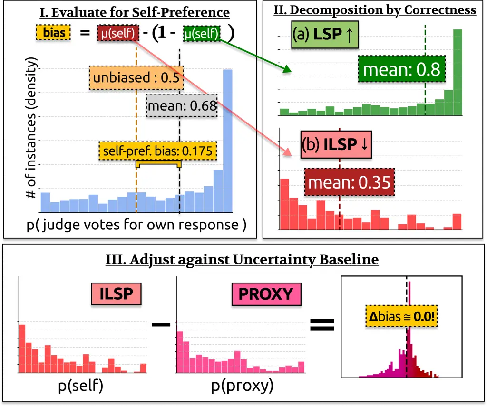

Figure 1: (I) A histogram shows the probability density that a judge
votes for itself against a counterpart for a given task, overestimating
ground truth 17.5pp.  
(II) Points in the histogram can be decomposed into legitimate examples
where the oracle prefers the judge (LSP) and illegitimate examples where
the oracle prefers the counterpart (ILSP). The “mean” values refer to
the sample mean on the subsets on these two estimates, which deviate
from “ground truth” means of 1.0 and 0.0 by definition.  
(III) Since bias comes from false positives on incorrect examples, bias
measurements should be made by taking the difference against a proxy
where self-preference is impossible by design. The proxy examples are
distributed similarly to the original examples, suggesting that
“narcissism” is reason for overshooting. The decomposition is made clear
in Section 5.

Figure 2: Judge Task Accuracy versus Illegitimate Self-Preference
(Sec. 4.2.1). The size of the points represents the parameter count of
the tested model. With our proposed baseline (dark nodes), reported bias
(light nodes) drops substantially, irrespective of task accuracy or
model size.

## 1 Introduction

As language models see increasing deployment as evaluators, raters, and
proxies for human preference, researchers have observed consistent
patterns of unreliability (Gu et al., 2025; Li et al., 2024). These
patterns are frequently categorized as biases (Dietz et al., 2025; Ye et
al., 2024) and are often interpreted through anthropomorphic tropes or
linked to emerging theory-of-mind frameworks.

One notable example comes with the recent fascination with
self-preference bias, or narcissism, of LLM evaluators (Panickssery et
al., 2024; Liu et al., 2024b). A suite of recent experimental findings
claim that when language models are used to compare responses to a
query, the distribution of votes will skew towards outputs generated by
that same model. If true, this behavior would pose critical implications
for safety and alignment research; this form of situational awareness
(Laine et al., 2023) risks contaminating post-training, guardrail
construction, and monitoring efforts that bootstrap human preferences
using LLM evaluators.

However, self-preference signals remain confounded by plausible
baselines. For instance, early tests did not compare self-preference
rates against ground truth accuracy, potentially mistaking a model’s
accurate assessment of its own superior performance for illegitimate
bias. Recent efforts now control for this by using oracle labels (Chen
et al., 2025a; Wataoka et al., 2024), but still fail to disentangle the
relationship between task accuracy and evaluation accuracy; that is, the
ability of a judge model to assign accurate preference ratings
regardless of its own skill in a given domain. The capabilities a model
exhibits on a given task may inform its preferences on that same task;
specifically, one might imagine that an LLM-judge’s distribution of
preferences will differ depending on if it could succeed on the query in
question. If evaluations on these “harder” queries show greater
uncertainty, then a model might choose its own, incorrect response at
random. The inability to distinguish between a model’s general
evaluative proficiency and an active self-bias undermines the causality
of previously established results.

We find that evaluator uncertainty produces artifacts in reported
self-preference bias. If we replace the judge’s response with an
incorrect response from a different model, we can compare the judge’s
preference distribution on this “proxy” test against its own, isolating
the effect of a judge evaluating itself.

##### Contributions

First, we pose an Evaluation Quality Baseline that calibrates
self-preference statistics using an output-matched control group. For
queries where a judge produced an incorrect or inferior response (cases
where self-preference would be illegitimate), we retrieve responses to
that query from other models which were also incorrect/inferior, and
elicit from the judge the probability that it votes for this
alternative. By collecting probabilities from judgments which do not
feature the judge’s own response, there is no longer a “self” to prefer.
Taking the difference in probabilities between the original case and
this proxy test yields the relative surplus of preference caused by
auto-evaluation. We describe an outcome-matching approach to collecting
proxies and implement our baseline as a paired t-test, where the test
statistic produces this self-preference effect. We then implement this
baseline on 9 datasets across 16 models. Finally, we offer a
preliminary, entropy-based analysis on the mechanisms which produce
evaluator biases, which attempt to capture markers of confidence in
pairwise evaluations.

We operationalize these proposals on reproductions of four landmark
self-preference papers, showing that evaluator uncertainty accounts for
an average of 89.6% of measured self-preference, substantially reducing
but not eliminating evidence for bias; furthermore, 44% of experiments
should show no or negative bias, and 50% report self-preference values
that lose statistical significance under the null.

Furthermore, we test if inducing chain-of-thought reasoning in the judge
reduces bias in the controlled setting, finding limited evidence despite
previous claims.

We conclude with hypotheses on the mechanisms which produce evaluator
noise, including a preliminary analysis on asymmetric entropy
conditioned on evaluator correctness. Together, our findings distill
self-preference into a clear, causal signal to improve future
meta-evaluation, bias and calibration research.

## 2 Background

### 2.1 Self-Preference and Other Biases in LLM Evaluators

Literature on LLM evaluation has rapidly expanded in recent years, with
numerous surveys cataloging the diverse methodologies and challenges
(Zheng et al., 2023; Shen et al., 2023; Chen et al., 2024; Li et al.,
2024; Li et al., 2025; Gu et al., 2025). A significant subset of this
work focuses on the reliability and biases of LLM evaluators,
identifying various failure modes including inconsistency,
susceptibility to manipulation, and context sensitivity (Koo et al.,
2024; Ye et al., 2024; Dietz et al., 2025).

Among these, self-preference has emerged as a particularly intriguing
phenomenon, where models appear to favor their own outputs over those of
other models. Panickssery et al. (2024) isolate this behavior using
proxy tests on summarization tasks, while Liu et al. (2024b) observe a
similar behavior using judges trained on encoding-based representations.

These early approaches faced limitations due to their entanglement of
self-preference signals with objective quality. A model which might
achieve a 100% win-rate against a significantly weaker counterpart may
correctly prefer its own outputs 100% of the time, unfairly earning the
title of “narcissist”. To address this confound, Chen et al. (2025a),
Wataoka et al. (2024), Li et al. (2026), and Mahbub and Feng (2025)
proposed experimental setups based on response evaluations from
verifiable tasks like mathematics, code, or multiple-choice responses.
For subjective data, Chen et al. (2025b) utilize “gold labels” from a
panel of stronger, third-party language models to emulate human
judgment. Both approaches enable “oracle labels” which add a dimension
of ground truth to pairwise comparisons. Many of these works find that a
judge’s accuracy on a task correlates positively with its accuracy
evaluating that same task. None, however, decouple this correlation from
reported bias figures.

Spiliopoulou et al. (2025) use third-party judge labels to control for
model quality and simulate self-scoring variance. However, they do not
distinguish between harmful and legitimate self-preference, leaving the
actual impact of their identified bias unclear.

### 2.2 Situational Awareness

Self-preference behavior in LLMs has been interpreted as evidence of
situational awareness, suggesting that models can recognize their own
outputs and adjust their evaluations accordingly (Laine et al., 2023;
Berglund et al., 2023; Binder et al., 2025). By eliminating
false-positives in self-preference statistics, we ground evaluator bias
in comparative assertions of this awareness.

### 2.3 Uncertainty Quantification

Measuring uncertainty in language models enables “confidence” estimates
for generated outputs. Tian et al. (2023); Grewal et al. (2024); Liu et
al. (2024a) present evidence that activation spaces offer rich
uncertainty signals, enabling reasonable calibration. Vazhentsev et al.
(2025) further show that analyzing token-level uncertainty enables
elicitation of true confidence levels, while Kuhn et al. (2023) and
Farquhar et al. (2024) devise a semantic entropy metric to unite both
approaches. While we leave diagnostics of evaluator uncertainty to these
and future works, our preliminary entropy-driven analysis provides some
heuristics for characterizing the relationship between task difficulty
and uncertainty.

## 3 Methodology

### 3.1 Preliminaries

#### 3.1.1 Setup

Consider a judge model $`J`$ prompted to conduct pairwise evaluations of
task responses on a prompt $`x\in\mathcal{X}`$. Let $`A`$ and $`B`$ be
two candidate outputs. We define the preference score $`s_{J}(x,A,B)`$
as the probability the judge favors candidate $`A`$ over candidate $`B`$
based on its predictive distribution over vote tokens:

```math
s_{J}(x,A,B)=P_{J}(\text{vote}=A\mid x,A,B)\in[0,1] \tag{1}
```

When $`J`$ evaluates its own output $`o_{J}`$ against a reference
$`o_{R}`$, the aggregate self-preference score (SP) is:

```math
\textbf{SP}(J,R,\mathcal{X})=\mathbb{E}_{x\in\mathcal{X}}[s_{J}(x,o_{J},o_{R})] \tag{2}
```

#### 3.1.2 Comparison against “Generation Quality”

To distinguish internal bias from objective performance, we utilize an
oracle to provide a ground-truth indicator $`G(x,A,B)\in\{0,1\}`$, where
$`G=1`$ if $`A`$ is truly superior to $`B`$. The task accuracy
(win-rate) of $`J`$ against $`R`$ is:

```math
\textbf{Acc}(J,R,\mathcal{X})=\mathbb{E}_{x\in\mathcal{X}}[G(x,o_{J},o_{R})] \tag{3}
```

We define the self-preference bias as the expected deviation of the
judge’s probabilistic preference from the oracle indicator:

```math
\textbf{Bias}(J,R,\mathcal{X})=\textbf{SP}(J,R,\mathcal{X})-\textbf{Acc}(J,R,\mathcal{X}) \tag{4}
```

### 3.2 Illegitimate versus Legitimate Self-Preference

The oracle $`G`$ allows us to decompose Bias into two distinct failure
modes based on whether the judge wins ($`Y=1`$) or loses ($`Y=0`$). We
define the illegitimate (ILSP) and legitimate (LSP) self-preference
rates as follows:

```math
\text{{{\color[rgb]{1,0,0}ILSP}}}=\mathbb{E}[s_{J}|Y=0],\quad\text{{{\color[rgb]{0,0.3906,0}LSP}}}=\mathbb{E}[s_{J}|Y=1]
```

Intuitively, ILSP represents “unearned credit”—instances where the judge
favors itself despite producing an inferior response. Conversely, LSP
measures “recognized merit.” We can now reformulate Equation 4 as a
weighted decomposition:

```math
\textbf{Bias}=\underbrace{(1-\textbf{Acc})\cdot\textbf{{\color[rgb]{1,0,0}ILSP}}}_{\text{Unearned Credit}}-\underbrace{\textbf{Acc}\cdot(1-\textbf{{\color[rgb]{0,0.3906,0}LSP}})}_{\text{Unrecognized Merit}} \tag{5}
```

Crucially, self-preference bias (unearned credit) is exclusively a
function of ILSP. Chen et al. (2025a) refer to this metric as “Harmful
Self-Preference Propensity”, while Chen et al. (2025b) enumerate this as
bias. The decomposition demonstrates that ILSP is the variable of
interest for measuring harmful bias, as task accuracy and LSP
counterbalance it. Our study focuses on isolating ILSP, as eliminating
this bias entails removing unwarranted self-preference.

### 3.3 The Need for an Evaluator Quality Baseline

If the ILSP term controls bias, how can we characterize the distribution
that produces it? All examples which fall into this subset are examples
where a judge model produced a verifiably incorrect or relatively
inferior response. This subset introduces a covariate on evaluations
based on the judge’s task-related capability. We assert that this
deficit in capability influences the voting behavior of the judge. This
is analogous to a student’s performance on a multiple choice exam
(pairwise preference), which may be lower-bounded by their performance
in a free response setting (generative task). This student’s
“multiple-choice” behavior may manifest as pure aleatory uncertainty or
deference to shallow heuristics. Research on uncertainty quantification
has shown that while evaluator errors do depend on task accuracy (Kalai
et al., 2025; Du et al., 2024; Sychev et al., 2025), the mechanisms
which drive such errors vary by model, task, and context.

We begin with an outcome-driven definition of self-preference:
self-preference bias in LLM judges is the excess probability that a
judge favors its own inferior output over a similarly inferior output
from another model.

Regardless of the specific mechanism, what remains constant is a need to
test the judge’s behaviors in a control setting. If self-preference bias
drives voting behavior under uncertainty, then the voting behaviors on
ILSP examples should differ based on whether a judge is evaluating
itself or not. To demonstrate self-preference bias, we need a baseline
to compare against, to measure on a per-example basis how much more a
judge would prefer its own incorrect response, versus that of a proxy
model of similar capability. In the latter case, there is no “self” for
the judge to prefer, but the example context retains its
uncertainty-provoking difficulty.

To isolate true self-bias, we introduce the Evaluator Quality Baseline.
We define a proxy model $`K`$ and a capability-matched subset
$`\mathcal{X}_{K}`$ where $`K`$ and $`J`$ share identical oracle
indicators against reference $`R`$:

```math
\mathcal{X}_{K}:\{x\in\mathcal{X}\mid G(x,o_{J},o_{R})=G(x,o_{K},o_{R})\} \tag{6}
```

To determine if $`J`$ exhibits a specific affinity for its own outputs
over those of an equally capable peer, we define the sample-wise
preference differential $`\Delta s_{J}(x)`$:

```math
\Delta s_{J}(x)=s_{J}(x,o_{J},o_{R})-s_{J}(x,o_{K},o_{R}) \tag{7}
```

We can pose this as a test statistic $`T_{\text{quality}}`$, which is
the mean of this differential across $`\mathcal{X}_{K}`$:

```math
T_{\text{quality}}(J,R,K,\mathcal{X}_{K})=\mathbb{E}_{x\in\mathcal{X}_{K}}[\Delta s_{J}(x)] \tag{8}
```

Then, our baseline creates a null hypothesis to establish
self-preference. $`H_{0}:T_{\text{quality}}\leq 0`$ posits that $`J`$
does not prefer its own generations more than those of a proxy. This
baseline not only allows us to calibrate self-preference scores against
evaluation noise on hard problems, but also ensures that signals which
reject the null are robust to evaluator quality effects.

## 4 Experimental Setup

### 4.1 The Evaluator Quality Test

Our Evaluator Quality Baseline selects relevant proxies, calculates the
difference between self-vote and proxy-vote probabilities, and derives
distributional statistics like mean and spread.

##### Proxy Selection and Retrieval

We identify proxy models $`K`$ that are capability-matched to the judge
$`J`$ relative to a reference $`R`$. For all datasets in the experiments
above, we index the dataset to example-level granularity; that is, For
each example $`x_{i}`$, we identify all proxy responses $`o_{K,i}`$
where the oracle judgment against reference $`o_{R,i}`$ matches:
$`G(x_{i},o_{J,i},o_{R,i})=G(x_{i},o_{K,i},o_{R,i})`$. This ensures the
judge evaluates responses of equivalent outcome quality without a
self-preferential intervention.

Critically, this is not model-level capability matching but
example-level outcome matching. The proxy provides a response that
”should” receive the same preference as J’s response according to ground
truth, isolating potential self-recognition effects from objective
quality differences.

If we find several such proxy examples, we test them all and take
$`\Delta s_{J}{x}`$ over the average
$`\mathbb{E}_{k\in\{K\}}[s_{J}(x,o_{K},o_{R})]`$.

We report statistics on selected proxies per dataset in Appendix B.

##### Statistical Significance Testing

We pose our Evaluator Quality Baseline as a paired t-test:

```math
T_{\text{quality}}(J,R,K,\mathcal{X}_{K})=\frac{\mathbb{E}_{x\in\mathcal{X}_{K}}[\Delta s_{J}(x)]}{SE} \tag{9}
```

where $`\Delta s_{J}`$ is the difference between the self- and
proxy-evaluations from Eq. 7, and
$`SE=\sqrt{\frac{Var(\Delta s_{J})}{N}}`$.

Per the decomposition in Equation 5, self-preference bias is driven by
the ILSP mean. Test statistics are thus calculated on the ILSP metric
defined in Eq. 9.

### 4.2 Reproducing Previous Experiments

We reproduce four prior self-preference pipelines, augmenting their
original protocols with our baseline and match proxies in all evaluation
setups. We test a diverse suite of models—including Llama-3.(1,2,3),
Qwen-2.5, Gemma-2, DeepSeek-V3, GPT-4o, and GPT-3.5-Turbo—to cover
various reasoning modalities. Full experimental specifications are in
Appendix A.

#### 4.2.1 Verifiable Outputs (Chen et al., 2025a)

We reproduce the verifiable reasoning experiments of Chen et al.
(2025a), which isolate self-preference on tasks with objectively correct
answers. Datasets include MATH-500(Hendrycks et al., 2021b), MBPP-Plus
(Austin et al., 2021), and MMLU (Hendrycks et al., 2021a). Ground truth
is established via execution-based evaluation for code (pass@1) and
exact string matching for mathematics and multiple-choice responses.
This setup enables clean separation of LSP from ILSP examples.

We also test the setup of allowing the judges to use chain of thought of
reasoning to test if harmful self-preference is surfaced from the
Evaluation Quality Baseline. Before reaching a decision, the judge
creates a sequential chain of reasoning. We use base instruction tuned
models and ask them to reason step by step.

#### 4.2.2 Debiased Gold Judges (Chen et al., 2025b)

We reproduce the DBG-scoring methodology of Chen et al. (2025b), which
evaluates self-preference on open-ended tasks including helpfulness with
AlpacaEval (Li et al., 2023), truthfulness with TruthfulQA (Lin et al.,
2022), and translation quality with the German-English WMT19 dataset
(Barrault et al., 2019).

For exactitude, we use the exact response and preference data released
with the paper, including ground-truth labels from oracle judges
$`G=\{G_{1},\dots,G_{n}\}`$, which are “neutral” models unrelated to all
tested judges and references. For each item $`i`$, the oracle vote
$`g_{i}\in\{y_{A,i},y_{B,i}\}`$ is the majority preference of $`G`$
between the two candidates $`(y_{A,i},y_{B,i})`$ in $`Y_{A,B}(X)`$. We
then define a judge score over $`X`$ that measures objective quality
differences between models $`J`$ and $`R`$:
$`\mathtt{score}\!\big(G,Y_{J,R}(X)\big)=\tfrac{1}{|X|}\sum_{i=1}^{|X|}\mathbf{1}[\,g_{i}=y_{J,i}\,]`$,
i.e., the fraction of items where the oracle judges prefer $`J`$’s
summary. To reproduce initial findings, we use the same ensemble of
three oracle judges—GPT-4o-mini, Gemini-1.5-Flash, and DeepSeek-V3—to
assign oracle labels via majority vote (requiring agreement from at
least two of three judges; ties are excluded). We find high agreement
between judges, particularly when aggregating via majority vote, and
report agreement in Appendix  H.

#### 4.2.3 Human Annotations (Panickssery et al., 2024)

We reproduce the summarization experiments of Panickssery et al. (2024),
which established a correlation between self-recognition and
self-preference on news summarization datasets, namely CNN/DailyMail
(See et al., 2017) and XSUM (Narayan et al., 2018). Similar to
DBG-Score, ground-truth summaries are generated at-scale with a
“debiased gold judge”—in this case, GPT 5—with a prompt first tuned by
small-scale human validation before tested on a larger, holdout set. We
take log-probabilities through the OpenAI API, following the
hyperparameters used initially. Our proxy selection matches the
outcome-based approach used for other experimental setups, except that
we only take a subset of potential proxies due to costs of accruing
gold-judge labels from proprietary models.

#### 4.2.4 Authorship Obfuscation

Lastly, we replicate the setup of Mahbub and Feng (2025), which
investigates self-preference under stylistic perturbation using answer
extraction as the verifiability signal. This approach tests whether
synonym replacement and paraphrasing eliminate self-preference by
disrupting surface-level cues. This work tests self-preference on the
multiple-choice reading comprehension dataset QualiTY (Pang et al.,
2022). Since reading comprehension responses are in multiple-choice
format, we can gather ground truth labels by parsing the corresponding
answer and outcome-match queries accordingly.

|                  |                 |                |       |                    |                      |
| ---------------- | --------------- | -------------- | ----- | ------------------ | -------------------- |
| Dataset / Model  | ILSP\_(orig)(%) | ILSP\_(upd)(%) | $`N`$ | Rel. $`\Delta`$(%) | $`p`$                |
| Quality          |                 |                |       |                    |                      |
| Q2.5-7B-I-T      | 30.0            | -6.5           | 2259  | -121.7             | 1.000                |
| L3.1-8B-I-T      | 33.5            | -7.6           | 2341  | -122.7             | 1.000                |
| L4-Scout-17B     | 35.3            | 6.5            | 2146  | -81.6              | $`<10^{-4}`$         |
| Alpaca Eval      |                 |                |       |                    |                      |
| Q2.5-3B-Ins      | 41.4            | -2.3           | 1370  | -105.6             | 0.998                |
| Q2.5-0.5B-Ins    | 49.8            | -0.2           | 1476  | -100.4             | 0.992                |
| Q2.5-1.5B-Ins    | 48.7            | -0.4           | 1369  | -100.8             | 0.989                |
| Q2.5-7B-Ins      | 37.6            | 4.9            | 2261  | -87.0              | $`<10^{-4}`$         |
| Q2.5-14B-Ins     | 24.9            | 9.2            | 900   | -63.1              | $`<10^{-4}`$         |
| Q2.5-32B-Ins     | 22.3            | 11.9           | 873   | -46.6              | $`<10^{-4}`$         |
| L3.1-8B-Ins      | 39.1            | 6.8            | 2038  | -82.6              | $`<10^{-4}`$         |
| G2-9b-it         | 43.5            | 22.9           | 324   | -47.4              | $`<10^{-4}`$         |
| Trans / Truth    |                 |                |       |                    |                      |
| Q2.5-7B (Trans)  | 31.0            | 3.1            | 543   | -90.0              | 0.007                |
| L3.1-8B (Trans)  | 42.4            | 3.2            | 690   | -92.5              | $`<10^{-4}`$         |
| G2-9b-it (Trans) | 23.3            | 8.1            | 147   | -65.2              | $`2.9\cdot 10^{-4}`$ |
| Q2.5-7B (Truth)  | 38.4            | 11.7           | 441   | -69.5              | $`<10^{-4}`$         |
| L3.1-8B (Truth)  | 37.6            | 9.1            | 559   | -75.8              | $`<10^{-4}`$         |
| G2-9b-it (Truth) | 28.9            | 12.3           | 283   | -57.4              | $`<10^{-4}`$         |
| MATH500          |                 |                |       |                    |                      |
| Q2.5-3b          | 48.1            | -1.5           | 71    | -103.1             | 0.884                |
| Q2.5-7b          | 49.7            | 9.4            | 29    | -81.1              | 0.051                |
| Q2.5-14b         | 35.7            | -2.8           | 28    | -107.8             | 0.707                |
| Q2.5-32b         | 49.1            | 12.4           | 24    | -74.8              | 0.019                |
| Q2.5-72b         | 54.1            | 20.0           | 20    | -63.0              | $`3.7\cdot 10^{-4}`$ |
| L3.2-3b          | 30.6            | -5.1           | 144   | -116.7             | 1.000                |
| L3.1-8b          | 32.9            | -4.7           | 129   | -114.3             | 1.000                |
| L3.1-70b         | 28.3            | -2.1           | 73    | -107.4             | 0.788                |
| L3.3-70b         | 21.4            | -3.8           | 50    | -117.8             | 0.820                |
| G2-9b            | 40.8            | -1.6           | 106   | -103.9             | 0.768                |
| G2-27b           | 42.7            | 1.4            | 99    | -96.7              | 0.320                |
| MMLU             |                 |                |       |                    |                      |
| Q2.5-3b          | 53.9            | 2.8            | 173   | -94.8              | 0.019                |
| Q2.5-7b          | 52.8            | 10.3           | 111   | -80.5              | $`5.3\cdot 10^{-4}`$ |
| Q2.5-14b         | 60.0            | 12.9           | 70    | -78.5              | $`<10^{-4}`$         |
| Q2.5-32b         | 67.6            | 17.1           | 66    | -74.7              | $`<10^{-4}`$         |
| Q2.5-72b         | 62.0            | 19.3           | 50    | -68.9              | $`<10^{-4}`$         |
| L3.2-3b          | 18.7            | -12.6          | 210   | -167.4             | 1.000                |
| L3.1-8b          | 35.5            | 0.3            | 145   | -99.2              | 0.418                |
| L3.1-70b         | 46.8            | 7.3            | 109   | -84.4              | 0.010                |
| L3.3-70b         | 65.4            | 23.3           | 58    | -64.4              | $`<10^{-4}`$         |
| G2-9b            | 33.9            | -5.9           | 119   | -117.4             | 0.993                |
| G2-27b           | 43.2            | 0.9            | 123   | -97.9              | 0.380                |
| MBPP+            |                 |                |       |                    |                      |
| Q2.5-3b          | 50.1            | -0.4           | 107   | -100.8             | 0.585                |
| Q2.5-7b          | 45.0            | 6.6            | 73    | -85.3              | 0.022                |
| Q2.5-14b         | 25.8            | 6.9            | 72    | -73.3              | 0.001                |
| Q2.5-32b         | 15.3            | 0.5            | 56    | -96.7              | 0.408                |
| Q2.5-72b         | 25.8            | 10.3           | 45    | -60.1              | $`9.8\cdot 10^{-4}`$ |
| L3.2-3b          | 28.0            | -0.3           | 147   | -101.1             | 0.778                |
| L3.1-8b          | 29.6            | 1.0            | 107   | -96.6              | 0.014                |
| L3.1-70b         | 37.8            | 6.5            | 83    | -82.8              | $`<10^{-4}`$         |
| L3.3-70b         | 38.7            | 9.0            | 63    | -76.7              | $`<10^{-4}`$         |
| G2-9b            | 22.9            | -0.0           | 104   | -100.0             | 0.500                |
| G2-27b           | 41.0            | 8.4            | 65    | -79.5              | 0.012                |
| CNN              |                 |                |       |                    |                      |
| GPT-4            | 49.2            | -17.84         | 59    | -136.3             | 1.000                |
| GPT-3.5-turbo    | 46.8            | -22.2          | 114   | -147.4             | 1.000                |
| XSUM             |                 |                |       |                    |                      |
| GPT-4            | 47.2            | -22.8          | 104   | -148.3             | .98                  |
| GPT-3.5-turbo    | 50.0            | -19.8          | 173   | -139.6             | 1.000                |

Table 1: Consolidated judge-swap summary across datasets (ILSP
subsets).  
Rel.
$`\Delta=(\text{ILSP}_{upd}-\text{ILSP}_{orig})/\text{ILSP}_{orig}`$,
where negative values indicate a reduction in self-preference bias.
$`N`$ refers to incorrect examples. Values at the $`p<0.05`$
significance level bolded.

## 5 Results and Discussion

### 5.1 The Evaluator Quality Baseline Substantially Reduces Measured Self-Preference

Controlling for evaluator quality via capability-matched proxies
substantially reduces measured self-preference, revealing that much of
the observed bias stems from evaluation uncertainty rather than
self-recognition. On MATH500, 5 of 11 tested models exhibit updated
preference propensities at or below 0, ranging from $`-5.1\%`$ with
Llama-3.2 3B Instruct to $`20.0\%`$ with Qwen2.5-72B; initially
$`30.6\%`$ and $`54.1\%`$ respectively (Figure 2). MATH500 shows an
average reduction of self preference by $`98.76\%`$, showing a
near-total collapse of self-preference signals (Table 1). Such a result
is unsurprising for objective tasks like math or coding (self-preference
declines by $`-89.26\%`$); we see lower, but still significant, relative
decreases for subjective tasks like translation ($`-82.57\%`$),
instruction-following on Alpaca Eval ($`-79.19\%`$), and truthfulness
($`-67.57\%`$). Surprisingly, MMLU—a seemingly objective multiple-choice
task—recovers a strong self-preference signal, with only 4 of 11 tested
models having a preference below statistical significance. This may be
due to stylistic preferences for persuasion modes which are baked into
post-training and bleed into responses.

Most importantly, the MMLU case shows how we can now isolate clear
self-preference signals against the backdrop of evaluator uncertainty.
Against the null, models from the Qwen2.5 suite show consistent
self-preference, even on more objective datasets. The trend of larger
models exhibiting self-preference established in Chen et al. (2025a),
Mahbub and Feng (2025), and Chen et al. (2025b) persists.

Our baseline complements rather than contradicts prior findings:
self-preference exists, but the prioritization of at-risk models has
been misplaced by measurement error. Rankwise model bias orderings shift
considerably after applying the Evaluator Quality Baseline. Using Alpaca
Eval as an example, Llama 3.1-8B showed the highest initial bias rate of
49% before the baseline, and now shows just 3.2%—the second lowest. On
the other hand, for code generation, Qwen2.5-72B went from the
third-to-least to the highest rankwise bias relative to its baseline.
For data-based mitigation strategies like steering vectors (Roytburg et
al., 2025; Ackerman and Panickssery, 2024), having controlled
measurements determines choice of mechanism design and training targets,
enabling more effective interventions.

Full judge-level pairwise statistics are in App. C: MATH500 (Table 9),
MBPP-Plus (Table 10), MMLU (Table 11), AlpacaEval (Table 12),
Translation (Table 13), Truthfulness (Table 14), and Authorship
Obfuscation (Table 15).

#### 5.1.1 Validity of Selected Proxies

While we filter our selected proxies based on oracle-level results, the
oracle preference signal only allows us to assert the performance of a
proxy relative to the reference comparison. Arguably, this does not
guarantee that the proxy could not be substantially better or worse than
the judge on the same example. This problem is magnified for subjective
tasks, where annotations from language models are used to facilitate
oracle labeling. We isolate some cases to consider: (i) the judge’s
response and the proxy’s response are incorrect for different reasons;
(ii) the ensemble of models which generate the proxy responses are, in
average, more capable than the judge at the task; (iii) a
high-capability model has too few examples of illegitimate
self-preference.

We find that our proxy selection method is robust in practice. To
measure this, we establish the equivalency between outcome-based
matching and capabilities-based matching. Since we have oracle labels
for all judge examples as well as all proxy examples, we can calculate
model-level task accuracies for any given model. The oracle-label
winrate of a judge should scale proportionally with the average winrate
of its proxies, weighted by the amount of examples selected from each
proxy.

We find a strong correlation (Pearson’s $`\rho=.85`$) between judge
winrate and weighted proxy winrate (Fig. 3). The fit aligns closely with
the $`y=x`$ line, indicating that our example-level outcome matching
balances against model-level capability differences. This matches the
intuition: for outcome-based matching, if a proxy is significantly
higher in capability, there will be fewer common outcome-level failure
points with the judge, reducing its representation in the proxy set.

We also test the stability of our test statistic as a function of the
number of matched proxies to an example. In Appendix B.3, we show that
as the number of proxies-per-example increases, neither the mean test
statistic nor its standard error fluctuate. This shows that proxy
matching does not inherit heteroskedasticity from the number of proxies
which also failed an example.

Finally, we compare our “greedy-matching” strategy to two filtered
subsets: (i) filtering selected proxy examples to those which have the
same incorrect answer as the judge; (ii) selecting only the other proxy
models whose overall task accuracy is most similar to the judge. In
Appendix I, we show that these strategies produce answers consistent
with our greedy-matching strategy with higher standard error.

More details on proxy selection and validation can be found in
Appendix B.

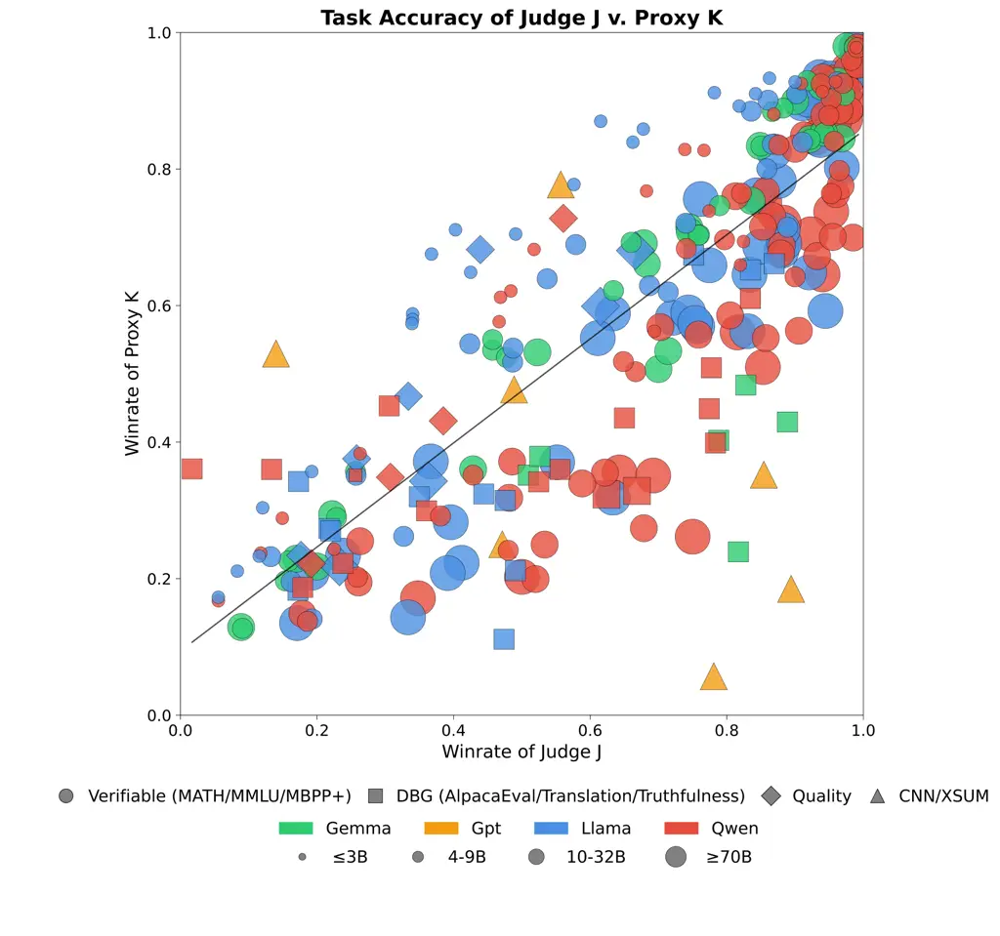

Figure 3: Model-level winrate of judges versus weighted average winrate
of selected proxies. Each point represents a judge model on a specific
dataset. The strong correlation ($`R^{2}=79\%`$) validates our proxy
selection method.

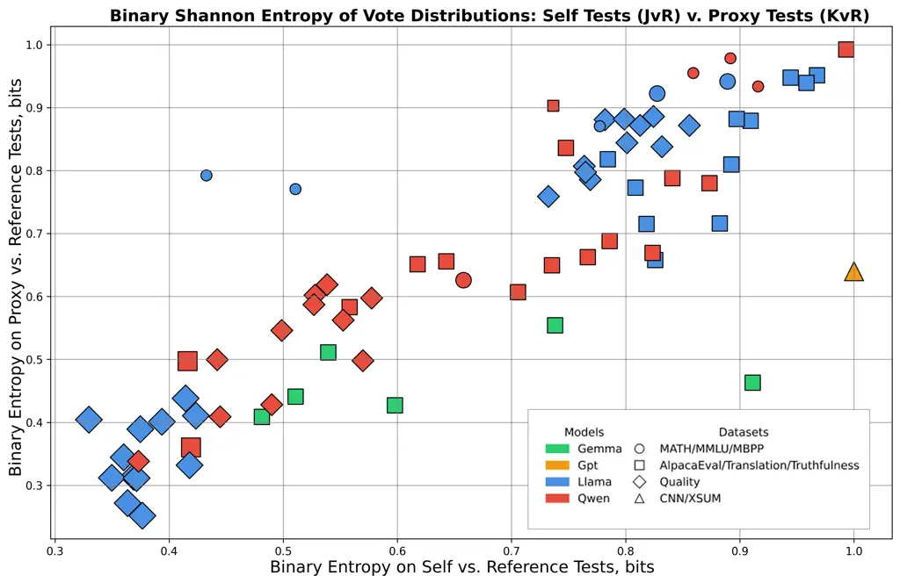

Figure 4: Shannon Entropy on hard (ILSP) example distributions is
strongly correlated, regardless of whether a model $`J`$ is judging
itself (x axis) or a similar proxy $`K`$ (y axis) ($`R^{2}=73\%`$).

Figure 5: More results on Judge Task Accuracy versus original (light)
and updated (full) self-preference experiments.

### 5.2 On the Role of Chain-of-Thought Prompting in Mitigating Self-Preference Bias

Chen et al. (2025a) report that eliciting a chain-of-thought (CoT) prior
to evaluation reduces measured self-preference. We stress-test this
intervention using our Evaluator Quality Baseline. If CoT truly does
reduce illegitimate self-preference, then it should remain relatively
robust under this framework.

Consolidated COT judge-swap results are shown in Appendix D. We see that
while COT does reduce self-preference propensity in some cases, the
findings are relatively inconsistent. Specifically, Qwen models seem to
exhibit increased self-preference when asked to elicit COT prior to a
verdict, and the MMLU results overall reflect a similar rise in
self-preference. Overall, these results suggests that while COT may be
an effective method of reducing illegitimate self-preference in some
cases, further work must be done examining how well it generalizes to
different models and domains.

### 5.3 Entropy Persists on Proxy Evaluation

Having established the strength of the Evaluator Quality Baseline in
disentangling evaluation noise from self-preference bias, we investigate
distribution-level properties that may contribute to noise. We use
Shannon Entropy to measure uncertainty on vote distributions.

We measure entropy on the subset of ILSP examples for a given model.
Specifically, we calculate the average paired Shannon entropy on
individual votes:

```math
\displaystyle H(J|Y=0) \displaystyle=\mathbb{E}_{s_{J}(\cdot|Y=0)}[H_{2}(s_{J}(x_{i},o_{J},o_{R}))] \tag{10}
```

```math
\displaystyle H(K|Y=0) \displaystyle=\mathbb{E}_{s_{J}(\cdot|Y=0)}[H_{2}(s_{J}(x_{i},o_{K},o_{R}))] \tag{11}
```

Where $`H_{2}(p)=-p\log_{2}p-(1-p)\log_{2}(1-p)`$ is the binary Shannon
entropy function. As shown in Figure 4, entropy on hard-example
distributions does not change whether a model is evaluating itself or a
proxy. On questions that a judge got wrong in generation, the
correlation between entropy on hard examples where a judge evaluates
itself versus another model is extremely strong ($`\rho=0.85`$). While
we earlier showed that the expected bias decreases dramatically when
compared against a proxy, an entropy-based analysis reveals that the
confidence with which these preferences are decoded does not change if a
judge is evaluating itself. This strengthens the hypothesis that
reported self-preference bias features an evaluator quality artifact: if
removing this bias did not change entropy around example-level
confidence, it appears unlikely that narcissism motivates uncertainty.

We present a table of these findings and a preliminary analysis of
asymmetric entropy in easy-to-hard evaluation in Appendix G.

## 6 Limitations

### 6.1 Model-Derived Oracle Labels

For subjective tasks, we follow the oracle-label approach used by
previous authors, which relies on “neutral” LLM judges which are not
being tested as judges or control groups. This ensures that, at a
minimum, oracle labels themselves do not carry a self-preference bias.
However, these labels should not be interpreted as definitive gold
standards, as they may encode other biases unrelated to authorship. Our
focus on precise re-implementation means that we assume the same risks
as previous authors in using synthetic oracle labels. Future research
should use human gold labels to disentangle evaluator uncertainty from
LLM-as-a-judge artifacts.

### 6.2 Proxy Construction and Capability Matching

Our Evaluator Quality Baseline uses outcome-matched proxies to enable a
treatment-effect design that directly measures self-preference. While
this prioritizes per-example statistical pairing over model-level
calibration, we show it still balances capabilities effectively, though
further proxy generation could enforce this more strictly.

These mismatches can act as a confounding factor in some settings;
future work on auditing self-preference might consider systematic or
proxy-level approaches to proxy selection. While our results are robust
across selection types, future research could sample proxies directly
and apply model-level calibration to control for both outcomes and
capabilities.

Because the capability of both the judge and proxy in responding to a
particular question is measured relative to a neutral reference point,
we can only ensure their relative inferiority without specifying what
domains qualify their weaker capability. Two alternate proxy strategies
are presented, with final findings equivalent to those seen in our
primary strategy. In particular, our final results do not change if we
instead filter proxy examples with semantically equivalent responses as
those of the judge. Nor do they change if we only admit proxy responses
from models in a similar capability tier as the tested judge.
Nonetheless, the inability to qualify relative superiority/inferiority
poses concerns for subjective-task datasets, since example-level
responses are harder to grade. Future work might use rubrics as opposed
to monotonic preference labels to ablate this effect.

## 7 Conclusion and Future Work

This work lays the groundwork for determining what constitutes
narcissism in LLM evaluators. Previous studies of “self-preference bias”
have suggested that this failure mode constitutes a latent form of
“situational awareness” and operate with implicit information beyond the
context window. Broadly, then, the motivation for studying
self-preferences rests on surfacing the “unknown unknowns” of the
capabilities of language models.

The necessity of recovering such behaviors requires that we adopt
methodological protocols which may systematically rule out alternative
explanations. Currently, audits of self-preference bias identify how
often a language model votes for itself when it shouldn’t. This setup
does not proactively identify whether this vote is due to general
evaluator deficiencies or due to self-preference. After testing on
37,448 evaluation pairs, only 10.4% of self-preference bias exceeds a
control-group baseline.

Future work on self-preference starts from this remainder. Certain
tasks—question-answering on language understanding, instruction
following and translations—exhibit a bias which persists beyond
measurement error. Current interventions which do not act on a causally
identified subset risk catching the wrong culprit. For instance,
revisited experiments on chain-of-thought reasoning suggest its limited
effectiveness on this subset. This work takes a crucial step towards
causally identifying self-preference behaviors in LLM-judges, though the
identified residual might emerge from other experimental artifacts
beyond our scope. In other words, this paper does not dispute the
existence of self-preference, but it does advise on where (not) to look.

## Impact Statement

This study adds to research on LLM situational awareness. By proposing a
”sensibility” framework for meta-evaluation, we show how to successfully
recover true bias from noisy data.

This research helps eliminate alignment false positives. Since accurate
measurement is vital for scalable oversight, we demonstrate that current
interventions may inadvertently target entropic noise rather than true
self-preference.

As LLMs automate high-stakes decisions and moderation, understanding
evaluator failure modes is critical. With AI content saturating public
workstreams, accurately identifying self-preference is vital to secure
platform systems against exploitation or jailbreaks.

## Acknowledgements

This work was made possible through advising by Apart Research and
Martian, with compute support from Lambda Labs. The Apart Fellowship,
hosted with Martian, assisted in funding and supporting the research,
without which this work would not have been possible.

## References

- Ackerman and Panickssery (2024) C. Ackerman and N. Panickssery
  Inspection and Control of Self-Generated-Text Recognition Ability in
  Llama3-8b-Instruct. In The Thirteenth International Conference on
  Learning Representations, External Links:
  [Link](https://openreview.net/forum?id=wWnsoLhHwt) Cited by: §5.1.
- Austin et al. (2021) J. Austin, A. Odena, M. Nye, M. Bosma, H.
  Michalewski, D. Dohan, E. Jiang, C. Cai, M. Terry, Q. Le, and C.
  Sutton Program synthesis with large language models. External Links:
  2108.07732, [Link](https://arxiv.org/abs/2108.07732) Cited by: §4.2.1.
- Barrault et al. (2019) L. Barrault, O. Bojar, M. R. Costa-jussà, C.
  Federmann, M. Fishel, Y. Graham, B. Haddow, M. Huck, P. Koehn, S.
  Malmasi, C. Monz, M. Müller, S. Pal, M. Post, and M. Zampieri Findings
  of the 2019 conference on machine translation (WMT19). In Proceedings
  of the Fourth Conference on Machine Translation (Volume 2: Shared Task
  Papers, Day 1), O. Bojar, R. Chatterjee, C. Federmann, M. Fishel, Y.
  Graham, B. Haddow, M. Huck, A. J. Yepes, P. Koehn, A. Martins, C.
  Monz, M. Negri, A. Névéol, M. Neves, M. Post, M. Turchi, and K.
  Verspoor (Eds.), Florence, Italy, pp. 1–61. External Links:
  [Link](https://aclanthology.org/W19-5301/),
  [Document](https://dx.doi.org/10.18653/v1/W19-5301) Cited by: §4.2.2.
- Berglund et al. (2023) L. Berglund, A. C. Stickland, M. Balesni, M.
  Kaufmann, M. Tong, T. Korbak, D. Kokotajlo, and O. Evans Taken out of
  context: on measuring situational awareness in LLMs. External Links:
  2309.00667, [Link](https://arxiv.org/abs/2309.00667) Cited by: §2.2.
- Binder et al. (2025) F. J. Binder, J. Chua, T. Korbak, H. Sleight, J.
  Hughes, R. Long, E. Perez, M. Turpin, and O. Evans Looking inward:
  language models can learn about themselves by introspection. In The
  Thirteenth International Conference on Learning Representations,
  External Links: [Link](https://openreview.net/forum?id=eb5pkwIB5i)
  Cited by: §2.2.
- Chen et al. (2024) G. H. Chen, S. Chen, Z. Liu, F. Jiang, and B. Wang
  Humans or LLMs as the Judge? A Study on Judgement Bias. In Proceedings
  of the 2024 Conference on Empirical Methods in Natural Language
  Processing, Y. Al-Onaizan, M. Bansal, and Y. Chen (Eds.), Miami,
  Florida, USA, pp. 8301–8327. External Links:
  [Document](https://dx.doi.org/10.18653/v1/2024.emnlp-main.474),
  [Link](https://aclanthology.org/2024.emnlp-main.474/) Cited by: §2.1.
- Chen et al. (2025a) W. Chen, Z. Wei, X. Zhu, S. Feng, and Y. Meng Do
  LLM Evaluators Prefer Themselves for a Reason?. arXiv. External Links:
  2504.03846, [Document](https://dx.doi.org/10.48550/arXiv.2504.03846),
  [Link](http://arxiv.org/abs/2504.03846) Cited by: §1, §2.1, §3.2,
  §4.2.1, §4.2.1, §5.1, §5.2.
- Chen et al. (2025b) Z. Chen, H. Wang, X. Zhang, E. Hu, and Y. Lin
  Beyond the Surface: Measuring Self-Preference in LLM Judgments. In
  Proceedings of the 2025 Conference on Empirical Methods in Natural
  Language Processing, C. Christodoulopoulos, T. Chakraborty, C. Rose,
  and V. Peng (Eds.), Suzhou, China, pp. 1653–1672. External Links:
  [Document](https://dx.doi.org/10.18653/v1/2025.emnlp-main.86),
  [Link](https://aclanthology.org/2025.emnlp-main.86/), ISBN
  979-8-89176-332-6 Cited by: §2.1, §3.2, §4.2.2, §4.2.2, §5.1.
- Dietz et al. (2025) L. Dietz, O. Zendel, P. Bailey, C. Clarke, E.
  Cotterill, J. Dalton, F. Hasibi, M. Sanderson, and N. Craswell
  LLM-Evaluation Tropes: Perspectives on the Validity of
  LLM-Evaluations. In Proceedings of the 2025 International ACM SIGIR
  Conference on Innovative Concepts and Theories in Information
  Retrieval (ICTIR), pp. 218–229. External Links: 2504.19076,
  [Document](https://dx.doi.org/10.1145/3731120.3744588),
  [Link](http://arxiv.org/abs/2504.19076) Cited by: §1, §2.1.
- Du et al. (2024) P. Du, S. Liang, B. Zhang, P. Cao, Y. Chen, K. Liu,
  and J. Zhao ZhuJiu-Knowledge: A Fairer Platform for Evaluating
  Multiple Knowledge Types in Large Language Models. In Proceedings of
  the 2024 Conference of the North American Chapter of the Association
  for Computational Linguistics: Human Language Technologies (Volume 3:
  System Demonstrations), K. Chang, A. Lee, and N. Rajani (Eds.), Mexico
  City, Mexico, pp. 194–206. External Links:
  [Document](https://dx.doi.org/10.18653/v1/2024.naacl-demo.20),
  [Link](https://aclanthology.org/2024.naacl-demo.20/) Cited by: §3.3.
- Farquhar et al. (2024) S. Farquhar, J. Kossen, L. Kuhn, and Y. Gal
  Detecting hallucinations in large language models using semantic
  entropy. Nature 630 (8017), pp. 625–630. External Links: ISSN
  1476-4687, [Document](https://dx.doi.org/10.1038/s41586-024-07421-0),
  [Link](https://www.nature.com/articles/s41586-024-07421-0) Cited by:
  §2.3.
- Grewal et al. (2024) Y. S. Grewal, E. V. Bonilla, and T. D. Bui
  Improving uncertainty quantification in large language models via
  semantic embeddings. External Links: 2410.22685,
  [Link](https://arxiv.org/abs/2410.22685) Cited by: §2.3.
- Gu et al. (2025) J. Gu, X. Jiang, Z. Shi, H. Tan, X. Zhai, C. Xu, W.
  Li, Y. Shen, S. Ma, H. Liu, S. Wang, K. Zhang, Y. Wang, W. Gao, L. Ni,
  and J. Guo A Survey on LLM-as-a-Judge. arXiv. External Links:
  2411.15594, [Document](https://dx.doi.org/10.48550/arXiv.2411.15594),
  [Link](http://arxiv.org/abs/2411.15594) Cited by: §1, §2.1.
- Hendrycks et al. (2021a) D. Hendrycks, C. Burns, S. Basart, A. Zou, M.
  Mazeika, D. Song, and J. Steinhardt Measuring massive multitask
  language understanding. In International Conference on Learning
  Representations, External Links:
  [Link](https://openreview.net/forum?id=d7KBjmI3GmQ) Cited by: §4.2.1.
- Hendrycks et al. (2021b) D. Hendrycks, C. Burns, S. Kadavath, A.
  Arora, S. Basart, E. Tang, D. Song, and J. Steinhardt Measuring
  mathematical problem solving with the MATH dataset. In Thirty-fifth
  Conference on Neural Information Processing Systems Datasets and
  Benchmarks Track (Round 2), External Links:
  [Link](https://openreview.net/forum?id=7Bywt2mQsCe) Cited by: §4.2.1.
- Kalai et al. (2025) A. T. Kalai, O. Nachum, S. S. Vempala, and E.
  Zhang Why Language Models Hallucinate. arXiv. External Links:
  2509.04664, [Document](https://dx.doi.org/10.48550/arXiv.2509.04664),
  [Link](http://arxiv.org/abs/2509.04664) Cited by: §3.3.
- Koo et al. (2024) R. Koo, M. Lee, V. Raheja, J. I. Park, Z. M. Kim,
  and D. Kang Benchmarking Cognitive Biases in Large Language Models as
  Evaluators. In Findings of the Association for Computational
  Linguistics: ACL 2024, L. Ku, A. Martins, and V. Srikumar (Eds.),
  Bangkok, Thailand, pp. 517–545. External Links:
  [Document](https://dx.doi.org/10.18653/v1/2024.findings-acl.29),
  [Link](https://aclanthology.org/2024.findings-acl.29/) Cited by: §2.1.
- Kuhn et al. (2023) L. Kuhn, Y. Gal, and S. Farquhar Semantic
  uncertainty: linguistic invariances for uncertainty estimation in
  natural language generation. In The Eleventh International Conference
  on Learning Representations, External Links:
  [Link](https://openreview.net/forum?id=VD-AYtP0dve) Cited by: §2.3.
- Laine et al. (2023) R. Laine, A. Meinke, and O. Evans Towards a
  Situational Awareness Benchmark for LLMs. In Socially Responsible
  Language Modelling Research, External Links:
  [Link](https://openreview.net/forum?id=DRk4bWKr41) Cited by: §1, §2.2.
- Li et al. (2025) D. Li, B. Jiang, L. Huang, A. Beigi, C. Zhao, Z.
  Tan, A. Bhattacharjee, Y. Jiang, C. Chen, T. Wu, K. Shu, L. Cheng,
  and H. Liu From Generation to Judgment: Opportunities and Challenges
  of LLM-as-a-Judge. In Proceedings of the 2025 Conference on Empirical
  Methods in Natural Language Processing, C. Christodoulopoulos, T.
  Chakraborty, C. Rose, and V. Peng (Eds.), Suzhou, China,
  pp. 2757–2791. External Links:
  [Document](https://dx.doi.org/10.18653/v1/2025.emnlp-main.138),
  [Link](https://aclanthology.org/2025.emnlp-main.138/), ISBN
  979-8-89176-332-6 Cited by: §2.1.
- Li et al. (2024) H. Li, Q. Dong, J. Chen, H. Su, Y. Zhou, Q. Ai, Z.
  Ye, and Y. Liu LLMs-as-Judges: A Comprehensive Survey on LLM-based
  Evaluation Methods. arXiv. External Links: 2412.05579,
  [Document](https://dx.doi.org/10.48550/arXiv.2412.05579),
  [Link](http://arxiv.org/abs/2412.05579) Cited by: §1, §2.1.
- Li et al. (2026) Q. Li, S. Dou, K. Shao, C. Chen, and H. Hu Evaluating
  scoring bias in LLM-as-a-Judge. In Database Systems for Advanced
  Applications, H. Jung, T. Wang, M. Toyoda, H. Kwon, and J. Lee (Eds.),
  Singapore, pp. 19–34. External Links: ISBN 978-981-92-0372-7 Cited by:
  §2.1.
- Li et al. (2023) X. Li, T. Zhang, Y. Dubois, R. Taori, I.
  Gulrajani, C. Guestrin, P. Liang, and T. B. Hashimoto AlpacaEval: an
  automatic evaluator of instruction-following models. GitHub. Note:
  [https://github.com/tatsu-lab/alpaca_eval](https://github.com/tatsu-lab/alpaca_eval)
  Cited by: §4.2.2.
- Lin et al. (2022) S. Lin, J. Hilton, and O. Evans TruthfulQA:
  measuring how models mimic human falsehoods. In Proceedings of the
  60th Annual Meeting of the Association for Computational Linguistics
  (Volume 1: Long Papers), S. Muresan, P. Nakov, and A. Villavicencio
  (Eds.), Dublin, Ireland, pp. 3214–3252. External Links:
  [Link](https://aclanthology.org/2022.acl-long.229/),
  [Document](https://dx.doi.org/10.18653/v1/2022.acl-long.229) Cited by:
  §4.2.2.
- Liu et al. (2024a) L. Liu, Y. Pan, X. Li, and G. Chen Uncertainty
  estimation and quantification for llms: a simple supervised approach.
  External Links: 2404.15993, [Link](https://arxiv.org/abs/2404.15993)
  Cited by: §2.3.
- Liu et al. (2024b) Y. Liu, N. Moosavi, and C. Lin LLMs as Narcissistic
  Evaluators: When Ego Inflates Evaluation Scores. In Findings of the
  Association for Computational Linguistics: ACL 2024, L. Ku, A.
  Martins, and V. Srikumar (Eds.), Bangkok, Thailand, pp. 12688–12701.
  External Links:
  [Document](https://dx.doi.org/10.18653/v1/2024.findings-acl.753),
  [Link](https://aclanthology.org/2024.findings-acl.753/) Cited by: §1,
  §2.1.
- Mahbub and Feng (2025) T. Mahbub and S. Feng Mitigating
  Self-Preference by Authorship Obfuscation. In NeurIPS 2025 Workshop on
  Evaluating the Evolving LLM Lifecycle: Benchmarks, Emergent Abilities,
  and Scaling, External Links:
  [Link](<https://openreview.net/forum?id=8II1ZSRKwQ&referrer=%5Bthe%20profile%20of%20Shi%20Feng%5D(%2Fprofile%3Fid%3D~Shi_Feng1)>)
  Cited by: §2.1, §4.2.4, §5.1.
- Narayan et al. (2018) S. Narayan, S. B. Cohen, and M. Lapata Don’t
  give me the details, just the summary! topic-aware convolutional
  neural networks for extreme summarization. In Proceedings of the 2018
  Conference on Empirical Methods in Natural Language Processing, E.
  Riloff, D. Chiang, J. Hockenmaier, and J. Tsujii (Eds.), Brussels,
  Belgium, pp. 1797–1807. External Links:
  [Link](https://aclanthology.org/D18-1206/),
  [Document](https://dx.doi.org/10.18653/v1/D18-1206) Cited by: §4.2.3.
- Pang et al. (2022) R. Y. Pang, A. Parrish, N. Joshi, N. Nangia, J.
  Phang, A. Chen, V. Padmakumar, J. Ma, J. Thompson, H. He, and S.
  Bowman QuALITY: question answering with long input texts, yes!. In
  Proceedings of the 2022 Conference of the North American Chapter of
  the Association for Computational Linguistics: Human Language
  Technologies, M. Carpuat, M. de Marneffe, and I. V. Meza Ruiz (Eds.),
  Seattle, United States, pp. 5336–5358. External Links:
  [Link](https://aclanthology.org/2022.naacl-main.391/),
  [Document](https://dx.doi.org/10.18653/v1/2022.naacl-main.391) Cited
  by: §4.2.4.
- Panickssery et al. (2024) A. Panickssery, S. R. Bowman, and S. Feng
  LLM Evaluators Recognize and Favor Their Own Generations. In The
  Thirty-eighth Annual Conference on Neural Information Processing
  Systems, External Links:
  [Link](https://openreview.net/forum?id=4NJBV6Wp0h) Cited by: §1, §2.1,
  §4.2.3, §4.2.3.
- Pezeshkpour and Hruschka (2024) P. Pezeshkpour and E. Hruschka Large
  language models sensitivity to the order of options in multiple-choice
  questions. In Findings of the Association for Computational
  Linguistics: NAACL 2024, K. Duh, H. Gomez, and S. Bethard (Eds.),
  Mexico City, Mexico, pp. 2006–2017. External Links:
  [Link](https://aclanthology.org/2024.findings-naacl.130/),
  [Document](https://dx.doi.org/10.18653/v1/2024.findings-naacl.130)
  Cited by: Appendix A.
- Roytburg et al. (2025) D. Roytburg, M. Nguyen, M. Bozoukov, J.
  Barzdukas, H. Fu, and N. F. Oozeer Breaking the Mirror:
  Activation-Based Mitigation of Self-Preference in LLM Evaluators. In
  Mechanistic Interpretability Workshop at NeurIPS 2025, External Links:
  [Link](https://openreview.net/forum?id=HDxJwnzVom) Cited by: §5.1.
- See et al. (2017) A. See, P. J. Liu, and C. D. Manning Get to the
  point: summarization with pointer-generator networks. In Proceedings
  of the 55th Annual Meeting of the Association for Computational
  Linguistics (Volume 1: Long Papers), Vancouver, Canada, pp. 1073–1083.
  External Links: [Link](https://www.aclweb.org/anthology/P17-1099),
  [Document](https://dx.doi.org/10.18653/v1/P17-1099) Cited by: §4.2.3.
- Shen et al. (2023) C. Shen, L. Cheng, X. Nguyen, Y. You, and L. Bing
  Large Language Models are Not Yet Human-Level Evaluators for
  Abstractive Summarization. In Findings of the Association for
  Computational Linguistics: EMNLP 2023, H. Bouamor, J. Pino, and K.
  Bali (Eds.), Singapore, pp. 4215–4233. External Links:
  [Document](https://dx.doi.org/10.18653/v1/2023.findings-emnlp.278),
  [Link](https://aclanthology.org/2023.findings-emnlp.278/) Cited by:
  §2.1.
- Spiliopoulou et al. (2025) E. Spiliopoulou, R. Fogliato, H.
  Burnsky, T. Soliman, J. Ma, G. Horwood, and M. Ballesteros Play
  favorites: a statistical method to measure self-bias in
  LLM-as-a-judge. External Links: 2508.06709,
  [Link](https://arxiv.org/abs/2508.06709) Cited by: §2.1.
- Sychev et al. (2025) P. Sychev, A. Goncharov, D. Vyazhev, E.
  Khalafyan, and A. Zaytsev When an LLM is apprehensive about its
  answers – and when its uncertainty is justified. arXiv. External
  Links: 2503.01688,
  [Document](https://dx.doi.org/10.48550/arXiv.2503.01688),
  [Link](http://arxiv.org/abs/2503.01688) Cited by: §3.3.
- Tian et al. (2023) K. Tian, E. Mitchell, A. Zhou, A. Sharma, R.
  Rafailov, H. Yao, C. Finn, and C. Manning Just ask for calibration:
  strategies for eliciting calibrated confidence scores from language
  models fine-tuned with human feedback. In Proceedings of the 2023
  Conference on Empirical Methods in Natural Language Processing, H.
  Bouamor, J. Pino, and K. Bali (Eds.), Singapore, pp. 5433–5442.
  External Links: [Link](https://aclanthology.org/2023.emnlp-main.330/),
  [Document](https://dx.doi.org/10.18653/v1/2023.emnlp-main.330) Cited
  by: §2.3.
- Vazhentsev et al. (2025) A. Vazhentsev, L. Rvanova, I. Lazichny, A.
  Panchenko, M. Panov, T. Baldwin, and A. Shelmanov Token-level
  density-based uncertainty quantification methods for eliciting
  truthfulness of large language models. In Proceedings of the 2025
  Conference of the Nations of the Americas Chapter of the Association
  for Computational Linguistics: Human Language Technologies (Volume 1:
  Long Papers), L. Chiruzzo, A. Ritter, and L. Wang (Eds.), Albuquerque,
  New Mexico, pp. 2246–2262. External Links:
  [Link](https://aclanthology.org/2025.naacl-long.113/),
  [Document](https://dx.doi.org/10.18653/v1/2025.naacl-long.113), ISBN
  979-8-89176-189-6 Cited by: §2.3.
- Wataoka et al. (2024) K. Wataoka, T. Takahashi, and R. Ri
  Self-preference bias in LLM-as-a-judge. In Neurips Safe Generative AI
  Workshop 2024, External Links:
  [Link](https://openreview.net/forum?id=tLZZZIgPJX) Cited by: §1, §2.1.
- Ye et al. (2024) J. Ye, Y. Wang, Y. Huang, D. Chen, Q. Zhang, N.
  Moniz, T. Gao, W. Geyer, C. Huang, P. Chen, N. V. Chawla, and X. Zhang
  Justice or Prejudice? Quantifying Biases in LLM-as-a-Judge. In The
  Thirteenth International Conference on Learning Representations,
  External Links: [Link](https://openreview.net/forum?id=3GTtZFiajM)
  Cited by: §1, §2.1.
- Zheng et al. (2023) L. Zheng, W. Chiang, Y. Sheng, S. Zhuang, Z.
  Wu, Y. Zhuang, Z. Lin, Z. Li, D. Li, E. Xing, H. Zhang, J. E.
  Gonzalez, and I. Stoica Judging LLM-as-a-judge with MT-bench and
  chatbot arena. In Thirty-seventh Conference on Neural Information
  Processing Systems Datasets and Benchmarks Track, External Links:
  [Link](https://openreview.net/forum?id=uccHPGDlao) Cited by: §2.1.

## Appendix A Experimental Configuration Tables

Since we are using a pairwise setting, to account for positional bias
(Pezeshkpour and Hruschka, 2024) we prompt the judge twice, once where
the judges prompt is first and once where the judges prompt appears
second. We collect from both prompts logprobs and average them to get
the probabilities for self.

We report the full specification of judge/reference/dataset triplets for
each reproduced experimental setup.

### A.1 Debiased Gold Judges (DBG Scoring)

| Component            | Specification                                                                                                                                                            |
| -------------------- | ------------------------------------------------------------------------------------------------------------------------------------------------------------------------ |
| Judge Models         | Gemma-2-9B-it, Llama-3.1-8B-Instruct, Qwen2.5-0.5B-Instruct, Qwen2.5-1.5B-Instruct, Qwen2.5-3B-Instruct, Qwen2.5-7B-Instruct, Qwen2.5-14B-Instruct, Qwen2.5-32B-Instruct |
| Reference Models     | Gemma-2-9B-it, Llama-3.1-8B, Llama-3.1-70B-Instruct, Qwen2.5-7B-Instruct                                                                                                 |
| Dataset              | AlpacaEval                                                                                                                                                               |
| Total Configurations | 16 (some judge-reference pairs did not have enough examples)                                                                                                             |

Table 2: AlpacaEval experimental configuration. Quality assessed via
pairwise preference judgments.

| Component            | Specification                                                            |
| -------------------- | ------------------------------------------------------------------------ |
| Judge Models         | Gemma-2-9B-it, Llama-3.1-8B-Instruct, Qwen2.5-7B-Instruct                |
| Reference Models     | Gemma-2-9B-it, Llama-3.1-8B, Llama-3.1-70B-Instruct, Qwen2.5-7B-Instruct |
| Dataset              | Translation                                                              |
| Total Configurations | 9 (some judge-reference pairs did not have enough examples)              |

Table 3: Translation experimental configuration. Quality assessed via
pairwise preference judgments.

| Component            | Specification                                                            |
| -------------------- | ------------------------------------------------------------------------ |
| Judge Models         | Gemma-2-9B-it, Llama-3.1-8B-Instruct, Qwen2.5-7B-Instruct                |
| Reference Models     | Gemma-2-9B-it, Llama-3.1-8B, Llama-3.1-70B-Instruct, Qwen2.5-7B-Instruct |
| Dataset              | Truthfulness                                                             |
| Total Configurations | 9 (some judge-reference pairs did not have enough examples)              |

Table 4: Truthfulness experimental configuration. Quality assessed via
pairwise preference judgments.

### A.2 Human Annotations (Panickssery et al.)

| Component                      | Specification                                     |
| ------------------------------ | ------------------------------------------------- |
| Judge Models                   | GPT-3.5-Turbo, GPT-4                              |
| Reference                      | GPT-3.5-Turbo, GPT-4, Llama-2-7B, Human responses |
| Datasets                       | CNN/DailyMail, XSum                               |
| Proxy Models for GPT-3.5-Turbo | Llama-3.1-8B, Llama-3.2-3B-Instruct, Hermes-3-8B  |
| Proxy Models for GPT-4         | Llama-3.1-405B, DeepSeek-V3, Hermes-3-405B        |
| Total Triplets                 | 15                                                |

Table 5: Panickssery et al. experimental configuration. Ground truth
from human-written summaries.

### A.3 Authorship Obfuscation

| Component        | Specification                                                                                         |
| ---------------- | ----------------------------------------------------------------------------------------------------- |
| Judge Models     | Meta-Llama-3.1-8B-Instruct-Turbo, Qwen2.5-7B-Instruct-Turbo, Llama-4-Scout-17B-16E                    |
| Reference Models | DeepSeek-distill-Llama-3.1-8B-Instruct, Llama-4-Scout-17B, DeepSeek-distill-Qwen2.5-7B-Instruct-Turbo |
| Datasets         | MBPP (code), QuALITY (reading comprehension)                                                          |
| Total Triplets   | 22 comparison pairs                                                                                   |

Table 6: Authorship Obfuscation experimental configuration. Models
selected for stylistic distinctiveness.

### A.4 Verifiable Outputs (Chen et al.)

| Component            | Specification                                                                                                                                                                                                                           |
| -------------------- | --------------------------------------------------------------------------------------------------------------------------------------------------------------------------------------------------------------------------------------- |
| Judge Models         | Gemma-2-9B-it, Gemma-2-27B-it, Llama-3.1-8B-Instruct, Llama-3.1-70B-Instruct, Llama-3.2-3B-Instruct, Llama-3.3-70B-Instruct, Qwen2.5-3B-Instruct, Qwen2.5-7B-Instruct, Qwen2.5-14B-Instruct, Qwen2.5-32B-Instruct, Qwen2.5-72B-Instruct |
| Reference Models     | Gemma-2-2B, GPT-3.5-Turbo, GPT-4o, Llama-3.2-1B, Mistral-7B-v0.3, Mistral-Small, Phi-3.5-Mini                                                                                                                                           |
| Total Configurations | 77 (11 judges $`\times`$ 7 references)                                                                                                                                                                                                  |

Table 7: MATH-500, MMLU, and MBPP-Plus experimental configuration.
Ground truth from exact match.

## Appendix B Proxy Robustness Checks

Here, we include a detailed breakdown of proxy selections and results
regarding their validity. As in the main body, we select proxies based
on outcome-level matching of judge and proxy model responses. For each
judge example, we identify all proxy examples where the proxy model’s
response outcome matches that of the judge (i.e., both correct or both
incorrect). This outcome matching requires a relative preference score
against a static judge $`R`$.

### B.1 Model-Level Winrate Validation

To conduct this validation, we calculate at the (dataset, judge,
reference) precision level. That is, for a given judge $`J`$ compared
against reference model $`R`$ on dataset $`D`$, we compute the judge’s
winrate as defined in Eq. 3. Then, we calculate the weighted average
winrate of all proxies $`K`$ selected for $`J`$ on $`D`$ against $`R`$,
where weights correspond to the number of examples selected from each
proxy:

```math
\text{Weighted Proxy Winrate}_{J,D,R}=\sum_{K\in\text{Proxies}(J,D)}\frac{N_{J,K,D}}{N_{J,D}}\cdot\text{Winrate}_{K,D,R} \tag{12}
```

Where $`N_{J,K,D}`$ is the number of examples from proxy $`K`$ selected
for judge $`J`$ on dataset $`D`$, and $`N_{J,D}`$ is the total number of
examples for judge $`J`$ on dataset $`D`$. This gives the y-axis figure
in Fig. 3.

### B.2 In- and Out-of-Family Effects

Self-preference may persist throughout a model family. Since such
“family members” count as proxies towards our analysis, we set out to
determine that excluding models from the same provider would not
significantly impact results.

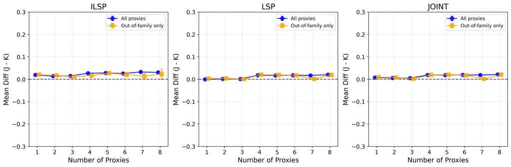

Figure 6: Sensitivity of Evaluator Quality Baseline to inclusion of
same-family proxies. Each point represents a judge model on a specific
dataset

As seen in Figure 6, excluding same-family proxies does not
significantly alter the Evaluator Quality Baseline results. Out of
family results exhibit marginal differences throughout the sensitivity
test, with no deviation in overall trends across ILSP, LSP, and joint
distributions. We include as well Table 8, which shows their relative
stability.

|                    | ILSP      |        | LSP       |        |
| ------------------ | --------- | ------ | --------- | ------ |
| Condition          | Mean Diff | Std    | Mean Diff | Std    |
| All proxies        | 0.0197    | 0.2327 | -0.0006   | 0.2020 |
| Out-of-family only | 0.0227    | 0.2439 | 0.0023    | 0.2203 |
| Difference         | 0.0031    | –      | 0.0029    | –      |

Table 8: Sensitivity Analysis: All Proxies vs Out-of-Family Only

### B.3 Mean Test Statistic vs. Number of Proxies-Per-Example Plots

We evaluate the stability of the Evaluator Quality Baseline as the
number of capability-matched proxies per example increases. Across all
experimental settings, the mean test statistic and its variance remain
essentially constant as more proxies are added, indicating that the
baseline is not sensitive to proxy count. This demonstrates that the
observed reductions in self-preference are not an artifact of sparse or
uneven proxy availability.

#### B.3.1 Debiased Gold Judges (DBG Scoring)

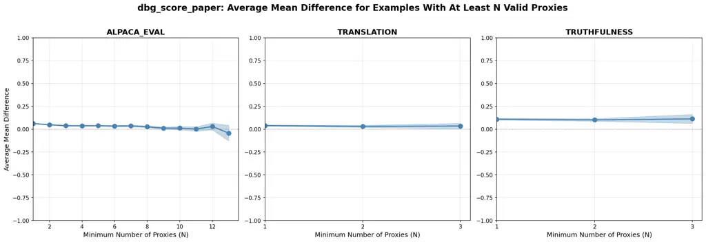

Figure 7: Mean test statistic versus number of proxies per example.

#### B.3.2 Human Annotations (Panickssery et al.)

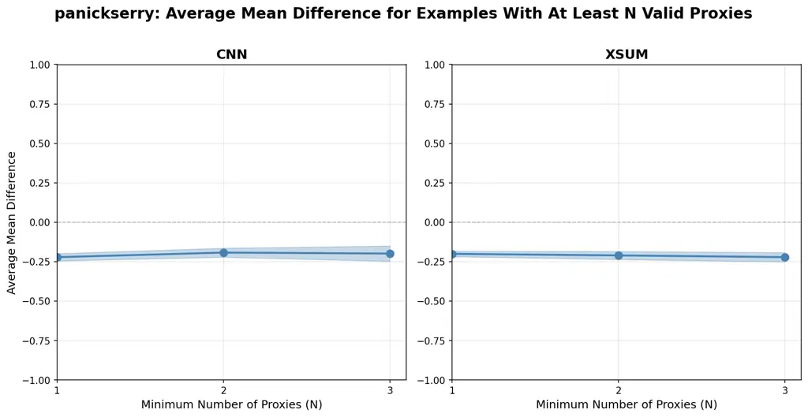

Figure 8: Mean test statistic versus number of proxies per example.

#### B.3.3 Authorship Obfuscation

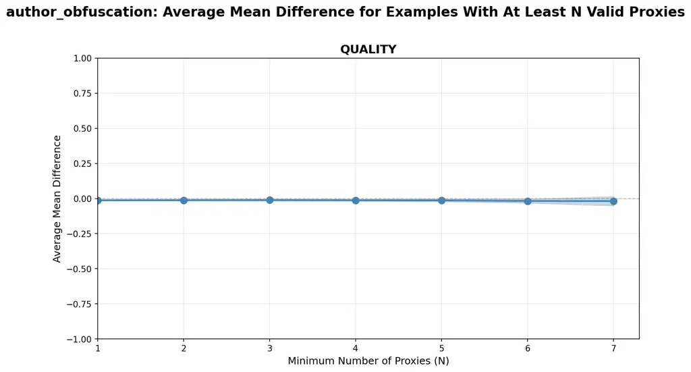

Figure 9: Mean test statistic versus number of proxies per example.

#### B.3.4 Verifiable Outputs (Chen et al.)

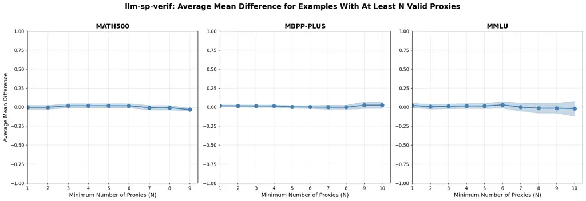

Figure 10: Mean test statistic versus number of proxies per example.

### B.4 Percentage of Examples vs. Number of Proxies Plots

We analyze how many examples admit valid capability-matched proxies as
the proxy threshold increases. It shows that a substantial fraction of
the dataset retains multiple proxies per example across all experimental
settings, ensuring adequate coverage for the Evaluator Quality Baseline.

#### B.4.1 Debiased Gold Judges (DBG Scoring)

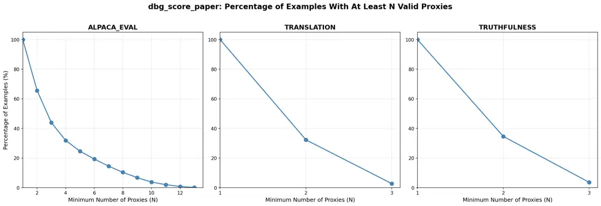

Figure 11: Percentage of examples with at least N valid proxies.

#### B.4.2 Human Annotations (Panickssery et al.)

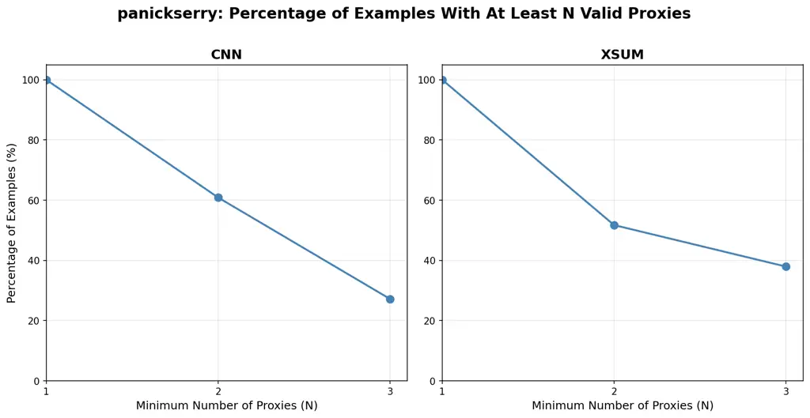

Figure 12: Percentage of examples with at least N valid proxies.

#### B.4.3 Authorship Obfuscation

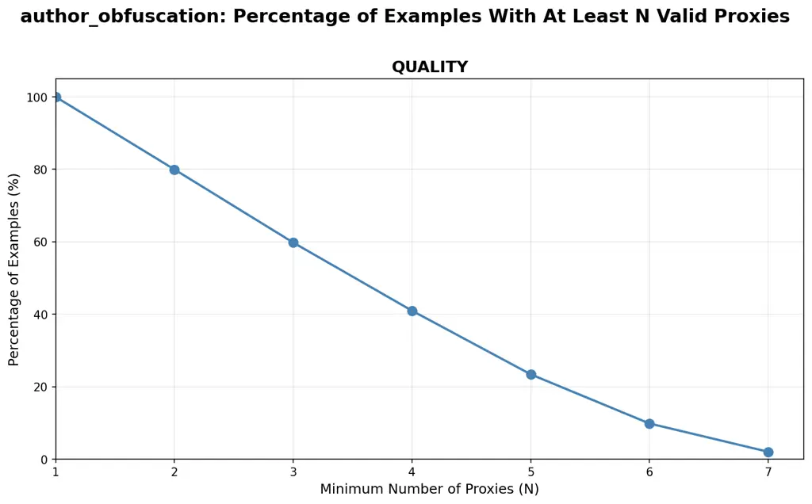

Figure 13: Percentage of examples with at least N valid proxies.

#### B.4.4 Verifiable Outputs (Chen et al.)

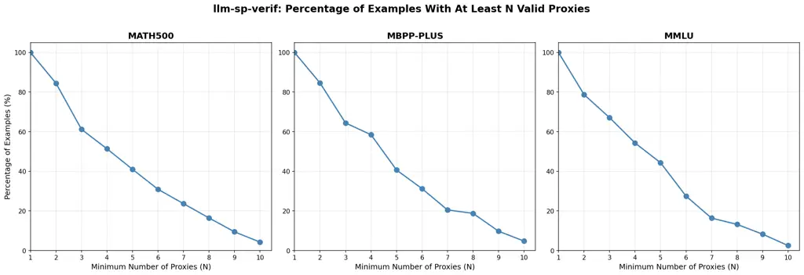

Figure 14: Percentage of examples with at least N valid proxies.

## Appendix C Full Results

### C.1 Verifiable Outputs

Judge gemma-2-2b gpt-3.5-turbo gpt-4o llama-3.2-1b mistral-7b-v0.3
mistral-small phi-3.5-mini gemma-2-27b 23.6 (54.1) -5.2 (37.8) 0.6
(42.6) -9.4 (36.8) -36.1 (16.5) 2.4 (47.5) -13.9 (26.5) gemma-2-9b -3.0
(40.8) -0.9 (48.6) 0.9 (44.0) -12.8 (43.8) 0.2 (48.7) -2.7 (39.5) -6.3
(34.8) llama-3.1-70b -5.1 (43.8) 14.1 (47.6) -4.4 (23.4) 16.3 (66.7) 6.0
(97.6) -10.1 (23.2) -5.7 (20.0) llama-3.1-8b -2.7 (37.1) -9.8 (26.5)
-4.2 (34.2) -8.6 (29.8) 2.6 (37.4) -8.1 (31.0) -6.0 (31.2) llama-3.2-3b
-1.2 (33.3) -4.3 (28.1) -5.9 (34.4) 3.2 (38.0) 0.6 (37.9) -8.2 (31.0)
-5.0 (32.1) llama-3.3-70b 3.6 (34.6) -23.7 (11.8) 1.2 (23.6) -0.3 (18.4)
3.8 (82.0) 15.7 (50.5) -31.7 (1.1) qwen-2.5-14b 6.9 (24.9) 30.2 (76.1)
-2.5 (38.3) -2.6 (37.9) -5.6 (44.0) -6.8 (29.2) 17.3 (41.9) qwen-2.5-32b
11.7 (71.7) 18.0 (65.2) 10.9 (35.4) 5.8 (44.2) 6.0 (100.0) 27.2 (65.4)
10.5 (42.2) qwen-2.5-3b 1.4 (47.9) -4.9 (40.3) -0.7 (49.2) 8.4 (59.1)
4.3 (50.0) 2.5 (52.0) -7.9 (44.7) qwen-2.5-72b 13.1 (71.9) 38.8 (96.5)
23.0 (40.6) 16.9 (61.5) 4.9 (99.6) 16.8 (21.2) – qwen-2.5-7b 17.4 (78.9)
7.3 (48.3) 11.8 (44.0) -3.0 (52.6) -9.2 (66.0) 6.6 (43.7) -23.9 (21.5)

Table 9: Judge Swap Results: MATH500

Judge gemma-2-2b gpt-3.5-turbo gpt-4o llama-3.2-1b mistral-7b-v0.3
mistral-small phi-3.5-mini gemma-2-27b -2.4 (28.4) 16.4 (50.0) 21.3
(46.8) -4.2 (21.8) -4.3 (33.1) 14.3 (39.0) 7.6 (37.8) gemma-2-9b -1.3
(15.1) 1.4 (25.1) -3.7 (15.8) -2.2 (17.1) -7.4 (11.3) 1.6 (23.6) -7.7
(33.8) llama-3.1-70b 1.5 (46.7) 1.3 (33.6) 4.7 (31.0) 9.0 (32.1) 1.6
(38.2) 10.5 (35.4) 4.6 (46.7) llama-3.1-8b 0.4 (26.1) 0.4 (28.1) 0.8
(29.0) 6.5 (31.9) -0.6 (29.0) 1.1 (31.7) -0.3 (30.4) llama-3.2-3b 0.4
(27.0) -0.6 (28.4) 0.6 (28.8) 1.9 (27.6) -4.3 (17.6) 2.4 (28.9) -1.7
(28.0) llama-3.3-70b 3.5 (58.7) 9.0 (39.9) 5.0 (24.2) -3.8 (1.2) 6.6
(41.7) 16.2 (40.7) 13.5 (56.6) qwen-2.5-14b 10.0 (45.3) 3.7 (16.5) 1.2
(20.3) 11.0 (34.1) 0.7 (15.7) 14.6 (29.0) -12.8 (20.3) qwen-2.5-32b 1.6
(28.5) 3.1 (16.3) 0.8 (8.3) -0.0 (0.0) 6.7 (32.0) 1.3 (7.5) -13.8 (15.2)
qwen-2.5-3b 0.0 (48.8) 0.9 (54.5) 2.3 (55.5) 3.7 (46.0) 8.4 (55.2) -7.1
(47.4) -10.3 (41.2) qwen-2.5-7b 17.2 (56.7) 10.0 (47.3) 2.2 (35.6) 2.0
(51.1) -5.2 (37.2) 8.1 (48.2) -4.9 (52.9)

Table 10: Judge Swap Results: MBPP-Plus

Judge gemma-2-2b gpt-3.5-turbo gpt-4o llama-3.2-1b mistral-7b-v0.3
mistral-small phi-3.5-mini gemma-2-27b 21.7 (56.5) -0.2 (38.0) 1.8
(44.9) 5.1 (47.7) 18.9 (61.0) 0.6 (41.7) -9.3 (35.7) gemma-2-9b 12.2
(45.6) -14.9 (37.5) -3.4 (24.9) -3.7 (82.3) -10.5 (39.1) -7.9 (29.3)
-14.6 (9.3) llama-3.1-70b 12.0 (62.6) -11.0 (45.5) 2.0 (26.5) -1.4
(88.9) 5.2 (73.9) -2.1 (46.2) 3.4 (46.4) llama-3.1-8b 4.4 (34.0) -5.0
(36.6) -3.0 (31.5) 2.0 (53.6) 6.2 (41.7) 0.8 (36.9) 3.2 (40.9)
llama-3.2-3b -19.9 (10.7) -17.6 (14.8) -4.2 (35.1) -12.1 (23.4) -15.7
(18.3) -12.4 (23.6) -9.8 (21.3) llama-3.3-70b -2.2 (69.6) 16.7 (82.6)
12.0 (37.1) 6.7 (95.7) 17.0 (87.1) 11.9 (55.3) 24.5 (61.4) qwen-2.5-14b
-5.3 (42.2) 17.8 (84.5) 17.0 (46.6) 7.3 (83.1) -1.1 (60.2) 9.8 (57.1)
21.4 (48.1) qwen-2.5-32b 15.0 (55.8) 30.3 (87.1) 23.5 (46.3) 8.5 (99.9)
8.2 (74.9) 19.0 (66.6) 16.8 (62.4) qwen-2.5-3b 2.5 (54.4) -0.4 (53.6)
-0.8 (49.4) 1.2 (53.8) 2.4 (55.9) 0.9 (53.8) 1.9 (54.0) qwen-2.5-72b 9.5
(49.9) 26.8 (74.6) 11.7 (30.9) 12.2 (99.6) 28.9 (84.3) 16.7 (61.6) 33.6
(70.9) qwen-2.5-7b 13.7 (60.2) 0.6 (54.0) -0.7 (22.7) 9.5 (93.4) 6.7
(68.9) 18.4 (64.1) 18.3 (69.5)

Table 11: Judge Swap Results: MMLU

### C.2 Debiased Gold Judges (DBG Scoring)

Judge DeepSeek-R1-Distill-Qwen-7B gemma-2-9b gemma-2-9b-it
Llama-3.1-70B-Instruct Llama-3.1-8B Llama-3.1-8B-Instruct
Qwen2.5-72B-Instruct Qwen2.5-7B Qwen2.5-7B-Instruct gemma-2-9b-it – 32.5
(51.5) – – – 21.9 (42.7) – – – Llama-3.1-8B-Instruct – – 14.8 (41.5) 6.3
(38.8) 11.6 (40.8) – – – 5.2 (39.0) Qwen2.5-0.5B-Instruct – – – -0.2
(49.8) – – – – – Qwen2.5-1.5B-Instruct – – – -0.4 (48.7) – – – – –
Qwen2.5-14B-Instruct – – – 9.2 (24.9) – – – – – Qwen2.5-32B-Instruct – –
– 11.9 (22.3) – – – – – Qwen2.5-3B-Instruct – – – -2.3 (41.4) – – – – –
Qwen2.5-7B-Instruct 4.7 (41.7) – – 3.3 (35.8) – 8.6 (39.3) 6.4 (43.2)
8.6 (38.3) –

Table 12: Judge Swap Results: AlpacaEval

Judge gemma-2-9b gemma-2-9b-it Llama-3.1-70B-Instruct Llama-3.1-8B
Llama-3.1-8B-Instruct Qwen2.5-72B-Instruct Qwen2.5-7B
Qwen2.5-7B-Instruct gemma-2-9b-it 9.8 (26.0) – – – 7.4 (22.2) – – –
Llama-3.1-8B-Instruct – 5.7 (41.7) 1.5 (42.1) 2.8 (43.0) – – – 3.2
(43.0) Qwen2.5-7B-Instruct – – – – 3.6 (34.4) 3.4 (30.1) 0.6 (28.4) –

Table 13: Judge Swap Results: Translation

Judge gemma-2-9b gemma-2-9b-it Llama-3.1-70B-Instruct Llama-3.1-8B
Llama-3.1-8B-Instruct Qwen2.5-72B-Instruct Qwen2.5-7B
Qwen2.5-7B-Instruct gemma-2-9b-it 20.0 (41.3) – – – 10.9 (26.4) – – –
Llama-3.1-8B-Instruct – 14.9 (43.6) 7.3 (34.2) 7.2 (38.2) – – – 7.4
(37.1) Qwen2.5-7B-Instruct – – – – 11.0 (36.3) 11.5 (39.6) 15.4 (43.9) –

Table 14: Judge Swap Results: Truthfulness

### C.3 Authorship Obfuscation

Judge DeepSeek-V3 Llama-4-Maverick-17B-128E-Instruct-FP8
Llama-4-Scout-17B-16E-Instruct Meta-Llama-3.1-8B-Instruct-Turbo
Qwen2.5-7B-Instruct-Turbo Llama-4-Scout-17B-16E-Instruct 6.0 (27.0) 6.8
(25.4) – 8.0 (52.7) 5.8 (48.9) Meta-Llama-3.1-8B-Instruct-Turbo -7.7
(32.7) -5.9 (32.1) -4.2 (29.6) – -12.9 (40.7) Qwen2.5-7B-Instruct-Turbo
-6.2 (28.2) -3.7 (26.6) -2.5 (21.2) -15.2 (47.8) –

Table 15: Judge Swap Results: Authorship Obfuscation

## Appendix D Chain of Thought

| Dataset / Model | ILSP$`{}_{\text{orig}}`$ (%) | ILSP$`{}_{\text{upd}}`$ (%) | $`N`$ | Rel. $`\Delta`$ (%) | $`p`$                 |
| --------------- | ---------------------------- | --------------------------- | ----- | ------------------- | --------------------- |
| Math500         |                              |                             |       |                     |                       |
| llama-3.1-8b    | 16.2                         | -7.3                        | 198   | -145.3              | 0.991                 |
| llama-3.3-70b   | 29.4                         | 4.4                         | 176   | -85.2               | 0.087                 |
| qwen-2.5-7b     | 46.6                         | 18.9                        | 148   | -59.4               | $`\mathbf{<10^{-4}}`$ |
| qwen-2.5-14b    | 45.9                         | 18.4                        | 122   | -59.8               | $`\mathbf{<10^{-4}}`$ |
| qwen-2.5-32b    | 46.6                         | 8.3                         | 102   | -82.1               | 0.031                 |
| MMLU            |                              |                             |       |                     |                       |
| llama-3.1-8b    | 46.0                         | -12.2                       | 887   | -126.6              | 1.000                 |
| llama-3.3-70b   | 68.2                         | 9.7                         | 591   | -85.7               | $`\mathbf{<10^{-4}}`$ |
| qwen-2.5-7b     | 48.1                         | -4.8                        | 852   | -109.9              | 1.000                 |
| qwen-2.5-14b    | 69.6                         | 10.3                        | 785   | -85.2               | $`\mathbf{<10^{-4}}`$ |
| qwen-2.5-32b    | 69.3                         | 10.3                        | 765   | -85.2               | $`\mathbf{<10^{-4}}`$ |
| MBPP-Plus       |                              |                             |       |                     |                       |
| llama-3.1-8b    | 22.1                         | 0.6                         | 241   | -97.5               | 0.419                 |
| llama-3.3-70b   | 26.8                         | 4.1                         | 196   | -84.8               | 0.024                 |
| qwen-2.5-7b     | 27.0                         | 0.9                         | 235   | -96.8               | 0.359                 |
| qwen-2.5-14b    | 37.3                         | 2.5                         | 221   | -93.3               | 0.171                 |
| qwen-2.5-32b    | 30.1                         | 2.3                         | 219   | -92.4               | 0.175                 |

Table 16: Self-preference bias analysis across different judge models
aggregated over all reference models. ILSP$`{}_{\text{orig}}`$
represents the mean judge vs. reference preference (mean*j_vs_r
$`\times`$ 100), ILSP$`{}*{\text{upd}}`$ is computed as
ILSP$`{}_{\text{orig}}`$ + mean_diff. Rel.
$`\Delta=(\text{ILSP}_{\text{upd}}-\text{ILSP}_{\text{orig}})/\text{ILSP}_{\text{orig}}`$,
where negative values indicate a reduction in self-preference bias.
$`N`$ refers to incorrect examples. Values at the $`p<0.05`$
significance level bolded.

## Appendix E Prompts

### E.1 Prompts for Generating Judge Answers for MATH-500, MMLU


### E.2 Prompts for Generating Judge Answers for MBPP-Plus


### E.3 Prompts for Generating COT Judge Answers for MATH-500


### E.4 Prompts for Generating COT Judge Answers for MMLU


### E.5 Prompts for Generating COT Judge Answers for MBPP-Plus


### E.6 Prompts for Judge CNN/XSUM


### E.7 DBG Scoring: AlpacaEval


### E.8 DBG Scoring: TruthfulQA


### E.9 DBG Scoring: Translation


## Appendix F Authorship Obfuscation


## Appendix G Entropy Experiments

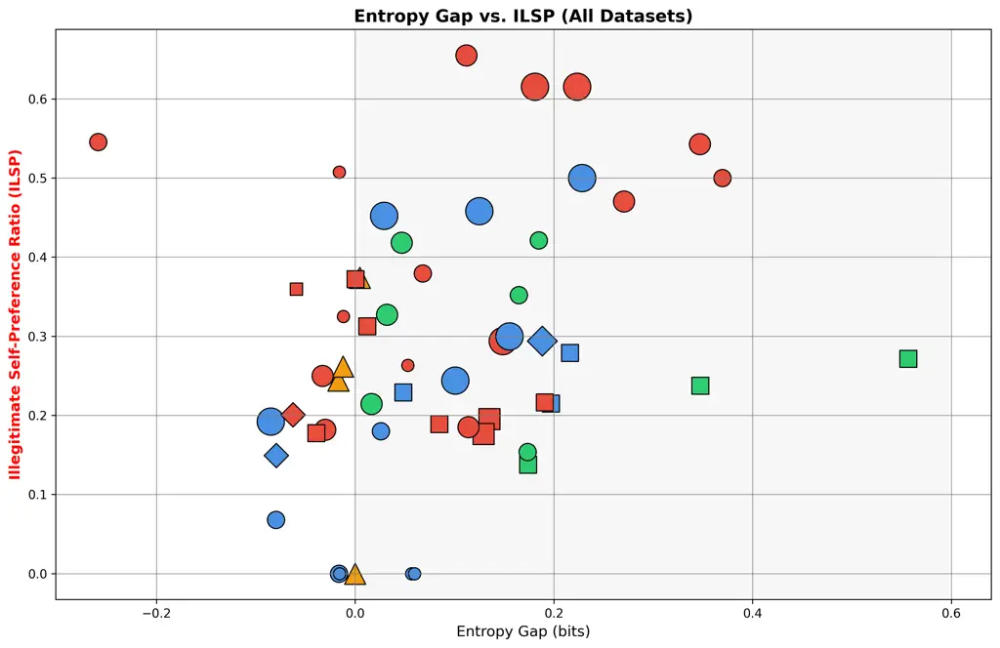

Figure 15: Shannon Entropy Gap (Eq. 11) versus illegitimate
self-preference. 41 of 56 experiments have a positive entropy gap, and
exhibit a positive correlation with illegitimate self-preference
(Pearson’s $`\rho=0.25`$)

| Dataset      | $`N`$ | Pos. | Neg. | % Pos. | Mean $`\Delta H`$ |
| ------------ | ----- | ---- | ---- | ------ | ----------------- |
| math500      | 11    | 7    | 4    | 63.6%  | 0.108             |
| mbpp-plus    | 10    | 7    | 3    | 70.0%  | 0.067             |
| mmlu         | 11    | 9    | 2    | 81.8%  | 0.086             |
| alpaca_eval  | 8     | 6    | 2    | 75.0%  | 0.121             |
| translation  | 3     | 3    | 0    | 100.0% | 0.103             |
| truthfulness | 3     | 3    | 0    | 100.0% | 0.252             |
| quality      | 3     | 1    | 2    | 33.3%  | 0.015             |
| cnn          | 4     | 3    | 1    | 75.0%  | -.009             |
| xsum         | 3     | 2    | 1    | 66.7%  | -.007             |
| Overall      | 56    | 41   | 15   | 73.2%  | 0.106             |

Table 17: Entropy Gap Statistics

## Appendix H Inter-rater Agreement Between Judges for DBG-Scoring

Testing self-preference bias in judges for subjective datasets like
DBG-scoring can be confounded by the fact that we acquire ground-truth
from other llm judges. We provide ablations to our setup to show that
between judges there is not a significant difference with how they vote,
and we show there is little difference with how they vote as an
individual vs as an majority. This shows that the gold judges mainly all
agree on what is the correct answer and the vote is dominated by 2 out
of the 3 judges.

| Pair                            | $`\kappa`$ |
| ------------------------------- | ---------- |
| gemini-flash-1.5 vs gpt-4o-mini | 0.603      |
| gemini-flash-1.5 vs deepseek-v3 | 0.614      |
| gpt-4o-mini vs deepseek-v3      | 0.678      |

Table 18: Inter-rater agreement ($`\kappa`$) between oracle pairs.

| Oracle                       | $`\kappa`$ |
| ---------------------------- | ---------- |
| gemini-flash-1.5 vs majority | 0.769      |
| gpt-4o-mini vs majority      | 0.821      |
| deepseek-v3 vs majority      | 0.835      |

Table 19: Oracle agreement ($`\kappa`$) against the majority vote.

## Appendix I Alternative Proxy Selection Strategies

We investigate two proxy-matching strategies to assess the robustness of
our results. First, we filter out responses from proxies whose final
answers differ from the judges’, effectively “swapping only the
reasoning while keeping the letter choice constant.” Second, we filter
out all responses except those from the two proxies closest to the judge
in overall task accuracy.

| Judge         | Same-Error $`\Delta`$ | Same-Error SE | Top-2 Proxies $`\Delta`$ | Top-2 Proxies SE | All Proxies $`\Delta`$ | All Proxies SE |
| ------------- | --------------------- | ------------- | ------------------------ | ---------------- | ---------------------- | -------------- |
| Gemma-2-27B   | $`-0.0410`$           | $`0.0271`$    | $`+0.0320`$              | $`0.0376`$       | $`-0.0681`$            | $`0.0177`$     |
| Gemma-2-9B    | $`-0.0908`$           | $`0.0235`$    | $`-0.0458`$              | $`0.0222`$       | $`-0.0961`$            | $`0.0163`$     |
| Llama-3.1-70B | $`-0.0309`$           | $`0.0188`$    | $`-0.0388`$              | $`0.0240`$       | $`+0.0084`$            | $`0.0147`$     |
| Llama-3.1-8B  | $`-0.0193`$           | $`0.0208`$    | $`-0.0383`$              | $`0.0146`$       | $`-0.0559`$            | $`0.0153`$     |
| Llama-3.2-3B  | $`-0.0483`$           | $`0.0212`$    | $`-0.0606`$              | $`0.0097`$       | $`-0.0519`$            | $`0.0141`$     |
| Llama-3.3-70B | $`+0.1347`$           | $`0.0234`$    | $`+0.0213`$              | $`0.0323`$       | $`+0.0443`$            | $`0.0183`$     |
| Qwen2.5-14B   | $`-0.0008`$           | $`0.0248`$    | $`+0.0272`$              | $`0.0383`$       | $`+0.0009`$            | $`0.0191`$     |
| Qwen2.5-32B   | $`+0.1180`$           | $`0.0240`$    | $`+0.0385`$              | $`0.0385`$       | $`+0.1158`$            | $`0.0167`$     |
| Qwen2.5-3B    | $`-0.0354`$           | $`0.0227`$    | $`-0.0059`$              | $`0.0187`$       | $`-0.0273`$            | $`0.0140`$     |
| Qwen2.5-72B   | $`+0.0786`$           | $`0.0253`$    | $`+0.0792`$              | $`0.0375`$       | $`+0.1280`$            | $`0.0173`$     |
| Qwen2.5-7B    | $`-0.0538`$           | $`0.0279`$    | $`-0.0367`$              | $`0.0417`$       | $`+0.0045`$            | $`0.0188`$     |

Table 20: $`\mu_{\mathrm{ILSP}},\hat{\mathrm{SE}}`$ with proxy filtering
v. all proxies (average between MATH500, MBPP+, MMLU)

These results are directionally consistent, with only two models having
results flip signs while both were $`\leq\pm 0.05`$. Furthermore,
standard error decreases as our proxy selection strategy gets greedier.
In other words, our results hold irrespective of proxy validation
strategy, so under other interpretations the evaluator quality baseline
holds.
