# Rethinking LLM-as-a-Judge: Representation-as-a-Judge with Small Language Models via Semantic Capacity Asymmetry

Zhuochun Li Affiliation: University of Pittsburgh
Email: [zhl163@pitt.edu](mailto:)    Yong Zhang
Email: [yuj49@pitt.edu](mailto:)    Ming Li
Email: [dah44@pitt.edu](mailto:)    Yuelyu Ji
Email: [zhangyong203@pingan.com.cn](mailto:)    Yiming Zeng
Email: [chengning211@pingan.com.cn](mailto:)    Ning Cheng
Email: [minglii@umd.edu](mailto:)    Yun Zhu
Email: [yiming.zeng@uconn.edu](mailto:)    Yanmeng Wang    Shaojun Wang
   Jing Xiao    Daqing He Affiliation: Ping An Technology (Shenzhen)
Co., Ltd. Affiliation: University of Maryland, College Park
Affiliation: University of Connecticut

###### Abstract

Large language models (LLMs) are widely used as reference-free
evaluators via prompting, but this “LLM-as-a-Judge” paradigm is costly,
opaque, and sensitive to prompt design. In this work, we investigate
whether smaller models can serve as efficient evaluators by leveraging
internal representations instead of surface generation. We uncover a
consistent empirical pattern: small LMs, despite with weak generative
ability, encode rich evaluative signals in their hidden states. This
motivates us to propose the Semantic Capacity Asymmetry Hypothesis:
evaluation requires significantly less semantic capacity than generation
and can be grounded in intermediate representations, suggesting that
evaluation does not necessarily need to rely on large-scale generative
models but can instead leverage latent features from smaller ones. Our
findings motivate a paradigm shift from LLM-as-a-Judge to
Representation-as-a-Judge, a decoding-free evaluation strategy that
probes internal model structure rather than relying on prompted output.
We instantiate this paradigm through INSPECTOR, a probing-based
framework that predicts aspect-level evaluation scores from small model
representations. Experiments on reasoning benchmarks (GSM8K, MATH, GPQA)
show that INSPECTOR substantially outperforms prompting-based small LMs
and closely approximates full LLM judges, while offering a more
efficient, reliable, and interpretable alternative for scalable
evaluation. The code and data are available at:
[https://github.com/zhuochunli/Representation-as-a-judge](https://github.com/zhuochunli/Representation-as-a-judge)

|     |
| --- |
|     |

^(†)^(†)footnotetext: † Equal contribution.^(†)^(†)footnotetext: \*
Corresponding author.^(†)^(†)footnotetext: Work was done during Zhuochun
Li’s internship at Ping An Technology.

## 1 Introduction

Large language models (LLMs) have demonstrated remarkable capabilities
in generation, reasoning, and alignment tasks (Achiam et al., 2023;
Touvron et al., 2023). A growing number of works leverage the paradigm
of LLM-as-a-Judge, wherein powerful LLMs are prompted to assess the
quality of generated outputs without access to ground-truth
references (Chang et al., 2024; Prasad et al., 2023). This approach has
achieved strong empirical results in reference-free evaluation across
domains such as summarization and complex reasoning (He et al., 2023;
Zhang et al., 2024).

However, this prompt-based evaluation paradigm has important
limitations. First, it requires autoregressive decoding, making it
computationally expensive even for single-point evaluations. Second, it
relies on large proprietary models (e.g., GPT-4), whose internal
mechanisms remain opaque and unverifiable. Lastly, its effectiveness
depends heavily on prompt engineering, raising concerns about
reproducibility, robustness, and scaling (Polo et al., 2024; Voronov et
al., 2024; Mizrahi et al., 2024).

A natural goal is to use smaller open-source LMs as evaluators, as they
offer a more lightweight and accessible alternative to large proprietary
models. However, when prompted directly, their evaluation performance is
poor and highly inconsistent compared to large LLMs. Prior work (Li et
al., 2024a; Waldis et al., 2024) has shown that small models, despite
weaker generation, often possess semantic competence comparable to large
models. This suggests that their poor evaluation performance may stem
from limitations in surface generation rather than a fundamental lack of
understanding. Building on this, we ask a more granular question: do
small models encode evaluation-relevant signals in their internal
representations, even when generation is poor?

This question represents a broader insight: the ability to evaluate may
place lower demands on semantic capacity than the ability to generate.
Even when generation fails, compact internal representations may already
encode the features needed for judgment. We therefore formalize the
Semantic Capacity Asymmetry Hypothesis: The semantic capacity required
for accurate evaluation is significantly lower than that required for
generation. Evaluation can be grounded in compressed internal
representations of small language models, even when generation requires
full-model decoding.

Building on this hypothesis, we advance an alternative perspective on
evaluation: Representation-as-a-Judge. Rather than relying on prompted
text generation, evaluative signals can be extracted directly from the
latent structure. This addresses key bottlenecks of prompt-based
evaluation and opens the door to lightweight, interpretable, and
scalable systems.

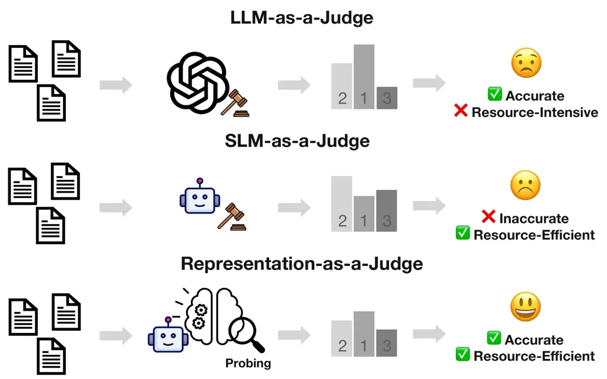

Figure 1: Illustration of Representation-as-a-Judge.

To explore this perspective, we introduce INSPECTOR ( INternal Signal
Probing and EvaluaTion Of Representations), a probing-based framework
for reference-free evaluation. Given a (prompt, response) pair,
INSPECTOR performs the following steps: (1) obtain aspect-level
evaluation scores from a strong LLM judge across multiple aspects (e.g.,
logicality, fluency, consistency); (2) input the same evaluation prompt
to a small LM and extract internal representations; (3) identify
informative layers and train lightweight classifiers to approximate
evaluation scores using latent embeddings.

Empirically, we validate this framework on reasoning benchmarks such as
GSM8K, MATH, and GPQA, and find that internal representations from small
models (e.g., 1.7B) achieve high predictive performance, substantially
outperforming prompting-based baselines and in many cases approaching
the fidelity of full-scale LLM judges. Furthermore, we show that
classifiers trained with this method can be used to filter noisy
reasoning data, leading to measurable gains in downstream supervised
fine-tuning (Xu et al., 2024; Albalak et al., 2024; Li et al., 2024b).

Our contributions are threefold:

- •
  We identify and analyze a consistent empirical phenomenon: small LMs,
  despite weak generation, encode evaluation-relevant signals in their
  internal representations.
- •
  We formalize this insight as the Semantic Capacity Asymmetry
  Hypothesis, positing that evaluation requires less semantic capacity
  than generation and can be grounded in intermediate representations.
- •
  We advance a new perspective, Representation-as-a-Judge, and
  instantiate it through our probing-based framework, INSPECTOR,
  demonstrating high-fidelity evaluation and efficient data filtering
  for reasoning tasks. To the best of our knowledge, this is the first
  work to investigate LLM probing for evaluation tasks.

## 2 Related Work

Our work builds on two research directions: (i) data evaluation methods,
particularly the emerging LLM-as-a-Judge paradigm, and (ii) probing
techniques for analyzing LLM representations. Below we summarize
progress in each line and position our contribution.

LLM Evaluation Recent studies in NLP have introduced reference-based
evaluation metrics such as BERTScore (Zhang et al., 2019) and
BARTScore (Yuan et al., 2021), which leverage pretrained language models
to better align with human judgments. ROSCOE further develops
unsupervised, reference-free metrics that outperform traditional n-gram
methods like ROUGE (Lin, 2004) and BLEU (Papineni et al., 2002), as well
as several model-based metrics. With the emergence of LLMs, many works
have begun to treat LLMs themselves as evaluators (Zheng et al., 2023;
Liu et al., 2023; Li et al., 2024c), identifying and filtering
high-quality data samples. A variety of techniques enhance this
LLM-as-a-Judge paradigm: Chain-of-Thought reasoning (Wei et al., 2022)
to improve decision quality, RECEVAL (Prasad et al., 2023) to assess
reasoning chains via correctness and informativeness, and SOCREVAL (He
et al., 2023) to let LLMs generate their own answers before evaluation.
However, these methods often rely on prompt engineering and proprietary
LLMs, limiting both their reliability and interpretability.
Alternatively, we propose to probe and analyze critical internal
representations of small LMs, training lightweight classifiers to
approximate state-of-the-art evaluations from powerful LLMs. This yields
a more efficient and explainable approach to data evaluation.

Probing LLM Representations There is a growing interest in probing the
internal representations of LLMs to uncover interpretable features.
Early work by Shi et al. (2016) introduced probing by training a
logistic regression classifier on top of machine translation encoders to
study the extent of syntactic information. Building on this idea, later
studies investigate more complex linguistic phenomena. For example,
Starace et al. (2023) examine how linguistic categories such as
part-of-speech (POS) and dependency relations are jointly encoded across
layers of LLMs, revealing shared and hierarchical structures in their
representations. Beyond linguistic categories, recent research has
explored whether LLMs capture higher-level abstractions of world
knowledge and state. Zhang et al. (2025) propose Sentinel, which probes
decoder attention in small proxy LLMs to extract relevance signals for
context compression, framing probing as a lightweight understanding task
rather than a linguistic diagnostic. More works further probe the
internal representations of world states in Transformer models when
processing game scripts and embodied sequences (Li et al., 2023; Jin and
Rinard, 2024; Di Palma et al., 2025).

In contrast to prior work, which mainly seeks to understand what
knowledge LLMs encode, we leverage probing in a new direction:
extracting critical internal representations that are predictive of
evaluation quality. To the best of our knowledge, this is the first work
to bridge probing with the LLM-as-a-Judge paradigm, enabling evaluation
that is both more efficient and more interpretable.

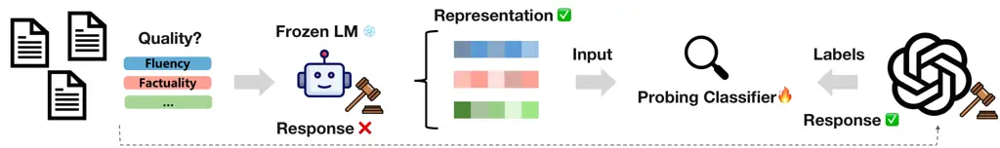

Figure 2: Overview of our proposed INSPECTOR. We freeze the small LMs
and probe their representations, training only a lightweight probing
classifier to fit the proprietary LLM evaluations.

## 3 METHODOLOGY

The Semantic Capacity Asymmetry Hypothesis suggests that evaluation can
be grounded in compact intermediate representations of small LMs,
without requiring full decoding. To operationalize and test this idea,
we propose Representation-as-a-Judge: a new evaluation paradigm that
directly probes latent semantic structure rather than relying on
surface-level outputs. We instantiate this paradigm through INSPECTOR.
Illustrated in Figure2, it consists of three components: LLMs evaluation
annotation, small LMs probing, and building probing classifiers, which
we will discuss in Sec. 4.1, 4.2, and 4.3, respectively.

### 3.1 LLMs evaluation annotation

Following established rubric definitions from prior work, including
ROSCOE Golovneva et al. (2022) and Socreval He et al. (2023), we adopt
five widely used evaluation aspects $`\mathcal{K}`$ to assess the
quality of reference-free rationales, with the corresponding few-shot
prompts provided in Appendix K:

- •
  Semantic Consistency: Do the solution steps and final answer remain
  faithful to the problem facts (no invented events, omitted givens, or
  unstated assumptions)?
- •
  Logicality: Does each inference and arithmetic step follow valid rules
  and correctly apply operations?
- •
  Informativeness: Does the rationale include the essential steps and
  intermediate calculations needed to verify the final answer?
- •
  Fluency: Is the text grammatical, clear, and easy to follow, with
  proper punctuation, sentence flow, notation, and presentation?
- •
  Factuality: Are the claims, facts, evidence, references, and concrete
  assertions in the rationale factually correct and supported?

Let $`x`$ denote a task instruction and $`y`$ the corresponding
model-generated response. We first employ a medium-scale language model
$`\mathcal{M}_{med}`$ (10-50B) to generate responses for all benchmark
queries. Unlike state-of-the-art LLMs $`\mathcal{M}_{large}`$
(50–100B+), $`\mathcal{M}_{med}`$ is less powerful, which is desirable
because it produces more diverse evaluation distributions, containing
both good and bad quality samples, across different aspects, thereby
facilitating the subsequent probing process. This will construct the
response dataset $`D=\{(x_{i},y_{i})\}_{i=1}^{N}`$, where $`x_{i}`$ is a
benchmark question and $`y_{i}=\mathcal{M}_{med}(x_{i})`$ is the
corresponding response. For each evaluation aspect $`k\in\mathcal{K}`$,
we construct an aspect-specific instruction $`\mathcal{I}_{k}`$ and
integrate $`(x,y)`$ into it, yielding $`\mathcal{I}_{k}(x,y)`$ as the
evaluation prompt. We then query a state-of-the-art LLM
$`\mathcal{M}_{\text{large}}`$ to obtain evaluation scores along each
aspect. For a given sample $`(x,y)`$, we prompt
$`\mathcal{M}_{\text{large}}`$ with $`\mathcal{I}_{k}(x,y)`$ and obtain
a scalar score $`s_{k}\in[1,5]`$:

```math
s_{i,k}=\mathcal{M}_{\text{large}}\big(\mathcal{I}_{k}(x_{i},y_{i})\big).
```

Collecting these pairs yields the probing dataset

```math
D_{\text{prob}}=\bigcup_{k\in\mathcal{K}}\{\,(\mathcal{I}_{k}(x_{i},y_{i}),\,s_{i,k})\,\}_{i=1}^{N}. \tag{1}
```

To avoid bias toward over-represented quality levels, we construct a
balanced probing dataset for each aspect: we first determine the minimum
number of samples among the five score levels (1–5), and then randomly
downsample the other levels to this size. This ensures that the
multiclass probing tasks are balanced across labels and not dominated by
frequent scores.

Specifically, original scores (1–5) are treated as multiclass
classification tasks, while responses with scores higher than threshold
$`\tau`$ are labeled high quality and the rest low quality, forming a
simpler binary classification task. Since these aspects have been
validated and the effectiveness of powerful LLMs has been extensively
studied in prior work, we treat the resulting scores as gold labels for
our subsequent LM probing experiments.

### 3.2 Small LMs probing

We use probing to test whether small LMs encode linearly recoverable
evaluative cues in their hidden states, with the probe’s minimal
capacity ensuring that any predictive signal reflects the model’s own
semantics. In our tasks, we observe that prompt-based evaluation
inference from small LMs $`\mathcal{M}_{small}`$ (0-10B) yields a large
gap compared to the gold scores from $`\mathcal{M}_{large}`$, primarily
due to differences in model capacity. To address this, instead of
relying solely on the final decoded text, we analyze internal
representations layer by layer to identify those most predictive of the
gold evaluation scores. Specifically, we convert each prompt
$`\mathcal{I}_{k}(x_{i},y_{i})\in D_{\text{prob}}`$ into a collection of
per-layer, pooled representation features, and fit these features with
simple, cross-validated linear probes. More explanations could be found
in Appendix B.

#### Extraction and pooling.

For a sample $`i`$, let $`S_{i}`$ denote the sequence length and
$`t=1,...,S_{i}`$ index tokens, we input prompt
$`\mathcal{I}_{k}(x_{i},y_{i})`$ and run $`\mathcal{M}_{\text{small}}`$
in evaluation mode, obtaining per-layer $`\ell`$ hidden states
$`\mathbf{H}^{(\ell)}_{i}`$ and attention weights
$`\mathbf{A}^{(\ell)}_{i}`$. From $`\mathbf{H}^{(\ell)}_{i}`$ we compute
a small but expressive set of pooled vectors: mean, last, min, max, and
concat. These pooling variants capture complementary token-level and
global signals across layers. For example:

```math
\displaystyle\mathbf{r}^{(\ell)}_{i,\text{mean}} \displaystyle=\tfrac{1}{S_{i}}\sum_{t=1}^{S_{i}}\mathbf{H}^{(\ell)}_{i}[t,:]\in\mathbb{R}^{d} \tag{2}
```

```math
\displaystyle\mathbf{r}^{(\ell)}_{i,\text{last}} \displaystyle=\mathbf{H}^{(\ell)}_{i}[t_{i}^{\ast},:]\in\mathbb{R}^{d},\quad t_{i}^{\ast}=\max\{t:\text{token }t\ \text{non-pad}\}
```

#### Attention and statistical features.

For each head $`h`$ of layer $`\ell`$, we compute an attention-entropy
statistic $`e^{(\ell)}_{i,h}`$ and compress them into the number of
attention heads $`R`$ per layer:

```math
\mu^{(\ell)}_{i}=\frac{1}{R}\sum_{h}e^{(\ell)}_{i,h},\quad\sigma^{(\ell)}_{i}=\mathrm{std}_{h}\big(e^{(\ell)}_{i,h}\big),\quad\max_{h}e^{(\ell)}_{i,h}. \tag{3}
```

For each pooled vector $`\mathbf{r}`$ we also compute compact
statistics, including its norm $`\text{norm}(\mathbf{r})`$, variance
$`\text{var}(\mathbf{r})`$, and entropy $`E(\mathbf{r})`$.

#### Feature assembly.

For each layer $`\ell`$ and pooling type
$`p\in\{\text{mean,last,min,max,concat}\}`$, we construct a feature
matrix by concatenating multiple components along the feature dimension:

```math
X^{(\ell,p)}=\big[\,\operatorname{PCA}_{d}(\mathbf{r}^{(\ell)}_{i,p})\;\big|\;\underbrace{[\text{norm},\,\text{var},\,E(\cdot)]}_{\text{statistics}}\;\big|\;[\mu^{(\ell)}_{i},\sigma^{(\ell)}_{i},\max_{h}e^{(\ell)}_{i,h}]\,\big]_{i=1}^{N} \tag{4}
```

where $`\operatorname{PCA}_{d}`$ denotes an optional
dimensionality-reduction to $`d`$ components. All transforms that depend
on the data (imputer, PCA, scaler) are applied inside a cross-validation
pipeline to avoid information leakage.

#### Probing and layer ranking.

We treat gold labels $`s_{i,k}\in\{1,\dots,5\}`$ from
$`D_{\text{prob}}`$ as both (i) a multiclass prediction target
$`y^{\text{multi}}_{i,k}=s_{i,k}`$ and (ii) a binary target
$`y^{\text{bin}}_{i,k}=\mathbb{I}[\,s_{i,k}\geq\tau\,]`$ with threshold
$`\tau`$ (high vs. low quality). For each $`X^{(\ell,p)}`$ we fit a
logistic probe and evaluate generalization with stratified
cross-validation. Based on the fitting results, we rank
layer–pool–feature configurations by a chosen criterion (binary or
multiclass performance) for different downstream tasks.

The probing stage produces: (1) a ranked list of layer–pool–feature
configurations with cross-validated predictive performance, (2)
per-layer progression plots that visualize where evaluative signal
accumulates inside $`\mathcal{M}_{\text{small}}`$. These results inform
the subsequent section, where we build final probing classifiers using
the selected features.

### 3.3 Building probing classifiers

The probing stage produces a ranked list of layer–pool–feature
configurations with predictive performance. In this section we describe
how we use that ranked list to assemble multi-layer feature sets, train
final probing classifiers, and select an optimal evaluator.

#### From ranked configurations to candidate layer sets.

Let $`\pi`$ denote the ranked list of layer–pool–feature tuples produced
after the previous probing stage. We take the Top-$`\mathbf{K}`$ unique
layers in $`\pi`$ and start from the highest-ranked single layer,
iteratively adding the next-ranked layer only if the addition improves
performance.

#### Feature concatenation for multi-layer probes.

For a chosen subset of layers $`S=\{\ell_{1},\dots,\ell_{|S|}\}`$ and a
pooling method $`p`$, we construct a multi-layer feature matrix by
horizontally concatenating the per-layer features defined in
Eq. equation 4. Concretely, for sample $`i`$ we form the concatenated
feature vector

```math
\tilde{\mathbf{x}}^{(S,p)}_{i}\;=\;\big[\,\mathbf{r}^{(\ell_{1})}_{i,p};\ \mathbf{r}^{(\ell_{2})}_{i,p};\ \dots;\ \mathbf{r}^{(\ell_{|S|})}_{i,p}\,\big]\ \in\ \mathbb{R}^{|S|\cdot d_{p}}, \tag{5}
```

where $`d_{p}`$ is the dimensionality of the pooled vector for pooling
$`p`$. If attention summaries are included, we append the per-layer
attention summaries to form the final feature vector. The assembled
dataset for $`N`$ examples is
$`\widetilde{X}^{(S,p)}=[\,\tilde{\mathbf{x}}^{(S,p)}_{1},\dots,\tilde{\mathbf{x}}^{(S,p)}_{N}\,]^{\top}`$.

#### Classifier training and selection.

For each candidate feature assembly $`\widetilde{X}^{(S,p)}`$, we train
a family of simple, interpretable classifiers to predict both the
multiclass target $`y^{\text{multi}}`$ and the binary target
$`y^{\text{bin}}`$. We select the final probing classifier by maximizing
a task-specific performance criterion over the candidate set
$`\mathcal{S}`$ and probe families. Formally, letting $`\mathcal{C}`$
denote the set of classifier hyperparameterizations tested, we choose

```math
(S^{\star},p^{\star},\theta^{\star})=\operatorname*{argmax}_{(S,p,\text{clf})}\ \bar{a}^{(S,p,\text{clf})}_{\gamma},\quad(S,p,\text{clf})\in\mathcal{S}\times\mathcal{P}\times\mathcal{C}. \tag{6}
```

where $`\gamma\in\{\text{bin},\text{multi}\}`$ denotes the
classification task type (binary vs. multiclass), and $`\theta^{\star}`$
are the learned classifier parameters for the selected configuration. In
case of ties, we prefer the configuration with smaller $`\sigma`$ (more
stable performance) and with fewer layers.

This search yields a compact, high-performing probing classifier that
uses a small subset of layers identified by the probing stage, which is
tuned for robust generalization via cross-validation and grid search. It
can serve as an efficient surrogate evaluator approximating
$`\mathcal{M}_{\text{large}}`$ judgments while remaining orders of
magnitude cheaper at inference time.

## 4 Experiments

### 4.1 EXPERIMENTAL SETUP

#### Datasets.

To prove the effectiveness on reasoning evaluation tasks, we picked
three popular benchmarks in Mathematics & Science Tasks: GSM8K (Cobbe et
al., 2021), MATH (Hendrycks et al., 2021), and GPQA (Rein et al., 2024).
Datasets statistics are shown in Appendix C.

#### Models.

In our experiments, we select Llama-3-8B-Instruct (Dubey et al., 2024)
as $`\mathcal{M}_{\text{med}}`$ for response generation, as it achieves
reasonable performance on the chosen benchmarks while producing diverse
evaluation scores. For LLM-based evaluation annotation, we employ
DeepSeek-V3 (Liu et al., 2024) as $`\mathcal{M}_{\text{large}}`$ owing
to its strong reasoning ability and relatively low cost. To validate the
effectiveness of our pipeline across different small LMs, we consider
Qwen3-0.6B (Yang et al., 2025), Qwen3-1.7B (Yang et al., 2025),
Llama-3.2-1B-Instruct (Dubey et al., 2024), and
Llama-3.1-8B-Instruct (Dubey et al., 2024) as
$`\mathcal{M}_{\text{small}}`$.

#### Baselines.

To the best of our knowledge, this is the first study to investigate LLM
probing for evaluation tasks, and therefore related work is limited.
Accordingly, we compare our approach against three baselines: (1) direct
prompt-based inference on small LMs, (2) fine-tuning small LMs
(Qwen3-0.6B), and (3) RoBERTa (Liu et al., 2019) on probing datasets to
fit the evaluation scores.

#### Implementation Details.

We set the score threshold $`\tau=4`$, labeling samples with scores
$`\geq 4`$ as high-quality and those with scores $`<4`$ as low-quality.
For dimensionality reduction, we apply $`\operatorname{PCA}`$ with
$`d=50`$ in the probing process. We use $`K=5`$ for Top-$`K`$
aggregation and experiment with a variety of classifiers, including
Logistic Regression, Random Forests, small Multilayer Perceptrons
(MLPs), and linear Support Vector Machines (SVMs). Since all pooling,
layer, and classifier variants operate on cached hidden representations,
exploring these configurations incurs negligible computational overhead.
All test results are reported on the zero-shot prompt and weighted
average F1 score. Additional implementations are provided in Appendix D.

### 4.2 Probing Classifiers Results

We present the main results of our optimal probing classifiers across
Mathematics & Science benchmarks in Figure 3. Explicit statistics for
the probing datasets and the numbers of main results can be found in
Appendix E, F. Notably, our strong results are obtained by only training
on small probing datasets (typically fewer than 100 samples per score)
due to the downsampling strategy (3.1).

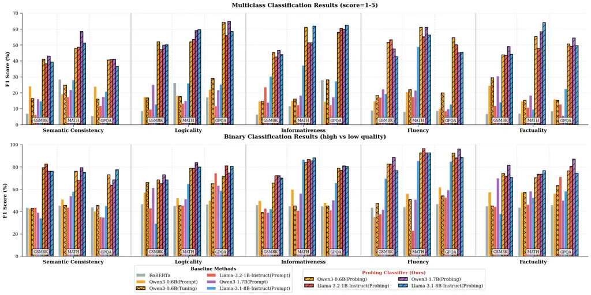

Figure 3: Weighted average F1 score (%) across reasoning benchmarks with
multiclass classification and binary classification tasks. Our probing
method (colored bars with hatch marks) significantly outperforms
prompting on the same models (colored bars without hatch marks) across
all tasks.

#### Probing is much more effective than prompt-based inference.

Figure 3 shows substantial improvements of our methods over baselines,
with average F1 scores increasing by more than 20% on most tasks. This
suggests that poor outputs from LLMs do not necessarily imply that the
models lack the underlying knowledge to solve the task. Instead, crucial
information may be already embedded in the internal representations, but
remains hidden after the final decoding process. Probing allows us to
uncover and leverage these latent understandings, whereas direct text
generation can introduce noise and degrade human-interpretable
performance. Importantly, the effectiveness of our approach is
consistently observed across all evaluation aspects and for different
sizes of $`\mathcal{M}_{\text{small}}`$ across multiple model families,
including results after fine-tuning. This provides a strong indication
that our method can be applied to more general scenarios.

#### Larger LLMs do not necessarily provide stronger evaluation, either through inference or probing.

Although Llama-3.1-8B-Instruct achieves the best results on several
tasks, Qwen3-1.7B still outperforms it on certain benchmarks despite
being much smaller. Within the same model family, both the Qwen3 and
Llama3 series demonstrate that larger models do not consistently surpass
their smaller counterparts across all aspects. For instance, on MATH,
Qwen3-0.6B outperforms Qwen3-1.7B in prompt-based inference for
logicality (18.18% vs. 15.06%), and Llama-3.2-1B-Instruct surpasses
Llama-3.1-8B-Instruct in binary probing for fluency (96.32% vs. 92.65%).
These results highlight that different models can exhibit distinct
strengths across evaluation aspects, cautioning against a blind reliance
on scaling laws.

#### Probing classifiers for binary classification serve as highly reliable data filters.

While the performance of probing classifiers on multiclass prediction
remains modest (approximately 50–60%), this is expected given the
difficulty of approximating a $`\mathcal{M_{\text{large}}}`$ that is
hundreds of times larger with a $`\mathcal{M_{\text{small}}}`$. In
contrast, binary classification performance reaches 80–90%, making it
sufficiently reliable to function as a reference-free coarse filtering
mechanism. This capability is particularly valuable for common NLP
applications such as curating high-quality data for supervised
fine-tuning, where the filter can efficiently separate high and low
quality samples during initial screening and thereby reduce the cost of
further fine-grained annotation.

## 5 Analysis

### 5.1 Ablation study of pooling and classifier methods

For each probing result in Figure 3, we don’t report the combinations of
various pooling methods ($`\mathbf{r}^{(\ell)}_{i}`$ in Equation 2) and
classifiers (clf in Equation 6). To better illustrate the effect of
different pooling and classifier choices, we conduct an ablation study
on the Informativeness aspect of the MATH dataset, using Qwen3-0.6B and
Llama-3.2-1B-Instruct on binary classification, with results shown in
Figure 4.

The results demonstrate that mean pooling consistently outperforms other
strategies, which is intuitive since averaging preserves critical
information while producing compact feature representations. Among
classifiers, Logistic Regression achieves the best results. With limited
data and potentially noisy labels from LLMs scoring, calibrated
probabilities and regularization from Logistic Regression can lead to a
better overall F1 score. These patterns match findings from recent
studies: Kantamneni et al. (2025) show that complex probes often do not
strongly outperform simpler pooling + linear classifiers; Lee et al.
(2023) demonstrates that averaging over all token vectors can beat using
only CLS or last token embeddings. Finally, these findings are
consistent with the detailed results shown in Table 11, where
top-performing configurations most often involve mean pooling combined
with Logistic Regression classifiers.

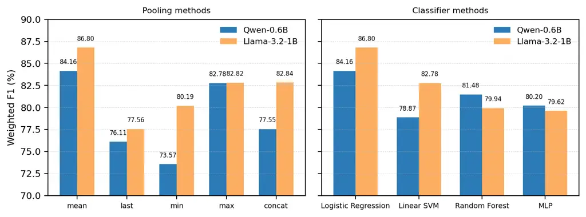

Figure 4: Ablation study of different pooling and classifier methods on
binary classification tasks. Left: logistic regression fixed. Right:
mean pooling fixed.

### 5.2 Data filtering and Supervised Fine-Tuning (SFT)

To assess the effectiveness of our data filtering approach, we apply the
trained probing classifiers of Qwen3-1.7B in a knowledge distillation
setup, with Llama-3-8B-Instruct (Dubey et al., 2024) as the teacher and
Llama-2-7B-Chat (Touvron et al., 2023) as the student. For each
benchmark, the classifiers assign binary scores (0 or 1) to every
response across five aspects, which are then summed to yield a total
score between 0 and 5. Responses are ranked by this score from high to
low to construct the training set, and the student is trained on
progressively larger subsets in 10% increments. We directly compare our
probing-based filtering against two baselines: (i) the gold DeepSeek-V3
filtering and (ii) random filtering. The result curves are summarized in
Figure 5.

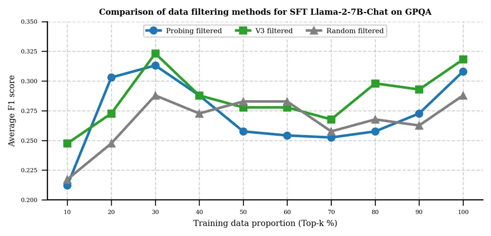

Figure 5: Llama-2-7B-Chat SFT performance under different data filtering
methods (probing classifier, DeepSeek-V3, and random) with incremental
training subsets.

Our findings can be summarized as follows: (1) filtering training data
with our probing classifiers yields SFT performance comparable to using
powerful LLM as the filter, indicating that our approach can approximate
LLM-level data quality judgments; (2) both probing and DeepSeek-V3
consistently outperform random filtering, despite occasional mid-range
fluctuations where random sampling may incidentally capture
higher-quality data, reinforcing the importance of quality-aware data
selection for downstream training; and (3) the observed up–down–up trend
suggests that initial gains derive from training on high-quality data,
performance then declines as lower-quality data is introduced, and
subsequently recovers once the volume of training data becomes
sufficiently large. This supports claims in prior studies (Sajith and
Kathala, 2024; Iyer et al., 2024): data quality plays the primary role
in low-resource settings, whereas data quantity may become a dominant
factor as training data scales.

## 6 Semantic Capacity Asymmetry in Evaluative Signals

### 6.1 Evaluative Signals in Intermediate Representations

To better understand why small models can support accurate evaluation,
we analyze the internal representations used in our probing classifiers
(§4). Specifically, we examine how evaluative signals vary across layers
and what types of features most effectively capture them. We present
representative results in Figure 6, with additional analysis provided in
Appendix I.

(1) Representations Encode Strong Evaluative Signals. Across reasoning
datasets, we observe that hidden representations show substantial
correlation with evaluation scores from the strong LLM judge. These
signals are especially strong in mid-to-upper layers, indicating that
evaluative information is embedded throughout intermediate layers,
rather than being restricted to the output stage.

(2) Evaluative Features Reside in Structured Feature Subspaces. Probing
feature spaces derived from PCA-based subspaces often reveals evaluative
signals more effectively than scalar or attention-derived features.
These observations suggest that evaluative signals are present across
structured feature subspaces, with PCA-based projections revealing them
more clearly than simpler features.

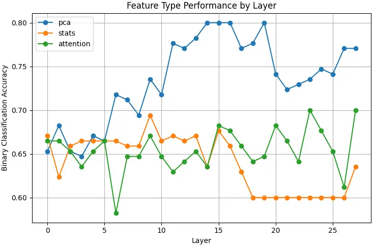

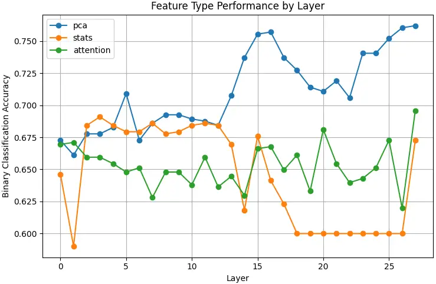

Figure 6: Layer-wise probing accuracy for Factuality (left) and Semantic
Consistency (right) using Qwen3-1.7B on the MATH dataset. PCA features
perform best, peaking in upper layers.

### 6.2 The Semantic Capacity Asymmetry Hypothesis

These patterns observed above support the hypothesis that accurate
evaluation requires much less capacity than generation and can rely on
intermediate representations. This reflects an intrinsic asymmetry
between the tasks: generation involves discourse planning and long
dependencies that demand substantial capacity and often require full
decoding, while evaluation focuses on identifying inconsistencies or
content errors, which are already accessible in intermediate model
states.

Prior work has shown that internal representations often encode much
richer and more reliable semantic information than what is reflected in
surface outputs. Probing studies demonstrate that hidden states capture
fine-grained linguistic and semantic structure (Waldis et al., 2024;
Rogers et al., 2020). Complementing this, latent-knowledge analyses
reveal that task-relevant information can remain present in intermediate
representations even when generated text is unreliable or intentionally
misled (Kadavath et al., 2022; Burns et al., 2023; Mallen et al., 2023).
Building on these insights, we show that intermediate representations
not only encode general semantic structure but also contain
evaluation-relevant signals that can be directly leveraged for effective
reference-free assessment.

## 7 Conclusion

Despite suboptimal generation, small LMs retain strong evaluative
signals in their internal representations. We validate the Semantic
Capacity Asymmetry Hypothesis and introduce INSPECTOR, a probing-based
pipeline that extracts high-fidelity judgments from these latents.
Experiments on various reasoning benchmarks show the capability of our
method, suggesting that Representation-as-a-Judge can serve as a
scalable and interpretable solution for evaluation and data curation.

## Reproducibility Statement

All datasets and models used in our experiments are publicly accessible.
We also provide additional details in the Appendix, including dataset
statistics, model parameters, and training hyperparameters. We believe
that the information provided is sufficient to reproduce our methods and
results. Furthermore, we released all data and code in the public
repository:
[https://github.com/zhuochunli/Representation-as-a-judge](https://github.com/zhuochunli/Representation-as-a-judge).

## Use of Large Language Models (LLMs)

We used large language models (LLMs) only for minor text polishing, such
as grammar and phrasing. All ideas, experiments, analyses, and
discussions were conducted solely by the authors. The LLM did not
contribute to the design and interpretation of our research.

## References

- Achiam et al. (2023) J. Achiam, S. Adler, S. Agarwal, L. Ahmad, I.
  Akkaya, F. L. Aleman, D. Almeida, J. Altenschmidt, S. Altman, S.
  Anadkat, et al. Gpt-4 technical report. arXiv preprint
  arXiv:2303.08774. Cited by: §1.
- Albalak et al. (2024) A. Albalak, Y. Elazar, S. M. Xie, S. Longpre, N.
  Lambert, X. Wang, N. Muennighoff, B. Hou, L. Pan, H. Jeong, et al. A
  survey on data selection for language models. arXiv preprint
  arXiv:2402.16827. Cited by: §1.
- Burns et al. (2023) C. Burns, H. Ye, D. Klein, and J. Steinhardt
  Discovering latent knowledge in language models without supervision.
  In The Eleventh International Conference on Learning Representations,
  External Links: [Link](https://openreview.net/forum?id=ETKGuby0hcs)
  Cited by: §6.2.
- Chang et al. (2024) Y. Chang, X. Wang, J. Wang, Y. Wu, L. Yang, K.
  Zhu, H. Chen, X. Yi, C. Wang, Y. Wang, et al. A survey on evaluation
  of large language models. ACM transactions on intelligent systems and
  technology 15 (3), pp. 1–45. Cited by: §1.
- Cobbe et al. (2021) K. Cobbe, V. Kosaraju, M. Bavarian, M. Chen, H.
  Jun, L. Kaiser, M. Plappert, J. Tworek, J. Hilton, R. Nakano, C.
  Hesse, and J. Schulman Training verifiers to solve math word problems.
  arXiv preprint arXiv:2110.14168. Cited by: §4.1.
- Di Palma et al. (2025) D. Di Palma, A. De Bellis, G. Servedio, V. W.
  Anelli, F. Narducci, and T. Di Noia LLaMAs have feelings too:
  unveiling sentiment and emotion representations in llama models
  through probing. arXiv preprint arXiv:2505.16491. Cited by: §2.
- Dubey et al. (2024) A. Dubey, A. Jauhri, A. Pandey, A. Kadian, A.
  Al-Dahle, A. Letman, A. Mathur, A. Schelten, A. Yang, A. Fan, et al.
  The llama 3 herd of models. arXiv e-prints, pp. arXiv–2407. Cited by:
  §D.1, §D.2, Table 10, Table 10, Table 10, Table 10, Table 13, Table
  13, Table 13, Table 13, §4.1, §5.2.
- Dubois et al. (2024) Y. Dubois, B. Galambosi, P. Liang, and T. B.
  Hashimoto Length-controlled alpacaeval: a simple way to debias
  automatic evaluators. arXiv preprint arXiv:2404.04475. Cited by:
  Appendix H.
- Golovneva et al. (2022) O. Golovneva, M. Chen, S. Poff, M.
  Corredor, L. Zettlemoyer, M. Fazel-Zarandi, and A. Celikyilmaz Roscoe:
  a suite of metrics for scoring step-by-step reasoning. arXiv preprint
  arXiv:2212.07919. Cited by: §3.1.
- He et al. (2023) H. He, H. Zhang, and D. Roth Socreval: large language
  models with the socratic method for reference-free reasoning
  evaluation. arXiv preprint arXiv:2310.00074. Cited by: Appendix K, §1,
  §2, §3.1.
- Hendrycks et al. (2021) D. Hendrycks, C. Burns, S. Kadavath, A.
  Arora, S. Basart, E. Tang, D. Song, and J. Steinhardt Measuring
  mathematical problem solving with the math dataset. arXiv preprint
  arXiv:2103.03874. Cited by: §4.1.
- Iyer et al. (2024) V. Iyer, B. Malik, P. Stepachev, P. Chen, B.
  Haddow, and A. Birch Quality or quantity? on data scale and diversity
  in adapting large language models for low-resource translation. arXiv
  preprint arXiv:2408.12780. Cited by: §5.2.
- Jin and Rinard (2024) C. Jin and M. Rinard Emergent representations of
  program semantics in language models trained on programs. In
  Forty-first International Conference on Machine Learning, Cited by:
  §2.
- Kadavath et al. (2022) S. Kadavath, T. Conerly, A. Askell, T.
  Henighan, D. Drain, E. Perez, N. Schiefer, Z. Hatfield-Dodds, N.
  DasSarma, E. Tran-Johnson, et al. Language models (mostly) know what
  they know. arXiv preprint arXiv:2207.05221. Cited by: §6.2.
- Kantamneni et al. (2025) S. Kantamneni, J. Engels, S.
  Rajamanoharan, M. Tegmark, and N. Nanda Are sparse autoencoders
  useful? a case study in sparse probing. arXiv preprint
  arXiv:2502.16681. Cited by: §5.1.
- Lee et al. (2023) K. Lee, G. Choi, and C. Choi Use all tokens method
  to improve semantic relationship learning. Expert Systems with
  Applications 233, pp. 120911. Cited by: §5.1.
- Li et al. (2023) K. Li, A. K. Hopkins, D. Bau, F. Viégas, H. Pfister,
  and M. Wattenberg Emergent world representations: exploring a sequence
  model trained on a synthetic task. ICLR. Cited by: §2.
- Li et al. (2024a) M. Li, Y. Zhang, S. He, Z. Li, H. Zhao, J. Wang, N.
  Cheng, and T. Zhou Superfiltering: weak-to-strong data filtering for
  fast instruction-tuning. In Proceedings of the 62nd Annual Meeting of
  the Association for Computational Linguistics (Volume 1: Long
  Papers), L. Ku, A. Martins, and V. Srikumar (Eds.), pp. 14255–14273.
  Cited by: §1.
- Li et al. (2024b) M. Li, Y. Zhang, Z. Li, J. Chen, L. Chen, N.
  Cheng, J. Wang, T. Zhou, and J. Xiao From quantity to quality:
  boosting LLM performance with self-guided data selection for
  instruction tuning. In Proceedings of the 2024 Conference of the North
  American Chapter of the Association for Computational Linguistics:
  Human Language Technologies (Volume 1: Long Papers), K. Duh, H. Gomez,
  and S. Bethard (Eds.), Mexico City, Mexico, pp. 7595–7628. External
  Links: [Link](https://aclanthology.org/2024.naacl-long.421) Cited by:
  §1.
- Li et al. (2024c) Z. Li, Y. Ji, R. Meng, and D. He Learning from
  committee: reasoning distillation from a mixture of teachers with
  peer-review. arXiv preprint arXiv:2410.03663. Cited by: §2.
- Lin (2004) C. Lin Rouge: a package for automatic evaluation of
  summaries. In Text summarization branches out, pp. 74–81. Cited by:
  §2.
- Liu et al. (2024) A. Liu, B. Feng, B. Xue, B. Wang, B. Wu, C. Lu, C.
  Zhao, C. Deng, C. Zhang, C. Ruan, et al. Deepseek-v3 technical report.
  arXiv preprint arXiv:2412.19437. Cited by: §D.3, §4.1.
- Liu et al. (2023) Y. Liu, D. Iter, Y. Xu, S. Wang, R. Xu, and C. Zhu
  G-eval: nlg evaluation using gpt-4 with better human alignment. arXiv
  preprint arXiv:2303.16634. Cited by: §2.
- Liu et al. (2019) Y. Liu, M. Ott, N. Goyal, J. Du, M. Joshi, D.
  Chen, O. Levy, M. Lewis, L. Zettlemoyer, and V. Stoyanov Roberta: a
  robustly optimized bert pretraining approach. arXiv preprint
  arXiv:1907.11692. Cited by: Table 10, Table 10, Table 13, Table 13,
  §4.1.
- Mallen et al. (2023) A. Mallen, M. Brumley, J. Kharchenko, and N.
  Belrose Eliciting latent knowledge from quirky language models. arXiv
  preprint arXiv:2312.01037. Cited by: §6.2.
- Mizrahi et al. (2024) M. Mizrahi, G. Kaplan, D. Malkin, R. Dror, D.
  Shahaf, and G. Stanovsky State of what art? a call for multi-prompt
  LLM evaluation. Transactions of the Association for Computational
  Linguistics 12, pp. 933–949. Cited by: §1.
- Papineni et al. (2002) K. Papineni, S. Roukos, T. Ward, and W. Zhu
  Bleu: a method for automatic evaluation of machine translation. In
  Proceedings of the 40th annual meeting of the Association for
  Computational Linguistics, pp. 311–318. Cited by: §2.
- Polo et al. (2024) F. M. Polo, R. Xu, L. Weber, M. Silva, O.
  Bhardwaj, L. Choshen, A. F. M. de Oliveira, Y. Sun, and M. Yurochkin
  Efficient multi-prompt evaluation of LLMs. In The Thirty-eighth Annual
  Conference on Neural Information Processing Systems, External Links:
  [Link](https://openreview.net/forum?id=jzkpwcj200) Cited by: §1.
- Prasad et al. (2023) A. Prasad, S. Saha, X. Zhou, and M. Bansal
  Receval: evaluating reasoning chains via correctness and
  informativeness. arXiv preprint arXiv:2304.10703. Cited by: §1, §2.
- Rein et al. (2024) D. Rein, B. L. Hou, A. C. Stickland, J.
  Petty, R. Y. Pang, J. Dirani, J. Michael, and S. R. Bowman Gpqa: a
  graduate-level google-proof q&a benchmark. In First Conference on
  Language Modeling, Cited by: §4.1.
- Rogers et al. (2020) A. Rogers, O. Kovaleva, and A. Rumshisky A primer
  in BERTology: what we know about how BERT works. Transactions of the
  Association for Computational Linguistics 8, pp. 842–866. Cited by:
  §6.2.
- Sajith and Kathala (2024) A. Sajith and K. C. R. Kathala Is training
  data quality or quantity more impactful to small language model
  performance?. arXiv preprint arXiv:2411.15821. Cited by: §5.2.
- Shi et al. (2016) X. Shi, I. Padhi, and K. Knight Does string-based
  neural mt learn source syntax?. In Proceedings of the 2016 conference
  on empirical methods in natural language processing, pp. 1526–1534.
  Cited by: §2.
- Starace et al. (2023) G. Starace, K. Papakostas, R. Choenni, A.
  Panagiotopoulos, M. Rosati, A. Leidinger, and E. Shutova Probing llms
  for joint encoding of linguistic categories. arXiv preprint
  arXiv:2310.18696. Cited by: §2.
- Touvron et al. (2023) H. Touvron, T. Lavril, G. Izacard, X.
  Martinet, M. Lachaux, T. Lacroix, B. Rozière, N. Goyal, E. Hambro, F.
  Azhar, et al. Llama: open and efficient foundation language models.
  arXiv preprint arXiv:2302.13971. Cited by: §D.4, §1, §5.2.
- Voronov et al. (2024) A. Voronov, L. Wolf, and M. Ryabinin Mind your
  format: towards consistent evaluation of in-context learning
  improvements. In Findings of the Association for Computational
  Linguistics: ACL 2024, L. Ku, A. Martins, and V. Srikumar (Eds.),
  pp. 6287–6310. Cited by: §1.
- Waldis et al. (2024) A. Waldis, Y. Perlitz, L. Choshen, Y. Hou, and I.
  Gurevych Holmes $`\recorder`$ a benchmark to assess the linguistic
  competence of language models. Transactions of the Association for
  Computational Linguistics 12, pp. 1616–1647. Cited by: §1, §6.2.
- Wei et al. (2022) J. Wei, X. Wang, D. Schuurmans, M. Bosma, F. Xia, E.
  Chi, Q. V. Le, D. Zhou, et al. Chain-of-thought prompting elicits
  reasoning in large language models. Advances in neural information
  processing systems 35, pp. 24824–24837. Cited by: §2.
- Xu et al. (2024) X. Xu, M. Li, C. Tao, T. Shen, R. Cheng, J. Li, C.
  Xu, D. Tao, and T. Zhou A survey on knowledge distillation of large
  language models. arXiv preprint arXiv:2402.13116. Cited by: §1.
- Yang et al. (2025) A. Yang, A. Li, B. Yang, B. Zhang, B. Hui, B.
  Zheng, B. Yu, C. Gao, C. Huang, C. Lv, et al. Qwen3 technical report.
  arXiv preprint arXiv:2505.09388. Cited by: §D.1, Table 10, Table 10,
  Table 10, Table 10, Table 13, Table 13, Table 13, Table 13, §4.1.
- Yuan et al. (2021) W. Yuan, G. Neubig, and P. Liu Bartscore:
  evaluating generated text as text generation. Advances in neural
  information processing systems 34, pp. 27263–27277. Cited by: §2.
- Zhang et al. (2024) Q. Zhang, Y. Wang, T. Yu, Y. Jiang, C. Wu, L.
  Li, Y. Wang, X. Jiang, L. Shang, R. Tang, et al. Reviseval: improving
  llm-as-a-judge via response-adapted references. arXiv preprint
  arXiv:2410.05193. Cited by: §1.
- Zhang et al. (2019) T. Zhang, V. Kishore, F. Wu, K. Q. Weinberger,
  and Y. Artzi Bertscore: evaluating text generation with bert. arXiv
  preprint arXiv:1904.09675. Cited by: §2.
- Zhang et al. (2025) Y. Zhang, Y. Huang, N. Cheng, Y. Guo, Y. Zhu, Y.
  Wang, S. Wang, and J. Xiao Sentinel: attention probing of proxy models
  for llm context compression with an understanding perspective.
  External Links: 2505.23277 Cited by: §2.
- Zheng et al. (2023) L. Zheng, W. Chiang, Y. Sheng, S. Zhuang, Z.
  Wu, Y. Zhuang, Z. Lin, Z. Li, D. Li, E. Xing, et al. Judging
  llm-as-a-judge with mt-bench and chatbot arena. Advances in neural
  information processing systems 36, pp. 46595–46623. Cited by: §2.

## Appendix A Limitations

While the proposed method demonstrates competitive performance compared
to other baselines, we acknowledge that there are still potential
limitations:

- •
  Following prior work, we adopt five evaluation aspects and construct
  corresponding prompt templates for our experiments. However, in the
  absence of standardized evaluation criteria, our chosen definitions
  may not represent the optimal formulation for all tasks. Furthermore,
  we observe that the difficulty of the selected evaluation aspects
  varies. For instance, fluency appears to be the easiest, as the
  majority of responses consistently receive high scores relative to
  other aspects. This suggests the need for further investigation into
  the design and selection of evaluation aspects.
- •
  Although we conducted experiments on various datasets, future work can
  explore more general reasoning fields, such as commonsense and code
  generation tasks.
- •
  We only use the DeepSeek-V3 as our rating model, due to its cost and
  availability. However, this may cause evaluation bias and affect our
  downstream probing classifier training process. Exploring diverse
  rating LLMs from different organizations could be a valuable direction
  for future research.

## Appendix B Small LMs probing Details

#### Notation and extraction.

For a sample $`i`$, we input prompt $`\mathcal{I}_{k}(x_{i},y_{i})`$ and
run $`\mathcal{M}_{\text{small}}`$ in evaluation mode, obtaining

```math
\mathbf{H}^{(\ell)}_{i}\in\mathbb{R}^{S_{i}\times d},\qquad\mathbf{A}^{(\ell)}_{i}\in\mathbb{R}^{R\times S_{i}\times S_{i}},
```

for layers $`\ell=1,\dots,L`$. Here $`S_{i}`$ is the token length, $`d`$
the hidden dimension, and $`R`$ the number of attention heads.

#### Pooling and representation.

From $`\mathbf{H}^{(\ell)}_{i}`$ we compute a small but expressive set
of pooled vectors. These pooling variants capture complementary
token-level and global signals across layers:

```math
\displaystyle\mathbf{r}^{(\ell)}_{i,\text{mean}} \displaystyle=\tfrac{1}{S_{i}}\sum_{t=1}^{S_{i}}\mathbf{H}^{(\ell)}_{i}[t,:]\in\mathbb{R}^{d},
```

```math
\displaystyle\mathbf{r}^{(\ell)}_{i,\text{last}} \displaystyle=\mathbf{H}^{(\ell)}_{i}[t_{i}^{\ast},:]\in\mathbb{R}^{d},\quad t_{i}^{\ast}=\max\{t:\text{token }t\ \text{non-pad}\},
```

```math
\displaystyle\mathbf{r}^{(\ell)}_{i,\text{min}} \displaystyle=\min_{t}\mathbf{H}^{(\ell)}_{i}[t,:],\quad\mathbf{r}^{(\ell)}_{i,\text{max}}=\max_{t}\mathbf{H}^{(\ell)}_{i}[t,:],
```

```math
\displaystyle\mathbf{r}^{(\ell)}_{i,\text{concat}} \displaystyle=\big[\mathbf{r}^{(\ell)}_{i,\text{min}};\mathbf{r}^{(\ell)}_{i,\text{max}};\mathbf{r}^{(\ell)}_{i,\text{mean}}\big]\in\mathbb{R}^{3d}.
```

#### Attention and statistical features.

For each head $`h`$ of layer $`\ell`$ we compute an attention-entropy
statistic (with small constant $`\epsilon>0`$ for numerical stability):

```math
e^{(\ell)}_{i,h}\;=\;-\frac{1}{S_{i}}\sum_{s=1}^{S_{i}}\sum_{t=1}^{S_{i}}A^{(\ell)}_{i,h,s,t}\log\big(A^{(\ell)}_{i,h,s,t}+\epsilon\big).
```

We compress head-wise entropies into low-dimensional summaries per
layer:

```math
\mu^{(\ell)}_{i}=\frac{1}{R}\sum_{h}e^{(\ell)}_{i,h},\quad\sigma^{(\ell)}_{i}=\mathrm{std}_{h}\big(e^{(\ell)}_{i,h}\big),\quad\max_{h}e^{(\ell)}_{i,h}.
```

For each pooled vector $`\mathbf{r}`$ we also compute compact
statistics:

```math
\text{norm}(\mathbf{r})=\|\mathbf{r}\|_{2},\quad\text{var}(\mathbf{r})=\operatorname{Var}(\mathbf{r}),\quad E(\mathbf{r})=-\sum_{m}\operatorname{softmax}(\mathbf{r})_{m}\log\operatorname{softmax}(\mathbf{r})_{m},
```

#### Feature assembly.

For each layer $`\ell`$ and pooling type
$`p\in\{\text{mean,last,min,max,concat}\}`$ we assemble candidate
feature matrices:

```math
X^{(\ell,p)}=\big[\,\operatorname{PCA}_{d}(\mathbf{r}^{(\ell)}_{i,p})\;\big|\;\underbrace{[\text{norm},\,\text{var},\,E(\cdot)]}_{\text{statistics}}\;\big|\;[\mu^{(\ell)}_{i},\sigma^{(\ell)}_{i},\max_{h}e^{(\ell)}_{i,h}]\,\big]_{i=1}^{N}
```

where $`\operatorname{PCA}_{d}`$ denotes an optional
dimensionality-reduction to $`d`$ components. All transforms that depend
on the data (imputer, PCA, scaler) are applied inside a cross-validation
pipeline to avoid information leakage.

#### Probing and layer ranking.

We treat gold labels $`s_{i,k}\in\{1,\dots,5\}`$ from
$`D_{\text{prob}}`$ as both (i) a multiclass prediction target
$`y^{\text{multi}}_{i,k}=s_{i,k}`$ and (ii) a binary target
$`y^{\text{bin}}_{i,k}=\mathbb{I}[\,s_{i,k}\geq\tau\,]`$ with threshold
$`\tau`$ (high vs. low quality). For each $`X^{(\ell,p)}`$ we fit a
logistic probe (linear logistic regression; one-vs-rest for multiclass)
and evaluate generalization with stratified cross-validation.

Each candidate probe yields a performance tuple

```math
\big(\bar{a}^{(\ell,p)}_{\text{bin}},\ \sigma^{(\ell,p)}_{\text{bin}},\ \bar{a}^{(\ell,p)}_{\text{multi}},\ \sigma^{(\ell,p)}_{\text{multi}}\big)
```

where $`\bar{a}^{(\ell,p)}_{\text{bin}}`$ and
$`\bar{a}^{(\ell,p)}_{\text{multi}}`$ denote the mean accuracies of the
binary and multiclass probes, respectively, and
$`\sigma^{(\ell,p)}_{\text{bin}},\sigma^{(\ell,p)}_{\text{multi}}`$
their corresponding standard deviations across cross-validation folds.
We rank layer–pool–feature configurations by a chosen criterion (binary
or multiclass accuracy mean) for different downstream tasks.

## Appendix C Datasets Statistics

We download datasets GSM8K and GPQA from Huggingface, MATH from their
official project website:
[https://github.com/hendrycks/math](https://github.com/hendrycks/math).
GSM8K dataset is split according to the official original split ratio.
We use the official training set for Math and MATH-500 for the test set
due to its high representation and low cost. Since there is no official
train/test split for GPQA, we use gpqa_main and gpqa_extended as the
training set, gpqa_diamond as the test set. Table 1 shows the statistics
of all datasets.

| Dataset | Type        | \#Train | \#Test |
| ------- | ----------- | ------- | ------ |
| GSM8K   | Mathematics | 7473    | 1319   |
| MATH    | Mathematics | 7500    | 500    |
| GPQA    | Science     | 994     | 198    |

Table 1: Dataset statistics.

## Appendix D Implementation Details

Primary experiments are conducted on eight NVIDIA Quadro RTX 8000 and
eight NVIDIA RTX A6000 GPUs.

### D.1 Small LMs Parameters

The parameter settings for $`\mathcal{M}_{\text{small}}`$:
Qwen3-0.6B (Yang et al., 2025), Qwen3-1.7B (Yang et al., 2025),
Llama-3.2-1B-Instruct (Dubey et al., 2024), and
Llama-3.1-8B-Instruct (Dubey et al., 2024).

| Parameter            | Value   |
| -------------------- | ------- |
| temperature          | 0.6     |
| max new tokens       | 256     |
| do sample            | True    |
| output_hidden_states | True    |
| output_attentions    | True    |
| torch_dtype          | float16 |
| attn_implementation  | eager   |

Table 2: Small LMs parameter settings.

### D.2 Medium LMs Parameters

The parameter settings for $`\mathcal{M}_{\text{med}}`$:
Llama-3-8B-Instruct (Dubey et al., 2024).

| Parameter      | Value   |
| -------------- | ------- |
| temperature    | 0       |
| max new tokens | 512     |
| do sample      | True    |
| torch_dtype    | float16 |
| top_p          | 1.0     |

Table 3: Medium LM parameter settings.

### D.3 Large LMs Parameters

DeepSeek-V3 (Liu et al., 2024) is required by the official API:
[https://api-docs.deepseek.com](https://api-docs.deepseek.com).

| Parameter       | Value                   |
| --------------- | ----------------------- |
| temperature     | 0                       |
| max new tokens  | 2048                    |
| do sample       | True                    |
| model           | deepseek-chat           |
| response_format | {’type’: ’json_object’} |

Table 4: Large LM parameter settings.

### D.4 Model Tuning Hyperparameter

We list the training hyperparameters for Llama-2-7B-Chat (Touvron et
al., 2023) in Section 6.4.

| Hyperparameter              | Value                  |
| --------------------------- | ---------------------- |
| epoch                       | 8                      |
| batch size                  | 8                      |
| learning rate               | 1e-4                   |
| warmup_steps                | 100                    |
| max seq length              | 1024                   |
| gradient accumulation steps | 4                      |
| lora_r                      | 16                     |
| lora_alpha                  | 32                     |
| lora_dropout                | 0.1                    |
| target_modules              | \["q_proj", "v_proj"\] |

Table 5: Student LM training hyperparameter settings.

### D.5 Probing Classifier Details

We train several probing classifiers on internal features to fit gold
scores. All classifiers are implemented in scikit-learn pipelines with
StandardScaler for feature normalization. We perform hyperparameter
search via 5-fold cross-validation using macro F1 as the scoring metric.
Table 6 below summarizes each classifier’s fixed parameters and the
hyperparameter ranges considered in the grid search.

| Classifier             | Fixed Parameters                                                                                                                          | Hyperparameter Grid                                                                                                      |
| ---------------------- | ----------------------------------------------------------------------------------------------------------------------------------------- | ------------------------------------------------------------------------------------------------------------------------ |
| Logistic Regression    | max_iter=2000, class_weight="balanced", solver="lbfgs"                                                                                    | C: \[0.001,0.01,0.1,1\]; penalty: \[”l2”\]                                                                               |
| Random Forest          | class_weight="balanced", random_state=42                                                                                                  | n_estimators: \[100,300,500\]; max_depth: \[None,10,20\]; min_samples_leaf: \[1,2,5\]                                    |
| Multi-layer Perceptron | hidden_layer_sizes=(256,128), activation="relu", alpha=1e-4, learning_rate_init=1e-3, max_iter=1000, early_stopping=True, random_state=42 | alpha: \[1e-4,1e-3,1e-2\]; learning_rate_init: \[1e-4,1e-3,1e-2\]; hidden_layer_sizes: \[(200,100),(100,),(200,100,50)\] |
| Linear SVM             | kernel="linear", class_weight="balanced", probability=True, random_state=42                                                               | C: \[0.001,0.01,0.1,1,10,100\]                                                                                           |

Table 6: Probing classifiers including fixed parameters and grid search
ranges for hyperparameter tuning.

## Appendix E Probing Datasets Statistics

As explained in Section 4.1, we first determine the minimum number of
samples $`n`$ among the five score levels (1–5), and then randomly
downsample the other levels to this size. This ensures that the
multiclass probing tasks are balanced across labels and not dominated by
frequent scores. Thus, after downsampling, $`D_{prob}`$ contains a total
of $`5\times n`$ samples, and we split the dataset into training and
test sets with an 80:20 ratio. In the following tables, we mark the
minimum number $`n`$ of each aspect in bold. These score distributions
can reflect the difficulty evaluation levels among various dataset
questions and aspects.

$`D_{prob}`$ statistics for GSM8K:

|                      | \#score=1 | \#score=2 | \#score=3 | \#score=4 | \#score=5 |
| -------------------- | --------- | --------- | --------- | --------- | --------- |
| Semantic Consistency | 184       | 491       | 369       | 34        | 6435      |
| Logicality           | 118       | 842       | 174       | 26        | 6353      |
| Informativeness      | 46        | 81        | 111       | 49        | 7226      |
| Fluency              | 17        | 23        | 70        | 86        | 7317      |
| Factuality           | 377       | 300       | 479       | 85        | 6272      |

Table 7: Number of LLM-judge scores across five aspects of probing
datasets on GSM8K.

$`D_{prob}`$ statistics for MATH:

|                      | \#score=1 | \#score=2 | \#score=3 | \#score=4 | \#score=5 |
| -------------------- | --------- | --------- | --------- | --------- | --------- |
| Semantic Consistency | 441       | 467       | 1879      | 121       | 4575      |
| Logicality           | 224       | 1288      | 1604      | 98        | 4269      |
| Informativeness      | 75        | 180       | 748       | 2062      | 4418      |
| Fluency              | 132       | 27        | 746       | 2857      | 3721      |
| Factuality           | 609       | 945       | 1818      | 34        | 4077      |

Table 8: Number of LLM-judge scores across five aspects of probing
datasets on MATH.

$`D_{prob}`$ statistics for GPQA:

|                      | \#score=1 | \#score=2 | \#score=3 | \#score=4 | \#score=5 |
| -------------------- | --------- | --------- | --------- | --------- | --------- |
| Semantic Consistency | 257       | 529       | 60        | 22        | 125       |
| Logicality           | 267       | 463       | 145       | 31        | 87        |
| Informativeness      | 197       | 164       | 327       | 163       | 142       |
| Fluency              | 135       | 26        | 68        | 210       | 554       |
| Factuality           | 306       | 475       | 119       | 46        | 47        |

Table 9: Number of LLM-judge scores across five aspects of probing
datasets on GPQA.

## Appendix F Detailed Main Results

We show the specific numbers of results in Table 10.

|                                             |                      |       |       |            |       |       |                 |       |       |         |       |       |            |       |       |
| ------------------------------------------- | -------------------- | ----- | ----- | ---------- | ----- | ----- | --------------- | ----- | ----- | ------- | ----- | ----- | ---------- | ----- | ----- |
| Method                                      | Semantic Consistency |       |       | Logicality |       |       | Informativeness |       |       | Fluency |       |       | Factuality |       |       |
|                                             | GSM8K                | MATH  | GPQA  | GSM8K      | MATH  | GPQA  | GSM8K           | MATH  | GPQA  | GSM8K   | MATH  | GPQA  | GSM8K      | MATH  | GPQA  |
| Multiclass Classification (score=1-5)       |                      |       |       |            |       |       |                 |       |       |         |       |       |            |       |       |
| RoBERTa (Liu et al., 2019)                  | 7.03                 | 28.34 | 5.59  | 8.65       | 26.18 | 17.18 | 6.40            | 11.65 | 28.14 | 8.96    | 8.08  | 8.65  | 6.73       | 7.03  | 8.50  |
| Qwen3-0.6B (Yang et al., 2025)              |                      |       |       |            |       |       |                 |       |       |         |       |       |            |       |       |
| Prompt Inference                            | 24.21                | 19.33 | 23.92 | 17.46      | 18.18 | 22.12 | 14.62           | 15.09 | 14.53 | 14.66   | 20.47 | 10.10 | 24.50      | 14.65 | 15.96 |
| Tuning                                      | 16.38                | 24.76 | 16.00 | 16.64      | 17.68 | 29.03 | 14.63           | 16.01 | 28.14 | 18.18   | 21.91 | 19.84 | 29.35      | 15.23 | 15.16 |
| Probing Classifier                          | 40.92                | 47.73 | 40.48 | 51.93      | 52.00 | 64.23 | 45.18           | 61.07 | 57.97 | 51.46   | 60.97 | 54.60 | 43.80      | 55.18 | 50.67 |
| Llama-3.2-1B-Instruct (Dubey et al., 2024)  |                      |       |       |            |       |       |                 |       |       |         |       |       |            |       |       |
| Prompt Inference                            | 6.33                 | 17.40 | 11.82 | 9.55       | 13.32 | 11.73 | 23.54           | 12.34 | 12.12 | 17.11   | 17.52 | 8.45  | 11.76      | 10.74 | 12.83 |
| Probing Classifier                          | 38.04                | 48.47 | 40.69 | 47.16      | 53.47 | 55.81 | 42.33           | 51.27 | 60.34 | 53.29   | 55.16 | 50.13 | 43.29      | 47.80 | 49.21 |
| Qwen3-1.7B (Yang et al., 2025)              |                      |       |       |            |       |       |                 |       |       |         |       |       |            |       |       |
| Prompt Inference                            | 16.18                | 21.98 | 17.42 | 25.00      | 15.06 | 21.81 | 13.88           | 18.34 | 17.27 | 22.27   | 21.45 | 9.77  | 30.46      | 18.40 | 5.66  |
| Probing Classifier                          | 42.98                | 58.45 | 40.93 | 49.86      | 59.05 | 64.79 | 46.51           | 51.42 | 59.79 | 47.39   | 60.97 | 45.02 | 48.86      | 58.34 | 54.37 |
| Llama-3.1-8B-Instruct (Dubey et al., 2024)  |                      |       |       |            |       |       |                 |       |       |         |       |       |            |       |       |
| Prompt Inference                            | 14.72                | 27.97 | 20.78 | 12.75      | 26.04 | 25.34 | 30.20           | 37.21 | 27.35 | 19.33   | 48.94 | 12.69 | 14.07      | 9.63  | 22.53 |
| Probing Classifier                          | 39.31                | 51.10 | 36.41 | 50.00      | 59.63 | 58.42 | 43.85           | 61.78 | 62.28 | 42.56   | 56.15 | 45.36 | 44.06      | 63.94 | 49.56 |
| Binary-Classification (high vs low quality) |                      |       |       |            |       |       |                 |       |       |         |       |       |            |       |       |
| RoBERTa (Liu et al., 2019)                  | 43.57                | 45.40 | 43.90 | 46.89      | 45.25 | 46.58 | 46.06           | 45.00 | 44.83 | 43.57   | 44.10 | 46.89 | 45.00      | 43.57 | 46.06 |
| Qwen3-0.6B (Yang et al., 2025)              |                      |       |       |            |       |       |                 |       |       |         |       |       |            |       |       |
| Prompt Inference                            | 42.71                | 51.13 | 40.27 | 57.22      | 51.99 | 49.93 | 49.71           | 59.74 | 48.21 | 35.29   | 56.08 | 61.95 | 57.41      | 57.26 | 55.99 |
| Tuning                                      | 42.71                | 45.40 | 45.45 | 65.85      | 45.25 | 64.75 | 38.98           | 45.00 | 44.83 | 47.43   | 50.73 | 53.85 | 45.00      | 57.26 | 63.21 |
| Probing Classifier                          | 79.28                | 76.07 | 72.95 | 68.43      | 78.80 | 71.16 | 65.48           | 84.16 | 78.73 | 82.35   | 92.65 | 92.31 | 73.80      | 70.16 | 76.37 |
| Llama-3.2-1B-Instruct (Dubey et al., 2024)  |                      |       |       |            |       |       |                 |       |       |         |       |       |            |       |       |
| Prompt Inference                            | 43.57                | 43.48 | 35.12 | 43.08      | 45.45 | 74.35 | 42.79           | 41.03 | 41.31 | 37.65   | 22.93 | 52.75 | 44.44      | 46.28 | 71.17 |
| Probing Classifier                          | 82.35                | 68.07 | 63.64 | 65.00      | 78.79 | 80.85 | 72.08           | 86.80 | 76.93 | 82.35   | 96.32 | 87.94 | 71.42      | 73.36 | 80.52 |
| Qwen3-1.7B (Yang et al., 2025)              |                      |       |       |            |       |       |                 |       |       |         |       |       |            |       |       |
| Prompt Inference                            | 38.95                | 53.88 | 34.66 | 61.54      | 51.34 | 63.28 | 38.94           | 56.28 | 50.26 | 41.58   | 50.73 | 59.17 | 69.85      | 58.22 | 49.90 |
| Probing Classifier                          | 76.13                | 79.21 | 68.38 | 72.78      | 83.67 | 74.47 | 72.08           | 85.48 | 80.96 | 88.32   | 92.65 | 96.11 | 81.26      | 73.36 | 87.11 |
| Llama-3.1-8B-Instruct (Dubey et al., 2024)  |                      |       |       |            |       |       |                 |       |       |         |       |       |            |       |       |
| Prompt Inference                            | 34.02                | 58.01 | 45.10 | 29.22      | 64.80 | 58.81 | 42.32           | 86.67 | 65.63 | 69.56   | 85.27 | 84.80 | 38.02      | 52.26 | 58.12 |
| Probing Classifier                          | 76.13                | 75.11 | 77.42 | 68.43      | 79.77 | 80.65 | 69.91           | 88.12 | 80.41 | 76.63   | 92.65 | 88.33 | 70.51      | 76.47 | 74.21 |

Table 10: Average F1 score (%) across various reasoning benchmarks with
multiclass classification and binary classification tasks. The best
performance among different classification tasks in each benchmark is
marked in bold.

We also report the specific layers, pooling, and classifier methods that
achieve the best probing performance, as summarized in Table 10, across
different benchmarks in Table 11.

|                                             |                                                      |                                                       |                                                       |
| ------------------------------------------- | ---------------------------------------------------- | ----------------------------------------------------- | ----------------------------------------------------- |
|                                             | GSM8K                                                | MATH                                                  | GPQA                                                  |
| Multiclass Classification (score=1-5)       |                                                      |                                                       |                                                       |
| Semantic Consistency                        | Qwen3-1.7B, layers=\[14,25\], pool=”mean”, LR        | Qwen3-1.7B, layers=\[15\], pool=”mean”, LS            | Qwen3-1.7B, layers=\[2\], pool=”mean”, LS             |
| Logicality                                  | Qwen3-0.6B, layers=\[17\], pool=”mean”, LR           | Llama-3.1-8B-Instruct, layers=\[17\], pool=”last”, LR | Qwen3-1.7B, layers=\[13\], pool=”mean”, LS            |
| Informativeness                             | Qwen3-1.7B, layers=\[16,17\], pool=”mean”, LS        | Llama-3.1-8B-Instruct, layers=\[10\], pool=”mean”, LS | Llama-3.1-8B-Instruct, layers=\[12\], pool=”mean”, LS |
| Fluency                                     | Llama-3.2-1B-Instruct, layers=\[1\], pool=”last”, LS | Qwen3-1.7B, layers=\[18\], pool=”mean”, LS            | Qwen3-0.6B, layers=\[18\], pool=”last”, LR            |
| Factuality                                  | Qwen3-1.7B, layers=\[14,18\], pool=”mean”, LR        | Llama-3.1-8B-Instruct, layers=\[21\], pool=”mean”, LR | Qwen3-1.7B, layers=\[15\], pool=”last”, LR            |
| Binary-Classification (high vs low quality) |                                                      |                                                       |                                                       |
| Semantic Consistency                        | Llama-3.2-1B-Instruct, layers=\[3\], pool=”last”, LS | Qwen3-1.7B, layers=\[15\], pool=”mean”, LR            | Llama-3.1-8B-Instruct, layers=\[16\], pool=”last”, LR |
| Logicality                                  | Qwen3-1.7B, layers=\[24\], pool=”last”, LR           | Qwen3-1.7B, layers=\[18\], pool=”last”, LR            | Llama-3.2-1B-Instruct, layers=\[3\], pool=”last”, LR  |
| Informativeness                             | Qwen3-1.7B, layers=\[21\], pool=”mean”, LS           | Llama-3.1-8B-Instruct, layers=\[20\], pool=”last”, LS | Qwen3-1.7B, layers=\[17\], pool=”mean”, LR            |
| Fluency                                     | Qwen3-1.7B, layers=\[1,11\], pool=”last”, LS         | Llama-3.2-1B-Instruct, layers=\[13\], pool=”last”, LR | Qwen3-1.7B, layers=\[14\], pool=”mean”, LR            |
| Factuality                                  | Qwen3-1.7B, layers=\[16\], pool=”mean”, LR           | Llama-3.1-8B-Instruct, layers=\[28\], pool=”mean”, LR | Qwen3-1.7B, layers=\[18\], pool=”last”, LS            |

Table 11: Detailed layers, pooling and classifiers selection for best
probing performances. ”pool” denotes different pooling methods in
Equation 2. ”LR” denotes Logistic Regression and ”LS” denotes linear
SVM.

## Appendix G Out-of-Distribution (OOD) probing

To evaluate the generalization abilities of our probing methods on
Out-of-Distribution (OOD) data, we conducted experiments using one
mathematical reasoning dataset as the training set and another dataset
as the test set. Table 12 highlights the probing performance with
Qwen3-1.7B as the $`\mathcal{M_{\text{small}}}`$ in OOD scenarios. Our
analysis reveals two complementary patterns. First, multiclass (1–5)
probing demonstrates limited transferability, with F1 scores dropping to
approximately 10–25%, suggesting that fine-grained score prediction is
dataset-specific. In particular, transferring from more challenging
datasets (MATH) to simpler ones (GSM8K) proves more difficult than the
reverse. Second, binary probing demonstrates substantially greater
robustness under distribution shift: out-of-distribution F1 scores range
from $`\sim`$35–62%, comparable to in-distribution results in Table 10.
These findings suggest that PCA-based linear probing reliably captures
coarse, domain-general quality signals, whereas fine-grained
distinctions are too difficult to transfer. Consequently, for claims of
OOD robustness, we emphasize binary evaluations and recommend
controlling probe capacity when reporting cross-dataset transfer.

|                                             |                      |       |            |       |                 |       |         |       |            |       |
| ------------------------------------------- | -------------------- | ----- | ---------- | ----- | --------------- | ----- | ------- | ----- | ---------- | ----- |
| Method                                      | Semantic Consistency |       | Logicality |       | Informativeness |       | Fluency |       | Factuality |       |
|                                             | GSM8K                | MATH  | GSM8K      | MATH  | GSM8K           | MATH  | GSM8K   | MATH  | GSM8K      | MATH  |
| Multiclass Classification (score=1-5)       |                      |       |            |       |                 |       |         |       |            |       |
| Qwen3-1.7B                                  |                      |       |            |       |                 |       |         |       |            |       |
| Probing Classifier                          | 10.31                | 14.26 | 10.19      | 23.50 | 16.47           | 11.65 | 13.35   | 11.60 | 16.63      | 27.57 |
| Binary-Classification (high vs low quality) |                      |       |            |       |                 |       |         |       |            |       |
| Qwen3-1.7B                                  |                      |       |            |       |                 |       |         |       |            |       |
| Probing Classifier                          | 35.76                | 61.04 | 27.20      | 62.90 | 60.39           | 45.00 | 41.58   | 23.59 | 36.70      | 62.19 |

Table 12: Average F1 score (%) of test results across mathematics
reasoning benchmarks in Out-of-Distribution (OOD) scenarios.
Specifically, we conducted experiments by training on GSM8K and testing
on MATH, as well as training on MATH and testing on GSM8K.

## Appendix H Extended results on open-ended benchmark

While our primary focus is on reasoning evaluation, we additionally
evaluated our approach on the open-ended generation benchmark AlpacaEval
2.0 (Dubois et al., 2024), using the same experimental settings as the
three reasoning benchmarks in Table 10. The results of AlpacaEval 2.0
are shown in Table 13. The results further supports the effectiveness
and robustness of our approach on a broader range of domains and tasks,
including reference-free open-ended benchmarks.

|                                             |                      |            |                 |         |            |
| ------------------------------------------- | -------------------- | ---------- | --------------- | ------- | ---------- |
| Method                                      | Semantic Consistency | Logicality | Informativeness | Fluency | Factuality |
| Multiclass Classification (score=1-5)       |                      |            |                 |         |            |
| RoBERTa (Liu et al., 2019)                  | 7.56                 | 8.08       | 8.32            | 11.69   | 8.08       |
| Qwen3-0.6B (Yang et al., 2025)              |                      |            |                 |         |            |
| Prompt Inference                            | 22.40                | 11.11      | 16.94           | 11.82   | 8.89       |
| Tuning                                      | 14.29                | 11.11      | 9.93            | 10.61   | 12.70      |
| Probing Classifier                          | 36.84                | 42.59      | 46.71           | 61.21   | 23.33      |
| Llama-3.2-1B-Instruct (Dubey et al., 2024)  |                      |            |                 |         |            |
| Prompt Inference                            | 12.50                | 13.33      | 8.37            | 16.97   | 0.20       |
| Probing Classifier                          | 35.71                | 55.56      | 46.08           | 61.21   | 28.57      |
| Qwen3-1.7B (Yang et al., 2025)              |                      |            |                 |         |            |
| Prompt Inference                            | 7.14                 | 20.11      | 22.70           | 25.19   | 20.00      |
| Probing Classifier                          | 35.12                | 45.93      | 42.01           | 65.10   | 23.70      |
| Llama-3.1-8B-Instruct (Dubey et al., 2024)  |                      |            |                 |         |            |
| Prompt Inference                            | 14.92                | 17.99      | 18.34           | 23.38   | 14.29      |
| Probing Classifier                          | 34.69                | 53.70      | 45.90           | 57.32   | 22.96      |
| Binary-Classification (high vs low quality) |                      |            |                 |         |            |
| RoBERTa (Liu et al., 2019)                  | 41.56                | 39.68      | 46.58           | 49.49   | 39.68      |
| Qwen3-0.6B (Yang et al., 2025)              |                      |            |                 |         |            |
| Prompt Inference                            | 55.24                | 43.00      | 49.93           | 46.36   | 44.44      |
| Tuning                                      | 35.24                | 43.00      | 45.41           | 28.48   | 27.78      |
| Probing Classifier                          | 61.42                | 55.56      | 62.76           | 91.06   | 55.56      |
| Llama-3.2-1B-Instruct (Dubey et al., 2024)  |                      |            |                 |         |            |
| Prompt Inference                            | 49.20                | 34.19      | 59.26           | 64.24   | 39.68      |
| Probing Classifier                          | 67.14                | 70.42      | 67.44           | 81.82   | 65.80      |
| Qwen3-1.7B (Yang et al., 2025)              |                      |            |                 |         |            |
| Prompt Inference                            | 50.24                | 65.80      | 45.03           | 45.45   | 55.56      |
| Probing Classifier                          | 67.14                | 75.93      | 70.71           | 91.06   | 77.78      |
| Llama-3.1-8B-Instruct (Dubey et al., 2024)  |                      |            |                 |         |            |
| Prompt Inference                            | 39.77                | 48.15      | 58.34           | 62.42   | 27.35      |
| Probing Classifier                          | 70.16                | 77.78      | 69.96           | 82.12   | 64.07      |

Table 13: Average F1 score (%) on AlpacaEval 2.0 with multiclass
classification and binary classification tasks.

## Appendix I Additional Analysis of Evaluative Signals

To complement the main findings in Figure 6, we include detailed
layer-wise analyses for additional evaluation dimensions: Factuality,
Informativeness, Logicality, and Semantic Consistency. These results are
based on Qwen3-1.7B evaluated on the MATH dataset. Each figure reports
probing accuracy across layers using three feature types: PCA-projected
embeddings, statistical summaries, and attention-derived vectors.

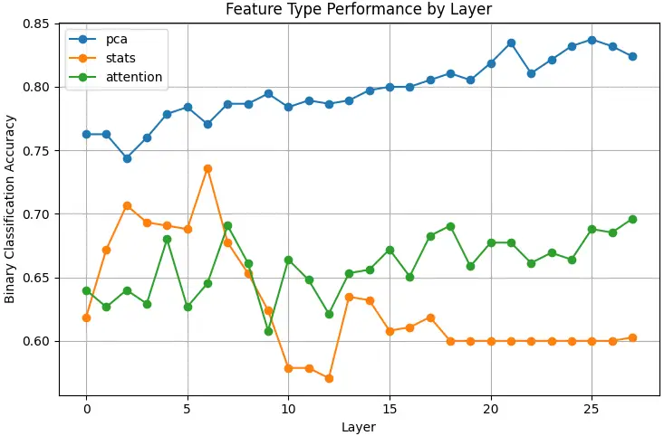

Figure 7: Layer-wise diagnostic results for Informativeness. Peak
correlation appears near Layer 25. PCA accuracy increases steadily,
while stats features decline in upper layers.

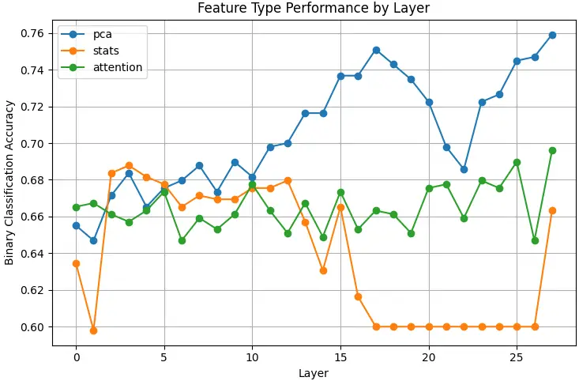

Figure 8: Layer-wise diagnostic results for Logicality. Signals
concentrate around Layers 17 and 27. PCA features show rising accuracy
toward the upper layers.

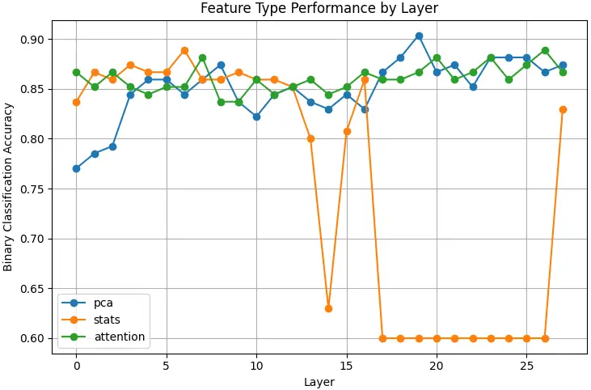

Figure 9: Layer-wise diagnostic results for Fluency. Evaluative signals
show local peaks at Layer 17.

## Appendix J Case Analysis

This case compares three evaluators scoring the same model-generated
response: a strong LLM judge (DeepSeek-V3), a probing-based judge that
accesses intermediate representations of Qwen3-1.7B, and a prompt-based
judge that relies on the same model’s generated evaluation text.
Consistent with our main hypothesis, the probing-based scores closely
match the strong judge, indicating that the semantic and factual signals
required for accurate evaluation are already encoded in the small
model’s latent states.

In contrast, the prompt-based evaluation from the same small model
diverges: although its numeric scores remain plausible, the generated
justifications introduce spurious concerns, overinterpret minor details,
or provide unreliable reasoning. These deviations reflect the higher
capacity demands of generating a coherent evaluation explanation. The
pattern illustrates a core capacity asymmetry—evaluation depends on
localized semantic cues accessible from intermediate representations,
whereas producing well-formed meta-evaluative text requires long-range
structuring and discourse planning that small models struggle to express
reliably.

### GSM8K Example

Question:  
Keaton climbed a 30 feet ladder twenty times while working at the
construction site. Reece, also working at the same site, climbed a
ladder 4 feet shorter than Keatonś ladder 15 times. Whatś the total
length of the ladders that both workers climbed in inches? Gold Answer:
11880 Model Prediction:  
Let’s break it down step by step.

Keaton climbed a 30 feet ladder 20 times. To find the total length of
the ladder he climbed, we need to multiply the height of the ladder by
the number of times he climbed it:

30 feet/ladder × 20 times = 600 feet

Since there are 12 inches in 1 foot, we can convert the total length
from feet to inches:

600 feet × 12 inches/foot = 7200 inches

Now, letś calculate the total length of the ladder Reece climbed. Reece
climbed a ladder that was 4 feet shorter than Keatonś ladder, which
means Reeceś ladder was:

30 feet - 4 feet = 26 feet

Reece climbed the ladder 15 times, so the total length of the ladder he
climbed is:

26 feet/ladder × 15 times = 390 feet

Converting this to inches:

390 feet × 12 inches/foot = 4680 inches

Now, letś add the total length of the ladders climbed by both workers:

7200 inches (Keaton) + 4680 inches (Reece) = 11,880 inches

So, the total length of the ladders that both workers climbed is 11,880
inches.

### DeepSeek-V3 Output

Semantic Consistency (score 5): Every step strictly follows the problem
facts without inventing events, dropping givens, or adding unstated
assumptions. The response correctly processes Keatonś 30-foot ladder
climbed 20 times, calculates Reeceś ladder as 4 feet shorter (26 feet)
climbed 15 times, converts both totals from feet to inches using the
standard conversion (12 inches per foot), and sums the results
accurately. The final answer is fully grounded in the given problem.  
Logicality (score 5): All inferences and arithmetic are valid; each step
follows logically from prior steps. The response correctly interprets
the problem, performs accurate calculations for both workers (including
the conversion from feet to inches), and sums the results
appropriately.  
Informativeness (score 5): Full, verifiable step-by-step derivation
showing all essential calculations: Keatonś total feet (30 × 20 = 600),
conversion to inches (600 × 12 = 7200), Reeceś ladder height (30 - 4 =
26), Reeceś total feet (26 × 15 = 390), conversion to inches (390 × 12 =
4680), and final sum (7200 + 4680 = 11880). Anyone can re-check the
answer from these clear, complete steps.  
Fluency (score 5): Clear, grammatical, well-punctuated, and easy to
follow; uses readable notation and step-by-step presentation that flows
logically from one calculation to the next.  
Factuality (score 5): All factual claims are correct and well-supported:
accurate arithmetic (30×20=600, 30-4=26, 26×15=390, 600×12=7200,
390×12=4680, 7200+4680=11880), correct unit conversion (12 inches per
foot), and proper application of the problemś conditions. No errors,
hallucinations, or unsupported assertions.

### Qwen3-1.7B Probing Evaluation

Predicted scores:  
Semantic Consistency: 4  
Logicality: 5  
Informativeness: 5  
Fluency: 5  
Factuality: 5

### Qwen3-1.7B Prompt-Based Evaluation Output

Semantic Consistency (score 3): Solution follows the problem facts.
Minor consistency lapse: the rationale never states the tacit assumption
that each ’climb’ is a single ascent. Also, unit management is done per
person instead of showing a single feet-to-inches conversion. These are
small omissions that do not change the numeric result, so mid-level
credit is appropriate.  
Logicality (score 3): Arithmetic steps are correct. Logical inefficiency
exists: the chain converts each person to inches separately rather than
adding feet then converting once — a harmless but unnecessary detour.
Because all inferences are valid but the chain is slightly untidy, a
middle score fits.  
Informativeness (score 3): Key calculations are present. However, the
explanation omits one explicit grouped intermediate (explicitly writing
’total = 990 ft’ before conversion is not shown in every version), and
some steps are shown only implicitly. Enough detail to verify the
answer, but not fully exhaustive — hence partial credit.  
Fluency (score 4): Language is clear, grammatical, and easy to follow.
Sentences read naturally and numeric steps are separated. Minor
repetition and slightly verbose conversion phrasing prevent a perfect
score, but overall readability is high.  
Factuality (score 2): While the final numeric answer is correct, there
are factual/imprecision concerns that lower confidence: (1) the
rationale implicitly assumes ’climb’ means one ascent and does not state
this, which could be misread in other contexts; (2) converting
per-person instead of converting total feet introduces an avoidable
chance for unit-handling mistakes in variants of the problem. These
represent multiple factual/imprecision issues significant enough to
warrant a low factuality rating.

Figure: Complete evaluation outputs for the GSM8K case across three
judges: DeepSeek-V3, Qwen3-1.7B (probing), and Qwen3-1.7B (prompting).

## Appendix K Prompt templates

We provide the one-shot evaluation prompt templates for five aspects
defined in Section 4.1 across three selected benchmarks: GSM8K, MATH,
and GPQA. We use these prompts to get LLM evaluation results. Some parts
of the prompt design are inspired by SOCREVAL(He et al., 2023).

It’s noticeable that when we use these same prompts to prob small LMs,
we found the prompts are too complex for small LMs to understand, which
makes it difficult to acquire accurate probing results. Thus, for
probing prompts, we remove the one-shot example and ask it to directly
output the score, instead of JSON output. Specifically, for the probing
evaluation prompt, we remove the ”Example question”, ”Example generated
response”, and ”Example representation”. We also change the final output
requirement to: ”Now evaluate the Question and Generated response above
based on the instruction. Return only the score.”

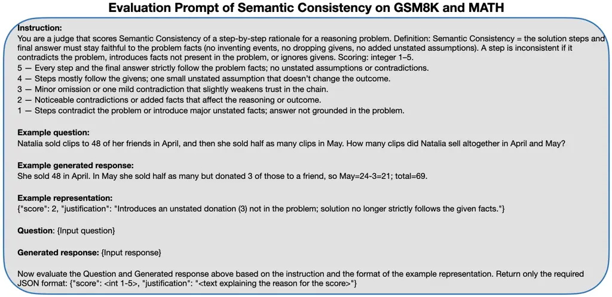

Figure 10: Evaluation prompt of Semantic Consistency on GSM8K and MATH.

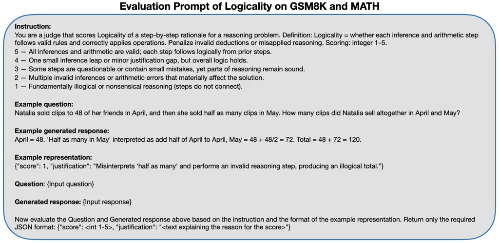

Figure 11: Evaluation prompt of Logicality on GSM8K and MATH.

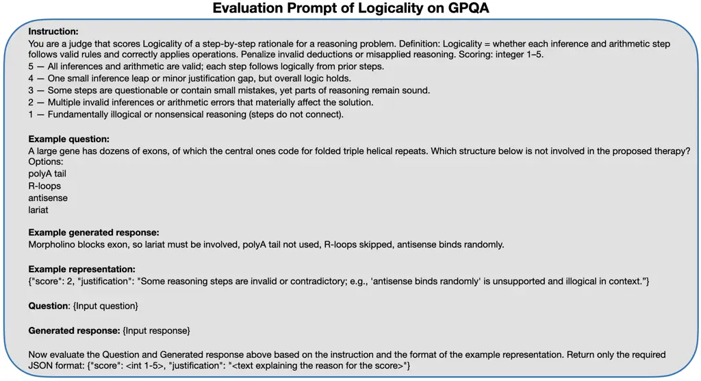

Figure 12: Evaluation prompt of Logicality on GPQA.

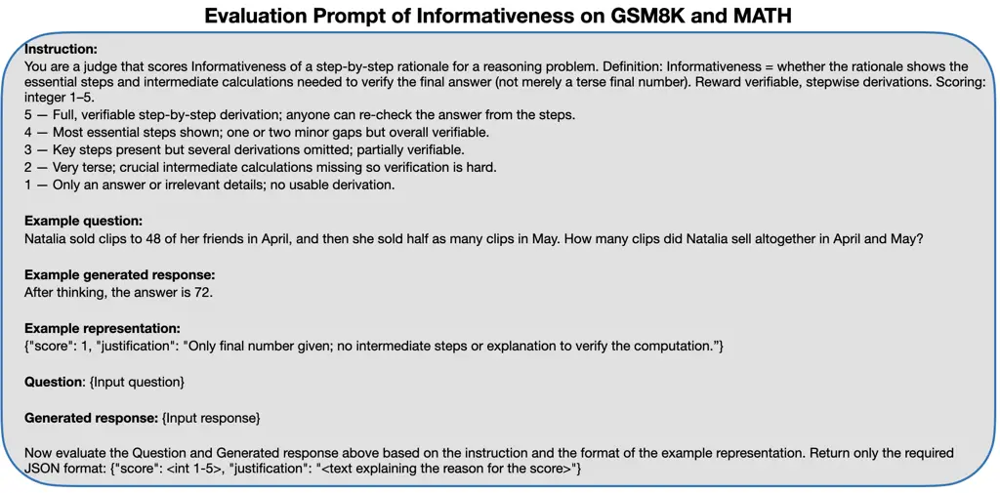

Figure 13: Evaluation prompt of Informativeness on GSM8K and MATH.

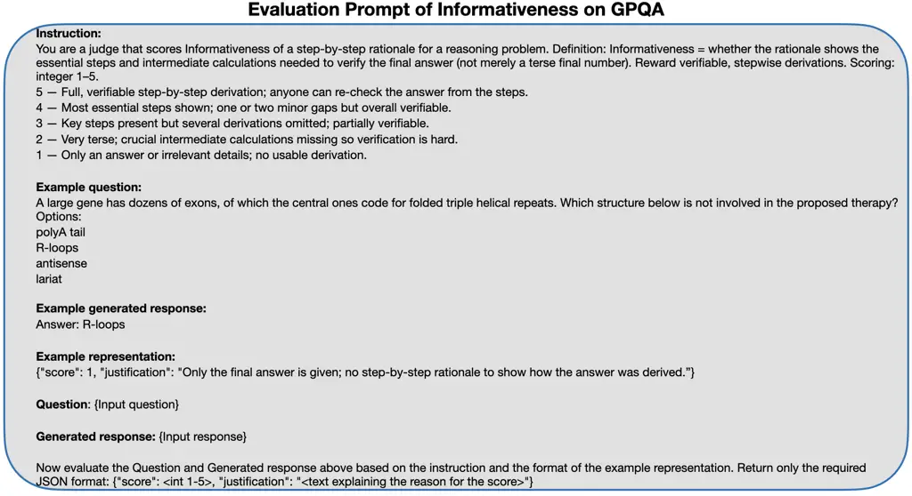

Figure 14: Evaluation prompt of Informativeness on GPQA.

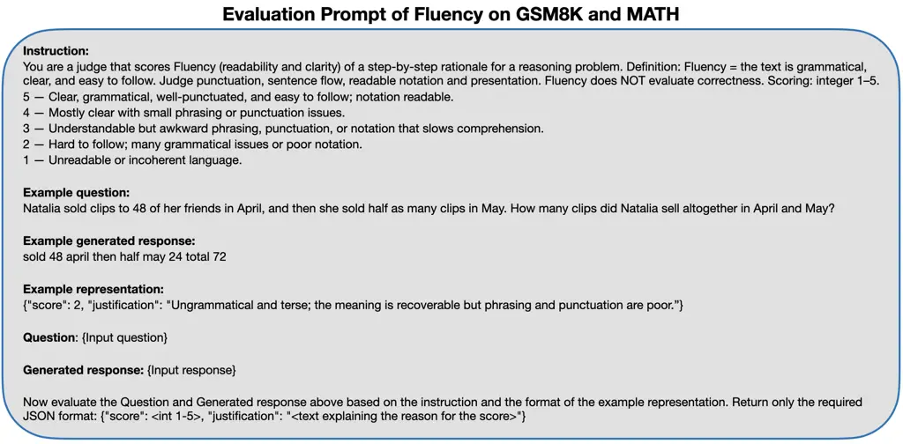

Figure 15: Evaluation prompt of Fluency on GSM8K and MATH.

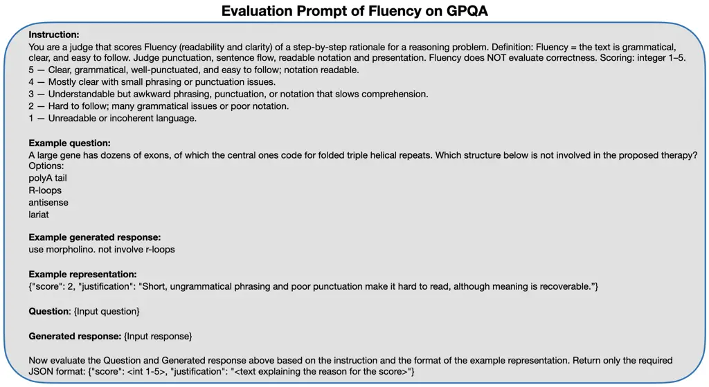

Figure 16: Evaluation prompt of Fluency on GPQA.

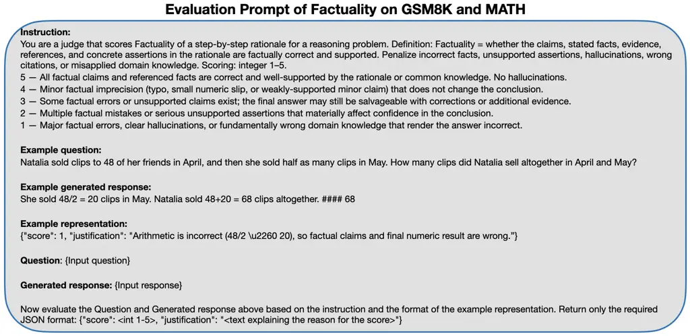

Figure 17: Evaluation prompt of Factuality on GSM8K and MATH.

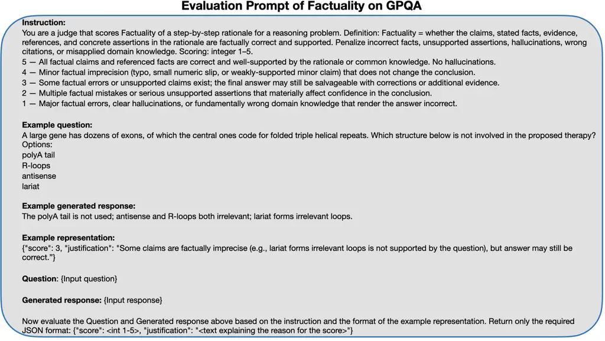

Figure 18: Evaluation prompt of Factuality on GPQA.
