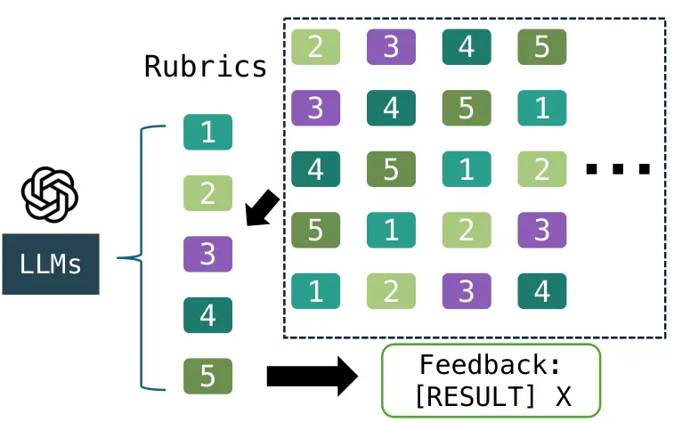
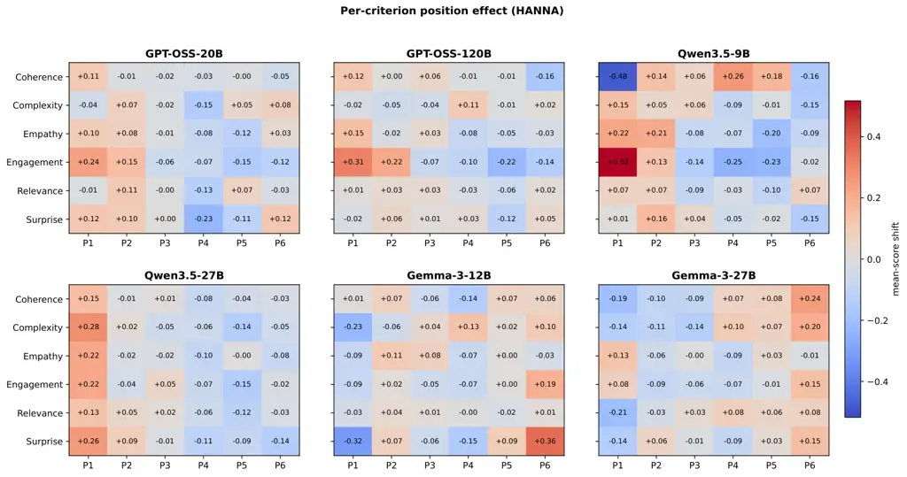
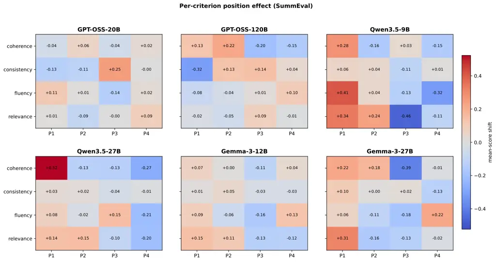

# Am I More Pointwise or Pairwise? Revealing Position Bias in Rubric-Based LLM-as-a-Judge

Yuzheng Xu Affiliation: OMRON SINIC X Affiliation: NexaScience    Tosho
Hirasawa Affiliation: OMRON SINIC X Affiliation: NexaScience    Tadashi
Kozuno Affiliation: OMRON SINIC X Affiliation: NexaScience    Yoshitaka
Ushiku Affiliation: OMRON SINIC X Affiliation: NexaScience

###### Abstract

Large language models are widely employed as evaluators, a paradigm
commonly referred to as LLM-as-a-Judge. Prior research has predominantly
examined point-wise or pair-wise evaluation protocols; in contrast, our
focus is on rubric-based evaluation, which has been attracting
increasing attention owing to its utility for training models in domains
where verification is otherwise difficult. In this work, we show that
rubric-based evaluation implicitly resembles a multiple-choice setting
and therefore exhibits position bias: LLMs tend to prefer score options
that appear at specific positions within the rubric list. Through
controlled experiments across multiple models and datasets, we
demonstrate that this position bias is consistent. Its direction,
however, is model-specific: some judges favor the first option, while
others favor the last. We further identify a second, orthogonal axis of
bias: when a prompt scores several criteria simultaneously, the ordering
of the criteria itself shifts the resulting scores. We additionally
explore permuting the order of the rubric options as a means of
mitigating position bias, and find that although the bias can be
attenuated, improvements in the correlation between model judgments and
human annotations are obtained primarily for models that exhibit strong
bias. Our results recast rubric-based LLM-as-a-Judge as a
multiple-choice problem with measurable, model-specific position bias,
and we further confirm that only a small number of random order
permutations are sufficient to reduce the error introduced by this bias
for the majority of models.

## 1 Introduction

Large language models (LLMs), exemplified by ChatGPT OpenAI et al.
(2023), have been widely applied to language-related tasks due to their
strong performance, such as summarization Goyal et al. (2022); Bhaskar
et al. (2023), question answering Rein et al. (2024), and even creative
idea generation Lu et al. (2024); Xu et al. (2025). Due to their strong
generality on text-related tasks, LLMs can also be used to generate
evaluations of textual quality, a paradigm commonly referred to as
LLM-as-a-Judge Zheng et al. (2023); Ye et al. (2024); Fu et al. (2024).
This capability is useful not only for producing evaluation scores but
also for training LLMs themselves Lee et al. (2024), leading to a wide
range of applications. Although LLMs are highly capable in this regard,
their performance has also been questioned. Some prior work has pointed
out that using LLMs as judges for text quality evaluation can introduce
various biases like position bias, verbosity bias, and so on Zheng et
al. (2023); Ye et al. (2024); Chen et al. (2024); Huang et al. (2025).
This phenomenon needs to be carefully considered in practice.

Figure 1: Four paradigms of LLM-as-a-Judge evaluation. Point-wise
evaluation assigns a score given a question and a single response.
Pair-wise evaluation compares two responses and outputs the model’s
preference. Rubric-based evaluation further incorporates explicit
scoring criteria. We can explicitly display the rubric scores along with
their corresponding descriptions, or we can simply specify the parts
that need to be evaluated and the specific score ranges. Judge models
may also exhibit position bias toward responses in certain orders.

Figure 2: Balanced permutation of rubric orderings. Aggregating the
model’s choice distributions across permutations marginalizes out score
identities and reveals systematic position bias.

The presence of bias can also depend on the evaluation type. As shown
in Figure 1, in practice, two popular evaluation paradigms are commonly
used: point-wise and pair-wise Tripathi et al. (2025). The former
assigns a score to a given response, while the latter selects the better
one between two candidate responses. Constructing rubrics and asking the
model to perform evaluation based on them is also a widely adopted
approach Kim et al. (2024), as it provides greater flexibility. We can
write out in detail the score and description corresponding to each
rubric, or we can directly list all the dimensions to be evaluated, omit
the details, and simply describe the score range.

In this paper, we focus on the rubric-based LLM-as-a-Judge setting.
Since there is only a single text to be evaluated, there should be no
position bias in the classical sense. However, the rubric-based
LLM-as-a-Judge can be viewed as a multiple-choice selection problem:
given a text for evaluation, the LLM must choose the rubric option that
aligns most with the text. Unlike the pair-wise setting, positional bias
in rubric-based evaluation is less salient, because score selections are
inherently imbalanced and dominated by the underlying score
distribution, making positional effects harder to observe directly.
Additionally, if we put all the rubrics together (the fourth paradigm),
although the multiple-choice situation disappears, would the order of
the different aspects affect the final output?

In our work, inspired by position bias observed in pair-wise evaluation,
we propose a balanced permutation method to disentangle the influence of
score values from positional choice preferences in rubric-based
LLM-as-a-Judge. By ensuring that each score is evenly distributed across
different positions over multiple evaluations, our method enables us to
uncover position bias in rubric-based evaluations. Figure 2 illustrates
how aggregating model choices across balanced rubric permutations
reveals systematic positional preference. While debiasing does not
always improve correlation with human scores, the ordering effect is
practically consequential: it changes downstream rankings and top-1
selections even when average score correlations remain similar.

Our contributions are:

- •
  We frame rubric-based LLM-as-a-Judge as an implicit multiple-choice
  task and show that it carries statistically significant,
  model-specific position bias across six judges and four datasets. Some
  judges are first-biased while others are last-biased, contradicting
  the assumption of a uniform first-option preference.
- •
  We identify a second, orthogonal axis of bias, namely the order of
  criteria within a multi-criterion prompt, which proves significant.
- •
  Using budget-matched ablations and a paired bootstrap, we find that
  balanced permutation is statistically indistinguishable from random
  aggregation and improves human correlation only for strongly biased
  judges, so a small number of randomly ordered variants suffices.
- •
  We show that the bias propagates downstream: rubric ordering alone
  flips the top-1 candidate on 15% to 41% of prompts, with direct
  implications for best-of-$`N`$ and rubric-as-reward pipelines.

## 2 Related Work

#### LLM-as-a-Judge:

Human evaluation of text is an expensive option. With the advent of
RLHF Ouyang et al. (2022), LLMs have acquired a certain degree of
alignment with human values, which makes LLM-as-a-Judge feasible Zheng
et al. (2023).  Fu et al. (2024) first explored the use of GPT models
for evaluating text data. This work addressed a long-standing limitation
of traditional evaluation: it’s hard to flexibly and easily adapt
evaluation criteria to different tasks and requirements. Zheng et al.
(2023) systematically studied LLM-as-a-Judge by introducing MT-Bench.
Their results show that strong models used as LLM-as-a-Judge can closely
match human preferences, achieving over 80% agreement. Such a high level
of agreement enables LLMs to be used even for training other LLMs,
achieving performance comparable to RLHF. This approach is known as
RLAIF Lee et al. (2024). Along with RLAIF, some work uses rubrics as
training signals Gunjal et al. (2025); Dineen et al. (2025). Rubrics can
also be used to evaluate the quality of CoT (Chain-of-Thought) Sheng et
al. (2026) or the answers without ground truth.

Our work is positioned within the line of research on LLM-as-a-Judge and
focuses on a previously underexplored issue in rubric-based evaluation.
We identify position bias induced by rubric ordering and propose a
simple, model-agnostic mitigation strategy.

#### Evaluation Biases:

Similar to humans Chen et al. (2024), LLM-as-a-Judge also exhibits
biases. A notable example is position bias: in a pair-wise evaluation
setting, the model may tend to prefer either the first or the second
response, depending on factors such as the model’s capability and the
quality of the answers. This bias can be mitigated by swapping the order
and performing evaluation twice Zheng et al. (2023). LLMs also show
length bias, tending to assign higher scores to longer, more verbose
responses Zheng et al. (2023); Tripathi et al. (2025).  Shi et al.
(2025) argue that the quality gap between candidate responses has a
significant impact on position bias, while length difference is not. In
addition, an LLM may favor outputs generated by itself or by closely
related models Chen et al. (2025b); Chen et al. (2025a); Zheng et al.
(2023). Wataoka et al. (2024) explain this phenomenon by noting that
LLMs tend to prefer responses with lower perplexity, and outputs
generated by the same model or closely related models often have
relatively lower perplexity. Related to our work, Li et al. (2025) shows
that different rubric orderings can affect the correlation between LLMs
and human scores. We extend this line of work by formulating rubric
ordering effects as measurable position bias and by introducing a
balanced permutation protocol for auditing and quantifying it. Besides,
we identify an orthogonal axis, the order of criteria in a
multi-criterion prompt, which is position-biased even when no explicit
score-option list is presented. Our results further show that, under a
matched inference budget, simple randomization often matches exact
balancing, yielding a practical low-cost recommendation.

## 3 Problem Formulation and Methods

Our work aims to study whether LLMs suffer from position bias in the
rubric-based format. We have two settings in total. In the first
setting, an LLM is asked to judge a question-response pair with a set of
rubric score options. We define position bias in this context as a
systematic preference for selecting score options appearing at
particular positions. In the second setting, each rubric does not come
with a specific score description; instead, the model assigns a score
within a given range based on its own understanding. Please refer
to Figure 1.

### 3.1 Balanced Permutation

In studies of position bias in pair-wise evaluation, a common mitigation
is to swap the two responses to cancel out the effect. In the
rubric-based setting, however, we have multiple score options, which
makes a simple swap ineffective. Nevertheless, as long as we can ensure
that each score appears equally often at each position, we can in
principle factor out the influence introduced by the score values
themselves.

To address this, we propose a balanced permutation method. The key
insight is that position bias can be neutralized if each score option
appears in each position an equal number of times across multiple
evaluation runs. For example, if there are 5 scores, we construct 10
complementary orderings: 5 forward cyclic rotations (\[1,2,3,4,5\],
\[2,3,4,5,1\], …) and 5 reverse cyclic rotations (\[5,4,3,2,1\],
\[4,3,2,1,5\], …). This design ensures that every score appears exactly
twice in each position, effectively canceling out any systematic
positional preference while preserving the semantic signal of the
scores.

For the second rubric setting, we only need to replace the score
rotations mentioned above with rotations of the different aspects. In
addition, as a lower-cost alternative, we also experimented with
directly randomizing the rubrics.

## 4 Experimental Setup

We evaluated position bias using 6 open-weight models across four
datasets. Two of these datasets include human ratings, which allowed us
to compute the correlation between LLM scores and human judgments under
the permutation-based setting.

### 4.1 Datasets

| Dataset      | Composition                                            | Total |
| ------------ | ------------------------------------------------------ | ----- |
| MT-Bench     | 80 prompts $`\times`$ 4 models                         | 320   |
| Vicuna-Bench | 80 prompts $`\times`$ 4 models                         | 320   |
| HANNA        | 96 stories $`\times`$ 6 criteria                       | 576   |
| SummEval     | 100 articles $`\times`$ 4 models $`\times`$ 4 criteria | 1,600 |
| Total        |                                                        | 2,816 |

Table 1: Dataset Statistics

We use MT-Bench, HANNA, SummEval, and Vicuna-Bench as our datasets for
evaluation. Our data are either taken from Kim et al. (2024) or adapted
following their format, and therefore differ from those used in the
original paper. Detailed descriptions of the datasets are outlined
below:

- •
  MT Bench Zheng et al. (2023): A multi-turn conversation dataset with
  80 prompts across 8 categories (writing, roleplay, reasoning, math,
  coding, extraction, STEM, humanities). ChatGPT OpenAI et al. (2023),
  Llama-2-Chat-13B Touvron et al. (2023), Vicuna-13B Chiang et al.
  (2023), and WizardLM-13B Xu et al. (2024) were used to generate
  responses, resulting in a total of 320 responses.
- •
  Vicuna Bench Chiang et al. (2023): A single-turn conversation
  benchmark with 80 prompts across 9 categories (generic, knowledge,
  roleplay, common-sense, fermi, counterfactual, coding, math, writing).
  Similar to MT Bench, it has 320 responses from 4 models.
- •
  HANNA Chhun et al. (2024): A story generation benchmark. We use a
  subset of 96 stories written by humans across 6 criteria (Coherence,
  Empathy, Surprise, Engagement, Relevance, Complexity). Each evaluation
  is annotated by 3 human raters.
- •
  SummEval Fabbri et al. (2021): A summarization evaluation benchmark
  with 100 CNN/DailyMail articles, each summarized by 4 models on 4
  criteria (coherence, consistency, fluency, relevance). Each evaluation
  is made by 3 human expert raters.

### 4.2 Judge Models

We evaluate six open-weight LLMs spanning three families and two size
points: GPT-OSS-20B and GPT-OSS-120B OpenAI et al. (2025), Qwen3.5-9B
and Qwen3.5-27B Qwen Team (2026), and Gemma-3-12B and Gemma-3-27B Gemma
Team et al. (2025). Inference uses vLLM Kwon et al. (2023). Unless
stated, the default temperature is 0. We report a temperature sweep
$`\tau\in\{0.0,0.3,0.6,1.0\}`$ for all the models and disable reasoning
mode for Qwen3.5. The gpt-oss family supports an explicit
reasoning-effort setting; we sweep
$`\{\text{low},\text{medium},\text{high}\}`$ for both sizes. The details
of the prompt are shown in Appendix B.

### 4.3 Evaluation Protocol

We study position bias along the two settings above ( Section 3.1), each
with its own permutation, as illustrated in Figure 3.

Figure 3: An illustration of balanced permutations of rubric scores,
ensuring that each score appears equally often at each position.

#### Score-option ordering (Setting 1).

For the $`n`$-point rubric we permute the order of the score options and
compare three strategies, each producing $`K{=}10`$ judgments per item:
(i) Balanced, the $`2n`$ cyclic rotations of Section 3.1; (ii) Random,
$`K`$ orderings drawn at random; and (iii) Fixed, a single canonical
ordering $`[1,\dots,n]`$ repeated $`K`$ times. To see how the bias
scales with rubric granularity we repeat the balanced experiment at
$`n\in\{2,3,5,9\}`$, and to see how many orderings are actually needed
we sub-sample $`K\in\{1,\dots,10\}`$ from the balanced and random sets.

#### Criterion ordering (Setting 2).

Only HANNA (6 criteria) and SummEval (4 criteria) have a multi-criterion
structure; MT-Bench and Vicuna provide a single overall score and
therefore do not support this setting. When a prompt scores several
criteria at once we permute the order of the criteria with the same
balanced cyclic construction ($`2n_{c}`$ orderings; 12 for HANNA, 8 for
SummEval), holding each criterion’s score scale fixed, and compare three
budget-matched strategies (Balanced / Random / Fixed criterion
orderings, all at $`2n_{c}`$ reads per item), mirroring Setting 1.

### 4.4 Metrics

#### Bias detection.

We test whether the selected-position distribution deviates from uniform
with a $`\chi^{2}`$ goodness-of-fit test against $`1/n`$. To compare
bias strength across rubric sizes we report Cramér’s
$`V=\sqrt{\chi^{2}/(N(n-1))}\in[0,1]`$, which is invariant to sample
size. For criterion ordering we use an item-blocked Friedman test
(blocking on the story/article).

#### Human alignment.

We measure agreement with human ratings by Pearson’s correlation
coefficient $`r`$ and Spearman’s rank correlation coefficient $`\rho`$,
with 95% bootstrap confidence intervals. To compare two strategies we
use a paired bootstrap on the difference $`\Delta r`$ (resampling the
same items for both correlations), which controls for the high
item-level correlation between strategies.

#### Downstream impact.

On the multi-candidate datasets we rank the candidate responses per
prompt under each strategy and report the mean per-prompt Kendall
$`\tau`$ between strategies and the fraction of prompts whose top-1
candidate changes.

## 5 Results

### 5.1 Model-Specific Position Bias (Setting 1)

Figure 4shows the marginal position-selection distribution on the
standard 5-point rubric, averaged over the 10 balanced orderings. If
there is no position bias, every line would be near the 20% baseline.
Table 2 reports the $`\chi^{2}`$ goodness-of-fit against uniform
together with the Pos1 / Pos5 selection rates on the two datasets with
human labels. Every $`\chi^{2}`$ on HANNA and SummEval is significant at
$`p<0.05`$, the sole exception being the near-uniform GPT-OSS-120B on
HANNA; on the smaller MT-Bench and Vicuna ($`n{=}320`$) the test has
less power and a few cells fall short.

Figure 4: Per-judge position-selection distribution under the 5-point
rubric (one solid line per dataset, distinct color and marker), averaged
over the 10 balanced orderings; the dotted line marks the 20% uniform
baseline. The direction of bias is model-specific yet consistent across
datasets: GPT-OSS-20B over-selects Pos 1, Gemma-3-27B over-selects
Pos 5, and GPT-OSS-120B is close to uniform.

| Model        | HANNA        |      |      | SummEval     |      |      | MT-Bench     |      |      | Vicuna       |      |      |
| ------------ | ------------ | ---- | ---- | ------------ | ---- | ---- | ------------ | ---- | ---- | ------------ | ---- | ---- |
|              | $`\chi^{2}`$ | Pos1 | Pos5 | $`\chi^{2}`$ | Pos1 | Pos5 | $`\chi^{2}`$ | Pos1 | Pos5 | $`\chi^{2}`$ | Pos1 | Pos5 |
| GPT-OSS-20B  | 165.7        | 26.4 | 18.9 | 639.8        | 27.8 | 16.8 | 30.9         | 23.2 | 17.5 | 94.3         | 26.4 | 16.1 |
| GPT-OSS-120B | 3.1^(†)      | 19.2 | 20.6 | 25.2         | 20.3 | 21.1 | 5.8^(†)      | 19.3 | 20.1 | 8.0^(†)      | 20.4 | 20.1 |
| Qwen3.5-9B   | 27.4         | 21.6 | 21.2 | 265.9        | 20.9 | 23.7 | 5.6^(†)      | 19.9 | 20.5 | 21.7         | 20.7 | 20.4 |
| Qwen3.5-27B  | 76.3         | 17.4 | 24.3 | 142.5        | 18.4 | 22.9 | 23.4         | 17.4 | 22.8 | 6.3^(†)      | 19.2 | 21.7 |
| Gemma-3-12B  | 243.2        | 21.3 | 24.9 | 369.8        | 21.6 | 24.3 | 29.6         | 20.3 | 21.3 | 29.0         | 23.1 | 19.0 |
| Gemma-3-27B  | 395.3        | 13.9 | 29.3 | 1691.7       | 11.5 | 31.4 | 88.9         | 18.9 | 26.2 | 83.7         | 20.6 | 25.1 |

Table 2: 5-point rubric: $`\chi^{2}`$ on position selection against
uniform $`1/5`$, with Pos1 and Pos5 selection rates (%), for all four
datasets. Larger $`\chi^{2}`$ = stronger bias; the significance
threshold is $`\chi^{2}_{4,0.05}=9.49`$. All cells on the human-rated
HANNA and SummEval are significant except GPT-OSS-120B on HANNA; ^(†)
marks the cells that fall below significance (the low-power MT-Bench /
Vicuna cells at $`n{=}320`$, plus GPT-OSS-120B / HANNA).

Another finding is that the direction of bias differs across judge
models. GPT-OSS-20B is more first-biased; Gemma-3-27B and Qwen3.5-27B
are more last-biased; GPT-OSS-120B is near-uniform. So the bias here is
a property of the model, not of the rubric layout, given that we use the
same prompts.

### 5.2 When Does Permutation Help? (Setting 1)

The permutation operation can definitely reduce bias, because the scores
are placed evenly across all positions. However, reducing this kind of
bias does not necessarily lead to increased alignment with humans.

We compare three budget-matched strategies, each producing $`K{=}10`$
judgments per item: Balanced ($`2n`$ cyclic rotations), Random ($`K`$
random orderings), and Fixed (the canonical order repeated $`K`$ times).
Because each item’s score is the mean over $`K`$ reads, the
Balanced$`-`$Fixed gap isolates de-biasing from variance reduction,
while Balanced$`-`$Random isolates exact balance from mere aggregation.
Figure 8 shows the per-strategy Pearson $`r`$ with 95% bootstrap CIs and
Table 3 the paired bootstrap CIs on the differences (resampling the same
items for both correlations).

| Model        | Dataset  | Balanced $`-`$ Random |                            | Balanced $`-`$ Fixed |                            |
| ------------ | -------- | --------------------- | -------------------------- | -------------------- | -------------------------- |
|              |          | $`\Delta r`$          | 95% CI                     | $`\Delta r`$         | 95% CI                     |
| GPT-OSS-20B  | HANNA    | $`+0.009`$            | \[$`-`$.013,$`+`$.031\]    | $`\mathbf{+0.075}`$  | $`\mathbf{[+.038,+.116]}`$ |
| GPT-OSS-20B  | SummEval | $`+0.009`$            | \[$`-`$.003,$`+`$.021\]    | $`\mathbf{+0.083}`$  | $`\mathbf{[+.057,+.108]}`$ |
| GPT-OSS-120B | HANNA    | $`\mathbf{+0.014}`$   | $`\mathbf{[+.000,+.029]}`$ | $`+0.021`$           | \[$`-`$.005,$`+`$.046\]    |
| GPT-OSS-120B | SummEval | $`-0.002`$            | \[$`-`$.010,$`+`$.006\]    | $`\mathbf{+0.018}`$  | $`\mathbf{[+.003,+.033]}`$ |
| Qwen3.5-9B   | HANNA    | $`-0.000`$            | \[$`-`$.016,$`+`$.017\]    | $`-0.009`$           | \[$`-`$.047,$`+`$.029\]    |
| Qwen3.5-9B   | SummEval | $`-0.008`$            | \[$`-`$.018,$`+`$.004\]    | $`\mathbf{+0.050}`$  | $`\mathbf{[+.027,+.072]}`$ |
| Qwen3.5-27B  | HANNA    | $`-0.006`$            | \[$`-`$.021,$`+`$.011\]    | $`\mathbf{+0.076}`$  | $`\mathbf{[+.047,+.105]}`$ |
| Qwen3.5-27B  | SummEval | $`+0.007`$            | \[$`-`$.001,$`+`$.014\]    | $`+0.011`$           | \[$`-`$.003,$`+`$.026\]    |
| Gemma-3-12B  | HANNA    | $`-0.006`$            | \[$`-`$.033,$`+`$.022\]    | $`-0.004`$           | \[$`-`$.043,$`+`$.034\]    |
| Gemma-3-12B  | SummEval | $`+0.001`$            | \[$`-`$.011,$`+`$.013\]    | $`\mathbf{+0.035}`$  | $`\mathbf{[+.014,+.055]}`$ |
| Gemma-3-27B  | HANNA    | $`+0.009`$            | \[$`-`$.016,$`+`$.034\]    | $`\mathbf{+0.070}`$  | $`\mathbf{[+.036,+.106]}`$ |
| Gemma-3-27B  | SummEval | $`\mathbf{+0.015}`$   | $`\mathbf{[+.001,+.028]}`$ | $`\mathbf{+0.027}`$  | $`\mathbf{[+.010,+.045]}`$ |

Table 3: Paired bootstrap 95% CI for
$`\Delta r=r_{\text{Balanced}}-r_{\text{Random}}`$ and
$`r_{\text{Balanced}}-r_{\text{Fixed}}`$ (2000 iterations, same items
resampled for both correlations). CIs excluding 0 are paired-significant
at $`p<0.05`$. Bold marks paired-significant cells; Balanced
significantly beats Fixed on 8 of 12 cells and no cell has Fixed beating
Balanced.

We have two findings. (i) Balanced $`\approx`$ Random: the paired CI for
$`r_{\text{Balanced}}-r_{\text{Random}}`$ contains 0 on 10 of 12 cells
(point estimates in $`[-0.008,+0.015]`$), so exact score–position
balance buys little over random ordering at $`K{=}10`$. The improvement
comes from aggregating distinct orderings, i.e. variance reduction. (ii)
Balanced $`>`$ Fixed only conditionally: Balanced detectably beats Fixed
on 8 of 12 cells, again the judges with the strongest position bias
(GPT-OSS-20B, Qwen3.5-27B, Gemma-3-27B), and never loses to it; the
remaining cells are inconclusive. In short, “removing the bias” is
mechanical, but “improving human correlation” is conditional.
Permutation helps human agreement only when the judge is strongly biased
to begin with.

### 5.3 How Many Orderings?

Balanced needs exactly $`2n`$ orderings for exact balance, but how many
are actually useful? We sub-sample $`K\in\{1,\dots,10\}`$ from both the
balanced and the random sets, average each item over the chosen
orderings, and plot mean Pearson $`r`$ vs $`K`$ (Figure 9). The random
and balanced curves track each other within $`0.02`$ at every $`K`$ on 5
of 6 judges, and the gain saturates early: for judge models that
benefit, roughly two-thirds of the $`K{=}1\!\to\!10`$ improvement is
reached by $`K{=}3`$ and about $`85\%`$ by $`K{=}5`$.

### 5.4 Bias Across Rubric Scales

To rule out a 5-point artefact we repeat the balanced experiment at
$`n\in\{2,3,5,9\}`$, selecting evenly spaced descriptions from the
original rubric. Because $`\chi^{2}`$ scales with sample size, we
compare bias strength with Cramér’s
$`V=\sqrt{\chi^{2}/(N(n-1))}\in[0,1]`$ (Table 4). Bias does not vanish
at any scale, and it is not monotone: on 5 of 6 judge models the lowest
$`V`$ sits at an intermediate scale ($`n{=}3`$ or $`5`$) while the
extremes ($`n{=}2`$ and $`9`$) carry the highest $`V`$. Magnitude tracks
the judge family, not size: GPT-OSS-120B stays $`\leq 0.05`$ everywhere,
whereas Gemma-3-27B is the most biased at every scale and roughly
doubles from $`n{=}5`$ ($`0.114`$) to $`n{=}9`$ ($`0.220`$). Migrating
to a finer 9-point or a coarser binary rubric therefore tends to
increase bias; 3- or 5-point is the lower-bias regime.

| Model        | $`n{=}2`$ | $`n{=}3`$ | $`n{=}5`$ | $`n{=}9`$ |
| ------------ | --------- | --------- | --------- | --------- |
| GPT-OSS-20B  | 0.035     | 0.035     | 0.080     | 0.036     |
| GPT-OSS-120B | 0.049     | 0.025     | 0.019     | 0.022     |
| Qwen3.5-9B   | 0.098     | 0.064     | 0.040     | 0.071     |
| Qwen3.5-27B  | 0.096     | 0.060     | 0.042     | 0.065     |
| Gemma-3-12B  | 0.168     | 0.059     | 0.069     | 0.158     |
| Gemma-3-27B  | 0.172     | 0.066     | 0.114     | 0.220     |

Table 4: Mean Cramér’s $`V`$ for position-selection bias by judge and
rubric resolution ($`V\in[0,1]`$, invariant to sample size; higher =
stronger bias). Each cell averages over the datasets evaluated at that
scale (4 for $`n\in\{2,3,5\}`$; HANNA + SummEval for $`n{=}9`$).

### 5.5 Criterion-Order Bias (Setting 2)

When a prompt scores several criteria at once (HANNA: 6, SummEval: 4),
the order in which the criteria are listed is a second bias axis,
orthogonal to score-option order. We permute the criterion order with
the same balanced construction and test, per criterion, whether its
score depends on its position with an item-blocked Friedman test
(blocking on the story/article). Table 5 reports the per-judge gap
$`\Delta`$Pos between the best- and worst-position mean score and the
number of significant criteria; Figure 10 visualises the per-criterion
position effect.

| Model           | Avg $`r`$ | Mean $`\Delta`$ | Max $`\Delta`$ | Sig. |
| --------------- | --------- | --------------- | -------------- | ---- |
| GPT-OSS-20B(H)  | 0.290     | 0.26            | 0.39           | 6/6  |
| GPT-OSS-20B(S)  | 0.433     | 0.23            | 0.39           | 4/4  |
| GPT-OSS-120B(H) | 0.323     | 0.25            | 0.54           | 5/6  |
| GPT-OSS-120B(S) | 0.421     | 0.30            | 0.46           | 4/4  |
| Qwen3.5-9B(H)   | 0.263     | 0.45            | 0.77           | 6/6  |
| Qwen3.5-9B(S)   | 0.444     | 0.53            | 0.80           | 4/4  |
| Qwen3.5-27B(H)  | 0.337     | 0.33            | 0.43           | 6/6  |
| Qwen3.5-27B(S)  | 0.451     | 0.39            | 0.79           | 4/4  |
| Gemma-3-12B(H)  | 0.381     | 0.30            | 0.68           | 5/6  |
| Gemma-3-12B(S)  | 0.486     | 0.21            | 0.29           | 4/4  |
| Gemma-3-27B(H)  | 0.354     | 0.30            | 0.44           | 6/6  |
| Gemma-3-27B(S)  | 0.507     | 0.43            | 0.61           | 4/4  |

Table 5: Multi-criterion ordering. “Avg $`r`$” is mean Pearson with
humans across criteria; “Mean / Max $`\Delta`$Pos” is the
best$`-`$worst-position score gap (5-point scale) averaged / maxed over
criteria; “Sig.” counts criteria with a significant item-blocked
Friedman test ($`p<0.05`$) out of the total. H represents HANNA; S
represents SummEval.

The bias is pervasive: $`58`$ of $`60`$ (judge, criterion) Friedman
tests are significant (all 24 SummEval cells, $`34/36`$ HANNA cells),
and the most extreme cell (Qwen3.5-9B on SummEval) shifts a criterion’s
mean by up to $`0.80`$ points. A judge corrected for score-position bias
can therefore still be biased through criterion order.

We then ask whether mitigating it helps, with the same budget-matched
three-way ablation (Balanced/Random/Fixed criterion order, $`2n_{c}`$
reads: 12 for HANNA, 8 for SummEval). Table 6 reports macro-average
Pearson with cluster-level paired-bootstrap CIs. The story mirrors the
score axis exactly: budget-matched Balanced$`-`$Fixed is significant on
6 of 12 cells, and the Balanced and Random columns differ by at most
$`0.02`$ on every cell.

| Model        | HANNA (H) |       |       |                     | SummEval (S) |       |       |                     |
| ------------ | --------- | ----- | ----- | ------------------- | ------------ | ----- | ----- | ------------------- |
|              | Bal       | Rnd   | Fix   | $`\Delta`$          | Bal          | Rnd   | Fix   | $`\Delta`$          |
| GPT-OSS-20B  | 0.290     | 0.283 | 0.201 | $`\mathbf{+0.090}`$ | 0.433        | 0.434 | 0.399 | $`\mathbf{+0.034}`$ |
| GPT-OSS-120B | 0.323     | 0.335 | 0.300 | $`+0.022`$          | 0.421        | 0.418 | 0.400 | $`\mathbf{+0.021}`$ |
| Qwen3.5-9B   | 0.263     | 0.259 | 0.244 | $`+0.019`$          | 0.444        | 0.428 | 0.423 | $`+0.021`$          |
| Qwen3.5-27B  | 0.337     | 0.337 | 0.330 | $`+0.007`$          | 0.451        | 0.445 | 0.445 | $`+0.006`$          |
| Gemma-3-12B  | 0.381     | 0.393 | 0.338 | $`\mathbf{+0.043}`$ | 0.486        | 0.481 | 0.455 | $`\mathbf{+0.031}`$ |
| Gemma-3-27B  | 0.354     | 0.343 | 0.347 | $`+0.007`$          | 0.507        | 0.504 | 0.483 | $`\mathbf{+0.023}`$ |

Table 6: Budget-matched criterion-order ablation on HANNA (H) and
SummEval (S). Bal/Rnd/Fix are macro-average Pearson with humans under
Balanced/Random/Fixed criterion ordering (same $`2n_{c}`$-read budget);
$`\Delta`$ is the cluster-level paired-bootstrap difference Bal$`-`$Fix
(resampling stories / article–model pairs), bold when its $`95\%`$ CI
excludes 0. De-biasing (Bal$`-`$Fix) is significant on 6/12 cells (three
Gemma, both GPT-OSS SummEval, and GPT-OSS-20B HANNA). Balanced and
Random differ by at most $`0.02`$ on every cell.

### 5.6 Downstream Rank Reversal

Finally we show the bias propagates into ranking, which best-of-$`N`$
selection, RLAIF reward modeling, and leaderboards all consume. On the
multi-candidate datasets (MT-Bench, Vicuna, SummEval) we rank the
candidate responses per prompt under Balanced and Fixed and compare
(Table 7). Across all 18 cells the per-prompt Kendall $`\tau`$ between
the two rankings is only $`0.65`$–$`0.85`$, and the top-1 candidate
flips on $`15`$–$`41\%`$ of prompts. This is not confined to high-bias
judges: GPT-OSS-120B, the lowest-bias judge by $`\chi^{2}`$, still shows
$`21`$–$`38\%`$ top-1 reversal, because rank reversal depends on
per-item variance, not just the average direction of bias. A reward
model fed these scores would see a different winning candidate on
roughly a quarter of prompts from a nominally cosmetic ordering choice
alone.

| Model        | M        |      | V        |      | S        |      |
| ------------ | -------- | ---- | -------- | ---- | -------- | ---- |
|              | $`\tau`$ | t1   | $`\tau`$ | t1   | $`\tau`$ | t1   |
| GPT-OSS-20B  | .72      | 15.0 | .65      | 28.8 | .67      | 41.0 |
| GPT-OSS-120B | .74      | 21.2 | .77      | 36.2 | .72      | 38.2 |
| Qwen3.5-9B   | .76      | 28.8 | .79      | 16.2 | .73      | 38.0 |
| Qwen3.5-27B  | .84      | 23.8 | .85      | 16.2 | .85      | 26.0 |
| Gemma-3-12B  | .75      | 18.8 | .75      | 30.0 | .78      | 36.0 |
| Gemma-3-27B  | .77      | 17.5 | .82      | 25.0 | .81      | 33.2 |

Table 7: Rank reversal under ordering perturbation (Balanced vs Fixed):
per (judge, dataset) we rank the candidate responses per prompt and
report the mean per-prompt Kendall $`\tau`$ and the percentage of
prompts whose top-1 candidate flips (t1). Datasets: M = MT-Bench,
V = Vicuna ($`80`$ prompts each), S = SummEval ($`400`$); all have 4
candidates per prompt. HANNA is omitted: it has a single text per item,
hence no competing candidates to rank. $`\tau`$ never exceeds $`0.85`$
and t1 reaches $`15`$–$`41\%`$.

## 6 Discussion

#### Detection versus correction.

The sources of bias are relatively diverse; even after position bias has
been eliminated, other forms of bias still remain. Moreover, even human
ratings are subject to a certain degree of bias, and therefore the
similarity is not necessarily improved.

#### Impact on selection, not absolute scores.

Although the correlation does not necessarily show a substantial
improvement, when we swap the order of the criteria, the resulting
variation in scores exerts a considerable impact on the ranking.
Therefore, applications of rubric-based LLM-as-a-Judge should pay
attention to such scenarios. It is also worthwhile to assess the
influence of this kind of noise on downstream applications, such as
model training.

#### Practical guidance.

Even given the same prompt, different models exhibit different biases:
some prefer the first position, some prefer the last position, and some
are relatively balanced. Furthermore, the biases observed under two
different settings also differ. In addition, although permutation works
well in theory, if the goal is merely to improve correlation, randomly
shuffling the order is sufficient.

## Limitations

Owing to budget constraints, our experiments were not conducted on the
most recent closed-source LLMs. For the same reason, we did not attempt
to apply our method directly to works that leverage rubrics for model
training.

## Acknowledgments

This work was supported by JST Moonshot R&D Program Grant Number
JPMJMS2236 and JSPS KAKENHI Grant Number JP25H01149.

## References

- Bhaskar et al. (2023) A. Bhaskar, A. Fabbri, and G. Durrett Prompted
  opinion summarization with GPT-3.5. In Findings of the Association for
  Computational Linguistics: ACL 2023, A. Rogers, J. Boyd-Graber, and N.
  Okazaki (Eds.), Toronto, Canada, pp. 9282–9300. External Links:
  [Link](https://aclanthology.org/2023.findings-acl.591/),
  [Document](https://dx.doi.org/10.18653/v1/2023.findings-acl.591) Cited
  by: §1.
- Chen et al. (2024) G. H. Chen, S. Chen, Z. Liu, F. Jiang, and B. Wang
  Humans or LLMs as the judge? a study on judgement bias. In Proceedings
  of the 2024 Conference on Empirical Methods in Natural Language
  Processing, Y. Al-Onaizan, M. Bansal, and Y. Chen (Eds.), Miami,
  Florida, USA, pp. 8301–8327. External Links:
  [Link](https://aclanthology.org/2024.emnlp-main.474/),
  [Document](https://dx.doi.org/10.18653/v1/2024.emnlp-main.474) Cited
  by: §1, §2.
- Chen et al. (2025a) W. Chen, Z. Wei, X. Zhu, S. Feng, and Y. Meng Do
  llm evaluators prefer themselves for a reason?. arXiv preprint arXiv:
  2504.03846. Cited by: §2.
- Chen et al. (2025b) Z. Chen, H. Wang, X. Zhang, E. Hu, and Y. Lin
  Beyond the surface: measuring self-preference in LLM judgments. In
  Proceedings of the 2025 Conference on Empirical Methods in Natural
  Language Processing, C. Christodoulopoulos, T. Chakraborty, C. Rose,
  and V. Peng (Eds.), Suzhou, China, pp. 1653–1672. External Links:
  [Link](https://aclanthology.org/2025.emnlp-main.86/),
  [Document](https://dx.doi.org/10.18653/v1/2025.emnlp-main.86), ISBN
  979-8-89176-332-6 Cited by: §2.
- Chhun et al. (2024) C. Chhun, F. M. Suchanek, and C. Clavel Do
  language models enjoy their own stories? prompting large language
  models for automatic story evaluation. Transactions of the Association
  for Computational Linguistics 12, pp. 1122–1142. External Links: ISSN
  2307-387X, [Document](https://dx.doi.org/10.1162/tacl%5Fa%5F00689),
  [Link](https://doi.org/10.1162/tacl_a_00689),
  https://direct.mit.edu/tacl/article-pdf/doi/10.1162/tacl_a_00689/2470807/tacl_a_00689.pdf
  Cited by: 3rd item.
- Chiang et al. (2023) W. Chiang, Z. Li, Z. Lin, Y. Sheng, Z. Wu, H.
  Zhang, L. Zheng, S. Zhuang, Y. Zhuang, J. E. Gonzalez, I. Stoica,
  and E. P. Xing Vicuna: an open-source chatbot impressing gpt-4 with
  90%\* chatgpt quality. External Links:
  [Link](https://lmsys.org/blog/2023-03-30-vicuna/) Cited by: 1st item,
  2nd item.
- Dineen et al. (2025) J. Dineen, A. Rrv, Q. Liu, Z. Xu, X. Ye, M.
  Shen, Z. Li, S. Lu, C. Baral, M. Chen, and B. Zhou QA-LIGN: aligning
  LLMs through constitutionally decomposed QA. In Findings of the
  Association for Computational Linguistics: EMNLP 2025, C.
  Christodoulopoulos, T. Chakraborty, C. Rose, and V. Peng (Eds.),
  Suzhou, China, pp. 20619–20642. External Links:
  [Link](https://aclanthology.org/2025.findings-emnlp.1123/),
  [Document](https://dx.doi.org/10.18653/v1/2025.findings-emnlp.1123),
  ISBN 979-8-89176-335-7 Cited by: §2.
- Fabbri et al. (2021) A. R. Fabbri, W. Kryściński, B. McCann, C.
  Xiong, R. Socher, and D. Radev SummEval: re-evaluating summarization
  evaluation. Transactions of the Association for Computational
  Linguistics 9, pp. 391–409. External Links: ISSN 2307-387X,
  [Document](https://dx.doi.org/10.1162/tacl%5Fa%5F00373),
  [Link](https://doi.org/10.1162/tacl_a_00373),
  https://direct.mit.edu/tacl/article-pdf/doi/10.1162/tacl_a_00373/1923949/tacl_a_00373.pdf
  Cited by: 4th item.
- Fu et al. (2024) J. Fu, S. Ng, Z. Jiang, and P. Liu GPTScore: evaluate
  as you desire. In Proceedings of the 2024 Conference of the North
  American Chapter of the Association for Computational Linguistics:
  Human Language Technologies (Volume 1: Long Papers), K. Duh, H. Gomez,
  and S. Bethard (Eds.), Mexico City, Mexico, pp. 6556–6576. External
  Links: [Link](https://aclanthology.org/2024.naacl-long.365/),
  [Document](https://dx.doi.org/10.18653/v1/2024.naacl-long.365) Cited
  by: §1, §2.
- Gemma Team et al. (2025) Gemma Team, A. Kamath, J. Ferret, S.
  Pathak, N. Vieillard, R. Merhej, S. Perrin, T. Matejovicova, A.
  Ramé, M. Rivière, L. Rouillard, T. Mesnard, G. Cideron, J. Grill, S.
  Ramos, E. Yvinec, M. Casbon, E. Pot, I. Penchev, G. Liu, F. Visin, K.
  Kenealy, L. Beyer, X. Zhai, A. Tsitsulin, R. Busa-Fekete, A. Feng, N.
  Sachdeva, B. Coleman, Y. Gao, B. Mustafa, I. Barr, E. Parisotto, D.
  Tian, M. Eyal, C. Cherry, J. Peter, D. Sinopalnikov, S.
  Bhupatiraju, R. Agarwal, M. Kazemi, D. Malkin, R. Kumar, D. Vilar, I.
  Brusilovsky, J. Luo, A. Steiner, A. Friesen, A. Sharma, A.
  Sharma, A. M. Gilady, A. Goedeckemeyer, A. Saade, A. Feng, A.
  Kolesnikov, A. Bendebury, A. Abdagic, A. Vadi, A. György, A. S.
  Pinto, A. Das, A. Bapna, A. Miech, A. Yang, A. Paterson, A. Shenoy, A.
  Chakrabarti, B. Piot, B. Wu, B. Shahriari, B. Petrini, C. Chen, C. L.
  Lan, C. A. Choquette-Choo, C. Carey, C. Brick, D. Deutsch, D.
  Eisenbud, D. Cattle, D. Cheng, D. Paparas, D. S. Sreepathihalli, D.
  Reid, D. Tran, D. Zelle, E. Noland, E. Huizenga, E. Kharitonov, F.
  Liu, G. Amirkhanyan, G. Cameron, H. Hashemi, H. Klimczak-Plucińska, H.
  Singh, H. Mehta, H. T. Lehri, H. Hazimeh, I. Ballantyne, I.
  Szpektor, I. Nardini, J. Pouget-Abadie, J. Chan, J. Stanton, J.
  Wieting, J. Lai, J. Orbay, J. Fernandez, J. Newlan, J. Ji, J.
  Singh, K. Black, K. Yu, K. Hui, K. Vodrahalli, K. Greff, L. Qiu, M.
  Valentine, M. Coelho, M. Ritter, M. Hoffman, M. Watson, M.
  Chaturvedi, M. Moynihan, M. Ma, N. Babar, N. Noy, N. Byrd, N. Roy, N.
  Momchev, N. Chauhan, N. Sachdeva, O. Bunyan, P. Botarda, P.
  Caron, P. K. Rubenstein, P. Culliton, P. Schmid, P. G. Sessa, P.
  Xu, P. Stanczyk, P. Tafti, R. Shivanna, R. Wu, R. Pan, R. Rokni, R.
  Willoughby, R. Vallu, R. Mullins, S. Jerome, S. Smoot, S. Girgin, S.
  Iqbal, S. Reddy, S. Sheth, S. Põder, S. Bhatnagar, S. R. Panyam, S.
  Eiger, S. Zhang, T. Liu, T. Yacovone, T. Liechty, U. Kalra, U.
  Evci, V. Misra, V. Roseberry, V. Feinberg, V. Kolesnikov, W. Han, W.
  Kwon, X. Chen, Y. Chow, Y. Zhu, Z. Wei, Z. Egyed, V. Cotruta, M.
  Giang, P. Kirk, A. Rao, K. Black, N. Babar, J. Lo, E. Moreira, L. G.
  Martins, O. Sanseviero, L. Gonzalez, Z. Gleicher, T. Warkentin, V.
  Mirrokni, E. Senter, E. Collins, J. Barral, Z. Ghahramani, R.
  Hadsell, Y. Matias, D. Sculley, S. Petrov, N. Fiedel, N. Shazeer, O.
  Vinyals, J. Dean, D. Hassabis, K. Kavukcuoglu, C. Farabet, E.
  Buchatskaya, J. Alayrac, R. Anil, D. Lepikhin, S. Borgeaud, O.
  Bachem, A. Joulin, A. Andreev, C. Hardin, R. Dadashi, and L. Hussenot
  Gemma 3 technical report. External Links: 2503.19786,
  [Link](https://arxiv.org/abs/2503.19786) Cited by: §4.2.
- Goyal et al. (2022) T. Goyal, J. J. Li, and G. Durrett News
  summarization and evaluation in the era of gpt-3. arXiv preprint
  arXiv: 2209.12356. Cited by: §1.
- Gunjal et al. (2025) A. Gunjal, A. Wang, E. Lau, V. Nath, Y. He, B.
  Liu, and S. Hendryx Rubrics as rewards: reinforcement learning beyond
  verifiable domains. arXiv preprint arXiv: 2507.17746. Cited by: §2.
- Huang et al. (2025) H. Huang, X. Bu, H. Zhou, Y. Qu, J. Liu, M.
  Yang, B. Xu, and T. Zhao An empirical study of LLM-as-a-judge for LLM
  evaluation: fine-tuned judge model is not a general substitute for
  GPT-4. In Findings of the Association for Computational Linguistics:
  ACL 2025, W. Che, J. Nabende, E. Shutova, and M. T. Pilehvar (Eds.),
  Vienna, Austria, pp. 5880–5895. External Links:
  [Link](https://aclanthology.org/2025.findings-acl.306/),
  [Document](https://dx.doi.org/10.18653/v1/2025.findings-acl.306), ISBN
  979-8-89176-256-5 Cited by: §1.
- Kim et al. (2024) S. Kim, J. Shin, Y. Cho, J. Jang, S. Longpre, H.
  Lee, S. Yun, S. Shin, S. Kim, J. Thorne, and M. Seo Prometheus:
  inducing fine-grained evaluation capability in language models. In The
  Twelfth International Conference on Learning Representations, External
  Links: [Link](https://openreview.net/forum?id=8euJaTveKw) Cited by:
  Appendix B, Appendix H, §1, §4.1.
- Kwon et al. (2023) W. Kwon, Z. Li, S. Zhuang, Y. Sheng, L.
  Zheng, C. H. Yu, J. E. Gonzalez, H. Zhang, and I. Stoica Efficient
  memory management for large language model serving with
  pagedattention. In Proceedings of the ACM SIGOPS 29th Symposium on
  Operating Systems Principles, Cited by: §4.2.
- Lee et al. (2024) H. Lee, S. Phatale, H. Mansoor, T. Mesnard, J.
  Ferret, K. R. Lu, C. Bishop, E. Hall, V. Carbune, A. Rastogi, and S.
  Prakash RLAIF vs. RLHF: scaling reinforcement learning from human
  feedback with AI feedback. In Proceedings of the 41st International
  Conference on Machine Learning, R. Salakhutdinov, Z. Kolter, K.
  Heller, A. Weller, N. Oliver, J. Scarlett, and F. Berkenkamp (Eds.),
  Proceedings of Machine Learning Research, Vol. 235, pp. 26874–26901.
  External Links: [Link](https://proceedings.mlr.press/v235/lee24t.html)
  Cited by: §1, §2.
- Li et al. (2025) Q. Li, S. Dou, K. Shao, C. Chen, and H. Hu Evaluating
  scoring bias in llm-as-a-judge. arXiv preprint arXiv: 2506.22316.
  Cited by: §2.
- Lu et al. (2024) C. Lu, C. Lu, R. T. Lange, J. Foerster, J. Clune,
  and D. Ha The ai scientist: towards fully automated open-ended
  scientific discovery. arXiv preprint arXiv: 2408.06292. Cited by: §1.
- OpenAI et al. (2023) OpenAI, J. Achiam, S. Adler, S. Agarwal, L.
  Ahmad, I. Akkaya, F. L. Aleman, D. Almeida, J. Altenschmidt, S.
  Altman, S. Anadkat, R. Avila, I. Babuschkin, S. Balaji, V. Balcom, P.
  Baltescu, H. Bao, M. Bavarian, J. Belgum, I. Bello, J. Berdine, G.
  Bernadett-Shapiro, C. Berner, L. Bogdonoff, O. Boiko, M. Boyd, A.
  Brakman, G. Brockman, T. Brooks, M. Brundage, K. Button, T. Cai, R.
  Campbell, A. Cann, B. Carey, C. Carlson, R. Carmichael, B. Chan, C.
  Chang, F. Chantzis, D. Chen, S. Chen, R. Chen, J. Chen, M. Chen, B.
  Chess, C. Cho, C. Chu, H. W. Chung, D. Cummings, J. Currier, Y.
  Dai, C. Decareaux, T. Degry, N. Deutsch, D. Deville, A. Dhar, D.
  Dohan, S. Dowling, S. Dunning, A. Ecoffet, A. Eleti, T. Eloundou, D.
  Farhi, L. Fedus, N. Felix, S. P. Fishman, J. Forte, I. Fulford, L.
  Gao, E. Georges, C. Gibson, V. Goel, T. Gogineni, G. Goh, R.
  Gontijo-Lopes, J. Gordon, M. Grafstein, S. Gray, R. Greene, J.
  Gross, S. S. Gu, Y. Guo, C. Hallacy, J. Han, J. Harris, Y. He, M.
  Heaton, J. Heidecke, C. Hesse, A. Hickey, W. Hickey, P. Hoeschele, B.
  Houghton, K. Hsu, S. Hu, X. Hu, J. Huizinga, S. Jain, S. Jain, J.
  Jang, A. Jiang, R. Jiang, H. Jin, D. Jin, S. Jomoto, B. Jonn, H.
  Jun, T. Kaftan, Ł. Kaiser, A. Kamali, I. Kanitscheider, N. S.
  Keskar, T. Khan, L. Kilpatrick, J. W. Kim, C. Kim, Y. Kim, J. H.
  Kirchner, J. Kiros, M. Knight, D. Kokotajlo, Ł. Kondraciuk, A.
  Kondrich, A. Konstantinidis, K. Kosic, G. Krueger, V. Kuo, M.
  Lampe, I. Lan, T. Lee, J. Leike, J. Leung, D. Levy, C. M. Li, R.
  Lim, M. Lin, S. Lin, M. Litwin, T. Lopez, R. Lowe, P. Lue, A.
  Makanju, K. Malfacini, S. Manning, T. Markov, Y. Markovski, B.
  Martin, K. Mayer, A. Mayne, B. McGrew, S. M. McKinney, C. McLeavey, P.
  McMillan, J. McNeil, D. Medina, A. Mehta, J. Menick, L. Metz, A.
  Mishchenko, P. Mishkin, V. Monaco, E. Morikawa, D. Mossing, T. Mu, M.
  Murati, O. Murk, D. Mély, A. Nair, R. Nakano, R. Nayak, A.
  Neelakantan, R. Ngo, H. Noh, L. Ouyang, C. O’Keefe, J. Pachocki, A.
  Paino, J. Palermo, A. Pantuliano, G. Parascandolo, J. Parish, E.
  Parparita, A. Passos, M. Pavlov, A. Peng, A. Perelman, F. de Avila
  Belbute Peres, M. Petrov, H. P. de Oliveira Pinto, Michael,
  Pokorny, M. Pokrass, V. H. Pong, T. Powell, A. Power, B. Power, E.
  Proehl, R. Puri, A. Radford, J. Rae, A. Ramesh, C. Raymond, F.
  Real, K. Rimbach, C. Ross, B. Rotsted, H. Roussez, N. Ryder, M.
  Saltarelli, T. Sanders, S. Santurkar, G. Sastry, H. Schmidt, D.
  Schnurr, J. Schulman, D. Selsam, K. Sheppard, T. Sherbakov, J.
  Shieh, S. Shoker, P. Shyam, S. Sidor, E. Sigler, M. Simens, J.
  Sitkin, K. Slama, I. Sohl, B. Sokolowsky, Y. Song, N.
  Staudacher, F. P. Such, N. Summers, I. Sutskever, J. Tang, N.
  Tezak, M. B. Thompson, P. Tillet, A. Tootoonchian, E. Tseng, P.
  Tuggle, N. Turley, J. Tworek, J. F. C. Uribe, A. Vallone, A.
  Vijayvergiya, C. Voss, C. Wainwright, J. J. Wang, A. Wang, B. Wang, J.
  Ward, J. Wei, C. Weinmann, A. Welihinda, P. Welinder, J. Weng, L.
  Weng, M. Wiethoff, D. Willner, C. Winter, S. Wolrich, H. Wong, L.
  Workman, S. Wu, J. Wu, M. Wu, K. Xiao, T. Xu, S. Yoo, K. Yu, Q.
  Yuan, W. Zaremba, R. Zellers, C. Zhang, M. Zhang, S. Zhao, T.
  Zheng, J. Zhuang, W. Zhuk, and B. Zoph GPT-4 technical report.
  Preprint. Cited by: §1, 1st item.
- OpenAI et al. (2025) OpenAI, S. Agarwal, L. Ahmad, J. Ai, S.
  Altman, A. Applebaum, E. Arbus, R. K. Arora, Y. Bai, B. Baker, H.
  Bao, B. Barak, A. Bennett, T. Bertao, N. Brett, E. Brevdo, G.
  Brockman, S. Bubeck, C. Chang, K. Chen, M. Chen, E. Cheung, A.
  Clark, D. Cook, M. Dukhan, C. Dvorak, K. Fives, V. Fomenko, T.
  Garipov, K. Georgiev, M. Glaese, T. Gogineni, A. Goucher, L.
  Gross, K. G. Guzman, J. Hallman, J. Hehir, J. Heidecke, A. Helyar, H.
  Hu, R. Huet, J. Huh, S. Jain, Z. Johnson, C. Koch, I. Kofman, D.
  Kundel, J. Kwon, V. Kyrylov, E. Y. Le, G. Leclerc, J. P. Lennon, S.
  Lessans, M. Lezcano-Casado, Y. Li, Z. Li, J. Lin, J. Liss, Lily,
  Liu, J. Liu, K. Lu, C. Lu, Z. Martinovic, L. McCallum, J. McGrath, S.
  McKinney, A. McLaughlin, S. Mei, S. Mostovoy, T. Mu, G. Myles, A.
  Neitz, A. Nichol, J. Pachocki, A. Paino, D. Palmie, A. Pantuliano, G.
  Parascandolo, J. Park, L. Pathak, C. Paz, L. Peran, D. Pimenov, M.
  Pokrass, E. Proehl, H. Qiu, G. Raila, F. Raso, H. Ren, K.
  Richardson, D. Robinson, B. Rotsted, H. Salman, S. Sanjeev, M.
  Schwarzer, D. Sculley, H. Sikchi, K. Simon, K. Singhal, Y. Song, D.
  Stuckey, Z. Sun, P. Tillet, S. Toizer, F. Tsimpourlas, N. Vyas, E.
  Wallace, X. Wang, M. Wang, O. Watkins, K. Weil, A. Wendling, K.
  Whinnery, C. Whitney, H. Wong, L. Yang, Y. Yang, M. Yasunaga, K.
  Ying, W. Zaremba, W. Zhan, C. Zhang, B. Zhang, E. Zhang, and S. Zhao
  Gpt-oss-120b & gpt-oss-20b model card. arXiv preprint arXiv:
  2508.10925. Cited by: §4.2.
- Ouyang et al. (2022) L. Ouyang, J. Wu, X. Jiang, D. Almeida, C. L.
  Wainwright, P. Mishkin, C. Zhang, S. Agarwal, K. Slama, A. Ray, J.
  Schulman, J. Hilton, F. Kelton, L. Miller, M. Simens, A. Askell, P.
  Welinder, P. Christiano, J. Leike, and R. Lowe Training language
  models to follow instructions with human feedback. In Proceedings of
  the 36th International Conference on Neural Information Processing
  Systems, NIPS ’22, Red Hook, NY, USA. External Links: ISBN
  9781713871088 Cited by: §2.
- Qwen Team (2026) Qwen Team Qwen3.5: towards native multimodal agents.
  External Links: [Link](https://qwen.ai/blog?id=qwen3.5) Cited by:
  §4.2.
- Rein et al. (2024) D. Rein, B. L. Hou, A. C. Stickland, J.
  Petty, R. Y. Pang, J. Dirani, J. Michael, and S. R. Bowman GPQA: a
  graduate-level google-proof q&a benchmark. In First Conference on
  Language Modeling, External Links:
  [Link](https://openreview.net/forum?id=Ti67584b98) Cited by: §1.
- Sheng et al. (2026) L. Sheng, W. Ma, R. Hong, X. Wang, A. Zhang,
  and T. Chua Reinforcing chain-of-thought reasoning with self-evolving
  rubrics. External Links: 2602.10885,
  [Link](https://arxiv.org/abs/2602.10885) Cited by: §2.
- Shi et al. (2025) L. Shi, C. Ma, W. Liang, X. Diao, W. Ma, and S.
  Vosoughi Judging the judges: a systematic study of position bias in
  LLM-as-a-judge. In Proceedings of the 14th International Joint
  Conference on Natural Language Processing and the 4th Conference of
  the Asia-Pacific Chapter of the Association for Computational
  Linguistics, K. Inui, S. Sakti, H. Wang, D. F. Wong, P.
  Bhattacharyya, B. Banerjee, A. Ekbal, T. Chakraborty, and D. P. Singh
  (Eds.), Mumbai, India, pp. 292–314. External Links:
  [Link](https://aclanthology.org/2025.ijcnlp-long.18/), ISBN
  979-8-89176-298-5 Cited by: §2.
- Touvron et al. (2023) H. Touvron, L. Martin, K. Stone, P. Albert, A.
  Almahairi, Y. Babaei, N. Bashlykov, S. Batra, P. Bhargava, S.
  Bhosale, D. Bikel, L. Blecher, C. C. Ferrer, M. Chen, G. Cucurull, D.
  Esiobu, J. Fernandes, J. Fu, W. Fu, B. Fuller, C. Gao, V. Goswami, N.
  Goyal, A. Hartshorn, S. Hosseini, R. Hou, H. Inan, M. Kardas, V.
  Kerkez, M. Khabsa, I. Kloumann, A. Korenev, P. S. Koura, M.
  Lachaux, T. Lavril, J. Lee, D. Liskovich, Y. Lu, Y. Mao, X.
  Martinet, T. Mihaylov, P. Mishra, I. Molybog, Y. Nie, A. Poulton, J.
  Reizenstein, R. Rungta, K. Saladi, A. Schelten, R. Silva, E. M.
  Smith, R. Subramanian, X. E. Tan, B. Tang, R. Taylor, A.
  Williams, J. X. Kuan, P. Xu, Z. Yan, I. Zarov, Y. Zhang, A. Fan, M.
  Kambadur, S. Narang, A. Rodriguez, R. Stojnic, S. Edunov, and T.
  Scialom Llama 2: open foundation and fine-tuned chat models. arXiv
  preprint arXiv: 2307.09288. Cited by: 1st item.
- Tripathi et al. (2025) T. Tripathi, M. Wadhwa, G. Durrett, and S.
  Niekum Pairwise or pointwise? evaluating feedback protocols for bias
  in LLM-based evaluation. In Second Conference on Language Modeling,
  External Links: [Link](https://openreview.net/forum?id=uyX5Vnow3U)
  Cited by: §1, §2.
- Wataoka et al. (2024) K. Wataoka, T. Takahashi, and R. Ri
  Self-preference bias in LLM-as-a-judge. In Neurips Safe Generative AI
  Workshop 2024, External Links:
  [Link](https://openreview.net/forum?id=tLZZZIgPJX) Cited by: §2.
- Xu et al. (2024) C. Xu, Q. Sun, K. Zheng, X. Geng, P. Zhao, J.
  Feng, C. Tao, Q. Lin, and D. Jiang WizardLM: empowering large
  pre-trained language models to follow complex instructions. In The
  Twelfth International Conference on Learning Representations, ICLR
  2024, Vienna, Austria, May 7-11, 2024, External Links:
  [Link](https://openreview.net/forum?id=CfXh93NDgH) Cited by: 1st item.
- Xu et al. (2025) Y. Xu, T. Hirasawa, S. Kawano, S. Kato, and T. Kozuno
  MK2 at pbig competition: a prompt generation solution. In The 2nd
  Workshop on Agent AI For Scenario Planning (AGENTSCEN2025), Cited by:
  §1.
- Ye et al. (2024) J. Ye, Y. Wang, Y. Huang, D. Chen, Q. Zhang, N.
  Moniz, T. Gao, W. Geyer, C. Huang, P. Chen, N. V. Chawla, and X. Zhang
  Justice or prejudice? quantifying biases in llm-as-a-judge. arXiv
  preprint arXiv:2410.02736. Cited by: §1.
- Zheng et al. (2023) L. Zheng, W. Chiang, Y. Sheng, S. Zhuang, Z.
  Wu, Y. Zhuang, Z. Lin, Z. Li, D. Li, E. Xing, H. Zhang, J. E.
  Gonzalez, and I. Stoica Judging llm-as-a-judge with mt-bench and
  chatbot arena. In Advances in Neural Information Processing
  Systems, A. Oh, T. Naumann, A. Globerson, K. Saenko, M. Hardt, and S.
  Levine (Eds.), Vol. 36, pp. 46595–46623. Cited by: §1, §2, §2, 1st
  item.

## Appendix A Potential Risk

Our work has potential applications in detecting whether questionnaires
have been completed by LLMs, and conversely, it could also be used to
manipulate questionnaires when respondents rely on LLMs to answer. By
arranging the options in a particular order, one may bias the LLM toward
producing certain responses more frequently.

## Appendix B LLM Instructions

Figure 5: Unified prompt format used in all experiments
(Prometheus-Eval).

Figure 5 illustrates the prompt template used in our experiments, which
basically follows the style in Kim et al. (2024). The LLM is provided
with a task description, the instruction to evaluate, the response, a
reference answer, and line-by-line score rubrics, and is asked to
produce written feedback and a score from 1 to 5. Note that the HANNA
and SummEval datasets do not include a reference answer in the prompt.
For setting 2, we directly presented each criterion along with its
description, and then asked the LLM to assign a score for each
criterion.

## Appendix C Sensitivity: Temperature and Reasoning Effort

Neither temperature nor reasoning effort eliminates the bias. For
decoding temperature (Figure 6), position bias ($`\chi^{2}`$ / Cramér’s
$`V`$) is flat across $`\tau\in\{0,0.3,0.6,1.0\}`$ for all six judges,
and human $`r`$ is flat too, except Qwen3.5-9B, whose $`r`$ rises
($`0.22\!\to\!0.31`$ on HANNA) not by reducing bias but because sampling
and averaging recover graded score resolution that greedy decoding
discards. For reasoning effort (gpt-oss; Figure 7), bias is
non-monotone. GPT-OSS-20B’s HANNA $`\chi^{2}`$ drops $`151\!\to\!43`$
from low to medium then rises to $`58`$ at high. More effort does not
reliably improve correlation. Both effects are model-specific.

Figure 6: Temperature sweep, all judges. Columns: Cramér’s $`V`$ (left)
and Pearson $`r`$ (right); rows: HANNA (top), SummEval (bottom); one
solid line per judge. Bias is flat in $`\tau`$; only Qwen3.5-9B’s $`r`$
rises.

Figure 7: Reasoning-effort sweep (gpt-oss). Same layout as Figure 6.
Bias is non-monotone in effort and more effort does not consistently
improve $`r`$.

## Appendix D Position-Prior Decomposition

We fit a conditional logit
$`u_{i\ell s}=\gamma_{i\ell}+\beta_{\ell}+\alpha_{s}`$, splitting the
score into content $`\gamma_{i\ell}`$, a leniency prior
$`\beta_{\ell}`$, and a position prior $`\alpha_{s}`$. A
likelihood-ratio test (LRT), which compares this fit against the case of
forcing $`\alpha=0`$, rejects $`\alpha=0`$ on $`23`$ of $`24`$ cells,
except GPT-OSS-120B on HANNA. We summarise the strength of the prior by
$`\mathrm{sd}(\alpha)`$, the spread of $`\alpha`$ across the score
positions (Table 8), where a larger value means a stronger bias. So, the
bias is a real and estimable effect.

| Model        | $`\mathrm{sd}(\alpha)`$ |
| ------------ | ----------------------- |
| GPT-OSS-20B  | 0.40                    |
| GPT-OSS-120B | 0.15                    |
| Qwen3.5-9B   | 0.23                    |
| Qwen3.5-27B  | 0.26                    |
| Gemma-3-12B  | 0.52                    |
| Gemma-3-27B  | 0.72                    |

Table 8: Position-prior spread $`\mathrm{sd}(\alpha)`$ from the
conditional-logit fit on the 5-point rubric, averaged over the four
datasets. A higher value means a stronger position prior.

## Appendix E Prompt Layout and Prompt-Level Mitigations

We re-estimate $`\alpha`$ (Appendix D) using six prompts on the balanced
5-point design: base (the Score N: list), prose (same content, no list),
debias (ignore the option order), cot (step-by-step check), anchor (two
worked reference points at both ends), and verify (re-score after seeing
its own canonical-order score). No setting removes the bias (Table 9).
prose even raises it, so the layout is not the reason. anchor gives the
lowest value, which might be a good method to reduce the bias.

| Arm    | mean $`\mathrm{sd}(\alpha)`$ | Rel. base      | Sig.  |
| ------ | ---------------------------- | -------------- | ----- |
| base   | 0.377                        | —              | 11/12 |
| prose  | 0.455                        | $`1.21\times`$ | 12/12 |
| debias | 0.373                        | $`0.99\times`$ | 12/12 |
| cot    | 0.347                        | $`0.92\times`$ | 11/12 |
| verify | 0.356                        | $`0.94\times`$ | 12/12 |
| anchor | 0.249                        | $`0.66\times`$ | 11/12 |

Table 9: Position-prior spread $`\mathrm{sd}(\alpha)`$ by prompt arms,
averaged over the $`12`$ (judge, dataset) cells (5-point balanced
design). “Rel.” is the setting’s mean $`\mathrm{sd}(\alpha)`$ relative
to base; “Sig.” counts cells with a significant $`\alpha`$ (LRT
$`p<0.05`$).

## Appendix F Why Inference-Time Fixes Fail, and How Many Orderings Suffice

We measure how much of Balanced$`\times 10`$’s correlation gain each
rotation budget recovers (Table 10). A single fixed order is the
baseline; repeating it ten times recovers only $`8\%`$ (greedy decoding
is nearly deterministic, so the repeated runs add little). Averaging
over different orderings helps more, but saturates fast: Balanced-$`3`$
already captures $`70\%`$ and Balanced-$`5`$ captures $`87\%`$.

| Strategy                           | Cost          | Gain captured      |
| ---------------------------------- | ------------- | ------------------ |
| Fixed (single read)                | $`\times 1`$  | $`0\%`$ (baseline) |
| Fixed$`\times 10`$ (repeated read) | $`\times 10`$ | $`8\%`$            |
| Balanced-3                         | $`\times 3`$  | $`70\%`$           |
| Balanced-5                         | $`\times 5`$  | $`87\%`$           |
| Balanced-10                        | $`\times 10`$ | $`100\%`$          |

Table 10: Share of Balanced$`\times 10`$’s human-correlation gain
recovered by each strategy under greedy decoding, pooled over the
human-labelled HANNA and SummEval cells. Only averaging over different
orderings recovers most of the gain; repeating a single fixed order
recovers almost none.

## Appendix G Additional Figures

This appendix collects supporting figures referenced from the main text;
the corresponding numbers appear in the tables there.

### G.1 Strategy Ablation (Forest Plots)

Figure 8 is the visual companion to the paired comparison in Table 3:
for each (judge, dataset) it plots the Pearson $`r`$ and its 95%
bootstrap CI under Balanced, Random, and Fixed score-option orderings,
all at the matched $`K{=}10`$ budget. The Balanced and Random intervals
are nearly identical on every row, confirming that exact balance buys
little over random aggregation; Fixed drops clearly below both only on
the strongly biased judges.

Figure 8: Forest plot of Pearson $`r`$ (95% bootstrap CI) for the three
ordering strategies on HANNA and SummEval. Balanced and Random CIs are
nearly identical on every row; Fixed is clearly below both only on the
highest-bias judges.

### G.2 Budget Sweep

Figure 9 supports the budget analysis in the main text. For each budget
$`K\in\{1,\dots,10\}`$ we enumerate every size-$`K`$ subset of the
$`10`$ orderings, average each item’s score over the chosen orderings,
and compute Pearson $`r`$ with humans (complete-case items); the curve
is the mean over subsets and the band its $`2.5`$–$`97.5`$ percentile
range. Random and Balanced sub-sampling track each other at every $`K`$,
and most of the achievable gain is reached by $`K\!\approx\!3`$, so a
handful of randomly ordered variants suffices.

Figure 9: Correlation with humans vs the number of aggregated orderings
$`K`$, for Random and Balanced sub-sampling on HANNA (solid) and
SummEval (dashed); the Fixed baseline is the dotted line. Bands are
2.5–97.5 percentiles over subsets. The two curves are nearly identical
and most of the gain is realised by $`K\!\approx\!3`$.

### G.3 Criterion-Order Heatmaps

Figure 10 is the visual form of the criterion-order detection in
Table 5: it shows, per judge, how much each criterion’s mean score
shifts with its position in the prompt. The off-diagonal structure makes
the criterion-order bias directly visible, and its pattern is
model-specific.

Figure 10: Per-criterion position effect on HANNA for all six judges.
Each cell is the shift in a criterion’s mean score (rows) when placed at
a given position (columns) relative to its overall mean; warm = higher
there, cool = lower. Patterns are model-specific (e.g. Qwen3.5-9B scores
Engagement $`+0.52`$ at Pos 1 but $`-0.25`$ at Pos 4). The SummEval
counterpart is Figure 11.

Figure 11: Per-criterion position effect on SummEval (4 criteria) for
all six judges; same construction as Figure 10. The criterion-order
effect shows the same qualitative, model-specific pattern as on HANNA.

## Appendix H Licenses and Intended Use

We use only publicly released benchmarks and open-weight models, all for
research-purpose evaluation, consistent with their intended use; we
redistribute no data or model weights.

#### Datasets.

MT-Bench and Vicuna-Bench are distributed with the FastChat project
(Apache-2.0); SummEval and HANNA are released under the MIT license. Our
prompts follow the Prometheus-Eval format Kim et al. (2024) and are
adapted from these sources.

#### Models.

GPT-OSS-20B/120B and the Qwen3.5 family are released under Apache-2.0;
the Gemma-3 family is released under the Gemma Terms of Use. All
datasets and models are used in accordance with their licenses and
intended purpose (benchmarking and evaluation research). The benchmarks
contain no personally identifying information beyond what their original
public releases already include.

## Appendix I Computational Budget and Infrastructure

All experiments are inference-only; we train no models. Part of the
results was obtained through the OpenRouter API; the remaining judges
are served locally with vLLM 0.20.1 on a single NVIDIA H100 (96 GB) and
queried on the same machine. The full study comprises roughly $`2.1`$M
judge calls across the six models and all conditions (the four datasets,
scales $`n\in\{2,3,5,9\}`$, the temperature and reasoning-effort sweeps,
and the three permutation strategies). The local GPU inference budget is
under $`50`$ GPU-hours.

## Appendix J Statistical Tools

All statistical tests use scipy.stats (v1.17.1): the $`\chi^{2}`$
goodness-of-fit test (chisquare), the item-blocked Friedman test
(friedmanchisquare), and Pearson / Spearman correlations (pearsonr,
spearmanr). Cramér’s $`V`$, the bootstrap confidence intervals, and the
paired bootstrap on $`\Delta r`$ are our own implementations on top of
numpy (v2.4.3): the $`95\%`$ confidence intervals use $`1{,}000`$
resamples and the paired bootstrap on $`\Delta r`$ uses $`2{,}000`$
resamples, all with a fixed random seed.

## Appendix K Use of AI Assistants

We used an AI coding assistant to help write the experiment-running
scripts and the analysis code. The code for generating figures and
tables is also written with the help of an AI assistant. AI assistants
also helped refine the manuscript.
