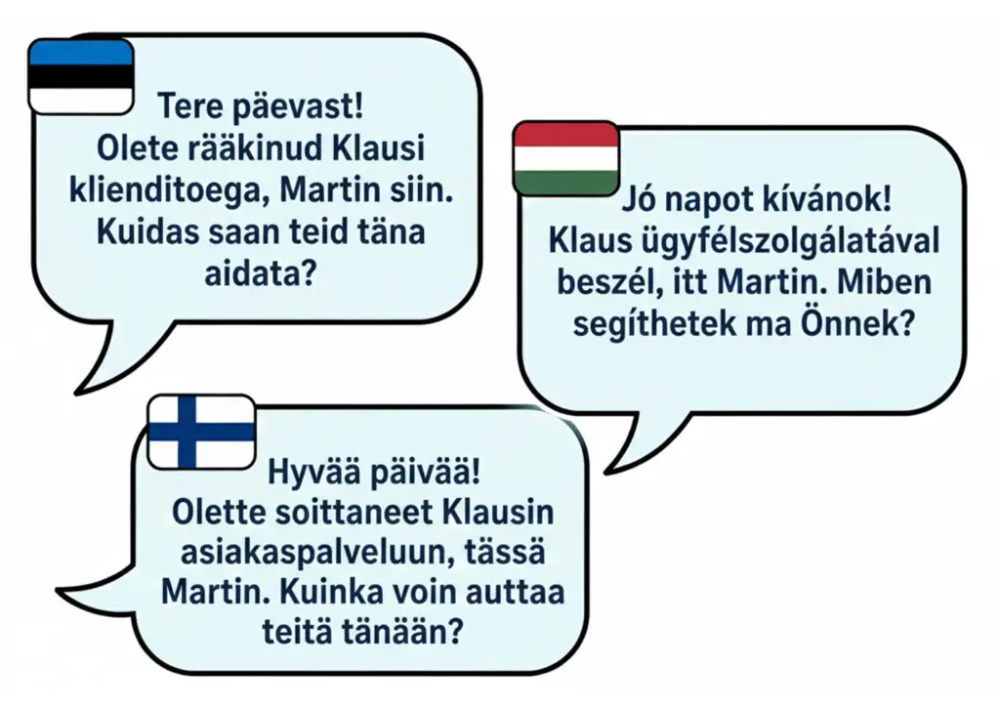

# Cross-Lingual Stability of LLM Judges Under Controlled Generation: Evidence from Finno-Ugric Languages

Isaac Chung Affiliation: Zendesk Email: <first.last@zendesk.com>   
Linda Freienthal Affiliation: Zendesk

###### Abstract

Cross-lingual evaluation of large language models (LLMs) typically
conflates two sources of variance: genuine model performance differences
and measurement instability. We investigate evaluation reliability by
holding generation conditions constant while varying target language.
Using synthetic customer-support dialogues generated with identical
parameters across Estonian, Finnish, and Hungarian, we test whether
automatic metrics and LLM-as-a-judge scoring produce stable model
rankings across these morphologically rich, related Finno-Ugric
languages. With a small set of Estonian native speaker annotations as a
reference point, we find systematic ranking instabilities: surface-level
metrics (lexical diversity, surface and semantic similarity) maintain
cross-language stability, but pragmatic judgments (coherence,
instruction-following) exhibit rank inversions and near-zero
correlations. Because generation is controlled, these inconsistencies
reflect how judge scoring behaves differently across languages rather
than true model differences.

This controlled design provides a diagnostic probe: evaluation methods
that fail to maintain stability under identical generation conditions
signal transfer failure before deployment. Our findings suggest that
zero-shot judge transfer is unreliable for discourse-level assessment in
morphologically rich languages, motivating language-specific calibration
against targeted human baselines. We release our controlled generation
protocol, synthetic data, and evaluation framework to enable replication
across language families at
[https://github.com/isaac-chung/cross-lingual-stability-judges](https://github.com/isaac-chung/cross-lingual-stability-judges).

## 1 Introduction

Evaluating large language models (LLMs) in morphologically rich,
underrepresented languages faces a paradox: the places that most need
reliable evaluation have the least human supervision. Recent benchmarks
for Finno-Ugric languages like Estonian
lillepalu2025estoniannativelargelanguage, Finnish
luukkonen2023fingptlargegenerativemodels, and Hungarian
yang2025openhuevalevaluatinglargelanguage extend coverage beyond
English, yet largely inherit high-resource evaluation
practices—emphasizing single-turn tasks and assuming the validity of
automatic or model-based scoring whose behavior in conversational
settings remains poorly understood.

Figure 1: Example opening messages in each language from the generated
dialogues. In English, it reads ‘Good day! You have spoken to Klaus
Customer Support, Martin here. How can I help you today?’.

We address this validation trap through controlled diagnostic testing:
generating dialogues with identical parameters across Estonian, Finnish,
and Hungarian to probe judge behavior. If rankings destabilize when only
language varies, the method will fail on natural data.

Recent multilingual judge studies reveal systematic inconsistency across
languages (Fleiss’ $`\kappa\approx`$ 0.3 across 25 languages;
fu2025judge), yet the sources of this instability remain poorly
understood. Our controlled generation isolates evaluation behavior from
content variation to diagnose transfer failures.

Using synthetic customer-support dialogues generated with identical
parameters, we first verify generation consistency through surface-level
calculated metrics (lexical diversity, surface similarity, semantic
similarity), then test whether LLM-as-a-judge pragmatic assessments
maintain cross-language ranking stability. This two-stage design
isolates judge behavior: if surface properties are comparable but judge
rankings diverge, the instability originates in the evaluation process
rather than content variation. Our contributions are:

1.  1.  We demonstrate that LLM-as-a-judge coherence assessment exhibits
        systematic rank inversions ($`\tau\approx 0`$) across
        morphologically rich languages under controlled generation, while
        surface metrics maintain stability ($`\tau\geq 0.76`$).
2.  2.  We provide a diagnostic methodology for detecting cross-linguistic
        ranking instabilities before large-scale deployment, validated
        through judge ablation and prompt-language sensitivity checks.
3.  3.  We release our controlled generation protocol, synthetic dialogues,
        and evaluation prompts to enable replication studies in other
        language families.

## 2 Methods

### 2.1 Dialogue Generation

We generate 10K synthetic customer-support dialogues per language using
parametrized templates with identical distributions across Estonian,
Finnish, Hungarian, and English (40+ industries, 20+ problem types; full
specifications in Appendix B). While this setup ensures semantical
alignment in the prompts, we recognize that the resulting dialogue
quality may vary due to the models’ varying linguistic proficiencies,
which may introduce subtle content variance across languages. English
serves as a high-resource and typologically distinct anchor. By
comparing Finno-Ugric outputs to this baseline, we can observe how model
performance shifts when the same scenario is realized in lower-resource
linguistic contexts. Dialogues are generated end-to-end in single API
calls to enable discourse-level evaluation. Code and dataset is released
at
[https://github.com/isaac-chung/cross-lingual-stability-judges](https://github.com/isaac-chung/cross-lingual-stability-judges).

### 2.2 Human Annotation

Three native Estonian speakers independently annotate 100 dialogues for
coherence (conversation-level consistency) and fluency (grammatical
naturalness). Inter-annotator agreement is fair to moderate
($`\kappa=.385`$ coherence, $`\kappa=.321`$ fluency), reflecting
conversational evaluation subjectivity. This moderate agreement bounds
expectations for automated cross-linguistic consistency—recent work
shows LLM judges achieve even lower cross-language agreement
fu2025judge, highlighting the challenge of zero-shot evaluation
transfer. These judgments provide a reference for interpreting automatic
and judge patterns (Appendix C).

### 2.3 Evaluation Framework

We first verify generation consistency via surface-level calculated
metrics (TTR, MATTR, self-BLEU, semantic similarity; Appendix A), then
test whether LLM-as-a-judge scoring maintains cross-language ranking
stability. This two-stage design isolates judge behavior: if surface
properties are comparable but judge rankings diverge, instability
originates in evaluation transfer. We note, however, that this design
also captures the inherent variability of generator performance across
languages, allowing us to observe how the entire evaluation pipeline
reacts to shifting linguistic contexts.

We use gpt-5-mini with default reasoning effort as an automatic judge to
evaluate 100 conversations per model per language. Guided by existing
works barbu2025; bae-etal-2022-building; simplestories, the judge
assigns scores for Grammar (G), Readability (R), Coherence (C), and
Fluency (F). Additionally, we measure Label Recovery Accuracy (LRA),
which assesses instruction-following and semantic consistency by
attempting to recover generation parameters from dialogue content. We
categorize G, R, and F as surface-level judge metrics—evaluating
grammatical correctness, lexical choice, and sentence-level
naturalness—and C and LRA as pragmatic dimensions requiring
discourse-level reasoning about conversation flow and instruction
alignment. The judge operates zero-shot with English meta-prompts
(Appendix D). A sensitivity check using native-language meta-prompts for
Estonian showed negligible variance from English-prompt results
(difference $`<0.05`$; see Section 3.5 for details). An ablation across
three judge models in Appendix G suggests that task difficulty stems
from ground-truth ambiguity rather than judge capability with minimal
scoring variance ($`\Delta<0.02`$), supporting our choice of the
cost-effective baseline model.

For each metric, we compute per-language model rankings and quantify
agreement using Kendall $`\tau`$ (95% bootstrap CIs, $`N=1{,}500`$).
Rank inversions are tested via permutation. While our generation is
controlled at the parameter level, observed instabilities reveal how the
evaluation pipeline, comprising both the generator’s output quality and
the judge’s scoring logic, becomes fragile when transferred to
non-English contexts.

### 2.4 Generator Models

We use gpt-4.1-mini, Llama-3.3-70B-Instruct
grattafiori2024llama3herdmodels, Mixtral-8x7B-Instruct
jiang2024mixtralexperts, Command-R, Llama-3.1-8B-Instruct
grattafiori2024llama3herdmodels, and Claude Sonnet 4, all accessed via
Amazon Bedrock.¹¹ 1
[https://aws.amazon.com/bedrock/](https://aws.amazon.com/bedrock/)

## 3 Results

Our results focus on identifying systematic reliability failures in
evaluation transfer rather than comparing model performance.

| Model              | Grammar (G)                           |                                       |                                       | Readability (R)                       |                                       |                                       | Coherence (C)                         |                                       |                                       | Fluency (F)                           |                                       |                                       | LRA                                  |                                      |                                      |
| ------------------ | ------------------------------------- | ------------------------------------- | ------------------------------------- | ------------------------------------- | ------------------------------------- | ------------------------------------- | ------------------------------------- | ------------------------------------- | ------------------------------------- | ------------------------------------- | ------------------------------------- | ------------------------------------- | ------------------------------------ | ------------------------------------ | ------------------------------------ |
|                    | et                                    | fi                                    | hu                                    | et                                    | fi                                    | hu                                    | et                                    | fi                                    | hu                                    | et                                    | fi                                    | hu                                    | et                                   | fi                                   | hu                                   |
| gpt-4.1-mini       | $`\textbf{3.17}{\scriptstyle\pm.55}`$ | $`\textbf{3.51}{\scriptstyle\pm.52}`$ | $`\textbf{3.57}{\scriptstyle\pm.50}`$ | $`3.63{\scriptstyle\pm.48}`$          | $`\textbf{3.86}{\scriptstyle\pm.34}`$ | $`\textbf{3.85}{\scriptstyle\pm.36}`$ | $`\textbf{2.99}{\scriptstyle\pm.09}`$ | $`2.97{\scriptstyle\pm.16}`$          | $`2.99{\scriptstyle\pm.10}`$          | $`\textbf{2.35}{\scriptstyle\pm.48}`$ | $`\textbf{2.56}{\scriptstyle\pm.50}`$ | $`\textbf{2.66}{\scriptstyle\pm.48}`$ | $`\textbf{.62}{\scriptstyle\pm.09}`$ | $`.34{\scriptstyle\pm.25}`$          | $`.36{\scriptstyle\pm.26}`$          |
| Llama3.3-70B-Inst. | $`2.39{\scriptstyle\pm.52}`$          | $`3.03{\scriptstyle\pm.58}`$          | $`3.04{\scriptstyle\pm.57}`$          | $`2.92{\scriptstyle\pm.43}`$          | $`3.44{\scriptstyle\pm.51}`$          | $`3.43{\scriptstyle\pm.49}`$          | $`2.93{\scriptstyle\pm.25}`$          | $`2.89{\scriptstyle\pm.34}`$          | $`2.94{\scriptstyle\pm.23}`$          | $`1.92{\scriptstyle\pm.32}`$          | $`2.22{\scriptstyle\pm.47}`$          | $`2.18{\scriptstyle\pm.41}`$          | $`.36{\scriptstyle\pm.20}`$          | $`\textbf{.62}{\scriptstyle\pm.13}`$ | $`.59{\scriptstyle\pm.11}`$          |
| Mixtral-8x7B-Inst. | $`1.63{\scriptstyle\pm.48}`$          | $`2.32{\scriptstyle\pm.60}`$          | $`2.36{\scriptstyle\pm.64}`$          | $`1.99{\scriptstyle\pm.36}`$          | $`2.77{\scriptstyle\pm.61}`$          | $`2.70{\scriptstyle\pm.60}`$          | $`2.72{\scriptstyle\pm.45}`$          | $`2.81{\scriptstyle\pm.39}`$          | $`2.79{\scriptstyle\pm.43}`$          | $`1.17{\scriptstyle\pm.37}`$          | $`1.82{\scriptstyle\pm.49}`$          | $`1.78{\scriptstyle\pm.51}`$          | $`.33{\scriptstyle\pm.24}`$          | $`.34{\scriptstyle\pm.25}`$          | $`.33{\scriptstyle\pm.22}`$          |
| Command-R          | $`1.50{\scriptstyle\pm.61}`$          | $`1.61{\scriptstyle\pm.54}`$          | $`1.65{\scriptstyle\pm.51}`$          | $`1.81{\scriptstyle\pm.56}`$          | $`2.01{\scriptstyle\pm.45}`$          | $`2.04{\scriptstyle\pm.43}`$          | $`2.56{\scriptstyle\pm.56}`$          | $`2.64{\scriptstyle\pm.48}`$          | $`2.57{\scriptstyle\pm.51}`$          | $`1.04{\scriptstyle\pm.31}`$          | $`1.13{\scriptstyle\pm.34}`$          | $`1.16{\scriptstyle\pm.36}`$          | $`.40{\scriptstyle\pm.20}`$          | $`.38{\scriptstyle\pm.22}`$          | $`.34{\scriptstyle\pm.22}`$          |
| Llama3.1-8B-Inst.  | $`1.61{\scriptstyle\pm.49}`$          | $`2.22{\scriptstyle\pm.44}`$          | $`2.23{\scriptstyle\pm.52}`$          | $`1.87{\scriptstyle\pm.36}`$          | $`2.66{\scriptstyle\pm.48}`$          | $`2.65{\scriptstyle\pm.50}`$          | $`2.34{\scriptstyle\pm.51}`$          | $`2.62{\scriptstyle\pm.49}`$          | $`2.63{\scriptstyle\pm.48}`$          | $`1.06{\scriptstyle\pm.24}`$          | $`1.81{\scriptstyle\pm.40}`$          | $`1.75{\scriptstyle\pm.45}`$          | $`.30{\scriptstyle\pm.21}`$          | $`.30{\scriptstyle\pm.23}`$          | $`.42{\scriptstyle\pm.20}`$          |
| claude-sonnet-4    | $`3.04{\scriptstyle\pm.50}`$          | $`3.18{\scriptstyle\pm.50}`$          | $`3.19{\scriptstyle\pm.47}`$          | $`\textbf{3.63}{\scriptstyle\pm.48}`$ | $`3.81{\scriptstyle\pm.40}`$          | $`3.78{\scriptstyle\pm.41}`$          | $`2.98{\scriptstyle\pm.13}`$          | $`\textbf{2.99}{\scriptstyle\pm.09}`$ | $`\textbf{2.99}{\scriptstyle\pm.09}`$ | $`2.29{\scriptstyle\pm.45}`$          | $`2.45{\scriptstyle\pm.51}`$          | $`2.47{\scriptstyle\pm.50}`$          | $`.45{\scriptstyle\pm.17}`$          | $`.36{\scriptstyle\pm.23}`$          | $`\textbf{.75}{\scriptstyle\pm.14}`$ |

Table 1: LLM-as-a-judge evaluation of generated Estonian (et), Finnish
(fi), and Hungarian (hu) dialogues. The best scores per metric and
language are bolded.

### 3.1 Automatic metrics reveal stable semantic content despite surface variation

Automatic metrics (see Appendix A for details) reveal a nuanced picture
in Table 2. While semantic similarity remains stable across languages
(mean differences $`<.03`$), surface-level metrics show systematic
language effects. Estonian consistently exhibits higher lexical
diversity (MATTR: .48-.80) and lower repetition (Full Self-BLEU:
.05-.14) compared to Finnish (MATTR: .45-.70, Self-BLEU: .11-.30) and
Hungarian (MATTR: .49-.76, Self-BLEU: .22-.35) across all models. These
patterns likely reflect morphological complexity differences rather than
generation quality variance.

Beyond language effects, models differ notably in lexical diversity:
Llama3.1-8B shows lower MATTR (.45-.49) than Mixtral-8x7B (.70-.80).
Despite these surface differences, semantic similarity remains
consistent across languages.

Crucially, semantic similarity scores remain remarkably consistent
(.89-.94 across all models and languages), confirming that underlying
content quality is comparable despite surface variation. This
dissociation validates our experimental design for judge evaluation:
generation produces semantically equivalent dialogues, but surface
properties differ systematically by language.

### 3.2 Human annotation provides a noisy reference point

Estonian annotations yield mean scores of .842$`\pm`$.367 (coherence, on
binary scale) and 2.108$`\pm`$.696 (fluency, on 0-3 scale), with
fair-to-moderate agreement ($`\kappa=.385`$, $`\kappa=.321`$).
Annotators report task-level coherence but reduced linguistic
naturalness (Appendix C). This moderate agreement bounds expectations
for automated cross-linguistic consistency.

Annotators noted that dialogues were logically coherent but
linguistically unnatural. Common feedback included overly formal tone,
expressions that feel translated from English, and phrasing resembling
’B2 level speaker, not a native.’ Frequent coherence issues included
inconsistent customer names and illogical scenarios. Examples with
annotator feedback are provided in Appendix C.

### 3.3 LLM-as-a-judge scores diverge from human judgments and destabilize across languages

Table 1shows that LLM-as-a-judge evaluations align imperfectly with
human judgments in Estonian, and exhibit significant instability when
extended to Finnish and Hungarian. While G and R scores remain
relatively stable, scores for C, F, and LRA exhibit substantial variance
across languages and models. English shows ceiling effects (C
$`\approx`$ 2.98–3.00), limiting discriminative power but maintaining
moderate ranking stability.

While surface metrics remain stable, coherence rankings scramble across
language pairs, indicating that discourse-level assessment logic does
not transfer reliably across morphologically rich languages. Label
recovery accuracy (LRA) results are provided in Appendix D.

### 3.4 Ranking stability reveals coherence breakdown

Figure 2: Cross-language ranking stability measured by Kendall’s
$`\tau`$. Error bars show 95% bootstrap confidence intervals. Numbers
below bars indicate rank inversions (out of 15 possible pairwise
inversions among 6 models); asterisks denote statistical significance
via permutation test (\* $`p<0.05`$). Surface-level metrics (Grammar,
Readability, Fluency) maintain high stability ($`\tau\geq 0.62`$) with
minimal inversions. Pragmatic dimensions show systematic breakdown:
Coherence exhibits near-zero or negative correlations, and LRA shows
significant rank scrambling across all Finno-Ugric pairs (9\*, 6\*, 7\*
inversions). English pairs included for context, though ceiling effects
limit their informativeness for Coherence.

We quantify evaluation stability in Figure 2. The results reveal a sharp
divide between surface-level and pragmatic assessment. Surface-level
metrics (G, R, F) exhibit high cross-language stability
($`\tau\geq.70`$) with minimal rank inversions (1–3 per pair). However,
Coherence shows systematic breakdown: near-zero or negative correlations
across Finno-Ugric language pairs ($`\tau=-.06`$ for et–hu,
$`\tau=-.17`$ for fi–hu), with significant inversions ($`p=.02`$) for
et–hu. English Coherence scores show ceiling effects (mean $`\approx`$
2.98–3.00), preventing meaningful ranking comparisons with English. Our
analysis therefore focuses on Finno-Ugric pairs, where score variance
allows for meaningful ranking comparisons.

Since generation parameters are held constant and automatic metrics
confirm comparable generation quality, these Coherence rank inversions
point to judge transfer failure at the discourse level. The judge’s
internal discourse-level assessment logic collapses when transferred
across morphologically rich languages, even among closely related
language pairs. As sensitivity checks confirm that scores are robust to
meta-prompt language (subsection 3.5), this instability represents a
fundamental breakdown in cross-linguistic evaluation reliability rather
than a prompt engineering problem. These findings indicate that
discourse coherence assessment—unlike surface-level grammatical or
lexical evaluation—cannot be zero-shot transferred and requires
language-specific calibration before deployment. Full stability analysis
is provided in Appendix E.

### 3.5 Meta-prompt language sensitivity

To ensure that the use of English-centric meta-prompts did not introduce
instruction-language bias into our results, we conducted a sensitivity
study on the Estonian calibration set ($`N=100`$). We re-evaluated the
dialogues from all six generator models using a version of the
LLM-as-a-judge system prompt translated into Estonian by a native
speaker.

Scores produced by the native-language prompt are nearly identical to
those produced by the English meta-prompt. Results suggest that the
judge’s evaluation behavior is driven by its internal representation of
the target language rather than the language of the instructions.
Detailed results can be found in Appendix F. This rules out prompt
language as the source of instability. The underlying cause remains as
discussed in Section 3.4.

| Model              | TTR                                  |                                      |                                      | MATTR                                |                                      |                                      | Full Self-BLEU |     |     | Agent Self-BLEU |     |     | Client Self-BLEU |     |     | Intra Model Sim                      |                                      |                                      |
| ------------------ | ------------------------------------ | ------------------------------------ | ------------------------------------ | ------------------------------------ | ------------------------------------ | ------------------------------------ | -------------- | --- | --- | --------------- | --- | --- | ---------------- | --- | --- | ------------------------------------ | ------------------------------------ | ------------------------------------ |
|                    | et                                   | fi                                   | hu                                   | et                                   | fi                                   | hu                                   | et             | fi  | hu  | et              | fi  | hu  | et               | fi  | hu  | et                                   | fi                                   | hu                                   |
| gpt-4.1-mini       | $`\mathbf{.80}{\scriptstyle\pm.07}`$ | $`.63{\scriptstyle\pm.07}`$          | $`.64{\scriptstyle\pm.07}`$          | $`\mathbf{.81}{\scriptstyle\pm.06}`$ | $`.68{\scriptstyle\pm.06}`$          | $`.71{\scriptstyle\pm.04}`$          | .10            | .19 | .22 | .15             | .19 | .20 | .12              | .11 | .15 | $`.93{\scriptstyle\pm.01}`$          | $`.92{\scriptstyle\pm.02}`$          | $`\mathbf{.93}{\scriptstyle\pm.02}`$ |
| Llama3.3-70B-Inst. | $`.67{\scriptstyle\pm.11}`$          | $`.52{\scriptstyle\pm.11}`$          | $`.55{\scriptstyle\pm.11}`$          | $`.67{\scriptstyle\pm.11}`$          | $`.55{\scriptstyle\pm.09}`$          | $`.59{\scriptstyle\pm.08}`$          | .14            | .30 | .35 | .26             | .34 | .36 | .25              | .18 | .25 | $`\mathbf{.94}{\scriptstyle\pm.01}`$ | $`\mathbf{.93}{\scriptstyle\pm.02}`$ | $`\mathbf{.93}{\scriptstyle\pm.02}`$ |
| Mixtral-8x7B-Inst. | $`\mathbf{.80}{\scriptstyle\pm.10}`$ | $`\mathbf{.70}{\scriptstyle\pm.08}`$ | $`\mathbf{.76}{\scriptstyle\pm.08}`$ | $`\mathbf{.80}{\scriptstyle\pm.10}`$ | $`\mathbf{.70}{\scriptstyle\pm.08}`$ | $`\mathbf{.76}{\scriptstyle\pm.08}`$ | .07            | .21 | .23 | .15             | .22 | .20 | .15              | .15 | .16 | $`.91{\scriptstyle\pm.02}`$          | $`.91{\scriptstyle\pm.02}`$          | $`.90{\scriptstyle\pm.02}`$          |
| Command-R          | $`.74{\scriptstyle\pm.10}`$          | $`.64{\scriptstyle\pm.09}`$          | $`.60{\scriptstyle\pm.09}`$          | $`.75{\scriptstyle\pm.09}`$          | $`.67{\scriptstyle\pm.07}`$          | $`.72{\scriptstyle\pm.06}`$          | .07            | .11 | .31 | .11             | .10 | .33 | .09              | .07 | .25 | $`.92{\scriptstyle\pm.02}`$          | $`.91{\scriptstyle\pm.02}`$          | $`.89{\scriptstyle\pm.03}`$          |
| Llama3.1-8B-Inst.  | $`.48{\scriptstyle\pm.18}`$          | $`.42{\scriptstyle\pm.12}`$          | $`.45{\scriptstyle\pm.12}`$          | $`.48{\scriptstyle\pm.19}`$          | $`.45{\scriptstyle\pm.09}`$          | $`.49{\scriptstyle\pm.09}`$          | .05            | .24 | .29 | .43             | .24 | .28 | .43              | .12 | .18 | $`.93{\scriptstyle\pm.01}`$          | $`\mathbf{.93}{\scriptstyle\pm.01}`$ | $`\mathbf{.93}{\scriptstyle\pm.01}`$ |
| claude-sonnet-4    | $`.73{\scriptstyle\pm.09}`$          | $`.59{\scriptstyle\pm.10}`$          | $`.61{\scriptstyle\pm.09}`$          | $`.78{\scriptstyle\pm.06}`$          | $`.68{\scriptstyle\pm.05}`$          | $`.72{\scriptstyle\pm.05}`$          | .12            | .19 | .26 | .19             | .19 | .25 | .12              | .13 | .19 | $`.92{\scriptstyle\pm.02}`$          | $`.92{\scriptstyle\pm.02}`$          | $`.92{\scriptstyle\pm.02}`$          |

Table 2: Automatic metrics for generated Estonian (et), Finnish (fi),
and Hungarian (hu) dialogues. TTR, MATTR and Intra Model Similarity show
their standard deviation as well.

### 3.6 Ablation: Judge Model

To test whether instability is specific to our chosen judge, we compared
six judge models (GPT-5-mini, GPT-5.1, GPT-5.1-high, Qwen3-32B
yang2025qwen3technicalreport, Llama-4-Maverick meta2025llama4,
GPT-OSS-120B openai2025gptoss120bgptoss20bmodel) on Finnish dialogues.
All judges exhibit near-identical performance patterns with minimal
variance ($`\Delta<0.02`$ across categories). This suggests the
instability is systematic rather than judge-specific. Full details in
Appendix G.

## 4 Discussion and Outlook

Surface-level evaluation transfers; discourse assessment does not.
Practitioners can deploy judge-based surface assessments (grammar,
readability, fluency) for cross-linguistic comparison with confidence
($`\tau\geq 0.70`$ across Finno-Ugric pairs). Discourse coherence
exhibits systematic breakdown ($`\tau\approx 0`$) even among related
languages, requiring language-specific calibration.

Controlled stability as a validity gate. Our diagnostic approach
provides a negative check: if an LLM judge produces inconsistent model
rankings across languages under identical generation conditions, they
will fare worse on natural data. This motivates a staged workflow: (1)
verify generation consistency with automatic metrics, (2) collect a
small expert sample ($`N\sim 100`$) in the target language, (3) test
judge-human ranking alignment, (4) calibrate if correlations are weak.
This prioritizes measurement reliability while respecting resource
constraints in underrepresented language communities.

## Limitations

Synthetic dialogues enable controlled evaluation but may exhibit
stylistic homogeneity and phrasing not present in real data. Validation
on natural customer support scenarios is needed to confirm ranking
instabilities persist in operational settings. Surface-level ranking
stability suggests comparable generation quality across languages,
making judge transfer failure the more likely explanation for Coherence
instability. However, we cannot completely rule out discourse-level
quality differences that surface metrics do not capture.

Human calibration is restricted to Estonian ($`N=100`$). Our controlled
generation does not require multilingual human labels to detect ranking
problems: if model rankings change when only language varies, the judge
is unreliable. The Estonian annotations serve only to confirm that
synthetic dialogues vary semantically and evaluate the fluency of a
subset of the synthetic dialogues.

We examine customer support dialogues in three related Finno-Ugric
languages. While judge ablation (Appendix G) confirms scoring stability
across GPT-5 variants, our findings may not hold for non-commercial
models, other conversational domains, or linguistically distant
languages. We focus on discourse coherence; other aspects like
politeness conventions and language-specific grammatical patterns remain
unexplored.

## Acknowledgments

We thank Mervi Sepp Rei, Reimo Priidik, Martin Küngas, and Andreas Pung
for labeling, Daniel Loureiro for his valuable feedback on the draft,
and Joonathan Mägi, Mikk Müraus, and Kajetan Bochajczuk for their
foundational work on the conversation generator. We thank Magda Kubit,
Abdallah Akzouk, and Abhinay Kathuria for their support in open-source
model inference. We thank the reviewers for their insightful feedback.

## References

## Appendix A Automatic Metrics

Here is the description of the automatic metrics.

- •
  TTR and MATTR: we compute both simple Type–Token Ratio (TTR) (unique
  words / total words) and Moving Average TTR (MATTR) Kettunen2014ttr
  over sliding 100-token windows for length-independent measurement of
  morphological variety. Higher MATTR and TTR values indicate greater
  lexical diversity.
- •
  Self-BLEU selfbleu2018: Calculated at three granularity levels: full
  conversations, agent responses only, and client responses only—to
  detect formulaic patterns. We used 4-gram BLEU and NLTK’s smoothing
  function (method4). Lower values indicate reduced repetition and
  greater diversity.
- •
  Intra Model Conversation Similarity answers the question "How
  different are the conversations from each other?". For that we use the
  cosine similarity between sentence embeddings from
  multilingual-e5-large-instruct wang2024multilingual, the
  highest-ranked multilingual model in MMTEB enevoldsen2025mmteb. Lower
  scores indicate higher similarity (more template-like), while higher
  scores indicate greater conversation diversity within a model.

For calculating the values, all three languages use morphological
lemmatization: EstNLTK laur-EtAl:2020:LREC for Estonian, and Stanza
qi2020stanza for Hungarian and Finnish, with language-specific stopword
filtering.

See in Table 2 the results of the metrics per model and language.

Beyond language effects, we observe notable model differences.
Llama3.1-8B shows substantially lower lexical diversity (TTR: .42-.48,
MATTR: .45-.49) compared to Mixtral-8x7B-Inst. (TTR: .70-.80, MATTR:
.70-.80), suggesting different training data characteristics or
architectural effects on generation diversity. Command-R achieves the
lowest agent-side self-BLEU scores (.10-.11 for et/fi), indicating
reduced formulaic patterns in agent responses. However, all models
maintain consistent semantic similarity scores across languages,
confirming that surface-level differences do not translate to semantic
quality variance.

## Appendix B Dialogue Generation

We generate synthetic customer-support dialogues using parametrized
prompt templates to create controlled test conditions across languages.
Parameters control industry (40+ categories), customer problem type
(20+), communication channel, agent experience, agent type, and
conversation length. Crucially, we use identical parameter distributions
and generation models across all three languages, enabling us to isolate
evaluation behavior from content variation. If dialogues are generated
under identical conditions but judges produce different model rankings
across languages, the instability originates in the evaluation process
rather than genuine performance differences.

Dialogues are generated end-to-end in a single API call, enabling
evaluation of global discourse coherence rather than turn-level response
quality. We generate 10K conversations per language for Estonian,
Finnish, Hungarian, and English (40K total), providing sufficient scale
to probe evaluation stability while remaining tractable for analysis.

Table 3and Table 4 together form the dialogue generation prompt , with
values of changing parameters in curly brackets. The parameters are
sampled from the fixed sets detailed in Table 5.

|                                                                                                                                                                                                                                                                                                                                                                                                                                                                                                                                                                                                                                                                                                                                                                                                                                                                                                                                                                                                                                                                                                                                                                              |
| ---------------------------------------------------------------------------------------------------------------------------------------------------------------------------------------------------------------------------------------------------------------------------------------------------------------------------------------------------------------------------------------------------------------------------------------------------------------------------------------------------------------------------------------------------------------------------------------------------------------------------------------------------------------------------------------------------------------------------------------------------------------------------------------------------------------------------------------------------------------------------------------------------------------------------------------------------------------------------------------------------------------------------------------------------------------------------------------------------------------------------------------------------------------------------- |
| \*\*Role\*\* You are an expert generator of customer support conversations. The generated conversations must stay on topic as much as possible, and mimic real life customer support interactions as much as possible. The most important thing is for these conversations to be as realistic as possible. \*\*Instructions\*\* These conversations are between professional agents and human customers. Customers have emotions, needs, and expectations. There are specific instructions for each conversation that you must follow. These are for agents to follow when interacting with customers. There are also instructions for the customer to follow. Do you UTMOST BEST to adhere to the following instructions for generation. If there are more than 1 agent in the conversation, the agents turns must be sequential and must NOT interleave. For example, if agent1 and agent2 are in the conversation, the ALLOWED turns can be: a) agent1, customer, agent1, customer, agent2, customer, agent2; b) agent2, customer, agent2, customer, agent1, customer, agent1; and the BANNED turns are: c) agent1, customer, agent2, customer, agent1, customer, agent2; |

Table 3: System prompt for dialogue generation.

|                                                                                                                                                                                                                                                                                                                                                                                                                                                                                                                                                                                                                                                                                                                                                                                                                                                                                                                                                                                                                                                                                                                               |
| ----------------------------------------------------------------------------------------------------------------------------------------------------------------------------------------------------------------------------------------------------------------------------------------------------------------------------------------------------------------------------------------------------------------------------------------------------------------------------------------------------------------------------------------------------------------------------------------------------------------------------------------------------------------------------------------------------------------------------------------------------------------------------------------------------------------------------------------------------------------------------------------------------------------------------------------------------------------------------------------------------------------------------------------------------------------------------------------------------------------------------- |
| (User Prompt) Generate a chat conversation between a customer and and {n_agents} support agents. The emails of the agents are: {agentemails}. The conversation must be in {language} and should be made of \[{n_messages}\] messages. ’Klaus’ is a company in the {industry} industry. The conversation must be tailored to the industry. For example, use products and services that are common in the industry, and use language that is common in the industry. The conversation must reference at least one issue with a service, product, or policy that is relevant to the company. The AGENT must greet the customer. For example, using common greeting words like ’Hello’ or ’Good day’ in the respective language and address the customer by name, and based on the channel. The AGENT must use proper grammar and spelling, and must follow grammatical rules in the respective language. The AGENT must demonstrate empathy towards the customer and must tailor the conversation to address their problems and needs. The AGENT must use professional tone. {agent_type} {problem} {channel} {agent_experience} |

Table 4: User prompt for dialogue generation.

|                                                                                                                                                                                                                                                                                                                                                                                                                                                                                                                                                                                                                                                                                                                                                                                                                                                                                                                                                                                                                                                                                                                                                                                        |
| -------------------------------------------------------------------------------------------------------------------------------------------------------------------------------------------------------------------------------------------------------------------------------------------------------------------------------------------------------------------------------------------------------------------------------------------------------------------------------------------------------------------------------------------------------------------------------------------------------------------------------------------------------------------------------------------------------------------------------------------------------------------------------------------------------------------------------------------------------------------------------------------------------------------------------------------------------------------------------------------------------------------------------------------------------------------------------------------------------------------------------------------------------------------------------------- |
| Industry: manufacturing, energy production, energy management, energy technology, apparel retail, retail clothing stores, apparel manufacturing, fitness apparel retail, footwear retail, safety apparel manufacturing, home decor retail, home textiles retail, manufacturing tools, retail technology solutions, gaming technology services, transportation technology, transportation services, logistics and transportation, kitchen appliances manufacturing, utility management services, audio equipment manufacturing, e-commerce grocery retail, gambling and betting, e-commerce retail baby products, furniture retail, label manufacturing, cutlery manufacturing, bicycle manufacturing, telecommunications retail, pet retail, financial services, financial software development, gaming, retail, outdoor equipment retail, e-commerce jewelry manufacturing, retail fashion accessories, automotive parts retail, fintech services, games, e-commerce retail goods, automotive retail, coatings manufacturing, sporting goods manufacturing, e-commerce, beverage retailing, computer hardware manufacturing, automotive manufacturing, e-commerce electronics retail. |
| Problem: create account, delete account, edit account, switch account, check cancellation fee, delivery options, complaint, review, check invoice, get invoice, newsletter subscription, cancel order, change order, place order, check payment methods, payment issue, check refund policy, track refund, change shipping address, set up shipping address.                                                                                                                                                                                                                                                                                                                                                                                                                                                                                                                                                                                                                                                                                                                                                                                                                           |
| Channel: email, chat.                                                                                                                                                                                                                                                                                                                                                                                                                                                                                                                                                                                                                                                                                                                                                                                                                                                                                                                                                                                                                                                                                                                                                                  |
| Agent Experience: junior, senior.                                                                                                                                                                                                                                                                                                                                                                                                                                                                                                                                                                                                                                                                                                                                                                                                                                                                                                                                                                                                                                                                                                                                                      |
| Language: Estonian, Finnish, Hungarian.                                                                                                                                                                                                                                                                                                                                                                                                                                                                                                                                                                                                                                                                                                                                                                                                                                                                                                                                                                                                                                                                                                                                                |
| Agent Type: human, bot.                                                                                                                                                                                                                                                                                                                                                                                                                                                                                                                                                                                                                                                                                                                                                                                                                                                                                                                                                                                                                                                                                                                                                                |
| Number of messages: 4, 8, 12, 16.                                                                                                                                                                                                                                                                                                                                                                                                                                                                                                                                                                                                                                                                                                                                                                                                                                                                                                                                                                                                                                                                                                                                                      |

Table 5: Parameter options for synthetic dialogue generation. All
options are sampled with equal probability, except for message length,
which is weighted to favor shorter interactions $`[0.4,0.3,0.2,0.1]`$.

Each multi-turn conversation is generated individually in one go,
similar to the method used in PLACES chen-etal-2023-places but without
in-context learning as we operate in a data-scarce setting for
underrepresented languages. Utterance-level generation strategies
chen2022weakly; aher2023usinglargelanguagemodels are not suitable for
this study as we seek to evaluate full conversation generation
capabilities of LLMs.

## Appendix C Human Labeling

### C.1 Instructions

Table 6 shows detailed labeling instructions given to human labelers to
evaluate the generated Estonian dialogues1. Agreement levels follow
standard guidelines: $`\kappa>0.8`$ (excellent), $`0.6<\kappa\leq 0.8`$
(substantial), $`0.4<\kappa\leq 0.6`$ (moderate), $`0.2<\kappa\leq 0.4`$
(fair), and $`\kappa\leq 0.2`$ (poor). These expert judgments provide
the calibration signal necessary to validate evaluation dimensions in
morphologically rich contexts.

|                                                                                                                                                                                                     |
| --------------------------------------------------------------------------------------------------------------------------------------------------------------------------------------------------- |
| Does the content make sense?                                                                                                                                                                        |
| YES → Questions and answers are logical, relevant to the topic.                                                                                                                                     |
| NO → Questions and answers do not interact logically OR the issue/solution would never occur in any industry OR the agent never sends an email starting with “welcome to chat, how can I help you?” |
| Is this fluent, human-written Estonian?                                                                                                                                                             |
| 3 → Messages could pass as written by fluent speakers.                                                                                                                                              |
| 2 → Majority of messages pass as written by fluent speakers, but 1–2 odd wordings and/or 1–2 grammar mistakes (e.g., wrong verb case, pronoun confusion).                                           |
| 1 → Several odd wordings and grammar mistakes; still resembles Estonian.                                                                                                                            |
| 0 → Reading this gave me an aneurysm.                                                                                                                                                               |

Table 6: Detailed labeling instructions are given to human labelers for
each question.

### C.2 Feedback and Examples

Table 7 shows one agent-customer exchange from two examples taken from
Estonian dialogues that have labeler feedback. The labelers mentioned
that the text contained expressions that could be used in the language
but do not feel natural (e.g. gives a feeling of B2 level speaker, not a
native). Many phrases felt rough or one could detect the English phrase
it was translated from. This is also reflected by the fluency score,
with the average of the reference label (agreement between three
annotators) being 2.108±.696 on the scale of 0-3.

Regarding logical coherence, the scores are higher: The average of
reference labels in conversations is .842±.367 on a binary scale.
Reoccurring reasons for the negative logical coherence grade were:

- •
  Inconsistent customer names or amounts of product during the
  conversation.
- •
  The described issue is illogical. E.g., a customer bought a bicycle
  and now wants to know how to pay or a customer needs to return an
  object it has not received yet.
- •
  Hallucinated words that make the entire conversation not
  understandable.

|                                                                                                                                                                               |
| ----------------------------------------------------------------------------------------------------------------------------------------------------------------------------- |
| Example 1:                                                                                                                                                                    |
| AGENT: Tere päevast! Harald siin Klaus spordivarustuse tugitiimist. Kuidas saan teid täna aidata?                                                                             |
| CUSTOMER: Tere! Tellisin hiljuti spordijalatsid, aga kahjuks pidin tellimuse tühistama. Nüüd näen, et mulle on lisatud tühistamistasu. Kas see on õigustatud?                 |
|                                                                                                                                                                               |
| Fluency: 1/3                                                                                                                                                                  |
| Coherence: 1/1                                                                                                                                                                |
| Feedback: Too formal. "Harold siin" is too literally translated. We usually don’t say that. We say "Mina olen Harold" most likely in this context.                            |
| Example 2:                                                                                                                                                                    |
| AGENT: Tere päevast, hea klient! Tänan, et võtsite ühendust Klaus klienditoega. Kuidas saan Teid täna aidata?                                                                 |
| CUSTOMER: Tere! Ma tellisin teie poest uue mobiiltelefoni, kuid märkasin, et tarneaadress on valesti sisestatud. Kas saaksin selle muuta enne, kui tellimus välja saadetakse? |
| Fluency: 1/3                                                                                                                                                                  |
| Coherence: 1/1                                                                                                                                                                |
| Feedback: Too formal, usually these conversations are more casual. "kuid" and "ning" are usually not used in speech, only in some literature.                                 |

Table 7: One agent-customer exchange from two example generated Estonian
dialogues that have labeler feedback. Most labeler feedback flags
uncommon expressions and overly formal tone, which led to lower fluency
scores in those dialogues.

## Appendix D LLM As A Judge

### D.1 Instructions

Table 9shows the full system prompt used for the LLM-as-a-judge to
evaluate the linguistic and pragmatic dimensions of the generated
dialogues. This zero-shot approach uses English meta-prompts to assess
performance in morphologically rich languages. As discussed in the main
text, the Label Recovery Accuracy (LRA) dimension is further utilized as
a diagnostic for instruction-following and semantic consistency by
attempting to extract generation parameters from the dialogue content.
The prompt used to assess LRA is shown in Table 10.

### D.2 English Results

Table 8 shows LLM-as-a-judge results on the English dialogues.

| Model                 | Grammar (G)                           | Readability (R)                       | Coherence (C)                         | Fluency (F)                           | LRA                                  |
| --------------------- | ------------------------------------- | ------------------------------------- | ------------------------------------- | ------------------------------------- | ------------------------------------ |
| claude-sonnet-4       | $`\textbf{3.99}{\scriptstyle\pm.09}`$ | $`\textbf{4.00}{\scriptstyle\pm.00}`$ | $`2.98{\scriptstyle\pm.13}`$          | $`\textbf{3.00}{\scriptstyle\pm.00}`$ | $`\textbf{.77}{\scriptstyle\pm.16}`$ |
| llama3-70b-instruct   | $`3.94{\scriptstyle\pm.23}`$          | $`3.99{\scriptstyle\pm.09}`$          | $`2.98{\scriptstyle\pm.13}`$          | $`2.99{\scriptstyle\pm.09}`$          | $`.64{\scriptstyle\pm.10}`$          |
| mixtral-8x7b-instruct | $`3.97{\scriptstyle\pm.18}`$          | $`3.97{\scriptstyle\pm.18}`$          | $`2.90{\scriptstyle\pm.29}`$          | $`2.97{\scriptstyle\pm.16}`$          | $`.39{\scriptstyle\pm.22}`$          |
| llama3-8b-instruct    | $`3.96{\scriptstyle\pm.20}`$          | $`3.98{\scriptstyle\pm.13}`$          | $`2.91{\scriptstyle\pm.29}`$          | $`2.95{\scriptstyle\pm.22}`$          | $`.40{\scriptstyle\pm.18}`$          |
| command-r             | $`3.91{\scriptstyle\pm.29}`$          | $`3.96{\scriptstyle\pm.19}`$          | $`2.95{\scriptstyle\pm.23}`$          | $`2.94{\scriptstyle\pm.25}`$          | $`.34{\scriptstyle\pm.22}`$          |
| gpt-4.1-mini          | $`3.96{\scriptstyle\pm.21}`$          | $`\textbf{4.00}{\scriptstyle\pm.00}`$ | $`\textbf{2.99}{\scriptstyle\pm.09}`$ | $`2.99{\scriptstyle\pm.09}`$          | $`.37{\scriptstyle\pm.22}`$          |

Table 8: LLM-as-a-judge evaluation of generated English dialogues. The
best scores per metric are bolded.

### D.3 LRA Full Results

Label recovery accuracy measures the judge’s ability to extract
generation parameters from dialogue content. Figure 3 shows performance
across Estonian, Finnish, Hungarian, and English for all parameter
categories.

Figure 3: Label recovery accuracy (LRA) across categories by model for
sampled dialogues in Estonian, Finnish, Hungarian, and English.
Performance varies substantially by category complexity: simple binary
parameters (Agent Experience, Agent Type) show consistent accuracy
across all languages, while complex semantic categories (Industry: 40+
options, Problem: 20+ types) exhibit poor and inconsistent performance
in all languages including English. This pattern suggests that complex
parameter recovery may exceed current model capabilities regardless of
target language, limiting LRA’s utility as a cross-linguistic
diagnostic. Unlike surface metrics and coherence assessment, where clear
stability differences emerge, LRA instability appears task-dependent
rather than language-dependent.

| LLM Judge Prompt Template                                                                                                                                                                                                                               |
| ------------------------------------------------------------------------------------------------------------------------------------------------------------------------------------------------------------------------------------------------------- |
| You are an expert linguistic judge specialising in customer-support dialogues across all languages, including Finno-Ugric languages. Your task is to rate the given dialogue according to the criteria below. Provide only the requested output format. |
| Grading Criteria                                                                                                                                                                                                                                        |
| 1. Grammaticality (G): Score 0–4                                                                                                                                                                                                                        |
| This criterion evaluates the grammatical correctness of the text, checking how free it is from grammatical errors.                                                                                                                                      |
| 0: Numerous grammatical mistakes; largely unreadable.                                                                                                                                                                                                   |
| 1: Significant errors that make parts difficult to understand.                                                                                                                                                                                          |
| 2: Some errors present but overall understandable.                                                                                                                                                                                                      |
| 3: Minor mistakes that do not affect comprehension.                                                                                                                                                                                                     |
| 4: Grammatically perfect with no mistakes.                                                                                                                                                                                                              |
| 2. Readability (R): Score 0–4                                                                                                                                                                                                                           |
| This criterion assesses ease of reading and natural flow, considering sentence length, word complexity, and overall coherence.                                                                                                                          |
| 0: Completely incoherent and unreadable.                                                                                                                                                                                                                |
| 1: Very difficult to read and understand.                                                                                                                                                                                                               |
| 2: Readable but requires significant effort.                                                                                                                                                                                                            |
| 3: Mostly coherent, minor effort required.                                                                                                                                                                                                              |
| 4: Very easy to read, natural flow.                                                                                                                                                                                                                     |
| 3. Content Coherence (C): Score 0–3                                                                                                                                                                                                                     |
| 3: Questions and answers are completely logical, relevant, and form a coherent dialogue flow; realistic business scenario                                                                                                                               |
| 2: Questions and answers are mostly logical and relevant with minor coherence issues; plausible business scenario                                                                                                                                       |
| 1: Some logical connection between questions and answers but with notable coherence problems; somewhat realistic scenario                                                                                                                               |
| 0: Questions and answers do not interact logically OR the issue/solution would never occur in any industry OR conversations lack proper structure                                                                                                       |
| 4. Fluency (F): Score 0–3                                                                                                                                                                                                                               |
| How fluent and natural is this \[Estonian/Finnish//English\]?                                                                                                                                                                                           |
| 3: Messages could pass as written by fluent native speakers.                                                                                                                                                                                            |
| 2: Majority of messages pass as fluent, but 1–2 odd wordings and/or 1–2 grammar mistakes.                                                                                                                                                               |
| 1: Several odd wordings and grammar mistakes; still resembles the language.                                                                                                                                                                             |
| 0: Extremely poor quality with pervasive errors.                                                                                                                                                                                                        |

Table 9: LLM-as-a-judge system prompt for evaluating grammar,
readability, coherence, and fluency of the synthetic customer support
dialogues.

| LLM Judge LRA Prompt Template                                                                                                                                                                                                    |
| -------------------------------------------------------------------------------------------------------------------------------------------------------------------------------------------------------------------------------- |
| You are an expert analyst specializing in customer support conversation classification across all languages, including Finno-Ugric languages. Your task is to classify the given conversation according to the categories below. |
| ——————–                                                                                                                                                                                                                          |
| CLASSIFICATION CATEGORIES                                                                                                                                                                                                        |
| ——————–                                                                                                                                                                                                                          |
| 1. Industry: {all possible parameters}                                                                                                                                                                                           |
| 2. Problem: Identify the primary issue or inquiry type: {all possible parameters}                                                                                                                                                |
| 3. Channel: Determine the communication method used                                                                                                                                                                              |
| •email: Email-based correspondence                                                                                                                                                                                               |
| •chat: Live chat, instant messaging                                                                                                                                                                                              |
| 4. Agent Experience: Assess the agent’s expertise level based on responses                                                                                                                                                       |
| •junior: Basic responses, may need escalation, limited problem-solving                                                                                                                                                           |
| •senior: Expert responses, complex problem-solving, proactive suggestions                                                                                                                                                        |
| 5. Agent Type: Determine if responses are from human or AI                                                                                                                                                                       |
| •human: Natural conversational style, empathy, contextual understanding                                                                                                                                                          |
| •bot: Structured responses, consistent formatting, may lack nuance                                                                                                                                                               |
| Analyze the conversation carefully and provide your classification for each category along with a brief explanation.                                                                                                             |
|                                                                                                                                                                                                                                  |
| Please classify the following customer support conversation across all required categories:                                                                                                                                      |
| {conversation}                                                                                                                                                                                                                   |
|                                                                                                                                                                                                                                  |
| Provide classifications for:                                                                                                                                                                                                     |
| 1. Industry: Select from the specific industries listed in the system prompt (e.g., manufacturing, energy production, etc.)                                                                                                      |
| 2. Problem type: Select from the specific problem types                                                                                                                                                                          |
| 3. Channel: email or chat                                                                                                                                                                                                        |
| 4. Agent experience level: junior or senior                                                                                                                                                                                      |
| 5. Agent type: human or bot                                                                                                                                                                                                      |
| Include a brief explanation for your classification decisions.                                                                                                                                                                   |

Table 10: LLM-as-a-judge prompt for evaluating LRA of the synthetic
customer support dialogues.

## Appendix E Cross-language ranking stability

We aggregate per-language per-model means and compute rank correlations
for each language pair (et–en, et–fi, et–hu, fi–en, fi–hu, hu–en). To
assess whether observed order flips exceed chance, we run a permutation
test (randomly reassigning language labels at the per-model level) and
report 95% bootstrap confidence intervals.

| Metric      | Pair  | Kendall $`\tau`$ \[95% CI\] | Spearman $`\rho`$ \[95% CI\] | Inversions (obs, $`p`$) |
| ----------- | ----- | --------------------------- | ---------------------------- | ----------------------- |
| Coherence   | et–en | $`0.06`$ $`[-0.30,0.45]`$   | $`0.07`$ $`[-0.39,0.52]`$    | 5, $`0.05`$             |
| Coherence   | et–fi | $`-0.38`$ $`[-0.65,0.65]`$  | $`-0.41`$ $`[-0.70,0.70]`$   | 5, $`0.05`$             |
| Coherence   | et–hu | $`-0.14`$ $`[-0.67,0.29]`$  | $`-0.16`$ $`[-0.72,0.36]`$   | 5, $`0.04`$             |
| Coherence   | fi–en | $`-0.33`$ $`[-0.58,-0.12]`$ | $`-0.38`$ $`[-0.65,-0.13]`$  | 4, $`0.10`$             |
| Coherence   | fi–hu | $`0.28`$ $`[0.00,0.30]`$    | $`0.29`$ $`[0.00,0.31]`$     | 0, $`1.00`$             |
| Coherence   | hu–en | $`0.56`$ $`[0.26,0.60]`$    | $`0.64`$ $`[0.37,0.78]`$     | 1, $`0.66`$             |
| Fluency     | et–en | $`0.74`$ $`[0.47,1.00]`$    | $`0.86`$ $`[0.60,1.00]`$     | 1, $`0.80`$             |
| Fluency     | et–fi | $`0.82`$ $`[0.60,1.00]`$    | $`0.92`$ $`[0.77,1.00]`$     | 2, $`0.44`$             |
| Fluency     | et–hu | $`0.70`$ $`[0.60,0.87]`$    | $`0.83`$ $`[0.77,0.94]`$     | 3, $`0.28`$             |
| Fluency     | fi–en | $`0.62`$ $`[0.33,0.87]`$    | $`0.77`$ $`[0.54,0.94]`$     | 3, $`0.27`$             |
| Fluency     | fi–hu | $`0.88`$ $`[0.87,1.00]`$    | $`0.95`$ $`[0.94,1.00]`$     | 1, $`0.81`$             |
| Fluency     | hu–en | $`0.51`$ $`[0.20,0.73]`$    | $`0.69`$ $`[0.37,0.89]`$     | 4, $`0.14`$             |
| Grammar     | et–en | $`0.55`$ $`[0.33,0.73]`$    | $`0.73`$ $`[0.54,0.83]`$     | 3, $`0.26`$             |
| Grammar     | et–fi | $`0.84`$ $`[0.73,1.00]`$    | $`0.93`$ $`[0.83,1.00]`$     | 1, $`0.78`$             |
| Grammar     | et–hu | $`0.90`$ $`[0.73,1.00]`$    | $`0.96`$ $`[0.83,1.00]`$     | 1, $`0.78`$             |
| Grammar     | fi–en | $`0.46`$ $`[0.20,0.60]`$    | $`0.66`$ $`[0.31,0.77]`$     | 4, $`0.13`$             |
| Grammar     | fi–hu | $`0.93`$ $`[0.73,1.00]`$    | $`0.97`$ $`[0.89,1.00]`$     | 0, $`1.00`$             |
| Grammar     | hu–en | $`0.51`$ $`[0.33,0.60]`$    | $`0.71`$ $`[0.49,0.77]`$     | 4, $`0.13`$             |
| LRA         | et–en | $`0.06`$ $`[-0.20,0.33]`$   | $`0.16`$ $`[-0.20,0.49]`$    | 7, $`0.02`$             |
| LRA         | et–fi | $`-0.15`$ $`[-0.47,0.20]`$  | $`-0.17`$ $`[-0.60,0.26]`$   | 9, $`0.01`$             |
| LRA         | et–hu | $`0.10`$ $`[-0.20,0.33]`$   | $`0.07`$ $`[-0.31,0.37]`$    | 6, $`0.03`$             |
| LRA         | fi–en | $`0.72`$ $`[0.33,1.00]`$    | $`0.82`$ $`[0.49,1.00]`$     | 2, $`0.38`$             |
| LRA         | fi–hu | $`0.02`$ $`[-0.33,0.33]`$   | $`0.02`$ $`[-0.31,0.49]`$    | 7, $`0.02`$             |
| LRA         | hu–en | $`0.13`$ $`[-0.07,0.33]`$   | $`0.25`$ $`[-0.09,0.54]`$    | 7, $`0.02`$             |
| Readability | et–en | $`0.72`$ $`[0.55,0.83]`$    | $`0.84`$ $`[0.70,0.93]`$     | 2, $`0.45`$             |
| Readability | et–fi | $`0.95`$ $`[0.87,1.00]`$    | $`0.98`$ $`[0.94,1.00]`$     | 0, $`1.00`$             |
| Readability | et–hu | $`0.99`$ $`[0.87,1.00]`$    | $`1.00`$ $`[0.94,1.00]`$     | 0, $`1.00`$             |
| Readability | fi–en | $`0.76`$ $`[0.55,0.97]`$    | $`0.87`$ $`[0.70,0.99]`$     | 2, $`0.43`$             |
| Readability | fi–hu | $`0.95`$ $`[0.87,1.00]`$    | $`0.98`$ $`[0.94,1.00]`$     | 0, $`1.00`$             |
| Readability | hu–en | $`0.72`$ $`[0.55,0.83]`$    | $`0.83`$ $`[0.70,0.93]`$     | 2, $`0.44`$             |

Table 11: Cross-language ranking stability: Kendall $`\tau`$ and
Spearman $`\rho`$ and inversion counts (obs) with permutation
$`p`$-values. Significant inversions ($`p<0.05`$) indicate that rankings
are not preserved across languages under the given evaluation.

For inversion count $`n=6`$ models, the maximum number of possible
pairwise inversions is $`n(n-1)/2=15`$. An inversion count of 0
represents perfect preservation of model ranking between two languages,
while 15 represents a perfect reversal.

Across languages, surface-oriented dimensions (Grammar, Readability,
Fluency) show high rank stability ($`\tau`$ typically $`\geq`$ 0.5 with
non-significant inversion counts). In contrast, pragmatic dimensions are
fragile under transfer: Coherence shows attenuated or negative agreement
for pairs involving Estonian (et–en/fi/hu) with marginal/significant
inversion counts, while remaining stable for fi–hu.

LRA exhibits significant inversions for several pairs, including et–en
(7, $`p=0.02`$), et–fi (9, $`p=0.01`$), et–hu (6, $`p=0.03`$), fi–hu (7,
$`p=0.02`$), and hu–en (7, $`p=0.02`$). Coherence shows
marginal/significant inversions in et–en (5, $`p=0.05`$), et–fi (5,
$`p=0.05`$), and et–hu (5, $`p=0.04`$). Because the domain and generator
are held constant, instability reflects evaluation transfer rather than
model content.

## Appendix F Meta-Prompt Sensitivity

Table 12shows that scores produced by the native-language prompt are
nearly identical to those produced by the English meta-prompt. For
example, the maximum variance observed for any model in any dimension
remains below $`0.05`$.

| Model               | Grammar (G) |      | Readability (R) |      | Coherence (C) |      | Fluency (F) |      |
| ------------------- | ----------- | ---- | --------------- | ---- | ------------- | ---- | ----------- | ---- |
|                     | en          | et   | en              | et   | en            | et   | en          | et   |
| gpt-4.1-mini        | 3.17        | 3.18 | 3.63            | 3.60 | 2.99          | 2.99 | 2.35        | 2.36 |
| llama-3.3-70b-inst. | 2.39        | 2.38 | 2.92            | 2.98 | 2.93          | 2.94 | 1.87        | 1.86 |
| claude-sonnet-4     | 3.04        | 3.08 | 3.63            | 3.64 | 2.98          | 2.98 | 2.29        | 2.32 |
| mixtral-8x7b-inst.  | 1.63        | 1.63 | 1.99            | 1.93 | 2.72          | 2.72 | 1.17        | 1.22 |
| llama-3.1-8b-inst.  | 1.61        | 1.64 | 1.87            | 1.88 | 2.34          | 2.24 | 1.06        | 1.09 |
| command-r           | 1.50        | 1.52 | 1.81            | 1.83 | 2.56          | 2.45 | 1.04        | 1.07 |

Table 12: Comparison of LLM-as-a-judge mean scores using English (en)
vs. Estonian (et) meta-prompts for the Estonian calibration set. The
negligible variance confirms that evaluation stability is robust to the
language of instructions.

## Appendix G Appendix: Judge Model Ablation Study

We compare six judge models for Finnish conversation label recovery:
GPT-5-mini (baseline), GPT-5.1 with default reasoning, GPT-5.1 with high
reasoning effort, Qwen3-32B, Llama-4-Maverick, and GPT-oss-120B.
Open-source LLMs are accessed via Groq²² 2
[https://groq.com/](https://groq.com/). Each judge evaluated the same
six models over the sampled Finnish dialogues over the LRA categories.
The same judge prompt is used from Appendix D across all judges.

Figure 4shows accuracy by category. All six judges exhibit
near-identical performance patterns, with minimal differences
($`\Delta<0.02`$ across categories). Channel classification proves
easiest ($`\approx`$55–57%), followed by Agent Type ($`\approx`$57%),
Agent Experience ($`\approx`$48–51%), Problem ($`\approx`$19–22%), and
Industry ($`\approx`$9–11%).

Figure 4: Comparison between different LLM judges over Finnish dialogues
across LLM-as-a-judge metrics.

Inter-judge agreement was assessed using Spearman correlations across
all model-category pairs. Mean correlation was 0.66 across all judge
comparisons, indicating moderate-to-substantial agreement while
preserving meaningful judgment variance.

Three findings emerge: (1) Model choice has minimal impact—GPT-5.1-high
performs identically to default reasoning settings, and open-source
alternatives (Qwen3-32B, Llama-4-Maverick, GPT-oss-120B) achieve
comparable results to proprietary models, suggesting this structured
classification task does not benefit from extended reasoning or
increased model scale; (2) Trends generalize across judges—the
performance patterns observed in our main experiments with GPT-5-mini
are consistently reproduced by all five alternative judges, including
open-source models; (3) Task difficulty hierarchy is judge-invariant—all
judges struggle identically with Industry/Problem categories while
succeeding on Channel/Agent classifications, suggesting difficulty stems
from ground-truth ambiguity rather than judge capability.

These results validate our use of GPT-5-mini as the judge throughout our
main experiments, demonstrating comparable reliability to both
proprietary reasoning models and open-source alternatives.
