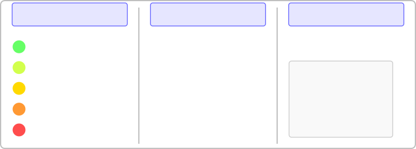
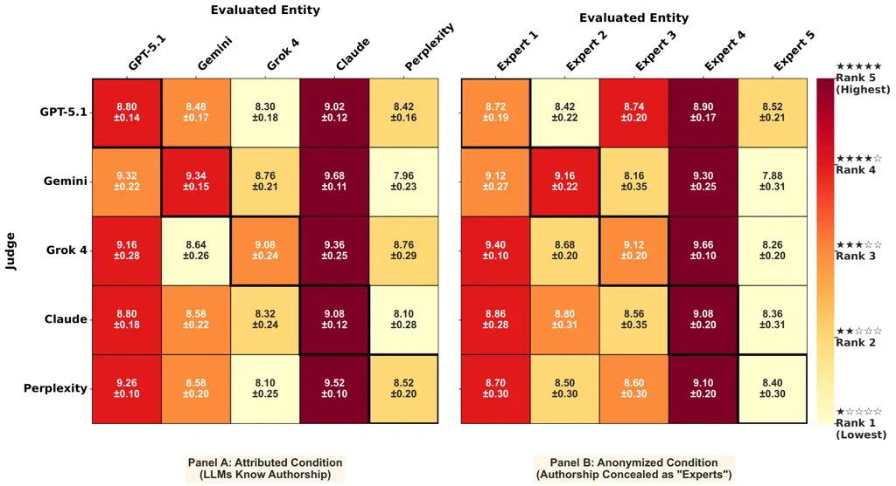
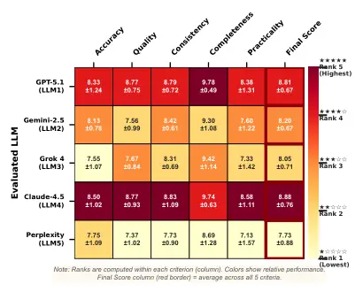
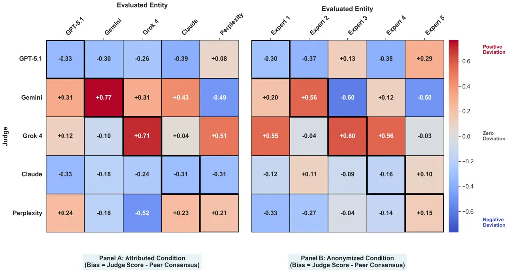
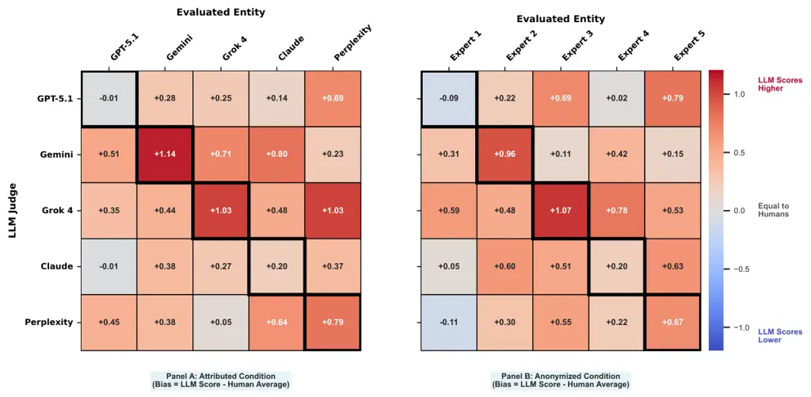

# Understanding LLM Evaluator Behavior: A Structured Multi-Evaluator Framework for Merchant Risk Assessment

Liang Wang    Junpeng Wang    Chin-Chia Michael Yeh    Yan Zheng
Affiliation: Jiarui Sun    Xiran Fan    Xin Dai    Yujie Fan
Affiliation: Yiwei Cai Affiliation: Visa Research Affiliation: 900 Metro
Center Blvd Affiliation: Foster City, CA 94404
Email: [(liawang,junpenwa,miyeh,yazheng,jiaruis2,xiyafan,xidai,yufan,yicai)@visa.com](mailto:@visa.com)

###### Abstract

Large Language Models (LLMs) are increasingly used as evaluators of
reasoning quality, yet their reliability and bias in _payments-risk_
settings remain poorly understood. We introduce a structured
multi-evaluator framework for assessing LLM reasoning in Merchant
Category Code (MCC)-based merchant risk assessment, combining a
five-criterion domain rubric with Monte-Carlo scoring to evaluate both
rationale quality and evaluator stability. Five frontier LLMs (GPT-5.1,
Gemini-2.5 Pro, Grok 4, Claude 4.5 Sonnet, Perplexity Sonar) generate
and cross-evaluate MCC risk rationales under _attributed_ and
_anonymized_ conditions. To establish a principled, judge-independent
reference, we introduce a consensus-deviation metric that eliminates
circularity by comparing each judge’s score to the mean of all _other_
judges, yielding a theoretically grounded measure of self-evaluation and
cross-model deviation. Our results reveal substantial heterogeneity in
evaluator behavior: GPT-5.1 and Claude 4.5 Sonnet show negative
self-evaluation bias ($`-0.33`$, $`-0.31`$), while Gemini-2.5 Pro and
Grok 4 display strong positive bias ($`+0.77`$, $`+0.71`$), with bias
direction persisting but attenuating by 25.8% under anonymization.
Evaluation by 26 payment-industry experts shows that LLM judges assign
scores averaging +0.46 points higher than human consensus, and that the
negative bias of GPT-5.1 and Claude 4.5 Sonnet relative to LLM peers
reflects _closer alignment with human judgment_. Ground-truth validation
using payment-network transaction data shows that four models—Claude 4.5
Sonnet, Gemini-2.5 Pro, Grok 4, and GPT-5.1—exhibit statistically
significant alignment (Spearman $`\rho=0.56`$–$`0.77`$), confirming that
the evaluation framework captures genuine quality. Overall, the
framework offers a replicable basis for evaluating LLM-as-a-judge
systems in payment-risk workflows and highlights the need for rigorous,
bias-aware protocols when deploying LLM evaluators in operationally
sensitive financial settings.

## 1 Introduction

Large Language Models (LLMs) are increasingly deployed not only as
content generators but also as evaluators, judging the quality of text,
code, and reasoning produced by other models  Chang et al. (2024); Chen
et al. (2025); Kahng et al. (2024); Li et al. (2025); Li et al. (2024);
Tan et al. (2024); Zhang et al. (2024); Zheng et al. (2023). This
LLM-as-a-judge paradigm raises foundational questions about reliability,
stability, and bias—questions that are particularly salient in
_payments-risk_ domains, where evaluation errors can affect fraud
analytics, merchant onboarding, regulatory compliance, and transaction
monitoring. Merchant Category Code (MCC) risk assessment provides a
demanding testbed: with more than 800 heterogeneous categories, coherent
rationale generation requires integrating business-model stability,
regulatory exposure, fraud typologies, return and refund behavior, and
chargeback dynamics.

Despite growing interest in LLM-as-a-judge systems, no prior work
provides a structured, domain-aligned evaluation of LLM reasoning in
payments-risk settings. Existing benchmarks emphasize general linguistic
competence or broad reasoning skills, but do not examine whether models
can produce correct, complete, and operationally grounded MCC risk
rationales aligned with industry practice. Moreover, prior studies
rarely assess the stability of LLM-generated evaluations across repeated
stochastic sampling, leaving open how consistent a given evaluator is
across runs. A further limitation is the treatment of self-evaluation
bias: most existing work assumes positive self-preference and uses
pairwise tests that cannot measure bias magnitude, detect negative
self-critique, or disentangle judge-specific bias from true quality
differences Balog et al. (2025); Dietz et al. (2025); Jiang et al.
(2025); Panickssery et al. (2024); Wang et al. (2024b); Wataoka et al.
(2024); Xu et al. (2024). These gaps underscore the need for a
principled methodology that evaluates both the _quality_ of LLM
reasoning and the _behavior_ of LLM evaluators in high-stakes,
domain-specific contexts.

To address these challenges, we introduce a structured multi-evaluator
framework for MCC-based merchant-risk reasoning. The framework
integrates a five-criterion rubric (Accuracy, Rationale Quality,
Consistency, Completeness, Practical Applicability) with a Monte Carlo
evaluation procedure in which each model performs multiple independently
sampled scoring runs, yielding estimates of evaluator stability
($`\mu\pm\sigma`$). We evaluate five frontier LLMs—GPT-5.1, Gemini-2.5
Pro, Grok 4, Claude 4.5 Sonnet, and Perplexity Sonar—both as rationale
generators and as evaluators. This design enables analysis not only of
reasoning quality but also of how consistently different judges evaluate
complex merchant categories under stochastic variability.

A central contribution of this work is a consensus-deviation metric that
provides a principled method for quantifying both self-evaluation and
cross-model bias. The metric eliminates circularity by comparing each
judge’s score only to the mean assigned by all _other_ judges, ensuring
that the reference standard remains independent of the judge being
evaluated. This makes it possible to isolate judge-specific tendencies,
measure bias magnitude robustly, and detect both positive
(self-promoting) and negative (self-critical) forms of self-evaluation.
Using this metric, we conduct cross-evaluation experiments under two
conditions—_attributed_ (source model disclosed) and _anonymized_
(source concealed)—allowing us to distinguish biases driven by
authorship recognition from those reflecting deeper evaluative
tendencies.

Our results show substantial heterogeneity in evaluator behavior.
GPT-5.1 and Claude 4.5 Sonnet exhibit _negative_ self-evaluation bias
($`-0.33`$ and $`-0.31`$ points), consistently scoring their own outputs
below peer consensus—a behavior not identified in prior LLM
self-evaluation work. In contrast, Gemini-2.5 Pro and Grok 4 display
strong _positive_ bias ($`+0.77`$ and $`+0.71`$), while Perplexity Sonar
exhibits modest positive bias ($`+0.21`$). Bias direction persists under
anonymization: although anonymization reduces magnitude by 25.8% on
average, it does not reverse direction, indicating that evaluator
tendencies reflect underlying model characteristics rather than explicit
authorship cues. These findings demonstrate that evaluation behavior
varies systematically across models and can differ sharply from
traditional expectations of universal self-preference.

To validate these LLM-based findings, we conducted complementary human
expert evaluation: 26 domain experts from the payments
industry—including research scientists and experienced business partners
with deep expertise in merchant risk assessment, fraud prevention, and
payment operations—independently evaluated the same LLM-generated
rationales using the identical evaluation rubric. This human validation
reveals that LLM judges systematically assign scores averaging +0.46
points higher than human expert consensus, with models exhibiting
negative bias relative to LLM peers (GPT-5.1, Claude-4.5 Sonnet)
demonstrating closest alignment with human judgment. We further validate
findings against four years of payment network transaction data, showing
that top-rated models achieve Spearman $`\rho=0.56`$–0.77 with empirical
merchant risk patterns. This triangulated validation—combining peer
consensus, human expert assessment, and empirical ground truth—confirms
that the evaluation framework captures genuine quality differences
rather than shared model artifacts.

##### Contributions.

1.  1.  We provide the first structured, domain-aligned evaluation of LLM
        reasoning in MCC-based _payments-risk_ settings, establishing a
        transparent and replicable foundation for assessing LLM-as-a-judge
        systems.
2.  2.  We develop a Monte Carlo evaluation framework that quantifies
        scoring stability through repeated independent assessments,
        revealing substantial cross-model differences in evaluator
        consistency.
3.  3.  We introduce a consensus-deviation metric with mathematically proven
        circularity prevention, enabling rigorous measurement of both
        positive and negative self-evaluation bias.
4.  4.  We present the first quantitative evidence of negative
        self-evaluation bias in frontier LLMs, extending and challenging
        prior work on self-preference.
5.  5.  We show that bias direction persists under anonymization and that
        anonymization reduces magnitude without eliminating directional
        tendencies.
6.  6.  We validate findings through complementary human expert evaluation
        and empirical ground-truth analysis, demonstrating that models
        exhibiting conservative scoring relative to LLM peers align more
        closely with human judgment and, for top performers, with payment
        network transaction data.

##### Paper organization.

Section 2 describes MCC risk rationale generation. Section 3 presents
the Monte Carlo evaluation framework including human expert validation.
Section 4 introduces the consensus-deviation metric, characterizes bias
patterns, and compares against human baseline. Section 5 validates
findings against payment network transaction data. Section 6 reviews
related literature. Section 7 discusses implications and limitations.
Section 8 concludes with implications for trustworthy LLM-as-a-judge
deployment.

## 2 MCC Risk Rationale Generation

Figure 1 illustrates the prompt design used to elicit structured MCC
risk rationales that serve as evaluation targets in our multi-evaluator
framework. This section describes the prompt structure, the five core
risk dimensions, and the LLM-generated outputs analyzed in later
sections.



Figure 1: Structure of the MCC Risk Rationale Prompt. Left: INPUT
specifies five risk levels from very low to very high risk. Center:
RATIONALE instructions require explicit coverage of five payments-risk
dimensions (Business Model Stability, Regulatory Exposure, Fraud
Exposure, Return Patterns, Chargeback Activity) along with 3
representative MCCs, while prohibiting numerical metrics and industry
jargon.Right: OUTPUT format specifies a structured JSON array containing
risk level definitions and rationales. Full prompt text appears in
Appendix .

### 2.1 Prompt Design and Risk Level Specification

Five frontier LLMs—GPT-5.1, Gemini-2.5 Pro, Grok 4, Claude-4.5 Sonnet,
and Perplexity Sonar—were each instructed to act as global payment-risk
experts and produce qualitative assessments across a five-level spectrum
(Very Low to Very High Risk). To ensure comparability across models, the
prompt requires each rationale to address the same five domain-relevant
dimensions:

- •
  Business Model Stability
- •
  Regulatory Exposure
- •
  Fraud Exposure
- •
  Return / Refund Patterns
- •
  Chargeback Activity

For each risk level, models must also select three representative MCCs
from the over 800 distinct merchant categories. To promote
domain-aligned, interpretable reasoning, the prompt restricts numerical
claims and discourages specialized industry jargon, and the output must
follow a structured JSON schema enabling machine-readable analysis.

Figure 2 provides examples of representative MCCs spanning diverse
business models and risk profiles. These categories anchor the
rationales in concrete merchant types that reflect realistic
payments-risk considerations.

|          |                               |
| -------- | ----------------------------- |
| MCC Code | Merchant Category Description |
| 5411     | GROCERY STORES/SUPERMARKETS   |
| 5541     | SERVICE STATIONS              |
| 5552     | ELECTRIC VEHICLE CHARGING     |
| 5651     | FAMILY CLOTHING STORES        |
| 5732     | ELECTRONICS STORES            |
| 5812     | RESTAURANTS                   |
| 5816     | DIGITAL GOODS: GAMES          |
| 5967     | INBOUND TELEMARKETING         |
| 6051     | QUASI-CASH                    |
| 7273     | DATING & ESCORT SERVICES      |

Figure 2: Representative MCCs. Ten MCCs spanning diverse risk levels and
business models: from low-risk essential services (grocery stores,
service stations) to high-risk categories (quasi-cash, telemarketing,
dating services). Full descriptions appear in the Visa Merchant Data
Standards Manual Visa Inc. (2023) and Mastercard Quick Reference
Booklet Mastercard (2023).

#### 2.1.1 Design Principle and Data Access

The five-level structure yields concise prompts and supports
interpretable reasoning aligned with payments-risk practice.
Importantly, all LLMs had access only to a public MCC-to-Name mapping
table; they received no transaction-level, merchant-level, or
proprietary network data. As a result, all generated rationales reflect
general knowledge learned by these LLMs during pretraining rather than
relying on any proprietary payment-transaction information.

### 2.2 LLM-Generated Risk Rationales

Each model produces structured JSON outputs containing five
rationales—one per risk level—covering all required dimensions and
corresponding representative MCCs. These outputs constitute the core
artifacts evaluated for reasoning quality, cross-model agreement, bias,
and stability in Section 3.

Figure 3 shows example rationales generated by Claude-4.5 Sonnet. Each
card reflects the five required dimensions, a coherent shift in language
intensity across risk levels, and representative MCCs aligned with
industry expectations (e.g., essential services at lower risk levels and
high-volatility or high-chargeback sectors at higher levels), despite
models’ access only to category names.


Figure 3: Example LLM-Generated MCC Risk Rationales (Claude-4.5 Sonnet).
Each rationale synthesizes all five risk dimensions and selects
representative MCCs. Color gradients reflect increasing risk severity.
Complete outputs for all models appear in Appendix B.

Across models, the rationales show systematic structure and
domain-relevant distinctions, providing a consistent basis for the
cross-model evaluation framework introduced in Section 3. Full JSON
outputs for all five LLMs are provided in Appendix B.

### 2.3 Summary

This section establishes a unified methodology for generating MCC-based
payment-risk rationales using frontier LLMs. The structured prompt
ensures that all models address identical risk dimensions across the
five-level spectrum, producing standardized outputs that serve as the
evaluation targets for the multi-evaluator framework that follows.

## 3 LLM-as-Judge Evaluation with Rubric and Monte Carlo Stability

This section presents the evaluation framework used to assess the
quality and consistency of the MCC risk rationales generated in
Section 2. The same five frontier LLMs—GPT-5.1, Gemini-2.5 Pro, Grok 4,
Claude-4.5 Sonnet, and Perplexity Sonar—now serve as evaluators, scoring
one another’s rationales under a structured rubric and a Monte Carlo
protocol designed to measure evaluator stability.

### 3.1 Monte Carlo Evaluation Framework

Figure 4 summarizes the evaluation setup. Each LLM is cast as a “Global
Payments-Risk Domain Expert” and evaluates all rationales, including its
own. The evaluation protocol has three components: (1) a
role-establishing context, (2) a five-criterion scoring rubric, and (3)
a Monte Carlo sampling procedure to quantify evaluator stability.


Figure 4: Monte Carlo Evaluation Framework. Top: _Evaluation Context_
specifies the evaluator role and target models, _Monte Carlo Protocol_
defines the 10-run sampling procedure at temperature 0.7 to quantify
stability, and _Critical Rules_ prohibit output modification and clarify
that runs represent repeated evaluator judgments. Bottom: _Scoring
Rubric_ provides 0–10 scales for five criteria (Accuracy, Rationale
Quality, Consistency, Completeness, Practical Applicability),
_Procedure_ outlines the six-step evaluation workflow, and _Required
Output_ specifies the structured reporting format with $`\mu\pm\sigma`$
scores and expert synthesis. Full prompt text appears in Appendix C.

##### Monte Carlo Protocol.

For each judge–target pair, we perform 10 independent scoring runs while
holding the underlying rationale fixed. Only the evaluator’s generative
reasoning varies due to stochastic sampling. The resulting mean
($`\mu`$) and standard deviation ($`\sigma`$) quantify each judge’s
scoring tendency and stability. A detailed algorithm appears in
Appendix D.

##### Scoring Rubric.

Evaluators score each rationale on five dimensions:

1.  1.  Accuracy: alignment with known MCC risk behavior.
2.  2.  Rationale Quality: clarity, structure, and domain professionalism.
3.  3.  Consistency: coherent progression of risk across levels.
4.  4.  Completeness: coverage of all five required risk dimensions.
5.  5.  Practical Applicability: usefulness for payments-risk decision
        making.

The rubric captures both objective structural criteria and
domain-informed qualitative reasoning.

##### Evaluation Integrity.

Judges evaluate the original rationale without modification. Because the
content is fixed across runs, $`\mu`$ and $`\sigma`$ reflect _evaluator_
uncertainty rather than variation in generated content.

### 3.2 Attributed vs. Anonymized Evaluation Conditions

To separate identity-driven effects from deeper evaluator tendencies,
scores are collected under two conditions:

- •
  Attributed: judges see full model identities (e.g., “Generated by
  GPT-5.1”).
- •
  Anonymized: identities are replaced with “Expert 1–5” using a fixed
  mapping (GPT-5.1 $`\rightarrow`$ Expert 1, Gemini-2.5 Pro
  $`\rightarrow`$ Expert 2, Grok 4 $`\rightarrow`$ Expert 3, Claude-4.5
  Sonnet $`\rightarrow`$ Expert 4, Perplexity Sonar $`\rightarrow`$
  Expert 5).

This dual-condition design isolates the influence of authorship
recognition. Comparing attributed and anonymized scores allows us to
distinguish intrinsic tendencies (present in both conditions) from
contextual ones triggered by source identity.

### 3.3 Illustrative Example: GPT-5.1 Evaluates Claude-4.5

Figure 5 illustrates the effect of authorship information. When
Claude-4.5’s identity is disclosed, GPT-5.1 assigns slightly higher
scores and uses more affirmative evaluative language. Under
anonymization, scores moderately decrease and commentary becomes more
neutral. Such attribution-driven shifts motivate the need for a
quantitative bias measure.


Figure 5: Example: GPT-5.1 Evaluating Claude-4.5 Sonnet Under Two
Conditions. (1) Attributed Condition where the source model (Claude-4.5
Sonnet) identity is disclosed, yielding a final stabilized score of
$`9.02\pm 0.12`$, and (2) Anonymized Condition where the same output is
presented as “Expert 4” with identity concealed, yielding
$`8.90\pm 0.17`$. Each criterion shows the mean score $`\mu\pm\sigma`$
from 10 independent Monte Carlo runs at temperature 0.7, accompanied by
the evaluator’s justification.

### 3.4 Cross-Evaluation Score Matrices

The full Monte Carlo evaluation yields two $`5\times 5`$ matrices—one
for attributed scoring and one for anonymized scoring—shown in Figure 6.
Each cell reports a judge’s stabilized mean score ($`\mu`$) and
consistency estimate ($`\sigma`$). Color shading encodes each judge’s
_relative_ ordering of the five targets, enabling comparison of ranking
behavior independent of absolute calibration differences. Detailed
criterion-level numerical values corresponding to these matrices are
provided in Appendix E.



Figure 6: Cross-Evaluation Score Matrices Under Attributed and
Anonymized Conditions. Five LLMs (GPT-5.1, Gemini-2.5 Pro, Grok 4,
Claude-4.5 Sonnet, Perplexity Sonar) evaluate all MCC rationales under
(A) attributed and (B) anonymized conditions. Each cell reports mean
$`\pm`$ standard deviation from 10 Monte Carlo runs. Color shading
reflects the judge’s relative ranking of the five targets. Diagonal
entries represent self-evaluations; off-diagonal entries are peer
assessments.

Three observations follow directly from these matrices.

##### (1) Self-scoring varies substantially across models.

Diagonal entries show that models differ in how favorably they evaluate
their own rationales (e.g., Gemini-2.5 Pro: 9.34; Grok 4 and Claude-4.5
Sonnet: 9.08; GPT-5.1: 8.80; Perplexity Sonar: 8.52). These differences
do not yet imply positive or negative bias—they simply show that raw
self-scores are not uniform across evaluators.

##### (2) Anonymization shifts score magnitudes but preserves ranking patterns.

Comparing Panels A and B indicates that anonymization slightly increases
or decreases scores depending on the judge–target pair (e.g., Gemini-2.5
Pro: 9.34 $`\rightarrow`$ 9.16; GPT-5.1: 8.80 $`\rightarrow`$ 8.72).
While these differences are easily visible, the matrices alone cannot
determine whether the changes constitute positive or negative bias. That
requires a judge-independent baseline, introduced in Section 4.

##### (3) Peer judges show clear areas of agreement.

Column patterns reveal strong consensus: Claude-4.5 Sonnet receives
uniformly high peer evaluations across both conditions; GPT-5.1 also
receives consistently strong ratings; and Perplexity Sonar receives the
lowest peer scores. These differences highlight shared judgments across
evaluators.

Together, these observations motivate the need for a principled method
to compare each model’s self-assessment against the consensus of other
judges. The consensus-deviation metric introduced in Section 4
formalizes this comparison and enables rigorous quantification of
evaluation bias.

### 3.5 Human Expert Validation

To validate the LLM evaluation framework against human domain expertise,
we assembled an expert panel of 26 professionals from a major global
payment network, representing a diverse range of experience in merchant
risk assessment, fraud prevention, transaction monitoring, and payment
operations. The panel includes research scientists with advanced degrees
and extensive publication records, as well as highly regarded business
partners who bring years of operational expertise in identifying and
mitigating payment risk. To avoid model-based preconceptions, experts
were blinded to model identity; each of the five LLMs was simply labeled
_LLM1_ through _LLM5_ when their rationales were presented. Each expert
independently evaluated the same five LLM-generated rationales using the
identical five-criterion rubric (Accuracy, Rationale Quality,
Consistency, Completeness, Practicality) with the same 1–10 scoring
scale employed by LLM judges, ensuring direct comparability between
human and LLM assessments. Notably, a strong majority of the panel
expressed that all five models performed impressively—both in generating
merchant-risk rationales and in providing judgment scores—especially
given that the LLMs had no access to real payment transaction data and
relied solely on knowledge acquired during pretraining.

Human consensus reveals a clear performance hierarchy (Figure 7):
Claude-4.5 Sonnet receives the highest average rating (8.88 $`\pm`$
0.76), followed closely by GPT-5.1 (8.81 $`\pm`$ 0.67), Gemini-2.5 Pro
(8.20 $`\pm`$ 0.67), Grok-4 (8.05 $`\pm`$ 0.71), and Perplexity Sonar
(7.73 $`\pm`$ 0.88). This ranking largely aligns with peer consensus
among LLM judges, confirming that the structured evaluation methodology
captures quality dimensions recognized by human experts.

Detailed analysis of human versus LLM judge agreement patterns and bias
implications is presented in Section 4.4, where we demonstrate that
models exhibiting negative bias (self-critique) relative to LLM peers
show closest alignment with human evaluation standards.



Figure 7: Human Consensus on Frontier LLM Risk-Assessment Quality.
Twenty-six payment-industry experts evaluated five LLM-generated MCC
risk rationales across five criteria (Accuracy, Quality, Consistency,
Completeness, Practicality). Cells report mean $`\pm`$ standard
deviation, with shading indicating relative rankings within each
criterion. The Final Score column (red border) aggregates all criteria.
Claude-4.5 Sonnet and GPT-5.1 receive the highest overall scores,
followed by Gemini-2.5 Pro, Grok-4, and Perplexity Sonar. This expert
baseline supports comparison with LLM-as-Judge results (see Figure 9).

## 4 Bias Metrics: Mathematical Formulation and Empirical Characterization

Section 3 introduced the raw scores generated by the Monte Carlo
LLM-as-judge framework. We now formalize how these scores are converted
into a judge-independent measure of deviation from peer consensus. This
section defines the _consensus-deviation metric_, establishes its
theoretical guarantees, and applies it to characterize systematic
evaluation tendencies across frontier LLMs.

### 4.1 Definition of the Consensus-Deviation Metric

The consensus-deviation metric measures how much a judge’s score differs
from the consensus formed by all _other_ judges. Excluding the focal
judge from the consensus baseline is essential: it ensures independence
and eliminates circularity.

#### 4.1.1 Notation

Let $`n`$ be the number of judges and $`m`$ the number of evaluated
entities. For each judge $`i\in\{1,\dots,n\}`$ and entity
$`j\in\{1,\dots,m\}`$:

- •
  $`\text{Score}_{\text{judge}=i}(\text{LLM}=j)`$ is the attributed
  score.
- •
  $`\text{Score}_{\text{judge}=i}(\text{Expert}=j)`$ is the anonymized
  score.
- •
  Each score is the Monte Carlo mean from 10 scoring runs.

Consensus for entity $`j`$ excludes judge $`i`$, ensuring independence.

#### 4.1.2 Attributed Bias

When identities are visible, deviation from consensus is:

```math
\text{Bias}_{A}(i,j)=\text{Score}_{\text{judge}=i}(\text{LLM}=j)-\underbrace{\text{MeanScore}_{k\neq i}(\text{LLM}=j)}_{\text{consensus}}.
```

Interpretation:

```math
\text{Bias}_{A}(i,j)\begin{cases}>0&\text{judge }i\text{ scores entity }j\text{ above consensus},\\
<0&\text{judge }i\text{ scores entity }j\text{ below consensus},\\
=0&\text{perfect alignment with consensus}.\end{cases}
```

The diagonal case $`i=j`$ corresponds to self-evaluation bias.

#### 4.1.3 Anonymized Bias

Under anonymization, identity labels are replaced using a fixed mapping:

```math
\text{Expert }j\equiv\text{LLM }j.
```

The deviation is:

```math
\text{Bias}_{B}(i,j)=\text{Score}_{\text{judge}=i}(\text{Expert}=j)-\text{MeanScore}_{k\neq i}(\text{Expert}=j).
```

Here, $`\text{Bias}_{B}(i,i)`$ captures intrinsic self-evaluation
tendencies independent of authorship disclosure.

### 4.2 Theoretical Properties and Guarantees

The consensus-deviation metric satisfies two key guarantees that
distinguish it from naive, self-inclusive baselines. Complete proofs
appear in Appendix F.

#### 4.2.1 Proposition 1: Zero-Sum Property Across Judges

###### Proposition 1.

For any entity $`j`$,

```math
\sum_{i=1}^{n}\text{Bias}_{A}(i,j)=0,\qquad\sum_{i=1}^{n}\text{Bias}_{B}(i,j)=0.
```

##### Interpretation.

The zero-sum structure means that positive bias by some judges
necessarily implies negative bias by others. The metric measures
_relative_ deviation from collective judgment, not absolute quality.
This guarantees that bias values are intrinsically calibrated: if all
judges assign identical scores to an entity—even if those scores are
uniformly high or uniformly low—every bias term is exactly zero. In
other words, the metric reflects divergence from peer consensus rather
than raw scoring scale, ensuring comparability across judges with
different absolute tendencies.

#### 4.2.2 Proposition 2: Self-Exclusion Prevents Circularity

###### Proposition 2.

Because consensus excludes judge $`i`$,

```math
\frac{\partial\text{Bias}_{A}(i,j)}{\partial\text{Score}_{\text{judge}=i}(\text{LLM}=j)}=1.
```

##### Interpretation.

Self-exclusion ensures that bias measurements remain orthogonal to the
consensus reference point: a judge cannot influence the baseline against
which their own deviation is computed. The derivative being exactly one
formalizes this independence. This property is essential for isolating
_genuine evaluator bias_ from simple scoring-scale differences—without
it, judges who use higher or lower absolute scores would contaminate
their own baselines, attenuating and distorting measured deviations.

#### 4.2.3 Contrast with Non-Excluding Consensus

If consensus included the focal judge:

```math
\text{Consensus}_{\text{naive}}(j)=\frac{1}{n}\sum_{k=1}^{n}\text{Score}_{\text{judge}=k}(\text{LLM}=j),
```

then:

```math
\frac{\partial\text{Bias}_{\text{naive}}(i,j)}{\partial\text{Score}_{\text{judge}=i}}=1-\frac{1}{n}=\frac{n-1}{n}.
```

If judge $`i`$ were included in the consensus, their own score would
partially anchor the baseline. The resulting naive deviation would
shrink by a factor of $`(n-1)/n`$, because changes in judge $`i`$’s
score move the consensus in the same direction. For $`n=5`$ judges, this
induces a 20% attenuation in all bias measurements.

This $`(n-1)/n`$ contraction systematically underestimates true
deviation, obscuring genuine evaluation patterns. Our self-excluding
consensus removes this circularity entirely: each judge is evaluated
against a baseline they cannot manipulate, yielding unbiased and
interpretable bias estimates.

### 4.3 Empirical Characterization of Evaluation Bias

Having established the theoretical properties of the consensus-deviation
metric, we now examine how frontier LLMs behave as evaluators. The
consensus-deviation matrices in Figure 8 aggregate all Monte
Carlo–stabilized scores under both attribution conditions. Each cell
represents judge $`i`$’s deviation from the consensus of the other
judges when scoring entity $`j`$, with blue indicating under-scoring and
red indicating over-scoring. Diagonal entries quantify self-evaluation
bias through $`\text{Bias}_{A}(i,i)`$ and $`\text{Bias}_{B}(i,i)`$;
off-diagonals reveal cross-model tendencies.



Figure 8: Bias Matrices Under Attributed (A) and Anonymized (B)
Conditions. Each cell shows deviation from the consensus of all other
judges (blue = below consensus, red = above consensus). Diagonals
represent self-evaluation tendencies; off-diagonals reflect cross-model
biases.

#### 4.3.1 Central Finding: Heterogeneous Self-Evaluation Behavior

The diagonal cells reveal a pronounced pattern: frontier LLMs differ
substantially in how they evaluate their own reasoning.

Two high-performing models exhibit _negative self-evaluation bias_:

```math
\text{Bias}_{A}(1,1)=-0.33\text{ and }\text{Bias}_{B}(1,1)=-0.30\quad\text{(GPT\mbox{-}5.1)},
```

```math
\text{Bias}_{A}(4,4)=-0.31\text{ and }\text{Bias}_{B}(4,4)=-0.16\quad\text{(Claude\mbox{-}4.5)}.
```

Both models score their own rationales below peer consensus despite
strong peer ratings (Figure 6), indicating a self-critical evaluation
style rather than lower-quality content.

In contrast, two models show strong _positive_ self-bias:

```math
\text{Bias}_{A}(2,2)=+0.77,\quad\text{Bias}_{B}(2,2)=+0.56\quad(\text{Gemini\mbox{-}2.5}),
```

```math
\text{Bias}_{A}(3,3)=+0.71,\quad\text{Bias}_{B}(3,3)=+0.60\quad(\text{Grok\mbox{-}4}),
```

while Perplexity Sonar exhibits modest positive self-bias:

```math
\text{Bias}_{A}(5,5)=+0.21,\quad\text{Bias}_{B}(5,5)=+0.15.
```

Collectively, these three patterns map a continuum of
self-evaluation—from self-critical to self-affirming to nearly
neutral—highlighting that frontier models exhibit distinctive evaluative
signatures rather than a shared assessment tendency.

#### 4.3.2 Stability Across Conditions: Evidence of Intrinsic Evaluator Heuristics

A key result is that no model changes the _direction_ of its
self-evaluation bias when authorship labels are removed. The transitions
are: (GPT-5.1: $`-0.33\to-0.30`$; Gemini-2.5 Pro: $`+0.77\to+0.56`$;
Grok-4:$`+0.71\to+0.60`$; Claude-4.5 Sonnet: $`-0.31\to-0.16`$;
Perplexity Sonar: $`+0.21\to+0.15`$).

Bias magnitudes shrink by 9.1–48.4% across models (25.8% on
average)—with reductions of 9.1% (GPT-5.1), 27.3% (Gemini-2.5 Pro),
15.5% (Grok-4), 48.4% (Claude-4.5 Sonnet), and 28.6% (Perplexity
Sonar)—but _sign is preserved for all five models_. This stability
strongly suggests that self-evaluation behavior arises from _intrinsic
scoring heuristics_, not explicit recognition of model identity.

#### 4.3.3 Off-Diagonal Evidence: Universal Standards vs. Model Preference

Off-diagonal cells reveal how judges score other models’ rationales.
Negative-bias models apply broadly stricter standards: for example,
Claude-4.5 Sonnet assigns negative deviations to both itself ($`-0.31`$)
and GPT-5.1 ($`-0.33`$). Positive-bias models, such as Gemini-2.5 Pro
and Grok-4, apply more generous scoring across multiple targets. These
patterns indicate that self-bias is part of a consistent evaluator style
rather than an isolated effect.

### 4.4 Human Expert Baseline Comparison

The consensus-deviation analysis in Section 4.3 quantifies bias relative
to LLM peer consensus. To determine whether these patterns reflect
genuine differences in evaluative standards or artifacts shared across
LLMs, we compare LLM-judge scores against an independent human expert
baseline (Figure 7).

Comparing LLM judges with human consensus yields a clear pattern
(Figure 9): across all evaluations and criteria, LLM judges assign
scores that are, on average, 0.46 points higher than the consensus of
the 26 payment-industry experts, indicating that LLM judges collectively
employ more lenient scoring standards than human domain experts. Against
this baseline, GPT-5.1’s apparent negative bias (self-critique) relative
to LLM peers ($`-0.33`$, Figure 8) emerges instead as _closest alignment
with human judgment_ ($`-0.01`$ relative to humans). Similarly,
Claude-4.5 Sonnet’s negative self-evaluation bias versus LLM peers
($`-0.31`$, Figure 8) translates into mild positive bias relative to
humans ($`+0.20`$). By contrast, Gemini-2.5 Pro and Grok-4 exhibit
substantially stronger positive bias when compared with human standards
($`+1.14`$ and $`+1.03`$, respectively, in self-evaluation).

Taken together, these findings reframe how evaluator behavior should be
interpreted: models that appear self-critical relative to LLM consensus
are in fact those whose scoring patterns most closely reflect human
domain-expert judgment, suggesting that conservative self-evaluation
corresponds to realism rather than undue harshness.



Figure 9: LLM Judges Score Higher Than Human Evaluators Across
Attribution Conditions. Bias matrices measuring how five LLM judges
deviate from the 26-expert human consensus. Bias is calculated as: LLM
Score – Human Average, where positive values (red) indicate LLM judges
assign higher scores than human evaluators, and negative values (blue)
indicate lower scores. Diagonal elements (bold borders) reveal
self-evaluation bias relative to human consensus. Panel A (Attributed):
When model identities are disclosed, LLM judges exhibit predominantly
positive bias across 23 of 25 evaluation pairs, with a mean bias of
$`+0.46`$ points. GPT-5.1 shows near-zero self-evaluation bias
($`-0.01`$), while Gemini-2.5 Pro ($`+1.14`$) and Grok-4 ($`+1.03`$)
show the largest positive self-biases. Panel B (Anonymized): When
identities are concealed, the pattern persists with a mean bias of
$`+0.43`$ points. This systematic positive bias indicates that LLM
judges assign higher scores than human domain experts across nearly all
judge–target and criterion combinations.

### 4.5 Summary

Across both evaluation conditions, the consensus-deviation metric
reveals clear, model-specific evaluation signatures:

- •
  Frontier LLMs differ markedly in how they score their own reasoning,
  with negative, positive, and near-neutral self-bias all present.
- •
  Bias direction persists under anonymization, demonstrating that
  evaluator tendencies reflect intrinsic scoring heuristics rather than
  explicit recognition of model identity.
- •
  Off-diagonal patterns show that models apply coherent, model-wide
  scoring standards—not isolated or self-targeted adjustments.
- •
  The full deviation spectrum (from $`\text{Bias}_{A}(1,1)=-0.33`$ for
  GPT-5.1 to $`\text{Bias}_{A}(2,2)=+0.77`$ for Gemini-2.5 Pro) reveals
  substantial heterogeneity in frontier LLM evaluation behavior _even
  when all models score the same fixed rationales_.
- •
  Comparison with the 26-expert human baseline shows that LLM judges
  collectively apply more lenient scoring standards, and that models
  exhibiting self-critical bias relative to LLM peers (e.g., GPT-5.1 and
  Claude-4.5) align most closely with human evaluators’ judgments.

These results demonstrate that LLM evaluators do not exhibit uniform
self-preference; instead, each model expresses a distinct, persistent
evaluation signature. The consensus-deviation metric provides the first
principled, judge-independent framework for quantifying these behaviors,
with human expert validation confirming that self-critical models
reflect realistic rather than overly harsh assessment standards.

## 5 Empirical Validation Against Payment Network Transaction Data

The preceding sections established that LLM evaluators exhibit
systematic biases relative to both peer consensus (Section 4.3) and
human expert judgment (Section 4.4). A critical remaining question is
whether these evaluation patterns correspond to genuine risk-assessment
quality or merely reflect shared heuristics ungrounded in empirical
reality. To address this, we validate LLM-generated risk assessments
against four years of payment-network transaction data covering more
than 800 MCCs, focusing on the 39 MCCs surfaced in the LLM-generated
rationales.

### 5.1 Data and Methodology

We obtained worldwide transaction data from a major global payment
network covering 2021–2024, spanning more than 800 merchant category
codes (MCCs). The 39 MCCs analyzed in this study correspond to those
surfaced in the LLM-generated rationales: each of the five models
selected and justified three representative MCCs per evaluation
criterion, yielding a distinct set of 39 model-proposed categories.

For each MCC in the transaction dataset, we computed a unified empirical
risk score as a weighted average of multiple fraud and operational
indicators, including fraud exposure metrics, chargeback
characteristics, and operational reliability signals such as returns,
refunds, and reversals. Indicators were derived from both count-based
(frequency) and dollar-based (financial impact) risk rates.

We then computed Spearman rank correlations between each LLM’s assigned
risk levels and the empirical unified risk scores to assess whether the
models correctly identify merchant categories associated with elevated
real-world risk patterns.

### 5.2 Results

Four models—Claude-4.5 Sonnet, Gemini-2.5 Pro, Grok-4, and GPT-5.1—show
statistically significant alignment with empirical transaction data
($`\rho=0.77`$, $`p<0.001`$; $`\rho=0.69`$, $`p<0.01`$; $`\rho=0.61`$,
$`p<0.05`$; and $`\rho=0.56`$, $`p<0.05`$, respectively). Perplexity
Sonar shows a weaker, non-significant correlation ($`\rho=0.49`$,
$`p=0.063`$). The alignment across evaluation sources is informative:
Claude-4.5 Sonnet, which receives the highest ratings from both LLM peer
evaluators and human experts, also demonstrates the strongest empirical
correlation. This three-way validation—combining peer consensus, human
expert assessment, and transaction-level ground truth—confirms that the
structured evaluation framework captures genuine variation in rationale
quality rather than shared model artifacts.

### 5.3 Detailed Risk Assignment Patterns

While aggregate correlation measures overall alignment strength,
understanding _which_ merchant categories each model assigns to
different risk levels provides deeper insight into model behavior and
failure modes. Figure 10 presents a comprehensive visualization
comparing risk level assignments across all five models.

Figure 10: Comparative LLM Risk Assessment of Merchant Category Codes.
Five frontier language models (rows) classify 39 merchant categories
into five risk levels (columns). Each card displaysm three
representative MCCs for that risk level. Bar lengths reflect unified
risk scores derived from worldwide payment transaction data, combining
fraud exposure, chargeback characteristics, and operational reliability
signals. Color gradient (light to dark blue) enhances visual
discrimination of risk levels. Models demonstrate strong overall
performance with smooth risk progression and perfect consensus on
unambiguous cases like grocery stores, while disagreements occur
primarily at adjacent category boundaries with occasional non-adjacent
misalignments requiring validation.

The detailed patterns reveal that frontier models demonstrate strong
overall capability, particularly excelling at identifying representative
merchants across lower and middle risk tiers. All five models exhibit
smooth risk progression, with empirical scores increasing systematically
from lower to higher risk levels, validating their fundamental grasp of
merchant risk hierarchies. Perfect consensus emerges for unambiguous
cases such as grocery stores, which all models correctly assign to Very
Low Risk.

Disagreements manifest at two levels of severity. Minor misalignments
between adjacent risk categories—such as whether dating and escort
services belong in High Risk versus Very High Risk—represent acceptable
calibration differences given inherently fuzzy boundaries between tiers.
However, non-adjacent misalignments reveal more concerning limitations:
some models assign merchants with empirically low risk scores to Very
High Risk categories, representing categorical errors that could
severely distort risk management decisions. Such misalignments occur
sporadically across models and indicate incomplete integration of
multi-dimensional risk factors.

These patterns underscore both the promise and current limitations of
LLM-based risk assessment: while frontier models demonstrate
sophisticated capability for identifying risk gradients and classifying
most merchants appropriately, occasional severe
misalignments—particularly evident in models with weaker empirical
alignment—necessitate human oversight and ongoing validation against
transaction data for high-stakes financial applications.

### 5.4 Interpretation and Implications

The empirical validation reveals three key insights. First, evaluation
quality as measured by LLM peer consensus and human expert ratings
_predicts_ empirical accuracy: models receiving higher scores
demonstrate stronger correlation with transaction-based risk. This
validates the structured evaluation framework and confirms that the
five-criterion rubric captures dimensions relevant to genuine risk
assessment capability.

Second, the observed correlations ($`\rho=0.56`$–0.77 for statistically
significant models) indicate strong but non-exhaustive alignment. This
is consistent with the nature of payments risk: fraud patterns evolve
over time, legitimate businesses may operate in high-risk categories,
and effective risk assessment requires judgment that cannot be fully
captured by historical patterns alone. The results suggest that
top-performing LLMs have internalized meaningful risk hierarchies while
retaining capacity for nuanced evaluation.

Third, the divergence in empirical accuracy across models confirms that
consensus-deviation metrics capture meaningful differences in evaluator
behavior, though bias direction alone does not fully explain empirical
alignment. Models with negative self-evaluation bias tend to align more
closely with human judgment, while empirical correlation varies by model
and reflects additional capability differences beyond scoring bias.
These findings support the use of highly rated models in high-stakes
financial applications: the evaluation framework successfully identifies
models whose risk assessments reflect both expert judgment and empirical
fraud patterns. However, occasional severe misalignments even in
top-performing models underscore the necessity of validation mechanisms
and human oversight for operationally sensitive decisions.

## 6 Related Work

LLM-as-a-judge systems have become essential tools for evaluating
summarization, reasoning, and safety in language models. Established
methodologies include rubric-based scoring Li et al. (2025); Liu et al.
(2024a); Liu et al. (2023); Murugadoss et al. (2025); Wu et al. (2023);
Zheng et al. (2023); Zhong et al. (2024), pairwise preference models
Feng et al. (2025); Jeong et al. (2025); Panickssery et al. (2024);
Zheng et al. (2023), and self-consistency protocols Feng et al. (2025);
Wang et al. (2022). While these frameworks demonstrate strong alignment
with human preferences, recent work reveals systematic biases including
self-enhancement, verbosity preference, position effects, and
prompt-format sensitivity Balog et al. (2025); Chen et al. (2024);
Herrera-Berg et al. (2023); Li et al. (2023); Liu et al. (2024b);
Panickssery et al. (2024); Saito et al. (2023); Wang et al. (2024b); Wu
et al. (2023); Ye et al. (2024). However, prior studies evaluate
self-assessment in isolation rather than within multi-judge
environments, leaving open whether frontier models exhibit distinct and
persistent self-evaluation patterns when assessed against peer
consensus.

Validation against external baselines remains a central challenge for
LLM evaluators. While prior work compares model judgments with human
preferences on general tasks Zheng et al. (2023); Dubois et al. (2024)
or explores calibration against task-specific ground truth Qi et al.
(2025), few studies provide triangulated validation combining peer
consensus, domain-expert assessment, and empirical outcome data.

Payments-risk assessment has traditionally relied on structured features
and expert-defined heuristics for fraud detection and merchant
classification Bahnsen et al. (2016); Wang et al. (2024a); Wang et al.
(2025); Yeh et al. (2020); Zhang et al. (2021). Recent industry efforts
apply foundational models to transaction embeddings and risk explanation
Dou et al. (2025); Fan et al. (2025); Pirmorad (2025); Sanz-Guerrero and
Arroyo (2024); Tan et al. (2025); Yeh et al. (2025), though evaluation
standards for LLM-generated rationales remain nascent.

## 7 Discussions, Implications, and Limitations

Our findings reveal that LLMs exhibit structured, model-specific
evaluation behaviors that persist across attribution conditions. This
section discusses the broader implications of these results for LLM
evaluation methodology, model development, and deployment in operational
settings, and concludes with a discussion of key limitations and
directions for future work.

### 7.1 Evaluator Diversity Versus Generation Homogeneity

Jiang et al. Jiang et al. (2025) demonstrate that more than seventy
open- and closed-source language models display notable homogeneity in
generated content and reasoning trajectories, forming an _artificial
hivemind_. Our empirical results reveal a contrasting picture for
evaluation: the overall bias spectrum spans more than one full point
(from $`-0.33`$ to $`+0.77`$), indicating substantial heterogeneity in
evaluator tendencies. While some convergence appears among self-critical
models—both GPT-5.1 and Claude-4.5 Sonnet exhibit negative
self-evaluation bias—this shared tendency exists within a much broader
landscape of divergent evaluator behaviors. This divergence extends
beyond what prior literature has documented and highlights that LLM
generation and LLM evaluation are governed by distinct behavioral modes
that cannot be assumed to align.

### 7.2 Metacognition, Self-Critique, and Cognitive Analogues

The emergence of negative self-evaluation bias in high-performing
models, now validated against independent domain-expert assessments,
suggests a form of model-level _self-critique_ that invites comparison
with patterns observed in human cognition. Classical research by Kruger
and Dunning Kruger and Dunning (1999) demonstrates that low performers
overestimate their competence while high performers underestimate it—a
phenomenon sometimes termed the Dunning–Kruger effect. Our findings
reveal potential analogues among LLMs: models with weaker evaluated
outputs exhibit stronger self-promotion, while high-performing models
such as GPT-5.1 and Claude-4.5 Sonnet systematically under-score
themselves relative to LLM peer consensus. This asymmetric pattern
resembles _imposter syndrome_, a psychological construct in which high
performers underestimate their capabilities Clance and Imes (1978).

Critically, the 26-expert domain evaluation baseline reframes these
observations: what appears as _negative self-evaluation bias_ when
measured against LLM peer consensus actually represents _closer
alignment with human expert judgment_. GPT-5.1 exhibits near-zero
self-evaluation bias relative to human consensus ($`-0.01`$ attributed,
$`-0.09`$ anonymized), while its negative bias versus other LLMs
($`-0.33`$) simply reflects that most LLM judges score more generously
than human experts. Claude-4.5 Sonnet demonstrates modest positive bias
relative to humans ($`+0.20`$ in both conditions) despite negative bias
versus LLM peers ($`-0.31`$), positioning it closer to human standards
than models with stronger positive bias. In contrast, Gemini-2.5 Pro and
Grok-4 exhibit substantial positive self-evaluation bias versus human
baseline ($`+1.14`$ to $`+1.18`$ and $`+0.96`$ to $`+1.07`$
respectively), indicating systematic overestimation relative to
domain-expert assessment.

These empirical regularities, now grounded in expert validation, raise
intriguing questions about the origins of evaluator bias. Claude-4.5
Sonnet’s conservative scoring may reflect Anthropic’s Constitutional AI
framework Askell et al. (2021); Bai et al. (2022a); Bai et al. (2022b),
which explicitly trains models to critique and revise their own outputs
through iterative self-improvement loops. This training paradigm
emphasizes self-correction and critical assessment, potentially
embedding conservative scoring tendencies that align more closely with
human expert standards. Similarly, GPT-5.1’s human-aligned evaluation
behavior may arise from reinforcement learning from human feedback
(RLHF) processes that reward caution and penalize overconfidence,
particularly in contexts where false positives carry reputational or
safety risks Mu et al. (2024); Ouyang et al. (2022); Yuan et al. (2025).
The fact that these training approaches produce evaluation behavior more
consistent with expert judgment than with typical LLM scoring suggests
they successfully embed realistic quality standards rather than
artificially harsh self-assessment.

In contrast, models exhibiting positive self-evaluation bias relative to
both LLM peers and human experts (Gemini-2.5 Pro, Grok-4) may reflect
different alignment objectives or training signals that prioritize
confidence and assertiveness, or may lack explicit self-critique
mechanisms during training. Understanding these divergent training
philosophies and their downstream effects on evaluator
behavior—validated through both human expert and empirical ground-truth
benchmarks—represents a promising direction for interpretability
research.

While LLMs do not possess human metacognition in the phenomenological
sense, these structured patterns, validated across multiple independent
baselines, indicate that their internal evaluation heuristics embed
domain-appropriate calibration rather than arbitrary scoring noise. The
expert-grounded evidence strengthens the interpretation that negative
bias relative to LLM peers signals realistic rather than overly harsh
assessment, and that training methodologies emphasizing self-critique
and iterative refinement produce evaluators whose standards align with
expert human judgment.

### 7.3 Implications for Practice and Deployment

The heterogeneity observed across models carries direct consequences for
both research benchmarking and operational deployment. In benchmarking
contexts, evaluator selection materially affects outcomes: positive-bias
models may inflate scores, while negative-bias models may penalize
otherwise strong reasoning. Judge disagreement reflects systematic
differences in learned evaluation standards rather than measurement
noise, requiring practitioners to treat evaluators as first-class
machine learning models that require calibration and ongoing monitoring.

In high-stakes operational settings—such as payments risk assessment,
compliance review, or model governance—these bias patterns become even
more consequential. Three practical strategies emerge from our findings.
First, post-hoc calibration layers can normalize scores across models
with different baseline tendencies, ensuring consistent decision
thresholds. Second, multi-judge ensembles aggregating models with
diverse biases may yield more robust assessments Li et al. (2023); Pal
et al. (2024), analogous to ensemble methods in predictive modeling.
Third, explanation auditing must extend beyond output quality to
evaluator tendencies themselves, since our metric identifies
model-specific behaviors independent of content.

### 7.4 Limitations and Future Directions

While our study provides the first systematic quantification of
self-evaluation bias in LLMs, several limitations warrant discussion.

Limited Model Coverage. We evaluate five models—GPT-5.1, Gemini-2.5 Pro,
Grok-4, Claude-4.5 Sonnet, and Perplexity Sonar—which represent only a
subset of commercially deployed LLMs. Bias patterns may differ for
open-source models (e.g., LLaMA, Mistral, DeepSeek, Qwen), smaller
parameter scales, domain-specialized models (medical, legal,
scientific), or multilingual models evaluated outside English. The
behaviors observed here may therefore characterize high-end proprietary
models rather than universal LLM tendencies.

Static Model Snapshots. Our analysis considers specific versions of each
model at a single point in time. As models are updated, scoring
heuristics and evaluation bias may evolve. For example, negative
self-bias in GPT-5.1 or Claude-4.5 Sonnet may reflect current tuning
choices and could shift in later releases, while the stronger positive
bias observed in Gemini-2.5 Pro might be reduced with future alignment
adjustments. Our findings should therefore be interpreted as a snapshot
of these versions rather than stable model properties.

Single Task Domain. We focus exclusively on payment risk assessment
rationales. While this domain provides well-structured tasks and clear
evaluation criteria, self-critical or self-promotional tendencies may
vary across other domains such as creative writing, mathematical
reasoning, code generation, dialogue, or factual question answering.
Understanding cross-domain generality remains an important direction for
future work.

Mechanistic Ambiguity. Although bias direction persists under
anonymization, we cannot fully disentangle two potential mechanisms: (1)
a universal evaluation standard learned during training, applied
uniformly across outputs; versus (2) implicit style recognition, where
models detect characteristic features of their own text even without
explicit labels. Several patterns support the universal standards
interpretation—e.g., Claude-4.5 Sonnet assigns similar negative
deviations to GPT-5.1 as to itself, and training frameworks like
Constitutional AI explicitly teach quality assessment independent of
authorship—but controlled experiments with style transfer or synthetic
rationales are needed for conclusive attribution. This ambiguity does
not affect practical implications, but limits mechanistic claims.

Overall, these limitations point toward several promising research
directions: scaling to broader model ecosystems, extending to multiple
domains, integrating human evaluators, and designing controlled
experiments to probe the origin of evaluation heuristics.

## 8 Conclusion

We introduced a rigorous framework for evaluating LLM-as-a-judge systems
in financial settings, combining a domain-aligned scoring rubric with a
consensus-deviation metric that isolates self-evaluation bias while
avoiding circularity. Validation through three independent sources—peer
consensus among five frontier models, assessment by 26 payment-industry
experts, and alignment with payment-network transaction
outcomes—demonstrates that the framework captures meaningful differences
in evaluator quality rather than superficial scoring artifacts. This
provides a principled and validated foundation for analyzing LLM
evaluators in payment-risk workflows, showing that systematic evaluator
biases can be measured, compared to human expertise, and grounded in
empirical outcomes to support reliable and transparent AI-driven
financial decision-making.

## Acknowledgement

We thank Shubham Agrawal, Yuzhong Chen, Chiranjeet Chetia, Grace Chow,
Yingtong Dou, Shubham Jain, Yuxi Jing, Hans Li, Yiran Li, Wei Liu,
Harish Majithiya, Menghai Pan, Bin Qin, Steven Qu, Dan Wang, Sheng Wang,
Jessie Xia, Weiping Yang, and Jie Zou for serving as domain experts in
evaluating the quality of LLM-generated merchant-category rationales,
and for their valuable discussions and constructive feedback.

## References

- \[1\] A. Askell, Y. Bai, A. Chen, D. Drain, D. Ganguli, T.
  Henighan, A. Jones, N. Joseph, B. Mann, N. DasSarma, et al. (2021) A
  general language assistant as a laboratory for alignment. arXiv
  preprint arXiv:2112.00861. Cited by: §7.2.
- \[2\] A. C. Bahnsen, D. Aouada, A. Stojanovic, and B. Ottersten (2016)
  Feature engineering strategies for credit card fraud detection. Expert
  Systems with Applications 51, pp. 134–142. Cited by: §6.
- \[3\] Y. Bai, A. Jones, K. Ndousse, A. Askell, A. Chen, N.
  DasSarma, D. Drain, S. Fort, D. Ganguli, T. Henighan, et al. (2022)
  Training a helpful and harmless assistant with reinforcement learning
  from human feedback. arXiv preprint arXiv:2204.05862. Cited by: §7.2.
- \[4\] Y. Bai, S. Kadavath, S. Kundu, A. Askell, J. Kernion, A.
  Jones, A. Chen, A. Goldie, A. Mirhoseini, C. McKinnon, et al. (2022)
  Constitutional ai: harmlessness from ai feedback. arXiv preprint
  arXiv:2212.08073. Cited by: §7.2.
- \[5\] K. Balog, D. Metzler, and Z. Qin (2025) Rankers, judges, and
  assistants: towards understanding the interplay of llms in information
  retrieval evaluation. In Proceedings of the 48th International ACM
  SIGIR Conference on Research and Development in Information Retrieval,
  pp. 3865–3875. Cited by: §1, §6.
- \[6\] Y. Chang, X. Wang, J. Wang, Y. Wu, L. Yang, K. Zhu, H. Chen, X.
  Yi, C. Wang, Y. Wang, et al. (2024) A survey on evaluation of large
  language models. ACM transactions on intelligent systems and
  technology 15 (3), pp. 1–45. Cited by: §1.
- \[7\] G. H. Chen, S. Chen, Z. Liu, F. Jiang, and B. Wang (2024) Humans
  or llms as the judge? a study on judgement biases. arXiv preprint
  arXiv:2402.10669. Cited by: §6.
- \[8\] W. Chen, Z. Wei, X. Zhu, S. Feng, and Y. Meng (2025) Do llm
  evaluators prefer themselves for a reason?. arXiv preprint
  arXiv:2504.03846. Cited by: §1.
- \[9\] P. R. Clance and S. A. Imes (1978) The imposter phenomenon in
  high achieving women: dynamics and therapeutic intervention.
  Psychotherapy: Theory, Research & Practice 15 (3), pp. 241–247. Cited
  by: §7.2.
- \[10\] L. Dietz, O. Zendel, P. Bailey, C. Clarke, E. Cotterill, J.
  Dalton, F. Hasibi, M. Sanderson, and N. Craswell (2025) Llm-evaluation
  tropes: perspectives on the validity of llm-evaluations. arXiv
  preprint arXiv:2504.19076. Cited by: §1.
- \[11\] Y. Dou, Z. Jiang, T. Zhang, M. Hu, Z. Xu, S. Jain, U. S.
  Saini, X. Fan, J. Sun, M. Pan, et al. (2025) TransactionGPT. arXiv
  preprint arXiv:2511.08939. Cited by: §6.
- \[12\] Y. Dubois, X. Li, R. Taori, T. Zhang, I. Gulrajani, J. Ba, C.
  Guestrin, P. Liang, and T. B. Hashimoto (2024) AlpacaFarm: a
  simulation framework for methods that learn from human feedback.
  Advances in Neural Information Processing Systems 36. Cited by: §6.
- \[13\] X. Fan, Z. Jiang, C. M. Yeh, Y. Chen, Y. Dou, M. Pan, and Y.
  Zheng (2025) Enhancing foundation models in transaction understanding
  with llm-based sentence embeddings. In Proceedings of the 2025
  Conference on Empirical Methods in Natural Language Processing:
  Industry Track, pp. 903–911. Cited by: §6.
- \[14\] Y. Feng, S. Wang, Z. Cheng, Y. Wan, and D. Chen (2025) Are we
  on the right way to assessing llm-as-a-judge?. arXiv preprint
  arXiv:2512.16041. Cited by: §6.
- \[15\] E. Herrera-Berg, T. V. Browne, P. León-Villagrá, M. Vives,
  and C. B. Calderon (2023) Large language models are biased to
  overestimate profoundness. arXiv preprint arXiv:2310.14422. Cited by:
  §6.
- \[16\] H. Jeong, C. Park, J. Hong, H. Lee, and J. Choo (2025) The
  comparative trap: pairwise comparisons amplifies biased preferences of
  llm evaluators. In Proceedings of the 8th BlackboxNLP Workshop:
  Analyzing and Interpreting Neural Networks for NLP, pp. 79–108. Cited
  by: §6.
- \[17\] L. Jiang, Y. Chai, M. Li, M. Liu, R. Fok, N. Dziri, Y.
  Tsvetkov, M. Sap, A. Albalak, and Y. Choi (2025) Artificial hivemind:
  the open-ended homogeneity of language models (and beyond). arXiv
  preprint arXiv:2510.22954. Cited by: §1, §7.1.
- \[18\] M. Kahng, I. Tenney, M. Pushkarna, M. X. Liu, J. Wexler, E.
  Reif, K. Kallarackal, M. Chang, M. Terry, and L. Dixon (2024) Llm
  comparator: visual analytics for side-by-side evaluation of large
  language models. In Extended Abstracts of the CHI Conference on Human
  Factors in Computing Systems, pp. 1–7. Cited by: §1.
- \[19\] J. Kruger and D. Dunning (1999) Unskilled and unaware of it:
  how difficulties in recognizing one’s own incompetence lead to
  inflated self-assessments. Journal of Personality and Social
  Psychology 77 (6), pp. 1121–1134. Cited by: §7.2.
- \[20\] D. Li, B. Jiang, L. Huang, A. Beigi, C. Zhao, Z. Tan, A.
  Bhattacharjee, Y. Jiang, C. Chen, T. Wu, et al. (2025) From generation
  to judgment: opportunities and challenges of llm-as-a-judge. In
  Proceedings of the 2025 Conference on Empirical Methods in Natural
  Language Processing, pp. 2757–2791. Cited by: §1, §6.
- \[21\] H. Li, Q. Dong, J. Chen, H. Su, Y. Zhou, Q. Ai, Z. Ye, and Y.
  Liu (2024) Llms-as-judges: a comprehensive survey on llm-based
  evaluation methods. arXiv preprint arXiv:2412.05579. Cited by: §1.
- \[22\] R. Li, T. Patel, and X. Du (2023) PRD: peer rank and discussion
  improve large language model based evaluations. arXiv preprint
  arXiv:2307.02762. Cited by: §6, §7.3.
- \[23\] X. Liu, X. Lei, S. Wang, Y. Huang, A. Feng, B. Wen, J.
  Cheng, P. Ke, Y. Xu, W. L. Tam, et al. (2024) Alignbench: benchmarking
  chinese alignment of large language models. In Proceedings of the 62nd
  Annual Meeting of the Association for Computational Linguistics
  (Volume 1: Long Papers), pp. 11621–11640. Cited by: §6.
- \[24\] Y. Liu, D. Iter, Y. Xu, S. Wang, R. Xu, and C. Zhu (2023)
  G-eval: nlg evaluation using gpt-4 with better human alignment. arXiv
  preprint arXiv:2303.16634. Cited by: §6.
- \[25\] Y. Liu, N. S. Moosavi, and C. Lin (2024) Llms as narcissistic
  evaluators: when ego inflates evaluation scores. URL https://arxiv.
  org/abs/2311.09766. Cited by: §6.
- \[26\] Mastercard (2023) Mastercard quick reference booklet: merchant
  edition. Note:
  [https://www.mastercard.com/content/dam/mccom/shared/business/support/rules-pdfs/mastercard-quick-reference-booklet-merchant.pdf](https://www.mastercard.com/content/dam/mccom/shared/business/support/rules-pdfs/mastercard-quick-reference-booklet-merchant.pdf)
  Cited by: Figure 2.
- \[27\] T. Mu, A. Helyar, J. Heidecke, J. Achiam, A. Vallone, I.
  Kivlichan, M. Lin, A. Beutel, J. Schulman, and L. Weng (2024) Rule
  based rewards for language model safety. Advances in Neural
  Information Processing Systems 37, pp. 108877–108901. Cited by: §7.2.
- \[28\] B. Murugadoss, C. Poelitz, I. Drosos, V. Le, N. McKenna, C. S.
  Negreanu, C. Parnin, and A. Sarkar (2025) Evaluating the evaluator:
  measuring llms’ adherence to task evaluation instructions. In
  Proceedings of the AAAI Conference on Artificial Intelligence, Vol.
  39, pp. 19589–19597. Cited by: §6.
- \[29\] L. Ouyang, J. Wu, X. Jiang, D. Almeida, C. Wainwright, P.
  Mishkin, C. Zhang, S. Agarwal, K. Slama, A. Ray, et al. (2022)
  Training language models to follow instructions with human feedback.
  Advances in Neural Information Processing Systems 35, pp. 27730–27744.
  Cited by: §7.2.
- \[30\] A. Pal, D. Karkhanis, S. Dooley, M. Roberts, S. Naidu, and C.
  White (2024) Replacing judges with juries: evaluating llm generations
  with a panel of diverse models. arXiv preprint arXiv:2404.18796. Cited
  by: §7.3.
- \[31\] A. Panickssery, S. R. Bowman, and S. Feng (2024) LLM evaluators
  recognize and favor their own generations. arXiv preprint
  arXiv:2404.13076. Cited by: §1, §6.
- \[32\] E. Pirmorad (2025) Exploring the in-context learning
  capabilities of llms for money laundering detection in financial
  graphs. arXiv preprint arXiv:2507.14785. Cited by: §6.
- \[33\] S. Qi, R. Cao, Y. He, and Z. Yuan (2025) Evaluating llms’
  assessment of mixed-context hallucination through the lens of
  summarization. arXiv preprint arXiv:2503.01670. Cited by: §6.
- \[34\] K. Saito, A. Wachi, K. Wataoka, and Y. Akimoto (2023) Verbosity
  bias in preference labeling by large language models. arXiv preprint
  arXiv:2310.10076. Cited by: §6.
- \[35\] M. Sanz-Guerrero and J. Arroyo (2024) Credit risk meets large
  language models: building a risk indicator from loan descriptions in
  p2p lending. arXiv preprint arXiv:2401.16458. Cited by: §6.
- \[36\] X. Tan, Y. Ma, and X. Zhang (2025) Understanding structured
  financial data with llms: a case study on fraud detection. arXiv
  preprint arXiv:2512.13040. Cited by: §6.
- \[37\] Z. Tan, D. Li, S. Wang, A. Beigi, B. Jiang, A.
  Bhattacharjee, M. Karami, J. Li, L. Cheng, and H. Liu (2024) Large
  language models for data annotation and synthesis: a survey. arXiv
  preprint arXiv:2402.13446. Cited by: §1.
- \[38\] Visa Inc. (2023) Visa merchant data standards manual. Note:
  [https://usa.visa.com/content/dam/VCOM/download/merchants/visa-merchant-data-standards-manual.pdf](https://usa.visa.com/content/dam/VCOM/download/merchants/visa-merchant-data-standards-manual.pdf)
  Cited by: Figure 2.
- \[39\] L. Wang, D. Gelda, R. Christensen, W. Zhang, H. Yang, and Y.
  Zheng (2024) Method and system for assessing the reputation of a
  merchant. Google Patents. Note: US Patent 12,141,807 Cited by: §6.
- \[40\] L. Wang, J. Wang, C. Chetia, S. Cao, H. S. Majithiya, R. A.
  Samuel, M. Xu, W. Zhang, and H. Yang (2025) Method, system, and
  computer program product for detecting group activities in a network.
  Google Patents. Note: US Patent 12,229,779 Cited by: §6.
- \[41\] P. Wang, L. Li, L. Chen, Z. Cai, D. Zhu, B. Lin, Y. Cao, L.
  Kong, Q. Liu, T. Liu, et al. (2024) Large language models are not fair
  evaluators. In Proceedings of the 62nd Annual Meeting of the
  Association for Computational Linguistics (Volume 1: Long Papers),
  pp. 9440–9450. Cited by: §1, §6.
- \[42\] X. Wang, J. Wei, D. Schuurmans, Q. Le, E. Chi, S. Narang, A.
  Chowdhery, and D. Zhou (2022) Self-consistency improves chain of
  thought reasoning in language models. arXiv preprint arXiv:2203.11171.
  Cited by: §6.
- \[43\] K. Wataoka, T. Takahashi, and R. Ri (2024) Self-preference bias
  in llm-as-a-judge. arXiv preprint arXiv:2410.21819. Cited by: §1.
- \[44\] M. Wu, A. Waheed, Y. Zhang, H. A. Muhammad, and S. G.
  Finlayson (2023) Style over substance: evaluation biases for large
  language models. arXiv preprint arXiv:2307.03025. Cited by: §6.
- \[45\] W. Xu, G. Zhu, X. Zhao, L. Pan, L. Li, and W. Y. Wang (2024)
  Pride and prejudice: llm amplifies self-bias in self-refinement. URL
  https://arxiv. org/abs/2402.11436. Cited by: §1.
- \[46\] J. Ye, Y. Wang, Y. Huang, D. Chen, Q. Zhang, N. Moniz, T.
  Gao, W. Geyer, C. Huang, P. Chen, et al. (2024) Justice or prejudice?
  quantifying biases in llm-as-a-judge. arXiv preprint arXiv:2410.02736.
  Cited by: §6.
- \[47\] C. M. Yeh, U. S. Saini, X. Dai, X. Fan, S. Jain, Y. Fan, J.
  Sun, J. Wang, M. Pan, Y. Dou, et al. (2025) TREASURE: a
  transformer-based foundation model for high-volume transaction
  understanding. arXiv preprint arXiv:2511.19693. Cited by: §6.
- \[48\] C. M. Yeh, Z. Zhuang, Y. Zheng, L. Wang, J. Wang, and W.
  Zhang (2020) Merchant category identification using credit card
  transactions. In 2020 IEEE International Conference on Big Data (Big
  Data), pp. 1736–1744. Cited by: §6.
- \[49\] Y. Yuan, T. Sriskandarajah, A. Brakman, A. Helyar, A.
  Beutel, A. Vallone, and S. Jain (2025) From hard refusals to
  safe-completions: toward output-centric safety training. arXiv
  preprint arXiv:2508.09224. Cited by: §7.2.
- \[50\] D. Zhang, X. Ma, X. Li, Y. Wang, et al. (2024) LLMs-as-judges:
  a comprehensive survey on llm-based evaluation methods. arXiv preprint
  arXiv:2412.05579. Cited by: §1.
- \[51\] W. Zhang, L. Wang, R. Christensen, Y. Zheng, L. Gou, and H.
  Yang (2021) Transaction sequence processing with embedded real-time
  decision feedback. Google Patents. Note: US Patent 11,153,314 Cited
  by: §6.
- \[52\] L. Zheng, W. Chiang, Y. Sheng, S. Zhuang, Z. Wu, Y. Zhuang, Z.
  Lin, Z. Li, D. Li, E. P. Xing, et al. (2023) Judging llm-as-a-judge
  with mt-bench and chatbot arena. In Advances in Neural Information
  Processing Systems, Vol. 36. Cited by: §1, §6, §6.
- \[53\] M. Zhong, A. Zhang, X. Wang, R. Hou, W. Xiong, C. Zhu, Z.
  Chen, L. Tan, C. Bi, M. Lewis, et al. (2024) Law of the weakest link:
  cross capabilities of large language models. arXiv preprint
  arXiv:2409.19951. Cited by: §6.

## Appendix A Complete Evaluation Prompt for LLM-as-Judge

This appendix presents the complete system prompt used to configure LLM
judges for evaluating MCC risk rationales. This prompt implements the
Monte-Carlo evaluation framework illustrated in Figure 4.

### A.1 System Prompt Structure

```ltx_verbatim
### **LLM MCC Risk-Rationale Evaluation — Monte-Carlo Scoring Framework**

# **YOUR ROLE**
You are a leading domain expert in **global payments risk**.

You will evaluate MCC (Merchant Category Code) risk-level rationales
produced by **five Large Language Models**:

- OpenAI **GPT-5.1**
- **Gemini 2.5 Pro**
- **Grok 4**
- **Claude 4.5 Sonnet**
- **Perplexity Sonar**

You must follow a strict scoring rubric, perform repeated stochastic
evaluations, and generate results that are consistent, transparent,
and auditable.

---

# **CRITICAL NON-NEGOTIABLE RULES**

### **Rule 1 — Do NOT alter LLM outputs**
You will receive 5 fixed MCC-risk rationales, each from one LLM.
You must **not change, rewrite, paraphrase, summarize, or modify**
this text in any way.
Your task is **evaluation only**.

### **Rule 2 — "10 Independent Samples" = 10 Independent Scoring
                 Runs by YOU (the Evaluator)**
For each LLM:

- You must perform **10 independent Monte-Carlo evaluation runs**,
- In each run, **you re-score the same fixed rationale**,
- Using **Temperature = 0.7**, so sampling variability affects
  the scoring output.

This creates **10 independent scoring samples**,
with variability arising solely from **the evaluator LLM’s
sampling behavior**, not from any changes to the evaluated text.

**No new model rationales are generated.**
Only the evaluator’s scoring process is repeated 10 times.

---

# **SCORING RUBRIC (0–10 per criterion)**

### **1. Accuracy**
- 0-3: Incorrect payment-risk concepts
- 4-6: Partially correct; missing >=2 key industry drivers
- 7-8: Mostly correct; missing <=1 nuance
- 9-10: Fully aligned with real-world MCC risk behavior

### **2. Rationale Quality**
- 0-3: Unclear or disorganized
- 4-6: Understandable but lacking depth
- 7-8: Clear, structured, logically layered
- 9-10: Polished, professional clarity

### **3. Consistency Across Levels**
- 0-3: Contradictory or illogical escalation
- 4-6: Some inconsistency across levels
- 7-8: Mostly smooth progression
- 9-10: Clean, precise, logically correct escalation

### **4. Completeness**
Each risk level must address all 5 dimensions:
- Business-model stability
- Regulatory exposure
- Fraud exposure
- Return behavior
- Chargeback activity

**Scoring Method:**
- 1 point per dimension per level
- Max = 25
- Score = (Points / 25) × 10

### **5. Practical Applicability**
- 0-3: Too vague
- 4-6: Some utility
- 7-8: Useful for MCC classification
- 9-10: Strong operational value

---

# **EVALUATION PROCEDURE**

For **each LLM**, perform all steps below.

---

## **Step A — Perform 10 Independent Monte-Carlo Evaluation Runs**
For the same fixed rationale text:
1. Perform **10 independent scoring passes**
2. In each run, using **Temperature = 0.7**, compute:
   - Accuracy (0-10)
   - Rationale Quality (0-10)
   - Consistency (0-10)
   - Completeness (0-10)
   - Practical Applicability (0-10)
   - **Initial Total Score** = mean of the five criteria

---

## **Step B — Compute Criterion-Level mu +/- sigma**
For each of the 5 criteria:
- Compute the **mean (mu)** across the 10 runs
- Compute the **standard deviation (sigma)** across the 10 runs
- Provide **one explicit sentence** explaining **why that score
  was chosen**, referencing rubric criteria.

**Example sentence:**
**"Accuracy = 8 because the rationale addresses fraud, returns,
and regulatory exposure but lacks detail on CNP risk."**

---

## **Step C — Compute Total Score mu +/- sigma**
- Compute mu_total and sigma_total across all 10 Initial Total Scores
- **Final Stabilized Score = mu_total**

---

## **Step E — Strengths & Weaknesses**
Provide:
- 2-4 bullets for **Strengths**
- 2-4 bullets for **Weaknesses**

---

# **REQUIRED OUTPUT FORMAT (FOR EACH LLM)**

### **1. Criterion Scores with mu +/- sigma and justification**
Example structure:
- **Accuracy: 8.2 +/- 0.3** — justification sentence
- **Quality: 7.9 +/- 0.4** — justification
- **Consistency: …**
- **Completeness: …**
- **Practicality: …**

### **2. Final Total Score**
- **Final Stabilized Score: mu_total +/- sigma_total**

### **3. Strengths (bullet points)**

### **4. Weaknesses (bullet points)**

### **5. Consolidated Summary Table (All Criteria, All Models)**

---

# **MESSAGE STRUCTURE REQUIREMENT**
Because the evaluation is long, produce the response in
**six separate messages**:

### **Message 1** — Evaluation of GPT-5.1
### **Message 2** — Evaluation of Gemini 2.5 Pro
### **Message 3** — Evaluation of Grok 4
### **Message 4** — Evaluation of Claude 4.5 Sonnet
### **Message 5** — Evaluation of Perplexity Sonar
### **Message 6** — The consolidated summary table, overall
                     comparative ranking, and one-paragraph synthesis

This avoids token overflow and keeps results clean.

---

**The 5 LLM rationales would appear here (provided in Appendix B).**
```

### A.2 Anonymized Version

For the anonymized evaluation condition (LLM$`\to`$Expert), the prompt
is identical except that all model names are replaced with generic
labels:

- •
  “Expert 1” replaces “GPT-5.1”
- •
  “Expert 2” replaces “Gemini 2.5 Pro”
- •
  “Expert 3” replaces “Grok 4”
- •
  “Expert 4” replaces “Claude 4.5 Sonnet”
- •
  “Expert 5” replaces “Perplexity Sonar”

The rationale texts remain identical; only the attribution labels
change. This design isolates the effect of authorship knowledge on
evaluation bias.

## Appendix B Complete LLM-Generated Risk Rationales

This appendix presents the complete JSON outputs from all five Large
Language Models (GPT-5.1, Gemini-2.5 Pro, Grok 4, Claude-4.5 Sonnet,
Perplexity Sonar) that generated risk-level rationales following the
prompt structure described in Section 2 and illustrated in Figure 1.
Each model produced five rationales (one per risk level) addressing the
five required risk dimensions and selecting three representative MCCs
from over 800 merchant categories.

### B.1 OpenAI GPT-5.1

```ltx_verbatim
[
  {
    "risk_level_definition": "1 — Very Low Risk",
    "rationale": "Merchants in this category operate with highly
    stable business models, consistent demand, and predictable cash
    flows. They are subject to strong regulatory oversight, which
    keeps compliance simple and well-defined. Fraud exposure is
    minimal because transactions are straightforward and typically
    low-dispute. Returns occur infrequently and follow clear,
    established patterns. Chargebacks are rare due to transparent
    pricing and tangible delivery of essential goods or services.
    Representative MCCs: 5411 (Grocery Stores/Supermarkets), 4900
    (Utilities), 5912 (Drug Stores & Pharmacies)."
  },
  {
    "risk_level_definition": "2 — Low Risk",
    "rationale": "Merchants at this level have generally stable
    business models with occasional seasonal fluctuations but are not
    prone to rapid collapse. Regulatory exposure exists but is
    manageable, with routine compliance obligations. Fraud risk is
    usually low, though isolated attempts may occur in non-face-to-
    face or mixed retail environments. Returns are more common than
    in essential-goods sectors but remain predictable. Chargebacks
    are uncommon and often stem from service dissatisfaction rather
    than misconduct. Representative MCCs: 5251 (Hardware Stores),
    5732 (Electronics Stores), 5651 (Family Clothing Stores)."
  },
  {
    "risk_level_definition": "3 — Medium / Average Risk",
    "rationale": "These merchants show moderate business-model
    variability, often tied to discretionary spending or sales
    cycles. Regulatory exposure ranges from light to routine but may
    include specific requirements for warranties, licensing, or
    customer data handling. Fraud exposure is moderate because
    products may have high resale value or transactions may be
    remote. Returns are frequent and can become unpredictable during
    peak seasons. Chargeback activity is noticeable but manageable
    and typically reflects buyer’s remorse, service disputes, or
    fulfillment issues. Representative MCCs: 5734 (Computer Software
    Stores), 5944 (Jewelry Stores), 5735 (Record Stores)."
  },
  {
    "risk_level_definition": "4 — High Risk",
    "rationale": "Merchants in this segment often operate with
    business models that are volatile, experience strong seasonality,
    or depend on advance sales or bookings. Regulatory oversight may
    be complex, covering areas such as licensing, age restrictions,
    or consumer-protection rules. Fraud exposure is high due to
    attractive resale value, remote fulfillment, or anonymous
    customer interactions. Returns can be heavy, unpredictable, or
    exploited by bad actors. Chargebacks happen frequently, often
    related to cancellations, perceived non-delivery, or disputed
    services. Representative MCCs: 5967 (Inbound Telemarketing
    Merchant), 7273 (Dating & Escort Services), 5816 (Digital Goods:
    Games)."
  },
  {
    "risk_level_definition": "5 — Very High Risk",
    "rationale": "These merchants typically have unstable, highly
    speculative, or failure-prone business models, often involving
    advance funding or customer-value uncertainty. Regulatory
    exposure is intense or evolving, with strict rules, licensing
    constraints, or cross-border compliance challenges. Fraud
    exposure is severe, with frequent high-value attacks and abuse
    patterns. Returns are common, erratic, or strategically
    manipulated. Chargeback activity is endemic, frequently driven by
    disputes over legitimacy, fulfillment, or prohibited activity.
    Representative MCCs: 7995 (Betting/Track/Casino/Lotto), 6051
    (Quasi-Cash), 6531 (Money Transfer)."
  }
]
```

### B.2 Gemini-2.5 Pro

```ltx_verbatim
[
  {
    "risk_level_definition": "1 — Very Low Risk",
    "rationale": "Merchants in this category exhibit exceptional
    business model stability, often providing essential, non-cyclical
    services with minimal regulatory exposure from a payments
    standpoint. They are characterized by a near-total absence of
    return patterns and virtually non-existent chargeback activity,
    coupled with minimal fraud exposure due to the typically low-
    value, high-frequency, and often face-to-face nature of their
    transactions. Representative MCCs: 4900 (Utilities), 5411
    (Grocery Stores/Supermarkets), 9311 (Tax Payments)."
  },
  {
    "risk_level_definition": "2 — Low Risk",
    "rationale": "These merchants have a stable business model
    centered on everyday goods and services, operating with low
    regulatory exposure. Their risk profile is defined by predictable
    and manageable return patterns, low chargeback activity, and only
    occasional fraud exposure, which is typically of low value and
    mitigated by a high proportion of in-person transactions.
    Representative MCCs: 5814 (Fast Food Restaurants), 7523 (Parking
    Lots, Meters, Garages), 5251 (Hardware Stores)."
  },
  {
    "risk_level_definition": "3 — Medium / Average Risk",
    "rationale": "This level includes merchants with generally stable
    but often seasonal business models that are susceptible to shifts
    in consumer trends. They face average fraud exposure and moderate
    regulatory exposure. The risk is elevated by more frequent and
    sometimes complex return patterns and a consistent, manageable
    level of chargeback activity that is considered a standard cost
    of doing business. Representative MCCs: 5732 (Electronics
    Stores), 5651 (Family Clothing Stores), 7011 (Hotels/Motels/
    Resorts)."
  },
  {
    "risk_level_definition": "4 — High Risk",
    "rationale": "Merchants at this level often have business models
    prone to instability, competition, and market shifts, frequently
    involving future-dated service delivery. They contend with
    significant regulatory exposure and frequent fraud exposure,
    especially in card-not-present environments. The risk is
    primarily driven by high-volume or complex return patterns and a
    high level of chargeback activity that poses a significant
    operational challenge. Representative MCCs: 4511 (Airlines, Air
    Carriers), 4722 (Travel Agencies), 5964 (Catalog Merchant)."
  },
  {
    "risk_level_definition": "5 — Very High Risk",
    "rationale": "This category is for merchants with business models
    that are often inherently unstable or operate in legally complex
    sectors, making them prone to collapse. They face extreme
    regulatory exposure and are targets for frequent, high-value
    fraud attacks. The risk is compounded by erratic or non-standard
    return patterns and endemic chargeback activity, which can stem
    from high rates of customer disputes, buyer’s remorse, or the
    controversial nature of the services themselves. Representative
    MCCs: 7995 (Betting/Track/Casino/Lotto), 5968 (Continuity/
    Subscription Merchant), 7273 (Dating & Escort Services)."
  }
]
```

### B.3 Grok 4

```ltx_verbatim
[
  {
    "risk_level_definition": "1 — Very Low Risk",
    "rationale": "Merchant types at this level feature highly stable
    business models with consistent demand, low regulatory exposure
    due to straightforward compliance requirements, minimal fraud
    exposure from everyday transactions, rare return patterns as
    purchases are essential and non-discretionary, and virtually non-
    existent chargeback activity owing to high customer satisfaction.
    Representative MCCs: 4900 (Utilities), 5411 (Grocery Stores/
    Supermarkets), 5541 (Service Stations)."
  },
  {
    "risk_level_definition": "2 — Low Risk",
    "rationale": "These merchants have stable business models with
    reliable revenue streams, moderate regulatory exposure involving
    basic oversight, occasional fraud exposure limited to low-value
    incidents, predictable return patterns tied to standard retail
    practices, and manageable chargeback activity that is infrequent
    and easily resolved. Representative MCCs: 5211 (Lumber/Building
    Supply Stores), 5251 (Hardware Stores), 5310 (Discount Stores)."
  },
  {
    "risk_level_definition": "3 — Medium / Average Risk",
    "rationale": "Merchant categories here exhibit moderately stable
    business models that may experience some seasonal variations,
    balanced regulatory exposure with standard compliance needs,
    frequent but moderate fraud exposure from varied transaction
    types, high-volume or seasonal return patterns due to customer
    preferences, and endemic but controllable chargeback activity
    requiring ongoing monitoring. Representative MCCs: 5812
    (Restaurants), 5942 (Book Stores), 7011 (Hotels/Motels/Resorts)."
  },
  {
    "risk_level_definition": "4 — High Risk",
    "rationale": "These involve business models prone to fluctuations
    or instability, high regulatory exposure from complex rules and
    international factors, frequent high-value fraud exposure due to
    opportunistic attacks, unpredictable and high-volume return
    patterns influenced by external events, and high chargeback
    activity that can be challenging to mitigate. Representative
    MCCs: 4511 (Airlines, Air Carriers), 4722 (Travel Agencies),
    5964 (Catalog Merchant)."
  },
  {
    "risk_level_definition": "5 — Very High Risk",
    "rationale": "Merchant types with business models prone to
    collapse or high volatility, intense regulatory exposure
    involving strict oversight and potential legal issues, very high
    fraud exposure from sophisticated and frequent attacks, erratic
    and high-volume return patterns driven by impulsive purchases,
    and endemic chargeback activity that is widespread and difficult
    to control. Representative MCCs: 7800 (Government Owned
    Lotteries), 7995 (Betting/Track/Casino/Lotto), 5960 (Direct
    Marketing Insurance Services)."
  }
]
```

### B.4 Claude-4.5 Sonnet

```ltx_verbatim
[
  {
    "risk_level_definition": "1 - Very Low Risk",
    "rationale": "Merchants in this category operate highly stable,
    predictable business models with minimal seasonal variation and
    long operational histories. They face low regulatory complexity
    with straightforward compliance requirements. Fraud exposure is
    minimal due to transparent transaction patterns and established
    customer relationships. Returns are rare and typically driven by
    minor service adjustments rather than dissatisfaction. Chargeback
    activity is virtually non-existent, as services are delivered
    immediately or products are essential and non-controversial.
    Representative MCCs: 5411 (Grocery Stores/Supermarkets), 5912
    (Drug Stores & Pharmacies), 5541 (Service Stations)."
  },
  {
    "risk_level_definition": "2 - Low Risk",
    "rationale": "Merchants exhibit stable business models with
    moderate predictability and occasional seasonal fluctuations that
    are well-understood and manageable. Regulatory exposure is
    present but routine, involving standard licensing and periodic
    compliance checks. Fraud exposure is occasional and typically
    low-value, with established detection mechanisms in place. Return
    patterns are predictable and align with industry norms, often
    related to sizing, preference, or minor defects. Chargeback
    activity is low and manageable, arising primarily from customer
    misunderstandings or delivery issues rather than systemic
    problems. Representative MCCs: 5812 (Restaurants), 5661 (Shoe
    Stores), 5943 (Stationery Stores)."
  },
  {
    "risk_level_definition": "3 - Medium / Average Risk",
    "rationale": "Merchants operate in moderately stable environments
    with noticeable seasonal peaks or cyclical demand patterns that
    require active management. Regulatory exposure involves multiple
    compliance layers, including sector-specific rules and periodic
    audits. Fraud exposure is moderate, with recurring attempts that
    necessitate ongoing monitoring and adaptive controls. Return
    patterns are significant and often seasonal or trend-driven,
    reflecting changing consumer preferences or product life cycles.
    Chargeback activity is present and requires dedicated resources
    to manage, often stemming from disputes over product quality,
    delivery timing, or service expectations. Representative MCCs:
    5651 (Family Clothing Stores), 5732 (Electronics Stores), 5945
    (Hobby, Toy & Game Stores)."
  },
  {
    "risk_level_definition": "4 - High Risk",
    "rationale": "Merchants face elevated business model instability
    due to rapid market changes, high competition, or dependency on
    discretionary consumer spending. Regulatory exposure is
    substantial, involving complex compliance frameworks, frequent
    updates, and heightened scrutiny from multiple authorities. Fraud
    exposure is frequent and often involves sophisticated schemes or
    high-value transactions that challenge standard detection
    methods. Return patterns are high-volume and unpredictable,
    driven by buyer’s remorse, unclear product descriptions, or
    delayed delivery. Chargeback activity is endemic and requires
    intensive management, often resulting from disputed transactions,
    non-delivery claims, or unauthorized use. Representative MCCs:
    5816 (Digital Goods: Games), 5967 (Inbound Telemarketing
    Merchant), 7995 (Betting/Track/Casino/Lotto)."
  },
  {
    "risk_level_definition": "5 - Very High Risk",
    "rationale": "Merchants operate in highly volatile or
    controversial sectors prone to sudden business collapse,
    reputational damage, or legal challenges. Regulatory exposure is
    extreme, with constantly evolving legal landscapes, cross-border
    compliance burdens, and potential for outright prohibition in
    certain jurisdictions. Fraud exposure is pervasive, involving
    organized criminal activity, identity theft, or large-scale
    exploitation of payment systems. Return patterns are chaotic and
    often impossible to predict, with high rates of non-delivery,
    misrepresentation, or consumer regret. Chargeback activity is at
    crisis levels, frequently exceeding acceptable thresholds and
    threatening merchant account viability, driven by fraud, disputes
    over service quality, or non-receipt of intangible goods.
    Representative MCCs: 5933 (Pawn Shops), 7273 (Dating & Escort
    Services), 5968 (Continuity/Subscription Merchant)."
  }
]
```

### B.5 Perplexity Sonar

```ltx_verbatim
[
  {
    "risk_level_definition": "1 — Very Low Risk",
    "rationale": "Merchants in this category operate within stable,
    highly regulated industries with consistent transaction patterns
    and negligible fraud exposure. Chargebacks and returns occur
    rarely and follow predictable cycles. Their business models are
    long-established and financially resilient, offering essential
    goods or services with low disputed transaction likelihood.
    Representative MCCs: 4900 (Utilities/Electric/Gas/Water/
    Sanitary), 5411 (Grocery Stores/Supermarkets), 8211
    (Elementary/Secondary Schools)."
  },
  {
    "risk_level_definition": "2 — Low Risk",
    "rationale": "These businesses have stable operations and
    moderate regulatory oversight, typically providing tangible, low-
    value goods or services. While some seasonality in sales or
    returns exists, their customer relationships and refund cycles
    remain predictable. Fraud attempts are infrequent and manageable
    due to business transparency. Representative MCCs: 5251 (Hardware
    Stores), 5992 (Florists), 7298 (Health & Beauty Spas)."
  },
  {
    "risk_level_definition": "3 — Medium / Average Risk",
    "rationale": "This group includes merchants with moderate
    business stability and exposure to standard commercial risk
    dynamics. They face periodic returns and some level of customer
    dispute, often linked to product dissatisfaction or delivery
    timing. Regulatory requirements vary but are not complex. Fraud
    is occasional but typically detected early. Representative MCCs:
    5732 (Electronics Stores), 7011 (Hotels/Motels/Resorts), 5812
    (Restaurants)."
  },
  {
    "risk_level_definition": "4 — High Risk",
    "rationale": "Merchants in this level experience elevated
    volatility due to complex business models, higher refund rates,
    or intermittent regulatory obligations. They frequently handle
    advance payments, cross-border transactions, or high-value
    purchases, which increase chargeback probability. Fraud exposure
    is significant, especially where digital or remote payments
    dominate. Representative MCCs: 5967 (Inbound Telemarketing
    Merchants), 7273 (Dating & Escort Services), 6531 (Payment
    Service Provider – Money Transfer)."
  },
  {
    "risk_level_definition": "5 — Very High Risk",
    "rationale": "These businesses exhibit unstable models, face
    intense regulatory scrutiny, and are frequent targets for
    sophisticated fraud. Transactions may be high-value, digital, or
    prone to customer dispute due to intangible goods, delayed
    delivery, or reputational risk. Chargebacks and returns are
    endemic, often driven by billing disputes or service
    dissatisfaction. Representative MCCs: 7995 (Betting/Casino/
    Lottery), 6011 (Financial Institution – Automated Cash), 7801
    (Government Licensed Online Casinos)."
  }
]
```

## Appendix C Complete Evaluation Prompt for LLM-as-Judge

This appendix presents the complete system prompt used to configure LLM
judges for evaluating MCC risk rationales. This prompt implements the
Monte-Carlo evaluation framework illustrated in Figure 4.

### C.1 System Prompt Structure

```ltx_verbatim
### **LLM MCC Risk-Rationale Evaluation — Monte-Carlo Scoring Framework**

# **YOUR ROLE**
You are a leading domain expert in **global payments risk**.

You will evaluate MCC (Merchant Category Code) risk-level rationales
produced by **five Large Language Models**:

- OpenAI **GPT-5.1**
- **Gemini 2.5 Pro**
- **Grok 4**
- **Claude 4.5 Sonnet**
- **Perplexity Sonar**

You must follow a strict scoring rubric, perform repeated stochastic
evaluations, and generate results that are consistent, transparent,
and auditable.

---

# **CRITICAL NON-NEGOTIABLE RULES**

### **Rule 1 — Do NOT alter LLM outputs**
You will receive 5 fixed MCC-risk rationales, each from one LLM.
You must **not change, rewrite, paraphrase, summarize, or modify**
this text in any way.
Your task is **evaluation only**.

### **Rule 2 — "10 Independent Samples" = 10 Independent Scoring
                 Runs by YOU (the Evaluator)**
For each LLM:

- You must perform **10 independent Monte-Carlo evaluation runs**,
- In each run, **you re-score the same fixed rationale**,
- Using **Temperature = 0.7**, so sampling variability affects
  the scoring output.

This creates **10 independent scoring samples**,
with variability arising solely from **the evaluator LLM’s
sampling behavior**, not from any changes to the evaluated text.

**No new model rationales are generated.**
Only the evaluator’s scoring process is repeated 10 times.

---

# **SCORING RUBRIC (0–10 per criterion)**

### **1. Accuracy**
- 0-3: Incorrect payment-risk concepts
- 4-6: Partially correct; missing >=2 key industry drivers
- 7-8: Mostly correct; missing <=1 nuance
- 9-10: Fully aligned with real-world MCC risk behavior

### **2. Rationale Quality**
- 0-3: Unclear or disorganized
- 4-6: Understandable but lacking depth
- 7-8: Clear, structured, logically layered
- 9-10: Polished, professional clarity

### **3. Consistency Across Levels**
- 0-3: Contradictory or illogical escalation
- 4-6: Some inconsistency across levels
- 7-8: Mostly smooth progression
- 9-10: Clean, precise, logically correct escalation

### **4. Completeness**
Each risk level must address all 5 dimensions:
- Business-model stability
- Regulatory exposure
- Fraud exposure
- Return behavior
- Chargeback activity

**Scoring Method:**
- 1 point per dimension per level
- Max = 25
- Score = (Points / 25) × 10

### **5. Practical Applicability**
- 0-3: Too vague
- 4-6: Some utility
- 7-8: Useful for MCC classification
- 9-10: Strong operational value

---

# **EVALUATION PROCEDURE**

For **each LLM**, perform all steps below.

---

## **Step A — Perform 10 Independent Monte-Carlo Evaluation Runs**
For the same fixed rationale text:
1. Perform **10 independent scoring passes**
2. In each run, using **Temperature = 0.7**, compute:
   - Accuracy (0-10)
   - Rationale Quality (0-10)
   - Consistency (0-10)
   - Completeness (0-10)
   - Practical Applicability (0-10)
   - **Initial Total Score** = mean of the five criteria

---

## **Step B — Compute Criterion-Level mu +/- sigma**
For each of the 5 criteria:
- Compute the **mean (mu)** across the 10 runs
- Compute the **standard deviation (sigma)** across the 10 runs
- Provide **one explicit sentence** explaining **why that score
  was chosen**, referencing rubric criteria.

**Example sentence:**
**"Accuracy = 8 because the rationale addresses fraud, returns,
and regulatory exposure but lacks detail on CNP risk."**

---

## **Step C — Compute Total Score mu +/- sigma**
- Compute mu_total and sigma_total across all 10 Initial Total Scores
- **Final Stabilized Score = mu_total**

---

## **Step E — Strengths & Weaknesses**
Provide:
- 2-4 bullets for **Strengths**
- 2-4 bullets for **Weaknesses**

---

# **REQUIRED OUTPUT FORMAT (FOR EACH LLM)**

### **1. Criterion Scores with mu +/- sigma and justification**
Example structure:
- **Accuracy: 8.2 +/- 0.3** — justification sentence
- **Quality: 7.9 +/- 0.4** — justification
- **Consistency: …**
- **Completeness: …**
- **Practicality: …**

### **2. Final Total Score**
- **Final Stabilized Score: mu_total +/- sigma_total**

### **3. Strengths (bullet points)**

### **4. Weaknesses (bullet points)**

### **5. Consolidated Summary Table (All Criteria, All Models)**

---

# **MESSAGE STRUCTURE REQUIREMENT**
Because the evaluation is long, produce the response in
**six separate messages**:

### **Message 1** — Evaluation of GPT-5.1
### **Message 2** — Evaluation of Gemini 2.5 Pro
### **Message 3** — Evaluation of Grok 4
### **Message 4** — Evaluation of Claude 4.5 Sonnet
### **Message 5** — Evaluation of Perplexity Sonar
### **Message 6** — The consolidated summary table, overall
                     comparative ranking, and one-paragraph synthesis

This avoids token overflow and keeps results clean.

---

**The 5 LLM rationales would appear here (provided in Appendix B).**
```

### C.2 Anonymized Version

For the anonymized evaluation condition (LLM$`\to`$Expert), the prompt
is identical except that all model names are replaced with generic
labels:

- •
  “Expert 1” replaces “GPT-5.1”
- •
  “Expert 2” replaces “Gemini 2.5 Pro”
- •
  “Expert 3” replaces “Grok 4”
- •
  “Expert 4” replaces “Claude 4.5 Sonnet”
- •
  “Expert 5” replaces “Perplexity Sonar”

The rationale texts remain identical; only the attribution labels
change. This design isolates the effect of authorship knowledge on
evaluation bias.

## Appendix D Monte-Carlo Evaluation Algorithm

This appendix provides the complete algorithmic specification for our
Monte Carlo evaluation protocol. The algorithm implements the evaluation
framework described in Section 3, where each judge evaluates each entity
through 10 independent scoring runs at Temperature=0.7. For each run,
the judge provides scores across five evaluation criteria (Accuracy,
Rationale Quality, Consistency, Completeness, and Practical
Applicability), which are then averaged to produce a final score. The
algorithm computes both criterion-level statistics (mean and standard
deviation for each criterion) and final score statistics (mean and
standard deviation of the aggregated scores), enabling analysis of
evaluation stability and criterion-specific patterns.

1:  for each judge $`i\in\{1,\ldots,5\}`$ do

2:   for each entity $`j\in\{1,\ldots,5\}`$ do

3:    for $`r=1`$ to $`10`$ do

4:     Set Temperature = 0.7

5:     Generate evaluation with five criterion scores:

6:      Accuracy $`c_{ij}^{(r,1)}`$, Quality $`c_{ij}^{(r,2)}`$,
Consistency $`c_{ij}^{(r,3)}`$,

7:      Completeness $`c_{ij}^{(r,4)}`$, Practical Applicability
$`c_{ij}^{(r,5)}`$

8:     Compute final score:
$`s_{ij}^{(r)}\leftarrow\frac{1}{5}\sum_{k=1}^{5}c_{ij}^{(r,k)}`$

9:    end for

10:    // Compute criterion-level statistics

11:    for each criterion $`k\in\{1,\ldots,5\}`$ do

12:
    $`\mu_{ij}^{(k)}\leftarrow\frac{1}{10}\sum_{r=1}^{10}c_{ij}^{(r,k)}`$
 (criterion mean)

13:
    $`\sigma_{ij}^{(k)}\leftarrow\sqrt{\frac{1}{9}\sum_{r=1}^{10}(c_{ij}^{(r,k)}-\mu_{ij}^{(k)})^{2}}`$
 (criterion std dev)

14:    end for

15:    // Compute final score statistics

16:    $`s_{ij}\leftarrow\frac{1}{10}\sum_{r=1}^{10}s_{ij}^{(r)}`$
 (final score mean)

17:
   $`\sigma_{ij}\leftarrow\sqrt{\frac{1}{9}\sum_{r=1}^{10}(s_{ij}^{(r)}-s_{ij})^{2}}`$
 (final score std dev)

18:    // Store results: $`(s_{ij}\pm\sigma_{ij})`$ and
$`(\mu_{ij}^{(k)}\pm\sigma_{ij}^{(k)})`$ for $`k=1,\ldots,5`$

19:   end for

20:  end for

21:  Output: Final score matrices and criterion-level matrices

Algorithm 1 Monte Carlo Evaluation Protocol

## Appendix E Detailed Criterion-Level Evaluation Tables

This appendix presents the complete criterion-level evaluation results
referenced in the Monte Carlo Evaluation Algorithm (Appendix D) and
Figure 6 in Section 3.4. Each table shows mean $`\pm`$ standard
deviation for five evaluation criteria (Accuracy, Quality, Consistency,
Completeness, Practical Applicability) and the aggregated Final Score,
computed from 10 Monte Carlo runs at Temperature = 0.7.

### E.1 LLMs Judge LLMs (Attributed Condition)

#### E.1.1 GPT-5.1 as Judge

|                  |                 |                 |                 |                 |                 |                  |
| ---------------- | --------------- | --------------- | --------------- | --------------- | --------------- | ---------------- |
| LLM              | Accuracy        | Quality         | Consistency     | Completeness    | Practicality    | Final Score      |
| GPT-5.1          | $`8.7\pm 0.28`$ | $`8.5\pm 0.35`$ | $`8.8\pm 0.31`$ | $`9.6\pm 0.12`$ | $`8.4\pm 0.33`$ | $`8.80\pm 0.14`$ |
| Gemini 2.5       | $`8.4\pm 0.32`$ | $`8.2\pm 0.37`$ | $`8.3\pm 0.29`$ | $`9.4\pm 0.18`$ | $`8.1\pm 0.40`$ | $`8.48\pm 0.17`$ |
| Grok 4           | $`8.1\pm 0.34`$ | $`8.0\pm 0.38`$ | $`8.2\pm 0.33`$ | $`9.3\pm 0.15`$ | $`7.9\pm 0.41`$ | $`8.30\pm 0.18`$ |
| Claude 4.5       | $`9.0\pm 0.26`$ | $`9.2\pm 0.31`$ | $`9.1\pm 0.22`$ | $`9.8\pm 0.07`$ | $`9.0\pm 0.30`$ | $`9.02\pm 0.12`$ |
| Perplexity Sonar | $`8.3\pm 0.31`$ | $`8.0\pm 0.36`$ | $`8.4\pm 0.28`$ | $`9.2\pm 0.20`$ | $`8.2\pm 0.33`$ | $`8.42\pm 0.16`$ |

Table 1: GPT-5.1 Evaluating LLM Rationales (Attributed Condition)

#### E.1.2 Gemini 2.5 Pro as Judge

|                  |                 |                 |                 |                  |                 |                  |
| ---------------- | --------------- | --------------- | --------------- | ---------------- | --------------- | ---------------- |
| LLM              | Accuracy        | Quality         | Consistency     | Completeness     | Practicality    | Final Score      |
| GPT-5.1          | $`9.1\pm 0.54`$ | $`9.2\pm 0.60`$ | $`9.3\pm 0.46`$ | $`10.0\pm 0.00`$ | $`9.0\pm 0.63`$ | $`9.32\pm 0.22`$ |
| Gemini 2.5       | $`9.4\pm 0.49`$ | $`8.8\pm 0.60`$ | $`9.2\pm 0.60`$ | $`10.0\pm 0.00`$ | $`9.3\pm 0.46`$ | $`9.34\pm 0.15`$ |
| Grok 4           | $`8.7\pm 0.46`$ | $`7.7\pm 0.46`$ | $`8.8\pm 0.40`$ | $`10.0\pm 0.00`$ | $`8.6\pm 0.49`$ | $`8.76\pm 0.21`$ |
| Claude 4.5       | $`9.6\pm 0.25`$ | $`9.7\pm 0.21`$ | $`9.7\pm 0.19`$ | $`10.0\pm 0.00`$ | $`9.4\pm 0.26`$ | $`9.68\pm 0.11`$ |
| Perplexity Sonar | $`8.0\pm 0.63`$ | $`7.5\pm 0.50`$ | $`7.1\pm 0.54`$ | $`9.6\pm 0.00`$  | $`7.6\pm 0.49`$ | $`7.96\pm 0.23`$ |

Table 2: Gemini 2.5 Pro Evaluating LLM Rationales (Attributed Condition)

#### E.1.3 Grok 4 as Judge

|                  |                 |                 |                 |                  |                 |                  |
| ---------------- | --------------- | --------------- | --------------- | ---------------- | --------------- | ---------------- |
| LLM              | Accuracy        | Quality         | Consistency     | Completeness     | Practicality    | Final Score      |
| GPT-5.1          | $`9.1\pm 0.57`$ | $`8.9\pm 0.54`$ | $`9.0\pm 0.45`$ | $`10.0\pm 0.00`$ | $`8.8\pm 0.60`$ | $`9.16\pm 0.28`$ |
| Gemini 2.5       | $`8.6\pm 0.49`$ | $`7.7\pm 0.64`$ | $`8.8\pm 0.40`$ | $`9.8\pm 0.40`$  | $`8.3\pm 0.46`$ | $`8.64\pm 0.26`$ |
| Grok 4           | $`9.0\pm 0.45`$ | $`8.5\pm 0.50`$ | $`9.2\pm 0.40`$ | $`10.0\pm 0.00`$ | $`8.7\pm 0.46`$ | $`9.08\pm 0.24`$ |
| Claude 4.5       | $`9.3\pm 0.46`$ | $`9.1\pm 0.30`$ | $`9.4\pm 0.49`$ | $`10.0\pm 0.00`$ | $`9.0\pm 0.45`$ | $`9.36\pm 0.25`$ |
| Perplexity Sonar | $`8.7\pm 0.46`$ | $`8.2\pm 0.60`$ | $`8.9\pm 0.30`$ | $`9.6\pm 0.49`$  | $`8.4\pm 0.49`$ | $`8.76\pm 0.29`$ |

Table 3: Grok 4 Evaluating LLM Rationales (Attributed Condition)

#### E.1.4 Claude 4.5 Sonnet as Judge

|                  |                 |                 |                 |                  |                 |                  |
| ---------------- | --------------- | --------------- | --------------- | ---------------- | --------------- | ---------------- |
| LLM              | Accuracy        | Quality         | Consistency     | Completeness     | Practicality    | Final Score      |
| GPT-5.1          | $`8.7\pm 0.46`$ | $`8.9\pm 0.30`$ | $`8.8\pm 0.40`$ | $`10.0\pm 0.00`$ | $`8.6\pm 0.49`$ | $`8.80\pm 0.18`$ |
| Gemini 2.5       | $`8.4\pm 0.49`$ | $`7.8\pm 0.40`$ | $`8.5\pm 0.50`$ | $`10.0\pm 0.00`$ | $`8.2\pm 0.40`$ | $`8.58\pm 0.22`$ |
| Grok 4           | $`7.9\pm 0.54`$ | $`7.6\pm 0.48`$ | $`8.3\pm 0.46`$ | $`10.0\pm 0.00`$ | $`7.8\pm 0.44`$ | $`8.32\pm 0.24`$ |
| Claude 4.5       | $`8.9\pm 0.30`$ | $`8.8\pm 0.42`$ | $`8.9\pm 0.30`$ | $`10.0\pm 0.00`$ | $`8.8\pm 0.42`$ | $`9.08\pm 0.12`$ |
| Perplexity Sonar | $`8.1\pm 0.54`$ | $`7.4\pm 0.49`$ | $`8.1\pm 0.54`$ | $`9.2\pm 0.40`$  | $`7.7\pm 0.44`$ | $`8.10\pm 0.28`$ |

Table 4: Claude 4.5 Sonnet Evaluating LLM Rationales (Attributed
Condition)

#### E.1.5 Perplexity Sonar as Judge

|                  |                |                |                |                 |                |                  |
| ---------------- | -------------- | -------------- | -------------- | --------------- | -------------- | ---------------- |
| LLM              | Accuracy       | Quality        | Consistency    | Completeness    | Practicality   | Final Score      |
| GPT-5.1          | $`9.1\pm 0.4`$ | $`9.0\pm 0.3`$ | $`9.2\pm 0.2`$ | $`10.0\pm 0.0`$ | $`9.0\pm 0.3`$ | $`9.26\pm 0.10`$ |
| Gemini 2.5       | $`8.6\pm 0.6`$ | $`8.2\pm 0.7`$ | $`8.4\pm 0.5`$ | $`7.4\pm 0.8`$  | $`8.3\pm 0.6`$ | $`8.58\pm 0.20`$ |
| Grok 4           | $`8.4\pm 0.7`$ | $`8.0\pm 0.8`$ | $`8.2\pm 0.6`$ | $`7.8\pm 0.9`$  | $`8.1\pm 0.7`$ | $`8.10\pm 0.25`$ |
| Claude 4.5       | $`9.4\pm 0.3`$ | $`9.3\pm 0.4`$ | $`9.5\pm 0.2`$ | $`10.0\pm 0.0`$ | $`9.4\pm 0.3`$ | $`9.52\pm 0.10`$ |
| Perplexity Sonar | $`8.8\pm 0.5`$ | $`8.5\pm 0.6`$ | $`8.7\pm 0.4`$ | $`8.0\pm 0.7`$  | $`8.6\pm 0.5`$ | $`8.52\pm 0.20`$ |

Table 5: Perplexity Sonar Evaluating LLM Rationales (Attributed
Condition)

### E.2 LLMs Judge Domain Experts (Anonymized Condition)

#### E.2.1 GPT-5.1 as Judge

|          |                 |                 |                 |                 |                 |                  |
| -------- | --------------- | --------------- | --------------- | --------------- | --------------- | ---------------- |
| Expert   | Accuracy        | Quality         | Consistency     | Completeness    | Practicality    | Final Score      |
| Expert 1 | $`8.6\pm 0.32`$ | $`8.4\pm 0.41`$ | $`8.7\pm 0.35`$ | $`9.4\pm 0.15`$ | $`8.5\pm 0.38`$ | $`8.72\pm 0.19`$ |
| Expert 2 | $`8.3\pm 0.36`$ | $`8.1\pm 0.44`$ | $`8.4\pm 0.40`$ | $`9.1\pm 0.21`$ | $`8.2\pm 0.39`$ | $`8.42\pm 0.22`$ |
| Expert 3 | $`8.7\pm 0.34`$ | $`8.5\pm 0.39`$ | $`8.8\pm 0.31`$ | $`9.3\pm 0.18`$ | $`8.4\pm 0.42`$ | $`8.74\pm 0.20`$ |
| Expert 4 | $`8.8\pm 0.29`$ | $`8.6\pm 0.37`$ | $`8.9\pm 0.28`$ | $`9.5\pm 0.12`$ | $`8.7\pm 0.33`$ | $`8.90\pm 0.17`$ |
| Expert 5 | $`8.4\pm 0.35`$ | $`8.2\pm 0.40`$ | $`8.5\pm 0.33`$ | $`9.2\pm 0.19`$ | $`8.3\pm 0.38`$ | $`8.52\pm 0.21`$ |

Table 6: GPT-5.1 Evaluating Domain Expert Rationales (Anonymized
Condition)

#### E.2.2 Gemini 2.5 Pro as Judge

|          |                 |                 |                 |                  |                 |                  |
| -------- | --------------- | --------------- | --------------- | ---------------- | --------------- | ---------------- |
| Expert   | Accuracy        | Quality         | Consistency     | Completeness     | Practicality    | Final Score      |
| Expert 1 | $`9.1\pm 0.30`$ | $`8.7\pm 0.40`$ | $`9.1\pm 0.30`$ | $`10.0\pm 0.00`$ | $`8.7\pm 0.40`$ | $`9.12\pm 0.27`$ |
| Expert 2 | $`9.3\pm 0.40`$ | $`8.5\pm 0.50`$ | $`9.1\pm 0.50`$ | $`10.0\pm 0.00`$ | $`8.9\pm 0.30`$ | $`9.16\pm 0.22`$ |
| Expert 3 | $`8.3\pm 0.80`$ | $`7.5\pm 0.50`$ | $`7.0\pm 0.60`$ | $`10.0\pm 0.00`$ | $`8.0\pm 0.60`$ | $`8.16\pm 0.35`$ |
| Expert 4 | $`9.0\pm 0.40`$ | $`9.5\pm 0.30`$ | $`9.2\pm 0.40`$ | $`10.0\pm 0.00`$ | $`9.0\pm 0.50`$ | $`9.30\pm 0.25`$ |
| Expert 5 | $`8.5\pm 0.50`$ | $`6.5\pm 0.50`$ | $`7.8\pm 0.40`$ | $`9.6\pm 0.00`$  | $`7.0\pm 0.60`$ | $`7.88\pm 0.31`$ |

Table 7: Gemini 2.5 Pro Evaluating Domain Expert Rationales (Anonymized
Condition)

#### E.2.3 Grok 4 as Judge

|          |                |                |                |                 |                |                 |
| -------- | -------------- | -------------- | -------------- | --------------- | -------------- | --------------- |
| Expert   | Accuracy       | Quality        | Consistency    | Completeness    | Practicality   | Final Score     |
| Expert 1 | $`9.1\pm 0.4`$ | $`9.3\pm 0.3`$ | $`9.4\pm 0.2`$ | $`10.0\pm 0.0`$ | $`9.2\pm 0.3`$ | $`9.40\pm 0.1`$ |
| Expert 2 | $`8.5\pm 0.5`$ | $`7.8\pm 0.4`$ | $`8.7\pm 0.3`$ | $`9.8\pm 0.2`$  | $`8.6\pm 0.4`$ | $`8.68\pm 0.2`$ |
| Expert 3 | $`8.8\pm 0.4`$ | $`8.9\pm 0.3`$ | $`9.0\pm 0.2`$ | $`10.0\pm 0.0`$ | $`8.9\pm 0.3`$ | $`9.12\pm 0.2`$ |
| Expert 4 | $`9.5\pm 0.3`$ | $`9.6\pm 0.2`$ | $`9.7\pm 0.1`$ | $`10.0\pm 0.0`$ | $`9.5\pm 0.3`$ | $`9.66\pm 0.1`$ |
| Expert 5 | $`8.2\pm 0.5`$ | $`7.5\pm 0.4`$ | $`8.3\pm 0.3`$ | $`9.2\pm 0.3`$  | $`8.1\pm 0.4`$ | $`8.26\pm 0.2`$ |

Table 8: Grok 4 Evaluating Domain Expert Rationales (Anonymized
Condition)

#### E.2.4 Claude 4.5 Sonnet as Judge

|          |                 |                 |                 |                  |                 |                  |
| -------- | --------------- | --------------- | --------------- | ---------------- | --------------- | ---------------- |
| Expert   | Accuracy        | Quality         | Consistency     | Completeness     | Practicality    | Final Score      |
| Expert 1 | $`8.4\pm 0.52`$ | $`8.6\pm 0.52`$ | $`8.8\pm 0.42`$ | $`10.0\pm 0.00`$ | $`8.5\pm 0.53`$ | $`8.86\pm 0.28`$ |
| Expert 2 | $`8.6\pm 0.52`$ | $`8.3\pm 0.48`$ | $`8.7\pm 0.48`$ | $`10.0\pm 0.00`$ | $`8.4\pm 0.52`$ | $`8.80\pm 0.31`$ |
| Expert 3 | $`8.3\pm 0.48`$ | $`7.9\pm 0.57`$ | $`8.5\pm 0.53`$ | $`10.0\pm 0.00`$ | $`8.1\pm 0.57`$ | $`8.56\pm 0.35`$ |
| Expert 4 | $`8.9\pm 0.32`$ | $`8.8\pm 0.42`$ | $`8.9\pm 0.30`$ | $`10.0\pm 0.00`$ | $`8.8\pm 0.42`$ | $`9.08\pm 0.20`$ |
| Expert 5 | $`8.1\pm 0.57`$ | $`7.6\pm 0.52`$ | $`8.3\pm 0.48`$ | $`10.0\pm 0.00`$ | $`7.8\pm 0.63`$ | $`8.36\pm 0.31`$ |

Table 9: Claude 4.5 Sonnet Evaluating Domain Expert Rationales
(Anonymized Condition)

#### E.2.5 Perplexity Sonar as Judge

|          |                |                |                |                |                |                |
| -------- | -------------- | -------------- | -------------- | -------------- | -------------- | -------------- |
| Expert   | Accuracy       | Quality        | Consistency    | Completeness   | Practicality   | Final Score    |
| Expert 1 | $`8.7\pm 0.4`$ | $`8.3\pm 0.5`$ | $`9.0\pm 0.3`$ | $`9.2\pm 0.2`$ | $`8.5\pm 0.4`$ | $`8.7\pm 0.3`$ |
| Expert 2 | $`8.5\pm 0.4`$ | $`8.0\pm 0.5`$ | $`8.8\pm 0.3`$ | $`8.9\pm 0.3`$ | $`8.3\pm 0.4`$ | $`8.5\pm 0.3`$ |
| Expert 3 | $`8.6\pm 0.4`$ | $`8.1\pm 0.5`$ | $`8.9\pm 0.3`$ | $`9.0\pm 0.3`$ | $`8.4\pm 0.4`$ | $`8.6\pm 0.3`$ |
| Expert 4 | $`9.1\pm 0.3`$ | $`8.9\pm 0.4`$ | $`9.2\pm 0.2`$ | $`9.5\pm 0.2`$ | $`9.0\pm 0.3`$ | $`9.1\pm 0.2`$ |
| Expert 5 | $`8.4\pm 0.4`$ | $`8.0\pm 0.5`$ | $`8.7\pm 0.3`$ | $`8.8\pm 0.3`$ | $`8.2\pm 0.4`$ | $`8.4\pm 0.3`$ |

Table 10: Perplexity Sonar Evaluating Domain Expert Rationales
(Anonymized Condition)

Note: Expert identities correspond to the LLM mapping: Expert 1 =
GPT-5.1, Expert 2 = Gemini 2.5 Pro, Expert 3 = Grok 4, Expert 4 = Claude
4.5 Sonnet, Expert 5 = Perplexity Sonar. This mapping was concealed from
judges during the anonymized evaluation condition.

## Appendix F Mathematical Proofs

This appendix provides complete proofs and illustrations of the
theoretical properties introduced in Section 4.2. All notation follows
the definitions in Section 4.1.

### F.1 Proof of Zero-Sum Property

###### Proposition (Zero-Sum Property).

For any entity $`j`$,

```math
\sum_{i=1}^{n}\text{Bias}_{A}(i,j)=0,\qquad\sum_{i=1}^{n}\text{Bias}_{B}(i,j)=0.
```

###### Proof.

We prove the attributed case; the anonymized case is identical.

By definition:

```math
\text{Bias}_{A}(i,j)=\text{Score}_{\text{judge}=i}(\text{LLM}=j)-\text{MeanScore}_{k\neq i}(\text{LLM}=j).
```

Summing over all judges:

```math
\sum_{i=1}^{n}\text{Bias}_{A}(i,j)=\sum_{i=1}^{n}\text{Score}_{\text{judge}=i}(\text{LLM}=j)-\sum_{i=1}^{n}\text{MeanScore}_{k\neq i}(\text{LLM}=j).
```

The first term expands directly:

```math
\sum_{i=1}^{n}\text{Score}_{\text{judge}=i}(\text{LLM}=j)=\sum_{k=1}^{n}s_{kj}.
```

For the second term, note that each $`s_{kj}`$ (for fixed $`k`$) appears
in $`\sum_{k\neq i}s_{kj}`$ for all $`i\neq k`$, i.e., exactly $`(n-1)`$
times. Thus:

```math
\sum_{i=1}^{n}\sum_{k\neq i}s_{kj}=(n-1)\sum_{k=1}^{n}s_{kj}.
```

Therefore:

```math
\sum_{i=1}^{n}\text{MeanScore}_{k\neq i}(\text{LLM}=j)=\frac{1}{n-1}\,(n-1)\sum_{k=1}^{n}s_{kj}=\sum_{k=1}^{n}s_{kj}.
```

Subtracting the two expressions gives:

```math
\sum_{i=1}^{n}\text{Bias}_{A}(i,j)=0.
```

∎

Implication. Bias is inherently relative: over-scoring by some judges
necessarily implies under-scoring by others.

### F.2 Proof of Self-Exclusion Preventing Circularity

###### Proposition (Self-Exclusion Prevents Circularity).

Because consensus excludes judge $`i`$,

```math
\frac{\partial\,\text{Bias}_{A}(i,j)}{\partial\,\text{Score}_{\text{judge}=i}(\text{LLM}=j)}=1.
```

###### Proof.

By definition:

```math
\text{Bias}_{A}(i,j)=\text{Score}_{\text{judge}=i}(\text{LLM}=j)-\text{MeanScore}_{k\neq i}(\text{LLM}=j).
```

Since the consensus sum excludes $`i`$:

```math
\frac{\partial\,\text{MeanScore}_{k\neq i}}{\partial\,\text{Score}_{\text{judge}=i}(\text{LLM}=j)}=0.
```

Therefore:

```math
\frac{\partial\text{Bias}_{A}(i,j)}{\partial\,\text{Score}_{\text{judge}=i}(\text{LLM}=j)}=1-0=1.
```

∎

Implication. Deviation is measured against an independent reference. A
judge cannot affect the benchmark used to evaluate its own behavior.

### F.3 Contrast with Non-Self-Excluding Consensus

If judge $`i`$ were included in the consensus, circularity would arise.

##### Naive consensus.

```math
\text{Consensus}_{\text{naive}}(j)=\frac{1}{n}\sum_{k=1}^{n}\text{Score}_{\text{judge}=k}(\text{LLM}=j).
```

Then

```math
\frac{\partial\text{Consensus}_{\text{naive}}(j)}{\partial\,\text{Score}_{\text{judge}=i}}=\frac{1}{n}\neq 0.
```

##### Naive deviation.

```math
\text{Bias}_{\text{naive}}(i,j)=\text{Score}_{\text{judge}=i}-\text{Consensus}_{\text{naive}}(j).
```

Differentiating:

```math
\frac{\partial\text{Bias}_{\text{naive}}(i,j)}{\partial\text{Score}_{\text{judge}=i}}=1-\frac{1}{n}=\frac{n-1}{n}.
```

Interpretation. This $`\tfrac{n-1}{n}`$ factor systematically
underestimates true deviation. For $`n=5`$, deviations shrink by 20%,
obscuring true evaluation patterns.

##### Illustration.

Assume two judges score entity $`j`$:

```math
s_{1j}=10.0,\qquad s_{2j}=8.0.
```

With self-exclusion:

```math
\text{Bias}_{A}(1,j)=10.0-8.0=+2.0,\qquad\text{Bias}_{A}(2,j)=8.0-10.0=-2.0.
```

Without self-exclusion:

```math
\text{Consensus}_{\text{naive}}(j)=9.0,\qquad\text{Bias}_{\text{naive}}(1,j)=+1.0,\quad\text{Bias}_{\text{naive}}(2,j)=-1.0.
```

Judge 1’s true deviation is +2.0, but the naive metric reports +1.0 — a
50% underestimation caused by including $`s_{1j}`$ in the consensus
reference.

##### General case.

For any judge deviation $`\Delta`$ from peer consensus:

```math
\text{Bias}_{\text{naive}}=\frac{n-1}{n}\,\Delta.
```

Self-exclusion removes this circularity entirely, ensuring unbiased
deviation measurement.

These results confirm the two structural properties that underpin the
consensus-deviation metric: (1) bias is relative and calibrated
(zero-sum), and (2) deviation is measured independently of the judge
being evaluated (no circularity).
