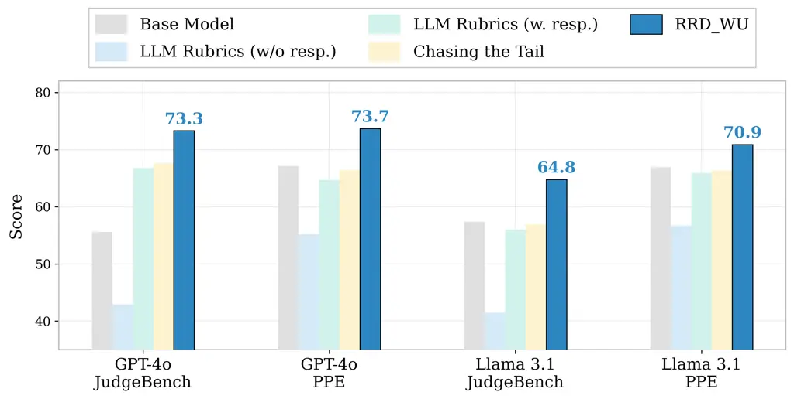
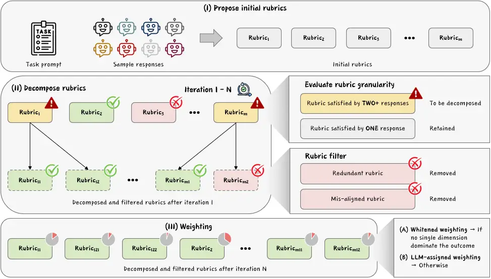
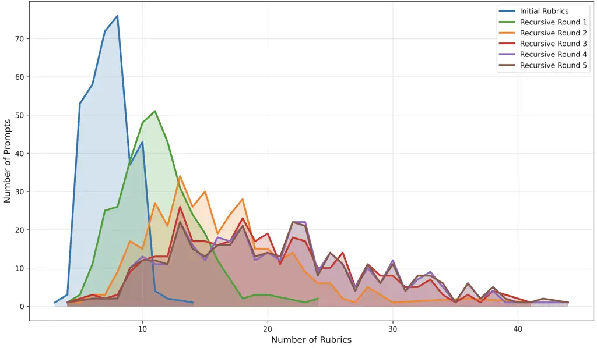
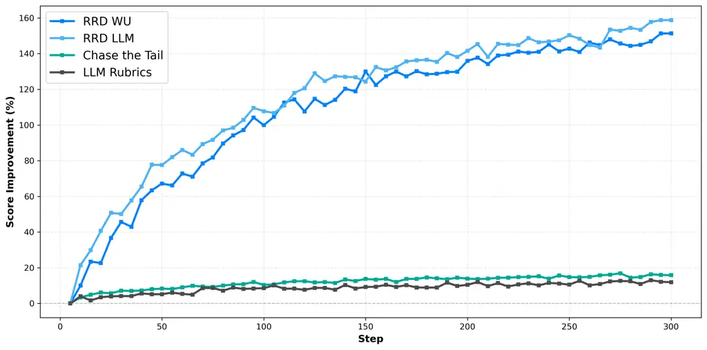
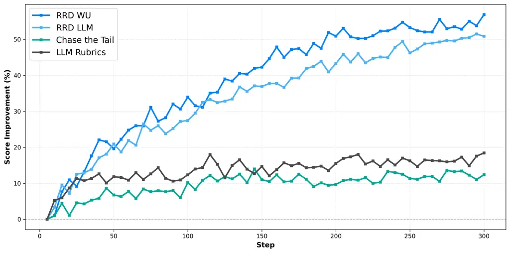
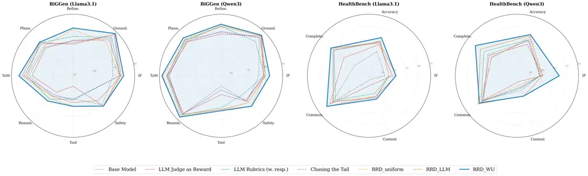

# Rethinking Rubric Generation for Improving LLM Judge and Reward Modeling for Open-ended Tasks

William F. Shen Affiliation: Meta Superintelligence Labs Work done at
Meta    Xinchi Qiu Affiliation: Meta Superintelligence Labs    Chenxi
Whitehouse Affiliation: Meta Superintelligence Labs    Lisa Alazraki
Affiliation: Meta Superintelligence Labs Work done at Meta    Shashwat
Goel Affiliation: Meta Superintelligence Labs Work done at Meta   
Francesco Barbieri Affiliation: Meta Superintelligence Labs    Timon
Willi Affiliation: Meta Superintelligence Labs    Akhil Mathur
Affiliation: Meta Superintelligence Labs    Ilias Leontiadis
Affiliation: Meta Superintelligence Labs

###### Abstract

Recently, rubrics have been used to guide LLM judges in capturing
subjective, nuanced, multi-dimensional human preferences, and have been
extended from evaluation to reward signals for reinforcement fine-tuning
(RFT). However, rubric generation remain hard to control: rubrics often
lack coverage, conflate dimensions, misalign preference direction, and
contain redundant or highly correlated criteria - degrading judge
accuracy and producing suboptimal rewards during RFT. We propose RRD, a
principled framework for rubric refinement built on a recursive
decompose–filter cycle. RRD decomposes coarse rubrics into fine-grained,
discriminative criteria, expanding coverage while sharpening separation
between responses. A complementary filtering mechanism removes
misaligned and redundant rubrics, and a correlation-aware weighting
scheme to prevent over-representing highly correlated criteria, yielding
rubric sets that are informative, comprehensive, and non-redundant.
Empirically, RRD delivers large, consistent gains across both evaluation
and training: it improves preference-judgment accuracy on JudgeBench and
PPE for both GPT-4o and Llama3.1-405B judges, achieving top performance
in all settings with up to $`+17.7`$ points on JudgeBench. When used as
the reward source for RFT on WildChat, it yields substantially stronger
and more stable learning signals, boosting reward by up to $`160\%`$
(Qwen3-4B) and $`60\%`$ (Llama3.1-8B) versus $`\sim`$10–20% for prior
rubric baselines, with gains that transfer to HealthBench-Hard and
BiGGen Bench. Overall, RRD establish recursive rubric refinement as a
scalable and interpretable foundation for LLM judging and reward
modeling in open-ended domains.

^(†)^(†)date: August 24, 2026^(†)^(†)correspondence:
[fs604@cam.ac.uk](mailto:fs604@cam.ac.uk),
[iliasl@meta.com](mailto:iliasl@meta.com)

## 1 Introduction

Large language models (LLMs) are increasingly used as judges (“LLM
judge”) to evaluate open-ended generations (e.g., creative writing,
planning, and roleplay) (Gu et al., 2024). However, because quality in
these settings is subjective and inherently multi-attribute, LLM-based
judging remains brittle: even frontier models can be near chance on
preference benchmarks, and real-world use is further limited by bias,
inconsistency, and limited transparency, especially when evaluation
criteria are implicit or underspecified (Thakur et al., 2024; Tan et
al., 2024; Pezeshkpour and Hruschka, 2023; Saito et al., 2023; Zheng et
al., 2023; Haldar and Hockenmaier, 2025; Kim et al., 2023; Gajcin et
al., 2025).

In parallel, recent work extends Reinforcement Learning from Verifiable
Rewards (RLVR) beyond domains with objectively checkable outcomes (e.g.,
math and coding) to open-ended tasks under non-verifiable rewards (Cui
et al., 2025; Guo et al., 2025; Lambert et al., 2024). A common approach
converts binary correctness into pairwise preferences (Ivison et al.,
2024), but this approach not only inherits the limitations of standard
LLM-judge labeling, but also introduces a key scaling bottleneck:
generating preference supervision that incorporates diverse and robust
criteria matching the complexity of real-world reasoning (Ouyang et al.,
2022; Chen et al., 2024; Singhal et al., 2023; Wang et al., 2024; Ye et
al., 2025).

One promising direction is rubric-based judging, where LLMs generate
explicit, structured rubrics and use them to ground assessments,
improving reliability and interpretability relative to holistic
judgments (Hashemi et al., 2024). These rubric-level signals also
integrate naturally into reinforcement fine-tuning (RFT) as structured
rewards, motivating the Rubrics-as-Rewards paradigm for aligning models
on complex open-ended tasks (Gunjal et al., 2025).



Figure 1: RRD consistently outperforms all baselines on both JudgeBench
and PPE for both proprietary (GPT-4o) and open-weights (Llama3.1-405B)
judges, delivering substantial gains in preference-judgment accuracy.

However, existing rubric generation methods face two key limitations:
(1) coverage deficiency, where the rubric set fails to comprehensively
capture the diverse and nuanced dimensions of generation quality; (2)
noisy evaluation outcomes, where misaligned, overlapping, or highly
correlated rubrics introduce unreliable signals. Consequently,
rubric-based judges often show weak alignment with human preferences,
reducing evaluation accuracy, and when used as rewards for RFT, they
yield only limited improvements in learning preference-aligned behavior
across diverse model outputs. These flaws are severe: we show that
naively generated rubrics degrade GPT-4o’s judgment accuracy from 55.6%
to 42.9% (Figure 1) on JudgeBench (Tan et al., 2024) – 13 points below
using no rubrics at all.

In this work, we propose Recursive Rubric Decomposition (RRD), a
principled framework that improves both the accuracy of rubric-based
judges and their effectiveness as reward models for downstream RFT. RRD
expands coverage by decomposing high-level rubric items—broad criteria
satisfied by many responses—into finer-grained, nuanced subpoints. This
yields more comprehensive and discriminative evaluations, helping LLM
judges better capture subtle yet consequential quality differences when
comparing candidate responses. To complement rubric expansion, we
introduce an aggregation mechanism to mitigate noise by (i) filtering
rubrics that produce misaligned or conflicting signals, and (ii)
removing redundant rubrics while down-weighting highly correlated ones.
The first step guards against criteria that yield grossly incorrect
judgments, while the second prevents overlapping perspectives from being
overrepresented. Together, these components produce more stable and
informative rubric-based assessments.

This process mirrors many real-world evaluations which follow a
structured assessment rather than a single holistic verdict. Consider a
physician diagnosing ambiguous symptoms: they don’t render a holistic
verdict, but forms hypotheses and orders discriminating tests. When a
test result is consistent with multiple conditions, she orders more
specific tests that distinguish between them. For example, a positive
result for “inflammatory markers” doesn’t determine whether the cause is
autoimmune, infectious, or malignant - she must decompose further. The
process terminates when tests discriminate: the remaining diagnosis is
the only one consistent with all evidence. Crucially, she also
recognizes correlated indicators—elevated CRP and ESR both signal
inflammation but shouldn’t be double-counted as independent evidence.
RRD instantiates this diagnostic logic: rubrics satisfied by multiple
responses are insufficiently discriminative and are recursively
decomposed; the process adapts naturally to case complexity, and
correlated criteria are appropriately down-weighted.

We empirical demonstrate the performance of RRD two-fold. We first
evaluate RRD on two widely used preference-judgment benchmarks:
JudgeBench (Tan et al., 2024) and Preference Proxy Evaluation (PPE)
(Frick et al., 2024). Across both GPT-4o and Llama3.1-405B judges, RRD
consistently yields stronger agreement with human pairwise preferences,
improving accuracy over the base judges and prior rubric-based
baselines. In particular, our best variant (RRD $`{}_{\text{WU}}`$)
achieves the top score on all settings achieving up to 17.7% improvement
on JudgeBench for GPT-4o.

In addition, we demonstrate the effectiveness of RRD in RFT by training
open-source policies, Qwen3-4B (Yang et al., 2025) and Llama3.1-8B
(Dubey et al., 2024), with rubric-based judges on WildChat (Zhao et al., 2024) as the reward signal. Compared to prior LLM-judge-based and
rubrics-based reward baselines, RRD yields substantially stronger and
better-calibrated rewards, translating into faster learning and higher
final reward (Figure 4). Concretely, our method boosts reward by up to
160% for Qwen3-4B and 60% for Llama3.1-8B, versus only $`\sim`$10–20%
for LLM Rubrics and Chasing the Tail (Figure 4). These gains also carry
over to downstream evaluations, where the resulting policies
consistently improve on BiGGen Bench (Kim et al., 2024) and
HealthBench-Hard (Arora et al., 2025) for both model families.

Overall, our results show that _recursive rubric decomposition_ (RRD) is
a key enabler of effective rubric-based judging and reward modeling for
open-ended tasks, turning brittle rubrics into reliable signals that
support robust alignment in open-ended language generation.

## 2 RRD Framework

In this section, we first provide an overview of rubric-based judges in
$`\lx@sectionsign`$2.1. We then formalize a theoretical perspective on
rubric quality that motivates our approach. Finally, we present
Recursive Rubric Decomposition (RRD) in $`\lx@sectionsign`$2.3, a
principled framework that builds on this grounding to improve
rubric-based evaluation.

### 2.1 Rubric-based Judge Overview

Let $`\mathcal{P}`$ denote the prompt space and $`\mathcal{R}`$ the
response space. For each $`P\in\mathcal{P}`$, consider a finite
candidate set $`R(P)=\{R_{1},\dots,R_{M}\}\subseteq\mathcal{R}`$. An LLM
judge outputs a preference verdict $`\mathcal{V}`$ over $`R(P)`$.

A _rubric-based_ judge conditions its evaluation on a set of rubric
predicates, evaluated separately. Each rubric is a measurable map
$`g:\mathcal{P}\times\mathcal{R}\to\{0,1\},`$ where $`g(P,R)=1`$
indicates that response $`R`$ satisfies the criterion under prompt
$`P`$. Given a rubric family $`\mathcal{G}=(g_{1},\dots,g_{m})`$ and
nonnegative weights $`\bm{w}=(w_{1},\dots,w_{m})\in\mathbb{R}_{+}^{m}`$,
we define the rubric reward

```math
f_{\bm{w},\mathcal{G}}(P,R)\;:=\;\sum_{k=1}^{m}w_{k}\,g_{k}(P,R)\,. \tag{1}
```

The constraint $`w_{k}\geq 0`$ is without loss of generality: any
negatively polarized rubric can be rewritten as a positive, contrastive
criterion. For two responses $`R_{i},R_{j}\in R(P)`$, the judge prefers
$`R_{i}`$ over $`R_{j}`$, denoted $`R_{i}\succ R_{j}`$, iff
$`f_{\bm{w},\mathcal{G}}(P,R_{i})>f_{\bm{w},\mathcal{G}}(P,R_{j})`$.

### 2.2 Theoretical Grounding for Rubric Quality

Since rubrics directly shape how LLM judges compare responses, and
therefore the reward signals used in RFT, rubric quality is a primary
lever for both judgment accuracy and reward fidelity. Ideally, a rubric
set should be (a) _informative_, with each criterion helping distinguish
preferred from non-preferred responses; (b) _comprehensive_, spanning
the diverse dimensions along which quality varies; and (c)
_non-redundant_, providing complementary signals, since overlapping or
correlated rubrics can distort aggregation. While prior work has made
substantial progress (see §5), achieving the three desiderata
simultaneously remains challenging: expert-authored rubrics are often
precise but can be limited in coverage, whereas LLM-generated rubrics
scale readily but may include criteria that are overly generic,
misaligned or highly correlated. More broadly, a principled theoretical
account of rubric quality – and how to systematically enforce it –
remains underdeveloped.

To bridge this gap and motivate RRD, we first briefly present the
theoretical grounding based on two assumptions: (A1) _positive edge_ and
(A2) _bounded correlation_. We then analyze the judge’s
misclassification probability, whether aggregated rubric verdicts
recover the true preference label, and show that it admits an
exponential upper bound (Eq. 2). Minimizing this bound yields a
principled objective for rubric generation and correlation-aware
weighting, directly operationalizing the three desiderata above.

Assume each rubric $`g_{k}\in\mathcal{G}`$ is weakly informative (a
positive “edge” over random guessing) and its noise (the deviation of
its verdicts from conditional mean given the true label) is sub-Gaussian
with bounded dependence:

- (A1)
  (_Positive edge_) There exist $`\mu_{k}>0`$ such that
  $`\mathbb{E}[\widehat{Y}_{k}\mid Y=+1]=+\mu_{k},\ \mathbb{E}[\widehat{Y}_{k}\mid Y=-1]=-\mu_{k}`$,
  where $`Y\in\{\pm 1\}`$ is the ground-truth preference label,
  $`\widehat{Y}_{k}`$ is the verdict of the $`k^{th}`$ rubric.
- (A2)
  (_Bounded correlation_) Letting $`Z_{k}=\widehat{Y}_{k}-\mu_{k}Y`$,
  the vector $`Z=(Z_{1},\dots,Z_{m})`$ is mean-zero sub-Gaussian with
  covariance $`\Sigma_{y}`$ satisfying
  $`\mathrm{Var}(Z_{k})\leq\sigma_{k}^{2}`$ and
  $`|\mathrm{Corr}(Z_{i},Z_{j})|\leq\rho<1`$ for $`i\neq j`$.

In simple words, (A1) assumes that each rubric, with a positive edge
($`\mu_{k}>0`$), contributes positively toward distinguishing the
preferred response from the inferior one; (A2) assumes that individual
rubric’s noise is bounded and rubrics are not repetitive (bounded
pairwise correlation $`\rho<1`$). Here, the noise
$`Z_{k}=\widehat{Y}_{k}-\mu_{k}Y`$ captures rubric-specific randomness
or systematic mismatch – i.e., the part of a rubric’s verdict not
explained by the true label, arising from ambiguous criteria, imperfect
judge execution, or instance-specific idiosyncrasies. This enables
standard concentration bounds over the aggregated, non-redundant
decisions.

The probability that the rubric-based judge, after aggregating decisions
across all rubric items (Eq.1), produces an incorrect verdict
(misclassification probability) $`\widehat{Y}\neq Y`$ is then upper
bounded by:

```math
\mathbb{P}(\widehat{Y}\neq Y)\ \leq\ \exp\!\Big(-\tfrac{1}{2}\min\{\Delta_{m}^{2}/V_{m}(+1),\,\Delta_{m}^{2}/V_{m}(-1)\}\Big) \tag{2}
```

where $`\Delta_{m}:=\bm{w}^{\top}\bm{\mu}`$ and
$`V_{m}:=\bm{w}^{\top}\bm{\Sigma}\,\bm{w}`$ is the variance proxy of the
weighted residuals (ref. Appendix B.1).

Eq. 2 implies that tightening the misclassification bound amounts to
maximizing
$`\Xi=\frac{(\bm{w}^{\top}\bm{\mu})^{2}}{\bm{w}^{\top}\bm{\Sigma}\bm{w}}`$.
This perspective suggests a high-level prescription:

1.  1.  Decomposition: Decompose broad rubrics into finer dimensions to
        enhance coverage and discrimination.
2.  2.  Positivity: Remove misaligned rubrics to eliminate negative edge and
        maintain constructivity.
3.  3.  Non-redundancy: Prune redundant rubrics to ensure distinct,
        non-overlapping criteria.
4.  4.  Weight Optimization: Prevent over-representation of highly
        correlated rubrics via weight optimization.

In tandem, (1) and (2) expand the rubric set by admitting new criteria
with positive edge ($`\mu_{k}>0`$) to maximize aggregate edge, while (3)
and (4) minimize redundancy and correlation within the denominator.
Together, these yield an exponentially decaying misclassification
probability and formalizes our three desiderata.

### 2.3 Methodology: Recursive Rubric Decomposition (RRD)



Figure 2: Overview of RRD framework: RRD consists of three stages: (I)
Initial Rubric Proposal. LLM proposes initial candidate rubrics
(conditioned on the task prompt and sample responses) for optimization.
(II) Recursive Decomposition and Filtering. Recursively decompose coarse
rubric into finer dimensions to enhance coverage and discrimination,
while filtering misalgined and redundant rubrics. The cycle stops when
the number of discarded rubrics exceeds $`N`$, indicating saturation in
novel, non-redundant, and valid rubrics. (III) Rubric Weight Assignment.
For open-ended tasks where preference signal is distributed, assign
whitened uniform (WU) weights to account for correlation structure and
prevent over-representation of highly correlated rubrics. Otherwise,
assign LLM-proposed heuristic weights. Empirically, WU weighting yields
higher LLM judge accuracy and improves the effectiveness of rubrics as
generative rewards in RFT.

Building on the theoretical insights in §2.2, we optimize Eq.2 through
four pillars: _decomposition_, _positivity_, _non-redundancy_, _weight
optimization_. Now, we introduce _Recursive Rubric Decomposition_ (RRD),
a principled rubric construction framework. The full RRD procedure is
summarized in Figure 2 and Algorithm 1.

RRD consists of three stages. First, we prompt an LLM to propose initial
rubrics conditioned on the task prompt and $`m`$ sample responses (we
set $`m=8`$ in all experiments), yielding candidate rubrics for
optimization.

Second, we start the recursive decomposition and filtering cycle. We
exploit the fact that distinct responses must differ in some respects: a
rubric satisfied by many responses is too broad-brush and insufficiently
discriminative. It can be decomposed into finer sub-dimensions that
capture more nuanced aspects of quality. We operationalize this by
instructing an LLM-based rubric generator to recursively decompose any
rubric that applies to more than $`n`$ rollouts (we use $`n=2`$ in all
experiments, triggering decomposition whenever a rubric matches more
than two candidate responses and leaving minimal room for
under-decomposition). We then apply two filters: (a) misalignment
filtering: which discards rubrics that prefer outputs from a weaker
model (Llama3-8B) over a stronger model (GPT-4o) as a proxy for
incorrect preference direction (more discussion about this in Appendix
C); and (b) LLM-based redundancy filtering, which removes rubrics that
are substantially overlapping with existing ones.

We repeat this decomposition–filtering loop until the proposer struggles
to produce novel, valid, non-redundant items. For efficiency, we use an
early-stopping criterion: if the number of accumulated rejected
proposals exceeds a termination threshold, we stop the loop, since
further iterations are unlikely to yield effective new rubrics. We treat
this termination threshold as a tunable hyperparameter. We use $`15`$ in
all of our experiments below. The resulting rubric set is task-adaptive:
its size emerges from the intrinsic complexity of the prompt rather than
being fixed _a priori_ (More discussion about this in Appendix C).

Finally, optimize weights to prevent over-representation of highly
correlated rubrics. In practice, this is particularly challenging
because the ground-truth preference labels needed to estimate the rubric
edges $`\bm{\mu}`$ are unavailable. Prior work therefore instructs an
LLM to assign rubric weights using a heuristically chosen scale (Gunjal
et al., 2025; Viswanathan et al., 2025; Zhang et al., 2025a). This
strategy is effective only if there exists a clearly _dominant_ rubric
and the LLM can reliably identify it, so that
$`{(\bm{w}^{\top}\bm{\mu})^{2}}`$ dominates the covariance term,
effectively suppressing the impact of rubric correlations. In open-ended
tasks, quality is inherently multi-dimensional, subjective, and nuanced,
so the class-separating signal is often _distributed_ across many
criteria rather than concentrated in single dominant rubric. This helps
explain why existing rubric-based judges remain imperfect in practice,
and why expanding coverage with additional valid rubrics further
disperses the signal.

To sidestep the need for labeled edges, we instead minimize the
misclassification upper bound by _homogenizing signal in a whitened
space_. This is feasible because the second-order redundancy structure
of rubric scores, captured by $`\bm{\Sigma}`$, is an intrinsic property
of the rubric set, not of any particular response pair, and can
therefore be estimated from unlabeled data (ref. Appendix B.2).
Concretely, we choose weights that _whiten_ the rubric space via
$`\Sigma^{-1/2}`$ (i.e., removing correlations while applying equal
weighting in the whitened coordinates). This yields a simple,
label-free, and correlation-aware weighting scheme that stabilizes
aggregation when signals are spread across many rubric dimensions.

## 3 RRD-based LLM Judge Results

In §2, we introduced RRD as a novel and theoretically grounded framework
for rubric generation. In this section, we empirically evaluate the
effectiveness of RRD in improving the accuracy of LLM judges on
open-form pairwise judgment tasks.

#### Dataset.

We evaluate the accuracy of LLM judge using (1) JudgeBench (Tan et al.,
2024), which consists of challenging open-form response pairs spanning
knowledge, reasoning, mathematics, and coding tasks. Following Tan et
al. (2024), we report results on the subset where both responses are
generated by GPT-4o (350 preference pairs), and (2) Preference Proxy
Evaluations (PPE) (Frick et al., 2024), a large-scale benchmark
containing 10.2K human preference pairs from Chatbot Arena covering 20
LLMs across 121+ languages.

#### Baselines.

We compare RRD against the base model (preference labeling without
explicit rubrics) and several rubric-based judge baselines that differ
in their rubric generation strategies. Specifically, we include: (1) LLM
Rubrics (w/o resp.): rubrics are proposed based solely on the prompt;
(2) LLM Rubrics (w. resp.): rubrics are generated with access to sample
responses for better grounding; (3) Chasing the Tail (Zhang et al.,
2025a): a state-of-the-art iterative method that optimizes rubrics to
differentiate high-quality response pairs; and (4) RRD variants: we
evaluate three weighting schemes – $`RRD_{\text{uniform}}`$ (uniform
weights), $`RRD_{\text{LLM}}`$ (LLM-assigned weights), and
$`RRD_{\text{UW}}`$ (whitened weights).

We employ GPT-4o (Hurst et al., 2024) and Llama-3.1-405B (Dubey et al., 2024) as rubric generator and final judge, and consistently use GPT-4o
and Gemini 2.5-pro (Comanici et al., 2025) as sample response generator
(each model generates 4 sample responses).

|                          | GPT-4o     |      | Llama3.1-405B |      |
| ------------------------ | ---------- | ---- | ------------- | ---- |
| Method                   | JudgeBench | PPE  | JudgeBench    | PPE  |
| Base Model               | 55.6       | 67.1 | 57.4          | 66.9 |
| LLM Rubrics (w/o resp.)  | 42.9       | 55.2 | 41.5          | 56.7 |
| LLM Rubrics (w. resp.)   | 66.8       | 64.7 | 56.0          | 65.9 |
| Chasing the Tail         | 67.6       | 66.4 | 56.9          | 66.3 |
| $`RRD_{\text{uniform}}`$ | 70.0       | 71.2 | 61.1          | 68.2 |
| $`RRD_{\text{LLM}}`$     | 72.4       | 72.6 | 63.5          | 69.7 |
| $`RRD_{\text{WU}}`$      | 73.3       | 73.7 | 64.8          | 70.9 |

(a) (a)



(b) (b)

Figure 3: (a) Accuracy on JudgeBench and PPE Preference datasets for
base model and rubric-assisted judges under different rubric-generation
strategies. While basic LLM-generated rubrics (unconditioned on sample
responses) can degrade performance, RRD yields consistent improvements
over the baselines. Notably, $`RRD_{\text{WU}}`$ delivers the largest
gains and scales reliably across both proprietary (GPT-4o) and
open-weights (Llama3.1-405B) judges. (b) Rubric-count dynamics on
JudgeBench. Starting from an average of $`7.4`$ rubrics, the count rises
to $`\sim 20`$, while the increasing variance across tasks indicates
that the recursive procedure adapts evaluation depth to instance
complexity.

### 3.1 Results

We summarize the primary performance results in Figure 3(a) and analyze
the dynamics of the recursive generation process in Figure 3(b).

As shown in Figure 3(a), $`RRD`$ variants consistently outperform
baselines across both models and datasets. On JudgeBench,
$`RRD_{\text{WU}}`$ improves GPT-4o’s accuracy from $`55.6\%`$ to
$`73.3\%`$ ($`+17.7`$ points). Similarly, Llama-3.1-405B sees a $`6.6`$
point boost. This suggests that the recursive discovery of latent
rubrics provides critical signal that the initial rubric sets miss in a
single pass. Interestingly, simple LLM Rubrics (w/o resp.) actually
degrade performance compared to the base model as LLM judge. This
highlights the failure mode where generic rubrics introduce noise or
distract the judge. RRD mitigates this by grounding the rubrics in
recursive residuals, ensuring they capture meaningful differences.
Additionally, whitened weighting ($`RRD_{\text{WU}}`$) consistently
outperforms the uniform and LLM-assigned weighting. This validates our
theoretical framework: for open-ended tasks involving multiple
non-dominating dimensions, accounting for rubric correlation yields a
more robust aggregation of judge “votes” than simple averaging or
LLM-based self-weighting.

Figure 3(b) shows the evolution of rubric counts across recursive rounds
on JudgeBench. Two key phenomena emerge: first, the initial average of
$`7.4`$ rubrics grows rapidly and plateaus at approximately $`20`$ by
iteration 3, suggesting that RRD captures a comprehensive set of
dimensions quickly before reaching a “saturation” point in novelty.
Second, the framework is inherently adaptive, increasing the variance in
rubric counts as it progresses. Consequently, recursion terminates
quickly for simpler tasks but generates deeper criteria for complex
tasks to resolve residual quality differences. A qualitative example of
simpler tasks entailing fewer rubrics are provided in the Appendix G.

#### Ablations.

|                      | Termination Threshold |      |      |      |
| -------------------- | --------------------- | ---- | ---- | ---- |
| Method               | 5                     | 10   | 15   | 20   |
| $`RRD`$              | 68.6                  | 67.4 | 70.0 | 66.3 |
| $`RRD_{\text{LLM}}`$ | 69.7                  | 69.1 | 72.4 | 67.1 |
| $`RRD_{\text{WU}}`$  | 71.4                  | 72.0 | 73.3 | 73.1 |

(a)

|                      |                            |             |          |              |
| -------------------- | -------------------------- | ----------- | -------- | ------------ |
|                      | Sample Responses Generator |             |          |              |
| Method               | GPT+Gemini                 | Gemini Only | GPT Only | GPT+Llama-8B |
| RRD                  | 70.0                       | 66.6        | 57.4     | 54.3         |
| $`RRD_{\text{LLM}}`$ | 72.4                       | 71.0        | 61.4     | 60.0         |
| $`RRD_{\text{WU}}`$  | 73.3                       | 72.4        | 62.3     | 60.3         |

(b)

Table 1: Ablation studies for RRD on JudgeBench with GPT-4o as rubric
proposer. (a) Ablation of the termination threshold (i.e., the number of
rubric proposals rejected due to redundancy or misalignment) for the RRD
process. (b) Ablation of the sample response generation strategy,
comparing (i) a combination of strong frontier models, (ii) a single
strong model, and (iii) a mixture of strong and weaker models as inputs
to the rubric proposer.

To assess the impact of key design choices, we conduct ablation studies
on JudgeBench, focusing on two key components: the termination threshold
for recursion and the choice of sample response generator.

Table 1(a) reports RRD variants under different termination thresholds,
where the recursion stops after a fixed number of rubric proposals are
rejected as redundant or misaligned. We observe that lower thresholds
(e.g., $`5`$ or $`10`$) underperform, likely due to insufficient
exploration of the rubric space. Raising the threshold to $`20`$ yields
a plateau or slight drop for basic RRD and $`RRD_{\text{LLM}}`$,
consistent with diminishing returns and increased noise from correlated
criteria. In contrast, $`RRD_{\text{WU}}`$ is notably robust: accuracy
remains high even at threshold $`20`$, suggesting that whitening-uniform
weighting effectively counteracts correlation-induced noise and
stabilizes performance under deeper rubric exploration.

In Table 1(b), we ablate the sample response generator by comparing
multi-model ensembles with single-model and mixed-capability setups.
Using two strong frontier models (GPT-4o + Gemini 2.5-Pro) performs
best, consistently outperforming single-model baselines. Notably, when
GPT-4o is the rubric proposer, it benefits more from conditioning on
high-quality samples produced by a different frontier model (Gemini)
than on its own outputs, suggesting that exposure to diverse reasoning
styles and perspectives improves rubric generation. Meanwhile, replacing
one frontier model with a smaller model (e.g., Llama3.1-8B) tends to
reduce performance in RRD setting, likely because decomposition benefits
from high-quality samples that reveal when a rubric is overly coarse
(i.e., satisfied by multiple strong responses) and should be refined.

## 4 RRD-based RFT

Previously in §3, we showed that RRD improves the accuracy of LLM judges
on open-ended tasks by producing more comprehensive, discriminative and
fine-grained rubrics. In this section, we ask whether these gains
translate into learning gains when judges are used as generative reward
models for reinforcement fine-tuning (RFT). RFT is the natural stress
test for open-ended judging: even small systematic scoring biases can be
amplified by the optimization loop, shaping model behavior in unintended
ways. A reward model therefore must do more than standalone preference
judges, it must provide stable, informative gradients that consistently
promote the desired trade-offs across diverse prompts. We therefore use
RFT to convert judge quality into an end-to-end signal, evaluating (i)
reward reliability during training, and (ii) downstream performance of
the resulting policies on in- and out-of-domain tasks.

#### Dataset and Training.

We conduct RFT on 4K English, non-toxic, de-duplicated prompts sampled
from WildChat (Zhao et al., 2024), representing natural user–AI
interactions. We employ Dr.GRPO (Liu et al., 2025) as our RFT algorithm
for all settings (see details in Appendix D).

Then after training, to demonstrate the performance of resulting models,
we evaluate the resulting policies on two rubric-based, open-ended
generation benchmarks: BiGGen Bench (Kim et al., 2024) and
HealthBench-Hard (Arora et al., 2025). BiGGen Bench is a free-form
generation benchmark spanning multiple core capabilities, and is
evaluated with instance-specific criteria that capture what a good
answer should contain for each prompt. HealthBench is a domain-specific
benchmark containing 5K multi-turn clinical dialogues, scored using
conversation-specific rubrics authored by physician experts, with
importance-weighted criteria to reflect clinical priorities; the Hard
split is designed to remain challenging and unsaturated.

We choose these two benchmarks because they provide complementary
coverage of (i) in-distribution general assistant behavior and (ii)
out-of-domain, high-stakes generalization. BiGGen Bench is closer to our
training distribution (WildChat): both emphasize broad, real-world,
open-ended assistant tasks, making BiGGen a natural test of whether RFT
improves general helpfulness and capability across the kinds of prompts
seen in the wild. In contrast, HealthBench-Hard focuses on clinical
multi-turn dialogue with physician-defined notions of correctness,
safety, and communication. It is substantially more domain-specific than
open-domain chat, thereby stress-testing whether the learned policy
maintain reliability in a high-stakes setting.

We report the macro-average score, computed as the mean of per-example
rubric scores
$`s_{i}=\frac{\texttt{total\_awarded}_{i}}{\texttt{total\_possible}_{i}}`$
(converted to a percentage), so that each dialogue/prompt contributes
equally regardless of how many rubric criteria it contains. For
HealthBench, we additionally clip the macro-average to $`[0,100]`$ after
averaging, following the benchmark’s recommended presentation to prevent
rare negative-penalty cases from overly skewing the headline score.

#### Models

We fine-tune Qwen3-4B (Yang et al., 2025) and Llama3.1-8B (Dubey et al., 2024) as policy models. GPT-4o serves as the rubric proposer and
GPT-OSS-120B (Agarwal et al., 2025) determines rubric satisfaction for
rollout responses (or give direct preference judgment in “LLM judge as
reward” baseline) during RFT.

### 4.1 Results





Figure 4: Reward improvement during training of Qwen3-4B (left) and
Llama3.1-8B-instruct (right) models using various rubric generation
methods. Both $`RRD_{\text{WU}}`$ and $`RRD_{\text{LLM}}`$ provide a
significantly stronger reward signal than traditional rubric-based or
iterative baselines. $`RRD_{\text{WU}}`$, in particular, shows superior
training stability and higher cumulative reward gains across both
architectures, indicating a more robust and granular supervision signal
for RFT.



Figure 5: Multi-dimensional evaluation (scores in percentage) on BiGGen
Bench (left) and HealthBench-Hard (right). Comparison of
$`\text{RRD}_{\text{WU}}`$ against five baseline methods using Llama-3.1
and Qwen3 base models. $`\text{RRD}_{\text{WU}}`$ (solid red)
demonstrates robust improvements across all axes, particularly in
Instruction Following (IF) and Completeness.

#### Reward Dynamics during Training.

Figure 4 shows reward improvement during RFT for Qwen3-4B (left) and
Llama3.1-8B-Instruct (right) under different rubric-generation
strategies. Across both models, RRD produces a substantially stronger
learning signal: rewards climb rapidly in the first $`\sim`$50–100 steps
and continue improving throughout training, while prior baselines
plateau early at low gains. Concretely, on Qwen3-4B,
$`RRD_{\mathrm{WU}}`$ reaches roughly 150–160% reward improvement by the
end of training, compared to only $`\sim`$10–20% for LLM Rubrics and
Chasing the Tail; on Llama3.1-8B-Instruct, it attains about 55–60%
versus $`\sim`$10–20% for baselines. Both RRD variants outperform
alternatives, with $`RRD_{\mathrm{WU}}`$ also showing the smoothest,
most stable curves. Overall, the large absolute gaps (often
$`\geq`$3–10$`\times`$ higher improvements) indicate that RRD yields
more discriminative and better-calibrated rewards, enabling sustained
optimization rather than early saturation on open-ended tasks.

#### Policy Performance on BiGGen Bench.

The superior reward signal provided by RRD translates into
state-of-the-art performance for the resulting policies across diverse
generation capabilities, as shown in the radar chart (Figure 5) with
more details breakdown in Table 3 (Appendix E). For both Qwen3-4B and
Llama3.1-8B backbones, $`RRD_{\text{WU}}`$ achieves the highest overall
scores of $`82.8\%`$ and $`71.1\%`$, respectively. The method is
particularly effective at improving instruction following (IF),
refinement, and reasoning, all while maintaining robust performance on
safety axes.

#### Generalization to High-Stakes Domains.

The performance is further confirmed by looking at the evaluation on the
HealthBench dataset as shown in the same radar chart (Fig. 5) with more
details breakdown in Table 4 (Appendix E) too. These results confirm
that the benefits of RRD transfer effectively to high-stakes,
domain-specific tasks, such as the medical field. On HealthBench-Hard,
$`RRD_{\text{WU}}`$ consistently yields the best policy performance,
particularly in IF, accuracy, and completeness ($`+16.0\%`$, $`+5.5\%`$,
and $`+12.5\%`$ points respectively on the Qwen3-4B backbone). These
results underscore the framework’s ability to provide granular
supervision that aligns with complex, physician-authored evaluation
criteria.

## 5 Related Works

#### LLM-as-a-Judge.

Early work has shown that holistic judges, those producing a single
verdict, can approximate human preferences with reasonable correlation
(Zheng et al., 2023; Liu et al., 2023; Dubois et al., 2024; Wang et al.,
2023; Bavaresco et al., 2025). However, such approaches suffer from bias
(Pezeshkpour and Hruschka, 2023; Saito et al., 2023), inconsistency
(Zheng et al., 2023; Haldar and Hockenmaier, 2025), and opacity (Kim et
al., 2023; Gajcin et al., 2025), especially given the subjective,
nuanced, and multidimensional nature of open-ended evaluation (Thakur et
al., 2024). To address these limitations, recent work has shifted toward
rubric-assisted judges (Kim et al., 2023; Hashemi et al., 2024; Kim,
2025; Arora et al., 2025), though many rely on static or heuristic
rubrics that either lack scalability or prompt-specific nuance. In
contrast, we propose a dynamic approach that recursively decomposes
evaluation criteria to ensure both broad coverage and discriminative
power.

#### Rubrics-based Rewards

The use of structured rubrics has recently expanded beyond evaluation to
serve as reward signals for training (Gunjal et al., 2025). To improve
rubric quality, Xie et al. (2025) introduce a Propose–Evaluate–Revise
paradigm, while Zhang et al. (2025a) optimize rubrics by maximizing
score differentials between high-quality responses. Domain-specific
approaches, such as Wang et al. (2025), condition rubric generation on
prompt context and retrieved exemplars, producing both positive and
negative criteria. Other works leverage rubrics as priors for data
generation or policy learning (Huang et al., 2025; Zhou et al., 2025),
or explore online rubric generation (Rezaei et al., 2025). RRD differs
from prior work by introducing explicit mechanisms that enforce rubric
_informativeness_, _comprehensiveness_, and _non-redundancy_ in
LLM-generated criteria, and demonstrates its effectiveness as a source
of high-quality RFT reward signals.

#### Reinforcement Fine-Tuning (RFT) for Open-Ended Tasks.

Reinforcement Learning from Verifiable Rewards (RLVR) has shown immense
success in domains with objective ground truth, such as mathematics and
coding, exemplified by models like DeepSeek-R1 and architectures
utilizing process rewards (Guo et al., 2025; Su et al., 2025; Wen et
al., 2025). Extending this success to open-ended tasks (e.g., creative
writing, brainstorming) remains an open challenge due to the lack of
ground-truth verifiers (Zhang et al., 2025b; Simonds et al., 2025).
Recent works have attempted to bridge this gap by using LLM judges as
proxy reward models for algorithms like GRPO. Our work contributes to
this frontier by providing a “Generative Verifier” via RRD that offers
the granularity and reliability required to stabilize RFT in subjective
and open-ended domains.

## 6 Conclusion

In this work, we introduced Recursive Rubric Decomposition (RRD), a
principled framework for generating informative, comprehensive and
non-redundant rubrics for rubric-based LLM judges and reward modeling
for open-ended tasks. RRD operates by recursively decomposing high-level
evaluation criteria into granular, discriminative rubrics, filtering for
positive edge and non-redundancy to ensure reliability while optimizing
weights to account for correlation structures and prevent the
over-representation of highly correlated metrics. Empirically, we
demonstrate that RRD significantly improves the accuracy of LLM judges
in a training-free setting, and establishes its effectiveness as a
high-fidelity reward model for RFT. Policies trained with RRD-derived
rewards exhibit stronger alignment with human preferences on complex,
open-ended generation tasks. These results highlight the importance of
structured, granular, and statistically grounded rubric generation as a
critical pathway toward scalable, interpretable, and reliable alignment
for the next generation of LLMs.

## References

- Agarwal et al. (2025) S. Agarwal, L. Ahmad, J. Ai, S. Altman, A.
  Applebaum, E. Arbus, R. K. Arora, Y. Bai, B. Baker, H. Bao, et al.
  Gpt-oss-120b & gpt-oss-20b model card. arXiv preprint
  arXiv:2508.10925. Cited by: Table 2, §4.
- Arora et al. (2025) R. K. Arora, J. Wei, R. S. Hicks, P. Bowman, J.
  Quiñonero-Candela, F. Tsimpourlas, M. Sharman, M. Shah, A. Vallone, A.
  Beutel, et al. Healthbench: evaluating large language models towards
  improved human health. arXiv preprint arXiv:2505.08775. Cited by: §1,
  §4, §5.
- Bai et al. (2022) Y. Bai, S. Kadavath, S. Kundu, A. Askell, J.
  Kernion, A. Jones, A. Chen, A. Goldie, A. Mirhoseini, C. McKinnon, et
  al. Constitutional ai: harmlessness from ai feedback. arXiv preprint
  arXiv:2212.08073. Cited by: Appendix C.
- Bavaresco et al. (2025) A. Bavaresco, R. Bernardi, L. Bertolazzi, D.
  Elliott, R. Fernández, A. Gatt, E. Ghaleb, M. Giulianelli, M.
  Hanna, A. Koller, et al. Llms instead of human judges? a large scale
  empirical study across 20 nlp evaluation tasks. In Proceedings of the
  63rd Annual Meeting of the Association for Computational Linguistics
  (Volume 2: Short Papers), pp. 238–255. Cited by: §5.
- Chen et al. (2024) L. Chen, C. Zhu, D. Soselia, J. Chen, T. Zhou, T.
  Goldstein, H. Huang, M. Shoeybi, and B. Catanzaro Odin: disentangled
  reward mitigates hacking in rlhf. arXiv preprint arXiv:2402.07319.
  Cited by: §1.
- Comanici et al. (2025) G. Comanici, E. Bieber, M. Schaekermann, I.
  Pasupat, N. Sachdeva, I. Dhillon, M. Blistein, O. Ram, D. Zhang, E.
  Rosen, et al. Gemini 2.5: pushing the frontier with advanced
  reasoning, multimodality, long context, and next generation agentic
  capabilities. arXiv preprint arXiv:2507.06261. Cited by: §3.
- Cui et al. (2025) G. Cui, L. Yuan, Z. Wang, H. Wang, Y. Zhang, J.
  Chen, W. Li, B. He, Y. Fan, T. Yu, et al. Process reinforcement
  through implicit rewards. arXiv preprint arXiv:2502.01456. Cited by:
  §1.
- Dubey et al. (2024) A. Dubey, A. Jauhri, A. Pandey, A. Kadian, A.
  Al-Dahle, A. Letman, A. Mathur, A. Schelten, A. Yang, A. Fan, et al.
  The llama 3 herd of models. arXiv e-prints, pp. arXiv–2407. Cited by:
  §1, §3, §4.
- Dubois et al. (2024) Y. Dubois, B. Galambosi, P. Liang, and T. B.
  Hashimoto Length-controlled alpacaeval: a simple way to debias
  automatic evaluators. arXiv preprint arXiv:2404.04475. Cited by: §5.
- Frick et al. (2024) E. Frick, T. Li, C. Chen, W. Chiang, A. N.
  Angelopoulos, J. Jiao, B. Zhu, J. E. Gonzalez, and I. Stoica How to
  evaluate reward models for rlhf. arXiv preprint arXiv:2410.14872.
  Cited by: §1, §3.
- Gajcin et al. (2025) J. Gajcin, E. Miehling, R. Nair, E. Daly, R.
  Marinescu, and S. Tirupathi Interpreting llm-as-a-judge policies via
  verifiable global explanations. arXiv preprint arXiv:2510.08120. Cited
  by: §1, §5.
- Gu et al. (2024) J. Gu, X. Jiang, Z. Shi, H. Tan, X. Zhai, C. Xu, W.
  Li, Y. Shen, S. Ma, H. Liu, et al. A survey on llm-as-a-judge. arXiv
  preprint arXiv:2411.15594. Cited by: §1.
- Gunjal et al. (2025) A. Gunjal, A. Wang, E. Lau, V. Nath, Y. He, B.
  Liu, and S. Hendryx Rubrics as rewards: reinforcement learning beyond
  verifiable domains. arXiv preprint arXiv:2507.17746. Cited by: §1,
  §2.3, §5.
- Guo et al. (2025) D. Guo, D. Yang, H. Zhang, J. Song, R. Zhang, R.
  Xu, Q. Zhu, S. Ma, P. Wang, X. Bi, et al. Deepseek-r1: incentivizing
  reasoning capability in llms via reinforcement learning. arXiv
  preprint arXiv:2501.12948. Cited by: §1, §5.
- Haldar and Hockenmaier (2025) R. Haldar and J. Hockenmaier Rating
  roulette: self-inconsistency in llm-as-a-judge frameworks. In Findings
  of the Association for Computational Linguistics: EMNLP 2025,
  pp. 24986–25004. Cited by: §1, §5.
- Hashemi et al. (2024) H. Hashemi, J. Eisner, C. Rosset, B. Van Durme,
  and C. Kedzie LLM-rubric: a multidimensional, calibrated approach to
  automated evaluation of natural language texts. arXiv preprint
  arXiv:2501.00274. Cited by: §1, §5.
- Huang et al. (2025) Z. Huang, Y. Zhuang, G. Lu, Z. Qin, H. Xu, T.
  Zhao, R. Peng, J. Hu, Z. Shen, X. Hu, et al. Reinforcement learning
  with rubric anchors. arXiv preprint arXiv:2508.12790. Cited by: §5.
- Hurst et al. (2024) A. Hurst, A. Lerer, A. P. Goucher, A. Perelman, A.
  Ramesh, A. Clark, A. Ostrow, A. Welihinda, A. Hayes, A. Radford, et
  al. Gpt-4o system card. arXiv preprint arXiv:2410.21276. Cited by: §3.
- Ivison et al. (2024) H. Ivison, Y. Wang, J. Liu, Z. Wu, V. Pyatkin, N.
  Lambert, N. A. Smith, Y. Choi, and H. Hajishirzi Unpacking dpo and
  ppo: disentangling best practices for learning from preference
  feedback. In Advances in Neural Information Processing Systems, Cited
  by: §1.
- Kim (2025) A. Kim RUBRIC-mqm: span-level llm-as-judge in machine
  translation for high-end models. In Proceedings of the 63rd Annual
  Meeting of the Association for Computational Linguistics (Volume 6:
  Industry Track), pp. 147–165. Cited by: §5.
- Kim et al. (2023) S. Kim, J. Shin, Y. Cho, J. Jang, S. Longpre, H.
  Lee, S. Yun, S. Shin, S. Kim, J. Thorne, et al. Prometheus: inducing
  fine-grained evaluation capability in language models. In The Twelfth
  International Conference on Learning Representations, Cited by: §1,
  §5.
- Kim et al. (2024) S. Kim, J. Suk, J. Y. Cho, S. Longpre, C. Kim, D.
  Yoon, G. Son, Y. Cho, S. Shafayat, J. Baek, S. H. Park, H. Hwang, J.
  Jo, H. Cho, H. Shin, S. Lee, H. Oh, N. Lee, N. Ho, S. J. Joo, M.
  Ko, Y. Lee, H. Chae, J. Shin, J. Jang, S. Ye, B. Y. Lin, S.
  Welleck, G. Neubig, M. Lee, K. Lee, and M. Seo The biggen bench: a
  principled benchmark for fine-grained evaluation of language models
  with language models. External Links: 2406.05761,
  [Link](https://arxiv.org/abs/2406.05761) Cited by: §1, §4.
- Lambert et al. (2024) N. Lambert, J. Morrison, V. Pyatkin, S.
  Huang, H. Ivison, F. Brahman, L. J. V. Miranda, A. Liu, N. Dziri, S.
  Lyu, et al. Tulu 3: pushing frontiers in open language model
  post-training. arXiv preprint arXiv:2411.15124. Cited by: §1.
- Lee et al. (2023) H. Lee, S. Phatale, H. Mansoor, T. Mesnard, J.
  Ferret, K. Lu, C. Bishop, E. Hall, V. Carbune, A. Rastogi, et al.
  Rlaif vs. rlhf: scaling reinforcement learning from human feedback
  with ai feedback. arXiv preprint arXiv:2309.00267. Cited by: Appendix
  C.
- Liu et al. (2023) Y. Liu, D. Iter, Y. Xu, S. Wang, R. Xu, and C. Zhu
  G-eval: nlg evaluation using gpt-4 with better human alignment. arXiv
  preprint arXiv:2303.16634. Cited by: Appendix C, §5.
- Liu et al. (2025) Z. Liu, C. Chen, W. Li, P. Qi, T. Pang, C. Du, W. S.
  Lee, and M. Lin Understanding r1-zero-like training: a critical
  perspective. arXiv preprint arXiv:2503.20783. Cited by: Appendix D,
  §4.
- Loshchilov and Hutter (2017) I. Loshchilov and F. Hutter Decoupled
  weight decay regularization. arXiv preprint arXiv:1711.05101. Cited
  by: Table 2.
- Ouyang et al. (2022) L. Ouyang, J. Wu, X. Jiang, D. Almeida, C.
  Wainwright, P. Mishkin, C. Zhang, S. Agarwal, K. Slama, A. Ray, et al.
  Training language models to follow instructions with human feedback.
  Advances in neural information processing systems 35, pp. 27730–27744.
  Cited by: §1.
- Pezeshkpour and Hruschka (2023) P. Pezeshkpour and E. Hruschka Large
  language models sensitivity to the order of options in multiple-choice
  questions. arXiv preprint arXiv:2308.11483. Cited by: §1, §5.
- Rajbhandari et al. (2020) S. Rajbhandari, J. Rasley, O. Ruwase, and Y.
  He Zero: memory optimizations toward training trillion parameter
  models. In SC20: International Conference for High Performance
  Computing, Networking, Storage and Analysis, pp. 1–16. Cited by: Table 2.
- Rezaei et al. (2025) M. Rezaei, R. Vacareanu, Z. Wang, C. Wang, Y. He,
  and A. F. Akyürek Online rubrics elicitation from pairwise
  comparisons. arXiv preprint arXiv:2510.07284. Cited by: §5.
- Saito et al. (2023) K. Saito, A. Wachi, K. Wataoka, and Y. Akimoto
  Verbosity bias in preference labeling by large language models. arXiv
  preprint arXiv:2310.10076. Cited by: §1, §5.
- Schulman et al. (2017) J. Schulman, F. Wolski, P. Dhariwal, A.
  Radford, and O. Klimov Proximal policy optimization algorithms. arXiv
  preprint arXiv:1707.06347. Cited by: Appendix D.
- Shao et al. (2024) Z. Shao, P. Wang, Q. Zhu, R. Xu, J. Song, X. Bi, H.
  Zhang, M. Zhang, Y. Li, Y. Wu, et al. Deepseekmath: pushing the limits
  of mathematical reasoning in open language models. arXiv preprint
  arXiv:2402.03300. Cited by: Appendix D.
- Sheng et al. (2025) G. Sheng, C. Zhang, Z. Ye, X. Wu, W. Zhang, R.
  Zhang, Y. Peng, H. Lin, and C. Wu Hybridflow: a flexible and efficient
  rlhf framework. In Proceedings of the Twentieth European Conference on
  Computer Systems, pp. 1279–1297. Cited by: Table 2, Table 2.
- Simonds et al. (2025) T. Simonds, K. Lopez, A. Yoshiyama, and D.
  Garmier Self rewarding self improving. arXiv preprint
  arXiv:2505.08827. Cited by: §5.
- Singhal et al. (2023) P. Singhal, T. Goyal, J. Xu, and G. Durrett A
  long way to go: investigating length correlations in rlhf. arXiv
  preprint arXiv:2310.03716. Cited by: §1.
- Su et al. (2025) Y. Su, D. Yu, L. Song, J. Li, H. Mi, Z. Tu, M. Zhang,
  and D. Yu Crossing the reward bridge: expanding rl with verifiable
  rewards across diverse domains. arXiv preprint arXiv:2503.23829. Cited
  by: §5.
- Tan et al. (2024) S. Tan, S. Zhuang, K. Montgomery, W. Y. Tang, A.
  Cuadron, C. Wang, R. A. Popa, and I. Stoica Judgebench: a benchmark
  for evaluating llm-based judges. arXiv preprint arXiv:2410.12784.
  Cited by: §1, §1, §1, §3.
- Thakur et al. (2024) A. S. Thakur, K. Choudhary, V. S. Ramayapally, S.
  Vaidyanathan, and D. Hupkes Judging the judges: evaluating alignment
  and vulnerabilities in llms-as-judges. arXiv preprint
  arXiv:2406.12624. Cited by: §1, §5.
- Viswanathan et al. (2025) V. Viswanathan, Y. Sun, S. Ma, X. Kong, M.
  Cao, G. Neubig, and T. Wu Checklists are better than reward models for
  aligning language models. arXiv preprint arXiv:2507.18624. Cited by:
  §2.3.
- Wang et al. (2024) H. Wang, Y. Lin, W. Xiong, R. Yang, S. Diao, S.
  Qiu, H. Zhao, and T. Zhang Arithmetic control of llms for diverse user
  preferences: directional preference alignment with multi-objective
  rewards. arXiv preprint arXiv:2402.18571. Cited by: §1.
- Wang et al. (2025) P. Wang, Q. Zuo, P. Liu, Z. Sang, C. Xie, and H.
  Yang InfiMed-orbit: aligning llms on open-ended complex tasks via
  rubric-based incremental training. arXiv preprint arXiv:2510.15859.
  Cited by: §5.
- Wang et al. (2023) Y. Wang, Z. Yu, Z. Zeng, L. Yang, C. Wang, H.
  Chen, C. Jiang, R. Xie, J. Wang, X. Xie, et al. Pandalm: an automatic
  evaluation benchmark for llm instruction tuning optimization. arXiv
  preprint arXiv:2306.05087. Cited by: §5.
- Wen et al. (2025) X. Wen, Z. Liu, S. Zheng, S. Ye, Z. Wu, Y. Wang, Z.
  Xu, X. Liang, J. Li, Z. Miao, et al. Reinforcement learning with
  verifiable rewards implicitly incentivizes correct reasoning in base
  llms. arXiv preprint arXiv:2506.14245. Cited by: §5.
- Xie et al. (2025) L. Xie, S. Huang, Z. Zhang, A. Zou, Y. Zhai, D.
  Ren, K. Zhang, H. Hu, B. Liu, H. Chen, et al. Auto-rubric: learning to
  extract generalizable criteria for reward modeling. arXiv preprint
  arXiv:2510.17314. Cited by: §5.
- Yang et al. (2025) A. Yang, A. Li, B. Yang, B. Zhang, B. Hui, B.
  Zheng, B. Yu, C. Gao, C. Huang, C. Lv, et al. Qwen3 technical report.
  arXiv preprint arXiv:2505.09388. Cited by: §1, §4.
- Ye et al. (2025) Z. Ye, F. D. Greenlee, M. Bartolo, P. Blunsom, J. A.
  Campos, and M. Gallé Improving reward models with synthetic critiques.
  In Findings of the Association for Computational Linguistics: NAACL
  2025, pp. 4506–4520. Cited by: §1.
- Zhang et al. (2025a) J. Zhang, Z. Wang, L. Gui, S. M. Sathyendra, J.
  Jeong, V. Veitch, W. Wang, Y. He, B. Liu, and L. Jin Chasing the tail:
  effective rubric-based reward modeling for large language model
  post-training. arXiv preprint arXiv:2509.21500. Cited by: §2.3, §3,
  §5.
- Zhang et al. (2025b) M. Zhang, X. Liu, S. Ding, W. Yin, Y. Sun, H.
  Wu, W. Guo, and Y. Zhang Auditable-choice reframing unlocks rl-based
  verification for open-ended tasks. arXiv preprint arXiv:2511.02463.
  Cited by: §5.
- Zhao et al. (2024) W. Zhao, X. Ren, J. Hessel, C. Cardie, Y. Choi,
  and Y. Deng Wildchat: 1m chatgpt interaction logs in the wild. arXiv
  preprint arXiv:2405.01470. Cited by: §1, §4.
- Zheng et al. (2023) L. Zheng, W. Chiang, Y. Sheng, S. Zhuang, Z.
  Wu, Y. Zhuang, Z. Lin, Z. Li, D. Li, E. Xing, et al. Judging
  llm-as-a-judge with mt-bench and chatbot arena. Advances in neural
  information processing systems 36, pp. 46595–46623. Cited by: Appendix
  C, §1, §5.
- Zhou et al. (2025) Y. Zhou, S. Li, S. Liu, W. Fang, K. Zhang, J.
  Zhao, J. Yang, Y. Zhou, J. Lv, T. Zheng, et al. Breaking the
  exploration bottleneck: rubric-scaffolded reinforcement learning for
  general llm reasoning. arXiv preprint arXiv:2508.16949. Cited by: §5.

## Appendix

## Appendix A Algorithm

Require: Let $`\mathcal{P}`$ be the prompt set;
$`\{R_{i}\}_{i=1}^{n}\in\mathcal{R}`$ be sampled responses for each
prompt $`P\in\mathcal{P}`$; $`\Psi`$ be the LLM-based rubric proposer.

Procedure:

for each $`P\in\mathcal{P}`$: do

  Let $`\Psi`$ generate an initial rubric list
$`\mathcal{G}_{0}=\Psi(P,\{R_{i}\}_{i=1}^{n})`$,

  Initialize $`\mathcal{G}_{\text{final}}\leftarrow\mathcal{G}_{0}`$,
iteration counter
$`t\leftarrow 0,|\mathcal{G}_{\text{filtered}}|\leftarrow 0`$

  while $`|\mathcal{G}_{\text{filtered}}|<N`$ do

   $`t\leftarrow t+1`$

   for each rubric $`g_{m}\in\mathcal{G}_{t-1}`$ do Step 1: Rubric
Evaluation

     $`\mathcal{R}_{m}\leftarrow\{\,R_{i}\in\{R_{i}\}_{i=1}^{n}:g_{m}(P,R_{i})=1\,\}`$

     if $`|\mathcal{R}_{m}|\geq n`$ then Step 2: Rubric Decomposition

      $`\mathcal{G}^{\text{new}}_{m}\leftarrow\Psi(g_{m},\mathcal{R}_{m})`$

      $`\mathcal{G}_{t-1}\leftarrow\mathcal{G}_{t-1}\cup\mathcal{G}^{\text{new}}_{m}`$

        

   $`\mathcal{G}_{t}\leftarrow\{\,m\in\mathcal{G}_{t-1}\mid\nexists\,m^{\prime}\neq m:\ \mathrm{conflict}(m,)\vee\mathrm{overlap}(m,m^{\prime})\,\}`$
Step 3: Rubric Filter

   $`\mathcal{G}_{\text{final}}\leftarrow\mathcal{G}_{t}`$   

return $`\mathcal{G}_{\text{final}}`$

Algorithm 1 RRD: Recursive Rubric Decomposition

## Appendix B Additional Notes on Derivations and Proofs

### B.1 Probability Upper Bound for Incorrect Rubric-based Judge Verdict (Eq.2)

Derivation. Condition on the class $`Y=y`$, an error is
$`\{\widehat{Y}\neq Y\}\iff\{\Gamma\leq 0\}`$. Let
$`W_{y}=\mathbf{w}^{\top}Z`$,

```math
\Pr(\Gamma\leq 0\mid Y=y)=\Pr(W_{y}\leq-\Delta_{m}\mid Y=y).
```

For a sub-Gaussian, it is trivial to show that

```math
\Pr(X\leq-a)=\Pr(e^{-\lambda X}\geq e^{\lambda a})\leq\mathbb{E}[e^{-\lambda X}]e^{-\lambda a}\leq\exp(\tfrac{\lambda^{2}\sigma^{2}}{2}-\lambda a).
```

For $`\lambda>0`$,

```math
\Pr(X\leq-a)\ \leq\ \exp\!\Big(-\frac{a^{2}}{2\sigma^{2}}\Big).
```

Substitute $`a`$ with $`\Delta_{m}`$ and $`\sigma^{2}`$ with
$`=V_{m}(y)`$,

```math
\Pr(\Gamma\leq 0\mid Y=y)=\Pr(W_{y}\leq-\Delta_{m}\mid Y=y)\leq\exp\!\Big(-\frac{\Delta_{m}^{2}}{2V_{m}(y)}\Big),
```

Therefore, by the law of total probability,

```math
\Pr(\widehat{Y}\neq Y)=\pi_{+}\Pr(\Gamma\leq 0\mid Y=+1)+\pi_{-}\Pr(\Gamma\geq 0\mid Y=-1),
```

Hence,

```math
\displaystyle\Pr(\widehat{Y}\neq Y) \displaystyle\ \leq\ \pi_{+}\,e^{-\Delta_{m}^{2}/(2V_{m}(+1))}\ +\ \pi_{-}\,e^{-\Delta_{m}^{2}/(2V_{m}(-1))}
```

```math
\displaystyle\ \leq\ \max\!\Big\{e^{-\Delta_{m}^{2}/(2V_{m}(+1))},\ e^{-\Delta_{m}^{2}/(2V_{m}(-1))}\Big\}
```

```math
\displaystyle\ \leq\ \exp\!\big(-\min\{\Delta_{m}^{2}/(2V_{m}(+1)),\,\Delta_{m}^{2}/(2V_{m}(-1))\}\big),
```

Now, we complete the derivation for Eq.2.

Note. As a side note following Eq.2, the motivation for expanding the
set of rubrics with positive information edge is clearer under the
idealized case where the rubrics are equicorrelated, equal-variance,
equal-weight.

Recall
$`V_{m}(Y)=\operatorname{Var}\!\left(\sum_{k=1}^{m}w_{k}Z_{k}\,\middle|\,Y\right)`$.
With $`w_{k}=1`$,

```math
\displaystyle V_{m}(Y) \displaystyle=\operatorname{Var}\!\Big(\sum_{k=1}^{m}Z_{k}\,\Big|\,Y\Big)
```

```math
\displaystyle=\sum_{k=1}^{m}\operatorname{Var}(Z_{k}\mid Y)\;+\;2\sum_{1\leq i<j\leq m}\operatorname{Cov}(Z_{i},Z_{j}\mid Y).
```

Plugging in the equicorrelation/equal-variance values:

```math
\displaystyle\sum_{k=1}^{m}\operatorname{Var}(Z_{k}\mid Y) \displaystyle=m\,\sigma^{2},
```

```math
\displaystyle\operatorname{Cov}(Z_{i},Z_{j}\mid Y) \displaystyle=\rho\,\sigma^{2}\ \ (i\neq j).
```

There are $`\binom{m}{2}=\frac{m(m-1)}{2}`$ distinct pairs, so

```math
\displaystyle V_{m}(Y) \displaystyle=m\,\sigma^{2}\;+\;2\cdot\frac{m(m-1)}{2}\,\rho\,\sigma^{2}
```

```math
\displaystyle=\sigma^{2}\big[m+(m^{2}-m)\rho\big].
```

Under the symmetric assumptions of the corollary, this does not depend
on $`Y=+1`$ or $`Y=-1`$, so we simply write

```math
V_{m}\;=\;\sigma^{2}\big[m+(m^{2}-m)\rho\big].
```

As such, with the idealized assumptions of $`w_{k}\equiv 1`$,
$`\mu_{k}\equiv\mu>0`$, $`\mathrm{Var}(S_{k}\mid Y)=\sigma^{2}`$, and
$`\mathrm{Corr}(S_{i},S_{j}\mid Y)=\rho`$ ($`i\neq j`$),

```math
\mathbb{P}(\widehat{Y}\neq Y)\ \leq\ \exp\!\left(-\frac{m\,\mu^{2}}{2\,\sigma^{2}\,[1+(m-1)\rho]}\right).
```

Following this, it becomes obvious that when rubrics are uncorrelated
(i.e., $`\rho`$ = 0), the prediction error can be consistently reduced
by consistently expanding the rubric pool, provided that each added
rubric contributes a positive information edge (i.e., its prediction
direction aligns with human preference). This supports the recursive
process to encourage more extensive rubric search for broader coverage.
In practice, however, rubrics are neither independent nor
equicorrelated. When the exact information edge $`\mu`$ is unobservable
and individual evaluation dimensions carry comparable importance (i.e.,
no single criterion dominating the overall judgment as often the case
for open-ended tasks), the aggregation of extended rubric set must
explicitly account for the rubric correlation structure. This motivates
incorporating correlation-aware normalization via an effective weighting
scheme, which we introduce below.

### B.2 Rubric Weighting in Whitened Space

Define the ratio to be optimized as:

```math
\Xi={(\bm{w}^{\top}\bm{\mu})^{2}}/({\bm{w}^{\top}\bm{\Sigma}\bm{w}})
```

Also define whitened coordinates:

```math
u\;:=\;\frac{\Sigma^{1/2}w}{\left\lVert\Sigma^{1/2}w\right\rVert_{2}}\in\mathbb{R}^{m},\qquad z\;:=\;\frac{\Sigma^{-1/2}\mu}{\left\lVert\Sigma^{-1/2}\mu\right\rVert_{2}}\in\mathbb{R}^{m},\qquad\kappa:=\left\lVert\Sigma^{-1/2}\mu\right\rVert_{2}^{2}.
```

###### Lemma 1.

For any $`w\neq 0`$,

```math
\Xi(w)\;=\;\kappa\;\big\langle u,\,z\big\rangle^{2}\qquad\text{and}\qquad\frac{\Xi(w)}{\Xi(w^{\star})}\;=\;\cos^{2}\!\angle\!\big(\Sigma^{1/2}w,\;\Sigma^{-1/2}\mu\big)\in[0,1].
```

###### Proof.

By direct algebra:
$`(w^{\top}\mu)^{2}=\big\langle\Sigma^{1/2}w,\,\Sigma^{-1/2}\mu\big\rangle^{2}=\left\lVert\Sigma^{1/2}w\right\rVert_{2}^{2}\left\lVert\Sigma^{-1/2}\mu\right\rVert_{2}^{2}\left\langle u,\,z\right\rangle^{2}`$,
and $`w^{\top}\Sigma w=\left\lVert\Sigma^{1/2}w\right\rVert_{2}^{2}`$.
Thus, $`\Xi(w^{\star})=\kappa`$, where $`w^{\star}`$ is the optimized
weight. ∎

###### Lemma 2.

Let $`X\in\mathbb{R}^{m}`$ be a zero-mean rubric-score vector with
covariance $`\Sigma=\mathbb{E}[XX^{\top}]\succ 0`$ (Note: $`X`$ is
sub-Gaussian given bounded rubric scores in $`[0,1]`$ and
$`X_{i}\ for\ i\in[1,N]`$ are i.i.d. copies of $`X`$).

Define the sample covariance

```math
\widehat{\Sigma}:=\frac{1}{N}\sum_{i=1}^{N}X_{i}X_{i}^{\top},\qquad r_{\mathrm{eff}}(\Sigma):=\frac{\operatorname{tr}(\Sigma)}{\|\Sigma\|_{\mathrm{op}}}\in[1,m].
```

Then there exist constants $`c,\ C>0`$ such that, for all $`t\geq 0`$,

```math
\ \big\|\widehat{\Sigma}-\Sigma\big\|_{\mathrm{op}}\ \leq\ C\,\|\Sigma\|_{\mathrm{op}}\!\left(\sqrt{\frac{r_{\mathrm{eff}}(\Sigma)}{N}}+\frac{r_{\mathrm{eff}}(\Sigma)}{N}+\frac{t}{\sqrt{N}}\right)\quad\text{with probability at least }1-2e^{-ct^{2}}.
```

In particular,

```math
\mathbb{E}\,\|\widehat{\Sigma}-\Sigma\|_{\mathrm{op}}\;\leq\;C\,\|\Sigma\|_{\mathrm{op}}\!\left(\sqrt{\frac{r_{\mathrm{eff}}(\Sigma)}{N}}+\frac{r_{\mathrm{eff}}(\Sigma)}{N}\right).
```

Moreover, if $`\lambda_{\min}(\Sigma)>0`$ and
$`\|\widehat{\Sigma}-\Sigma\|_{\mathrm{op}}\leq\tfrac{1}{2}\lambda_{\min}(\Sigma)`$,
then

```math
\big\|\widehat{\Sigma}^{-1/2}-\Sigma^{-1/2}\big\|_{\mathrm{op}}\ \leq\ \tfrac{1}{2}\,\lambda_{\min}(\Sigma)^{-3/2}\,\big\|\widehat{\Sigma}-\Sigma\big\|_{\mathrm{op}},
```

Thus whitened uniform weights computed from $`\widehat{\Sigma}`$ are
consistent and numerically stable.

###### Proof.

Let $`Y_{i}:=X_{i}X_{i}^{\top}-\Sigma`$, estimation error for or
covariance $`\Sigma`$ is
$`\widehat{\Sigma}-\Sigma=\frac{1}{N}\sum_{i=1}^{N}X_{i}^{\top}X_{i}-\Sigma=\frac{1}{N}\sum_{i=1}^{N}Y_{i}`$
with $`\mathbb{E}Y_{i}=0`$. To control the random fluctuation
$`\widehat{\Sigma}-\Sigma`$ in operator norm, we will apply a matrix
Bernstein inequality to the sum $`\sum^{N}_{i=1}Y_{i}`$. This requires
bounding the matrix variance proxy
$`V:=\Big\|\sum_{i=1}^{N}\mathbb{E}\,Y_{i}^{2}\Big\|_{\mathrm{op}}`$,
which captures the second-order size of the fluctuations.

Since
$`Y_{i}^{2}=(X_{i}X_{i}^{\top}-\Sigma)^{2}=X_{i}X_{i}^{\top}X_{i}X_{i}^{\top}-X_{i}X_{i}^{\top}\Sigma-\Sigma X_{i}X_{i}^{\top}+\Sigma^{2}`$,
we have
$`\mathbb{E}\,Y_{i}^{2}=\mathbb{E}[XX^{\top}XX^{\top}]-\Sigma^{2}`$.

Thus, for any unit $`u`$,
$`u^{\top}\mathbb{E}[XX^{\top}XX^{\top}]\,u=\mathbb{E}[\|X\|_{2}^{2}\,(u^{\top}X)^{2}]\leq\sqrt{\mathbb{E}\|X\|_{2}^{4}}\,\sqrt{\mathbb{E}(u^{\top}X)^{4}}`$.
Sub-Gaussian moment bounds give
$`\mathbb{E}\|X\|_{2}^{4}\leq C(\operatorname{tr}\Sigma)^{2}`$ and
$`\mathbb{E}(u^{\top}X)^{4}\leq C(u^{\top}\Sigma u)^{2}\leq C\|\Sigma\|_{\mathrm{op}}^{2}`$,
where $`C`$ is universal constant. Plugging this back we get

```math
u^{\top}\mathbb{E}[XX^{\top}XX^{\top}]\,u\leq C\,\|\Sigma\|_{\mathrm{op}}\,\operatorname{tr}(\Sigma),\qquad\Rightarrow\quad\big\|\mathbb{E}[XX^{\top}XX^{\top}]\big\|_{\mathrm{op}}\leq C\,\|\Sigma\|_{\mathrm{op}}\,\operatorname{tr}(\Sigma).
```

Therefore,

```math
V=\Big\|\sum_{i=1}^{N}\mathbb{E}Y_{i}^{2}\Big\|_{\mathrm{op}}\leq N\,C\,\|\Sigma\|_{\mathrm{op}}\,\operatorname{tr}(\Sigma)=C\,N\,\|\Sigma\|_{\mathrm{op}}^{2}\,r_{\mathrm{eff}}(\Sigma),
```

where
$`r_{\mathrm{eff}}(\Sigma)={\operatorname{tr}(\Sigma)}/{\|\Sigma\|_{\mathrm{op}}}`$.

To apply the non-commutative Bernstein inequality, we also require a
uniform sub-exponential bound on the size of the summands, encoded by a
parameter $`L>0`$ such that $`\|Y_{i}\|_{\op}`$ is sub-exponential with
$`\|Y_{i}\|_{\psi_{1}}\leq L`$. Since

```math
\|Y_{i}\|_{\op}=\|X_{i}X_{i}^{\top}-\Sigma\|_{\op}\leq\|X_{i}X_{i}^{\top}\|_{\op}+\|\Sigma\|_{\op}=\|X_{i}\|_{2}^{2}+\|\Sigma\|_{\op},
```

and $`X`$ is sub-Gaussian, it follows that $`\|Y_{i}\|_{\op}`$ is
sub-exponential with $`\|Y_{i}\|_{\psi_{1}}\leq C\|\Sigma\|_{\op}`$ for
some universal $`C`$. With $`V`$ and $`L=C\|\Sigma\|_{\op}`$, we now
invoke the intrinsic-dimension version of the matrix Bernstein
inequality for the sum $`\sum_{i=1}^{N}Y_{i}`$ and have:

```math
\mathbb{P}\!\left(\Big\|\frac{1}{N}\sum_{i=1}^{N}Y_{i}\Big\|_{\mathrm{op}}\geq s\right)\leq 2\exp\!\left\{-\,c\,\min\!\left(\frac{N^{2}s^{2}}{V},\,\frac{Ns}{L}\right)\right\},
```

where $`V`$ and $`L`$ are as above and $`c>0`$ is a universal constant.

Substituting
$`V\leq CN\|\Sigma\|_{\mathrm{op}}^{2}r_{\mathrm{eff}}(\Sigma)`$ yields

```math
\mathbb{P}\!\left(\big\|\widehat{\Sigma}-\Sigma\big\|_{\mathrm{op}}\geq s\right)\leq 2\exp\!\left\{-cN\,\min\!\left(\frac{s^{2}}{C\|\Sigma\|_{\mathrm{op}}^{2}r_{\mathrm{eff}}(\Sigma)},\,\frac{s}{C\|\Sigma\|_{\mathrm{op}}}\right)\right\}.
```

Choosing
$`s=C\,\|\Sigma\|_{\mathrm{op}}\!\left(\sqrt{r_{\mathrm{eff}}/N}+r_{\mathrm{eff}}/N+t/\sqrt{N}\right)`$
gives, after rescaling constants,

```math
\big\|\widehat{\Sigma}-\Sigma\big\|_{\mathrm{op}}\ \leq\ C\,\|\Sigma\|_{\mathrm{op}}\!\left(\sqrt{\frac{r_{\mathrm{eff}}(\Sigma)}{N}}+\frac{r_{\mathrm{eff}}(\Sigma)}{N}+\frac{t}{\sqrt{N}}\right),
```

with probability at least $`1-2e^{-ct^{2}}`$. Integrating this tail
yields the stated expectation bound.

For symmetric positive definite $`A,\ B`$ with
$`\lambda_{\min}(A),\lambda_{\min}(B)\geq\gamma>0`$ and any $`C^{1}`$
scalar function $`f`$ on $`[\gamma,\infty)`$, the spectral calculus
gives

```math
\|f(A)-f(B)\|_{\mathrm{op}}\leq\sup_{t\in[\gamma,\infty)}|f^{\prime}(t)|\,\|A-B\|_{\mathrm{op}}.
```

Applying this with $`f(t)=t^{-1/2}`$ yields
$`\sup_{t\geq\gamma}|f^{\prime}(t)|=\tfrac{1}{2}\gamma^{-3/2}`$. Taking
$`A=\widehat{\Sigma}`$, $`B=\Sigma`$, and
$`\gamma=\tfrac{1}{2}\lambda_{\min}(\Sigma)`$ (valid when
$`\|\widehat{\Sigma}-\Sigma\|_{\mathrm{op}}\leq\tfrac{1}{2}\lambda_{\min}(\Sigma)`$)
gives

```math
\big\|\widehat{\Sigma}^{-1/2}-\Sigma^{-1/2}\big\|_{\mathrm{op}}\leq\tfrac{1}{2}\lambda_{\min}(\Sigma)^{-3/2}\big\|\widehat{\Sigma}-\Sigma\big\|_{\mathrm{op}},
```

∎

###### Theorem 1.

Let the weight space be
$`\mathcal{W}:=\bigl\{\,w\in\mathbb{R}^{m}:\ \left\lVert{\Sigma}^{1/2}w\right\rVert_{2}=1\,\bigr\}`$.
Then

```math
\sup_{w\in\mathcal{W}}\ \inf_{\mu\in\mathcal{U}}\ \mathrm{SNR}(w)\quad\text{is attained by}\quad w_{\text{wu}}\ \propto\ {\Sigma}^{-1/2}\mathbf{1}
```

###### Proof.

Assume whitened edge $`\Sigma^{-1/2}\mu`$ is nonnegative and
exchangeable in distribution across coordinates. We fix its magnitude
$`\left\lVert\Sigma^{-1/2}\mu\right\rVert_{2}^{2}=c>0`$ but leave its
direction unknown.

By Lemma 1, $`\Xi(w)=c\,\left\langle u,\,z\right\rangle^{2}`$ with
$`u=\Sigma^{1/2}w/\left\lVert\Sigma^{1/2}w\right\rVert_{2}`$ and
$`z=\Sigma^{-1/2}\mu/\left\lVert\Sigma^{-1/2}\mu\right\rVert_{2}`$.
Under the assumptions, $`z`$ is supported on the positive orthant and is
exchangeable with fixed norm; the _least favorable_ $`z`$ against a
given $`u`$ is the one minimizing
$`\left\langle u,\,z\right\rangle^{2}`$. By symmetry and convexity of
the feasible set of $`z`$, the $`u`$ that maximizes the worst-case inner
product is the barycenter of the positive orthant, i.e.,
$`u\propto\bm{1}`$. Translating back gives
$`w\propto\Sigma^{-1/2}\bm{1}`$. ∎

## Appendix C Discussion

#### Misalignment filtering discussion.

We include an directionality guardrail that flags rubrics whose induced
preferences systematically favor a weaker reference model over a
stronger one. This heuristic is motivated by prior evidence that
_strong_ LLM judges can, on average, closely track human pairwise
preferences on open-ended prompts (e.g., GPT-4 achieving
human-comparable agreement in MT-Bench/Chatbot Arena; \[Zheng et al.,
2023\]), and that structured LLM-based evaluation frameworks can
substantially improve correlation with human judgments in NLG evaluation
\[Liu et al., 2023\]. More broadly, using a more capable model as a
source of supervision is a standard alignment pattern (e.g., AI feedback
replacing or complementing human labels in Constitutional AI and related
RLAIF setups; \[Bai et al., 2022, Lee et al., 2023\]). Importantly, we
do _not_ treat “stronger model preferred” as a normative definition of
quality: the heuristic can fail on value-sensitive axes where humans may
prefer caution, brevity, calibrated uncertainty, or certain refusal
behaviors. Accordingly, we treat the filter as a conservative
sanity-check rather than a core dependency of RRD, and recommend
disabling it in such domains or replacing it with (i) a multi-reference
check across several strong models and/or (ii) axis-specific
exemptions/calibration for known inversion-prone criteria.

#### Controlling over-decomposition.

A potential failure mode of recursive rubric refinement is
_over-decomposition_: when the decomposition trigger is aggressive
(e.g., small coverage threshold), the procedure may fragment criteria
into overly specific sub-rubrics that track incidental artifacts of the
sampled responses (e.g., stylistic quirks) rather than stable preference
dimensions. To mitigate this, RRD includes two complementary safeguards.
First, we apply a _non-redundancy_ filter that removes candidate rubrics
that are duplicative, conflicting, or near-paraphrases of existing ones,
preventing correlated or semantically equivalent sub-rubrics from
accumulating and effectively “double-counting” the same dimension.
Second, we impose a _rejection-based early stopping_ criterion by
setting up a tunable hyperparameter _termination threshold_: when a
decomposition round produces too many invalid or non-novel candidates
(exceeding a rejection threshold), we halt further recursion. Together,
these mechanisms bound rubric set growth and reduce the risk that
continued recursion degenerates into overly fine-grained,
sample-specific criteria, while preserving the benefits of decomposition
when it reveals genuinely discriminative sub-dimensions.

## Appendix D RFT Training Details

Reinforcement Fine-Tuning (RFT) aligns a policy model $`\pi_{\theta}`$
by maximizing expected return under prompts $`q\sim p_{Q}`$ and
model-generated responses $`o\sim\pi_{\theta}(\cdot\mid q)`$:

```math
J(\pi_{\theta})=\mathbb{E}_{q\sim p_{Q}}\Big[\mathbb{E}_{o\sim\pi_{\theta}(\cdot\mid q)}[R(q,o)]-\beta\,D_{\mathrm{KL}}\!\big(\pi_{\theta}(\cdot\mid q)\,\|\,\pi_{\mathrm{ref}}(\cdot\mid q)\big)\Big],
```

where $`R(q,o)=\sum_{t=1}^{|o|}r(s_{t},o_{t})`$ is the trajectory return
and $`\pi_{\mathrm{ref}}`$ is an optional reference policy.

In practice, policy-gradient methods such as PPO \[Schulman et al.,
2017\] optimize a clipped surrogate objective using an importance ratio
against the pre-update policy $`\pi_{\theta_{\text{old}}}`$:

```math
J_{\mathrm{PPO}}(\pi_{\theta})=\mathbb{E}_{q\sim p_{Q},\,o\sim\pi_{\theta_{\text{old}}}(\cdot\mid q)}\sum_{t=1}^{|o|}\min\!\Big(r_{t}(\theta)\hat{A}_{t},\ \mathrm{clip}(r_{t}(\theta),1-\varepsilon,1+\varepsilon)\hat{A}_{t}\Big),
```

with
$`r_{t}(\theta)=\frac{\pi_{\theta}(o_{t}\mid q,o_{<t})}{\pi_{\theta_{\text{old}}}(o_{t}\mid q,o_{<t})}`$.
GRPO \[Shao et al., 2024\] removes the need for a learned value function
by sampling a group of $`G`$ responses $`\{o_{i}\}_{i=1}^{G}`$ per
question and using a group-relative advantage for all tokens in response
$`o_{i}`$:

```math
\hat{A}_{i}=\frac{R(q,o_{i})-\mathrm{mean}(\{R(q,o_{j})\}_{j=1}^{G})}{\mathrm{std}(\{R(q,o_{j})\}_{j=1}^{G})}.
```

However, the standard GRPO objective additionally aggregates token
losses with a per-response length normalization factor $`1/|o_{i}|`$,
and together with per-question $`\mathrm{std}(\cdot)`$ normalization
this induces an optimization bias. Dr.GRPO \[Liu et al., 2025\]
mitigates this bias by removing the $`1/|o_{i}|`$ token-aggregation term
and removing the per-question $`\mathrm{std}(\cdot)`$ normalization,
yielding an unbiased policy-gradient estimator and improved token
efficiency.

In our experiments, we consistently apply Dr.GRPO algorithm in RFT
training across baselines and RRD variants. We provide RFT training
parameters as below in Table 2.

|                             |                                       |
| --------------------------- | ------------------------------------- |
| Parameter                   | Value                                 |
| Algorithm                   | Dr,GRPO                               |
| Rollouts per prompt         | 8                                     |
| Learning rate               | $`1\times 10^{-6}`$                   |
| Learning rate schedule      | Constant with no warmup               |
| Global batch size           | 128                                   |
| Reward-level KL coefficient | $`1\times 10^{-3}`$                   |
| Max. training steps         | 1000                                  |
| Max. gen. tokens            | 2048                                  |
| Training GPUs               | 8$`\times`$ NVIDIA H100s              |
| $`\pi_{J}`$                 | GPT-OSS-120B \[Agarwal et al., 2025\] |
| Optimizer                   | AdamW \[Loshchilov and Hutter, 2017\] |
| Parallelism strategy        | FSDP \[Rajbhandari et al., 2020\]     |

- •
  Note: We use the PyTorch FSDP implementation; see
  [https://pytorch.org/docs/stable/fsdp.html](https://pytorch.org/docs/stable/fsdp.html).

Table 2: Shared RFT training hyperparameters. We use the verl library
\[Sheng et al., 2025\] for RFT.

## Appendix E RFT Training Results

| Model    | Method                   | IF   | Ground. | Refine. | Plann. | ToM  | Reason. | Tool | Safety | Overall |
| -------- | ------------------------ | ---- | ------- | ------- | ------ | ---- | ------- | ---- | ------ | ------- |
| Qwen3    | Base Model               | 76.4 | 85.6    | 79.7    | 84.0   | 84.4 | 86.0    | 60.8 | 75.9   | 77.9    |
|          | LLM Judge as Reward      | 79.0 | 87.0    | 78.7    | 82.2   | 85.4 | 85.2    | 65.7 | 75.4   | 78.5    |
|          | LLM Rubrics (w. resp.)   | 79.6 | 82.6    | 83.1    | 83.5   | 86.0 | 86.6    | 73.2 | 71.1   | 79.2    |
|          | Chasing the Tail         | 80.2 | 86.0    | 80.2    | 82.5   | 84.8 | 86.0    | 63.1 | 74.6   | 78.6    |
|          | $`RRD_{\text{uniform}}`$ | 79.2 | 87.8    | 83.6    | 82.8   | 88.2 | 87.4    | 74.2 | 79.4   | 81.3    |
|          | $`RRD_{\text{LLM}}`$     | 80.2 | 87.2    | 83.1    | 84.3   | 85.7 | 86.0    | 74.2 | 76.7   | 80.6    |
|          | $`RRD_{\text{WU}}`$      | 82.6 | 87.6    | 84.3    | 85.4   | 88.6 | 88.2    | 74.9 | 79.5   | 82.8    |
| Llama3.1 | Base Model               | 69.4 | 76.2    | 67.3    | 69.7   | 71.6 | 64.0    | 61.1 | 70.1   | 67.0    |
|          | LLM Judge as Reward      | 73.1 | 74.8    | 67.1    | 69.1   | 70.0 | 61.4    | 55.1 | 70.8   | 66.3    |
|          | LLM Rubrics (w. resp.)   | 72.6 | 76.6    | 69.2    | 72.7   | 72.6 | 66.2    | 61.4 | 61.0   | 66.9    |
|          | Chasing the Tail         | 72.6 | 78.4    | 66.0    | 72.0   | 73.8 | 63.0    | 62.0 | 60.8   | 67.3    |
|          | $`RRD_{\text{uniform}}`$ | 72.4 | 73.0    | 72.6    | 70.2   | 72.6 | 65.8    | 64.8 | 70.9   | 68.6    |
|          | $`RRD_{\text{LLM}}`$     | 73.4 | 78.6    | 65.3    | 72.9   | 74.8 | 64.2    | 63.1 | 67.1   | 68.0    |
|          | $`RRD_{\text{WU}}`$      | 74.6 | 79.1    | 73.3    | 73.1   | 76.4 | 67.4    | 64.9 | 70.9   | 71.1    |

Table 3: Performance (in percentage) on BiGGen Bench of the base models
(pre-RFT) and models fine-tuned with various methods.
$`RRD_{\text{WU}}`$ (highlighted in gray) consistently improves
performance across both Qwen3-4B and Llama3.1-8B backbones, yielding
gains across evaluation axes as well as the overall score.

| Model    | Method                   | IF   | Accuracy | Completeness | Communication | Context | Overall |
| -------- | ------------------------ | ---- | -------- | ------------ | ------------- | ------- | ------- |
| Qwen3    | Base Model               | 48.3 | 59.7     | 59.2         | 63.3          | 42.4    | 55.9    |
|          | LLM Judge as Reward      | 51.0 | 57.0     | 57.9         | 64.8          | 34.9    | 57.0    |
|          | LLM Rubrics (w. resp.)   | 49.0 | 60.8     | 63.3         | 65.7          | 40.6    | 59.3    |
|          | Chasing the Tail         | 48.8 | 60.9     | 55.5         | 64.8          | 39.7    | 58.7    |
|          | $`RRD_{\text{uniform}}`$ | 49.5 | 63.1     | 54.9         | 68.6          | 37.7    | 60.1    |
|          | $`RRD_{\text{LLM}}`$     | 50.7 | 64.2     | 66.6         | 69.0          | 47.2    | 60.9    |
|          | $`RRD_{\text{WU}}`$      | 64.3 | 65.2     | 71.7         | 67.7          | 47.4    | 61.7    |
| Llama3.1 | Base Model               | 33.0 | 40.7     | 34.3         | 57.3          | 23.1    | 37.1    |
|          | LLM Judge as Reward      | 39.0 | 46.7     | 45.1         | 59.4          | 27.5    | 44.1    |
|          | LLM Rubrics (w. resp.)   | 36.2 | 49.6     | 55.2         | 53.6          | 35.1    | 47.2    |
|          | Chasing the Tail         | 36.2 | 48.9     | 55.3         | 56.0          | 38.6    | 47.5    |
|          | $`RRD_{\text{uniform}}`$ | 36.3 | 49.3     | 56.5         | 55.7          | 37.7    | 47.6    |
|          | $`RRD_{\text{LLM}}`$     | 42.2 | 48.0     | 58.0         | 62.5          | 37.6    | 48.5    |
|          | $`RRD_{\text{WU}}`$      | 41.8 | 52.6     | 58.2         | 62.3          | 39.9    | 49.3    |

Table 4: Performance (in percentage) on HealthBench-Hard of the base
model (pre-RFT) and models fine-tuned with various methods.
$`RRD_{\text{WU}}`$ outperforms both the base model and RFT baselines on
key axes – including instruction following (IF), accuracy, completeness,
context, and the overall score – when using Qwen3-4B as the backbone
model. It also achieves comparable performance on the communication axis
relative to other RRD-variants. Similar performance gains are observed
when using Llama3.1-8B as the backbone, demonstrating the robustness of
$`RRD_{\text{WU}}`$ across architectures.

## Appendix F Prompts

### F.1 Rubric Generation


Note: Italic parts are only included when generating rubrics with
sampled responses.


### F.2 Filtering


### F.3 Evaluation


## Appendix G Qualitative Examples

In this section, we present representative rubric outputs from multiple
datasets, showing both the initially proposed rubrics and the
corresponding refined rubrics produced through our recursive
decomposition and filtering process.

Note: Due to the large number of task prompts in each dataset, and the
considerable length of some prompts and their associated rubric sets, we
do not display all instances, as doing so would be prohibitively
difficult to read. We present representative examples to qualitatively
illustrate how RRD enhances both the granularity and coverage of
rubric-based evaluation.


