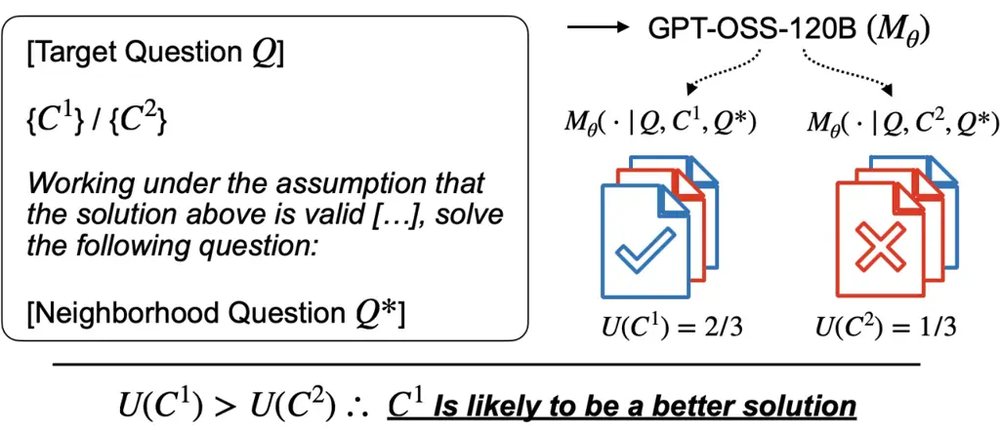
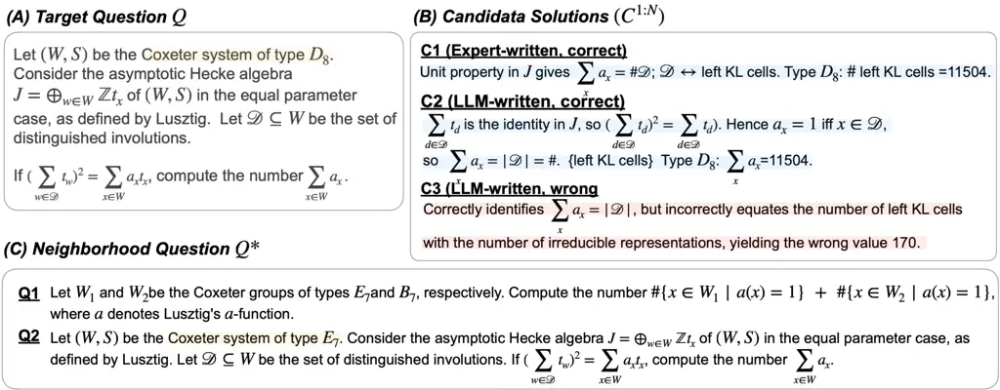
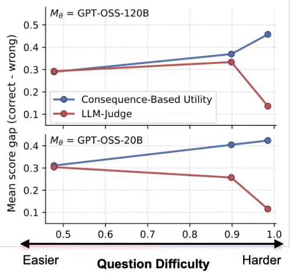
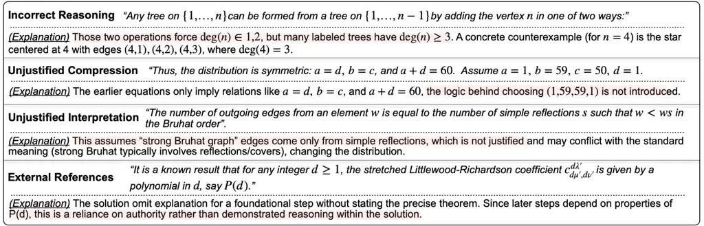

# Judging What We Cannot Solve: A Consequence-Based Approach for Oracle-Free Evaluation of Research-Level Math

Guijin Son Affiliation: Seoul National University Affiliation: OnelineAI
Correspondence to: <guijin.son@snu.ac.kr>    Donghun Yang
Affiliation: KISTI    Hitesh Laxmichand Patel Affiliation: ORACLE   
Hyunwoo Ko Affiliation: OnelineAI    Amit Agarwal Affiliation: ORACLE   
Sunghee Ahn Affiliation: Seoul National University    Kyong-Ha Lee
Affiliation: KISTI    Youngjae Yu Affiliation: Seoul National University

###### Abstract

Recent progress in reasoning models suggests that generating plausible
attempts for research-level mathematics may be within reach, but
verification remains a bottleneck, consuming scarce expert time. We
hypothesize that a meaningful solution should contain enough
method-level information that, when applied to a neighborhood of related
questions, it should yield better downstream performance than incorrect
solutions. Building on this idea, we propose Consequence-Based Utility,
an oracle-free evaluator that scores each candidate by testing its value
as an in-context exemplar in solving related yet verifiable questions.
Our approach is evaluated on an original set of research-level math
problems each paired with one expert-written solution and nine
LLM-generated solutions. Notably, Consequence-Based Utility consistently
outperforms reward models, generative reward models, and LLM judges on
ranking quality. Specifically, for GPT-OSS-120B it improves Acc@1 from
67.2 to 76.3 and AUC from 71.4 to 79.6, with similarly large AUC gains
on GPT-OSS-20B (69.0 to 79.2). Furthermore, compared to LLM-Judges, it
also exhibits a larger solver–evaluator gap, maintaining stronger
correct–wrong separation even on instances the underlying solver often
fails to solve.

## 1 Introduction

For a mathematical hypothesis to be accepted as scientific knowledge, it
must undergo extensive review and validation. Yet many recent efforts to
advance science with LLMs (Gottweis et al., 2025) emphasize hypothesis
generation (Zhou et al., 2024; Radensky et al., 2024) and experimental
planning (Goel et al., 2025), while giving comparatively less attention
to rigorous validation. Accordingly, this step is largely dependent on
either human experts (Georgiev et al., 2025), which are costly to scale,
or LLM judges (including agentic systems) (Lu et al., 2024; Zhu et al.,
2025; Panigrahi et al., 2026), that are often unreliable (Son et al.,
2024b; Son et al., 2025a) and biased (Ye et al., 2024). These
limitations motivate the need for better methods for hypothesis
validation.



Figure 1: Consequence-Based Utility for solution validation. We use
GPT-OSS-120B as the solver $`M_{\theta}`$ and score each candidate
solution by its induced accuracy on neighborhood questions $`Q^{*}`$;
$`U(C^{1})>U(C^{2})`$ suggests $`C^{1}`$ is more likely correct.

In this work, we introduce Consequence-Based Utility, a novel approach
to validate a set of candidate solutions without access to ground-truth
answers. As shown in Figure 1, we prompt a solver $`M_{\theta}`$ with a
research-level question $`Q`$ and $`C^{(i)}`$ as in-context exemplars.
For each $`C^{(i)}`$, we measure the solver’s accuracy on a closely
related neighborhood problem $`Q^{*}`$ and use the resulting accuracy as
its utility score. Intuitively, a candidate that induces higher accuracy
on $`Q^{*}`$, provides more helpful information for $`Q`$ and is
therefore more likely to be correct. It should be noted that
_Consequence-Based Utility is designed to focus on research-level
questions_, those remaining open to LLMs today. We therefore focus on
genuine research-level questions that remain out of reach for today’s
LLMs, and curate ExpertMath consisting of 192 expert-written problems
and 425 LLM-Generated questions. Half of the expert-written questions
remain open to leading models (e.g., GPT-5 and Gemini-3-Pro). In this
dataset, our method outperforms oracle-free baselines such as reward
models, generative reward models, and LLM judges. For instance, as an
LLM-Judge, GPT-OSS-120B achieves Acc@1 = 67.21 and AUC = 71.42; under
Consequence-Based Utility, these increase to 76.27 and 79.63,
respectively. Moreover, Consequence-Based Utility exhibits a larger
solver–evaluator gap than LLM judges, preserving a stronger separation
between correct and incorrect solutions even for questions the model
fail to solve. This makes it particularly well-suited for evaluating
research-level questions. Finally, our error analysis reveals that these
gains arise from Consequence-Based Utility more reliably downranking
solutions with incorrect reasoning, unjustified compression, or
unjustified interpretation, and being less sensitive to stylistic cues
and authority-like statements that are known to mislead LLM judges (Ye
et al., 2024; Moon et al., 2025).

Our contributions are summarized as follows:

- •
  We propose Consequence-Based Utility, an oracle-free method for
  validating candidate solutions via downstream performance on
  neighborhood questions.
- •
  We release ExpertMath a collection of $`192`$ expert-written
  research-level math problems with author solutions, along with $`425`$
  LLM-generated problems.
- •
  We show that CBU consistently outperforms oracle-free baselines
  (LLM-judges, reward models, and generative reward models), and
  identify judge failure modes that CBU reliably penalizes through error
  analysis.
- •
  We provide a practitioner’s guide for CBU, including how to construct
  neighborhood questions and how many rollouts are needed for stable
  utility estimates.

## 2 Preliminary and Related Works

### 2.1 Call for Oracle-Free Validation in Math

Recent case studies indicate that LLMs can meaningfully assist
professional mathematicians on genuine open or previously unsolved
research problems. In late 2025, publicly documented human–LLM
collaborations (i) established point convergence of Nesterov’s
accelerated gradient method (Jang and Ryu, 2025), (ii) produced a finite
counterexample to a “majority optimality” conjecture in non-interactive
correlation distillation with erasures (Ivanisvili and Xie, 2025), and
(iii) determined the sharp minimax-optimal error rate for robust density
estimation under Wasserstein-bounded contamination (Dobriban, 2025).
Despite the notable progress, however, these reports underscore that
current models are high-variance generators rather than reliable
autonomous theorem provers: Jang and Ryu (2025) reports that ChatGPT
generated _“numerous arguments, approximately 80% of which were
incorrect,”_ Dobriban (2025) notes that GPT‑5 _“glossed over details
that sometimes took days of work to fill in,”_ and Schmitt (2025)
observes that _“Some models claimed false counterexamples.”_
Consequently, progress still depends on professor-level triage. Experts
must reject hallucinated proof attempts, repair missing steps, and
translate ideas into checkable arguments before any result is safe to
trust or share. These experiences motivate the need for oracle-free
validation: scalable validation mechanisms that can filter and score
candidate research outputs without requiring a scarce domain-expert
oracle for each attempt.

### 2.2 Existing Oracle-Free Validators.

We model a _candidate solution_ as an object $`C\in\mathcal{C}`$ (e.g.,
a proof sketch, lemma chain, or an algorithmic construction) for a
research question $`Q\in\mathcal{Q}`$. A generator LLM $`M_{\theta}`$
induces a conditional distribution over candidates,

```math
C^{(i)}\sim p_{\theta}(\,\cdot\mid Q),\qquad i=1,\dots,N.
```

In an idealized setting, there exists a (typically unavailable)
correctness oracle

```math
O(Q,C)\in\{0,1\},
```

which returns $`1`$ iff $`C`$ is fully correct (and $`0`$ otherwise).
“Oracle-free validation” replaces $`O`$ with a _validator_ $`V`$ that
outputs a score used for selection or ranking:

```math
V:\mathcal{Q}\times\mathcal{C}\to\mathbb{R},\qquad\widehat{C}\;=\;\arg\max_{i\in[N]}V(Q,C^{(i)}).
```

Below, we formalize three widely used validators: consistency
voting (Wang et al., 2022), reward models (Ouyang et al., 2022), and LLM
judges(Zheng et al., 2023).

#### (1) Majority (consistency) voting.

Majority voting assumes that each candidate $`C`$ deterministically
induces a discrete prediction $`A(C)\in\mathcal{A}`$ (e.g., a numeric
answer or yes/no). Given $`N`$ i.i.d. samples $`C^{(1:N)}`$ with induced
answers $`A^{(i)}:=A(C^{(i)})`$, the majority-vote answer is
$`\widehat{A}_{\mathrm{mv}}:=\arg\max_{a\in\mathcal{A}}\sum_{i=1}^{N}\mathbf{1}\{A^{(i)}=a\}`$.
This approach may be effective when correctness is tightly tied to a
single discrete final answer, as in contest-style or short-answer math.
For research problems, however, the validity of a solution often cannot
be reduced to a discrete label. We therefore exclude majority voting
from our study.

#### (2) Reward models.

A reward model is a scoring function that approximates solution
“quality” in a cardinal way:

```math
R_{\phi}:\mathcal{Q}\times\mathcal{C}\to\mathbb{R},\qquad V_{R}(Q,C)=R_{\phi}(Q,C).
```

In use, an RM provides a scalar signal for ranking and optimization. A
common training approach fits $`R_{\phi}`$ from pairwise preferences
using a Bradley–Terry model (Yuan et al., 2024; Hong et al., 2025): for
a comparison $`(Q,C_{a},C_{b})`$, the probability that $`C_{a}`$ is
preferred is

```math
p_{\phi}(C_{a}\succ C_{b}\mid Q)\;=\;\sigma\!\big(R_{\phi}(Q,C_{a})-R_{\phi}(Q,C_{b})\big).
```

Parameters $`\phi`$ are then learned by maximum likelihood (i.e., a
standard logistic preference loss). To scale RMs at inference time,
process reward models (PRMs) (Zhang et al., 2025b) and generative reward
models (GenRMs) have been proposed. In our setting, we default to
GenRMs (Zhang et al., 2024), as recent work suggests PRMs can be less
stable than outcome-level scoring (Guo et al., 2025; Son et al., 2025b),
and current practice increasingly emphasizes generative
evaluators (Blakeman et al., 2025; Liu et al., 2025b). A GenRM produces
an evaluation string $`Z\in\mathcal{Z}`$ (typically a short critique
containing an explicit numeric score),

```math
Z\sim p_{\phi}(\cdot\mid Q,C),
```

and a deterministic parser $`\textsf{score}:\mathcal{Z}\to\mathbb{R}`$
extracts a scalar reward. This induces a single-sample score,

```math
R^{\text{gen}}_{\phi}(Q,C)\;=\;\textsf{score}(Z).
```

#### (3) LLM judges.

An LLM judge is a model $`J_{\psi}`$ that we prompt to evaluate a
candidate solution $`C^{(i)}`$. In common practice, the judge first
produces a natural-language critique $`Z^{(i)}`$ and then outputs a
discrete rating $`Y^{(i)}`$. In this paper, the rating is an integer
score on a $`1`$–$`10`$ scale,

```math
(Z^{(i)},\,Y^{(i)})\;=\;J_{\psi}(Q,C^{(i)}),\qquad Y^{(i)}\in\mathcal{Y}=\{1,\dots,10\}.
```

We reduce the judge output to a numeric validator by taking the score
directly,

```math
V_{J}(Q,C^{(i)})\;=\;s\!\left(Y^{(i)}\right),\qquad s(y)=y.
```

## 3 Consequence-Based Utility

#### Motivation and hypothesis: utility via “support by consequences.”

When a target question $`Q`$ is difficult to verify directly (e.g.,
because a reference answer is unavailable or costly to obtain, or
because the solution is long and subtle), a widely adopted method in
mathematics is the “support by consequences” perspective: rather than
scoring the claim in isolation, we assess it by the breadth and
coherence of what it enables. A canonical example is the Riemann
Hypothesis, which remains unproven yet underwrites many sharp
conditional results across analytic and algorithmic number theory (e.g.,
Von Koch (1901); Rosser and Schoenfeld (1975); Miller (1975); Bach
(1990)). Analogously, we treat each candidate solution $`C^{(i)}`$ as a
provisional _hypothesis_ about $`Q`$ and evaluate its quality by
transfer: even when $`C^{(i)}`$ cannot be validated reliably on $`Q`$
itself, it may still be judged by how consistently it provides useful
guidance for solving related, verifiable questions in a neighborhood
around $`Q`$.

Our hypothesis is therefore: _correct (or near-correct) candidates
contain method-level information that transfers to a neighborhood of
related questions and yields consistently higher downstream performance,
and vice-versa._

#### Implementation in the LLM setting.

Given a problem $`Q`$, we sample $`N`$ candidate solutions $`C^{(i)}`$
from the generator $`M_{\theta}`$. Because the ground-truth oracle
$`O(Q,C)`$ is unavailable, we estimate a candidate’s usefulness by
measuring how well it transfers to a neighborhood of related problems
for which correctness is verifiable (e.g., previously solved or
otherwise easier instances). We define this set of neighborhood
questions as $`\mathcal{N}(Q)`$. For a fixed candidate $`C`$, we
condition $`M_{\theta}`$ on $`(Q,C)`$ and ask it to solve each
$`Q^{*}\in\mathcal{N}(Q)`$. We score each rollout using a verifier
$`v(Q^{*},\tilde{C})\in\{0,1\}`$ that checks whether the completion
$`\tilde{C}`$ constitutes a correct solution for $`Q^{*}`$ under our
pipeline. We define the Consequence-Based Utility as the average
accuracy on these variants:

```math
U(C)=\frac{1}{|\mathcal{N}(Q)|}\sum_{Q^{*}\in\mathcal{N}(Q)}\mathbb{E}_{\tilde{C}\sim M_{\theta}(\cdot\mid Q,C,Q^{*})}\!\left[\,v(Q^{*},\tilde{C})\,\right].
```

In practice, we estimate this by sampling $`T`$ independent rollouts
$`\tilde{C}_{t}\sim M_{\theta}(\cdot\mid Q,C,Q^{*})`$ for each $`Q^{*}`$
and averaging their scores:

```math
\widehat{U}(C)\;=\;\frac{1}{|\mathcal{N}(Q)|\,T}\sum_{Q^{*}\in\mathcal{N}(Q)}\sum_{t=1}^{T}v\!\left(Q^{*},\tilde{C}_{t}\right).
```



Figure 2: Example of a target question, candidate solutions, and
neighborhood questions from ExpertMath . (A) A target research-level
problem on the asymptotic Hecke algebra $`J`$ of the Coxeter group of
type $`D_{8}`$. (B) A fixed candidate pool $`C^{1:3}`$ illustrating
three typical solution types appearing in our dataset: an expert-written
correct solution $`C^{1}`$; an LLM-generated solution that is
mathematically correct $`C^{2}`$; and a plausible but incorrect
LLM-generated solution $`C^{3}`$ that makes a subtle conceptual error by
conflating the number of left Kazhdan–Lusztig cells with the number of
irreducible representations. (C) Two neighborhood questions $`Q^{*}`$
derived from $`Q`$ by modifying the Coxeter type or the associated
invariant.

#### In-context learnability as a correctness signal.

Prior work have leveraged in-context performance as a proxy to value
examples and demonstrations (Chang and Jia, 2023; Nguyen and Wong, 2023;
Xie et al., 2024). Relatedly, context conditioning also serves as a
training signal, e.g., by distilling from a teacher that observes
privileged traces while the student observes only the question (Zhao et
al., 2026). Despite this progress, in-context valuation is used mainly
for data curation, retrieval, attribution, or training, with limited use
as an oracle-free _verification_ mechanism. Our work differentiates from
past efforts by leveraging in-context learnability to validate candidate
solutions by measuring their downstream consequences on neighborhood
problems.

## 4 Experiment Setup

### 4.1 Collecting Research-Level Math Problems

We start from 70 faculty-authored, hand-crafted questions, spanning
three broad areas and including keywords such as, but not limited to,
representation theory and algebraic combinatorics (Hecke algebra,
universal Coxeter system, Kazhdan–Lusztig polynomials, Polo’s algorithm,
Brenti’s conjecture), geometry (algebraic and differential)
(Kollár–Johnson threefold, $`\mathbb{Q}`$-Fano, Ricci lower bounds), and
homotopy theory and homotopical methods (homotopical algebra, $`p`$-adic
homotopy theory, Shafarevich extensions).

|                 |               |         |           |      |
| --------------- | ------------- | ------- | --------- | ---- |
| Model           | (Ours)        | AIME 25 | IMProofB. | F.M. |
| Public          | $`\triangle`$ | O       | X         | X    |
| \# Unsolved     | 38            | 0       | 5         | \-   |
| Gemini-3-Pro    | 47.14         | 95.7    | 71.8      | 37.6 |
| GPT-5           | 35.71         | 94.3    | 54.5      | 32.4 |
| Claude-Opus-4.5 | 7.14          | 91.3    | \-        | 20.7 |
| Claude-Opus-4.1 | \-            | 80.3    | 38.7      | \-   |

Table 1: Scores indicate ExpertMath is substantially harder than AIME 25
and IMProofBench, and comparable to FrontierMath (T1–3). ExpertMath uses
Avg@8 for all models except GPT-OSS-120B, which uses Avg@64. AIME 25
uses Avg@10. For IMProofBench, we report the subquestion score, where
subquestions are specific, automatically-verifiable components of larger
problems; the overall aggregation metric is not specified in the source.
FrontierMath (T1-3) uses Avg@8. ²² 2 - (hyphen) denotes an unavailable
value, typically because the benchmark is private and organizers did not
release the score. Sources: AIME 25 (Artificial Analysis), IMProofBench
(improofbench.math.ethz.ch), FrontierMath (epoch.ai/frontiermath).

Table 2 highlights the challenging nature of our dataset, ExpertMath ,
by comparing it among established math evaluations. Along with AIME
2025 (MAA, ), an invitational competition to USAMO,
IMProofBench (Schmitt et al., 2025) targets research-level mathematical
proof writing, and FrontierMath (Glazer et al., 2024) is explicitly
designed as a collection of unpublished, expert-authored problems. The
score on ExpertMath (7.14–47.14; mean 25.5) indicates higher difficulty
than competition-style benchmarks such as AIME 25 (80.3–95.7; mean
91.0), and lower performance than IMProofBench (37.6–71.8; mean 50.7).
The absolute scale on our benchmark is closest to FrontierMath (T1–3)
(20.7–37.6; mean 30.2). Finally, over half of the collected questions
are unsolved by any of the tested models, remaining open to frontier
models such as GPT-5 (Singh et al., 2025) and Gemini-3-Pro (Team et al.,
2025).

### 4.2 Neighborhood Questions, Ground Truths, and Candidate Solutions

For each problem, we additionally collect a set of _neighborhood
questions_. These questions are author-created variants that preserve
the core mathematical idea while perturbing the statement. Authors are
instructed to design variants that become straightforward once the
original problem is understood (e.g., by reusing the same key lemma or
reduction), and to make them slightly easier than the original whenever
feasible. In practice, having too many variants tends to become
redundant. Accordingly, we cap collection at two variants per original
problem. Authors receive approximately \$600 per problem package, which
includes the main problem, neighborhood questions, and reference
solutions. To the best of our knowledge, ExpertMath is the only
benchmark at this difficulty that provides expert-written solutions. See
Appendix D for further example and details.

| Models                      | HumanWin | MeanWin | Acc@1 | Recall@5 | AUC   |
| --------------------------- | -------- | ------- | ----- | -------- | ----- |
| (Generative) Reward Models  |          |         |       |          |       |
| Qwen3-235B-GenRM            | 27.05    | 77.05   | 65.37 | 71.72    | 67.85 |
| Llama3.3-Nemotron-49B-GenRM | 25.71    | 31.43   | 43.47 | 55.36    | 49.57 |
| Qwen2.5-Math-RM-72B         | 1.63     | 27.87   | 36.89 | 40.98    | 34.05 |
| AceMath-72B-RM              | 0.00     | 12.86   | 8.20  | 29.85    | 20.75 |
| LLM-Judges                  |          |         |       |          |       |
| Qwen3-235B-A22B             | 67.14    | 85.71   | 62.59 | 80.02    | 69.48 |
| Qwen3-30B-A3B               | 47.14    | 75.71   | 61.30 | 72.40    | 65.81 |
| GPT-OSS-120B                | 48.57    | 81.43   | 67.21 | 76.91    | 71.42 |
| GPT-OSS-20B                 | 52.86    | 82.86   | 72.13 | 72.06    | 69.03 |
| Consequence-Based Utility   |          |         |       |          |       |
| Qwen3-235B-A22B             | 81.43    | 90.00   | 73.42 | 74.15    | 71.38 |
| Qwen3-30B-A3B               | 85.71    | 90.00   | 75.79 | 78.37    | 76.24 |
| GPT-OSS-120B                | 82.86    | 90.00   | 76.27 | 83.04    | 79.63 |
| GPT-OSS-20B                 | 74.29    | 75.71   | 74.59 | 82.46    | 79.18 |

Table 2: Validator performance on ranking LLM solutions.
Consequence-Based Utility shows the highest performance across all
metrics. Best models are highlighted in bold, second best is underlined.



Figure 3: Mean score gap (correct - wrong) versus question difficulty
for LLM-Judge and Consequence-Based Utility.

Every original problem and neighborhood variant is accompanied by an
author-written ground-truth solution. Expert-written solutions range
from detailed, multi-page expositions to concise sketches,
intuition-driven arguments, or pointers to external results sufficient
to reconstruct a full proof. For the ease of automated verification, we
require that the final answer be presented in a compact, verifiable
form, even when the accompanying writeup is informal. Finally, we
construct a pool of LLM-generated candidate solutions for each original
question by sampling across a diverse set of models: GPT-OSS-120B,
GPT-5, GPT-5 Pro, Gemini-3-Pro, and Gemini DeepThink. We curate nine
candidate model solutions, four correct and five incorrect, per
problem.³³ 3 GPT-5 Pro and Gemini DeepThink were added with tool use
(web search and code execution) to increase solution diversity. Each
candidate is manually reviewed in two steps: (i) verifying agreement
with the ground-truth final answer, and (ii) reading the derivation to
confirm mathematical validity. The final dataset consists of 192
original research-level math problems (70 original and 122 variants),
each paired with expert-written solutions and 630 LLM-generated
solutions with human validation. See Figure 2 for an example ternary.

### 4.3 Baselines

Given a fixed candidate pool $`\{C^{(i)}\}_{i=1}^{N}`$ for each target
problem $`Q`$, we compare Consequence-Based Utility against three
standard oracle-free selection baselines: (i) LLM judges, (ii) RMs, and
(iii) GenRMs. We use four models, GPT-OSS-20B/120B (Agarwal et al.,
2025), and Qwen3-30B-A3B/235B-A22B (Yang et al., 2025) to attempt
neighborhood questions conditioned on $`(Q,C)`$. The same models are
used for the LLM-Judges as well. For RM baselines, we use
AceMath-RM-72B (Liu et al., 2025a) and Qwen2.5-Math-RM-72B (Yang et al.,
2024), two math-specialized reward models. For GenRM baselines, we use
Qwen3-Nemotron-235B-A22B-GenRM (Blakeman et al., 2025) and
Llama-3.3-Nemotron-Super-49B-GenRM (Wang et al., 2025). The standard
template for the two models expects two responses and outputs both
per-response and pairwise signals. In our experiments, we provide the
candidate as the first response and a fixed dummy string as the second,
and parse only the per-response helpfulness score. Excluding the
deterministic RM for which we run a single scoring pass, GenRMs and
LLM-Judges are repeated 64 times independently. This is to match its
inference cost with Consequence-Based Utility. Across all settings,
models are allowed to reason up to 16k tokens, with the temperature set
to the recommended value. Since released reward models typically have
much shorter native context windows, we apply RoPE scaling (Chen et al., 2023) to support longer inference. See Appendix E for prompts used in
our evaluations.

### 4.4 Evaluation Metrics

Each baseline outputs a single scalar score per candidate solution.
Since our dataset provides binary labels rather than graded quality, we
do not evaluate score calibration. Instead, we measure whether scores
rank and separate correct solutions above incorrect ones. We report five
higher-is-better metrics: Acc@1 (whether top-ranked is correct),
Recall@5 (the fraction of correct solutions recovered in the top five),
AUC (pairwise separability between correct and wrong solutions, with
ties partially credited), HumanWin (likelihood of human-written solution
scores above the average wrong solution), and MeanWin (likelihood of
mean correct score above the average wrong score). When multiple
variants of the same original question are available, we average over
variants. See Table 6 for formal definitions.

## 5 Main Results

#### Consequence-Based Utility (CBU) outperforms all baselines.

Table 2 shows a clear hierarchy among the evaluated methods. Reward
model baselines perform worst (e.g., AceMath-72B-RM attains 20.75 AUC),
which is expected given their much smaller compute budget (1/64 of the
rollouts used by other methods) (Lee et al., 2025a). LLM judges are
substantially stronger, but Consequence-Based Utility consistently
improves over LLM-judge scoring when using the same backbone. For
example, with Qwen3-235B-A22B, CBU achieves 71.38 AUC, exceeding both
the corresponding LLM judge (69.48) and Qwen3-235B-GenRM (67.85). For
GPT-OSS-120B, switching from LLM-judge scoring to CBU improves every
metric, with gains ranging from +6.13 on Recall@5 (76.91 to 83.04) to
+34.29 on HumanWin (48.57 to 82.86). Similar improvements hold for
Qwen3-30B-A3B and GPT-OSS-20B. The main exception is Qwen3-235B-A22B on
Recall@5, where the LLM judge outperforms by 5.87 points (80.02 vs.
74.15). Consistent with Figure 7, this appears to stem from
overconfident scoring that increases top-5 hit rate while weakening
fine-grained ranking. Notably, CBU yields especially large gains on
HumanWin even when MeanWin is already high, suggesting better alignment
with expert evaluation. We attribute this to a stylistic mismatch:
human-written solutions are often terse and intuition-driven, whereas
LLM judges can overweight surface cues such as verbosity and canonical
formatting (Saito et al., 2023; Ye et al., 2024); CBU is less sensitive
to these presentation features.

#### Consequence-Based Utility is better in evaluating candidates for questions they cannot solve.

Solve-to-Judge gap (Sun et al., 2025) denotes the disparity between a
model’s ability to judge a solution and its ability to solve the
underlying problem. Figure 3 plots the mean score gap between correct
and incorrect solutions versus question difficulty, measured by
$`1-\mathrm{avg}@64`$ (0 = fully solved; 1 = essentially unsolved). Even
in the hardest regime $`(1-\mathrm{avg}@64\approx 1)`$, both LLM-Judge
and CBU exhibit nonzero separation, consistent with concurrent findings
that models can distinguish correct from incorrect solutions on
instances they cannot solve themselves (Nie et al., 2025). As difficulty
increases, however, the evaluators diverge. The judge’s separability
drops sharply, whereas CBU remains robust, making it better suited for
the high-difficulty tail characteristic of research-level problems. This
pattern is expected in part because CBU uses neighborhood performance as
a proxy for correctness, which becomes less informative on easy
instances where the solver succeeds regardless of conditioning (e.g., it
solves without help, or repairs errors from an incorrect candidate).
More broadly, the two methods reflect different evaluation modes.
LLM-Judges resemble a code review: they inspect a single reasoning trace
for plausibility and consistency, which becomes unreliable when
incorrect solutions appear superficially coherent and errors are subtle.
In contrast, CBU resembles a unit test: it scores a candidate by its
downstream consequences, whether conditioning on it improves performance
on neighborhood questions, providing a signal that remains informative
when direct inspection becomes harder.

| Method      | G-20B | G-120B | Q3-30B | Q3-235B |
| ----------- | ----- | ------ | ------ | ------- |
| \(G\)       | \-    | \-     | \-     | 54.61   |
| \(J\)       | 63.05 | 64.66  | 58.06  | 66.67   |
| \(U\)       | 73.09 | 73.49  | 76.31  | 72.69   |
| \(J\) + (U) | 73.90 | 73.90  | 76.61  | 79.65   |

Table 3: Predictive performance of score-based feature sets across
models. For each backbone (GPT-OSS-20B, GPT-OSS-120B, Qwen3-30B-A3B,
Qwen3-235B-A22B), we train a logistic regression binary classifier to
predict the label using three alternative feature configurations: GenRM
(G), LLM-Judge (J), and Consequence-Based Utility (U).



Figure 4: Illustrative excerpts from incorrect solutions of each error
category. Each row shows a representative quoted snippet (top) and a
brief explanation of why it is incorrect or insufficient (bottom). We
use four non-exclusive labels: incorrect reasoning, unjustified
compression, unjustified interpretation, and external references.

#### Consequence-Based Utility scores are more predictive of correctness.

Table 3 evaluates how well each validator’s scalar score predicts binary
correctness by fitting a logistic-regression classifier per backbone and
reporting accuracy. Across all four backbones, training on the
Consequence-Based Utility score (U) outperforms training on the
LLM-judge score (J), with gains ranging from 6.02 points
(Qwen3-235B-A22B) to 18.25 points (Qwen3-30B-A3B). This indicates that
(U) provides a more linearly separable signal of correctness than (J).
Moreover, using both scores together further improves accuracy (e.g.,
GPT-OSS-20B: 73.09 to 73.90; Qwen3-235B-A22B: 72.79 to 79.65),
suggesting that Consequence-Based Utility and LLM-Judges capture
complementary information.

## 6 Additional Analysis

Figure 5: Above-average scoring probability by solution type and
backbone. Each bar measures, $`\Pr[s(C)-\bar{s}>0]`$, or how likely a
validator is to score a solution above its own typical score on that
question, shown separately for LLM-written correct solutions (Correct
(L)), human-written correct solutions (Correct (H)), and incorrect
solutions (Wrong).

Earlier, we showed that Consequence-Based Utility outperforms standard
oracle-free validations. In this section, we investigate why this
advantage arises and report empirical observations that help explain the
performance gap.

#### Consequence-Based Utility reduces overconfidence on wrong solutions and better preserves human-written correctness signals.

Figure 5 reports, for each solution type, the probability that a
validator assigns an above-average score, $`\Pr[s(C)-\bar{s}>0]`$, where
$`s(C)`$ is the validator’s score for a candidate and $`\bar{s}`$ is the
validator’s mean score over the candidate set for the same instance.
Across all models, LLM-judges are more likely than CBU to score
LLM-written correct solutions above the mean across all backbones (e.g.,
Qwen3-235B-A22B shows 0.90 vs. 0.52). In contrast, for human-written
correct solutions, the trend reverses. CBU assigns above-mean scores
more often than the judge (e.g., GPT-OSS-120B: 0.57 vs. 0.44, and
Qwen3-30B-A3B: 0.57 vs. 0.46). Another discrepancy appears on incorrect
solutions. LLM-judges are more likely to score wrong answers above the
mean, and for Qwen3-30B-A3B and Qwen3-235B-A22B more than half of wrong
solutions exceed the mean (both 0.53). CBU largely avoids this failure
mode, with only 0.08–0.14 of wrong solutions scoring above the mean.
Taken together, the performance gap between CBU and LLM-judges likely
arises from two factors. CBU better recognizes human-written correct
solutions and more reliably penalizes incorrect ones.

#### Consequence-Based Utility improves validation by penalizing non-reconstructable reasoning.

To understand why CBU outperforms LLM-judges, we conduct a qualitative
error analysis by inspecting 112 incorrect question-solution pairs where
GPT-OSS-120B assigns a below-mean CBU score but an above-mean LLM-judge
score. We leverage GPT-5-Pro to provide initial labels, which are then
confirmed by a mathematics PhD student. We annotate four non-exclusive
error types: (i) incorrect reasoning (invalid steps, contradictions, or
wrong calculations), (ii) unjustified compression (missing intermediate
steps that prevent local reconstruction or transfer), (iii) unjustified
interpretation (an unstated choice among plausible readings of the
statement), and (iv) external references (key claims justified mainly by
citing a named result without derivation or conditions).

These cases concentrate in two failure modes. Unjustified compression
occurs in 80/112 (71.4%) and incorrect reasoning in 77/112 (68.8%),
suggesting that many wrong solutions appear valid to LLM-Judges,
especially when they present polished high-level arguments while
omitting verification-critical steps. External references are also
common (35/112; 31.3%), consistent with evidence that LLM-judges can be
influenced by authority-like cues (Jeong et al., 2025; Moon et al.,
2025). A plausible explanation on why CBU likely downranks these
solutions may be that wrong or underspecified candidates provide little
transferable information for solving neighborhood variants, yielding low
utility. Overall, we speculate that CBU gains largely come from
downranking convincing-looking solutions that lack reconstructable,
transferable reasoning.

## 7 A Practitioner’s Guide to Consequence-Based Utility

### 7.1 How Many Rollouts to Generate.

By construction, Consequence-Based Utility requires multiple rollouts as
it estimates the candidate’s correctness by downstream performance. In
contrast, an LLM judge can assign a score in a single pass. To ensure
that performance gains do not arise from a larger inference budget, we
use 64 rollouts for both LLM-Judge and CBU throughout the paper. The two
methods also consume comparable numbers of tokens on average (Table 5),
so neither enjoys a systematic budget advantage. A natural question is
therefore whether 64 rollouts are necessary to estimate CBU reliably.

Figure 6: Mean range-normalized absolute error to the 64-rollout
reference using $`n\in{4,8,16,32,64}`$ sampled rollouts. Resampled 200
times using bootstrapping for statistical significance. Normalization
uses $`[L,U]=[0,1]`$ for CBU and $`[0,10]`$ for LLM-judge scores.

Figure 6 reports the mean deviation between an $`n`$-rollout estimate
and the 64-rollout reference. For each $`n\in{4,8,16,32,64}`$, we
uniformly subsample $`n`$ rollouts from the 64-rollout pool, repeat this
procedure with 200 bootstrap resamples, and compute the range-normalized
absolute error $`\frac{\lvert\hat{M}-M\rvert}{U-L}`$, where
$`[L,U]=[0,1]`$ for utility and $`[0,10]`$ for LLM-Judge scores. Error
decreases monotonically with $`n`$. CBU converges at a similar rate to
LLM-Judges and often faster (notably for GPT-OSS-20B and Qwen3-30B-A3B),
while GPT-OSS-120B is nearly identical. Across all backbones,
$`n\geq 8`$ keeps the mean normalized error below 0.05, indicating that
a small number of rollouts already captures most of the signal.

### 7.2 How to Make Neighborhood Questions.

In our experiments, we use faculty-written neighborhood questions. In
practice, however, obtaining expert variants with verified answers can
be nearly as difficult as collecting ground truth itself. We therefore
study practical alternatives for acquiring $`Q^{*}`$ of similar quality.
We start from RealMath (Zhang et al., 2025a), which automatically
generates graduate-level problems by transforming theorems in
mathematics papers. To ensure the questions are sufficiently
challenging, we run GPT-OSS-120B for 1024 attempts and retain only
instances with intermediate solvability, $`0.05<\text{Avg}@1024<0.5`$.
We then construct neighborhood questions using two approaches. First, we
follow explicit “related work” pointers to earlier papers and apply the
RealMath transformation to the cited work (e.g., Ortega and Eballe
(2022) points to Ortega and Eballe (2021)). Second, we prompt
Gemini-3-Pro to generate a closely related variant. We then obtain
provisional answers by solving with Gemini-3-Pro, GPT-5-Pro, and Grok-4,
and keep only instances where all three agree on the final answer. All
candidate solutions are LLM-generated and classified by an LLM-Judge.
Because these labels come from model agreement rather than expert
verification, this dataset is not suitable for establishing CBU in
isolation. Instead, after validating CBU on our expert-written subset,
we use it to illustrate viable alternatives. Finally, we also consider
Daft-Math (Trang, 2025), a collection of contest-level problems paired
with lightly transformed variants to have integer answers. The two
RealMath subsets and Daft-Math contain 127, 298, and 77 questions,
respectively.

Table 4 reports GPT-OSS-20B performance across three datasets. On both
RealMath variants, CBU substantially outperforms LLM-judge scoring. In
contrast, on Daft-Math, LLM-judge scoring is stronger (e.g., Acc@1 93.51
vs. 85.58). This contrast aligns with our earlier observations on how
CBU shows better peformance at questions of higher difficulty. Despite
Daft-Math being very close variants (almost identical at core) they are
competition level being way easier than the graduate level questions of
realmath, so the solver more often succeeds regardless of the in-context
exemplar, reducing the discriminative value of utility. Overall, these
results suggest that CBU does not require faculty-authored neighborhood
questions. LLM-generated neighborhoods can be sufficient when the target
questions are challenging for the solver.

| Metric  | Daft-Math     | Real-Math (1) | Real-Math (2) |
| ------- | ------------- | ------------- | ------------- |
| Acc@1   | 93.51 / 85.58 | 42.79 / 79.22 | 44.96 / 72.13 |
| AUC     | 69.14 / 63.98 | 51.29 / 62.03 | 48.76 / 69.83 |
| MeanWin | 76.62 / 59.74 | 40.26 / 64.94 | 44.87 / 80.33 |

Table 4: Performance of GPT-OSS-20B as LLM-Judge and CBU across three
datasets. Each cell reports LLM-Judge / CBU scores, the better value is
underlined. The two RealMath columns correspond to the two
neighborhood-construction procedures described in the text.

## 8 Discussions and Future Work

In this paper, we propose Consequence-Based Utility, an oracle-free
method that estimates solution correctness from downstream performance
when ground truth is unavailable. Across research-level mathematics, CBU
consistently outperforms LLM-judges and reward models, and remains
effective with both expert-written and LLM-generated neighborhoods. A
key limitation may be applicability. Unlike LLM-judges, which exhibit
systematic biases but are broadly applicable (Salinas et al., 2025; Son
et al., 2024a; He et al., 2025), CBU requires additional effort to
construct neighborhood questions. While we show that automated
generation is viable (Section 7), reliability depends on the generator’s
ability to produce sound variants without human oversight. CBU is also
most informative when neighborhood difficulty lies in a sweet spot. If
$`Q^{*}`$ is too easy, the solver succeeds regardless of conditioning,
and if too hard, it fails regardless, making neighborhood construction
partly model-dependent. Consequently, CBU is best suited to high-stakes
settings that demand high-confidence validation for fixed, difficult
problems. Future work includes improving fully automated neighborhood
generation, extending CBU beyond mathematics to other STEM domains, and
evaluating its effectiveness on genuinely open problems, where both
neighborhood construction and correctness assessment are inherently more
difficult.

## 9 Acknowledgements

This research was supported by the Korea Institute of Science and
Technology Information (KISTI) in 2026 (No.(KISTI)K26L3M1C1), aimed at
developing KONI (KISTI Open Neural Intelligence), a large language model
specialized in science and technology.

## References

- Agarwal et al. (2025) S. Agarwal, L. Ahmad, J. Ai, S. Altman, A.
  Applebaum, E. Arbus, R. K. Arora, Y. Bai, B. Baker, H. Bao, et al.
  Gpt-oss-120b & gpt-oss-20b model card. arXiv preprint
  arXiv:2508.10925. Cited by: §4.3.
- Bach (1990) E. Bach Explicit bounds for primality testing and related
  problems. Mathematics of Computation 55 (191), pp. 355–380. Cited by:
  §3.
- Blakeman et al. (2025) A. Blakeman, A. Grattafiori, A. Basant, A.
  Gupta, A. Khattar, A. Renduchintala, A. Vavre, A. Shukla, A.
  Bercovich, A. Ficek, et al. NVIDIA nemotron 3: efficient and open
  intelligence. arXiv preprint arXiv:2512.20856. Cited by: §2.2, §4.3.
- Chang and Jia (2023) T. Chang and R. Jia Data curation alone can
  stabilize in-context learning. In Proceedings of the 61st Annual
  Meeting of the Association for Computational Linguistics (Volume 1:
  Long Papers), A. Rogers, J. Boyd-Graber, and N. Okazaki (Eds.),
  Toronto, Canada, pp. 8123–8144. External Links:
  [Link](https://aclanthology.org/2023.acl-long.452/),
  [Document](https://dx.doi.org/10.18653/v1/2023.acl-long.452) Cited by:
  §3.
- Chen et al. (2023) S. Chen, S. Wong, L. Chen, and Y. Tian Extending
  context window of large language models via positional interpolation.
  arXiv preprint arXiv:2306.15595. Cited by: §4.3.
- Dobriban (2025) E. Dobriban Solving a research problem in mathematical
  statistics with ai assistance. arXiv preprint arXiv:2511.18828. Cited
  by: §2.1.
- Georgiev et al. (2025) B. Georgiev, J. Gómez-Serrano, T. Tao,
  and A. Z. Wagner Mathematical exploration and discovery at scale.
  arXiv preprint arXiv:2511.02864. Cited by: §1.
- Glazer et al. (2024) E. Glazer, E. Erdil, T. Besiroglu, D.
  Chicharro, E. Chen, A. Gunning, C. F. Olsson, J. Denain, A.
  Ho, E. d. O. Santos, et al. Frontiermath: a benchmark for evaluating
  advanced mathematical reasoning in ai. arXiv preprint
  arXiv:2411.04872. Cited by: §4.1.
- Goel et al. (2025) S. Goel, R. Hazra, D. Jayalath, T. Willi, P.
  Jain, W. F. Shen, I. Leontiadis, F. Barbieri, Y. Bachrach, J. Geiping,
  et al. Training ai co-scientists using rubric rewards. arXiv preprint
  arXiv:2512.23707. Cited by: §1.
- Gottweis et al. (2025) J. Gottweis, W. Weng, A. Daryin, T. Tu, A.
  Palepu, P. Sirkovic, A. Myaskovsky, F. Weissenberger, K. Rong, R.
  Tanno, et al. Towards an ai co-scientist. arXiv preprint
  arXiv:2502.18864. Cited by: §1.
- Guo et al. (2025) D. Guo, D. Yang, H. Zhang, J. Song, R. Zhang, R.
  Xu, Q. Zhu, S. Ma, P. Wang, X. Bi, et al. Deepseek-r1: incentivizing
  reasoning capability in llms via reinforcement learning. arXiv
  preprint arXiv:2501.12948. Cited by: §2.2.
- He et al. (2025) J. He, J. Shi, T. Y. Zhuo, C. Treude, J. Sun, Z.
  Xing, X. Du, and D. Lo From code to courtroom: llms as the new
  software judges. arXiv preprint arXiv:2503.02246. Cited by: §8.
- Hong et al. (2025) J. Hong, N. Lee, E. Kim, G. Son, W. Chung, A.
  Gupta, S. Tang, and J. Thorne On the robustness of reward models for
  language model alignment. arXiv preprint arXiv:2505.07271. Cited by:
  §2.2.
- Ivanisvili and Xie (2025) P. Ivanisvili and X. Xie Counterexample to
  majority optimality in nicd with erasures. arXiv preprint
  arXiv:2510.20013. Cited by: §2.1.
- Jang and Ryu (2025) U. Jang and E. K. Ryu Point convergence of
  nesterov’s accelerated gradient method: an ai-assisted proof. arXiv
  preprint arXiv:2510.23513. Cited by: §2.1.
- Jeong et al. (2025) H. Jeong, C. Park, J. Hong, H. Lee, and J. Choo
  The comparative trap: pairwise comparisons amplifies biased
  preferences of llm evaluators. In Proceedings of the 8th BlackboxNLP
  Workshop: Analyzing and Interpreting Neural Networks for NLP,
  pp. 79–108. Cited by: §6.
- Lee et al. (2025a) D. B. Lee, S. Lee, S. Park, M. Kang, J. Baek, D.
  Kim, D. Wagner, J. Jin, H. Lee, T. Bocklet, et al. Rethinking reward
  models for multi-domain test-time scaling. arXiv preprint
  arXiv:2510.00492. Cited by: §5.
- Lee et al. (2025b) J. Lee, F. Chen, S. Dua, D. Cer, M. Shanbhogue, I.
  Naim, G. H. Ábrego, Z. Li, K. Chen, H. S. Vera, et al. Gemini
  embedding: generalizable embeddings from gemini. arXiv preprint
  arXiv:2503.07891. Cited by: §A.3.
- Liu et al. (2025a) Z. Liu, Y. Chen, M. Shoeybi, B. Catanzaro, and W.
  Ping Acemath: advancing frontier math reasoning with post-training and
  reward modeling. In Findings of the Association for Computational
  Linguistics: ACL 2025, pp. 3993–4015. Cited by: §4.3.
- Liu et al. (2025b) Z. Liu, P. Wang, R. Xu, S. Ma, C. Ruan, P. Li, Y.
  Liu, and Y. Wu Inference-time scaling for generalist reward modeling.
  arXiv preprint arXiv:2504.02495. Cited by: §2.2.
- Lu et al. (2024) C. Lu, C. Lu, R. T. Lange, J. Foerster, J. Clune,
  and D. Ha The ai scientist: towards fully automated open-ended
  scientific discovery. arXiv preprint arXiv:2408.06292. Cited by: §1.
- Ma et al. (2025) W. Ma, A. Cojocaru, N. Kolhe, B. Louie, R. S.
  Sharif, H. Zhang, V. Zhuang, M. Zaharia, and S. Min Reliable
  fine-grained evaluation of natural language math proofs. arXiv
  preprint arXiv:2510.13888. Cited by: §A.2.
- \[23\] MAA MAA Invitational Competitions: AIME. Note:
  [https://maa.org/maa-invitational-competitions/](https://maa.org/maa-invitational-competitions/)Accessed:
  2026-01-19 Cited by: §4.1.
- Miller (1975) G. L. Miller Riemann’s hypothesis and tests for
  primality. In Proceedings of the seventh annual ACM symposium on
  Theory of computing, pp. 234–239. Cited by: §3.
- Moon et al. (2025) J. Moon, Y. Hwang, D. Lee, T. Kang, Y. Kim, and K.
  Jung Don’t judge code by its cover: exploring biases in llm judges for
  code evaluation. arXiv preprint arXiv:2505.16222. Cited by: §1, §6.
- Nguyen and Wong (2023) T. Nguyen and E. Wong In-context example
  selection with influences. arXiv preprint arXiv:2302.11042. Cited by:
  §3.
- Nie et al. (2025) F. Nie, K. Z. Liu, Z. Wang, R. Sun, W. Liu, W.
  Shi, H. Yao, L. Zhang, A. Y. Ng, J. Zou, et al. Uq: assessing language
  models on unsolved questions. arXiv preprint arXiv:2508.17580. Cited
  by: §A.2, §5.
- Ortega and Eballe (2021) J. M. E. Ortega and R. G. Eballe Harmonic
  centrality in some graph families. arXiv preprint arXiv:2111.12239.
  Cited by: §7.2.
- Ortega and Eballe (2022) J. M. E. Ortega and R. G. Eballe Harmonic
  centrality and centralization of some graph products. arXiv preprint
  arXiv:2205.03791. Cited by: §7.2.
- Ouyang et al. (2022) L. Ouyang, J. Wu, X. Jiang, D. Almeida, C.
  Wainwright, P. Mishkin, C. Zhang, S. Agarwal, K. Slama, A. Ray, et al.
  Training language models to follow instructions with human feedback.
  Advances in neural information processing systems 35, pp. 27730–27744.
  Cited by: §2.2.
- Panigrahi et al. (2026) S. S. Panigrahi, J. Videnović, and M. Brbić
  HeurekaBench: a benchmarking framework for ai co-scientist. arXiv
  preprint arXiv:2601.01678. Cited by: §1.
- Phan et al. (2025) L. Phan, A. Gatti, Z. Han, N. Li, J. Hu, H.
  Zhang, C. B. C. Zhang, M. Shaaban, J. Ling, S. Shi, et al. Humanity’s
  last exam. arXiv preprint arXiv:2501.14249. Cited by: §A.2.
- Radensky et al. (2024) M. Radensky, S. Shahid, R. Fok, P.
  Siangliulue, T. Hope, and D. S. Weld Scideator: human-llm scientific
  idea generation grounded in research-paper facet recombination. arXiv
  preprint arXiv:2409.14634. Cited by: §1.
- Rosser and Schoenfeld (1975) J. B. Rosser and L. Schoenfeld Sharper
  bounds for the chebyshev functions $`\theta`$(x) and $`\psi`$(x).
  Mathematics of computation, pp. 243–269. Cited by: §3.
- Saito et al. (2023) K. Saito, A. Wachi, K. Wataoka, and Y. Akimoto
  Verbosity bias in preference labeling by large language models. arXiv
  preprint arXiv:2310.10076. Cited by: §5.
- Salinas et al. (2025) D. Salinas, O. Swelam, and F. Hutter Tuning llm
  judge design decisions for 1/1000 of the cost. arXiv preprint
  arXiv:2501.17178. Cited by: §8.
- Schmitt et al. (2025) J. Schmitt, G. Bérczi, J. Dekoninck, J.
  Feusi, T. Gehrunger, R. Appenzeller, J. Bryan, N. Canova, T. de
  Wolff, F. Gaia, et al. IMProofBench: benchmarking ai on research-level
  mathematical proof generation. arXiv preprint arXiv:2509.26076. Cited
  by: §4.1.
- Schmitt (2025) J. Schmitt Extremal descendant integrals on moduli
  spaces of curves: an inequality discovered and proved in collaboration
  with ai. arXiv preprint arXiv:2512.14575. Cited by: §2.1.
- Singh et al. (2025) A. Singh, A. Fry, A. Perelman, A. Tart, A.
  Ganesh, A. El-Kishky, A. McLaughlin, A. Low, A. Ostrow, A. Ananthram,
  et al. OpenAI gpt-5 system card. arXiv preprint arXiv:2601.03267.
  Cited by: §4.1.
- Son et al. (2025a) G. Son, J. Hong, H. Fan, H. Nam, H. Ko, S. Lim, J.
  Song, J. Choi, G. Paulo, Y. Yu, et al. When ai co-scientists fail:
  spot-a benchmark for automated verification of scientific research.
  arXiv preprint arXiv:2505.11855. Cited by: §1.
- Son et al. (2025b) G. Son, J. Hong, H. Ko, and J. Thorne Linguistic
  generalizability of test-time scaling in mathematical reasoning. arXiv
  preprint arXiv:2502.17407. Cited by: §2.2.
- Son et al. (2024a) G. Son, H. Jeon, C. Hwang, and H. Jung KRX bench:
  automating financial benchmark creation via large language models. In
  Proceedings of the Joint Workshop of the 7th Financial Technology and
  Natural Language Processing, the 5th Knowledge Discovery from
  Unstructured Data in Financial Services, and the 4th Workshop on
  Economics and Natural Language Processing, C. Chen, X. Liu, U.
  Hahn, A. Nourbakhsh, Z. Ma, C. Smiley, V. Hoste, S. R. Das, M. Li, M.
  Ghassemi, H. Huang, H. Takamura, and H. Chen (Eds.), Torino, Italia,
  pp. 10–20. External Links:
  [Link](https://aclanthology.org/2024.finnlp-1.2/) Cited by: §8.
- Son et al. (2024b) G. Son, H. Ko, H. Lee, Y. Kim, and S. Hong
  Llm-as-a-judge & reward model: what they can and cannot do. arXiv
  preprint arXiv:2409.11239. Cited by: §1.
- Sun et al. (2025) S. Sun, J. Yu, Z. Wang, X. Yang, T. Gu, and Y. Yang
  S2j: bridging the gap between solving and judging ability in
  generative reward models. arXiv preprint arXiv:2509.22099. Cited by:
  §5.
- Team et al. (2025) G. Team, A. Kamath, J. Ferret, S. Pathak, N.
  Vieillard, R. Merhej, S. Perrin, T. Matejovicova, A. Ramé, M. Rivière,
  et al. Gemma 3 technical report. arXiv preprint arXiv:2503.19786.
  Cited by: §4.1.
- Trang (2025) V. Trang DAFT math: difficult automatically-scorable
  free-response tasks for math. Hugging Face, metr-evals. Note: Hugging
  Face dataset repository (gated). Accessed 2026-01-27 External Links:
  [Link](https://huggingface.co/datasets/metr-evals/daft-math) Cited by:
  §7.2.
- Von Koch (1901) H. Von Koch Sur la distribution des nombres premiers.
  Acta Mathematica 24 (1), pp. 159. Cited by: §3.
- Wang et al. (2022) X. Wang, J. Wei, D. Schuurmans, Q. Le, E. Chi, S.
  Narang, A. Chowdhery, and D. Zhou Self-consistency improves chain of
  thought reasoning in language models. arXiv preprint arXiv:2203.11171.
  Cited by: §2.2.
- Wang et al. (2025) Z. Wang, J. Zeng, O. Delalleau, H. Shin, F.
  Soares, A. Bukharin, E. Evans, Y. Dong, and O. Kuchaiev
  HelpSteer3-Preference: open human-annotated preference data across
  diverse tasks and languages. External Links: 2505.11475,
  [Link](https://arxiv.org/abs/2505.11475) Cited by: §4.3.
- Xie et al. (2024) S. Xie, M. Luo, C. D. Stern, M. Du, and L. Cheng
  DemoShapley: valuation of demonstrations for in-context learning.
  arXiv preprint arXiv:2410.07523. Cited by: §3.
- Yang et al. (2025) A. Yang, A. Li, B. Yang, B. Zhang, B. Hui, B.
  Zheng, B. Yu, C. Gao, C. Huang, C. Lv, et al. Qwen3 technical report.
  arXiv preprint arXiv:2505.09388. Cited by: §4.3.
- Yang et al. (2024) A. Yang, B. Zhang, B. Hui, B. Gao, B. Yu, C. Li, D.
  Liu, J. Tu, J. Zhou, J. Lin, et al. Qwen2. 5-math technical report:
  toward mathematical expert model via self-improvement. arXiv preprint
  arXiv:2409.12122. Cited by: §4.3.
- Ye et al. (2024) J. Ye, Y. Wang, Y. Huang, D. Chen, Q. Zhang, N.
  Moniz, T. Gao, W. Geyer, C. Huang, P. Chen, et al. Justice or
  prejudice? quantifying biases in llm-as-a-judge. arXiv preprint
  arXiv:2410.02736. Cited by: §1, §1, §5.
- Yuan et al. (2024) L. Yuan, G. Cui, H. Wang, N. Ding, X. Wang, J.
  Deng, B. Shan, H. Chen, R. Xie, Y. Lin, et al. Advancing llm reasoning
  generalists with preference trees. arXiv preprint arXiv:2404.02078.
  Cited by: §2.2.
- Zhang et al. (2025a) J. Zhang, C. Petrui, K. Nikolić, and F. Tramèr
  RealMath: a continuous benchmark for evaluating language models on
  research-level mathematics. arXiv preprint arXiv:2505.12575. Cited by:
  §7.2.
- Zhang et al. (2024) L. Zhang, A. Hosseini, H. Bansal, M. Kazemi, A.
  Kumar, and R. Agarwal Generative verifiers: reward modeling as
  next-token prediction. arXiv preprint arXiv:2408.15240. Cited by:
  §2.2.
- Zhang et al. (2025b) Z. Zhang, C. Zheng, Y. Wu, B. Zhang, R. Lin, B.
  Yu, D. Liu, J. Zhou, and J. Lin The lessons of developing process
  reward models in mathematical reasoning. arXiv preprint
  arXiv:2501.07301. Cited by: §A.2, §2.2.
- Zhao et al. (2026) S. Zhao, Z. Xie, M. Liu, J. Huang, G. Pang, F.
  Chen, and A. Grover Self-distilled reasoner: on-policy
  self-distillation for large language models. External Links:
  2601.18734, [Link](https://arxiv.org/abs/2601.18734) Cited by: §3.
- Zheng et al. (2023) L. Zheng, W. Chiang, Y. Sheng, S. Zhuang, Z.
  Wu, Y. Zhuang, Z. Lin, Z. Li, D. Li, E. Xing, et al. Judging
  llm-as-a-judge with mt-bench and chatbot arena. Advances in neural
  information processing systems 36, pp. 46595–46623. Cited by: §2.2.
- Zhou et al. (2024) Y. Zhou, H. Liu, T. Srivastava, H. Mei, and C. Tan
  Hypothesis generation with large language models. arXiv preprint
  arXiv:2404.04326. Cited by: §1.
- Zhu et al. (2025) K. Zhu, J. Zhang, Z. Qi, N. Shang, Z. Liu, P.
  Han, Y. Su, H. Yu, and J. You SafeScientist: toward risk-aware
  scientific discoveries by llm agents. arXiv preprint arXiv:2505.23559.
  Cited by: §1.

## Appendix A Additional Analyis

### A.1 Output Score Distribution of LLM-Judges

Figure 7: Output score distributions of LLM-judges. Histograms (density)
of judge scores on a 1–10 scale for each backbone over all candidate
solutions. GPT-OSS judges spread scores across the range, whereas Qwen
judges concentrate near 10, indicating a ceiling effect.

Figure 7 shows the distribution of scalar scores produced by each
LLM-judge backbone. GPT-OSS-20B and GPT-OSS-120B use a broad portion of
the 1–10 scale, assigning nontrivial mass across the range and providing
a usable dynamic range for ranking. In contrast, Qwen3-30B-A3B and
especially Qwen3-235B-A22B exhibit a strong ceiling effect, with scores
heavily concentrated near 10. This saturation suggests overconfident
scoring and reduces score-based discrimination among candidates.

### A.2 Prompt Sensitivity of LLM-Judges

The LLM-judge prompt used in our experiments are adapted from prior
evaluation prompts used in Zhang et al. (2025b) and Phan et al. (2025).
To test whether our results are an artifact of this specific prompt, we
re-run LLM-judge scoring with two alternative templates. Following Ma et
al. (2025), we adopt a 0–7 proof-grading prompt used (aka ProofGrader).
Additionally we bring a binary correctness prompt from Nie et al. (2025)
(aka UQ). For GPT-OSS-20B and GPT-OSS-120B, we score each candidate with
64 independent judge calls and average, then compare the induced
rankings across prompts using Spearman correlation. The rankings are
highly consistent: $`\rho=0.961/0.954`$ (ours vs. ProofGrader),
$`\rho=0.938/0.950`$ (original vs. UQ), and $`\rho=0.912/0.915`$
(ProofGrader vs. UQ) for GPT-OSS-20B/120B, respectively. These
correlations ($`>0.9`$ throughout) indicate that while prompts change
score scales, they have limited effect on relative ordering.

### A.3 Token Count: CBU VS. LLM-Judges

Table 5 compares inference cost and sampling diversity between
LLM-judges and CBU. The average token usage per generation is comparable
across methods, with CBU staying within ($`\pm`$ 15%) of the judge
across backbones (e.g., +1.3% on Qwen3-235B, +15.0% on Qwen3-30B, +9.5%
on GPT-OSS-120B, and (-7.4%) on GPT-OSS-20B). To quantify diversity
across repeated rollouts, we embed each generation with Gemini Embedding
001 (Lee et al., 2025b) and compute the mean pairwise cosine similarity.
CBU yields slightly lower similarity than LLM-judge across all backbones
(typically by 0.005–0.008), indicating modestly higher variation across
rollouts, although both methods remain highly similar overall (cosine
($`\approx 0.96\text{-}0.97`$)).

|                 |           |                                                      |           |                                                      |
| --------------- | --------- | ---------------------------------------------------- | --------- | ---------------------------------------------------- |
|                 | LLM-Judge |                                                      | Utility   |                                                      |
| Models          | \# Tokens | Cosine Similarity                                    | \# Tokens | Cosine Similarity                                    |
| Qwen3-235B-A22B | 12152.53  | $`0.969`$ $`\pm`$ $`0.008`$ \[$`0.910`$, $`0.992`$\] | 12310.33  | $`0.964`$ $`\pm`$ $`0.010`$ \[$`0.896`$, $`0.991`$\] |
| Qwen3-30B-A3B   | 10352.32  | $`0.972`$ $`\pm`$ $`0.008`$ \[$`0.917`$, $`0.992`$\] | 11903.18  | $`0.964`$ $`\pm`$ $`0.010`$ \[$`0.900`$, $`0.991`$\] |
| GPT-OSS-120B    | 2905.85   | $`0.972`$ $`\pm`$ $`0.007`$ \[$`0.915`$, $`0.991`$\] | 3182.76   | $`0.964`$ $`\pm`$ $`0.013`$ \[$`0.896`$, $`0.989`$\] |
| GPT-OSS-20B     | 5610.09   | $`0.963`$ $`\pm`$ $`0.009`$ \[$`0.886`$, $`0.988`$\] | 5196.76   | $`0.957`$ $`\pm`$ $`0.016`$ \[$`0.868`$, $`0.987`$\] |

Table 5: Token counts and pairwise cosine similarity statistics (mean
$`\pm`$ std \[min, max\]) across generations.

## Appendix B Evaluation Metrics

| Metric                    | Definition                                     |
| ------------------------- | ---------------------------------------------- | ----------- | --------------------------------------------------------------------------------------------- | ----------- | --------------------------------------------------------------------------------------------------------------------------------------------------------------------------------- | ----------- | --------------------------------------------------- | ----------- | ---------------------------------------------------- |
| Top1 accuracy (Acc@1)     | $`y^{(\pi_{1})}`$.                             |
| Recall@5                  | $`\displaystyle\frac{1}{                       | \mathcal{C} | }\sum*{k=1}^{5}y^{(\pi*{k})}`$.                                                               |
| AUC (pairwise separation) | $`\displaystyle\frac{1}{                       | \mathcal{C} |                                                                                               | \mathcal{W} | }\sum*{c\in\mathcal{C}}\sum*{w\in\mathcal{W}}\Bigl(\mathbf{1}\{s(C*{\text{good}})>s(C*{\text{wrong}})\}+\tfrac{1}{2}\mathbf{1}\{s(C*{\text{good}})=s(C*{\text{wrong}})\}\Bigr)`$. |
| HumanWin                  | $`\displaystyle\mathbf{1}\Bigl\{s(H)>\frac{1}{ | \mathcal{W} | }\sum*{w\in\mathcal{W}}s(C*{\text{wrong}})\Bigr\}+\tfrac{1}{2}\mathbf{1}\Bigl\{s(H)=\frac{1}{ | \mathcal{W} | }\sum*{w\in\mathcal{W}}s(C*{\text{wrong}})\Bigr\}`$.                                                                                                                              |
| MeanWin                   | $`\displaystyle\mathbf{1}\Bigl\{\frac{1}{      | \mathcal{C} | }\sum*{c\in\mathcal{C}}s(C*{\text{good}})>\frac{1}{                                           | \mathcal{W} | }\sum*{w\in\mathcal{W}}s(C*{\text{wrong}})\Bigr\}+\tfrac{1}{2}\mathbf{1}\Bigl\{\frac{1}{                                                                                          | \mathcal{C} | }\sum*{c\in\mathcal{C}}s(C*{\text{good}})=\frac{1}{ | \mathcal{W} | }\sum*{w\in\mathcal{W}}s(C*{\text{wrong}})\Bigr\}`$. |

Table 6: Formal definitions of evaluation metrics. Here $`\pi_{k}`$
denotes the index of the $`k`$-th ranked candidate,
$`y^{(\pi_{k})}\in\{0,1\}`$ is its correctness label, $`\mathcal{C}`$
and $`\mathcal{W}`$ are the sets of correct and wrong candidates,
$`s(\cdot)`$ is the scorer, and $`H`$ is the human-written solution.

## Appendix C Reproducibility

All codes used throughout the paper, and parsed generation results are
included in the supplementary results file for submission.

## Appendix D Details on ExpertMath .

ExpertMath comprises 192 expert-written mathematics problems and 425
LLM-generated problems derived from RealMath. We plan to release the 425
LLM-generated problems on Hugging Face shortly; the 192 expert-written
problems remain under embargo until after July 2026 due to requirements
of the funding body. During the embargo, we will provide evaluation on
ExpertMath for submitted models upon request. Below, we provide
expert-written questions and solution pairs (Section 4), along with
LLM-generated questions (Section 7).


## Appendix E Prompts.

In this section, we list the prompts used throughout the paper:

1.  1.  Consequence-Based Utility Prompt (Section 5)
2.  2.  LLM-Judge: Default Prompt (Section 5)

    1.  (a)
        LLM-Judge: ProofGrader Prompt
    1.  (b)
        LLM-Judge: UQBench Correctness Prompt

3.  3.  Problem Generation: RealMath (2) (Section 7)
4.  4.  Error Analysis Prompt (Section 6)


