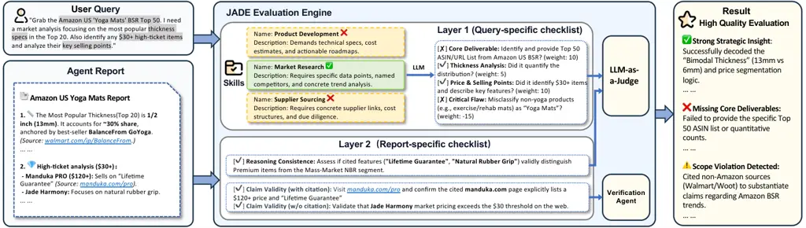
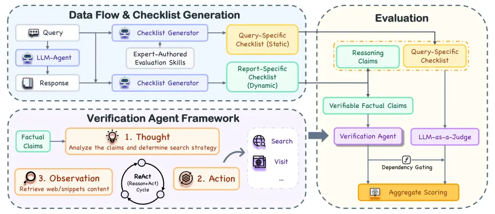
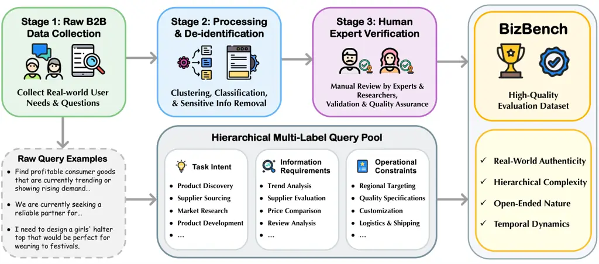

# JADE: Expert-Grounded Dynamic Evaluation for Open-Ended Professional Tasks

Lanbo Lin Affiliation: Alibaba International Digital Commerce Group
Correspondence to: <linlanbo.llb@alibaba-inc.com>    Jiayao Liu
Affiliation: Alibaba International Digital Commerce Group    Tianyuan
Yang Affiliation: Alibaba International Digital Commerce Group    Li Cai
Affiliation: Alibaba International Digital Commerce Group
Affiliation: Zhejiang University    Yuanwu Xu Affiliation: Alibaba
International Digital Commerce Group    Lei Wei Affiliation: Alibaba
International Digital Commerce Group Affiliation: Peking University   
Sicong Xie Affiliation: Alibaba International Digital Commerce Group   
Guannan Zhang Affiliation: Alibaba International Digital Commerce Group

###### Abstract

Evaluating agentic AI on open-ended professional tasks faces a
fundamental dilemma between rigor and flexibility. Static rubrics
provide rigorous, reproducible assessment but fail to accommodate
diverse valid response strategies, while LLM-as-a-judge approaches adapt
to individual responses yet suffer from instability and bias. Human
experts address this dilemma by combining domain-grounded principles
with dynamic, claim-level assessment. Inspired by this process, we
propose JADE, a two-layer evaluation framework. Layer 1 encodes expert
knowledge as a predefined set of evaluation skills, providing stable
evaluation criteria. Layer 2 performs report-specific, claim-level
evaluation to flexibly assess diverse reasoning strategies, with
evidence-dependency gating to invalidate conclusions built on refuted
claims. Experiments on BizBench show that JADE improves evaluation
stability and reveals critical agent failure modes missed by holistic
LLM-based evaluators. We further demonstrate strong alignment with
expert-authored rubrics and effective transfer to HealthBench and
DR.BENCH, covering medical and 10-domain professional evaluation
settings. Code and data are available at
[https://github.com/smiling-world/JADE](https://github.com/smiling-world/JADE).

###### Keywords: 

Agentic AI, LLM, Agent Evaluation, Open-Ended Tasks, Dynamic Evaluation

^(†)^(†)affiliationnotice: Equal contribution

## 1 Introduction

The evolution of Large Language Models (LLMs) from chat-bots to
reasoning engines has catalyzed the rise of autonomous agentic
systems (Naveed et al., 2025; Wang et al., 2024a). By integrating
multi-step reasoning with tool-use capabilities, these agents are
increasingly deployed in complex, long-horizon professional
workflows (Luo et al., 2025; Jimenez et al., 2024). As capabilities
advance, robust evaluation (Yehudai et al., 2025; Du et al., 2026)
becomes critical for guiding research and ensuring reliability in
high-stakes applications.

Most existing agent benchmarks focus on tasks with verifiable outcomes,
such as multi-hop web search (Wei et al., 2025; Zhou et al., 2025b; Chen
et al., 2025b), code generation (Jimenez et al., 2024; Quan et al.,
2025), or tool-mediated reasoning (Yao et al., 2025a; Wang et al., 2026;
Barres et al., 2025), enabling objective and reproducible evaluation.
However, such proxy tasks capture only a limited subset of real-world
deployments.

In real-world applications, agents must solve open-ended problems
involving strategic analysis, evidence synthesis, and decision-making
under evolving conditions (e.g., strategic procurement, market analysis,
and professional consulting). These tasks rarely admit a single “gold”
answer, making realistic evaluation an unresolved challenge. For
example, a query for “FDA-certified suppliers for stainless steel
tumblers with low shipping cost to the USA” admits multiple valid
response strategies, whose quality cannot be reliably assessed without
consistent professional principles and real-time evidence verification.



Figure 1: Example of End-to-End Evaluation of JADE on BizBench

Recent benchmarks (Du et al., 2026; Yao et al., 2025b) explore
expert-authored rubrics and LLM-generated checklists to approximate
professional judgment. While promising, these approaches expose a
fundamental dilemma: (i) Static checklists ensure stability but lack
adaptivity to diverse valid solutions (Arora et al., 2025; Ruan et al.,
2026; Zhu et al., 2025); (ii) LLM-as-a-judge methods (Zheng et al.,
2023; Du et al., 2026) provide adaptivity through direct scoring or
LLM-generated query-specific checklists, but suffer from stochastic
variance and systemic biases. More fundamentally, they lack
domain-calibrated, expert-grounded evaluation principles and fail to
construct explicit report-specific, claim-grounded checklists, hindering
systematic assessment of evidential credibility and reasoning quality.
We term this the stability–adaptivity dilemma.

Human experts resolve this challenge by decoupling domain-general
evaluation principles from case-specific evidence, rather than matching
against predefined ideal answers. This insight motivates Judge Agent
with Dynamic Evaluation (JADE), which achieves both stability and
adaptivity through a two-layer design: deterministic skill activation
and adaptive claim-level verification. Overall, these components enable
systematic, transparent, and context-aware evaluation. Our main
contributions are:

- •
  We propose JADE, a two-layer framework for stable and adaptive
  evaluation that encodes expert knowledge as reusable skills and
  performs dynamic, claim-level verification.
- •
  We introduce BizBench, a benchmark of 150 labeled strategic sourcing
  queries for evaluating temporally dynamic professional workflows.
- •
  Through JADE’s structured evaluation on BizBench, we empirically
  identify systematic agent failure modes—a large evidence–reasoning gap
  and pervasive citation laundering—that are often missed by holistic
  LLM evaluators.

##### Conflict of Interest Disclosure.

All authors are affiliated with Alibaba International Digital Commerce
Group. The paper evaluates Qwen3-Max, which is developed by an Alibaba
Group affiliate; the authors were not involved in developing Qwen3-Max.

## 2 Related Work

### 2.1 Deep Research Agents and Professional Benchmarks

Recent advances in LLMs have enabled _Deep Research Agents_
(DRAs)(OpenAI, 2025a; Perplexity Team, 2025; xAI, 2025; Team et al.,
2025; Google, 2025b) capable of multi-step information synthesis and
tool-mediated reasoning in complex workflows. Correspondingly, a growing
body of benchmarks has been proposed in domains such as academia (Zhou
et al., 2025a; Liu et al., 2025; Wan et al., 2026), healthcare (Arora et
al., 2025), finance (Hu et al., 2026; Sun et al., 2025; Zhu et al.,
2025; Chen et al., 2025a), and e-commerce (Yao et al., 2022; Wang et
al., 2026; Wang et al., 2025; Min et al., 2025). While these benchmarks
capture important aspects of agentic reasoning, most emphasize task
completion or short-horizon accuracy, leaving systematic evaluation of
long-form professional reports underexplored in both realistic benchmark
design and stable yet adaptive evaluation methodology.

### 2.2 Benchmark Environments and Data Construction

The realism of agentic benchmarks depends on both environmental dynamics
and data fidelity.

Environment Dynamics. Early benchmarks (Zhou et al., 2024; Yao et al.,
2022; Yao et al., 2025a; Wei et al., 2024) rely on sandboxed
environments or static snapshots, enabling reproducibility but failing
to capture temporal variability. Recent work advocates Live Web
evaluation (Zeng et al., 2026; Hu et al., 2026; Wang et al., 2025),
which BizBench follows in strategic sourcing scenarios.

Data Fidelity. Benchmarks such as BrowseComp (Wei et al., 2025) employ
synthetically constructed queries that may deviate from natural user
distributions, whereas HealthBench (Arora et al., 2025) and
AssistantBench (Yoran et al., 2024) emphasize authentic user needs.
BizBench prioritizes naturally occurring professional inquiries to
reflect realistic decision-making constraints.

### 2.3 Evaluation of Open-Ended Professional Reports

Evaluating open-ended professional reports remains challenging due to
the trade-off between stability and adaptivity.

LLM-as-a-judge methods (Zheng et al., 2023; Fan et al., 2025) enable
flexible evaluation but suffer from stochastic variance and systemic
biases (Li et al., 2024; Wang et al., 2024b). In contrast,
reference-based and ground-truth matching approaches offer high
verifiability but often fail to capture reasoning depth and evidential
rigor.

Distinct from the above evaluation-time methods, a complementary line of
research shapes model behavior at training time through human or AI
feedback, including RLHF (Ouyang et al., 2022), RLAIF (Lee et al.,
2024), and Constitutional AI (Bai et al., 2022). JADE operates in the
inference-time evaluation setting, producing auditable assessments of
completed reports grounded in expert skills, evidence verification, and
explicit fact-to-reasoning dependencies. As an LLM-based judge, it also
inherits known biases such as length and preference effects (Li et al.,
2024; Dubois et al., 2025); we mitigate these via density normalization,
deterministic skill activation, and structured, criterion-level scoring.

Recent work has explored checklist-based evaluation. Expert-authored
rubrics (Arora et al., 2025; Ruan et al., 2026; Xu et al., 2025) provide
rigorous standards but incur substantial human cost. Automated
approaches such as DeepResearch-Bench (Du et al., 2026) rely heavily on
LLM-generated checklists, weights and references, raising concerns about
reliability, interpretability, and expert calibration.

In contrast, JADE grounds evaluation in deterministic, expert-designed
skills and performs dynamic, claim-level verification. By decoupling
domain-general principles from case-specific evidence, JADE achieves
stable, interpretable, and adaptive assessment of professional reports.



Figure 2: Overview of JADE. Given a query and an agent-generated
response, JADE first activates appropriate expert-authored skills to
guide the generation of query-specific checklists. It then derives
report-specific checklists for verifiable factual claims and reasoning
quality. Factual claims are validated via real-time web verification,
while reasoning is assessed by LLMs conditioned on the query-specific
checklists, with evidence-based gating to ensure that unsupported facts
invalidate dependent judgments.

## 3 JADE: Judge Agents with Dynamic Evaluation

### 3.1 Notation and Overview

Human experts do not evaluate reports by matching them against
predefined ideal answers. Instead, they apply domain-specific principles
and dynamically assess the validity of claims. JADE mirrors this
cognitive process through a two-layer decomposition, enabling stable yet
adaptive evaluation with minimal expert effort.

Formally, for each task we consider: a user query $`q\in\mathcal{Q}`$;
an agent response $`r\in\mathcal{R}`$; a set of expert-authored
evaluation skills $`\mathcal{S}=\{s_{1},\dots,s_{K}\}`$; a
query-specific checklist $`\mathcal{L}_{q}`$ derived from $`q`$; and a
report-specific checklist $`\mathcal{L}_{r}`$ derived from $`(q,r)`$,
whose items are typed as either evidence (verifiable factual claims) or
reasoning (judgment quality).

Each checklist $`\mathcal{L}\in\{\mathcal{L}_{q},\mathcal{L}_{r}\}`$
consists of atomic Yes/No questions $`\ell_{i}=(d_{i},w_{i})`$, where
$`d_{i}`$ is the question description and $`w_{i}\in\mathbb{R}`$ is the
weight. Positive weights ($`w_{i}>0`$) indicate quality requirements,
while negative weights ($`w_{i}<0`$) indicate critical flaws that
penalize the score when triggered.

Given $`(q,r)`$, JADE produces a final score $`S(q,r)`$ and structured
feedback through a fixed evaluation pipeline (Figure 2).

### 3.2 Layer 1: Query-Specific Checklist Generation

Each evaluation skill $`s\in\mathcal{S}`$ encodes a high-level
professional principle (e.g., regulatory compliance). Each skill is
associated with a rubric template $`\mathcal{R}_{s}`$ containing
expert-authored checkpoints.

For a given query $`q`$, JADE activates a subset of relevant skills
using a deterministic taxonomy-based mapping. In practice, this
activation is implemented via multi-label classification, where skills
are triggered either through expert pre-annotation or online prediction
using learned binary or multi-class classifiers. We denote the activated
skill set by:

```math
\mathcal{S}_{q}\subseteq\mathcal{S}. \tag{1}
```

The query-level rubric is constructed by composing all activated
templates:

```math
\mathcal{R}(q)=\bigcup_{s\in\mathcal{S}_{q}}\mathcal{R}_{s}. \tag{2}
```

Given the composed rubric $`\mathcal{R}(q)`$, an LLM generates the
query-specific checklist:

```math
\mathcal{L}_{q}=\text{LLM}^{q}_{\text{gen}}(q,\mathcal{R}(q))=\{\ell_{1},\dots,\ell_{M}\}. \tag{3}
```

Each checklist item $`\ell_{i}=(d_{i},w_{i})`$ consists of:

- •
  $`d_{i}`$: an atomic Yes/No question (e.g., “Does the response provide
  product links?”),
- •
  $`w_{i}\in\mathbb{R}`$: a weight where $`w_{i}>0`$ for quality
  requirements and $`w_{i}<0`$ for critical flaws,

Because skill activation depends only on $`q`$, the same query always
activates the same skills and rubric, stabilizing checklist generation.

### 3.3 Layer 2: Report-Specific Checklist Generation

While $`\mathcal{L}_{q}`$ encodes query-level expectations,
$`\mathcal{L}_{r}`$ captures report-specific claims and risks. Given a
response $`r`$, an LLM generates the report-specific checklist:

```math
\mathcal{L}_{r}=\text{LLM}^{r}_{\text{gen}}(q,r)=\{\ell_{1}^{r},\dots,\ell_{P}^{r}\}. \tag{4}
```

Each item $`\ell_{i}^{r}`$ is typed as either evidence or reasoning,
yielding a typed decomposition:

```math
\mathcal{L}_{r}=\mathcal{L}_{r}^{\text{ev}}\cup\mathcal{L}_{r}^{\text{re}}. \tag{5}
```

Evidence items in $`\mathcal{L}_{r}^{\text{ev}}`$ phrase verifiable
factual claims as Yes/No questions (e.g., entity existence, quantitative
attributes, source attributions); reasoning items in
$`\mathcal{L}_{r}^{\text{re}}`$ ask whether conclusions are supported,
assumptions stated, or logical steps valid. Evidence items form the
factual base verified by the Verification Agent, while reasoning items
are evaluated by the LLM Judge under evidence-aware gating.

### 3.4 Scoring: Verification Agent and LLM Judge

JADE employs a two-track scoring mechanism:

Evidence Verification. For each evidence item
$`\ell\in\mathcal{L}_{r}^{\text{ev}}`$, a Verification Agent performs
real-time web search and content analysis to assign a verification
score:

```math
V(\ell)=\text{Agent}_{\text{verify}}(\ell)\in[0,1]. \tag{6}
```

Reasoning Judgment. For each query-level checklist item and
reasoning-typed report item,
$`\ell_{i}\in\mathcal{L}_{q}\cup\mathcal{L}_{r}^{\text{re}}`$, an LLM
Judge evaluates the response against the criterion:

```math
s_{i}=\text{LLM}_{\text{judge}}(q,r,d_{i})\in\{0,0.5,1\}, \tag{7}
```

where $`d_{i}`$ is taken from either $`\mathcal{L}_{q}`$ or
$`\mathcal{L}_{r}^{\text{re}}`$ and 1 indicates “Yes”, 0.5 indicates
“Partial”, and 0 indicates “No”. For reasoning checklist items that
depend on factual claims, the LLM Judge is additionally conditioned on
the verification results to ensure evidence-aware assessment.

### 3.5 Dependency Gating

Each judged checklist item
$`\ell_{i}\in\mathcal{L}_{q}\cup\mathcal{L}_{r}^{\text{re}}`$ may depend
on a subset of evidence items:

```math
\mathcal{D}(\ell_{i})\subseteq\mathcal{L}_{r}^{\text{ev}}. \tag{8}
```

JADE applies evidence-aware gating to ensure that conclusions built on
unverified facts do not contribute to the score:

```math
s_{i}^{\text{gated}}=\begin{cases}0,&\exists\ell^{\prime}\in\mathcal{D}(\ell_{i})\text{ with }V(\ell^{\prime})<\tau,\\
s_{i},&\text{otherwise},\end{cases} \tag{9}
```

where $`\tau`$ is the verification confidence threshold. This mechanism
prevents conclusions supported by invalid evidence from contributing to
the final score.

### 3.6 Final Scoring and Theoretical Properties

JADE separately aggregates reasoning quality and evidence reliability.

Reasoning Score. We aggregate signed contributions, rewarding satisfied
requirements and penalizing triggered critical flaws:

```math
S_{\text{reason}}(q,r)=\frac{\sum_{\ell_{i}\in\mathcal{L}_{q}\cup\mathcal{L}_{r}^{\text{re}}}w_{i}\,s_{i}^{\text{gated}}}{\sum_{\ell_{i}\in\mathcal{L}_{q}\cup\mathcal{L}_{r}^{\text{re}}}w_{i}^{+}}\in[-\alpha,\,1], \tag{10}
```

where $`w_{i}^{+}=\max(w_{i},0)`$ and
$`\alpha=\sum_{i}|w_{i}^{-}|/\sum_{i}w_{i}^{+}`$ with
$`w_{i}^{-}=\min(w_{i},0)`$. A perfect response (positives satisfied, no
flaw triggered) reaches $`1`$; each triggered flaw $`w_{i}<0`$ subtracts
$`|w_{i}|/\sum_{j}w_{j}^{+}`$.

Evidence Score. The evidence score is the mean verification reliability,
with $`V(\ell)`$ incorporating the verifier’s verdict and confidence:

```math
S_{\text{evid}}(r)=\frac{1}{|\mathcal{L}_{r}^{\text{ev}}|}\sum_{\ell\in\mathcal{L}_{r}^{\text{ev}}}V(\ell)\in[0,1]. \tag{11}
```

Overall Score. The final evaluation score is defined as

```math
S(q,r)=\max\!\big(S_{\text{reason}}(q,r),\,0\big)\cdot S_{\text{evid}}(r)\in[0,1], \tag{12}
```

where clipping prevents negative reasoning from being inverted by
reliable evidence, while the unclipped $`S_{\text{reason}}`$ is retained
for ranking and diagnostics. This multiplicative form ensures that
strong reasoning unsupported by reliable evidence, or reliable evidence
paired with poor reasoning, is consistently penalized.

JADE satisfies three key properties: (a) Stability. The query-specific
checklist $`\mathcal{L}_{q}`$ depends only on the query $`q`$; (b)
Adaptivity. The report-specific checklist $`\mathcal{L}_{r}`$ varies
with response content; (c) Soundness. Checklist items depending on
invalid evidence receive zero score via gating. The central design
principle is therefore compositional: stable expert-grounded criteria
and adaptive report-grounded verification are handled by separate
layers, while dependency gating connects them through explicit
fact-to-reasoning constraints.

## 4 BizBench: A Benchmark for Validating JADE

To empirically validate JADE under realistic professional workflows, we
construct BizBench, a benchmark of open-ended business queries that
require analytical reporting, evidence-grounded reasoning, and
decision-making under real-world constraints. BizBench operationalizes
JADE’s framework through expert-authored skills, rubrics, and
verification pipelines on authentic domain data.

Unlike factual QA benchmarks with fixed reference answers, BizBench
targets settings where multiple structurally distinct reports may be
valid and where external conditions evolve over time, rendering static
ground-truth-based evaluation ill-posed.



Figure 3: Overview of BizBench. Queries are collected from real B2B
sourcing and market research scenarios, filtered and de-identified, and
verified by domain experts. Each query is annotated using a hierarchical
taxonomy that instantiates JADE’s dynamic evaluation skills.

### 4.1 Domain and Data Collection

BizBench focuses on _strategic sourcing_, characterized by heterogeneous
information requirements, strong temporal dynamics, and open-ended
professional reporting. We start from approximately 10,000 naturally
occurring B2B queries (Figure 3). Automated deduplication,
de-identification, and noise filtering reduce this pool to roughly 3,200
candidates. Domain experts then screen for analytical depth and
multi-step reasoning, yielding about 350 candidate tasks, followed by
final validation for professional realism and challenge level. This
process yields 150 high-quality queries reflecting authentic expert
workflows.

### 4.2 Hierarchical Task Taxonomy

Each query $`q`$ is annotated with a hierarchical multi-label taxonomy
capturing professional task structure:

```math
\mathcal{T}(q)=\mathcal{T}_{1}(q)\cup\mathcal{T}_{2}(q)\cup\mathcal{T}_{3}(q), \tag{13}
```

where $`\mathcal{T}_{1}(q)`$ denotes primary intent,
$`\mathcal{T}_{2}(q)`$ specifies information needs, and
$`\mathcal{T}_{3}(q)`$ encodes operational constraints. Multiple labels
may be assigned at each level.

### 4.3 Instantiation of JADE Skills

The taxonomy supports JADE’s taxonomy-guided skill activation mechanism.
Each label $`\lambda\in\mathcal{T}(q)`$ corresponds to an evaluation
skill $`s_{\lambda}\in\mathcal{S}`$. We define a mapping

```math
\Gamma:2^{\mathcal{T}}\rightarrow 2^{\mathcal{S}}, \tag{14}
```

yielding the activated skill set

```math
\mathcal{S}_{q}=\Gamma(\mathcal{T}(q))\subseteq\mathcal{S}. \tag{15}
```

The activated skills are composed into a query-level rubric:

```math
\mathcal{R}(q)=\bigcup_{s\in\mathcal{S}_{q}}\mathcal{R}_{s}, \tag{16}
```

which guides generation of the query-specific checklist
$`\mathcal{L}_{q}`$.

| Statistic                                                                    | Value     |
| ---------------------------------------------------------------------------- | --------- |
| \# Queries                                                                   | 150       |
| Avg. query length (tokens)                                                   | 113.2     |
| Min/Max query length                                                         | 16 / 934  |
| Avg. \# labels per query                                                     | 5.0       |
| \# Taxonomy categories ($`\mathcal{T}_{1}/\mathcal{T}_{2}/\mathcal{T}_{3}`$) | 4 / 7 / 6 |
| Total Languages                                                              | 5         |

Table 1: Summary statistics of BizBench.

### 4.4 Benchmark Characteristics

Table 1 summarizes key statistics of BizBench. Detailed distributions
are provided in Appendix A. BizBench poses four systematic challenges:
(a) Real-world authenticity: queries drawn from genuine B2B workflows
preclude clean reference answers; (b) Open-endedness: multiple valid
reports per query; (c) Hierarchical complexity: concurrent objectives
and constraints; (d) Temporal sensitivity: time-dependent evidence
verification. Appendix J details the comparison with existing
benchmarks.

These properties motivate JADE’s two-layer design: Layer 1 encodes
stable, reusable skills, while Layer 2 adapts criteria to
report-specific claims and evidence.

## 5 Experiments

### 5.1 Setup

Evaluated Agents. We evaluate representative agent systems spanning
frontier APIs (GPT, Claude, DeepSeek, Gemini, Qwen) and commercial
products (ChatGPT, Gemini). Here, “Shopping Research” denotes ChatGPT’s
shopping research mode, evaluated separately from ChatGPT with general
web search. All systems were evaluated in January 2026; since
closed-source backends may evolve over time, we cite official system
cards, release notes, technical reports, or product documentation where
available (OpenAI, 2024; OpenAI, 2025a; OpenAI, 2025b; OpenAI, 2025d;
OpenAI, 2025c; Google, 2025b; Google, 2025a; Anthropic, 2025a;
Anthropic, 2025b; DeepSeek-AI, 2025; Qwen Team, 2025).

JADE Configuration. JADE uses GPT-5-0807 as the backbone for checklist
generation and judgment. Evidence verification employs a
GenAI-tool-based verifier using Google Search and URL context
extraction. We run each evaluation three times and report mean scores,
with checklist weights set to $`\{5,10,-15\}`$ by default.

Metrics. Beyond the Reasoning Score $`S_{\text{reason}}`$, Evidence
Score $`S_{\text{evid}}`$, and final score $`S`$ defined in Section 3,
we report a knowledge density indicator

```math
U(q,r)=\frac{S(q,r)}{\log(\text{Tokens}(r)+1)}, \tag{17}
```

which normalizes $`S`$ by response length to reduce verbosity bias, and
a source credibility metric based on source-website authority
(Appendix G).

Expert Effort. Unlike per-query rubric authoring used by
HealthBench (Arora et al., 2025) (48,562 expert criteria from 262
physicians over 11 months) or DR.BENCH (Yao et al., 2025b) (per-query
rubrics refined through three rounds of expert review), JADE encodes
evaluation principles once per domain. For BizBench, this amounted to
less than 15 person-days for a 17-skill taxonomy reused across all 150
queries; Appendix B reports the full comparison.

### 5.2 Overall Performance

Table 2 presents the BizBench leaderboard. The average final score is
42.6%, indicating substantial room for improvement toward expert-level
quality. The top performers – Gemini Deep Research (57.1%) and Shopping
Research (56.2%)—still fall short of the 80%+ threshold expected for
professional deliverables. This highlights a substantial gap between
current agent capabilities and professional deployment requirements.

|                                |       |      |           |               |              |                 |         |        |
| ------------------------------ | ----- | ---- | --------- | ------------- | ------------ | --------------- | ------- | ------ |
| Model                          | Type  | Tool | Final (%) | Reasoning (%) | Evidence (%) | Credibility (%) | Density | Tokens |
| Agentic Deep Research Systems  |       |      |           |               |              |                 |         |        |
| Gemini Deep Research           | Prop. | ✓    | 57.1      | 63.4          | 89.1         | 43.8            | 0.063   | 7590   |
| Shopping Research              | Prop. | ✓    | 56.2      | 59.1          | 95.3         | 44.4            | 0.067   | 4772   |
| o4-mini Deep Research          | Prop. | ✓    | 47.7      | 54.5          | 87.6         | 41.2            | 0.061   | 2907   |
| ChatGPT(Web Search)            | Prop. | ✓    | 38.8      | 46.0          | 84.6         | 48.6            | 0.051   | 2244   |
| API-Based Models with Tool Use |       |      |           |               |              |                 |         |        |
| GPT-5.2                        | Prop. | ✓    | 55.7      | 59.2          | 93.5         | 50.2            | 0.071   | 3167   |
| DeepSeek V3.2                  | Open  | ✓    | 55.8      | 59.2          | 93.5         | 48.1            | 0.071   | 2877   |
| Gemini 3 Pro                   | Prop. | ✓    | 41.8      | 48.5          | 86.5         | 44.7            | 0.059   | 1419   |
| Claude Opus 4.5                | Prop. | ✓    | 36.2      | 45.8          | 80.2         | 44.8            | 0.049   | 1824   |
| Claude Sonnet 4.5              | Prop. | ✓    | 32.9      | 45.5          | 73.3         | 48.1            | 0.046   | 1975   |
| Qwen3-Max                      | Open  | ✓    | 34.0      | 39.9          | 83.8         | 45.5            | 0.047   | 1340   |
| GPT-4.1                        | Prop. | ✓    | 32.7      | 40.2          | 81.4         | 45.7            | 0.046   | 1434   |
| API-Based Models (No Tool)     |       |      |           |               |              |                 |         |        |
| GPT-5.2                        | Prop. | –    | 49.0      | 52.6          | 93.1         | 53.7            | 0.064   | 2516   |
| DeepSeek V3.2                  | Open  | –    | 46.1      | 50.7          | 90.9         | 52.1            | 0.061   | 2299   |
| Gemini 3 Pro                   | Prop. | –    | 44.8      | 52.7          | 84.8         | 50.7            | 0.063   | 1495   |
| GPT-4.1                        | Prop. | –    | 42.7      | 54.6          | 80.0         | 51.2            | 0.060   | 1380   |
| Qwen3-Max                      | Open  | –    | 34.2      | 46.0          | 74.0         | 50.9            | 0.051   | 1040   |
| Claude Opus 4.5                | Prop. | –    | 32.1      | 49.3          | 68.0         | 52.2            | 0.044   | 2314   |
| Claude Sonnet 4.5              | Prop. | –    | 29.1      | 41.8          | 71.6         | 52.2            | 0.041   | 1585   |

Table 2: BizBench Leaderboard. All experiments were performed in
triplicate, and the mean was reported.

The leaderboard reveals clear stratification: agentic deep research
systems outperform API-based agents, with Gemini Deep Research leading
at 57.1%. Open-source models (DeepSeek V3.2) match proprietary
alternatives.

### 5.3 Key Failure Modes

JADE’s structured evaluation reveals two systematic failure modes
invisible to holistic evaluation.

Figure 4: Evidence–Reasoning Gap for eight representative
configurations; the in-figure average is computed over the displayed
configurations only.

Figure 5: JADE stability across 3 runs. Error bars show $`\pm 2\sigma`$.

Finding 1: Evidence-Reasoning Gap. Across all 18 configurations in
Table 2, we observe a striking disparity between evidence retrieval and
professional reasoning (Figure 4). The average evidence score is 84.0%,
while reasoning averages only 50.5%—a gap of 33.5 percentage points.
This gap manifests concretely: for a market trend analysis query, some
systems are able to retrieve highly accurate data (evidence: 100%) but
provide limited synthesis (reasoning: 5.3%). This indicates that current
agents excel at information gathering but struggle with professional
synthesis.

Finding 2: Source Credibility Deficiency. While agents retrieve factual
content accurately (average evidence score: 84.0%), source credibility
remains substantially lower (48.2%), revealing a 35.8% gap. This
reflects systematic difficulty in selecting authoritative and
query-appropriate sources. In JADE, credibility evaluates whether
citations originate from domain-authoritative primary sources (e.g.,
official filings, government statistics, original reports) rather than
secondary or unverifiable webpages. We find that many agents rely
heavily on low-credibility intermediaries instead of directly analyzing
original documents, resulting in weakened evidential grounding. This
_citation laundering_ phenomenon undermines professional trustworthiness
despite factual correctness. Detailed scoring protocols are provided in
Appendix G.

### 5.4 Stability: Expert-Aligned Rigorous Evaluation

We define stability as rigorous alignment with expert professional
standards—not merely low variance across runs, but convergence toward
calibrated, discriminative judgments that match human expert
assessments. This section validates that JADE achieves such rigorous
evaluation.

| Configuration | Human $`r`$ | Human $`\rho`$ | $`\Delta`$ vs Base | Variance |
| ------------- | ----------- | -------------- | ------------------ | -------- |
| Vanilla       | 0.667       | 0.736          | —                  | 1.45%    |
| + Checklist   | 0.769       | 0.758          | +15.3%             | 1.45%    |
| + Skill Only  | 0.844       | 0.800          | +26.5%             | 1.35%    |
| + Report Only | 0.786       | 0.797          | +17.8%             | 1.28%    |
| JADE          | 0.858       | 0.862          | +28.6%             | 1.12%    |
| JADE^(†)      | 0.827       | 0.826          | +24.0%             | 1.18%    |
| JADE^(‡)      | 0.841       | 0.833          | +26.1%             | 1.20%    |

- •
  Vanilla: LLM-as-a-Judge, Pointwise
- •
  ^(†): JADE with GPT-4.1 backbone.
- •
  ^(‡): JADE with Gemini-3-flash backbone.

Table 3: Human alignment and ablation.

Expert Alignment. We conduct a controlled human alignment study on
$`180`$ reports ($`30`$ tasks $`\times`$ $`6`$ models), engaging 5
domain experts for detailed annotation (IAA uses all experts without
trimming; Appendix I). Full JADE achieves $`r=0.858`$ Pearson
correlation with human experts (Table 3), a 28.6% improvement over
vanilla LLM-as-Judge ($`r=0.667`$). This strong alignment demonstrates
that JADE’s evaluations converge toward professional standards rather
than arbitrary LLM preferences. Refer to Appendix I for detailed
experimental configurations.

Model Robustness. JADE remains effective across different backbones,
achieving $`r=0.827`$ (GPT-4.1) and $`r=0.841`$ (Gemini-3-flash). Both
variants outperform the vanilla baseline and stay close to the main
setting, indicating strong model-agnostic robustness.

Score Calibration. Beyond correlation, rigorous evaluation should avoid
systematically inflated absolute scores. Vanilla LLM-as-Judge tends to
score substantially higher than human experts on average, while Full
JADE produces stricter scores that better reflect professional quality
levels. Similar trends are observed for GPT-4.1 and Gemini-3-flash,
suggesting that this behavior is not tied to a single backbone.

Reproducibility. Low variance across runs ($`\sigma=1.12\%`$; Figure 5)
emerges as a byproduct of principled, expert-grounded evaluation.
Deterministic skill activation eliminates arbitrary variation, while
structured decomposition bounds the stochasticity inherent in LLM-based
judgment.

Component Contributions. Ablation analysis reveals how each layer
contributes to rigorous evaluation:

\(a\) Skill Activation (Layer 1): Improves alignment from $`r=0.769`$ to
$`r=0.844`$ (+9.8%). Expert-derived skills encode profession-specific
requirements—compliance verification, quantitative metrics, operational
specifics—that distinguish rigorous assessment from surface judgment.

\(b\) Report-Specific Checklist (Layer 2): Improves alignment from
$`r=0.769`$ to $`r=0.786`$ (+2.2%). This component enables claim-level
verification that catches citation hallucination and unsupported
assertions—errors that holistic evaluation overlooks.

\(c\) Synergy: Combining both layers yields an additional +1.4%
improvement, confirming that the two-layer architecture achieves more
than the sum of its parts.

The + Checklist baseline corresponds to a flat rubric setting with
generated criteria but without JADE’s structured decomposition. Its
lower alignment ($`r=0.769`$) shows that the gain does not come simply
from using a longer checklist. Skill activation narrows evaluation to
professionally relevant criteria, while dependency gating imposes
explicit evidence–reasoning constraints that a flat independent rubric
cannot express.

Operational Cost. Complementing the one-time domain effort discussed in
the Setup above, JADE incurs higher per-query inference cost than a
single-call judge because it explicitly decomposes checklist generation,
scoring, verification, and gating. Table 4 reports the operational cost
under our recommended setup: GPT-5-0807 for checklist generation and
Gemini-3-flash for scoring and verification. Each query–response pair
costs about \$0.126 across 19.6 LLM calls on average, compared with
\$0.004–\$0.013 for a vanilla pointwise judge. This cost buys
substantially higher human alignment ($`r=0.858`$ vs. $`0.667`$) and
more calibrated scores, as reported above. Since only activated skills
are evaluated (5.0 labels per query on average, out of 17 total skills;
Appendix B), cost scales with task complexity rather than the full
domain taxonomy.

| Evaluator             | Calls      | Cost            | Human $`r`$ |
| --------------------- | ---------- | --------------- | ----------- |
| Vanilla judge         | 1.0        | \$0.004–\$0.013 | 0.667       |
| JADE w/o verification | 15.6       | \$0.057         | 0.844       |
| JADE                  | 19.6       | \$0.126         | 0.858       |
| DR.BENCH protocol     | $`\sim`$76 | \$0.108         | –           |

Table 4: Operational cost per query–response evaluation.

### 5.5 Adaptivity: Cross-Domain and Report-Specific Evaluation

Adaptivity in JADE manifests in two dimensions: (i) _cross-domain
generalization_—the ability to transfer evaluation principles to new
professional domains, and (ii) _report-specific evaluation_—dynamic
adaptation of criteria based on response content. We validate both
dimensions below.

Cross-Domain Transfer. We first evaluate JADE on DR.BENCH (Yao et al.,
2025b), which contains 214 expert-curated deep-research tasks across 10
domains. To test whether JADE’s compositional principle transfers beyond
BizBench, we use domain-level skills auto-summarized by GPT-5-0807 from
DR.BENCH’s rubrics, with no per-query rubrics and no expert-authored
skill curation. This deliberately conservative setup provides a
lower-bound transfer test, while the stronger BizBench alignment with
expert-authored skills (Table 3) suggests that human skill curation
remains valuable.

| Domain / group               | n   | Pearson $`r`$ | Spearman $`\rho`$ |
| ---------------------------- | --- | ------------- | ----------------- |
| All domains                  | 214 | 0.736         | 0.789             |
| Environment & Sustainability | 12  | 0.882         | 0.941             |
| Business & Finance           | 35  | 0.733         | 0.848             |
| Health & Medicine            | 19  | 0.758         | 0.609             |
| Sports & competitions        | 15  | 0.478         | 0.300             |

Table 5: DR.BENCH cross-domain validation. Selected domains are shown;
Appendix C reports all 10 domains. Sports & Competitions is the only
non-significant domain ($`p=0.297`$).

As shown in Table 5, JADE achieves strong overall alignment with
DR.BENCH’s expert rubric scores (Pearson $`r=0.736`$, Spearman
$`\rho=0.789`$), with statistically significant correlations in 9 of 10
domains. The strongest domains are open-ended analytical settings such
as environment, history, law, business, and education; the weakest
domain is sports, where many rubric items require recalling a fixed set
of named entities. These results support JADE’s cross-domain generality
while also identifying a principled boundary: domain skills encode
professional evaluation principles, not exhaustive closed-form answer
keys.

As a complementary transfer test in a high-stakes medical domain, we
further evaluate JADE on HealthBench (Arora et al., 2025), a benchmark
with 1000 hard-level tasks with expert-authored checklists across 7
clinical themes (emergency referrals, global health, clinical
communication, etc.). We select a subset of 474 instances whose
checklists contain at least five items for evaluation.

HealthBench provides ground-truth checklists written by medical
professionals for each query. To instantiate JADE in medicine, we use
GPT-5-0807 to auto-summarize theme-level principles from these
expert-authored checklists and use them as domain skills—mirroring the
conservative skill-construction recipe used for DR.BENCH, so that no
per-query expert rubrics enter JADE. We then compare scores from
JADE-generated checklists with scores from expert-authored checklists on
the 474-instance subset, and report their Spearman correlation
($`\rho`$).

| Dataset          | With Skill | No Skill | Improvement |
| ---------------- | ---------- | -------- | ----------- |
| Full (n=474)     | 0.228      | 0.154    | +48%        |
| Trim 10% (n=422) | 0.379      | 0.083    | +358%       |
| Trim 20% (n=371) | 0.530      | 0.187    | +183%       |

Table 6: HealthBench transfer validation. Spearman $`\rho`$ between
JADE-generated and expert-authored checklist scores. _With Skill_ uses
theme-summarized domain skills; _No Skill_ omits domain adaptation. Trim
removes outlier checklist items containing highly specific clinical
details (e.g., exact dosages).

As shown in Table 6, on the full 474 tasks, adding skills improves
$`\rho`$ from 0.154 to 0.228 (+48%). After proportionally removing 10%
outliers within each clinical theme—items containing highly
domain-specific clinical details like exact dosages (“1 mg IV/IO every
3-5 minutes”) or guideline classifications (“Class I, Level A”) that
require specialized medical training—alignment improves substantially to
$`\rho=0.379`$ (+358%). With 20% trimming, performance reaches
$`\rho=0.530`$ (+183%). These results demonstrate the potential of
theme-specific skill optimization and validate that JADE’s _principle_
of encoding expert knowledge as reusable evaluation dimensions
generalizes across professional domains. More details are provided in
Appendix D.

Report-Specific Dynamic Evaluation. Unlike static checklists that apply
identical criteria regardless of response content, JADE generates
report-conditioned evaluation criteria that adapt to each response’s
specific claims, evidence patterns, and reasoning structure. This
enables detection of response-specific failures invisible to fixed
rubrics.

Case Example: Evidence-Gated Reasoning. Consider an agent report
claiming that a price range of \$999–\$1,199 CAD corresponds to
approximately \$730–\$875 USD. JADE verifies this numerical premise
using real-time exchange rates and detects a material deviation. As a
result, the dependent pricing justification is gated and assigned zero
credit, preventing inaccurate financial assumptions from influencing
downstream reasoning. Additional details are provided in Appendix H.

### 5.6 Summary

Our experiments validate JADE’s resolution of the stability–adaptivity
dilemma. JADE achieves strong stability through expert-aligned,
well-calibrated, and consistent evaluation. It demonstrates adaptivity
via cross-domain transfer on DR.BENCH and HealthBench, as well as
report-specific dynamic assessment. JADE further exposes systematic
failure modes, including evidence–reasoning and source credibility gaps
hidden by holistic evaluation.

## 6 Limitations

For deployment in a new domain, experts should first define a compact
reusable skill taxonomy and verify that target tasks require open-ended
professional judgment rather than exhaustive factual recall. This domain
adaptation cost is nontrivial, and JADE’s effectiveness may decrease in
knowledge-intensive fields such as medicine and education. More
generally, JADE is designed for open-ended professional judgment, where
multiple valid response strategies can be evaluated against reusable
principles. It is less suitable for closed-form factual recall tasks
that require exhaustive answer keys, as reflected by weaker DR.BENCH
results in sports-style named-entity recall. In addition, evaluation
quality depends on rubric design and judge model reliability, and the
multi-stage pipeline increases system complexity and cost. Although
BizBench is highly challenging, its primarily single-turn and
underspecified queries introduce sensitivity to response style, as some
agents favor detailed one-shot reports while others rely on multi-turn
interaction.

## 7 Conclusion

We propose JADE, a two-layer framework that resolves the
stability–adaptivity dilemma in evaluating open-ended professional LLM
outputs. Through expert-grounded skill activation and report-specific
claim-level verification, JADE achieves both strong stability and
adaptivity on BizBench, enabling cross-domain transfer and dynamic
detection of response-specific failures. JADE also reveals
evidence–reasoning gaps and citation hallucination missed by holistic
evaluators.

## Impact Statement

JADE provides a more rigorous and transparent evaluation layer for
open-ended professional reports produced by agentic AI systems. Its
primary positive impact is to make agent evaluation more diagnostic: by
decomposing judgments into expert-grounded criteria, claim-level
verification, source credibility, and evidence-dependency gating, JADE
exposes failure modes such as unsupported reasoning, hallucinated
citations, weak source use, and citation laundering that holistic scores
can miss. This can support safer research and deployment decisions in
professional workflows where users need to understand not only whether
an agent answer seems plausible, but which claims and reasoning steps
are trustworthy. The public release of BizBench, rubrics, and evaluation
code is intended to enable reproducible comparison and independent
scrutiny of agent capabilities on temporally dynamic, reference-free
tasks. At the same time, JADE should not be treated as a substitute for
domain experts in settings where factual recall, legal obligations,
medical advice, or safety-critical decisions require specialized
professional review. Automated evaluation scores should not be
misinterpreted as quality certifications: high JADE scores do not
absolve practitioners from verifying critical claims, particularly in
commercially consequential settings such as strategic sourcing, where
evaluation outcomes may influence vendor rankings and procurement
decisions. Its outputs depend on the quality of the expert skills,
verifier, and external evidence sources used during evaluation. To
support evaluation integrity, BizBench queries reflect naturally
occurring professional inquiries and, to our knowledge, were not used in
training any evaluated model.

## References

- Anthropic (2025a) Anthropic Claude Opus 4.5 system card. Note:
  [https://assets.anthropic.com/m/64823ba7485345a7/Claude-Opus-4-5-System-Card.pdf](https://assets.anthropic.com/m/64823ba7485345a7/Claude-Opus-4-5-System-Card.pdf)
  Cited by: §5.1.
- Anthropic (2025b) Anthropic Claude Sonnet 4.5 system card. Note:
  [https://assets.anthropic.com/m/12f214efcc2f457a/original/Claude-Sonnet-4-5-System-Card.pdf](https://assets.anthropic.com/m/12f214efcc2f457a/original/Claude-Sonnet-4-5-System-Card.pdf)
  Cited by: §5.1.
- Arora et al. (2025) R. K. Arora, J. Wei, R. S. Hicks, P. Bowman, J.
  Quiñonero-Candela, F. Tsimpourlas, M. Sharman, M. Shah, A. Vallone, A.
  Beutel, et al. HealthBench: evaluating large language models towards
  improved human health. arXiv preprint arXiv:2505.08775. Cited by:
  Table 8, Appendix D, §1, §2.1, §2.2, §2.3, §5.1, §5.5.
- Bai et al. (2022) Y. Bai, S. Kadavath, S. Kundu, A. Askell, J.
  Kernion, A. Jones, A. Chen, A. Goldie, A. Mirhoseini, C. McKinnon, et
  al. Constitutional AI: harmlessness from AI feedback. arXiv preprint
  arXiv:2212.08073. Cited by: §2.3.
- Barres et al. (2025) V. Barres, H. Dong, S. Ray, X. Si, and K.
  Narasimhan $`\tau^{2}`$-Bench: evaluating conversational agents in a
  dual-control environment. arXiv preprint arXiv:2506.07982. Cited by:
  §1.
- Chen et al. (2025a) Y. Chen, Z. Yao, Y. Liu, A. Xin, J. Ye, J. Yu, L.
  Hou, and J. Li StockBench: can LLM agents trade stocks profitably in
  real-world markets?. arXiv preprint arXiv:2510.02209. Cited by: §2.1.
- Chen et al. (2025b) Z. Chen, X. Ma, S. Zhuang, P. Nie, K. Zou, A.
  Liu, J. Green, K. Patel, R. Meng, M. Su, S. Sharifymoghaddam, Y.
  Li, H. Hong, X. Shi, X. Liu, N. Thakur, C. Zhang, L. Gao, W. Chen,
  and J. Lin BrowseComp-Plus: a more fair and transparent evaluation
  benchmark of deep-research agent. arXiv preprint arXiv:2508.06600.
  Cited by: §1.
- DeepSeek-AI (2025) DeepSeek-AI DeepSeek-V3.2: pushing the frontier of
  open large language models. arXiv preprint arXiv:2512.02556. Cited by:
  §5.1.
- Du et al. (2026) M. Du, B. Xu, C. Zhu, L. Zhang, X. Wang, and Z. Mao
  DeepResearch Bench: a comprehensive benchmark for deep research
  agents. In The Fourteenth International Conference on Learning
  Representations, External Links:
  [Link](https://openreview.net/forum?id=hQ0K2Hhq7H) Cited by: §1, §1,
  §2.3.
- Dubois et al. (2025) M. Dubois, H. Coppock, M. Giulianelli, T.
  Flesch, L. Luettgau, and C. Ududec Skewed Score: a statistical
  framework to assess autograders. arXiv preprint arXiv:2507.03772.
  Cited by: §2.3.
- Fan et al. (2025) T. Fan, X. Niu, Y. Zheng, F. Zhang, C. Huang, B.
  Chen, J. Lin, and C. Huang Understanding DeepResearch via reports.
  arXiv preprint arXiv:2510.07861. Cited by: §2.3.
- Google (2025a) Google Gemini 3 Pro model card. Note:
  [https://storage.googleapis.com/deepmind-media/Model-Cards/Gemini-3-Pro-Model-Card.pdf](https://storage.googleapis.com/deepmind-media/Model-Cards/Gemini-3-Pro-Model-Card.pdf)
  Cited by: §5.1.
- Google (2025b) Google Gemini deep research–your personal research
  assistant. Note:
  [https://gemini.google/overview/deep-research/](https://gemini.google/overview/deep-research/)
  Cited by: §2.1, §5.1.
- Hu et al. (2026) L. Hu, J. Jiao, J. Liu, D. Mutu, Y. Ren, Z. Wen, K.
  Zhang, X. Zhang, X. Gao, T. He, et al. FinSearchComp: towards a
  realistic, expert-level evaluation of financial search and reasoning.
  In The Fourteenth International Conference on Learning
  Representations, External Links:
  [Link](https://openreview.net/forum?id=8AJbbbe2ni) Cited by: §2.1,
  §2.2.
- Jimenez et al. (2024) C. E. Jimenez, J. Yang, A. Wettig, S. Yao, K.
  Pei, O. Press, and K. R. Narasimhan SWE-bench: can language models
  resolve real-world github issues?. In The Twelfth International
  Conference on Learning Representations, External Links:
  [Link](https://openreview.net/forum?id=VTF8yNQM66) Cited by: §1, §1.
- Lee et al. (2024) H. Lee, S. Phatale, H. Mansoor, T. Mesnard, J.
  Ferret, K. R. Lu, C. Bishop, E. Hall, V. Carbune, A. Rastogi, and S.
  Prakash RLAIF vs. RLHF: scaling reinforcement learning from human
  feedback with AI feedback. In Forty-first International Conference on
  Machine Learning, External Links:
  [Link](https://openreview.net/forum?id=uydQ2W41KO) Cited by: §2.3.
- Li et al. (2024) H. Li, Q. Dong, J. Chen, H. Su, Y. Zhou, Q. Ai, Z.
  Ye, and Y. Liu LLMs-as-Judges: a comprehensive survey on LLM-based
  evaluation methods. arXiv preprint arXiv:2412.05579. Cited by: §2.3,
  §2.3.
- Liu et al. (2025) Y. Liu, Z. Yang, T. Xie, J. Ni, B. Gao, Y. Li, S.
  Tang, W. Ouyang, E. Cambria, and D. Zhou ResearchBench: benchmarking
  LLMs in scientific discovery via inspiration-based task decomposition.
  arXiv preprint arXiv:2503.21248. Cited by: §2.1.
- Luo et al. (2025) J. Luo, W. Zhang, Y. Yuan, Y. Zhao, J. Yang, Y.
  Gu, B. Wu, B. Chen, Z. Qiao, Q. Long, et al. Large language model
  agent: a survey on methodology, applications and challenges. arXiv
  preprint arXiv:2503.21460. Cited by: §1.
- Min et al. (2025) R. Min, Z. Qiao, Z. Xu, J. Zhai, W. Gao, X. Chen, H.
  Sun, Z. Zhang, X. Wang, H. Zhou, et al. EcomBench: towards holistic
  evaluation of foundation agents in e-commerce. arXiv preprint
  arXiv:2512.08868. Cited by: §2.1.
- Naveed et al. (2025) H. Naveed, A. U. Khan, S. Qiu, M. Saqib, S.
  Anwar, M. Usman, N. Akhtar, N. Barnes, and A. Mian A comprehensive
  overview of large language models. ACM Transactions on Intelligent
  Systems and Technology 16 (5), pp. 1–72. Cited by: §1.
- OpenAI (2024) OpenAI Introducing ChatGPT search. Note:
  [https://openai.com/index/introducing-chatgpt-search/](https://openai.com/index/introducing-chatgpt-search/)
  Cited by: §5.1.
- OpenAI (2025a) OpenAI Introducing deep research. Note:
  [https://openai.com/index/introducing-deep-research/](https://openai.com/index/introducing-deep-research/)
  Cited by: §2.1, §5.1.
- OpenAI (2025b) OpenAI Introducing GPT-4.1 in the API. Note:
  [https://openai.com/index/gpt-4-1/](https://openai.com/index/gpt-4-1/)
  Cited by: §5.1.
- OpenAI (2025c) OpenAI Introducing shopping research in ChatGPT. Note:
  [https://openai.com/index/chatgpt-shopping-research/](https://openai.com/index/chatgpt-shopping-research/)
  Cited by: §5.1.
- OpenAI (2025d) OpenAI Update to GPT-5 system card: GPT-5.2. Note:
  [https://openai.com/index/gpt-5-system-card-update-gpt-5-2/](https://openai.com/index/gpt-5-system-card-update-gpt-5-2/)
  Cited by: §5.1.
- Ouyang et al. (2022) L. Ouyang, J. Wu, X. Jiang, D. Almeida, C.
  Wainwright, P. Mishkin, C. Zhang, S. Agarwal, K. Slama, A. Ray, J.
  Schulman, J. Hilton, F. Kelton, L. Miller, M. Simens, A. Askell, P.
  Welinder, P. Christiano, J. Leike, and R. Lowe Training language
  models to follow instructions with human feedback. In Advances in
  Neural Information Processing Systems, Vol. 35, pp. 27730–27744. Cited
  by: §2.3.
- Perplexity Team (2025) Perplexity Team Introducing Perplexity deep
  research. Note:
  [https://www.perplexity.ai/hub/blog/introducing-perplexity-deep-research](https://www.perplexity.ai/hub/blog/introducing-perplexity-deep-research)
  Cited by: §2.1.
- Quan et al. (2025) S. Quan, J. Yang, B. Yu, B. Zheng, D. Liu, A.
  Yang, X. Ren, B. Gao, Y. Miao, Y. Feng, et al. CodeElo: benchmarking
  competition-level code generation of LLMs with human-comparable Elo
  ratings. arXiv preprint arXiv:2501.01257. Cited by: §1.
- Qwen Team (2025) Qwen Team Qwen3 technical report. arXiv preprint
  arXiv:2505.09388. Cited by: §5.1.
- Ruan et al. (2026) J. Ruan, I. Nair, S. Cao, A. Liu, S. Munir, M.
  Pollens-Dempsey, T. Chiang, L. Kates, N. David, S. Chen, et al.
  ExpertLongBench: benchmarking language models on expert-level
  long-form generation tasks with structured checklists. In The
  Fourteenth International Conference on Learning Representations,
  External Links: [Link](https://openreview.net/forum?id=nJvgBolRcR)
  Cited by: §1, §2.3.
- Sun et al. (2025) R. Sun, Z. Bai, W. Zhang, Y. Zhang, L. Zhao, S. Sun,
  and Z. Qiu FinResearchBench: a logic tree based agent-as-a-judge
  evaluation framework for financial research agents. In Proceedings of
  the 6th ACM International Conference on AI in Finance, pp. 656–664.
  Cited by: §2.1.
- Team et al. (2025) T. D. Team, B. Li, B. Zhang, D. Zhang, F. Huang, G.
  Li, G. Chen, H. Yin, J. Wu, J. Zhou, et al. Tongyi DeepResearch
  technical report. arXiv preprint arXiv:2510.24701. Cited by: §2.1.
- Wan et al. (2026) H. Wan, C. Yang, J. Yu, M. Tu, J. Lu, D. Yu, J.
  Cao, B. Gao, J. Xie, A. Wang, et al. Deep Research Arena: the first
  exam of LLMs’ research abilities via seminar-grounded tasks. In
  Proceedings of the AAAI Conference on Artificial Intelligence, Vol.
  40, pp. 33341–33349. Cited by: §2.1.
- Wang et al. (2025) H. Wang, X. Peng, H. Cheng, Y. Huang, M. Gong, C.
  Yang, Y. Liu, and J. Lin ECom-Bench: can LLM agent resolve real-world
  e-commerce customer support issues?. In Proceedings of the 2025
  Conference on Empirical Methods in Natural Language Processing:
  Industry Track, pp. 276–284. Cited by: §2.1, §2.2.
- Wang et al. (2026) J. Wang, K. Xiao, Q. Sun, H. Zhao, T. Luo, J. D.
  Zhang, and X. Zeng ShoppingBench: a real-world intent-grounded
  shopping benchmark for LLM-based agents. In Proceedings of the AAAI
  Conference on Artificial Intelligence, Vol. 40, pp. 33521–33529. Cited
  by: §1, §2.1.
- Wang et al. (2024a) L. Wang, C. Ma, X. Feng, Z. Zhang, H. Yang, J.
  Zhang, Z. Chen, J. Tang, X. Chen, Y. Lin, et al. A survey on large
  language model based autonomous agents. Frontiers of Computer Science
  18 (6), pp. 186345. Cited by: §1.
- Wang et al. (2024b) P. Wang, L. Li, L. Chen, Z. Cai, D. Zhu, B.
  Lin, Y. Cao, L. Kong, Q. Liu, T. Liu, et al. Large language models are
  not fair evaluators. In Proceedings of the 62nd Annual Meeting of the
  Association for Computational Linguistics (Volume 1: Long Papers),
  pp. 9440–9450. Cited by: §2.3.
- Wei et al. (2024) J. Wei, N. Karina, H. W. Chung, Y. J. Jiao, S.
  Papay, A. Glaese, J. Schulman, and W. Fedus Measuring short-form
  factuality in large language models. arXiv preprint arXiv:2411.04368.
  Cited by: §2.2.
- Wei et al. (2025) J. Wei, Z. Sun, S. Papay, S. McKinney, J. Han, I.
  Fulford, H. W. Chung, A. T. Passos, W. Fedus, and A. Glaese
  BrowseComp: a simple yet challenging benchmark for browsing agents.
  arXiv preprint arXiv:2504.12516. Cited by: §1, §2.2.
- xAI (2025) xAI Grok-4 model card. Note:
  [https://data.x.ai/2025-08-20-grok-4-model-card.pdf](https://data.x.ai/2025-08-20-grok-4-model-card.pdf)
  Cited by: §2.1.
- Xu et al. (2025) T. Xu, P. Lu, L. Ye, X. Hu, and P. Liu
  ResearcherBench: evaluating deep AI research systems on the frontiers
  of scientific inquiry. arXiv preprint arXiv:2507.16280. Cited by:
  §2.3.
- Yao et al. (2022) S. Yao, H. Chen, J. Yang, and K. Narasimhan WebShop:
  towards scalable real-world web interaction with grounded language
  agents. In Advances in Neural Information Processing Systems, Vol. 35,
  pp. 20744–20757. Cited by: §2.1, §2.2.
- Yao et al. (2025a) S. Yao, N. Shinn, P. Razavi, and K. R. Narasimhan
  $`\tau`$-Bench: a benchmark for tool-agent-user interaction in
  real-world domains. In The Thirteenth International Conference on
  Learning Representations (ICLR), External Links:
  [Link](https://openreview.net/forum?id=roNSXZpUDN) Cited by: §1, §2.2.
- Yao et al. (2025b) Y. Yao, Y. Wang, Y. Zhang, Y. Lu, T. Gu, L. Li, D.
  Zhao, K. Wu, H. Wang, P. Nie, Y. Teng, and Y. Wang Dr. Bench: a
  multidimensional evaluation for deep research agents, from answers to
  reports. arXiv preprint arXiv:2510.02190v2. Cited by: Table 8,
  Appendix C, §1, §5.1, §5.5.
- Yehudai et al. (2025) A. Yehudai, L. Eden, A. Li, G. Uziel, Y.
  Zhao, R. Bar-Haim, A. Cohan, and M. Shmueli-Scheuer Survey on
  evaluation of LLM-based agents. arXiv preprint arXiv:2503.16416. Cited
  by: §1.
- Yoran et al. (2024) O. Yoran, S. Amouyal, C. Malaviya, B. Bogin, O.
  Press, and J. Berant AssistantBench: can web agents solve realistic
  and time-consuming tasks?. In Proceedings of the 2024 Conference on
  Empirical Methods in Natural Language Processing, pp. 8938–8968. Cited
  by: §2.2.
- Zeng et al. (2026) Z. Zeng, J. Liu, S. Chen, T. He, Y. Liao, Y.
  Tian, J. Wang, Z. Wang, Y. Yang, L. Yin, et al. FutureX: an advanced
  live benchmark for LLM agents in future prediction. In The Fourteenth
  International Conference on Learning Representations, External Links:
  [Link](https://openreview.net/forum?id=z28PLIEj6l) Cited by: §2.2.
- Zheng et al. (2023) L. Zheng, W. Chiang, Y. Sheng, S. Zhuang, Z.
  Wu, Y. Zhuang, Z. Lin, Z. Li, D. Li, E. Xing, et al. Judging
  LLM-as-a-judge with MT-bench and chatbot arena. In Advances in neural
  information processing systems, Vol. 36, pp. 46595–46623. Cited by:
  §1, §2.3.
- Zhou et al. (2025a) J. Zhou, W. Li, Y. Liao, N. Zhang, T. Miao, Z.
  Qi, Y. Wu, and T. Yang ScholarSearch: benchmarking scholar searching
  ability of LLMs. arXiv preprint arXiv:2506.13784. Cited by: §2.1.
- Zhou et al. (2025b) P. Zhou, B. Leon, X. Ying, C. Zhang, Y. Shao, Q.
  Ye, D. Chong, Z. Jin, C. Xie, M. Cao, Y. Gu, S. Hong, J. Ren, J.
  Chen, C. Liu, and Y. Hua BrowseComp-ZH: benchmarking web browsing
  ability of large language models in chinese. arXiv preprint
  arXiv:2504.19314. Cited by: §1.
- Zhou et al. (2024) S. Zhou, F. F. Xu, H. Zhu, X. Zhou, R. Lo, A.
  Sridhar, X. Cheng, T. Ou, Y. Bisk, D. Fried, U. Alon, and G. Neubig
  WebArena: a realistic web environment for building autonomous agents.
  In The Twelfth International Conference on Learning Representations,
  External Links: [Link](https://openreview.net/forum?id=oKn9c6ytLx)
  Cited by: §2.2.
- Zhu et al. (2025) F. Zhu, X. Y. Ng, Z. Liu, C. Liu, X. Zeng, C.
  Wang, T. Tan, X. Yao, P. Shao, M. Xu, Z. Wang, J. Wang, X. Lin, J.
  Li, J. Zhu, Y. Zhang, W. Wang, F. Feng, R. Hong, H. Luan, K. Huang,
  and T. Chua FinDeepResearch: evaluating deep research agents in
  rigorous financial analysis. arXiv preprint arXiv:2510.13936. Cited
  by: §1, §2.1.

## Appendix A BizBench Dataset Details

### A.1 Multi-Label Taxonomy

BizBench uses a three-level hierarchical taxonomy to capture
professional task structure. Each query is annotated with labels from
multiple levels, reflecting the inherently multi-objective nature of B2B
sourcing tasks.

##### $`\mathcal{T}_{1}`$ — Primary Intent (4 categories).

The distribution of top-level intent is illustrated in Table 7,
reflecting the user’s primary goal.

| Category            | Count | Description                                    |
| ------------------- | ----- | ---------------------------------------------- |
| Supplier Sourcing   | 68    | Finding suppliers, manufacturers, or factories |
| Product Discovery   | 42    | Finding products matching specifications       |
| Market Research     | 28    | Market trends, competitor analysis             |
| Product Development | 12    | OEM/ODM, customization requirements            |

Table 7: Primary intent ($`\mathcal{T}_{1}`$) distribution in BizBench.

##### $`\mathcal{T}_{2}`$ — Information Need (7 categories).

The second level specifies the dimensions of required information:

- •
  Supplier Evaluation: Credentials, certifications, capabilities
- •
  Price Comparison: Price ranges, cost structures, margins
- •
  Review Analysis: User reviews, ratings, feedback synthesis
- •
  Sales Data: Sales volumes, rankings, market share
- •
  Trending Analysis: Market trends, seasonal patterns
- •
  Platform Data: E-commerce platform metrics, listings
- •
  Competitor Analysis: Competitive landscape, positioning

##### $`\mathcal{T}_{3}`$ — Operational Constraint (6 categories).

The third level reveals the relevant constraints.

- •
  MOQ/Price Constraint: Minimum order quantities, budget limits
- •
  Certification Required: CE, FDA, ISO, organic certifications
- •
  Region Specific: Geographic targeting, local sourcing
- •
  Customization/OEM: Custom branding, design modifications
- •
  Quality Specification: Material, durability, technical specs
- •
  Logistics/Shipping: Shipping terms, lead times, Incoterms

### A.2 Query Examples

Representative queries and their corresponding multi-labels are
presented below. Here, JSON fields L1–L3 correspond to taxonomy levels
$`\mathcal{T}_{1}`$–$`\mathcal{T}_{3}`$.

\[

{

”id”: 8,

”query”: ”Source a coffee machine accessories, logo branding, and
support

for small-batch OEM. Prioritize suppliers with export experience,

CE certifications. I want to sell these at Amazon US market.”,

”L1_primary_intent”: ”supplier_sourcing”,

”L2_information_need”: \[

”supplier_evaluation”,

”platform_data”

\],

”L3_constraints”: \[

”certification_required”,

”customization_oem”,

”region_specific”

\]

},

{

”id”: 16,

”query”: ”Give me a comprehensive list of at least 80 hot-selling and
uniquely

designed kitchenware products (such as cooking pots, pans, bowls, etc.)

that are currently popular on Amazon.”,

”L1_primary_intent”: ”product_discovery”,

”L2_information_need”: \[

”trending_analysis”,

”platform_data”

\],

”L3_constraints”: \[\]

},

{

”id”: 27,

”query”: ”Analysis of market opportunities in the European vegan cheese
sector,

identifying consumer trends and potential growth areas”,

”L1_primary_intent”: ”market_research”,

”L2_information_need”: \[

”trending_analysis”

\],

”L3_constraints”: \[

”region_specific”

\]

},

{

”id”: 43,

”query”: ”Alright, what I want to create is the Cool Pets Australia
Christmas

Pet box. I wanna create an epic product here that can be created,

produced, and packaged and sent to Australia immediately.\\n\\nWhat I

wanna do is work with a company that can drop ship or just send a heap

to Australia. Not necessarily Christmas themed, but we can try and

market them for the Christmas rush. What we wanna do is just create an

absolute viral frenzy with it. I wanna go at the higher price point,

so I wanna include cheap things that I can throw in this box that are

gonna be of interest to pet owners. And I wanna be able to do it so we

can promote Cool Pets Australia as well.\\n\\nLike a box, it’ll be a

mystery box almost. We could price it at \$350. It’s got some good

things in there that the average everyday pet owner needs for their

cat or their dog, and we can tailor it. Small dog owner large dog

owner cat owner”,

”L1_primary_intent”: ”product_development”,

”L2_information_need”: \[

”price_comparison”,

”platform_data”,

”trending_analysis”

\],

”L3_constraints”: \[

”moq_price_constraint”,

”logistics_shipping”,

”region_specific”,

”customization_oem”

\]

}

\]

## Appendix B Expert Effort and Deployment Cost

JADE requires experts to define reusable domain skills rather than
per-query rubrics. For BizBench, this process produced 17 structured
skill templates organized under a 4/7/6 three-level taxonomy. The
estimated one-time effort was less than 15 person-days: roughly 2–3
person-days for taxonomy design and about half a day per skill template
once the schema was fixed. The resulting skill activation is sparse:
each query activates 5.0 labels on average out of 17 total skills.
Table 8 compares this pattern with benchmarks that rely on per-query
rubric construction.

| Framework                        | Expert artifact                                              | Granularity | Reported scale                 |
| -------------------------------- | ------------------------------------------------------------ | ----------- | ------------------------------ |
| HealthBench (Arora et al., 2025) | Expert-authored checklist items                              | Per query   | 48,562 criteria                |
| DR.BENCH (Yao et al., 2025b)     | Query-specific and general report rubrics with expert review | Per query   | Rubrics for 214 tasks          |
| JADE / BizBench                  | Domain taxonomy and reusable skills                          | Per domain  | 17 skills, $`<`$15 person-days |

Table 8: Expert effort comparison.

This does not remove the need for domain expertise: deploying JADE in a
new field still requires experts to decide which principles matter and
where evaluator competence ends. However, once a domain skill library
exists, the same skills can be reused across many queries and updated
when domain standards change.

##### Deployment guideline.

For a new domain, practitioners should first identify whether the target
tasks involve open-ended professional judgment with multiple valid
solution paths. If the task instead requires exhaustive recall of a
fixed answer set, an answer-key or retrieval-based evaluator is more
appropriate. When JADE is suitable, experts should define a compact
taxonomy of reusable skills, validate the skill activations on a small
labeled set, and update skills as domain standards change.

## Appendix C DR.BENCH Cross-Domain Validation

To evaluate cross-domain generality beyond strategic sourcing, we first
conduct validation on DR.BENCH (Yao et al., 2025b). DR.BENCH contains
214 expert-curated deep-research tasks spanning 10 domains. For this
experiment, JADE uses domain-level skills auto-summarized by GPT-5-0807
from DR.BENCH’s rubrics, and matches DR.BENCH’s uniform 0/1/2 scoring
format. This setup is intentionally conservative: it uses no per-query
rubrics and no expert-authored skills, so it estimates a lower bound for
JADE’s transfer performance.

| Domain                       | n   | Pearson $`r`$ | Spearman $`\rho`$ | $`p(\rho)`$ |
| ---------------------------- | --- | ------------- | ----------------- | ----------- |
| Environment & Sustainability | 12  | 0.882         | 0.941             | $`<0.001`$  |
| History & Social Sciences    | 33  | 0.830         | 0.877             | $`<0.001`$  |
| Law & Politics               | 24  | 0.814         | 0.874             | $`<0.001`$  |
| Business & Finance           | 35  | 0.733         | 0.848             | $`<0.001`$  |
| Commonsense & Education      | 15  | 0.752         | 0.833             | $`<0.001`$  |
| Academia & Research          | 23  | 0.709         | 0.824             | $`<0.001`$  |
| News & Current Affairs       | 18  | 0.751         | 0.812             | $`<0.001`$  |
| Technology Intelligence      | 17  | 0.777         | 0.707             | 0.002       |
| Health & Medicine            | 19  | 0.758         | 0.609             | 0.006       |
| Sports & Competitions        | 15  | 0.478         | 0.300             | 0.297       |
| All                          | 214 | 0.736         | 0.789             | $`<0.001`$  |

Table 9: DR.BENCH domain-level alignment.

The results show strong alignment in domains dominated by open-ended
professional judgment, including environment, law, history, business,
education, academia, and news analysis. The weaker Sports & Competitions
result reveals a clear boundary: many rubric items require exact recall
of a fixed list of named entities, which is better handled by answer-key
or fact-retrieval evaluation than by reusable domain principles. The
Health & Medicine result is also lower than open-ended domains because
some criteria require exact clinical dosages, guideline classifications,
or procedural details.

##### Lower bound vs. expert-authored skills.

The DR.BENCH protocol here uses LLM-summarized skills as a deliberately
conservative substitute for human curation, in contrast to BizBench’s
expert-authored skill library (Appendix B). Although the two results are
not a controlled same-dataset ablation, they provide complementary
evidence: JADE obtains strong alignment even with auto-summarized skills
(Pearson $`r=0.736`$, Spearman $`\rho=0.789`$), while the higher
BizBench alignment with expert-authored skills (Pearson $`r=0.858`$,
Spearman $`\rho=0.862`$) is consistent with the value of expert curation
for high-stakes deployment.

## Appendix D HealthBench Transfer Experiments

We further examine transfer in a high-stakes medical setting using
HealthBench (Arora et al., 2025).

### D.1 Dataset Overview

HealthBench consists of two subsets: Consensus and Hard. Focusing on the
Hard subset, which initially contains 1,000 instances, we conducted a
filtering process to exclude multi-turn dialogues and samples with five
or fewer native rubrics. This refined collection comprises 474 medical
queries across 7 clinical themes, with detailed statistics provided in
Table 10.

| Theme               | Count | Description                                                                |
| ------------------- | ----- | -------------------------------------------------------------------------- |
| Global Health       | 135   | Adapt responses to account for variations across multilingual environments |
| Context Seeking     | 81    | Proactively solicit supplementary details when necessary                   |
| Hedging             | 71    | Distinguish between reducible and irreducible uncertainties                |
| Health Data Tasks   | 66    | Safely execute specific health data tasks                                  |
| Communication       | 44    | Identify whether the user is a medical professional                        |
| Complex Responses   | 43    | Provide responses with an appropriate level of granularity                 |
| Emergency Referrals | 34    | Evaluate whether the model can accurately triage                           |
| Total               | 474   |                                                                            |

Table 10: HealthBench theme distribution.

| Theme               | Full | Trim 10% | Trim 20% |
| ------------------- | ---- | -------- | -------- |
| Global Health       | 135  | 121      | 106      |
| Context Seeking     | 81   | 72       | 63       |
| Hedging             | 71   | 63       | 56       |
| Health Data Tasks   | 66   | 59       | 52       |
| Communication       | 44   | 39       | 34       |
| Complex Responses   | 43   | 38       | 34       |
| Emergency Referrals | 34   | 30       | 26       |
| Total               | 474  | 422      | 371      |

Table 11: HealthBench trimming distribution.

| Theme           | n   | Full Data |          | Trim 10% |          | Skill Wins(Full) |
| --------------- | --- | --------- | -------- | -------- | -------- | ---------------- |
|                 |     | Skill     | No Skill | Skill    | No Skill |                  |
| Emergency Ref.  | 34  | 0.287     | 0.194    | 0.438    | 0.149    | ✓                |
| Global Health   | 135 | 0.240     | 0.128    | 0.393    | 0.039    | ✓                |
| Communication   | 44  | 0.192     | 0.098    | 0.162    | -0.023   | ✓                |
| Hedging         | 71  | 0.197     | 0.245    | 0.407    | 0.183    | ✗                |
| Context Seeking | 81  | 0.153     | 0.253    | 0.331    | 0.227    | ✗                |
| Complex Resp.   | 43  | 0.099     | 0.014    | 0.160    | -0.012   | ✓                |
| Health Data     | 66  | 0.102     | -0.010   | 0.225    | -0.048   | ✓                |
| Overall         | 474 | 0.228     | 0.154    | 0.379    | 0.083    | ✓                |

Table 12: HealthBench theme-level Spearman correlation ($`\rho`$).

### D.2 Theme-Level Correlation Analysis

Table 12 shows Spearman correlation with expert checklists broken down
by clinical theme. Skill activation improves alignment in 5/7 themes.
Emergency Referrals and Global Health show strongest improvement (+194%
and +908% with trimming), reflecting well-defined professional
protocols. Table 11 reports the proportional trimming distribution used
in the main experiment. Within each theme, removed examples are those
with the largest divergence between JADE-generated checklist scores and
expert-authored checklist scores. Manual inspection shows that many
removed items are dominated by exact clinical recall, such as precise
dosages, guideline levels, or procedural codes, rather than reusable
professional judgment principles.

##### Theme-Level Insights:

- •
  Emergency Referrals shows highest correlation ($`\rho=0.438`$ after
  trimming), as urgent care triage follows well-established protocols
  that skill-based evaluation captures effectively.
- •
  Health Data Tasks shows improved correlation ($`\rho=0.225`$ after
  trimming), though still lower than other themes, reflecting that
  clinical documentation requires specialized medical training.
- •
  Context Seeking and Hedging themes show mixed results, as these
  involve subjective judgment about when to seek clarification or
  express uncertainty.

### D.3 Ablation: Skill vs. Evidence Components

To further verify the role of each JADE component on HealthBench, we use
a subset of 175 samples (the first 25 samples per theme) and conduct a
detailed ablation with evidence verification. Spearman correlations are
calculated against scores derived from the HealthBench rubrics, as shown
in Table 13. Removed samples exhibit the weakest correlation with the
HealthBench rubric scores under the corresponding configuration, so we
treat them as outliers for diagnostic analysis.

Framework-Level Insights:

- •
  Synergistic Efficacy of JADE: The Full JADE configuration consistently
  outperforms all other variants, achieving a peak correlation of
  $`\rho=0.607`$. This superiority underscores the necessity of both
  Evidence Verification and Skill-Based Reasoning; while evidence
  provides the essential factual grounding to prevent hallucinations,
  the skill module offers the structural logic required to interpret
  complex medical nuances. Removing either component leads to a
  significant performance degradation.
- •
  Sensitivity to Data Quality: Correlation coefficients more than double
  (reaching $`\rho=0.607`$) after removing a small number of outliers,
  suggesting that while JADE is highly effective for standard medical
  queries, extreme edge cases in HealthBench remain a challenge for
  current LLM-based evaluators.

|                                           |                   |              |     |
| ----------------------------------------- | ----------------- | ------------ | --- |
| Configuration                             | Spearman $`\rho`$ | vs. Baseline |     |
| Full dataset (n=175):                     |                   |              |     |
| Baseline (No Structure)                   | 0.075             | —            |     |
| JADE w/o Skill                            | 0.061             | -19%         |     |
| JADE w/o Evidence                         | 0.247             | +229%        |     |
| Full JADE                                 | 0.270             | +260%        |     |
| After remove 5 samples per theme (n=140): |                   |              |     |
| Baseline                                  | 0.256             | —            |     |
| JADE w/o Skill                            | 0.316             | +23%         |     |
| JADE w/o Evidence                         | 0.551             | +115%        |     |
| Full JADE                                 | 0.560             | +119%        |     |
| After remove 7 samples per theme (n=126): |                   |              |     |
| Baseline                                  | 0.314             | —            |     |
| JADE w/o Skill                            | 0.412             | +31%         |     |
| JADE w/o Evidence                         | 0.600             | +91%         |     |
| Full JADE                                 | 0.607             | +93%         |     |

Table 13: HealthBench ablation study.

## Appendix E Prompt Templates

This section presents the core prompt templates used in JADE’s two-layer
evaluation.

### E.1 Layer 1: Query Checklist Generation Prompt

The following prompt generates the query-specific checklist
$`\mathcal{L}_{q}=\text{LLM}^{q}_{\text{gen}}(q,\mathcal{R}(q))`$, where
$`\mathcal{R}(q)`$ is composed from activated expert-derived skills;
parts of the prompt in the OUTPUT FORMAT have been omitted:

\# TASK

Generate a checklist to evaluate if an AI response adequately answers
the user

query.

Each criterion must be an atomic Yes/No question (ask ONE thing only).

\# QUERY

{query}

\# CORE DELIVERABLE (L1 Gate)

{deliverable_check}

\# EXPERT CHECKPOINTS

{expert_hints}

\# RULES

1. \*\*L1 Gate First\*\*: item_id=0 must check if core deliverable
   exists

- Product/supplier queries → check for links (URLs, ASINs)

- Data queries → check for specific data/numbers

- Analysis queries → check for conclusions with reasoning

2. \*\*Atomic Questions\*\*: Each criterion = ONE check

- BAD: ”Does it provide links AND analyze trends?”

- GOOD: ”Does it provide product links?”

- GOOD: ”Does it analyze trends?”

3. \*\*Quantity\*\*: Scale with query complexity

- Simple query (few requirements): 4-6 items

- Complex query (many L2/L3 checkpoints): 8-15 items

- Cover each expert checkpoint; Cover the user’s requirements; Skip
  redundant or

trivial checks

4. \*\*Critical Flaw\*\*: Only for ACTIVE violations (recommending wrong
   things)

- GOOD: ”Does it recommend items outside the specified scope?”

- BAD: ”Does it fail to provide X?” (covered by positive check)

5. \*\*Independent Items\*\* (depends_on: null): Always include these at
   the end

- \*\*Graceful Degradation\*\*: If core request cannot be fully met,
  does the

response acknowledge limitations and provide alternatives?

- \*\*Risk Awareness\*\*: For recommendation/decision queries, does the
  response

mention potential risks or uncertainties?

\# OUTPUT FORMAT

Each item has: item_id, tier, depends_on, category, description, weight,
source_skill

Weights: 15 (L1 core), 10 (L2/L3), 5 (general), -15 (critical flaw)

“‘json

\[

{{

”item_id”: 0, ”tier”: ”L1”, ”depends_on”: null, ”category”: ”Core
Deliverable”,

”description”: ”Does the response provide \[SPECIFIC DELIVERABLE\]?”,

”weight”: 15, ”source_skill”: ”L1”

}},

…

\]

### E.2 Layer 2: Report-Specific Checklist Generation Prompt

The following prompt generates the report-specific checklist
$`\mathcal{L}_{r}`$, jointly producing evidence-typed items
($`\mathcal{L}_{r}^{\text{ev}}`$, verifiable factual claims phrased as
Yes/No questions) and reasoning-typed items
($`\mathcal{L}_{r}^{\text{re}}`$); parts of the prompt in the OUTPUT
FORMAT have been omitted:

\# TASK

Generate a checklist to verify factual claims and reasoning quality in
the AI

response.

\# QUERY

{query}

\# RESPONSE TO EVALUATE

{report_content}

\# ITEM TYPES

1. \*\*Evidence\*\* (type: ”evidence”): Verifiable facts

- Factual claims (entity existence, specs, certifications)

- Quantitative claims (numbers, dates, prices)

- Source validity (URLs cited in response)

2. \*\*Reasoning\*\* (type: ”reasoning”): Judgment quality

- Is the conclusion supported by stated evidence?

- Are key assumptions stated?

- Is the reasoning logically valid?

\# RULES

1. Each description must be SELF-CONTAINED (understandable without the
   response)

- BAD: ”Verify the Enaiter example’s price claim”

- GOOD: ”Verify that Enaiter silicone products are priced at
  \$7.50-\$9.80/piece”

2. Focus on HIGH-IMPACT claims that affect user decisions

3. Quantity: 4-10 items based on response complexity

4. Reasoning items may include depends_on: evidence item_ids they rely
   on

\# OUTPUT FORMAT

“‘json

\[

{{

”item_id”: 0, ”type”: ”evidence”, ”category”: ”Factual Claim”,

”description”: ”Verify that \[SPECIFIC CLAIM with full context\].”,

”weight”: 5

}},

{{

”item_id”: 2, ”type”: ”reasoning”, ”category”: ”Evidence Support”,

”description”: ”Is \[CONCLUSION\] supported by the verified evidence?”,

”weight”: 10, ”depends_on”: \[0\]

}},

…

\]

“‘

### E.3 Evidence Verification Prompt

The verification agent uses the following prompt to validate claims:

You are an expert fact-checker. Your task is to verify the following
claim using

web search and URL context tools.

\## Current Date: {current_date}

\## Claim to Verify

{claim}

{source_info}

\## Instructions

1. If a source URL is provided, analyze it first using URL context

2. Use web search to find additional evidence if needed

3. Analyze all gathered evidence carefully

4. Provide your final verdict in the EXACT JSON format below

\## IMPORTANT: Handling Equivalent Terms and Partial Matches

When verifying claims, recognize that many terms have \*\*equivalent
expressions\*\*.

Do NOT require the report/listing to repeat every alias verbatim if the
meaning is

clearly the same.

1. \*\*Parenthetical equivalence\*\* like ”18/8 (304)” or ”X (Y
   equivalent)” means

these are \*\*equivalent terms\*\*. Finding EITHER term satisfies the
claim.

- Example: ”18/8 stainless steel” = ”304 stainless steel” = ”SUS304”
  (same

material, different naming conventions)

- If claim says ”18/8 (304) stainless steel” and evidence shows only
  ”18/8

stainless steel”, this is still a MATCH.

2. \*\*Slash notations\*\* like ”USB-C/Type-C” are interchangeable
   terms.

3. \*\*Common industry equivalents\*\* you should recognize:

- 18/8 stainless steel = 304 stainless steel = SUS304

- Wi‑Fi 6 = 802.11ax

- USB 3.0 = USB 3.1 Gen 1 = USB 3.2 Gen 1

- 4K = 2160p = UHD

4. \*\*Focus on semantic meaning\*\*: if the evidence confirms the
   essential claim

using an equivalent term, conclude ”yes”.

\## Response Format (MUST be valid JSON)

“‘json

{{

”conclusion”: ”yes” or ”no”,

”confidence”: 0-100,

”reason”: {{

”summary”: ”Brief summary of your findings”,

”supporting”: \[”Evidence point 1”, ”Evidence point 2”\],

”contradicting”: \[”Contradicting evidence if any”\]

}},

”reference_urls”: {{

”supporting”: \[”url1”, ”url2”\],

”contradicting”: \[”url3”\]

}}

}}

“‘

\## Rules

\- ”yes” means the claim is accurate/verified

\- ”no” means the claim is inaccurate, outdated, or cannot be verified

\- Confidence should reflect how certain you are (0-100)

\- Include ALL relevant URLs you found in reference_urls

\- Be thorough but concise in your reasoning

## Appendix F Skill Templates

Each label at all levels
($`\mathcal{T}_{1}/\mathcal{T}_{2}/\mathcal{T}_{3}`$) is associated with
a corresponding skill in JADE’s taxonomy. We list representative
$`\mathcal{T}_{1}`$ (primary intent) skills with brief descriptions
below. However, due to business reasons, we only provide a basic version
of the skill in the code repository.

name: ”Supplier Sourcing”

description: ”A comprehensive process for identifying, screening, and
locking in

suitable upstream suppliers, OEMs, or factories in global markets

based on specific product requirements.”

primary_deliverable:

name: ”Concrete Supplier Information”

description: ”A report containing verifiable data, not just entity
names.”

must_have:

- ”Direct, verifiable URLs (Official Website, Alibaba/Global Sources
  Profile)”

- ”Direct contact details (WhatsApp, WeChat, direct email or phone
  number)”

- ”Key commercial terms: MOQ (Minimum Order Quantity), Lead Time, etc.”

hints:

- rule: ”Must provide verifiable supplier links”

- rule: ”Distinguish factories from trading companies when possible”

definitions:

factory: ”Owns production lines, lower price, higher MOQ.”

trading_company: ”Middleman, higher price, lower MOQ, better service.”

- rule: ”Include cost structure with clear assumptions”

require:

- ”Estimated Domestic & International Freight”

- ”Import Duties (based on HS Code)”

- ”Landed Cost Formula: Unit Price + Freight + Duties + Insurance”

- rule: ”Mention supplier verification risks”

examples:

- ”Payment Scams (Personal bank accounts)”

- ”Quality Fade (Golden sample vs. mass production)”

- ”Fake Certifications (Photoshop ISO/SGS docs)”

name: ”Price Comparison”

description: ”A systematic analysis of pricing hierarchies across the
supply chain,

aimed at establishing realistic cost baselines, identifying market

positioning.”

hints:

- rule: ”Specify price scope (unit/landed/retail vs wholesale)”

reasoning: ”Directly comparing a factory quote to a retail price is
misleading

without accounting for logistics and overhead.”

- rule: ”Indicate currency and source of pricing”

reasoning: ”Exchange rates fluctuate, and platform listings (e.g.,
Alibaba vs.

Amazon) have different validity periods.”

require:

- ”Standardize all pricing to a single reference currency.”

- ”Cite the specific source.”

- rule: ”Explain what drives price differences”

examples:

- ”Material Grade (e.g., 304 Stainless Steel vs. 201 Stainless Steel)”

- ”MOQ Impact (Price at 100 units vs. Price at 10,000 units)”

- ”Compliance Costs (UL/CE certifications)”

- ”Packaging Quality (Brown box vs. 4-color gift box)”

name: ”Certification Required”

description: ”A critical compliance check to ensure products and
manufacturers meet

legal, safety and quality standards for specific target markets (e.g.,

US, EU, UK) and sales platforms.”

hints:

- rule: ”Must acknowledge specified certification requirements by
  geography”

reasoning: ”Compliance is location-dependent. A ’good quality’ product
is

illegal to sell if it lacks the specific paperwork for that country.”

examples:

- ”USA: FCC (Electronics), FDA (Food/Skin), CPC (Children’s Products)”

- ”Europe: CE, RoHS, REACH”

- ”Global/Retailer specific: UL, BSCI (Social Compliance)”

- rule: ”Indicate whether recommendations meet the required
  certifications”

reasoning: ”Suppliers often claim to have certificates they don’t
actually

possess, or they provide certificates that belong to other

factories.”

require:

- ”Request the full PDF of the Test Report, not just the Certificate
  cover

page.”

- ”Verify the ’Applicant’ name matches the Supplier’s business license
  name.”

- ”Check that the ’Product Name/Model’ on the cert matches the exact
  item

being sourced.”

## Appendix G Source Quality Evaluation Framework

To ensure the credibility of verification results, we utilize a
structured Source Quality Scoring module. The system evaluates reference
URLs based on a tiered domain classification, quantifying the authority
and reliability of the information sources.

### G.1 Source Tier Classification

Sources are categorized into four distinct tiers based on their domain
reputation and institutional authority. Each tier is assigned a baseline
score ($`S_{tier}`$), as detailed in Table 14.

| Tier | Category           | Description & Representative Examples                                                                                          | Weight ($`S_{tier}`$) |
| ---- | ------------------ | ------------------------------------------------------------------------------------------------------------------------------ | --------------------- |
| T1   | Official Platforms | First-party platforms, government (.gov) and academic (.edu) domains Examples: tiktok.com, google.com, microsoft.com, gov, edu | 1.00                  |
| T2   | Authoritative Data | Major data analytics, research firms and global news media Examples: statista.com, springer.com, wsj.com, economist.com        | 0.75                  |
| T3   | Professional Tech  | Tech-focused media, developer communities and industry databases Examples: techcrunch.com, github.com, stackoverflow.com       | 0.50                  |
| T4   | Unknown Sources    | Unrecognized domains, small individual blogs or user-generated content                                                         | 0.25                  |

Table 14: Source credibility tiers.

### G.2 Scoring Methodology

The framework calculates an Overall Quality Score ($`Q`$) for a set of
$`n`$ references. The scoring engine supports position-based weighting.
The first cited source is treated as the primary evidence and assigned
higher significance. The score is calculated as follows:

```math
Q=\frac{\sum_{i=1}^{n}(S_{tier,i}\cdot w_{i})}{\sum_{i=1}^{n}w_{i}} \tag{18}
```

Where:

- •
  $`S_{tier,i}`$ is the score of the $`i`$-th source based on its
  classification.
- •
  $`w_{i}`$ is the positional weight, defined as $`w_{i}=\frac{1}{i}`$
  (e.g., 1.0, 0.5, 0.33…).

### G.3 Quality Grading and Recommendations

Based on the final score $`Q`$ and the presence of official sources, the
system assigns a letter grade (A–F).

- •
  Grade A: Requires $`Q\geq 0.75`$ and the inclusion of at least one T1
  (Official) source.
- •
  Grade F: Assigned if $`Q<0.3`$ or if all sources are entirely unknown.

Results graded below B trigger automated recommendations, such as
suggesting the addition of government data or first-party platform
documentation to strengthen the claim.

## Appendix H Case Study: Detecting Failure Modes

This section presents a detailed case study demonstrating how JADE
detects failure modes missed by holistic evaluation. We utilize a
specific user query regarding the market analysis for customizable
cashmere coats to illustrate distinct types of verification mechanics,
including real-time checks, content-dependent reasoning, and logic
gating.

### H.1 Context: User Query


### H.2 Case A: Real-time Verification (Currency Conversion)

#### Agent Report (Excerpt)


#### JADE Verification Log


##### Analysis Conclusion

Traditional holistic evaluations typically fail to catch this error
because the numbers (730 vs. 719) look plausible to a human reviewer.
Without invoking an external tool to fetch the specific exchange rate
for the specific date, the slight hallucination in financial data passes
unnoticed. JADE’s tool-use capability ensures that quantitative claims
are verified against ground truth rather than linguistic fluency.

### H.3 Case B: Content-Dependent Reasoning (Geographic Claims)

#### Agent Report (Excerpt)


#### JADE Verification Log


##### Analysis Conclusion

This case exemplifies the challenge of detecting unfaithful citations.
The agent supports its claim with a valid URL, creating a veneer of
veracity that often bypasses superficial human review. JADE, however,
verifies specific content entailment rather than mere link validity. It
correctly identifies that the source—being a North American
report—cannot logically ground the assertion regarding the UK market. By
penalizing this over-generalization, JADE exposes how models often
misappropriate valid evidence to support hallucinations.

### H.4 Case C: The “Pantone” Hallucination (Gated by Evidence)

#### Agent Report (Excerpt)


#### JADE Verification Log


##### Analysis Conclusion

This demonstrates JADE’s logic gating mechanism. A holistic review might
praise the strategic creativity of “trend-jacking.” However, JADE
explicitly models the dependency between facts and reasoning. Because
the foundational fact (Evidence \#5) is hallucinated, the downstream
strategy is operationally useless and is explicitly penalized,
preventing “smooth but wrong” advice from receiving high scores.

## Appendix I Human Alignment Experimental Setup

To ensure the reliability and objectivity of the human evaluation, we
engaged five domain experts to annotate the generated reports. The
experimental setup regarding model selection, annotation process, and
scoring aggregation is detailed below.

### I.1 Model Configuration

The evaluation corpus consists of total $`180`$ reports generated by six
diverse large language models (LLMs), selected to ensure a broad
coverage of capabilities and architectural differences. The specific
model identifiers used in this study are:

- •
  Gemini Deep Research
- •
  Shopping Research
- •
  Claude Opus 4.5 /w Tool Use
- •
  Doubao Seed-1.6 /w Tool Use
- •
  Gemini 3 pro /w Tool Use
- •
  Gpt-5.2 /w Tool Use

### I.2 Scoring Aggregation Mechanism

To mitigate the impact of individual bias and potential outliers, we
applied a trimmed mean aggregation strategy. For each evaluated item,
scores were collected from all five independent experts. We
systematically excluded the single highest and single lowest scores,
calculating the final ground truth score as the arithmetic mean of the
remaining three scores. This trimming is used only to construct the
aggregated ground-truth target for model-alignment analysis; it is not
used when computing inter-annotator agreement.

### I.3 Inter-Annotator Agreement

We evaluated the internal consistency of the expert annotations to
validate the quality of our ground truth data. We calculated the average
pairwise Pearson correlation across all five experts without trimming.
The average inter-annotator correlation was $`0.831`$, demonstrating a
high degree of agreement among the experts and confirming the
reliability of the human evaluation baseline used in this study.

## Appendix J Comparison with Related Work

To situate our contribution within the broader landscape of agentic
evaluation, we compare our proposed benchmark against several recent
datasets: BrowseComp, DeepResearchBench, RigorousBench, HealthBench, and
DR.BENCH. The comparison focuses on four critical dimensions required
for evaluating professional-grade market analysis agents:

1.  1.  Real-world Authenticity: Whether the queries and tasks reflect
        genuine, complex user needs rather than synthetic or simplified
        prompts.
2.  2.  Temporal Sensitive: Whether the evaluation supports real-time
        verification of dynamic information (e.g., current exchange rates,
        latest policy changes) rather than relying on frozen, outdated
        snapshots. This addresses the Temporal Sensitivity challenge
        identified in the main text.
3.  3.  Reference-free Evaluation: Whether the verification mechanism
        supports open-ended generation without relying on a single static
        gold reference, addressing the Open-endedness challenge.
4.  4.  Expert-aligned Logic: Whether the evaluation criteria enforce
        domain-specific constraints (e.g., logical dependencies, compliance
        checks) rather than just surface-level factuality.

| Benchmark         | Real-world   | Temporal  | Reference-free | Expert-aligned |
| ----------------- | ------------ | --------- | -------------- | -------------- |
|                   | Authenticity | Sensitive | Eval           | Logic          |
| BrowseComp        | ✗            | ✗         | ✗              | ✗              |
| DeepResearchBench | ✓            | ✗         | ✗              | ✗              |
| RigorousBench     | ✓            | ✗         | ✗              | ✓              |
| HealthBench       | ✓            | ✗         | ✗              | ✓              |
| DR.BENCH          | ✓            | ✗         | ✗              | ✓              |
| Ours (JADE)       | ✓            | ✓         | ✓              | ✓              |

Table 15: Comparison of JADE with existing agent benchmarks across key
dimensions.

Table 15 summarizes this comparison. While recent benchmarks like
RigorousBench and HealthBench have made significant strides in
incorporating expert-aligned logic and real-world scenarios, they remain
limited by their reliance on static reference answers. Crucially, they
lack real-time temporal awareness, meaning they cannot verify claims
against the current state of the world. In contrast, JADE utilizes
tool-assisted verification to check dynamic data points at the moment of
evaluation.

JADE (Ours) uniquely satisfies all four dimensions. Unlike BrowseComp
and DeepResearchBench, which focus primarily on information retrieval
recall or static QA, JADE introduces a temporal sensitive,
reference-free verification framework. This allows it to robustly
evaluate agents on tasks that are both hierarchically complex and
dynamically changing, closing the gap between academic evaluation and
real-world deployment requirements.
