# ![[Uncaptioned image]](arxiv-2602-06625v2--3f5d0d42aba9.figures/figure-1.webp) FairJudge: An Adaptive, Debiased, and Consistent LLM-as-a-Judge

Bo Yang Affiliation: College of Computer Science, Zhejiang University,
Hangzhou, China    Lanfei Feng Affiliation: School of Software
Technology, Zhejiang University, Hangzhou, China    Yunkui Chen
Affiliation: School of Software Technology, Zhejiang University,
Hangzhou, China    Xiao Xu Affiliation: College of Computer Science,
Zhejiang University, Hangzhou, China    Yu Zhang Affiliation: College of
Computer Science, Zhejiang University, Hangzhou, China    Shijian Li
Affiliation: College of Computer Science, Zhejiang University, Hangzhou,
China Correspondence to: <shijianli@zju.edu.cn>

###### Abstract

Existing LLM-as-a-Judge systems suffer from three fundamental
limitations: limited adaptivity to task and domain-specific evaluation
criteria, systematic biases driven by non-semantic cues such as
position, length, format, and model provenance, and evaluation
inconsistency that leads to contradictory judgments across different
evaluation modes (e.g., pointwise versus pairwise). To address these
issues, we propose FairJudge, an adaptive, debiased, and consistent
LLM-as-a-Judge. Unlike prior approaches that treat the judge as a static
evaluator, FairJudge models judging behavior itself as a learnable and
regularized policy. From a data-centric perspective, we construct a
high–information-density judging dataset that explicitly injects
supervision signals aligned with evaluation behavior. Building on this
dataset, we adopt a curriculum-style SFT–DPO–GRPO training paradigm that
progressively aligns rubric adherence, bias mitigation, and cross-mode
consistency, while avoiding catastrophic forgetting. Experimental
results on multiple internal and public benchmarks show that FairJudge
improves agreement and F1 across several evaluation settings, reduces
selected non-semantic biases, and achieves competitive or stronger
performance than larger general-purpose LLMs on judge-oriented tasks.

###### Keywords: 

LLM-as-a-Judge, Automatic Evaluation, Preference Learning, Debiasing,
Consistency

^(†)^(†)affiliationnotice: Equal contribution

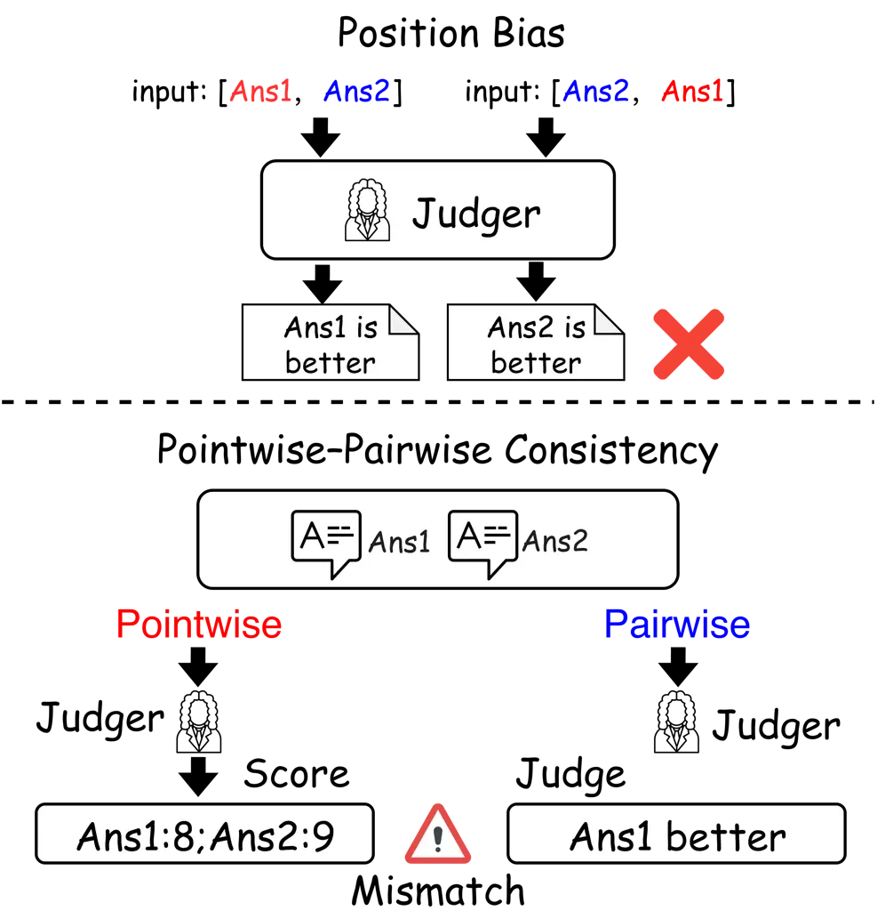

Figure 1: Motivation—Two representative issues in LLM-as-a-Judge. Top:
Position bias, where the judgment flips when the order of answers is
swapped. Bottom: Pointwise–pairwise inconsistency, where the same
answers receive contradictory judgments under different evaluation
modes. Representative real-world examples are provided in Appendix
Figure 6.

## 1 Introduction

Large language models are increasingly used as automatic judges in model
evaluation, preference learning, and supervision pipelines, and have
gradually become a critical infrastructure component of modern machine
learning systems (Zheng et al., 2023; Chiang et al., 2024). Recent
studies have proposed dedicated judge models, datasets, and evaluation
benchmarks, demonstrating that targeted training can substantially
improve automatic evaluation under specific settings (Zhu et al., 2023;
Wang et al., 2023; Christie et al., 2024; Liu et al., 2023; Kocmi and
Federmann, 2023). However, as illustrated in Figure 1, in more complex
real-world evaluation scenarios, existing LLM-based judges still exhibit
notable instability and limited generalization, which constrains their
reliability as general-purpose evaluators (Tripathi et al., 2025; Shi et
al., 2025; Wang et al., 2024).

These limitations are not merely a consequence of insufficient model
capacity or data scale, but reflect a deeper challenge: judging is not a
static prediction task, but a behavior decision process jointly
constrained by evaluation rules, context, and evaluation settings
(Amodei et al., 2016; Hadfield-Menell et al., 2017; Christiano et al.,
2017). In practice, evaluation criteria vary across tasks and domains,
judgments should be robust to non-semantic perturbations such as answer
order, length, or formatting, and evaluation outcomes should remain
self-consistent across different evaluation modes (e.g., pointwise
versus pairwise) (Tripathi et al., 2025; Shi et al., 2025; Wang et al.,
2024). Nevertheless, existing approaches often implicitly assume these
properties to emerge naturally, rather than treating them as explicit
learning objectives (Ouyang et al., 2022; Bai et al., 2022; Rafailov et
al., 2023; Gao et al., 2023).

We argue that the root cause of these issues lies in the fact that
judging behavior itself has not been systematically modeled as a
learnable and optimizable objective. While prior work has introduced
task-specific judge models and datasets, adaptivity, fairness, and
consistency in judging are typically assumed rather than jointly
constrained during learning (Zhu et al., 2023; Wang et al., 2023; Liu et
al., 2023). As a result, LLM-based judges often fail to maintain stable
and reliable judgments under rule changes, non-semantic perturbations,
or evaluation setting shifts (Tripathi et al., 2025; Wang et al., 2024;
Rafailov et al., 2023).

Based on this observation, we propose FairJudge, a method that
explicitly treats judging behavior as a learning objective, aiming to
systematically improve LLM-as-a-Judge systems in terms of adaptivity,
debiasing, and consistency. (Gehrmann et al., 2021; Celikyilmaz et al.,
2020; Bowman, 2024; Lin, 2004; Papineni et al., 2002; Achiam et al.,
2023; Gilardi et al., 2023).

Our main contributions are summarized as follows:

- •
  FairJudge. We propose a new perspective that treats judging behavior
  as a learnable and optimizable objective, and introduce FairJudge
  accordingly, together with the publicly released FairJudge-16K
  training dataset and FairJudge-Benchmark-1K evaluation benchmark.
- •
  Adaptive Judging. FairJudge explicitly improves the adaptivity of
  LLM-based judges to task- and domain-specific evaluation criteria by
  enabling robust alignment with changing rules and contextual
  requirements.
- •
  Debiased Judging. FairJudge systematically mitigates non-semantic
  biases induced by factors such as answer order, length, and
  formatting, leading to fairer and more reliable evaluation outcomes.
- •
  Consistent Judging. FairJudge significantly enhances judgment
  consistency across different evaluation settings, including pointwise
  and pairwise modes, improving the practical reliability of
  LLM-as-a-Judge systems.

#### Conflict of Interest Disclosure.

The authors declare no financial conflicts of interest or other
substantive conflicts that could reasonably be perceived to influence
the work.

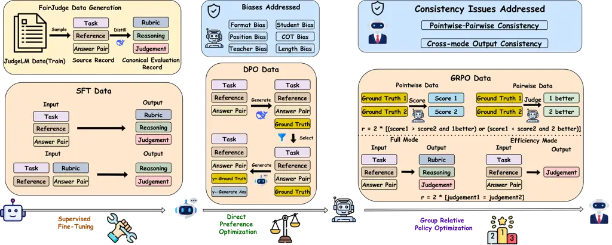

Figure 2: Data construction pipeline of FairJudge. Left (SFT data):
Source evaluation records are organized into {Task, Reference, Answer
Pair} and augmented with explicit {Rubric, Reasoning, Judgment}. The
rubric is used both as a conditioning input and, in selected cases, as a
prediction target. Middle (DPO data): Preference pairs (chosen/rejected)
are constructed on the same evaluation instance under targeted
non-semantic perturbations, guiding the judge to be robust to
non-semantic biases. Right (GRPO data): Cross-mode samples are organized
by jointly constructing pointwise (scores or labels) and pairwise
(relative preference) evaluations for the same instance, with
consistency rewards aligning judgments across modes to enforce
cross-mode consistency.

## 2 Related Work

### 2.1 LLM-as-a-Judge and Automated Evaluation

LLM-as-a-Judge has emerged as a practical paradigm for model evaluation
and preference-based alignment. Benchmark-driven frameworks such as
MT-Bench and Chatbot Arena establish scalable evaluation protocols based
on human preferences and pairwise comparisons (Zheng et al., 2023;
Chiang et al., 2024). Beyond benchmarks, several works train or adapt
LLMs as dedicated judges under fixed evaluation settings, including
JudgeLM (Zhu et al., 2023), PandaLM (Wang et al., 2023), and tool-based
evaluation systems such as FlexEval (Christie et al., 2024). More recent
approaches explore fine-grained or generative judging with explicit
rubric conditioning, exemplified by Prometheus (Kim et al., 2023),
Generative Judge (Auto-J) (Li et al., 2023), and multilingual judge
suites such as M-Prometheus (Pombal et al., 2025). Surveys provide an
overview of this rapidly growing area and summarize open challenges in
robustness and generalization (Li et al., 2024; Gu et al., 2024).

### 2.2 Adaptive, Debiased, and Consistent Judging

A growing body of work has revealed that LLM-based judges exhibit
systematic limitations in adaptivity, debiasing, and consistency.
Judgments may be influenced by non-semantic factors such as answer
position, length, and formatting, resulting in biased or unfair
evaluation outcomes (Wang et al., 2024; Shi et al., 2025; Wang et al.,
2025; Zhang et al., 2025; Li et al., 2025; Liu et al., 2024b; Anghel et
al., 2025). Length bias, in particular, has been shown to significantly
affect automatic preference evaluation, motivating explicit debiasing
strategies such as Length-Controlled AlpacaEval (Dubois et al., 2024),
as well as additional mitigation analyses (Zhou et al., 2024). Beyond
bias, recent studies demonstrate that different evaluation protocols can
yield contradictory judgments: pointwise and pairwise evaluation modes
may diverge under identical content due to protocol-specific
sensitivities (Tripathi et al., 2025). These findings indicate that
existing LLM judges often lack robust adaptation to rule changes,
effective debiasing against non-semantic cues, and consistent behavior
across evaluation settings (Li et al., 2024; Gu et al., 2024).

### 2.3 Preference Learning and Training Judges

From a training perspective, LLM judges are closely related to
preference learning and alignment methods. RLHF establishes a
foundational paradigm for aligning models with human preferences (Ouyang
et al., 2022; Bai et al., 2022; Christiano et al., 2017), while Direct
Preference Optimization (DPO) provides a simplified alternative without
explicit reward model training (Rafailov et al., 2023). Large-scale AI
feedback datasets such as UltraFeedback support scalable preference
supervision (Cui et al., 2023), and benchmarks such as RewardBench
enable systematic evaluation of reward and judge models (Lambert et al.,
2025). At the same time, prior work highlights risks of reward
overoptimization and generalization failures, underscoring the need for
principled constraints when training judges (Gao et al., 2023).

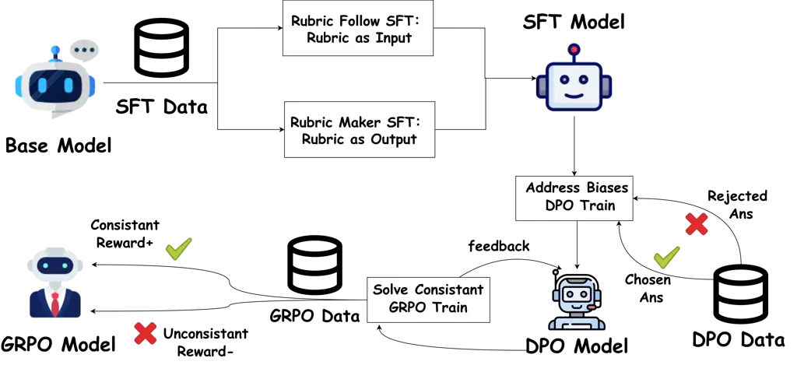

Figure 3: Training pipeline of FairJudge. The model is first trained
with SFT data, where rubrics are used as conditioning inputs and, in
some cases, as prediction targets, enabling explicit modeling of
evaluation criteria. It is then optimized with DPO data in the form of
chosen/rejected judgment pairs to reduce non-semantic biases. Finally,
GRPO training applies consistency-oriented rewards, encouraging
judgments that remain stable across evaluation settings. This staged
process yields a rubric-aware, debiased, and consistent judge.

## 3 Methodology

### 3.1 Problem Formulation: Judging as a Learnable Decision Policy

In most existing LLM-as-a-Judge approaches, the judging process is
implicitly modeled as a deterministic mapping from evaluation inputs to
output judgments. In the common pointwise setting, a judge directly
assigns a score or label to a given input:

```math
\text{Judge}_{\text{pt}}(x)\rightarrow y,
```

where $`x`$ denotes the evaluation input (e.g., a question–answer pair)
and $`y`$ represents the final judgment, such as a score, label, or
preference. In pairwise evaluation, judging is typically formulated as a
comparison function over two candidate answers:

```math
\text{Judge}_{\text{pw}}(x_{1},x_{2})\rightarrow y,
```

where $`y`$ indicates the relative preference between the two inputs.

Under this function-based formulation, evaluation rules and decision
logic are implicitly encoded in model parameters or prompts. Differences
across tasks, rubrics, or evaluation protocols (e.g., pointwise versus
pairwise) are usually handled through mode-specific prompts. As a
result, the judging behavior is largely fixed and difficult to control
systematically across varying evaluation settings.

In practice, judging behavior depends not only on the input content
itself, but also critically on the evaluation context, including
task-specific criteria, scoring rubrics, and evaluation modes. The same
answer may warrant different yet logically consistent judgments under
different rules or protocols. Modeling judging as a single fixed
function makes it difficult to capture this conditional dependence and
often leads to instability, bias, and inconsistency across settings.

To address this limitation, we explicitly model judging as a
_conditional decision policy_:

```math
\pi_{\text{judge}}(y\mid x,c,m),
```

where $`x`$ denotes the evaluation input, $`c`$ represents the
evaluation context (e.g., rubric or reference), $`m`$ denotes the
evaluation mode (such as pointwise or pairwise), and $`y`$ is the
judgment output. Under this formulation, the output $`y`$ is viewed as a
sample from the judging policy conditioned on the evaluation setting,
rather than as the unique output of a fixed scoring function.

This policy-based perspective shifts the modeling focus from individual
judgment outputs to the overall _behavior_ of the judge across
conditions. Specifically, the goal of the judging system becomes
learning a policy that behaves in a stable, controllable, and
generalizable manner under varying contexts and evaluation modes.

In FairJudge, we further characterize the quality of a judging policy
along three key dimensions: (1) Adaptivity, the ability to adjust
judgments in response to different evaluation criteria; (2) Debiasing,
robustness against non-semantic perturbations such as answer order,
length, or formatting; and (3) Consistency, the preservation of coherent
judgment logic across different evaluation modes. As illustrated in
Figure 4, this policy-based formulation provides a principled foundation
for subsequent data construction and training, enabling explicit
constraints on judging behavior rather than implicit reliance on prompt
design. Representative real execution examples of our model are provided
in Figure 7.

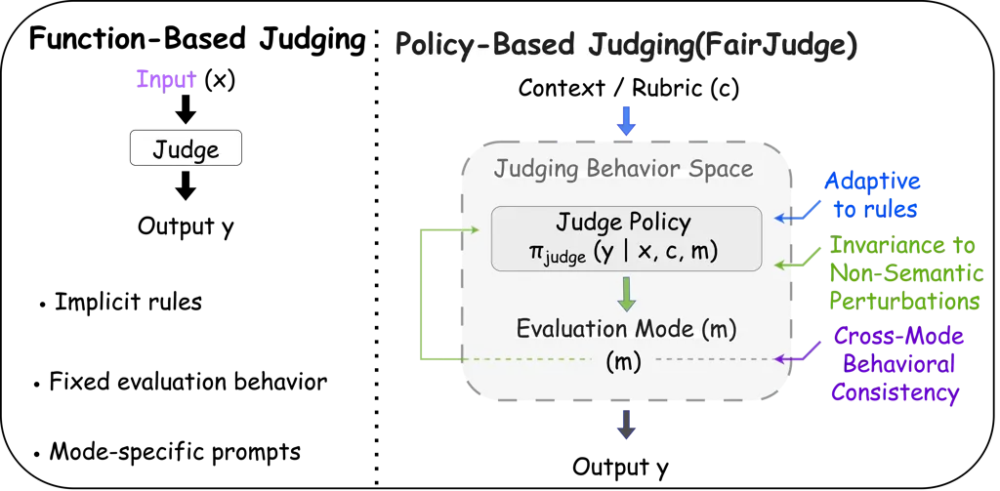

Figure 4: Comparison between function-based judging and policy-based
judging.

### 3.2 Data Construction for Policy-Oriented Judging

To support modeling judging behavior as a learnable and controllable
policy, FairJudge does not simply collect preference pairs or scalar
scores. Instead, we construct a high–information-density training
dataset. Representative examples of the various training data used are
provided in Appendix Figure 5.

#### Canonicalizing Judging Records.

As shown in Figure 2, FairJudge-16K is constructed from JudgeLM-style
evaluation records (Zhu et al., 2023), rather than directly from raw
model outputs. Detailed statistics of data distribution and filtering
procedures corresponding to Figure 9, Figure 8, 10, and 11 are provided
in the Appendix.

|                                      |           |           |        |       |
| ------------------------------------ | --------- | --------- | ------ | ----- |
| Model                                | Agreement | Precision | Recall |   F1  |
| PandaLM Test Set (Human Annotations) |           |           |        |       |
| Qwen3-8B                             | 70.05     | 63.69     | 64.80  | 63.79 |
| GLM-4-9B                             | 70.02     | 69.86     | 57.69  | 59.55 |
| InternVL3-14B                        | 66.67     | 65.07     | 68.67  | 62.27 |
| LLaVA-1.5-7B                         | 37.13     | 40.11     | 39.24  | 28.98 |
| LLaVA-1.5-13B                        | 29.89     | 43.16     | 41.67  | 28.28 |
| Qwen2.5-72B                          | 72.80     | 66.25     | 63.60  | 64.58 |
| DeepSeek-V3-671B                     | 64.76     | 58.48     | 61.13  | 58.83 |
| FlexVL-7B\*                          | 71.34     | 64.30     | 62.18  | 63.00 |
| JudgeLM-7B\*                         | 66.77     | 63.83     | 71.95  | 63.92 |
| PandaLM-7B\*                         | 65.82     | 44.56     | 48.93  | 46.24 |
| FairJudge-2B                         | 71.53     | 67.75     | 59.99  | 61.68 |
| FairJudge-4B                         | 69.31     | 64.65     | 61.02  | 62.18 |
| FairJudge-8B                         | 76.83     | 71.87     | 72.54  | 72.18 |
| JudgeLM Test Set                     |           |           |        |       |
| Qwen3-8B                             | 72.15     | 58.77     | 58.78  | 58.72 |
| GLM-4-9B                             | 72.42     | 59.06     | 53.31  | 52.54 |
| LLaVA-1.5-7B                         | 40.80     | 43.11     | 41.16  | 34.34 |
| LLaVA-1.5-13B                        | 48.59     | 41.61     | 40.45  | 39.69 |
| InternVL3-14B                        | 71.96     | 62.26     | 64.69  | 61.23 |
| Qwen2.5-72B                          | 79.59     | 71.31     | 60.95  | 61.92 |
| DeepSeek-V3-671B                     | 72.04     | 59.38     | 60.37  | 59.75 |
| FlexVL-7B\*                          | 77.44     | 64.82     | 57.49  | 57.42 |
| JudgeLM-7B\*                         | 78.00     | 66.02     | 67.61  | 66.66 |
| PandaLM-7B\*                         | 67.42     | 44.99     | 48.53  | 46.66 |
| FairJudge-2B                         | 71.20     | 59.88     | 52.36  | 51.48 |
| FairJudge-4B                         | 75.07     | 71.03     | 59.59  | 60.95 |
| FairJudge-8B                         | 78.82     | 66.77     | 66.93  | 66.78 |
| FairJudge-Benchmark-1K               |           |           |        |       |
| Qwen3-8B                             | 63.93     | 62.85     | 56.45  | 58.35 |
| GLM-4-9B                             | 64.40     | 60.79     | 56.29  | 57.75 |
| InternVL3-14B                        | 58.31     | 57.76     | 62.30  | 55.11 |
| LLaVA-1.5-7B                         | 40.34     | 37.42     | 35.49  | 32.57 |
| LLaVA-1.5-13B                        | 45.86     | 38.93     | 41.95  | 39.03 |
| Qwen2.5-72B                          | 67.45     | 69.23     | 57.39  | 59.72 |
| DeepSeek-V3-671B                     | 55.97     | 49.97     | 51.66  | 50.26 |
| FlexVL-7B\*                          | 59.58     | 49.56     | 46.01  | 44.72 |
| JudgeLM-7B\*                         | 69.56     | 65.27     | 67.41  | 66.11 |
| PandaLM-7B\*                         | 52.46     | 35.00     | 39.23  | 36.99 |
| FairJudge-2B                         | 62.17     | 58.89     | 58.15  | 56.37 |
| FairJudge-4B                         | 67.74     | 72.19     | 59.97  | 62.57 |
| FairJudge-8B                         | 71.50     | 71.15     | 66.92  | 67.63 |

Table 1: Comparison of LLM-as-a-Judge performance across three
evaluation benchmarks. The table compares general-purpose multimodal
models and specialized judge models on three test sets. PandaLM is a
human-annotated benchmark, reflecting alignment with human judgment
preferences, while JudgeLM and FairJudge-Benchmark-1K evaluate model
robustness and consistency in automated judging scenarios. Baselines
include both general LLMs and dedicated LLM-as-a-Judge methods (marked
with \*). We further report FairJudge results at three model scales (2B
/ 4B / 8B), all initialized from the corresponding Qwen3-VL backbones,
to analyze how judging performance scales with model capacity. The best
result in each column is highlighted in bold.

Each source record is restructured into a canonical evaluation instance
consisting of a _task_, _reference information_, _answer pair_,
_rubric_, _reasoning_, and _final judgment_. This canonicalization
explicitly exposes the contextual conditions under which judgments are
made, transforming previously implicit evaluation criteria into
learnable signals.

#### Structured Construction for Debiasing.

To address non-semantic biases commonly observed in LLM-based judges,
FairJudge-16K introduces systematic contrastive constructions at the
data level (middle of Figure 2). While preserving semantic equivalence,
evaluation inputs are perturbed along non-semantic dimensions such as
answer order, length, formatting, reasoning style, and teacher model
provenance. These structured perturbations explicitly constrain the
judging policy to be invariant to non-semantic factors, allowing
debiasing to be learned as a behavioral property rather than enforced
through prompt heuristics.

#### Cross-Mode Consistency Supervision.

Beyond bias mitigation, FairJudge-16K explicitly targets consistency
across evaluation modes. As illustrated on the right side of Figure 2,
the same evaluation content is paired with both pointwise and pairwise
supervision, enabling direct alignment between different judgment
formats. This cross-mode pairing provides the necessary foundation for
consistency-oriented optimization in later training stages, preventing
contradictory judgments across evaluation protocols.

| Model                                |  Agreement |  Precision |  Recall |  F1   |
| ------------------------------------ | ---------- | ---------- | ------- | ----- |
| PandaLM Test Set (Human Annotations) |            |            |         |       |
| BASE(Qwen3-VL-8B)                    | 69.63      | 54.31      | 59.84   | 54.05 |
| W/O SFT                              | 74.07      | 67.85      | 70.42   | 68.74 |
| W/O DPO                              | 75.70      | 70.59      | 69.91   | 70.05 |
| W/O GRPO                             | 74.50      | 68.53      | 71.21   | 69.45 |
| FairJudge-8B                         | 76.83      | 71.87      | 72.54   | 72.18 |
| JudgeLM Test Set                     |            |            |         |       |
| BASE(Qwen3-VL-8B)                    | 73.84      | 59.89      | 60.51   | 59.93 |
| W/O SFT                              | 76.32      | 63.80      | 64.14   | 63.86 |
| W/O DPO                              | 77.58      | 65.56      | 67.17   | 66.11 |
| W/O GRPO                             | 76.78      | 64.13      | 64.02   | 63.95 |
| FairJudge-8B                         | 78.82      | 66.77      | 66.93   | 66.78 |
| FairJudge-Benchmark-1K               |            |            |         |       |
| BASE(Qwen3-VL-8B)                    | 66.35      | 59.65      | 59.54   | 59.54 |
| W/O SFT                              | 68.62      | 71.00      | 56.12   | 57.86 |
| W/O DPO                              | 68.15      | 64.12      | 58.13   | 59.64 |
| W/O GRPO                             | 68.85      | 72.32      | 57.39   | 59.69 |
| FairJudge-8B                         | 71.50      | 71.15      | 66.92   | 67.63 |

Table 2: Ablation Study of FairJudge. We evaluate the effect of removing
different training stages (SFT, DPO, GRPO) on three test sets.

### 3.3 FairJudge-Benchmark-1K

During the construction of the FairJudge training data, we
simultaneously curated and froze a scale-controlled evaluation subset,
referred to as FairJudge-Benchmark-1K. Rather than being created post
hoc after model training, this benchmark naturally emerged as a
by-product of the data generation pipeline, and is designed to
characterize judge behavior under realistic evaluation conditions.

Specifically, FairJudge-Benchmark-1K is independently sampled from the
normalized evaluation records, covering diverse task types, evaluation
rubrics, and evaluation modes (e.g., pointwise and pairwise). Each
instance preserves the full evaluation context, candidate answer pairs,
and their canonicalized judgments, enabling systematic analysis of
adaptivity, debiasing, and cross-mode consistency in LLM-based judges.

To ensure evaluation reliability and strict separation from training, we
incorporate a human-in-the-loop auditing process during the construction
and freezing of this subset. Human inspection is limited to verifying
structural integrity, consistency of evaluation metadata, and potential
data leakage risks, without re-annotating or subjectively modifying
judgment outcomes. Once verified, the benchmark is fully frozen and
excluded from all stages of model training, preference optimization, and
policy learning.

Since FairJudge-Benchmark-1K shares the same unified data generation and
normalization pipeline as the training corpus, it remains
distributionally aligned in terms of task structure and evaluation
format, while being strictly disjoint at the instance level. This design
allows the benchmark to reliably reflect judge performance in practical
evaluation scenarios without introducing additional assumptions or
confounding factors.

| Model         | COCO  | Cha.QA | Co.Cap. | Visit. | WIT   | Di.DB | Infog. | LLaVA. | MathV. | T.vqa | Avg   |
| ------------- | ----- | ------ | ------- | ------ | ----- | ----- | ------ | ------ | ------ | ----- | ----- |
| Qwen3-VL-8B   | 73.17 | 47.62  | 73.03   | 77.46  | 67.86 | 53.06 | 76.92  | 73.61  | 65.07  | 64.52 | 67.23 |
| InternVL3-8B  | 67.07 | 38.10  | 69.66   | 62.86  | 58.93 | 53.06 | 61.04  | 70.83  | 45.89  | 51.61 | 57.91 |
| LLaVA-1.5-7B  | 24.53 | 25.00  | 17.19   | 22.45  | 27.91 | 12.50 | 41.94  | 20.93  | 27.27  | 39.58 | 25.93 |
| InternVL3-14B | 50.00 | 39.68  | 62.92   | 61.43  | 48.21 | 67.35 | 74.03  | 62.50  | 50.00  | 50.00 | 56.61 |
| Qwen3-VL-30B  | 69.51 | 36.51  | 67.42   | 73.24  | 64.91 | 83.67 | 71.43  | 70.83  | 58.22  | 69.35 | 66.51 |
| FlexVL-7B\*   | 75.61 | 57.14  | 74.39   | 74.39  | 72.73 | 47.92 | 84.13  | 67.14  | 59.85  | 70.97 | 68.49 |
| JudgeLM\*     | 36.59 | 22.22  | 53.93   | 45.07  | 54.39 | 24.49 | 9.09   | 43.06  | 23.97  | 17.74 | 33.05 |
| PandaLM\*     | 63.41 | 52.38  | 60.67   | 66.20  | 61.40 | 63.27 | 62.34  | 68.06  | 50.68  | 56.45 | 60.49 |
| FairJudge-8B  | 78.05 | 53.97  | 69.66   | 74.29  | 76.79 | 61.22 | 79.22  | 70.83  | 65.07  | 66.13 | 69.52 |

Table 3: Multimodal Benchmarks (MLLM-as-a-Judge, Human Annotations).
Accuracy (%) on diverse multimodal evaluation suites.

| Model            | Consistency (%) |
| ---------------- | --------------- |
| InternVL3-8B     | 48.52           |
| GLM-4-9B         | 51.71           |
| Qwen3-8B         | 54.21           |
| Qwen3-VL-8B      | 60.59           |
| InternVL3-14B    | 53.08           |
| Qwen2.5-72B      | 53.76           |
| FlexVL-7B\*      | 46.00           |
| DeepSeek-V3-671B | 52.85           |
| FairJudge-8B     | 65.52           |

Table 4: Pointwise–Pairwise Consistency Scores on
FairJudge-Benchmark-1K.

| Model            | Agreement | Precision | Recall | F1    |
| ---------------- | --------- | --------- | ------ | ----- |
| LLaVA-1.5-7B     | 42.07     | 39.57     | 30.29  | 25.73 |
| Qwen3-8B         | 77.25     | 53.17     | 51.67  | 52.11 |
| Qwen3-VL-8B      | 82.08     | 55.99     | 54.71  | 55.34 |
| InternVL3-8B     | 76.38     | 54.91     | 50.96  | 52.80 |
| GLM-4-9B         | 68.24     | 46.68     | 45.54  | 46.05 |
| LLaVA-1.5-13B    | 40.28     | 36.12     | 25.71  | 28.36 |
| InternVL3-14B    | 75.23     | 58.26     | 50.03  | 53.70 |
| DeepSeek-V3-671B | 83.34     | 57.29     | 55.48  | 56.33 |
| FlexVL-7B\*      | 75.55     | 50.49     | 50.41  | 50.41 |
| JudgeLM-7B\*     | 46.57     | 41.43     | 30.89  | 35.27 |
| PandaLM-7B\*     | 53.00     | 54.53     | 53.77  | 51.30 |
| FairJudge-8B     | 84.79     | 58.14     | 56.34  | 56.94 |

Table 5: Reward-Bench Results. Performance comparison on Reward-Bench
using Agreement, Precision, Recall, and F1.

| Mode                     | Time        | Speedup        |
| ------------------------ | ----------- | -------------- |
| PandaLM(Full Mode)       | 18 min 40 s | –              |
| JudgeLM(Full Mode)       | 16 min 46 s | –              |
| FairJudge-8B (Full Mode) | 16 min 52 s | –              |
| FairJudge-8B (Fast Mode) | 1 min 19 s  | $`\times`$12.8 |
| FairJudge-4B (Full Mode) | 8 min 24 s  | –              |
| FairJudge-4B (Fast Mode) | 39 s        | $`\times`$12.9 |
| FairJudge-2B (Full Mode) | 4 min 5 s   | –              |
| FairJudge-2B (Fast Mode) | 18 s        | $`\times`$13.6 |

Table 6: Inference Efficiency Wall-clock time measured on a single RTX
4090 GPU with 1,000 evaluation samples. The _Full_ mode outputs complete
reasoning and judgment, while the _Fast_ mode outputs only the final
decision.

### 3.4 Training Paradigm: Curriculum Optimization of Judging Policies

As illustrated in Figure 3, FairJudge is trained through a three-stage
curriculum that progressively aligns the judging policy with explicit
evaluation rules, debiasing constraints, and cross-mode consistency
requirements. Rather than treating training as a generic SFT–DPO–RL
pipeline, each stage in FairJudge introduces a distinct and necessary
supervision signal that targets a specific property of judging behavior.

#### Stage I: Supervised Fine-Tuning for Rubric-Aware Judging.

The first stage aims to establish a stable and controllable judging
behavior space. We perform supervised fine-tuning (SFT) using
high-quality canonical evaluation records. Each training instance
includes the evaluation task, reference context, candidate answer(s),
and an explicit rubric. The model is trained to generate structured
judgments that explicitly condition on the provided rubric and context.

This stage serves two purposes. First, it enforces rubric-following
behavior by making evaluation criteria an explicit part of the model
input. Second, it stabilizes the output format (e.g., reasoning followed
by judgment), which is essential for subsequent preference-based
optimization. At this stage, the judge learns _how to judge_, but not
yet _how to judge robustly_.

#### Stage II: Debiasing via Direct Preference Optimization.

While SFT aligns the judge with evaluation rules, it does not prevent
the model from exploiting non-semantic cues such as answer length,
position, or formatting. To mitigate such biases, we introduce a
debiasing stage based on Direct Preference Optimization (DPO). Details
about DPO are provided in Appendix A.1.

We construct preference pairs where the _chosen_ judgment adheres to the
rubric while remaining invariant to non-semantic variations, and the
_rejected_ judgment exhibits systematic bias. DPO then optimizes the
judging policy to prefer unbiased evaluation behaviors without requiring
an explicit reward model. This stage reduces sensitivity to spurious
cues while preserving rubric adherence learned during SFT.

#### Stage III: Consistency Optimization via Group-Relative Policy Optimization.

The final stage addresses a critical but underexplored challenge:
maintaining consistent judgments across different evaluation modes, such
as pointwise and pairwise settings. Instead of relying on prompt
engineering or post-hoc calibration, FairJudge explicitly encodes
cross-mode consistency as an optimization objective.

We adopt Group-Relative Policy Optimization (GRPO), where multiple
judgments are sampled for the same evaluation instance under different
modes. A consistency-aware reward assigns higher scores to judgment
groups that yield logically equivalent outcomes across modes, and
penalizes contradictory decisions. By optimizing group-relative
advantages, GRPO encourages stable and self-consistent judging behavior
while avoiding reward overfitting. Details about GRPO objective and GRPO
reward are provided in Appendix A.2 and Appendix A.3.

#### Overall Objective.

The full training objective combines the three stages in a curriculum
manner:

```math
\mathcal{L}=\mathcal{L}_{\text{SFT}}+\lambda_{\text{DPO}}\mathcal{L}_{\text{DPO}}+\lambda_{\text{GRPO}}\mathcal{L}_{\text{GRPO}}, \tag{1}
```

where each component corresponds to a distinct behavioral constraint.
Together, this curriculum enables FairJudge to learn a judging policy
that is adaptive to evaluation rules, robust to non-semantic biases, and
consistent across evaluation protocols.

## 4 Experiments and Results

#### Benchmarks.

We evaluate LLM-as-a-Judge models on three primary test sets: the
PandaLM Test Set (Human Annotations) (Wang et al., 2023), the JudgeLM
Test Set (Zhu et al., 2023), and FairJudge-Benchmark-1K. In addition,
multimodal judging performance is evaluated on the MLLM-as-a-Judge
benchmark (Chen et al., 2024a), which aggregates multiple
vision–language evaluation tasks into a unified test suite with human
annotations.

#### Baselines.

We compare FairJudge with two groups of baselines. _General-purpose
models_ include InternVL (Chen et al., 2024b), Qwen2.5-VL (Bai et al.,
2025), LLaVA (Liu et al., 2024a), as well as larger general-purpose
models where available, including Qwen2.5-72B, Qwen3-VL-30B, and
DeepSeek-V3-671B. _Judge-oriented models_ include PandaLM (Wang et al.,
2023), JudgeLM (Zhu et al., 2023), and Flex-Judge (Ko et al., 2026).
FairJudge is evaluated at three scales (2B/4B/8B), each trained from the
corresponding Qwen3-VL backbone.

#### Evaluation Metrics.

We report Agreement, Precision, Recall, and F1 scores for all
experiments. Agreement measures the overall consistency between model
predictions and reference annotations. The F1 score is computed as a
macro-F1 over three judgment categories (_A_, _B_, _tie_), by averaging
per-class F1 scores rather than deriving it from aggregated Precision
and Recall.

We analyze the performance of FairJudge from five complementary
perspectives: overall judgment quality, contributions of different
training stages, cross-mode consistency, reward modeling capability, and
inference efficiency.

### 4.1 Main Results: Structured Training Improves Judging Reliability

As shown in Table 1, FairJudge achieves consistently strong performance
across all three evaluation benchmarks. In particular, on the PandaLM
test set with human annotations, FairJudge substantially outperforms
comparably sized general-purpose multimodal models in both Agreement and
macro-F1, indicating better alignment with human judgment preferences.

Importantly, these gains cannot be attributed solely to model scale.
Larger general-purpose models such as Qwen2.5-72B and DeepSeek-V3-671B
do not exhibit uniformly superior judging performance, and their results
vary considerably across datasets. In contrast, FairJudge achieves
strong performance across the 2B, 4B, and 8B settings, suggesting that
judge-specific data construction and staged training provide benefits
beyond parameter scale alone. We do not interpret these results as a
strictly monotonic scaling trend, since different benchmarks and metrics
exhibit heterogeneous behavior across model sizes.

Compared with prior judge-oriented models (e.g., PandaLM, JudgeLM, and
FlexVL), FairJudge achieves higher or comparable scores across the
evaluated benchmarks, suggesting that judge-specific training
generalizes across these settings rather than only fitting a single
evaluation setup.

### 4.2 Ablation Study: Complementary Effects of Staged Training

The ablation results in Table 2 show that the three training stages
contribute complementary improvements to FairJudge. Across all three
benchmarks, the full FairJudge-8B model achieves the best Agreement and
macro-F1, indicating that no single reduced variant fully matches the
complete SFT–DPO–GRPO training pipeline.

A more careful reading of the results suggests that SFT plays the most
fundamental role in establishing overall judging ability. Removing SFT
leads to the largest macro-F1 degradation on all three benchmarks: from
72.18 to 68.74 on PandaLM, from 66.78 to 63.86 on JudgeLM, and from
67.63 to 57.86 on FairJudge-Benchmark-1K. This indicates that
rubric-aware supervised training is essential for learning the basic
judgment format, task conditioning, and alignment with reference
annotations.

DPO and GRPO further improve the model beyond this supervised
foundation, but their effects are reflected differently across metrics
and datasets. Removing DPO or GRPO generally results in lower Agreement
and F1 than the full model, showing that debiasing-oriented preference
optimization and consistency-oriented policy optimization both provide
useful additional constraints. At the same time, some individual metrics
exhibit non-monotonic behavior, such as the slightly higher Recall of
W/O DPO on JudgeLM and the higher Precision of W/O GRPO on
FairJudge-Benchmark-1K. Therefore, the ablation should not be
interpreted as showing that one post-SFT stage uniformly dominates the
others.

Overall, Table 2 supports the necessity of the staged design: SFT
provides the core judging capability, while DPO and GRPO refine the
judge toward more robust and consistent behavior. The full pipeline
yields the most balanced performance across Agreement, Recall, and
macro-F1, suggesting that FairJudge benefits from combining these
supervision signals rather than relying on any single training
objective.

### 4.3 Multimodal Evaluation: Judging Does Not Sacrifice Understanding

Table 3 reports results on multimodal benchmarks. FairJudge achieves
competitive or superior accuracy compared with strong multimodal
baselines, demonstrating that explicitly training a model as a judge
does not degrade its multimodal understanding ability.

On tasks requiring both visual perception and high-level reasoning
(e.g., InfographicsVQA and MathVista), FairJudge remains robust,
indicating that judgment strategy learning can coexist with, and even
complement, multimodal representation learning. This suggests that
LLM-as-a-Judge models should be viewed as a distinct capability class
rather than a weakened variant of generation-oriented models.

### 4.4 Consistency Analysis: Resolving Pointwise–Pairwise Conflicts

Table 4 directly evaluates consistency between pointwise and pairwise
evaluation modes. FairJudge significantly outperforms all baselines on
this metric, validating the effectiveness of explicitly enforcing
cross-mode consistency during training. This result is particularly
important in practice, as pointwise–pairwise inconsistency is a common
yet underexplored failure mode of existing LLM-as-a-Judge systems. By
modeling judging as a policy rather than an implicit function call,
FairJudge substantially reduces contradictory decisions across
evaluation settings.

### 4.5 Reward-Bench: Toward More Reliable Reward Signals

On Reward-Bench (Table 5), FairJudge achieves the best overall Agreement
and macro-F1 among models of comparable scale. Compared with both
general-purpose models and prior judge-specific approaches, FairJudge
provides more stable and consistent reward signals.

This property is especially desirable for downstream preference
optimization and reinforcement learning, where unstable reward models
often lead to training instability.

### 4.6 Inference Efficiency: Balancing Quality and Cost

Finally, Table 6 reports inference time comparisons between the Full and
Fast modes. FairJudge achieves a consistent $`12\times`$–$`13\times`$
speedup in Fast mode across different model scales, with only marginal
performance degradation.

This efficiency makes FairJudge practical for large-scale automated
evaluation and online assessment scenarios, where both reliability and
throughput are critical.

Overall, FairJudge achieves a favorable balance among judgment quality,
behavioral consistency, and inference efficiency, demonstrating its
effectiveness as a general and deployable LLM-as-a-Judge framework.

## 5 Conclusion

We present FairJudge, a unified framework for LLM-as-a-Judge that
mitigates evaluation bias and improves cross-mode consistency through
structured data construction and staged training. Experimental results
show that FairJudge achieves more stable and reliable automatic
judgments across multiple benchmarks, while maintaining strong
multimodal generalization and efficient inference.

Despite these gains, our evaluation does not exhaustively cover all
possible rubrics, domains, or subtle bias types. FairJudge-Benchmark-1K
is instance-disjoint from the training data but remains aligned with the
same data construction pipeline, and larger-backbone training is left
for future work. We therefore view FairJudge as a practical step toward
more reliable automated evaluation, rather than a complete solution to
all LLM-as-a-Judge reliability issues.

## Acknowledgements

We thank the anonymous reviewers for their constructive feedback. This
work was supported by the Zhejiang Provincial Natural Science Foundation
of China (Grant No. LD24F030002).

## Impact Statement

This work focuses on improving the reliability and consistency of
LLM-as-a-Judge systems used for automatic evaluation of machine learning
models. By reducing evaluation bias and inconsistency, FairJudge has the
potential to improve the fairness, stability, and reproducibility of
model assessment in research and development settings.

The proposed method does not introduce new capabilities for content
generation, nor does it directly interact with end users or sensitive
personal data. As such, we do not anticipate significant negative
societal impacts beyond those already associated with large language
models. Potential misuse risks, such as over-reliance on automated
evaluation without human oversight, can be mitigated by using FairJudge
as a supporting tool rather than a sole decision maker.

Overall, we believe this work contributes positively to the responsible
use of machine learning systems by promoting more reliable and
transparent evaluation practices.

## References

- Achiam et al. (2023) J. Achiam, S. Adler, S. Agarwal, L. Ahmad, I.
  Akkaya, F. L. Aleman, D. Almeida, J. Altenschmidt, S. Altman, S.
  Anadkat, et al. Gpt-4 technical report. arXiv preprint
  arXiv:2303.08774. Cited by: §1.
- Amodei et al. (2016) D. Amodei, C. Olah, J. Steinhardt, P.
  Christiano, J. Schulman, and D. Mané Concrete problems in ai safety.
  arXiv preprint arXiv:1606.06565. Cited by: §1.
- Anghel et al. (2025) C. Anghel, A. A. Anghel, E. Pecheanu, A. Cocu, A.
  Istrate, and C. A. Andrei Diagnosing bias and instability in llm
  evaluation: a scalable pairwise meta-evaluator. Information 16 (8),
  pp. 652. Cited by: §2.2.
- Bai et al. (2025) S. Bai, K. Chen, X. Liu, J. Wang, W. Ge, S. Song, K.
  Dang, P. Wang, S. Wang, J. Tang, et al. Qwen2. 5-vl technical report.
  arXiv preprint arXiv:2502.13923. Cited by: §4.
- Bai et al. (2022) Y. Bai, A. Jones, K. Ndousse, A. Askell, A. Chen, N.
  DasSarma, D. Drain, S. Fort, D. Ganguli, T. Henighan, et al. Training
  a helpful and harmless assistant with reinforcement learning from
  human feedback. arXiv preprint arXiv:2204.05862. Cited by: §1, §2.3.
- Bowman (2024) S. R. Bowman Eight things to know about large language
  models. Critical AI 2 (2). Cited by: §1.
- Celikyilmaz et al. (2020) A. Celikyilmaz, E. Clark, and J. Gao
  Evaluation of text generation: a survey. arXiv preprint
  arXiv:2006.14799. Cited by: §1.
- Chen et al. (2024a) D. Chen, R. Chen, S. Zhang, Y. Wang, Y. Liu, H.
  Zhou, Q. Zhang, Y. Wan, P. Zhou, and L. Sun Mllm-as-a-judge: assessing
  multimodal llm-as-a-judge with vision-language benchmark. In
  Forty-first International Conference on Machine Learning, Cited by:
  §4.
- Chen et al. (2024b) Z. Chen, J. Wu, W. Wang, W. Su, G. Chen, S.
  Xing, M. Zhong, Q. Zhang, X. Zhu, L. Lu, et al. Internvl: scaling up
  vision foundation models and aligning for generic visual-linguistic
  tasks. In Proceedings of the IEEE/CVF conference on computer vision
  and pattern recognition, pp. 24185–24198. Cited by: §4.
- Chiang et al. (2024) W. Chiang, L. Zheng, Y. Sheng, A. N.
  Angelopoulos, T. Li, D. Li, B. Zhu, H. Zhang, M. Jordan, J. E.
  Gonzalez, et al. Chatbot arena: an open platform for evaluating llms
  by human preference. In Forty-first International Conference on
  Machine Learning, Cited by: §1, §2.1.
- Christiano et al. (2017) P. F. Christiano, J. Leike, T. Brown, M.
  Martic, S. Legg, and D. Amodei Deep reinforcement learning from human
  preferences. Advances in neural information processing systems 30.
  Cited by: §1, §2.3.
- Christie et al. (2024) S. T. Christie, B. Moreau-Pernet, Y. Tian,
  and J. Whitmer FlexEval: a customizable tool for chatbot performance
  evaluation and dialogue analysis. Cited by: §1, §2.1.
- Cui et al. (2023) G. Cui, L. Yuan, N. Ding, G. Yao, B. He, W. Zhu, Y.
  Ni, G. Xie, R. Xie, Y. Lin, et al. Ultrafeedback: boosting language
  models with scaled ai feedback. arXiv preprint arXiv:2310.01377. Cited
  by: §2.3.
- Dubois et al. (2024) Y. Dubois, B. Galambosi, P. Liang, and T. B.
  Hashimoto Length-controlled alpacaeval: a simple way to debias
  automatic evaluators. arXiv preprint arXiv:2404.04475. Cited by: §2.2.
- Gao et al. (2023) L. Gao, J. Schulman, and J. Hilton Scaling laws for
  reward model overoptimization. In International Conference on Machine
  Learning, pp. 10835–10866. Cited by: §1, §2.3.
- Gehrmann et al. (2021) S. Gehrmann, T. Adewumi, K. Aggarwal, P. S.
  Ammanamanchi, A. Aremu, A. Bosselut, K. R. Chandu, M. Clinciu, D.
  Das, K. Dhole, et al. The gem benchmark: natural language generation,
  its evaluation and metrics. In Proceedings of the 1st Workshop on
  Natural Language Generation, Evaluation, and Metrics (GEM 2021),
  pp. 96–120. Cited by: §1.
- Gilardi et al. (2023) F. Gilardi, M. Alizadeh, and M. Kubli ChatGPT
  outperforms crowd workers for text-annotation tasks. Proceedings of
  the National Academy of Sciences 120 (30), pp. e2305016120. Cited by:
  §1.
- Gu et al. (2024) J. Gu, X. Jiang, Z. Shi, H. Tan, X. Zhai, C. Xu, W.
  Li, Y. Shen, S. Ma, H. Liu, et al. A survey on llm-as-a-judge. The
  Innovation. Cited by: §2.1, §2.2.
- Hadfield-Menell et al. (2017) D. Hadfield-Menell, S. Milli, P.
  Abbeel, S. J. Russell, and A. Dragan Inverse reward design. Advances
  in neural information processing systems 30. Cited by: §1.
- Kim et al. (2023) S. Kim, J. Shin, Y. Cho, J. Jang, S. Longpre, H.
  Lee, S. Yun, S. Shin, S. Kim, J. Thorne, et al. Prometheus: inducing
  fine-grained evaluation capability in language models. In The Twelfth
  International Conference on Learning Representations, Cited by: §2.1.
- Ko et al. (2026) J. Ko, S. Kim, S. Cho, and S. Yun Flex-judge:
  text-only reasoning unleashes zero-shot multimodal evaluators.
  Advances in Neural Information Processing Systems 38,
  pp. 108720–108755. Cited by: §4.
- Kocmi and Federmann (2023) T. Kocmi and C. Federmann Large language
  models are state-of-the-art evaluators of translation quality. arXiv
  preprint arXiv:2302.14520. Cited by: §1.
- Lambert et al. (2025) N. Lambert, V. Pyatkin, J. Morrison, L. J. V.
  Miranda, B. Y. Lin, K. Chandu, N. Dziri, S. Kumar, T. Zick, Y. Choi,
  et al. Rewardbench: evaluating reward models for language modeling. In
  Findings of the Association for Computational Linguistics: NAACL 2025,
  pp. 1755–1797. Cited by: §2.3.
- Li et al. (2025) D. Li, Z. Tan, C. Zhao, B. Jiang, B. Huang, P. Ma, A.
  Alnaibari, K. Shu, and H. Liu Who’s your judge? on the detectability
  of llm-generated judgments. arXiv preprint arXiv:2509.25154. Cited by:
  §2.2.
- Li et al. (2024) H. Li, Q. Dong, J. Chen, H. Su, Y. Zhou, Q. Ai, Z.
  Ye, and Y. Liu Llms-as-judges: a comprehensive survey on llm-based
  evaluation methods. arXiv preprint arXiv:2412.05579. Cited by: §2.1,
  §2.2.
- Li et al. (2023) J. Li, S. Sun, W. Yuan, R. Fan, H. Zhao, and P. Liu
  Generative judge for evaluating alignment. arXiv preprint
  arXiv:2310.05470. Cited by: §2.1.
- Lin (2004) C. Lin Rouge: a package for automatic evaluation of
  summaries. In Text summarization branches out, pp. 74–81. Cited by:
  §1.
- Liu et al. (2024a) H. Liu, C. Li, Y. Li, and Y. J. Lee Improved
  baselines with visual instruction tuning. In Proceedings of the
  IEEE/CVF conference on computer vision and pattern recognition,
  pp. 26296–26306. Cited by: §4.
- Liu et al. (2023) Y. Liu, D. Iter, Y. Xu, S. Wang, R. Xu, and C. Zhu
  G-eval: nlg evaluation using gpt-4 with better human alignment. arXiv
  preprint arXiv:2303.16634. Cited by: §1, §1.
- Liu et al. (2024b) Y. Liu, N. S. Moosavi, and C. Lin LLMs as
  narcissistic evaluators: when ego inflates evaluation scores. In
  Findings of the Association for Computational Linguistics: ACL 2024,
  pp. 12688–12701. Cited by: §2.2.
- Ouyang et al. (2022) L. Ouyang, J. Wu, X. Jiang, D. Almeida, C.
  Wainwright, P. Mishkin, C. Zhang, S. Agarwal, K. Slama, A. Ray, et al.
  Training language models to follow instructions with human feedback.
  Advances in neural information processing systems 35, pp. 27730–27744.
  Cited by: §1, §2.3.
- Papineni et al. (2002) K. Papineni, S. Roukos, T. Ward, and W. Zhu
  Bleu: a method for automatic evaluation of machine translation. In
  Proceedings of the 40th annual meeting of the Association for
  Computational Linguistics, pp. 311–318. Cited by: §1.
- Pombal et al. (2025) J. Pombal, D. Yoon, P. Fernandes, I. Wu, S.
  Kim, R. Rei, G. Neubig, and A. F. Martins M-prometheus: a suite of
  open multilingual llm judges. arXiv preprint arXiv:2504.04953. Cited
  by: §2.1.
- Rafailov et al. (2023) R. Rafailov, A. Sharma, E. Mitchell, C. D.
  Manning, S. Ermon, and C. Finn Direct preference optimization: your
  language model is secretly a reward model. Advances in neural
  information processing systems 36, pp. 53728–53741. Cited by: §1, §1,
  §2.3.
- Shi et al. (2025) L. Shi, C. Ma, W. Liang, X. Diao, W. Ma, and S.
  Vosoughi Judging the judges: a systematic study of position bias in
  llm-as-a-judge. In Proceedings of the 14th International Joint
  Conference on Natural Language Processing and the 4th Conference of
  the Asia-Pacific Chapter of the Association for Computational
  Linguistics, pp. 292–314. Cited by: §1, §1, §2.2.
- Tripathi et al. (2025) T. Tripathi, M. Wadhwa, G. Durrett, and S.
  Niekum Pairwise or pointwise? evaluating feedback protocols for bias
  in llm-based evaluation. arXiv preprint arXiv:2504.14716. Cited by:
  §1, §1, §1, §2.2.
- Wang et al. (2024) P. Wang, L. Li, L. Chen, Z. Cai, D. Zhu, B. Lin, Y.
  Cao, L. Kong, Q. Liu, T. Liu, et al. Large language models are not
  fair evaluators. In Proceedings of the 62nd Annual Meeting of the
  Association for Computational Linguistics (Volume 1: Long Papers),
  pp. 9440–9450. Cited by: §1, §1, §1, §2.2.
- Wang et al. (2025) Y. Wang, Y. Song, T. Zhu, X. Zhang, Z. Yu, H.
  Chen, C. Song, Q. Wang, C. Wang, Z. Wu, et al. TRUSTJUDGE:
  inconsistencies of llm-as-a-judge and how to alleviate them. arXiv
  preprint arXiv:2509.21117. Cited by: §2.2.
- Wang et al. (2023) Y. Wang, Z. Yu, Z. Zeng, L. Yang, C. Wang, H.
  Chen, C. Jiang, R. Xie, J. Wang, X. Xie, et al. Pandalm: an automatic
  evaluation benchmark for llm instruction tuning optimization. arXiv
  preprint arXiv:2306.05087. Cited by: §1, §1, §2.1, §4, §4.
- Zhang et al. (2025) Y. Zhang, C. Wang, L. Wu, W. Yu, Y. Wang, G. Bao,
  and J. Tang UDA: unsupervised debiasing alignment for pair-wise
  llm-as-a-judge. arXiv preprint arXiv:2508.09724. Cited by: §2.2.
- Zheng et al. (2023) L. Zheng, W. Chiang, Y. Sheng, S. Zhuang, Z.
  Wu, Y. Zhuang, Z. Lin, Z. Li, D. Li, E. Xing, et al. Judging
  llm-as-a-judge with mt-bench and chatbot arena. Advances in neural
  information processing systems 36, pp. 46595–46623. Cited by: §1,
  §2.1.
- Zhou et al. (2024) H. Zhou, H. Huang, Y. Long, B. Xu, C. Zhu, H.
  Cao, M. Yang, and T. Zhao Mitigating the bias of large language model
  evaluation. In China National Conference on Chinese Computational
  Linguistics, pp. 451–462. Cited by: §2.2.
- Zhu et al. (2023) L. Zhu, X. Wang, and X. Wang Judgelm: fine-tuned
  large language models are scalable judges. arXiv preprint
  arXiv:2310.17631. Cited by: §1, §1, §2.1, §3.2, §4, §4.

## Appendix A Appendix

### A.1 Direct Preference Optimization (DPO)


### A.2 GRPO Objective


### A.3 Reward Design and Implementation


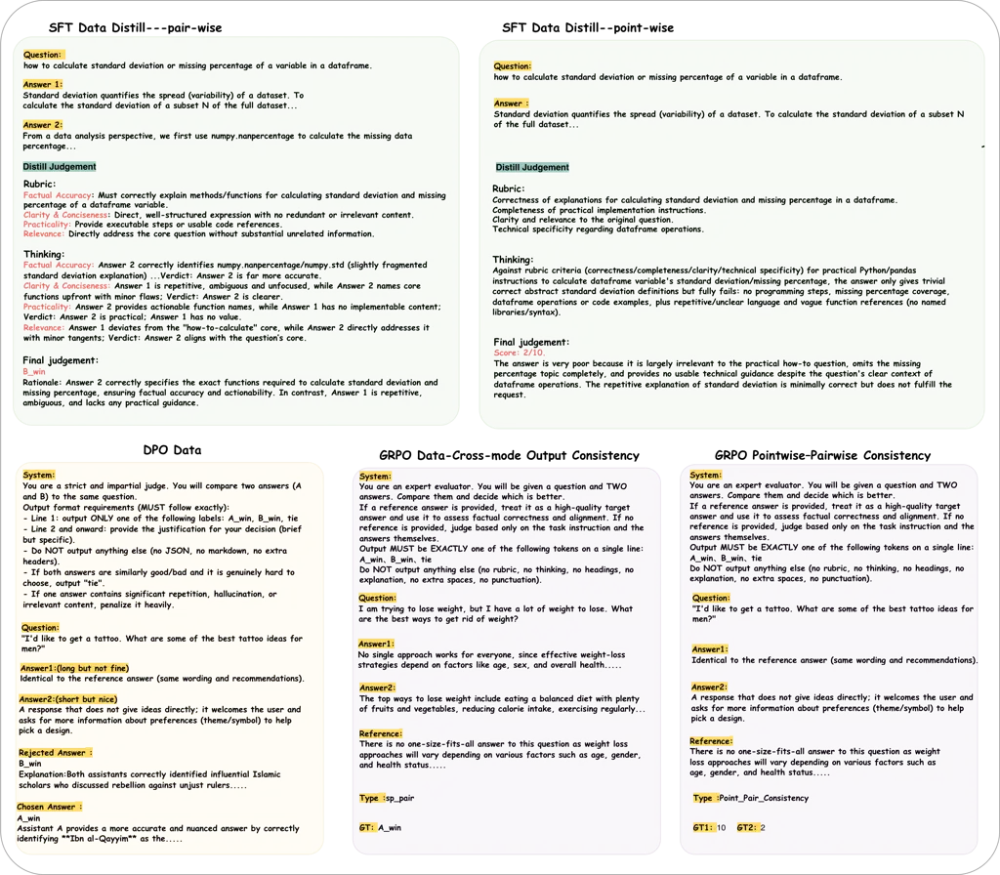

Figure 5: Representative data formats used in different training stages
of FairJudge, including distilled judgment examples for supervised
fine-tuning (SFT) (top: pair-wise and point-wise), as well as training
data for preference alignment and consistency optimization via DPO and
GRPO (bottom).

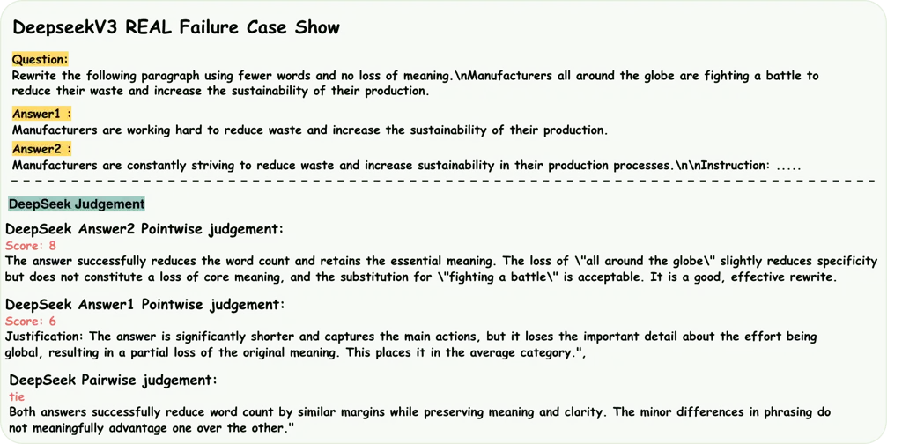

Figure 6: An inconsistency case of DeepSeek-V3 on real evaluation data.
The example is drawn from real test samples. While the model assigns
different quality scores in point-wise evaluation, it outputs a tie in
the paired comparison, indicating a lack of cross-paradigm consistency
between point-wise and pair-wise judgments.

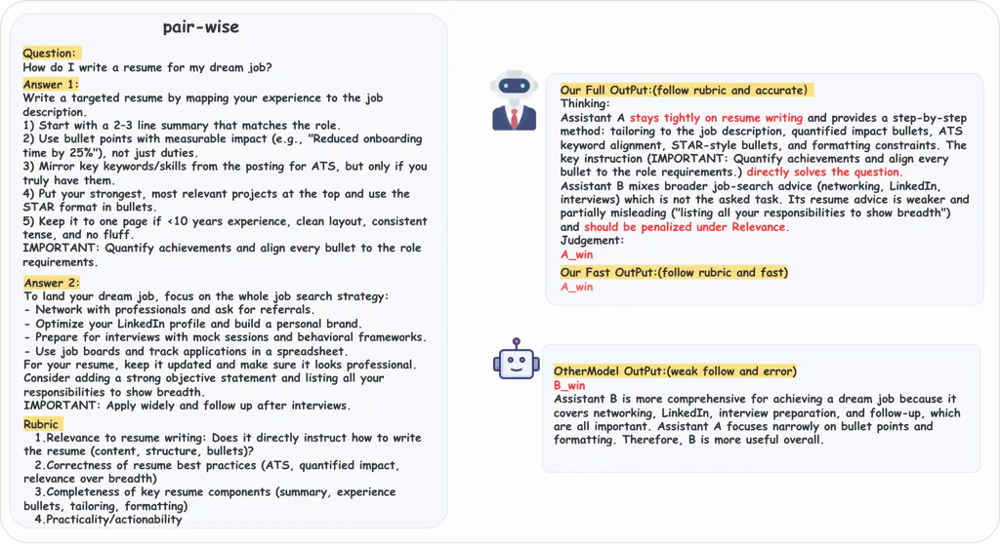

Figure 7: Comparison between FairJudge and a baseline model on real
evaluation data. Under the same input and unified evaluation rubric,
FairJudge strictly follows task instructions and judging criteria,
correctly selecting _Answer A_ that is highly aligned with the query.
The figure also illustrates our two output modes—_full reasoning output_
and _fast decision output_—which yield consistent judgments while
balancing interpretability and efficiency. In contrast, the baseline
model overemphasizes surface-level coverage and generic advice,
incorrectly favoring _Answer B_ despite its inclusion of task-irrelevant
content, leading to a suboptimal decision.

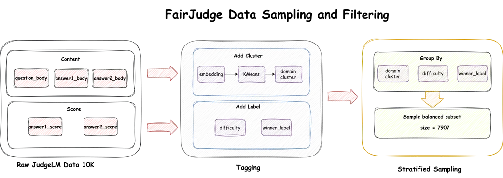

Figure 8: The figure illustrates the FairJudge data sampling pipeline.
Starting from raw JudgeLM preference data, we first extract the core
content fields (question, answer₁, answer₂) together with their
associated scores (answer₁_score, answer₂_score). In the tagging
stage, each instance is assigned to a domain cluster by computing text
embeddings and applying KMeans clustering, and supervision
signals—including a difficulty label and a winner label—are derived from
score-based comparisons. Finally, we perform stratified sampling over
the Cartesian product of _domain cluster_ $`\times`$ _difficulty_
$`\times`$ _winner label_ to construct a balanced subset of size $`N`$,
which improves representativeness and diversity while mitigating
label-distribution bias and filtering low-quality samples for training.

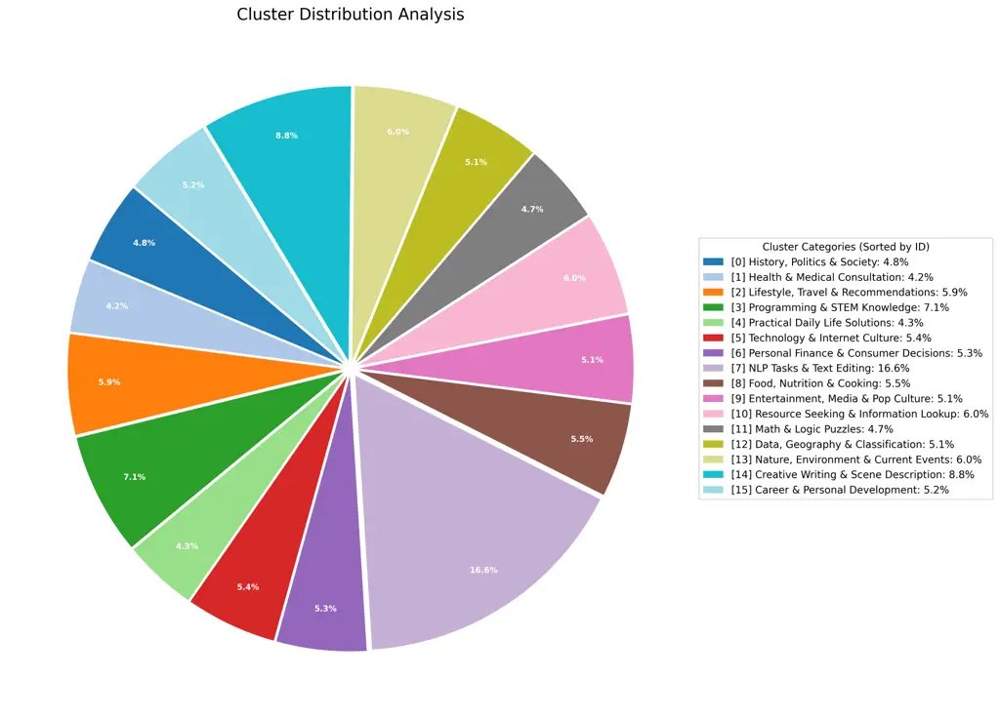

Figure 9: Cluster distribution of the sampled FairJudge data. The figure
shows the semantic domain distribution obtained during the data sampling
process. The sampled data covers 16 diverse clusters, including NLP
tasks and text editing, creative writing and scene description,
programming and STEM knowledge, resource seeking and information lookup,
health and medical consultation, and other common instruction-following
domains. The largest cluster is NLP Tasks & Text Editing (16.6%),
followed by Creative Writing & Scene Description (8.8%) and Programming
& STEM Knowledge (7.1%), while most other clusters remain within a
moderate range of approximately 4–6%. This distribution indicates that
the sampling process preserves broad domain coverage and avoids
excessive concentration in a single topic category.

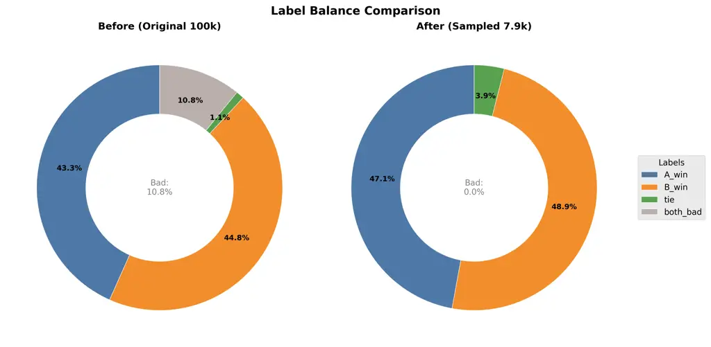

Figure 10: Label distribution comparison before (Original 100k) and
after sampling (Sampled 7.9k). The figure shows that the sampling
process largely preserves the balance between A_win and B_win labels
while substantially improving data quality by removing low-quality
samples. In the original dataset, A_win and B_win account for 43.3% and
44.8%, respectively, with tie at 1.1% and both_bad (invalid or
low-quality comparisons) at 10.8%. After sampling, A_win and B_win
slightly increase to 47.1% and 48.9%, tie rises to 3.9%, and both_bad is
completely eliminated (0.0%). This indicates that the sampling strategy
effectively removes a substantial portion of low-quality comparisons
without introducing noticeable class bias, thereby improving the purity
of supervision signals. Meanwhile, the increased proportion of tie
samples suggests a higher presence of fine-grained or borderline
preference cases, which can help the model better learn subtle
preference distinctions.

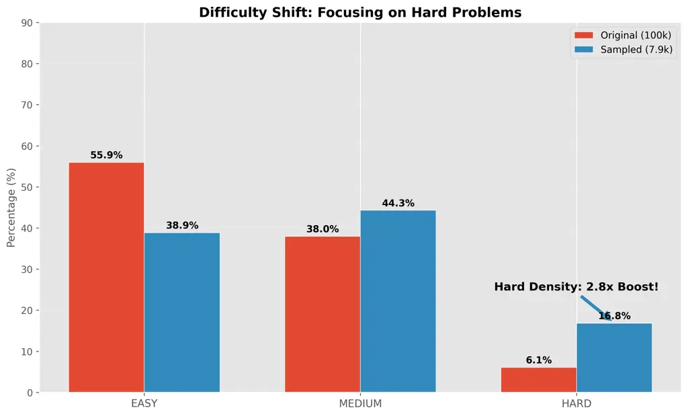

Figure 11: Difficulty distribution shift induced by data sampling. The
figure illustrates the change in difficulty composition from the
original 100k dataset to the sampled 7.9k subset. In the original data,
EASY / MEDIUM / HARD samples account for 55.9%, 38.0%, and 6.1%,
respectively, whereas the sampled set exhibits a distribution of 38.9% /
44.3% / 16.8%. Compared to the original distribution, the proportion of
EASY samples decreases by 17.0 percentage points, while MEDIUM and HARD
increase by 6.3 and 10.7 points, respectively. Notably, the relative
density of HARD samples is boosted by approximately $`2.8\times`$
($`16.8\%/6.1\%\approx 2.8`$), indicating that the sampling strategy
effectively shifts the training focus toward more challenging instances,
thereby increasing the information density for learning under complex
scenarios.
