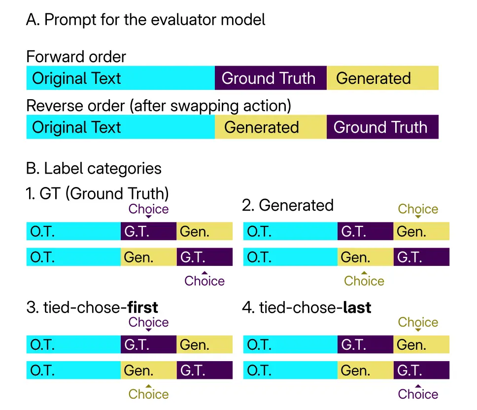
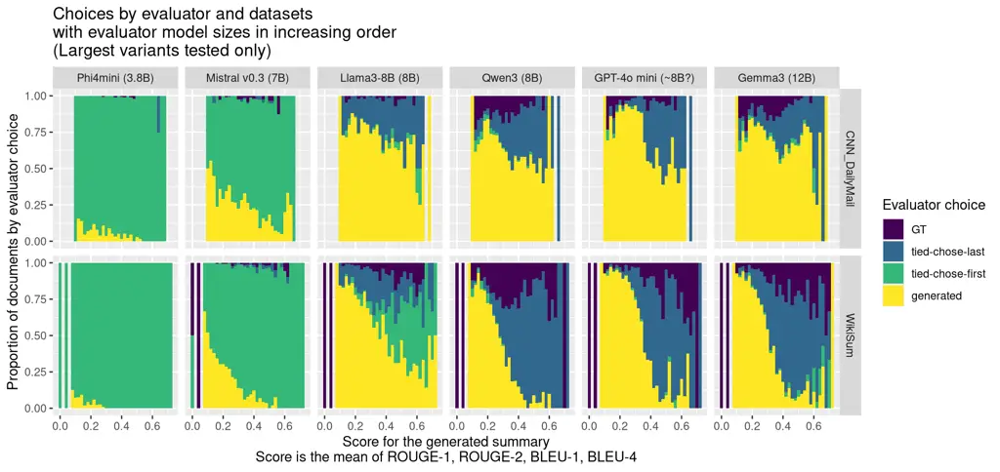
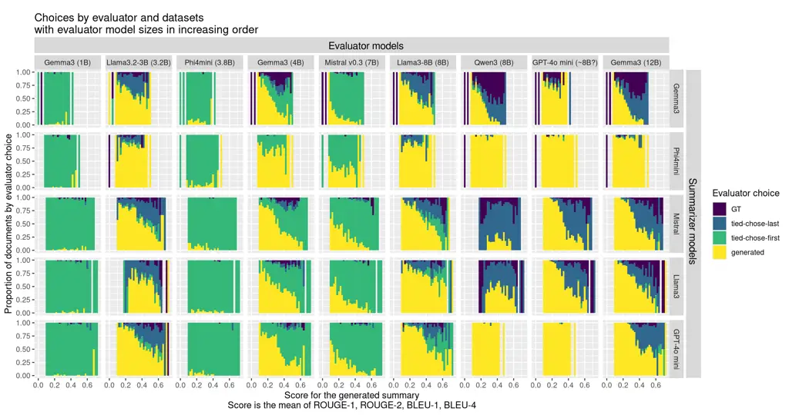
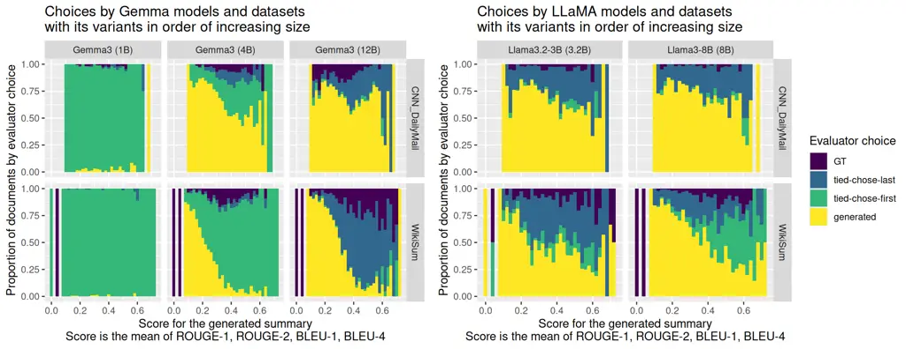

# Blind to the Human Touch: Overlap Bias in LLM-Based Summary Evaluation

###### Abstract

Large language model (LLM) judges have often been used alongside
traditional, algorithm-based metrics for tasks like summarization
because they better capture semantic information, are better at
reasoning, and are more robust to paraphrasing. However, LLM judges show
biases for length and order among others, and are vulnerable to various
adversarial input prompts. While recent studies have looked into these
biases, few have analyzed them at a more granular level in relation to a
well-defined overlap metric. In this work we provide an LLM judge bias
analysis as a function of overlap with human-written responses in the
domain of summarization. We test 9 recent LLMs with parameter counts
ranging from 1 billion to 12 billion, including variants of Gemma 3 and
LLaMA 3. We find that LLM judges increasingly prefer summaries generated
by other LLMs over those written by humans as the similarities (as
measured by ROUGE and BLEU) between the judged summaries decrease, and
this pattern extends to all but one model tested, and exists regardless
of the models’ own position biases. Additionally, we find that models
struggle to judge even summaries with limited overlaps, suggesting that
LLM-as-a-judge in the summary domain should rely on techniques beyond a
simple comparison.

Keywords: LLMs, summarization

| Jiangnan Fang¹, Cheng-Tse Liu², Hanieh Deilamsalehy³, Nesreen K. Ahmed⁴,   |
| -------------------------------------------------------------------------- |
| Puneet Mathur⁵, Nedim Lipka⁶, Franck Dernoncourt⁷, Ryan A. Rossi⁸          |
| ^(1,2)Independent Researchers, ^(3,5,6,7,8)Adobe Research, ⁴Cisco Research |
| {¹jfang53, ²cliu282}@ucsc.edu                                              |

Abstract content

As large language models (LLMs) continue to improve in their
capabilities, LLM-as-a-judge has emerged as a method of automating
evaluation. Compared to traditional overlap-based metrics, LLM judges
better capture semantic content of texts and are more robust to
paraphrasing. As models can leverage reasoning capabilities gained from
training, they also enable evaluation that don’t rely on reference texts
that can be expensive to obtain Freitag et al. (2024). However, bias
remains an issue in the LLM-as-a-judge paradigm. Biases of judge LLMs
reveal particular tendencies learned through LLM’s training, and these
tendencies displayed for one task (position bias, for example) extend to
other areas and input domains Tian et al. (2025) especially for
zero-shot tasks as they rely on the internal knowledge of a model.
Understanding these bias patterns is crucial in evaluating LLM
performance and informing future training or design practices. While
previous work has assessed how well LM decisions correlate with human
judgments Goyal et al. (2023); Zhu et al. (2025), including at different
levels of quality as rated by humans Shen et al. (2023), the present
work aims to look at correlations in a much more granular level in terms
of levels of overlap as measured by n-gram metrics.

In this work, we study the following research questions: (1) How does
similarity as measured by n-gram overlap metrics (e.g. ROUGE, BLEU)
correlate with LLM judgments, and is such judgment vs. similarity
pattern observed for models of different sizes and types? (2) How does
presentation order (position bias) interact with the judgment vs.
similarity pattern?

After extensive experimentation, we make the following contributions and
findings:

- •
  We collect a benchmark dataset containing 6,744 LLM summaries of a
  filtered subset of WikiSum and CNN_DailyMail datasets and over 94,000
  LLM judgments between human and machine-generated summaries.
- •
  LLM judges’ preference toward their own answers is (1) more prominent
  when generated summaries have fewer n-gram overlaps with the
  human-written summaries, (2) exists even towards summaries by small
  models, and (3) a large difference is needed for such preference to
  show. (See Figure 4 where the proportion of “generated” choices grows
  towards the left of individual results).
- •
  Position bias is more prominent when the generated summaries are more
  like human-written summaries. In addition, models with more parameters
  tend to prefer the last-presented summaries while models with fewer
  parameters prefer the first-presented summaries. We note that the bias
  for generated summaries as described above persists for variously
  sized models we have tested, regardless of types of position bias.
  (See Figure 5 for further breakdowns for each evaluator and generator
  model.)
- •
  We conduct a large-scale systematic study consisting of 9 LLMs, with
  parameter counts ranging from 1 billion to 12 billion, of judge LLM
  bias as a function vs. the degree of overlap between machine and human
  summaries.

## 1.  Related Works

Recent studies in LLM judges include various evaluation datasets,
frameworks, and prompting methods. Zhu et al. (2025) built a dataset for
fine-tuning LLM judges and proposes a scalable framework for open-ended
LLM judging tasks. Kumar et al. (2024) developed a benchmark dataset for
evaluating personalized long text generation. Hashemi et al. (2024)
develops a weighing framework for combining LLM responses to items in a
rubric, and G-Eval in Liu et al. (2023) uses a combination of
chain-of-thought prompting and form-filling to improve a judge LLM’s
alignment with human preferences in summarization and text generation.

LLM judges exhibit content-level biases, i.e. they are biased towards
textual content not related to the assigned evaluation task, or they
ignore textual content that are related to evaluation. Chen et al.
(2024) shows that LLM judges may overlook factual errors, and show
gender, authority, and beauty biases. Fu et al. (2023) has similarly
found that LLMs may struggle with evaluating factual information in
summarizations. Judge LLMs can even be swayed by short phrases like
“informative”, or “solution:” injected into evaluated texts Raina et al.
(2024); Zhao et al. (2025).

Patterns of biases towards other aspects of the texts, e.g. authorship
and length, are also found in both judging outputs of different language
models and between human and model outputs. Laurito et al. (2024) found
that LLMs often favor outputs of other LLMs over human outputs, and
between different AI output texts. Hu et al. (2024) found that longer
generated responses are preferred by LLM judges than shorter responses.
Panickssery et al. (2024) and Wataoka et al. (2024) found that LLMs also
recognize and favor texts produced by the same model over other models.
(i.e. GPT 4o-mini favor outputs of GPT 4o-mini over that of other LMs).
Self-favoritism and position bias are also reported by Zheng et al.
(2023) and Li et al. (2024), with the former suggesting several
mitigation strategies for position bias including a swapping operation
and few-shot prompting and the latter proposing a split-and-merge
approach to align semantically similar sections of evaluated texts.
Large model evaluators’ bias towards other models extends to other
domains like images as well Taesiri et al. (2025).

|                                     |                  |                |                |                |
| ----------------------------------- | ---------------- | -------------- | -------------- | -------------- |
| Model name                          | \# of parameters | Context length | Summarizer     | Evaluator      |
| google/gemma-3-1B-it                | 1B               | 32k            | $`\checkmark`$ | $`\checkmark`$ |
| google/gemma-3-4B-it                | 4.3B             | 128k           | $`\times`$     | $`\checkmark`$ |
| google/gemma-3-12B-it               | 12.2B            | 128k           | $`\times`$     | $`\checkmark`$ |
| meta-llama/Llama-3.2-3B-Instruct    | 3.21B            | 128k           | $`\times`$     | $`\checkmark`$ |
| meta-llama/Meta-Llama-3-8B-Instruct | 8.03B            | 8k             | $`\checkmark`$ | $`\checkmark`$ |
| microsoft/Phi-4-mini-instruct       | 3.84B            | 128k           | $`\checkmark`$ | $`\checkmark`$ |
| mistralai/Mistral-7B-Instruct-v0.3  | 7.25B            | 8k             | $`\checkmark`$ | $`\checkmark`$ |
| Qwen/Qwen3-8B                       | 8.19B            | 32k            | $`\times`$     | $`\checkmark`$ |
| GPT-4o mini                         | 8B?              | 128k           | $`\checkmark`$ | $`\checkmark`$ |

Table 1: Models used in the current work. Model names are Huggingface
repo_ids (excluding GPT-4o mini). “Summarizer” means the model was used
to produce generated summaries; “Evaluator” means the model was used to
evaluate summaries. GPT-4o mini’s parameter count is unknown; however,
Abacha et al. (2025) estimates 8 billion, citing Zeff (2024). We
couldn’t confirm this figure.

## 2.  Methodology

### 2.1.  Experimental Setup

Read the following section of a long document and write a concise
summary that captures its main points and key details in around 100
words. Output the summary text only and nothing else.

\[original text\]

Figure 1: Prompt used for the LLMs to generate initial summaries to be
evaluated

Given the original text below, along with indexed summaries, please
evaluate the summaries and output the name of the best summary. Output
the exact name only and nothing else.  
original text:

\[original text\]

summary_1

\[first summary text\]

summary_2

\[second summary text\]

Figure 2: Prompt used for the LLMs to generate initial summaries to be
evaluated.

We use test sets from WikiSum Cohen et al. (2021) and CNN_DailyMail See
et al. (2017); Hermann et al. (2015), covering a diverse range of topics
for summarization. Both datasets contain 2,000 articles and their human
written summaries in the test set. We use Phi-4-mini-instruct Microsoft
(2025), Mistral-7B-Instruct-v0.3 Jiang et al. (2023), GPT-4o mini OpenAI
(2024), and variants of Gemma Gemma Team (2025) and LLaMA Grattafiori et
al. (2024), covering parameter counts from 1 billion to 12 billion. The
models are decoder-only transformers. A summary of tested models can be
found in Table 1. During experiments, model temperatures are left at
0.7. For an LLM-generated summary, we use the average of BLEU-1, BLEU-4,
ROUGE-1, and ROUGE-2 to score its similarity to the human summary. These
four metrics cover recall- and precision-oriented scores and a range of
n-gram lengths to capture keyword and short phrases matches.

We first obtain LLM summaries (“generated” summaries) using the prompt
in Figure 1, where “original text” is the article in each of the
datasets. We then prompt an evaluator model to judge pairs of summaries
given the original texts using the prompt format in Figure 2. Here,
LLM-generated and human-generated “ground truth” summaries are assigned
to either \[first summary text\] or \[second summary text\] as described
later in Section 2.2. We keep no conversation history with LLMs so that
they are not influenced by past summarizations or evaluations.

While our instruction to the judge LLMs is to only respond with the name
of the summary, models occasionally return answers that quote their
choices. We perform string matching to recover some judgments from these
texts.

### 2.2.  Controlling for Length and Order Bias

ROUGE and BLEU scores are affected by the length difference between
reference and input texts, as longer input texts can simply include
duplicates of segments in the reference text to inflate the scores. At
the same time, LLM judges can be biased towards longer texts as
discussed in Section 1. To reduce the effect of length bias, we control
for summary length by filtering each dataset so that the reference
(human-generated) summaries are between 95 and 105 space-delimited words
long. Words are counted with space delimiters instead of using a
particular tokenization algorithm because each model may tokenize texts
differently. In the prompt in Figure 1, we instruct LLMs to output 100
words to match lengths of ground truth summaries. After filtering, the
CNN_DailyMail dataset contains 286 articles and the WikiSum dataset
contains 276 articles.

To reduce the effects of ordering bias and self-preferential bias as
mentioned in Section 1, we perform evaluations with summaries presented
in both orders. The evaluator LLM choices are accepted if they are
consistent when summaries are presented in both orders and mark choices
as “tied” if they are different depending on summary order. Tied choices
are further broken down by their ordering preference, i.e. if a model
chooses the first summary for both orders, the tie is marked as
“tied-chose-first”, and if it chooses the last summary for both orders,
the tie is marked as “tied-chose-last”. We provide a visual
representation of these categories in Figure 3.

Figure 3: Visual representation of evaluator choice labels. “GT” means
the evaluator chooses the ground truth summary in both orders;
“Generated” means the evaluator chooses the LLM-generated summary in
both orders. “Tied-chose-first” means the evaluator chooses the first
presented summary in both orders, and “Tied-chose-last” means the
evaluator chooses the last presented summary in both orders.

### 2.3.  Extending the Range of Similarity Scores

After obtaining summaries and scoring their similarity with human
summaries, we observed that the generated summaries had limited range
for the averaged score, namely below 0.55. To get a fuller picture with
wider range of similarity scores, we obtain additional LLM summaries by
submitting ground truth summaries and prompting models to rephrase and
reorganize them, keeping longer expressions and segments intact (see
Figure 6 for prompt). Since summaries with more long phrase overlaps
would score higher for ROUGE and BLEU, the additional summaries extend
the range of scores for similarity metrics. These summaries are treated
as input summaries and passed to evaluator LLMs as described in
Section 2.1, i.e. the evaluator prompt does not reveal that these
summaries are rephrased from ground-truth summaries.

Figure 4: Proportion of documents where the evaluator chooses ground
truth (GT), generated summaries, and when the evaluator chose first,
chose last regardless of order, plotted against the score of the
non-ground truth summaries. See Figure 3 for a visual representation of
evaluator choices. The score is the mean of ROUGE-1, ROUGE-2, BLEU-1,
and BLEU-4. Here the generators (summarizers) are Gemma 3, Phi 4 mini,
Mistral, Llama 3, and GPT-4o mini (i.e. no Qwen 3). For Llama 3 8B and
Mistral, additional summaries are generated with different prompts to
ascertain possible patterns in higher-scored summaries. Further
breakdowns for the variants Llama and Gemma can be found in Figure 7.

Figure 5: Alternative version of Figure 4, where each row of the grid
are the results with the same summarizer instead.

Rephrase and reorganize this text in your own style, but retain as many
long phrases in it as possible. Keep to the same length. Output your
rephrased text and nothing else.

\[ground truth summary\]

Figure 6: Prompt used for the LLMs to generate additional,
higher-scoring summaries.

Figure 7: Alternative version of Figure 4, showing breakdowns of
variants of Llama and Gemma.

## 3.  Results & Discussion

Since model choices are discrete and only consist of 4 categories
(excluding “other”), we present the results in histograms to better
visualize model preferences. For each graph in Figures 4 and 5, we show
the proportion of model choices for each bin of values on the x-axis.

RQ1: How do LLM judgments correlate with n-gram-based similarity
metrics, and is that consistent across models of different sizes?

We first note that for all models, the human summary is rarely chosen as
the better summary regardless of similarity to human summaries. For all
models excluding variants and the smallest Gemma-3-1B-it we observe a
pattern that AI-AI bias (i.e. LLM tending to choose generated summaries
over human summaries) is more prominent when generated summaries are
less like the human-written summaries, i.e. fewer n-gram overlaps; see
Figure 4 where the proportion of “generated” choices is larger towards
the left of the subfigures. We see this tendency for LLM judges even
when judging summaries produced by smaller models. For example, the
preference patterns for the 12B-parameter Gemma 3 judge and the 8B
Mistral judge are similar for summaries produced by the 1B Gemma 3 (see
Figure 5), even though the position biases of the judges are different,
namely that Gemma 3 (12B) tend to choose last-presented summary while
Mistral (7B) prefer the first-presented summary. It is worth noting that
for most of the models tested the bias towards generated summaries
diminish well before the average scores approaches 1. For example,
Mistral’s (8B) preference frequency for LLM summaries drops below 25%
for mean scores above 0.5. In other words, a significant non-overlap is
required for the bias towards generated summaries to show.

RQ2: How does position bias interact with the judgment vs. similarity
pattern?

We observe that position bias is more prominent when the generated
summaries are more like human-written summaries. In Figure 4 this is
represented by larger proportion of “tied” summaries towards the right
of each subfigure. Models with more parameters tend to prefer the
last-presented summaries while models with fewer parameters prefer the
first-presented summaries. We note that for variously sized models we
have tested, even though models may have different patterns of position
bias, the pattern for the preference of “generated” summaries persists.

We find that LLM preferences towards generated summaries are similar for
models with the same architecture above a certain parameter count, as
exemplified in the two very different sizes of LLaMA models and the two
biggest Gemma models tested.

## 4.  Conclusion

In this work we have investigated the relationship between the
human-machine text similarities and judge LLM’s preference, specifically
for the summarization task. We find that LLMs prefer generated
summaries, and this preference is more prominent when generated and
human summaries are less similar as measured by overlap metrics. This
preference extends to summaries generated by smaller models, e.g. 1
billion parameters. We also find that this preference exists regardless
of the type of position bias (preferring the first or last summary in
both orders) present in that model. LLM bias towards not just their own
but other LLMs over human texts points to a possible stylistic marker in
LLM output text that is present even with varied training techniques and
training data, which could be useful in contexts like LLM detection but
unproductive in scenarios like LLM automatic evaluations. At the same
time, judging bias displayed by this diverse set of models also could
reveal areas for improvement in future LLM training and LLM-as-a-judge
frameworks.

## 5.  Limitations

The main limitation of this study is the scope for the independent
variables for LLM bias. We have exclusively focused on judge LLM bias
vs. degree of short phrases overlap metrics as a crude approximation for
similarity with human-generated texts. Future studies could benefit from
investigating many more potential metrics as the independent variable.
Additionally, while we have used 9 models to generate summaries for
evaluation, only one reference text was used to test judge LLM bias and
to calculate overlap metrics. Future research may obtain multiple
diverse human-written summaries for more robust results for LLM bias
patterns. In controlling for summary length, we have limited the
findings to the subset of the datasets where human summaries are between
95 and 105 space-delimited words, and further work can expand on this
range for both human and machine generated summaries. Finally, We have
not considered adversarial examples, which may disrupt bias patterns.

## 6.  References

##

- Abacha et al. (2025) A. B. Abacha, W. Yim, Y. Fu, Z. Sun, M.
  Yetisgen, F. Xia, and T. Lin MEDEC: a benchmark for medical error
  detection and correction in clinical notes. External Links:
  2412.19260, [Link](https://arxiv.org/abs/2412.19260) Cited by: Table
  1, Table 1.
- Chen et al. (2024) G. H. Chen, S. Chen, Z. Liu, F. Jiang, and B. Wang
  Humans or LLMs as the judge? a study on judgement bias. In Proceedings
  of the 2024 Conference on Empirical Methods in Natural Language
  Processing, Y. Al-Onaizan, M. Bansal, and Y. Chen (Eds.), Miami,
  Florida, USA, pp. 8301–8327. External Links:
  [Link](https://aclanthology.org/2024.emnlp-main.474/),
  [Document](https://dx.doi.org/10.18653/v1/2024.emnlp-main.474) Cited
  by: §1.
- Cohen et al. (2021) N. Cohen, O. Kalinsky, Y. Ziser, and A. Moschitti
  WikiSum: coherent summarization dataset for efficient
  human-evaluation. In Proceedings of the 59th Annual Meeting of the
  Association for Computational Linguistics and the 11th International
  Joint Conference on Natural Language Processing (Volume 2: Short
  Papers), C. Zong, F. Xia, W. Li, and R. Navigli (Eds.), Online,
  pp. 212–219. External Links:
  [Link](https://aclanthology.org/2021.acl-short.28/),
  [Document](https://dx.doi.org/10.18653/v1/2021.acl-short.28) Cited by:
  §2.1.
- Freitag et al. (2024) M. Freitag, N. Mathur, D. Deutsch, C. Lo, E.
  Avramidis, R. Rei, B. Thompson, F. Blain, T. Kocmi, J. Wang, D. I.
  Adelani, M. Buchicchio, C. Zerva, and A. Lavie Are LLMs breaking MT
  metrics? results of the WMT24 metrics shared task. In Proceedings of
  the Ninth Conference on Machine Translation, B. Haddow, T. Kocmi, P.
  Koehn, and C. Monz (Eds.), Miami, Florida, USA, pp. 47–81. External
  Links: [Link](https://aclanthology.org/2024.wmt-1.2/),
  [Document](https://dx.doi.org/10.18653/v1/2024.wmt-1.2) Cited by:
  Blind to the Human Touch:  
  Overlap Bias in LLM-Based Summary Evaluation.
- Fu et al. (2023) X. Fu, M. T. R. Laskar, C. Chen, and S. B. Tn Are
  large language models reliable judges? a study on the factuality
  evaluation capabilities of LLMs. In Proceedings of the Third Workshop
  on Natural Language Generation, Evaluation, and Metrics (GEM), S.
  Gehrmann, A. Wang, J. Sedoc, E. Clark, K. Dhole, K. R. Chandu, E.
  Santus, and H. Sedghamiz (Eds.), Singapore, pp. 310–316. External
  Links: [Link](https://aclanthology.org/2023.gem-1.25/) Cited by: §1.
- Gemma Team (2025) Gemma Team Gemma 3 technical report. External Links:
  2503.19786, [Link](https://arxiv.org/abs/2503.19786) Cited by: §2.1.
- Goyal et al. (2023) T. Goyal, J. J. Li, and G. Durrett News
  summarization and evaluation in the era of gpt-3. External Links:
  2209.12356, [Link](https://arxiv.org/abs/2209.12356) Cited by: Blind
  to the Human Touch:  
  Overlap Bias in LLM-Based Summary Evaluation.
- Grattafiori et al. (2024) A. Grattafiori, A. Dubey, A. Jauhri, A.
  Pandey, A. Kadian, A. Al-Dahle, A. Letman, A. Mathur, A. Schelten,
  and A. V. et al The llama 3 herd of models. External Links:
  2407.21783, [Link](https://arxiv.org/abs/2407.21783) Cited by: §2.1.
- Hashemi et al. (2024) H. Hashemi, J. Eisner, C. Rosset, B. Van Durme,
  and C. Kedzie LLM-rubric: a multidimensional, calibrated approach to
  automated evaluation of natural language texts. In Proceedings of the
  62nd Annual Meeting of the Association for Computational Linguistics
  (Volume 1: Long Papers), L. Ku, A. Martins, and V. Srikumar (Eds.),
  Bangkok, Thailand, pp. 13806–13834. External Links:
  [Link](https://aclanthology.org/2024.acl-long.745/),
  [Document](https://dx.doi.org/10.18653/v1/2024.acl-long.745) Cited by:
  §1.
- Hermann et al. (2015) K. M. Hermann, T. Kociský, E. Grefenstette, L.
  Espeholt, W. Kay, M. Suleyman, and P. Blunsom Teaching machines to
  read and comprehend. In NIPS, pp. 1693–1701. External Links:
  [Link](http://papers.nips.cc/paper/5945-teaching-machines-to-read-and-comprehend)
  Cited by: §2.1.
- Hu et al. (2024) Z. Hu, L. Song, J. Zhang, Z. Xiao, T. Wang, Z.
  Chen, N. J. Yuan, J. Lian, K. Ding, and H. Xiong Explaining length
  bias in llm-based preference evaluations. External Links: 2407.01085,
  [Link](https://arxiv.org/abs/2407.01085) Cited by: §1.
- Jiang et al. (2023) A. Q. Jiang, A. Sablayrolles, A. Mensch, C.
  Bamford, D. S. Chaplot, D. de las Casas, F. Bressand, G. Lengyel, G.
  Lample, L. Saulnier, L. R. Lavaud, M. Lachaux, P. Stock, T. L.
  Scao, T. Lavril, T. Wang, T. Lacroix, and W. E. Sayed Mistral 7b.
  External Links: 2310.06825, [Link](https://arxiv.org/abs/2310.06825)
  Cited by: §2.1.
- Kumar et al. (2024) I. Kumar, S. Viswanathan, S. Yerra, A.
  Salemi, R. A. Rossi, F. Dernoncourt, H. Deilamsalehy, X. Chen, R.
  Zhang, S. Agarwal, N. Lipka, C. V. Nguyen, T. H. Nguyen, and H. Zamani
  LongLaMP: a benchmark for personalized long-form text generation.
  External Links: 2407.11016, [Link](https://arxiv.org/abs/2407.11016)
  Cited by: §1.
- Laurito et al. (2024) W. Laurito, B. Davis, P. Grietzer, T.
  Gavenčiak, A. Böhm, and J. Kulveit AI ai bias: large language models
  favor their own generated content. External Links: 2407.12856,
  [Link](https://arxiv.org/abs/2407.12856) Cited by: §1.
- Li et al. (2024) Z. Li, C. Wang, P. Ma, D. Wu, S. Wang, C. Gao, and Y.
  Liu Split and merge: aligning position biases in LLM-based evaluators.
  In Proceedings of the 2024 Conference on Empirical Methods in Natural
  Language Processing, Y. Al-Onaizan, M. Bansal, and Y. Chen (Eds.),
  Miami, Florida, USA, pp. 11084–11108. External Links:
  [Link](https://aclanthology.org/2024.emnlp-main.621/),
  [Document](https://dx.doi.org/10.18653/v1/2024.emnlp-main.621) Cited
  by: §1.
- Liu et al. (2023) Y. Liu, D. Iter, Y. Xu, S. Wang, R. Xu, and C. Zhu
  G-eval: NLG evaluation using gpt-4 with better human alignment. In
  Proceedings of the 2023 Conference on Empirical Methods in Natural
  Language Processing, H. Bouamor, J. Pino, and K. Bali (Eds.),
  Singapore, pp. 2511–2522. External Links:
  [Link](https://aclanthology.org/2023.emnlp-main.153/),
  [Document](https://dx.doi.org/10.18653/v1/2023.emnlp-main.153) Cited
  by: §1.
- Microsoft (2025) Microsoft Phi-4-mini technical report: compact yet
  powerful multimodal language models via mixture-of-loras. External
  Links: 2503.01743, [Link](https://arxiv.org/abs/2503.01743) Cited by:
  §2.1.
- OpenAI (2024) OpenAI GPT-4 technical report. External Links:
  2303.08774, [Link](https://arxiv.org/abs/2303.08774) Cited by: §2.1.
- Panickssery et al. (2024) A. Panickssery, S. R. Bowman, and S. Feng
  LLM evaluators recognize and favor their own generations. External
  Links: 2404.13076, [Link](https://arxiv.org/abs/2404.13076) Cited by:
  §1.
- Raina et al. (2024) V. Raina, A. Liusie, and M. Gales Is
  LLM-as-a-judge robust? investigating universal adversarial attacks on
  zero-shot LLM assessment. In Proceedings of the 2024 Conference on
  Empirical Methods in Natural Language Processing, Y. Al-Onaizan, M.
  Bansal, and Y. Chen (Eds.), Miami, Florida, USA, pp. 7499–7517.
  External Links: [Link](https://aclanthology.org/2024.emnlp-main.427/),
  [Document](https://dx.doi.org/10.18653/v1/2024.emnlp-main.427) Cited
  by: §1.
- See et al. (2017) A. See, P. J. Liu, and C. D. Manning Get to the
  point: summarization with pointer-generator networks. In Proceedings
  of the 55th Annual Meeting of the Association for Computational
  Linguistics (Volume 1: Long Papers), Vancouver, Canada, pp. 1073–1083.
  External Links: [Link](https://www.aclweb.org/anthology/P17-1099),
  [Document](https://dx.doi.org/10.18653/v1/P17-1099) Cited by: §2.1.
- Shen et al. (2023) C. Shen, L. Cheng, X. Nguyen, Y. You, and L. Bing
  Large language models are not yet human-level evaluators for
  abstractive summarization. In Findings of the Association for
  Computational Linguistics: EMNLP 2023, H. Bouamor, J. Pino, and K.
  Bali (Eds.), Singapore, pp. 4215–4233. External Links:
  [Link](https://aclanthology.org/2023.findings-emnlp.278/),
  [Document](https://dx.doi.org/10.18653/v1/2023.findings-emnlp.278)
  Cited by: Blind to the Human Touch:  
  Overlap Bias in LLM-Based Summary Evaluation.
- Taesiri et al. (2025) M. R. Taesiri, B. Collins, L. Bolton, V. D.
  Lai, F. Dernoncourt, T. Bui, and A. T. Nguyen Understanding generative
  ai capabilities in everyday image editing tasks. External Links:
  2505.16181, [Link](https://arxiv.org/abs/2505.16181) Cited by: §1.
- Tian et al. (2025) X. Tian, S. Zou, Z. Yang, and J. Zhang Identifying
  and mitigating position bias of multi-image vision-language models.
  External Links: 2503.13792, [Link](https://arxiv.org/abs/2503.13792)
  Cited by: Blind to the Human Touch:  
  Overlap Bias in LLM-Based Summary Evaluation.
- Wataoka et al. (2024) K. Wataoka, T. Takahashi, and R. Ri
  Self-preference bias in llm-as-a-judge. External Links: 2410.21819,
  [Link](https://arxiv.org/abs/2410.21819) Cited by: §1.
- Zeff (2024) M. Zeff OpenAI unveils gpt-4o mini, a smaller and cheaper
  ai model. Note: Accessed: 2025-06-10 External Links:
  [Link](https://techcrunch.com/2024/07/18/openai-unveils-gpt-4o-mini-a-small-ai-model-powering-chatgpt/)
  Cited by: Table 1, Table 1.
- Zhao et al. (2025) Y. Zhao, H. Liu, D. Yu, S. Y. Kung, H. Mi, and D.
  Yu One token to fool llm-as-a-judge. External Links: 2507.08794,
  [Link](https://arxiv.org/abs/2507.08794) Cited by: §1.
- Zheng et al. (2023) L. Zheng, W. Chiang, Y. Sheng, S. Zhuang, Z.
  Wu, Y. Zhuang, Z. Lin, Z. Li, D. Li, E. P. Xing, H. Zhang, J. E.
  Gonzalez, and I. Stoica Judging llm-as-a-judge with mt-bench and
  chatbot arena. External Links: 2306.05685,
  [Link](https://arxiv.org/abs/2306.05685) Cited by: §1.
- Zhu et al. (2025) L. Zhu, X. Wang, and X. Wang JudgeLM: fine-tuned
  large language models are scalable judges. External Links: 2310.17631,
  [Link](https://arxiv.org/abs/2310.17631) Cited by: §1, Blind to the
  Human Touch:  
  Overlap Bias in LLM-Based Summary Evaluation.

##  

- Abacha et al. (2025) A. B. Abacha, W. Yim, Y. Fu, Z. Sun, M.
  Yetisgen, F. Xia, and T. Lin MEDEC: a benchmark for medical error
  detection and correction in clinical notes. External Links:
  2412.19260, [Link](https://arxiv.org/abs/2412.19260) Cited by: Table
  1, Table 1.
- Chen et al. (2024) G. H. Chen, S. Chen, Z. Liu, F. Jiang, and B. Wang
  Humans or LLMs as the judge? a study on judgement bias. In Proceedings
  of the 2024 Conference on Empirical Methods in Natural Language
  Processing, Y. Al-Onaizan, M. Bansal, and Y. Chen (Eds.), Miami,
  Florida, USA, pp. 8301–8327. External Links:
  [Link](https://aclanthology.org/2024.emnlp-main.474/),
  [Document](https://dx.doi.org/10.18653/v1/2024.emnlp-main.474) Cited
  by: §1.
- Cohen et al. (2021) N. Cohen, O. Kalinsky, Y. Ziser, and A. Moschitti
  WikiSum: coherent summarization dataset for efficient
  human-evaluation. In Proceedings of the 59th Annual Meeting of the
  Association for Computational Linguistics and the 11th International
  Joint Conference on Natural Language Processing (Volume 2: Short
  Papers), C. Zong, F. Xia, W. Li, and R. Navigli (Eds.), Online,
  pp. 212–219. External Links:
  [Link](https://aclanthology.org/2021.acl-short.28/),
  [Document](https://dx.doi.org/10.18653/v1/2021.acl-short.28) Cited by:
  §2.1.
- Freitag et al. (2024) M. Freitag, N. Mathur, D. Deutsch, C. Lo, E.
  Avramidis, R. Rei, B. Thompson, F. Blain, T. Kocmi, J. Wang, D. I.
  Adelani, M. Buchicchio, C. Zerva, and A. Lavie Are LLMs breaking MT
  metrics? results of the WMT24 metrics shared task. In Proceedings of
  the Ninth Conference on Machine Translation, B. Haddow, T. Kocmi, P.
  Koehn, and C. Monz (Eds.), Miami, Florida, USA, pp. 47–81. External
  Links: [Link](https://aclanthology.org/2024.wmt-1.2/),
  [Document](https://dx.doi.org/10.18653/v1/2024.wmt-1.2) Cited by:
  Blind to the Human Touch:  
  Overlap Bias in LLM-Based Summary Evaluation.
- Fu et al. (2023) X. Fu, M. T. R. Laskar, C. Chen, and S. B. Tn Are
  large language models reliable judges? a study on the factuality
  evaluation capabilities of LLMs. In Proceedings of the Third Workshop
  on Natural Language Generation, Evaluation, and Metrics (GEM), S.
  Gehrmann, A. Wang, J. Sedoc, E. Clark, K. Dhole, K. R. Chandu, E.
  Santus, and H. Sedghamiz (Eds.), Singapore, pp. 310–316. External
  Links: [Link](https://aclanthology.org/2023.gem-1.25/) Cited by: §1.
- Gemma Team (2025) Gemma Team Gemma 3 technical report. External Links:
  2503.19786, [Link](https://arxiv.org/abs/2503.19786) Cited by: §2.1.
- Goyal et al. (2023) T. Goyal, J. J. Li, and G. Durrett News
  summarization and evaluation in the era of gpt-3. External Links:
  2209.12356, [Link](https://arxiv.org/abs/2209.12356) Cited by: Blind
  to the Human Touch:  
  Overlap Bias in LLM-Based Summary Evaluation.
- Grattafiori et al. (2024) A. Grattafiori, A. Dubey, A. Jauhri, A.
  Pandey, A. Kadian, A. Al-Dahle, A. Letman, A. Mathur, A. Schelten,
  and A. V. et al The llama 3 herd of models. External Links:
  2407.21783, [Link](https://arxiv.org/abs/2407.21783) Cited by: §2.1.
- Hashemi et al. (2024) H. Hashemi, J. Eisner, C. Rosset, B. Van Durme,
  and C. Kedzie LLM-rubric: a multidimensional, calibrated approach to
  automated evaluation of natural language texts. In Proceedings of the
  62nd Annual Meeting of the Association for Computational Linguistics
  (Volume 1: Long Papers), L. Ku, A. Martins, and V. Srikumar (Eds.),
  Bangkok, Thailand, pp. 13806–13834. External Links:
  [Link](https://aclanthology.org/2024.acl-long.745/),
  [Document](https://dx.doi.org/10.18653/v1/2024.acl-long.745) Cited by:
  §1.
- Hermann et al. (2015) K. M. Hermann, T. Kociský, E. Grefenstette, L.
  Espeholt, W. Kay, M. Suleyman, and P. Blunsom Teaching machines to
  read and comprehend. In NIPS, pp. 1693–1701. External Links:
  [Link](http://papers.nips.cc/paper/5945-teaching-machines-to-read-and-comprehend)
  Cited by: §2.1.
- Hu et al. (2024) Z. Hu, L. Song, J. Zhang, Z. Xiao, T. Wang, Z.
  Chen, N. J. Yuan, J. Lian, K. Ding, and H. Xiong Explaining length
  bias in llm-based preference evaluations. External Links: 2407.01085,
  [Link](https://arxiv.org/abs/2407.01085) Cited by: §1.
- Jiang et al. (2023) A. Q. Jiang, A. Sablayrolles, A. Mensch, C.
  Bamford, D. S. Chaplot, D. de las Casas, F. Bressand, G. Lengyel, G.
  Lample, L. Saulnier, L. R. Lavaud, M. Lachaux, P. Stock, T. L.
  Scao, T. Lavril, T. Wang, T. Lacroix, and W. E. Sayed Mistral 7b.
  External Links: 2310.06825, [Link](https://arxiv.org/abs/2310.06825)
  Cited by: §2.1.
- Kumar et al. (2024) I. Kumar, S. Viswanathan, S. Yerra, A.
  Salemi, R. A. Rossi, F. Dernoncourt, H. Deilamsalehy, X. Chen, R.
  Zhang, S. Agarwal, N. Lipka, C. V. Nguyen, T. H. Nguyen, and H. Zamani
  LongLaMP: a benchmark for personalized long-form text generation.
  External Links: 2407.11016, [Link](https://arxiv.org/abs/2407.11016)
  Cited by: §1.
- Laurito et al. (2024) W. Laurito, B. Davis, P. Grietzer, T.
  Gavenčiak, A. Böhm, and J. Kulveit AI ai bias: large language models
  favor their own generated content. External Links: 2407.12856,
  [Link](https://arxiv.org/abs/2407.12856) Cited by: §1.
- Li et al. (2024) Z. Li, C. Wang, P. Ma, D. Wu, S. Wang, C. Gao, and Y.
  Liu Split and merge: aligning position biases in LLM-based evaluators.
  In Proceedings of the 2024 Conference on Empirical Methods in Natural
  Language Processing, Y. Al-Onaizan, M. Bansal, and Y. Chen (Eds.),
  Miami, Florida, USA, pp. 11084–11108. External Links:
  [Link](https://aclanthology.org/2024.emnlp-main.621/),
  [Document](https://dx.doi.org/10.18653/v1/2024.emnlp-main.621) Cited
  by: §1.
- Liu et al. (2023) Y. Liu, D. Iter, Y. Xu, S. Wang, R. Xu, and C. Zhu
  G-eval: NLG evaluation using gpt-4 with better human alignment. In
  Proceedings of the 2023 Conference on Empirical Methods in Natural
  Language Processing, H. Bouamor, J. Pino, and K. Bali (Eds.),
  Singapore, pp. 2511–2522. External Links:
  [Link](https://aclanthology.org/2023.emnlp-main.153/),
  [Document](https://dx.doi.org/10.18653/v1/2023.emnlp-main.153) Cited
  by: §1.
- Microsoft (2025) Microsoft Phi-4-mini technical report: compact yet
  powerful multimodal language models via mixture-of-loras. External
  Links: 2503.01743, [Link](https://arxiv.org/abs/2503.01743) Cited by:
  §2.1.
- OpenAI (2024) OpenAI GPT-4 technical report. External Links:
  2303.08774, [Link](https://arxiv.org/abs/2303.08774) Cited by: §2.1.
- Panickssery et al. (2024) A. Panickssery, S. R. Bowman, and S. Feng
  LLM evaluators recognize and favor their own generations. External
  Links: 2404.13076, [Link](https://arxiv.org/abs/2404.13076) Cited by:
  §1.
- Raina et al. (2024) V. Raina, A. Liusie, and M. Gales Is
  LLM-as-a-judge robust? investigating universal adversarial attacks on
  zero-shot LLM assessment. In Proceedings of the 2024 Conference on
  Empirical Methods in Natural Language Processing, Y. Al-Onaizan, M.
  Bansal, and Y. Chen (Eds.), Miami, Florida, USA, pp. 7499–7517.
  External Links: [Link](https://aclanthology.org/2024.emnlp-main.427/),
  [Document](https://dx.doi.org/10.18653/v1/2024.emnlp-main.427) Cited
  by: §1.
- See et al. (2017) A. See, P. J. Liu, and C. D. Manning Get to the
  point: summarization with pointer-generator networks. In Proceedings
  of the 55th Annual Meeting of the Association for Computational
  Linguistics (Volume 1: Long Papers), Vancouver, Canada, pp. 1073–1083.
  External Links: [Link](https://www.aclweb.org/anthology/P17-1099),
  [Document](https://dx.doi.org/10.18653/v1/P17-1099) Cited by: §2.1.
- Shen et al. (2023) C. Shen, L. Cheng, X. Nguyen, Y. You, and L. Bing
  Large language models are not yet human-level evaluators for
  abstractive summarization. In Findings of the Association for
  Computational Linguistics: EMNLP 2023, H. Bouamor, J. Pino, and K.
  Bali (Eds.), Singapore, pp. 4215–4233. External Links:
  [Link](https://aclanthology.org/2023.findings-emnlp.278/),
  [Document](https://dx.doi.org/10.18653/v1/2023.findings-emnlp.278)
  Cited by: Blind to the Human Touch:  
  Overlap Bias in LLM-Based Summary Evaluation.
- Taesiri et al. (2025) M. R. Taesiri, B. Collins, L. Bolton, V. D.
  Lai, F. Dernoncourt, T. Bui, and A. T. Nguyen Understanding generative
  ai capabilities in everyday image editing tasks. External Links:
  2505.16181, [Link](https://arxiv.org/abs/2505.16181) Cited by: §1.
- Tian et al. (2025) X. Tian, S. Zou, Z. Yang, and J. Zhang Identifying
  and mitigating position bias of multi-image vision-language models.
  External Links: 2503.13792, [Link](https://arxiv.org/abs/2503.13792)
  Cited by: Blind to the Human Touch:  
  Overlap Bias in LLM-Based Summary Evaluation.
- Wataoka et al. (2024) K. Wataoka, T. Takahashi, and R. Ri
  Self-preference bias in llm-as-a-judge. External Links: 2410.21819,
  [Link](https://arxiv.org/abs/2410.21819) Cited by: §1.
- Zeff (2024) M. Zeff OpenAI unveils gpt-4o mini, a smaller and cheaper
  ai model. Note: Accessed: 2025-06-10 External Links:
  [Link](https://techcrunch.com/2024/07/18/openai-unveils-gpt-4o-mini-a-small-ai-model-powering-chatgpt/)
  Cited by: Table 1, Table 1.
- Zhao et al. (2025) Y. Zhao, H. Liu, D. Yu, S. Y. Kung, H. Mi, and D.
  Yu One token to fool llm-as-a-judge. External Links: 2507.08794,
  [Link](https://arxiv.org/abs/2507.08794) Cited by: §1.
- Zheng et al. (2023) L. Zheng, W. Chiang, Y. Sheng, S. Zhuang, Z.
  Wu, Y. Zhuang, Z. Lin, Z. Li, D. Li, E. P. Xing, H. Zhang, J. E.
  Gonzalez, and I. Stoica Judging llm-as-a-judge with mt-bench and
  chatbot arena. External Links: 2306.05685,
  [Link](https://arxiv.org/abs/2306.05685) Cited by: §1.
- Zhu et al. (2025) L. Zhu, X. Wang, and X. Wang JudgeLM: fine-tuned
  large language models are scalable judges. External Links: 2310.17631,
  [Link](https://arxiv.org/abs/2310.17631) Cited by: §1, Blind to the
  Human Touch:  
  Overlap Bias in LLM-Based Summary Evaluation.
