# Learning to Judge: LLMs Designing and Applying Evaluation Rubrics

Clemencia Siro Affiliation: Centrum Wiskunde & Informatica (CWI),
Amsterdam, The Netherlands Email: <c.n.siro@cwi.nl>    Pourya
Aliannejadi Affiliation: Shahid Beheshti University, Tehran, Iran
Email: <alianpourya@gmail.com>    Mohammad Aliannejadi
Affiliation: University of Amsterdam, Amsterdam, The Netherlands
Email: <m.aliannejadi@uva.nl>

###### Abstract

Large language models (LLMs) are increasingly used as evaluators for
natural language generation, applying human-defined rubrics to assess
system outputs. However, human rubrics are often static and misaligned
with how models internally represent language quality. We introduce
GER-Eval (Generating Evaluation Rubrics for Evaluation) to investigate
whether LLMs can design and apply their own evaluation rubrics. We
evaluate the semantic coherence and scoring reliability of LLM-defined
criteria and their alignment with human criteria. LLMs reliably generate
interpretable and task-aware evaluation dimensions and apply them within
models, but their scoring reliability degrades in factual and
knowledge-intensive settings. Closed-source models such as GPT-4o
achieve higher agreement and cross-model generalization than open-weight
models such as Llama. Our findings position evaluation as a learned
linguistic capability of LLMs, consistent within models but fragmented
across them, and call for new methods that jointly model human and LLM
evaluative language to improve reliability and interpretability. Our
code and generated rubrics can be found here. ¹¹ 1
[https://github.com/Clemenciah/llm-generated-rubrics](https://github.com/Clemenciah/llm-generated-rubrics)

## 1 Introduction

Recent advances in large language models (LLMs) have shifted evaluation
of generated text in various NLP and IR tasks beyond traditional surface
metrics like BLEU and ROUGE toward model-based judgments that better
capture fluency, coherence, and informativeness Dubois et al. (2023);
Zheng et al. (2023). LLMs are increasingly used as evaluators by
applying natural language rubrics or preference prompts to approximate
human judgments across diverse NLG tasks Chiang et al. (2024); Dubois
et al. (2023); Zheng et al. (2023). However, this raises important
questions about the reliability, consistency, and linguistic biases of
model judgments. In particular, it remains unclear whether LLMs evaluate
text using the same dimensions and cues intended by humans when defining
evaluation rubrics, or whether their assessments are shaped by internal
representational biases.

Recent studies show that “LLM-as-judge” suffers from both systemic
biases and limited adaptability. LLM-based evaluations are sensitive to
prompt phrasing Zhou et al. (2023), label order Wang et al. (2023),
response length Stureborg et al. (2024), and position Shi et al. (2024);
Kudugunta et al. (2023). Studies have also shown that LLMs favor their
own generations Koo et al. (2023), or fail to produce stable preferences
across reruns (Stureborg et al., 2024). While prompting tweaks and
calibration strategies have been proposed Jang et al. (2023); Kudugunta
et al. (2023), these methods often address superficial variances rather
than the deeper challenge, i.e., LLMs are instructed to interpret static
human-defined rubrics that may not align with their internal language
quality representation.

A growing body of work explores whether LLMs can take a more active role
in the evaluation process, moving beyond simply applying predefined
rubrics. Prior work explores LLMs producing reward signals during
training Yuan et al. (2024), decomposing evaluation into human-aligned
fine-grained criteria Liu et al. (2024b), and collaborating
interactively to define evaluation functions Shankar et al. (2024). The
BSM framework Saha et al. (2024) prompts LLMs to generate task-specific
criteria, applies them, and aggregates judgments for output comparison.
Existing research builds on the assumption that the LLMs’ self-defined
rubrics are reliable and lead to improved and consistent scores, as
opposed to human-defined rubrics. However, this assumption has not yet
been systematically tested and verified in the literature.

To investigate this alignment between model- and human-defined
evaluation rubrics, we propose GER-Eval (Generating Evaluation Rubrics
for Evaluation), a unified framework for studying whether LLMs can
autonomously generate and apply their own evaluation rubrics.
Importantly, GER-Eval is designed as a diagnostic framework. Rather than
introducing a new rubric generation method, our goal is to
systematically test a core assumption underlying recent LLM-as-judge
approaches: LLM-generated rubrics are more reliable and can be applied
consistently. By decoupling rubric generation from rubric application,
we enable controlled analyses of _where_ this assumption holds and
_where_ it fails across tasks, prompt conditions, and model families.
GER-Eval is a two-stage evaluation framework that decouples rubric
design and generation from rubric application. During generation, LLMs
generate task-specific evaluation criteria, including rubric names,
definitions, and scoring scales. In the subsequent application stage,
these self-generated rubrics are used by LLMs to score candidate
outputs, either in a zero-shot setting or augmented with few-shot
demonstrations.

Our experiments across four datasets on NLG tasks show that LLMs can
generate coherent and interpretable rubrics that capture task-relevant
quality dimensions such as coherence, fluency, and informativeness,
showing consistency across prompting conditions. These rubrics enable
consistent scoring within models but exhibit limited cross-model
agreement and weaker alignment with human judgments, suggesting that
evaluation rubrics are model-dependent. Closed-source models like GPT-4o
achieve higher internal consistency and stronger alignment with human
judgments than open-weight models such as Llama. In contrast, all models
perform less reliably in factual or knowledge-intensive settings.

Contributions. We introduce GER-Eval, a unified framework for analyzing
how LLMs generate, apply, and generalize their own evaluation rubrics.
Through large-scale experiments across multiple NLG tasks and models, we
assess rubric coherence, scoring reliability, and human alignment. Our
findings reveal systematic differences between closed-source and
open-weight models, advancing our understanding of LLMs as autonomous
evaluators.

## 2 Related Work

Evaluation in NLP has traditionally relied on human-annotated benchmarks
and predefined rubrics tailored to specific tasks. For example, SummEval
Fabbri et al. (2021) and QAGS Zhong et al. (2020) use human-authored
criteria such as coherence, relevance, and factuality to assess the
quality of summarization outputs. While these methods offer reliable
gold standards, they are expensive to scale and often lack flexibility
across domains and tasks. With the rise of LLMs, recent work has
explored using LLMs as automated evaluators. Benchmarks such as
AlpacaEval Dubois et al. (2023), MT-Bench Zheng et al. (2023), and
HelpSteer Xu et al. (2023) prompt LLMs to rate or rank responses
according to human-defined rubrics. These approaches enable scalable
evaluation, but inherit the limitations of the rubrics they rely on and
are prone to systemic biases. G-Eval Liu et al. (2023) improves the
robustness of LLM-based evaluation through prompt refinement, while Fu
et al. Fu et al. (2023) focus on mitigating common biases such as
verbosity and position effects. PAIRS Liu et al. (2024a) reframes
evaluation as a ranking task and proposes an uncertainty-guided pairwise
comparison method that achieves more stable and human-aligned output
rankings. A complementary line of work considers whether LLMs can take a
more active role in the evaluation process. HD-Eval Liu et al. (2024b)
introduces a hierarchical decomposition framework that iteratively
generates and refines fine-grained criteria aligned with human
preferences using attribution-based pruning and aggregation. EvalGen
Shankar et al. (2024) presents a mixed-initiative interface in which
LLMs and users co-construct evaluation functions. Their study reveals
that evaluation criteria often emerge through interaction with model
outputs, a phenomenon they describe as “criteria drift”. The BSM
framework Saha et al. (2024) advances this direction by prompting LLMs
to generate task-specific evaluation criteria, apply them to paired
outputs, and aggregate the results through a modular evaluation
pipeline.

Existing research builds on the assumption that the LLMs’ self-defined
rubrics are reliable and lead to improved and consistent scores, as
opposed to human-defined rubrics. This assumption has not yet been
systematically tested and verified in the literature. It remains unclear
how reliably LLMs can generate and apply self-defined rubrics in ways
that lead to consistent scoring behavior and meaningful alignment with
human evaluation criteria. Therefore, we propose GER-Eval to investigate
whether LLMs can generate and apply their self-defined rubric and do
they align with human rubric.

## 3 GER-Eval: A Framework for LLM-Generated Evaluation Rubrics

We propose GER-Eval (Generating Evaluation Rubrics for Evaluation), a
framework to investigate whether LLMs can generate and apply their
self-defined rubrics. GER-Eval is a two-stage framework that decouples
rubric generation from rubric application, enabling us to analyze two
complementary questions: (i) How LLMs conceptualize evaluation rubrics?;
and (ii) How consistently do LLMs apply their own evaluation rubrics?

### 3.1 Notation

Let $`p_{\theta}`$ denote an LLM with parameters $`\theta`$. Given a
task description $`t`$, and prompting condition $`\pi`$, the model
generates an evaluation criterion $`M=\{m_{1},\ldots,m_{k}\}`$, where
each criterion is represented as a triple $`m_{i}=(n_{i},d_{i},s_{i})`$
with a name, description, and scale (numeric or categorical). Each
criterion also includes a short instruction $`I(m_{i})`$. Candidate
outputs to be evaluated are denoted by $`Y=\{y_{1},\ldots,y_{N}\}`$.

### 3.2 Rubric Generation

The evaluation rubric generation stage conditions the model on a prompt
$`prompt_{gen}(t,\pi)`$, where $`\pi`$ specifies the prompting
condition. The model then generates a set of criteria:

```math
M\sim p_{\theta}(M\mid prompt_{gen}(t,\pi))~.
```

We experimented with three prompting conditions: Task-only, Task +
Contexts, and Task + Contrastive Examples. We include these three
conditions to examine two aspects: (i) whether LLMs generate consistent
rubrics across prompt variations, which reflects the stability of their
task understanding; and (ii) whether additional grounding through
demonstrations leads to more specific and domain-sensitive criteria.

For each criterion $`m_{i}`$, the model also generates a short
instruction $`I(m_{i})`$ describing how the criterion should be scored:

```math
I(m_{i})\sim p_{\theta}(I\mid m_{i},t)~.
```

### 3.3 Rubric Application

In the application stage, the generated criteria are used to assess
candidate outputs. Given a criterion $`m_{i}`$ with instruction
$`I(m_{i})`$ and an output $`y_{j}\in Y`$, the model is conditioned on a
scoring prompt $`prompt_{eval}`$ $`(t,m_{i},I(m_{i}),y_{j},\pi)`$.
$`prompt_{eval}`$ includes the task description, the criterion
(name/description/scale), its instruction, and the candidate output,
with $`\pi`$ controlling whether demonstrations are included, to
generate both reasoning $`r_{i,j}`$ and a score $`s_{i,j}`$:

```math
\displaystyle\pi^{eval}_{i,j} \displaystyle=prompt_{eval}\!\bigl(t,m_{i},I(m_{i}),y_{j},\pi\bigr),
```

```math
\displaystyle(r_{i,j},s_{i,j}) \displaystyle\sim p_{\theta}\!\bigl(r,s\mid\pi^{eval}_{i,j}\bigr).
```

Scores may be numerical (e.g., 1–5) or categorical (e.g.,
high/medium/low), depending on the scale $`s_{i}`$.

We test two prompting conditions $`\pi`$: Rubric-only (zero-shot) and
Rubric + Demonstrations (few-shot) to evaluate whether LLMs can reliably
apply their own rubrics with or without demonstrations, and compare
their alignment with human rubrics

Input: Task description $`t`$, prompting condition $`\pi`$, outputs
$`Y`$

Output: Structured evaluation results

$`M\sim p_{\theta}(M\mid prompt_{gen}(t,\pi))`$

foreach _$`m_{i}\in M`$_ do

   $`I(m_{i})\sim p_{\theta}(I\mid m_{i},t)`$

   foreach _$`y_{j}\in Y`$_ do

      $`(r_{i,j},s_{i,j})\sim p_{\theta}(r,s\mid prompt_{eval}(t,m_{i},I(m_{i}),y_{j},\pi))`$

return $`\{(m_{i},I(m_{i}),\{(y_{j},r_{i,j},s_{i,j})\})\}`$

Algorithm 1 GER-Eval Framework

Algorithm 1 summarizes the GER-Eval process. GER-Eval is positioned as a
framework for studying LLMs as both designers and users of evaluation
criteria and can be broadly applied across tasks and models, and is
directly comparable to human-defined evaluation rubrics.

### 3.4 Experimental Setup

To assess GER-Eval across diverse tasks and model families, we design
experiments that vary along three dimensions: the datasets under
evaluation, the prompting method used in rubric generation and
application, and the LLMs employed.

#### 3.4.1 Tasks and datasets

We evaluate GER-Eval on three NLG tasks: conversational, summarization,
and instruction-following, across four established benchmarks: USR Mehri
and Eskenazi (2020), SummEval Fabbri et al. (2021), SumPubMed Gupta
et al. (2021), and HelpSteer2 Wang et al. (2024). Each dataset provides
human scores on multiple quality attributes, enabling direct validity
analysis via correlation between LLM-based scores and human judgments.
Together, they span diverse domains and varying dependence on factual
correctness, allowing us to test both generality and failure modes of
rubric generation and application. Detailed dataset specifics in
Appendix A.2.

For each dataset, we extracted the core task description from its
corresponding official paper and used it to construct the generation
description for the rubric generation stage and the scoring description
for the scoring stage.

#### 3.4.2 Generation prompts

For rubric generation, we experimented with three prompting conditions.
We consider three types: (i) Task-only, where the model sees only the
task description; (ii) Task + Contexts, where representative input
contexts (e.g., a news article or dialogue history) are added; and (iii)
Task + Contrastive Examples, where contexts are paired with one positive
and one negative output. We treat high-scoring outputs as positives and
low-scoring outputs as negatives using human ratings.

#### 3.4.3 Scoring conditions

For evaluation rubric application, we compare two scoring setups: (i)
Rubric-only (zero-shot), where the model applies the rubric without
demonstrations; and (ii) Rubric + Demonstrations (few-shot), where the
rubric is presented together with sample outputs and scores.

#### 3.4.4 Rubric source

We evaluate two types of rubrics, both applied by LLMs. In the first
case, we use human-defined rubrics, taken directly from the human rubric
items and instructions specified in each dataset. In the second, we use
LLM-generated rubrics, generated in the evaluation rubric generation
stage of GER-Eval. Comparing these two conditions allows us to assess
how LLMs apply evaluation criteria originating from humans versus
self-defined.

#### 3.4.5 Models

We evaluate both closed- and open-source LLMs to capture a range of
capabilities: GPT-4o (OpenAI, 2023) and GPT-4o-mini (OpenAI, 2023),
Mixtral-8x22B (Jiang et al., 2024), Llama-3.3-70B (Touvron et al.,
2023), and Qwen2.5-72B (Yang et al., 2024). This selection reflects
models widely adopted in evaluation research and spans different
architectures and parameter scales. Details of exact models, model
configurations, and implementation details are in Appendix A.3.

Figure 1: Task-specific counts by model across datasets. Each color
represents a model; lighter bars denote Total counts, and darker hatched
bars denote Task-specific rubrics.

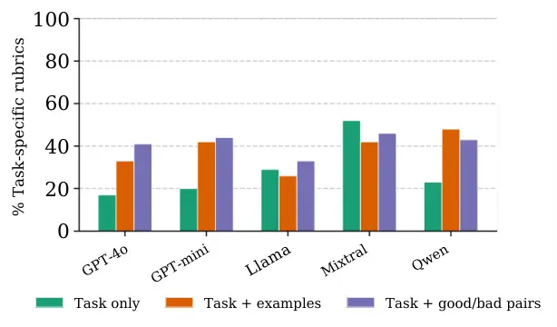

Figure 2: Percentage of task-specific rubrics identified by each model
under three prompting conditions.

## 4 Results

In this section, we report our empirical analysis of GER-Eval.

### 4.1 Rubric Generation

How effectively can LLMs generate explicit, task-specific evaluation
rubrics that reflect human-defined quality dimensions?

|            |             |           |            |            |          |            |            |
| ---------- | ----------- | --------- | ---------- | ---------- | -------- | ---------- | ---------- |
| Dataset    | Model       | Zero-shot |            |            | Few-shot |            |            |
|            |             | Breadth   | Unique (%) | Align. (%) | Breadth  | Unique (%) | Align. (%) |
| HelpSteer2 | GPT-4o      | 6         | 100        | 83         | 8        | 88         | 100        |
|            | GPT-4o-mini | 6         | 100        | 67         | 7        | 86         | 67         |
|            | Llama       | 5         | 80         | 100        | 6        | 83         | 100        |
|            | Mixtral     | 6         | 83         | 100        | 7        | 57         | 75         |
|            | Qwen        | 6         | 100        | 83         | 7        | 86         | 100        |
| SummEval   | GPT-4o      | 6         | 83         | 80         | 5        | 80         | 75         |
|            | GPT-4o-mini | 6         | 83         | 40         | 7        | 71         | 20         |
|            | Llama       | 5         | 60         | 67         | 5        | 60         | 67         |
|            | Mixtral     | 5         | 60         | 67         | 5        | 60         | 33         |
|            | Qwen        | 5         | 80         | 50         | 5        | 80         | 50         |
| SumPubMed  | GPT-4o      | 6         | 83         | 100        | 7        | 71         | 60         |
|            | GPT-4o-mini | 7         | 86         | 83         | 6        | 100        | 67         |
|            | Llama       | 6         | 33         | 50         | 7        | 86         | 33         |
|            | Mixtral     | 5         | 80         | 100        | 6        | 67         | 75         |
|            | Qwen        | 6         | 50         | 33         | 7        | 57         | 75         |
| USR        | GPT-4o      | 5         | 100        | 80         | 7        | 86         | 83         |
|            | GPT-4o-mini | 6         | 100        | 100        | 6        | 100        | 83         |
|            | Llama       | 5         | 80         | 75         | 5        | 80         | 100        |
|            | Mixtral     | 5         | 80         | 100        | 6        | 83         | 60         |
|            | Qwen        | 5         | 100        | 100        | 6        | 100        | 83         |

Table 1: Rubric generation results by model and prompting condition.
Breadth = raw number of generated rubrics, Unique = percent not
repeated, Align. = percentage of unique criteria that map to human
rubric criteria.

Table 1 and Table 2 summarize how LLMs generate evaluation rubrics
across datasets and prompting conditions. Overall, the models generated
five to eight rubrics per dataset, showing an ability to construct
structured rubrics. Few-shot prompting generally increases the number of
rubrics, while GPT-4o and GPT-4o-mini generate more unique rubrics
(around 90%), indicating broader yet non-redundant coverage. The high
uniqueness is matched by strong alignment with human rubrics, where
Align. (%) measures the proportion of generated criteria that can be
mapped to a human-defined rubric (Table 1), exceeding 80% across most
datasets.

Variation across datasets reflects differences in the focus of the task.
On HelpSteer2, where quality involves tone and empathy, several models
reach full alignment (i.e., Align. (%) $`=100`$ in Table 1) in few-shot
settings, suggesting that interpersonal aspects are easier to
internalize. In contrast, SumPubMed shows the lowest alignment (often
below 60%), as reproducing biomedical terminology and coverage requires
specialized knowledge. SummEval and USR yield moderate to high
alignment: SummEval yields moderate alignment due to its abstract
linguistic rubrics. USR achieves both high uniqueness and agreement,
indicating that conversational settings are easier for models to
approximate the human rubric.

Prompting conditions further influence rubric quality. As shown in
Table 2, contextual and contrastive examples lead to richer and more
varied rubrics but affect alignment differently across models. Mixtral
attains the highest alignment under task-only prompting (92%), while
Llama improves most with contrastive examples (94%). GPT-4o remains
robust across all setups, showing stable alignment and low rubrics
redundancy.

Figures 1 and 2 show that prompting and task domain influence
task-specificity of LLM-generated rubrics. With demonstrations, models
generate more task-grounded criteria that reflect domain goals,
suggesting that examples help calibrate models’ internal quality
judgment. This effect is stronger in conversational and
instruction-following datasets, where models express socially oriented
dimensions such as empathy and politeness, but weaker in summarization
tasks, where models generate more generic rubrics. Across models, GPT-4o
and Mixtral generate more task-specific rubrics compared to Llama or
Qwen, indicating that both prompt design and model priors influence how
evaluation criteria are generated and their alignment with human-defined
dimensions.

|             |           |        |        |          |        |        |          |        |        |
| ----------- | --------- | ------ | ------ | -------- | ------ | ------ | -------- | ------ | ------ |
|             | Task-only |        |        | Contexts |        |        | Good/Bad |        |        |
| Model       | Breadth   | Unique | Align. | Breadth  | Unique | Align. | Breadth  | Unique | Align. |
| GPT-4o      | 23(5.8)   | 92     | 86     | 27(6.8)  | 81     | 80     | 27(6.8)  | 81     | 68     |
| GPT-4o-mini | 25(6.2)   | 92     | 72     | 26(6.5)  | 89     | 59     | 25(6.2)  | 82     | 76     |
| Llama       | 21(5.2)   | 63     | 73     | 23(5.8)  | 77     | 75     | 18(4.5)  | 89     | 94     |
| Mixtral     | 21(5.2)   | 76     | 92     | 24(6.0)  | 67     | 61     | 26(6.5)  | 62     | 82     |
| Qwen        | 22(5.5)   | 82     | 67     | 25(6.2)  | 81     | 77     | 23(5.8)  | 86     | 65     |

Table 2: Rubric generation results by model and prompting condition.
Breadth = total number of rubrics across datasets with average per
dataset in parentheses (e.g., 23(5.8)), Unique = average % not repeated
rubrics, Align. = average % overlapping with human rubrics.

(a)

(b)

(c)

(d)

Figure 3: Agreement with 95% confidence intervals across datasets: (a)
USR, (b) HelpSteer2, (c) SummEval, and (d) SumPubMed, between human and
LLM scores when using human-defined rubrics.

### 4.2 Rubric Application

How reliably can LLMs apply self- and human-defined evaluation rubrics
when scoring system outputs?

|             |               |       |               |       |               |       |               |       |
| ----------- | ------------- | ----- | ------------- | ----- | ------------- | ----- | ------------- | ----- |
| Model       | HelpSteer2    |       | SummEval      |       | SumPubMed     |       | USR           |       |
|             | Agreement (%) | Corr. | Agreement (%) | Corr. | Agreement (%) | Corr. | Agreement (%) | Corr. |
| GPT-4o      | 85            | 0.82  | 59            | 0.82  | 92            | 0.53  | 86            | 0.89  |
| GPT-4o-mini | 71            | 0.83  | 67            | 0.83  | 41            | 0.25  | 69            | 0.57  |
| Llama       | 63            | 0.62  | 53            | 0.70  | 58            | 0.68  | 72            | 0.58  |
| Mixtral     | 79            | 0.95  | 66            | 0.90  | 57            | 0.71  | 74            | 0.62  |
| Qwen        | 76            | 0.68  | 72            | 0.82  | 70            | 0.62  | 79            | 0.76  |

Table 3: Agreement percentage and correlation between zero-shot and
few-shot scores per model and dataset (using LLM-generated rubrics).

|             |               |       |               |       |               |       |               |       |
| ----------- | ------------- | ----- | ------------- | ----- | ------------- | ----- | ------------- | ----- |
| Model       | HelpSteer2    |       | SummEval      |       | SumPubMed     |       | USR           |       |
|             | Agreement (%) | Corr. | Agreement (%) | Corr. | Agreement (%) | Corr. | Agreement (%) | Corr. |
| GPT-4o      | 81            | 0.82  | 68            | 0.80  | 69            | 0.73  | 87            | 0.95  |
| GPT-4o-mini | 81            | 0.83  | 68            | 0.82  | 32            | 0.24  | 86            | 0.93  |
| Llama       | 76            | 0.72  | 56            | 0.63  | 61            | 0.54  | 86            | 0.93  |
| Mixtral     | 75            | 0.81  | 37            | 0.53  | 64            | 0.76  | 80            | 0.89  |
| Qwen        | 76            | 0.88  | 73            | 0.77  | 72            | 0.61  | 86            | 0.94  |

Table 4: Agreement percentage and correlation between zero-shot and
few-shot scores per model and dataset (using human rubrics).

Models show strong internal consistency when applying their own rubrics.
Agreement between zero-shot and few-shot settings (Table 3) typically
falls between 70–90%, with correlations above 0.8 for most
configurations. GPT-4o and Mixtral are the most robust, maintaining
stable rankings across prompts. However, consistency varies by dataset.
Scores on HelpSteer2 and USR remain highly correlated, reflecting that
conversational tasks with stylistic or pragmatic dimensions are easier
to evaluate consistently. In contrast, agreement drops on SummEval and
especially SumPubMed, where tasks require factual reasoning or domain
knowledge. Lower stability in these datasets indicates that LLMs find it
harder to preserve evaluation behavior when rubrics involve technical
accuracy or content coverage rather than surface quality.

When using human rubrics, model–human alignment decreases, and variation
across domains becomes more pronounced. As shown in Tables 4, 5, and
 13, correlations with human scores reach $`\rho\approx`$ 0.8–0.9 for
HelpSteer2 and USR, but fall to around 0.5 for SummEval and below 0.3
for SumPubMed. Models capture human preferences for clarity, fluency,
and engagement, but struggle with rubrics linked to factuality. Few-shot
prompting slightly improves reliability in dialogue-oriented datasets,
but has limited or inconsistent benefit for summarization. Figures 3, 6,
7, and 8 show that agreement variance is largest in the biomedical
domain, suggesting that rubric application remains sensitive to task
complexity and domain shift.

Comparing across setups, models are far more consistent in reproducing
their own scoring patterns than in matching human evaluations. Figure 6
examines the Coherence rubric, which appears in all datasets, as a
common reference. Model and human scores are closely aligned in dialogue
data, where coherence reflects local flow and response relevance, but
diverge in summarization, where coherence requires document-level
structure and logical progression. Wider score dispersion on SummEval
and SumPubMed confirms that LLMs’ interpretation of coherence differs
across prompting conditions and that of humans.

Overall, LLMs apply rubrics consistently across prompting conditions, as
reflected by the zero-shot vs. few-shot agreement and correlations
reported in Tables 3-4, but align less closely with human judgments in
tasks that demand domain reasoning or factual consistency. These
findings highlight that robustness in rubric use does not yet imply
human-level reliability.

|             |            |          |           |          |           |          |           |          |
| ----------- | ---------- | -------- | --------- | -------- | --------- | -------- | --------- | -------- |
| Model       | HelpSteer2 |          | SummEval  |          | SumPubMed |          | USR       |          |
|             | Zero-shot  | Few-shot | Zero-shot | Few-shot | Zero-shot | Few-shot | Zero-shot | Few-shot |
| GPT-4o      | 0.49       | 0.56     | 0.55      | 0.58     | 0.14      | 0.30     | 0.81      | 0.82     |
| GPT-4o-mini | 0.47       | 0.58     | 0.24      | 0.28     | -0.09     | 0.06     | 0.79      | 0.78     |
| Llama       | 0.31       | 0.43     | 0.25      | 0.32     | 0.24      | 0.20     | 0.77      | 0.79     |
| Mixtral     | 0.50       | 0.61     | 0.38      | 0.40     | 0.30      | 0.28     | 0.79      | 0.79     |
| Qwen        | 0.65       | 0.63     | 0.46      | 0.45     | 0.19      | 0.28     | 0.81      | 0.80     |

Table 5: Spearman correlation of zero-shot and few-shot LLM scores with
human scores across datasets (using human rubrics).

### 4.3 Rubric Transfer

Do evaluation rubrics generated by one LLM generalize effectively when
applied by other models?

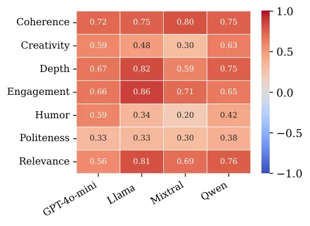

(a)

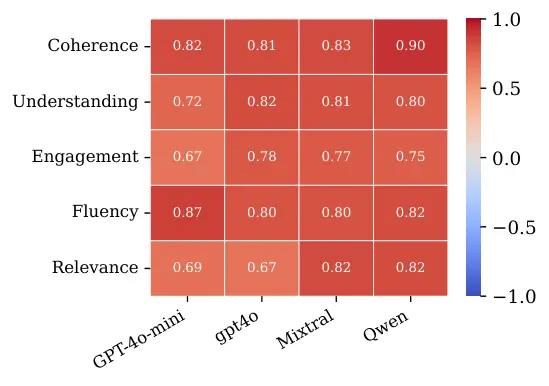

(b)

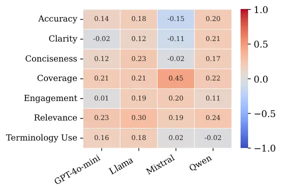

(c)

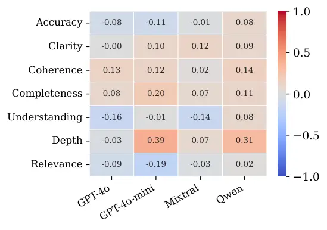

(d)

Figure 4: Spearman correlations for two datasets (USR and SumPubMed) and
two rubric sources (GPT-4o and Llama).

We investigate whether evaluation rubrics defined by one model can be
meaningfully interpreted and applied by others to score the same system
outputs. This setting captures the extent to which evaluation rubrics
are model-specific or reflect shared semantic representations across
architectures. We analyze two contrasting datasets: USR, an open-domain
dialogue benchmark where rubrics emphasize coherence, engagement, and
naturalness, and SumPubMed, a biomedical summarization task where
scoring depends on factual grounding and terminology precision. Rubrics
are drawn from GPT-4o and Llama, representing two complementary model
families: GPT-4o as a closed, instruction-tuned system and Llama as a
widely used open-weight model–allowing us to test cross-family transfer
of rubric understanding.

Results across Tables 6–8 and Figure 4 reveal clear task-dependent
patterns. For USR, rubrics generated by both GPT-4o and Llama achieve
strong inter-model reliability (ICC $`\approx`$ 0.7–0.8,
$`\alpha\approx`$ 0.74–0.81) and high cross-model correlations
($`\rho\approx`$ 0.7–0.9). These results indicate that conversational
rubrics generalize robustly across models: the relative scoring of
system outputs remains consistent even when the rubric originates from a
different model. Interestingly, while GPT-4o rubrics emphasize
dimensions such as Depth and Creativity and Llama focuses more on
Fluency and Contextual Understanding, both produce comparable
consistency across models, suggesting a shared semantic space for
dialogue evaluation grounded in pragmatic and linguistic features. The
strong correlation trends in Figure 6 mirror the high reliability
observed in the tables, showing that conversational attributes like
coherence and engagement are interpreted similarly across models.

In contrast, rubric transfer is substantially weaker for SumPubMed.
Here, reliability and correlation values fall sharply (ICC \< 0.2,
$`\rho<`$ 0.3), and even general rubrics such as Coherence and Relevance
show limited agreement. Rubrics tied to factual correctness and
terminology—Accuracy, Coverage, and Terminology Use–exhibit near-zero or
negative correlations, implying that domain-specific rubrics are not
consistently understood across model families. The drop in both
reliability and correlation highlights that factual reasoning and
biomedical knowledge remain model-dependent, and that domain-grounded
evaluation rubrics are harder to generalize without shared knowledge
representations.

In general, rubric transfer is robust in conversational domains, where
evaluation relies on broadly shared linguistic features, but unstable in
specialized domains, where scoring depends on factual and terminological
accuracy. This difference shows that while LLMs converge on
surface-level quality judgments, rubric generalization across models
still breaks down when evaluation requires domain-specific reasoning or
structured content understanding.

|                 |        |            |                    |
| --------------- | ------ | ---------- | ------------------ |
| Rubric          | ICC    | $`\alpha`$ | Fleiss’ $`\kappa`$ |
| Coherence       | 0.7906 | 0.7880     | 0.3727             |
| Relevance       | 0.7343 | 0.7311     | 0.3859             |
| Engagement      | 0.7903 | 0.7872     | 0.3858             |
| Contextual Und. | 0.7446 | 0.7415     | 0.3287             |
| Fluency         | 0.8138 | 0.8108     | 0.4005             |

Table 6: Inter-rater reliability for USR scored with the Llama rubric.
Values reported are ICC, Krippendorff’s $`\alpha`$, and Fleiss’
$`\kappa`$ across models.

|            |        |            |                    |
| ---------- | ------ | ---------- | ------------------ |
| Rubric     | ICC    | $`\alpha`$ | Fleiss’ $`\kappa`$ |
| Relevance  | 0.5431 | 0.5332     | 0.4290             |
| Engagement | 0.6392 | 0.6322     | 0.4513             |
| Coherence  | 0.7305 | 0.7256     | 0.5763             |
| Creativity | 0.3979 | 0.3931     | 0.3856             |
| Depth      | 0.7810 | 0.7771     | 0.5889             |
| Politeness | 0.5963 | 0.5847     | 0.3925             |
| Humor      | 0.4929 | 0.4853     | 0.4014             |

Table 7: Inter-rater reliability for USR scored with the GPT-4o rubric.
Values reported are ICC, Krippendorff’s $`\alpha`$, and Fleiss’
$`\kappa`$ across models.

|                 |         |            |                    |
| --------------- | ------- | ---------- | ------------------ |
| Rubric          | ICC     | $`\alpha`$ | Fleiss’ $`\kappa`$ |
| Relevance       | 0.0312  | -0.0379    | -0.0090            |
| Accuracy        | 0.0723  | 0.0007     | -0.0781            |
| Completeness    | 0.1854  | 0.1570     | 0.0113             |
| Clarity         | -0.0192 | -0.0352    | -0.0226            |
| Coherence       | 0.0535  | 0.0270     | -0.0007            |
| Depth           | 0.1323  | 0.0454     | -0.0224            |
| Contextual Und. | 0.0171  | -0.0163    | -0.0635            |

Table 8: Inter-rater reliability for SumPubMed scored with the Llama
rubric. Values reported are ICC, Krippendorff’s $`\alpha`$, and Fleiss’
$`\kappa`$ across models.

|                 |        |            |                    |
| --------------- | ------ | ---------- | ------------------ |
| Rubric          | ICC    | $`\alpha`$ | Fleiss’ $`\kappa`$ |
| Relevance       | 0.1942 | 0.1811     | 0.1306             |
| Clarity         | 0.0433 | 0.0432     | 0.0383             |
| Conciseness     | 0.0197 | -0.0296    | -0.0561            |
| Accuracy        | 0.1600 | 0.1125     | 0.0665             |
| Coverage        | 0.0578 | 0.0051     | 0.0122             |
| Terminology Use | 0.0000 | -0.1054    | -0.1173            |
| Engagement      | 0.1349 | 0.0654     | -0.0534            |

Table 9: Inter-rater reliability for SumPubMed scored with the GPT-4o
rubric. Values reported are ICC, Krippendorff’s $`\alpha`$, and Fleiss’
$`\kappa`$ across models.

## 5 Discussion

The results collectively provide two central insights into the
capabilities and limits of LLMs as evaluators. First, LLMs can reliably
generate and apply coherent evaluation rubrics, though their reliability
and validity depend on the task domain and model family. Second, models
interpret their own evaluation rubrics more effectively than they
interpret human rubrics or each other’s rubrics, revealing insights into
how evaluative meaning is represented across systems.

Across tasks, models demonstrate strong internal calibration: they can
generate structured rubrics and apply them across prompting conditions.
Conversational and instruction-following datasets show the highest
stability and agreement with human judgments, suggesting that LLMs
encode robust linguistic cues for discourse-level quality. By contrast,
reliability decreases in factual or domain-specific tasks like
SumPubMed, where evaluation depends on factual knowledge and
terminological precision. In these settings, models prioritize fluency
and surface coherence over factual correctness, producing scores that
are internally consistent but misaligned with human intent. This
distinction reflects a broader reliability–validity trade-off: LLMs are
procedurally stable but semantically limited. They capture consistent
cues embedded in linguistic form and usage, yet their assessments remain
shallow when reasoning about facts or content coverage.

Across all analyses, models interpret their own evaluation rubrics most
effectively, human rubrics moderately well, and other models’ rubrics
least consistently. When applying self-generated rubrics, they show high
cross-prompt agreement, suggesting an internal understanding of their
own evaluative constructs. Human rubrics yield partial alignment, high
for linguistic attributes such as fluency or coherence, but weak for
factual or knowledge-oriented rubrics. Rubric transfer across models
shows the lowest consistency, even when similar rubrics are used,
implying that evaluative semantics diverge across architectures. Each
model therefore develops a distinct “evaluation dialect,” shaped by its
alignment objectives and training data: internally coherent, yet
externally misaligned (Jones et al., 2025).

The results suggest that evaluation may itself be a learned linguistic
behavior: models can coherently define and apply rubrics yet fail to
generalize across architectures, indicating that their notion of quality
arises from internal representations rather than fixed external
standards. In this view, LLMs act not only as evaluators but as agents
that help construct the very concept of “quality” in generated language.
Their alignment in conversational settings reflects shared communicative
priors, whereas their divergence in factual or domain-specific tasks
reveals the limits of this emergent consensus. Future work should build
on this capacity to design collaborative evaluation frameworks where
human and model rubrics co-evolve, aligning linguistic calibration with
factual grounding. Such approaches would shift evaluation from static
benchmarks to dynamic, interpretable, and domain-adaptive practices that
reflect both human judgment and model reasoning.

## 6 Conclusion

This paper examined whether LLMs can act as reliable evaluators by
generating and applying their own rubrics. Using multiple datasets
spanning conversational and domain-specific tasks, we analyzed how
models define, apply, and transfer evaluative rubrics. The results show
that LLMs generate coherent rubrics and apply them consistently in
open-domain evaluation but struggle with factual and knowledge-intensive
tasks. Closed-source models such as GPT-4o outperform open-weight models
like Llama, generating rubrics that align more closely with human
judgments. However, models interpret their own evaluation language more
effectively than human or peer rubrics, revealing internal coherence but
limited shared understanding. These findings position LLM-based
evaluation as reliable for assessing linguistic quality; however,
unreliable for factual reasoning. Progress will require shared
evaluative representations and hybrid human–LLM frameworks that combine
linguistic calibration with domain-specific grounding.

## Limitations

Our study is limited to a subset of closed-source and open-weight LLMs
evaluated on English-language datasets. While these models cover diverse
families, results may not generalize to smaller, multilingual, or
domain-specialized models. The analysis focuses on textual outputs and
rubric-based evaluations, without examining how multimodal inputs or
interactive feedback might alter model behavior. Although we include
factual and knowledge-intensive tasks, we do not independently verify
factual accuracy beyond human reference scores. Finally, our work treats
LLMs as static evaluators, without modeling temporal drift or adaptation
over time. Future work should expand to multilingual, multimodal, and
dynamic evaluation settings, and investigate how model-specific
evaluation dialects evolve with new alignment and fine-tuning
strategies.

## Ethical Considerations

This work uses publicly available datasets and commercially released and
open-source models under their respective licenses. No personal or
sensitive information is introduced, and all evaluations are conducted
on benchmarked text. We acknowledge potential risks in using LLMs as
evaluators, including automation bias, overreliance on model judgments,
and reinforcement of model-specific biases. By systematically analyzing
where such evaluation is reliable and where it remains limited, this
study seeks to promote transparency rather than the replacement of human
oversight. We advocate for hybrid evaluation pipelines in which human
judgment remains central, particularly for factual, safety-critical, or
socially sensitive domains. All data and analysis scripts will be
released to support reproducibility and responsible extension of this
research.

#### Acknowledgments

This research is supported in part by the Dutch Science Foundation (NWO)
project HAICu with project number NWA.1518.22.105 and in part by the
Informatics Institute (IvI) of the University of Amsterdam.

All content represents the opinion of the authors, which is not
necessarily shared or endorsed by their respective employers and/or
sponsors.

## References

- Chiang et al. (2024) Wei-Lin Chiang, Chengrun Yang Mao, Yuhuai Wu,
  Xinyun Chen, and James Zou. 2024. Can large language models evaluate
  themselves accurately? _arXiv preprint arXiv:2401.10020_.
- Dubois et al. (2023) Yvan Dubois, Adam Jacob, Camille Dubois, Yonatan
  Belinkov, and Aviv Efrat. 2023. Alpacaeval: A strong set of reference
  rankings for instruction following llms. _arXiv preprint
  arXiv:2310.01377_.
- Fabbri et al. (2021) Alexander R. Fabbri, Wojciech Kryściński, Bryan
  McCann, Caiming Xiong, Richard Socher, and Dragomir Radev. 2021.
  [SummEval: Re-evaluating summarization
  evaluation](https://doi.org/10.1162/tacl_a_00373). _Transactions of
  the Association for Computational Linguistics_, 9:391–409.
- Fu et al. (2023) Xiang Fu, Zifan Zhou, Aman Madaan, Jiani He, Hao Tan,
  and Luke Zettlemoyer. 2023. [Debiasing llms for fair
  evaluation](https://arxiv.org/abs/2308.07309). _arXiv preprint
  arXiv:2308.07309_.
- Gupta et al. (2021) Vivek Gupta, Prerna Bharti, Pegah Nokhiz, and
  Harish Karnick. 2021. [SumPubMed: Summarization dataset of PubMed
  scientific articles](https://doi.org/10.18653/v1/2021.acl-srw.30). In
  _Proceedings of the 59th Annual Meeting of the Association for
  Computational Linguistics and the 11th International Joint Conference
  on Natural Language Processing: Student Research Workshop_, pages
  292–303, Online. Association for Computational Linguistics.
- Jang et al. (2023) Youngseok Jang, Yuxuan Ruan, Aniruddh Jain,
  et al. 2023. Correcting for position bias in llm evaluators. _arXiv
  preprint arXiv:2311.08889_.
- Jiang et al. (2024) Albert Q. Jiang, Alexandre Sablayrolles, Antoine
  Roux, Arthur Mensch, Blanche Savary, Chris Bamford, Devendra Singh
  Chaplot, Diego de las Casas, Emma Bou Hanna, Florian Bressand, Gianna
  Lengyel, Guillaume Bour, Guillaume Lample, Lélio Renard Lavaud, Lucile
  Saulnier, Marie-Anne Lachaux, Pierre Stock, Sandeep Subramanian,
  Sophia Yang, Szymon Antoniak, Teven Le Scao, Théophile Gervet, Thibaut
  Lavril, Thomas Wang, Timothée Lacroix, and William El Sayed. 2024.
  [Mixtral of experts](https://arxiv.org/abs/2401.04088). _Preprint_,
  arXiv:2401.04088.
- Jones et al. (2025) Erik Jones, Arjun Patrawala, and Jacob
  Steinhardt. 2025. [Uncovering gaps in how humans and llms interpret
  subjective
  language](https://api.semanticscholar.org/CorpusID:276813372).
  _ArXiv_, abs/2503.04113.
- Koo et al. (2023) Ryan Koo, Minhwa Lee, Vipul Raheja, et al. 2023.
  Benchmarking cognitive biases in large language models as evaluators.
  _arXiv preprint arXiv:2309.17012_.
- Kudugunta et al. (2023) Sneha Kudugunta, Xi Victoria Lin, Balakrishnan
  Narayanaswamy, et al. 2023. Investigating and reducing preference bias
  in llms for pairwise comparison. _arXiv preprint arXiv:2312.11592_.
- Liu et al. (2023) Yang Liu, Dan Iter, Yichong Xu, Shuohang Wang,
  Ruochen Xu, and Chenguang Zhu. 2023. [G-eval: Nlg evaluation using
  gpt-4 with better prompts](https://arxiv.org/abs/2303.16634). _arXiv
  preprint arXiv:2303.16634_.
- Liu et al. (2024a) Yinhong Liu, Han Zhou, Zhijiang Guo, Ehsan
  Shareghi, Ivan Vulić, Anna Korhonen, and Nigel Collier. 2024a.
  [Aligning with human judgement: The role of pairwise preference in
  large language model
  evaluators](https://openreview.net/forum?id=9gdZI7c6yr). In
  _Proceedings of the Conference on Language Modeling (COLM)_.
- Liu et al. (2024b) Yuxuan Liu, Tianchi Yang, Shaohan Huang, Zihan
  Zhang, Haizhen Huang, Furu Wei, Weiwei Deng, Feng Sun, and Qi Zhang.
  2024b. [Hd-eval: Aligning large language model evaluators through
  hierarchical criteria
  decomposition](https://aclanthology.org/2024.acl-long.413). In
  _Proceedings of the 62nd Annual Meeting of the Association for
  Computational Linguistics (ACL)_.
- Mehri and Eskenazi (2020) Shikib Mehri and Maxine Eskenazi. 2020.
  [USR: An unsupervised and reference free evaluation metric for dialog
  generation](https://doi.org/10.18653/v1/2020.acl-main.64). In
  _Proceedings of the 58th Annual Meeting of the Association for
  Computational Linguistics_, pages 681–707, Online. Association for
  Computational Linguistics.
- OpenAI (2023) OpenAI. 2023. [GPT-4 technical
  report](https://doi.org/10.48550/ARXIV.2303.08774). _CoRR_,
  abs/2303.08774.
- Saha et al. (2024) Swarnadeep Saha, Omer Levy, Asli Celikyilmaz, Mohit
  Bansal, Jason Weston, and Xian Li. 2024. [Branch-solve-merge improves
  large language model evaluation and
  generation](https://aclanthology.org/2024.naacl-long.462). In
  _Proceedings of the 2024 Conference of the North American Chapter of
  the Association for Computational Linguistics (NAACL)_.
- Shankar et al. (2024) Shreya Shankar, J.D. Zamfirescu-Pereira, Björn
  Hartmann, Aditya G. Parameswaran, and Ian Arawjo. 2024. [Who validates
  the validators? aligning llm-assisted evaluation of llm outputs with
  human preferences](https://dl.acm.org/doi/10.1145/3654777.3676450). In
  _Proceedings of the ACM Symposium on User Interface Software and
  Technology (UIST)_.
- Shi et al. (2024) Weijia Shi, Runzhe Zhang, Jianyu Chi, et al. 2024.
  Judging the judges: A systematic study of position bias in
  llm-as-a-judge. _arXiv preprint arXiv:2406.07791_.
- Stureborg et al. (2024) Oscar Stureborg, Iason Papadimitriou, Ruiqi
  Zhang, and Byron C. Wallace. 2024. Large language models are
  inconsistent and biased evaluators. _arXiv preprint arXiv:2405.01724_.
- Touvron et al. (2023) Hugo Touvron, Thibaut Lavril, Gautier Izacard,
  Xavier Martinet, Marie-Anne Lachaux, Timothée Lacroix, Baptiste
  Rozière, Naman Goyal, Eric Hambro, Faisal Azhar, Aurélien Rodriguez,
  Armand Joulin, Edouard Grave, and Guillaume Lample. 2023. [Llama: Open
  and efficient foundation language
  models](https://doi.org/10.48550/ARXIV.2302.13971). _CoRR_,
  abs/2302.13971.
- Wang et al. (2023) Peiyi Wang, Lei Li, Liang Chen, et al. 2023. Large
  language models are not fair evaluators. _arXiv preprint
  arXiv:2305.17926_.
- Wang et al. (2024) Zhilin Wang, Yi Dong, Olivier Delalleau, Jiaqi
  Zeng, Gerald Shen, Daniel Egert, Jimmy J. Zhang, Makesh Narsimhan
  Sreedhar, and Oleksii Kuchaiev. 2024. [Helpsteer2: Open-source dataset
  for training top-performing reward
  models](https://arxiv.org/abs/2406.08673). _Preprint_,
  arXiv:2406.08673.
- Xu et al. (2023) Yizhou Xu, Fan Yang, Yuntao Bai, Xiang Gao, and Xiang
  Ren. 2023. [Steering llms to produce more helpful dialogues via
  self-alignment](https://arxiv.org/abs/2305.14325). _arXiv preprint
  arXiv:2305.14325_.
- Yang et al. (2024) An Yang, Baosong Yang, Binyuan Hui, Bo Zheng, Bowen
  Yu, Chang Zhou, Chengpeng Li, Chengyuan Li, Dayiheng Liu, Fei Huang,
  Guanting Dong, Haoran Wei, Huan Lin, Jialong Tang, Jialin Wang, Jian
  Yang, Jianhong Tu, Jianwei Zhang, Jianxin Ma, Jianxin Yang, Jin Xu,
  Jingren Zhou, Jinze Bai, Jinzheng He, Junyang Lin, Kai Dang, Keming
  Lu, Keqin Chen, Kexin Yang, Mei Li, Mingfeng Xue, Na Ni, Pei Zhang,
  Peng Wang, Ru Peng, Rui Men, Ruize Gao, Runji Lin, Shijie Wang, Shuai
  Bai, Sinan Tan, Tianhang Zhu, Tianhao Li, Tianyu Liu, Wenbin Ge,
  Xiaodong Deng, Xiaohuan Zhou, Xingzhang Ren, Xinyu Zhang, Xipin Wei,
  Xuancheng Ren, Xuejing Liu, Yang Fan, Yang Yao, Yichang Zhang, Yu Wan,
  Yunfei Chu, Yuqiong Liu, Zeyu Cui, Zhenru Zhang, Zhifang Guo, and
  Zhihao Fan. 2024. [Qwen2 technical
  report](https://arxiv.org/abs/2407.10671). _Preprint_,
  arXiv:2407.10671.
- Yuan et al. (2024) Weizhe Yuan, Richard Yuanzhe Pang, Kyunghyun Cho,
  Xian Li, Sainbayar Sukhbaatar, Jing Xu, and Jason Weston. 2024.
  Self-rewarding language models. _arXiv preprint arXiv:2407.19594_.
- Zheng et al. (2023) Lianmin Zheng, Wei-Lin Chiang, Ying Sheng, Siyuan
  Zhuang, Zhanghao Wu, Yonghao Zhuang, Zi Lin, Zhuohan Li, Dacheng Li,
  Eric P. Xing, Hao Zhang, Joseph E. Gonzalez, and Ion Stoica. 2023.
  [Judging llm-as-a-judge with mt-bench and chatbot
  arena](https://arxiv.org/abs/2306.05685). _arXiv preprint
  arXiv:2306.05685_.
- Zhong et al. (2020) Wanjun Zhong, Tao Yu, and Danqi Chen. 2020. [Qags:
  Evaluating factual consistency with qa-based
  metrics](https://doi.org/10.18653/v1/2020.emnlp-main.40). In
  _Proceedings of the 2020 Conference on Empirical Methods in Natural
  Language Processing (EMNLP)_, pages 519–529.
- Zhou et al. (2023) Weizhi Zhou, Jie Gao, Yangqiu Song, and Tong
  Zhang. 2023. Promptbench: Towards evaluating the robustness of large
  language models with respect to prompting strategies. _arXiv preprint
  arXiv:2310.04455_.

## Appendix A Additional methodology Details

### A.1 Process Overview

The GER-Eval process consists of three steps:

1.  1.  Generate a set of rubrics $`M`$ from $`p_{\theta}`$ given
        $`prompt_{gen}(t,\pi)`$:

    ```math
    M\sim p_{\theta}(M\mid prompt_{gen}(t,\pi)).
    ```

2.  2.  Generate instructions $`I(m_{i})`$ for each rubric $`m_{i}\in M`$:

    ```math
    I(m_{i})\sim p_{\theta}(I\mid m_{i},t).
    ```

3.  3.  Apply each rubric with instructions $`I(m_{i})`$ to outputs $`Y`$,
        producing reasoning and ratings where:
        $`(r_{i,j},s_{i,j})\sim p_{\theta}(r,s\mid prompt_{eval}(t,m_{i},I(m_{i}),y_{j}))`$

The final output is a structured representation of rubrics and their
associated scores:

```math
\{(m_{i},I(m_{i}),\{(y_{j},r_{i,j},s_{i,j})\}_{j=1}^{N})\}_{i=1}^{k}.
```

### A.2 Datasets

1.  1.  SummEval Fabbri et al. (2021) is a news domain dataset, where the
        task is abstractive summarization. The outputs are system-generated
        summaries of CNN/Daily Mail articles, with human ratings provided on
        coherence, consistency, fluency, and relevance.
2.  2.  HelpSteer2 Wang et al. (2024) represents the instruction-following
        domain, where the task is to generate helpful responses to user
        prompts. The outputs are model-generated chat responses, annotated
        by humans on five attributes of helpfulness.
3.  3.  USR Mehri and Eskenazi (2020) is an open-domain dialogue dataset,
        where the task is dialogue response generation. The outputs are
        continuations of dialogue contexts, and expert evaluators provide
        ratings across six dimensions of dialogue quality.
4.  4.  SumPubMed Gupta et al. (2021) is situated in the biomedical research
        domain, where the task is long-form scientific summarization. The
        outputs are system-generated summaries of PubMed articles, with
        expert judgments on readability, coherence, redundancy, and
        informativeness.

Together, these datasets cover news, conversational, instructional, and
scientific domains, offering a broad set of text generation tasks on
which to test the generalizability of GER-Eval.

### A.3 Models

We evaluate a set of closed- and open-source LLMs commonly used in
recent LLM-as-judge and automated evaluation studies, covering different
model scales and training regimes. Our selection includes GPT-4o and
GPT-4o-mini (OpenAI), Mixtral-8$`\times`$22B, Llama-3.3-70B, and
Qwen2.5-72B, enabling analysis across proprietary and open-weight model
families.

- •
  GPT-4o (OpenAI, 2023) serves as a high-capacity proprietary judge
  model, frequently adopted as a reference in evaluation pipelines, with
  a 128K context window.
- •
  GPT-4o-mini (OpenAI, 2023) is a lower-cost, reduced-capacity variant
  used to study how evaluation reliability changes under constrained
  model capacity.
- •
  Mixtral 8$`\times`$22B (Jiang et al., 2024) represents open-weight
  mixture-of-experts models, allowing us to examine rubric generation
  and application under sparse activation settings (64K context).
- •
  Qwen 2.5-72B-Instruct (Yang et al., 2024) is a strong open-weight
  dense model with long-context support (128K), commonly used in recent
  evaluation and benchmarking work.
- •
  Llama 3.3-70B-Instruct (Touvron et al., 2023) serves as a widely
  adopted open-weight baseline for instruction-following and judgment
  tasks, supporting long-context evaluation.

#### A.3.1 Model Configurations

All models were run with temperature set to 0 for scoring tasks to
ensure determinism, using greedy decoding. For rubric generation, we
used temperature = 0.7 with nucleus sampling ($`p=0.9`$) to encourage
diversity in rubric generation. The maximum output length was set to 512
tokens for rubric generation and 256 tokens for scoring.

For GPT-4o and GPT-4o-mini, prompts were formatted using the system–user
message structure provided by the OpenAI API. For Mixtral-8x22B, prompts
were serialized as plain text and accessed via the Mistral API. For
Llama-3.3-70B and Qwen2.5-72B, prompts were likewise serialized into
plain text and accessed through the DeepInfra API. In all cases, we
normalized the prompt content to ensure consistency across APIs. Role
descriptions, when included, were applied uniformly across models.

Outputs were requested in structured JSON containing fields for rubric
name, description, scale, instruction, reasoning, and score. All outputs
were automatically validated; malformed responses were re-prompted up to
three times before being discarded. Random seeds were fixed across runs
for reproducibility. All experiments were conducted via API inference
only, and no local GPU compute was used.

#### A.3.2 Implementation details

We experimented with 50 data points from each dataset across all the
conditions. For each dataset, we randomly sampled three contexts per
task description. In the contrastive condition, each context was paired
with one positive and one negative response based on dataset-specific
quality signals (e.g., overall scores in USR, helpfulness in HelpSteer2,
relevance in SummEval, and informativeness/overlap/focus in SumPubMed).

During scoring, when categorical labels were available in the dataset
(e.g., Helpsteer), the model was prompted to produce categorical
judgments; otherwise, ratings were mapped to a continuous 1–5 scale.

#### A.3.3 Rubric Statistics: Breadth, Unique, and Alignment

##### Breadth.

We define Breadth as the total number of criteria produced by the model
for a given setting.

##### Unique.

To account for redundant or paraphrased criteria, we compute Unique by
de-duplicating the generated set using semantic similarity over
criterion descriptions. We embed each description with
jinaai/jina-embeddings-v3 and merge criteria whose cosine similarity
exceeds a fixed threshold ($`\tau=0.82`$), yielding a de-duplicated set
of criteria. We manually inspected a set of merged and non-merged pairs
to verify that high-similarity pairs correspond to genuine semantic
duplicates (e.g., Brevity vs. Conciseness), and used the embedding-based
merging thereafter.

##### Alignment (Align.%).

We estimate overlap with the dataset’s human rubric via LLM-based
tagging. We use GPT-4o (temperature $`0`$) as a tagger conditioned on
the task description, the human rubric items (teacher), and the
generated criteria (student). For each generated criterion, the tagger
assigns one or more human rubric item labels when the teacher
description is substantially covered; otherwise it assigns a novel
“other aspect” label. A criterion is counted as unseen if none of its
tags correspond to a human rubric item. We report:

```math
\text{Align.(\%)}=100\times\left(1-\frac{\#\text{Unseen}}{\#\text{Unique}}\right).
```

#### A.3.4 Prompts used for generation and scoring

Below we show sample prompts used in rubric generation 1, rubric scoring
instructions 2, and rubric scoring 3.

METRIC_GENERATION_PROMPT = ‘‘‘

{Task description}

{samples_prompt}

Based on this information, define a set of metrics that should be used
to assess the quality of this task.

For each metric, only include: Name, Description, Scale

’’’

Listing 1: Rubric Generation Prompt

INSTRUCTION_PROMPT = ‘‘‘ Please generate scoring instruction for this
{Metric} and {Description}.

Evaluation Criteria: {Metric} Evaluation Steps: ’’’

Listing 2: Instruction Prompt

SCORING_PROMPT = ‘‘‘

{Description} Please score the following output based on the:

Evaluation Criteria: {Metric}

Evaluation Steps: {Steps}

{Additional_info}

Sample of Evaluation: {Sample}

Evaluation of {Metric_name}:

’’’

Listing 3: Scoring Prompt

## Appendix B End-to-End Example of GER-Eval

Table 10 provides an end-to-end example of rubric generation and
application for HelpSteer2. We show excerpts for one generated criterion
for brevity.

|                                          |                                                                                                                                                                                    |
| ---------------------------------------- | ---------------------------------------------------------------------------------------------------------------------------------------------------------------------------------- |
| Stage                                    | Excerpt (HelpSteer2, GPT-4o, Task-only)                                                                                                                                            |
| Rubric generation prompt                 | “Define clear and independent metrics to evaluate the quality of assistant responses. For each metric, output only: Name, Description, Scale.”                                     |
| Generated rubric                         | Name: Creativity. Description: Assesses the originality of the response and whether it introduces novel ideas or perspectives. Scale: 1–5 (1 = not creative, 5 = highly creative). |
| Generated scoring instruction            | “Read the user prompt and the response. Judge whether the response contributes unique or inventive ideas. Assign a score from 1 to 5. Provide one sentence explaining the score.”  |
| Scoring prompt (constructed by GER-Eval) | “Using the rubric Creativity with the instruction above, evaluate the following response on a 1–5 scale and provide a brief justification.”                                        |
| Model output                             | Score: 4. Justification: “The response introduces several novel narrative elements that originally extend beyond the prompt.”                                                      |

Table 10: End-to-end example of GER-Eval for one generated rubric
(excerpts shown for brevity).

## Appendix C Supplemental Results

This appendix provides additional analyses that complement the main
results in the paper. We first report model- and dataset-specific
task-sensitive rubric names generated under the few-shot setting
(Table 11), alongside the corresponding human-defined task-specific
rubrics for each dataset (Table 12). We then present the global
frequency of generated rubrics across all models, datasets, and
prompting conditions, including overlap with human rubrics (Figure 5).

To further characterize evaluation behavior, we report inter-rater
reliability statistics under both zero-shot and few-shot conditions
using human-defined rubrics (Table 13). We additionally visualize score
distributions for the _Coherence_ rubric across datasets in the
zero-shot setting (Figure 6). Finally, we include correlation analyses
between LLM and human scores under zero-shot and few-shot conditions
(Figures 7 and 8), as well as dataset-level analyses of strictness
versus leniency in LLM scoring behavior (Figure 9).

Figure 5: Rubric Frequencies from all datasets and conditions and all
models, also overlapping with human rubrics.

|            |             |                                                                                                                                                      |
| ---------- | ----------- | ---------------------------------------------------------------------------------------------------------------------------------------------------- |
| Dataset    | Model       | Task-specific rubrics                                                                                                                                |
| HelpSteer2 | GPT-4o      | Tone                                                                                                                                                 |
| HelpSteer2 | GPT-4o-mini | Depth of Knowledge, Error Handling                                                                                                                   |
| HelpSteer2 | Mixtral     | Engagement, Originality                                                                                                                              |
| HelpSteer2 | Qwen        | Clarity and Coherence, Consistency, Depth of Information, Engagement and Responsiveness, Relevance to Context, Technical Accuracy, User-Friendliness |
| HelpSteer2 | Llama       | Conversational Flow, Empathy                                                                                                                         |
| SummEval   | GPT-4o      | Clarity and Coherence, Content Coverage, Language Quality                                                                                            |
| SummEval   | GPT-4o-mini | Accuracy, Completeness, Objectivity                                                                                                                  |
| SummEval   | Mixtral     | –                                                                                                                                                    |
| SummEval   | Qwen        | –                                                                                                                                                    |
| SummEval   | Llama       | Readability                                                                                                                                          |
| SumPubMed  | GPT-4o      | Coverage, Terminology Use                                                                                                                            |
| SumPubMed  | GPT-4o-mini | Clarity and Coherence, Content Coverage, Engagement and Readability, Technical Accuracy                                                              |
| SumPubMed  | Mixtral     | Clarity, Objectivity                                                                                                                                 |
| SumPubMed  | Qwen        | Comprehensiveness, Objectivity                                                                                                                       |
| SumPubMed  | Llama       | Clarity, Depth                                                                                                                                       |
| USR        | GPT-4o      | Creativity, Humor, Politeness                                                                                                                        |
| USR        | GPT-4o-mini | Coherence, Grammar and Syntax                                                                                                                        |
| USR        | Mixtral     | Character Consistency, Coherence and Cohesion, Contextual Relevance, Engagement and Interest, Grammatical Accuracy, Interesting Fact Integration     |
| USR        | Qwen        | Creativity, Empathy, Knowledge                                                                                                                       |
| USR        | Llama       | Engagement                                                                                                                                           |

Table 11: Task sensitivity: rubrics names per model and dataset (With
Examples Setting (Few-shot)).

|            |                                                                                                                                    |
| ---------- | ---------------------------------------------------------------------------------------------------------------------------------- |
| Dataset    | Task-specific rubrics                                                                                                              |
| HelpSteer2 | Clarity, Completeness, Complex Language, Correctness, Helpfulness, Safe, Simple, Succinct, Understanding, Unsafe, Verbose Language |
| SummEval   | Consistency, Fluency, Relevance                                                                                                    |
| SumPubMed  | Informativeness, Overlap and Focus, Non-Repetition and no factual Redundancy, Readability                                          |
| USR        | Interesting, Maintains Context, Natural, Understandable, Uses Knowledge                                                            |

Table 12: Ground-truth(Human) _task-specific_ rubrics.

|            |                   |           |                         |                   |          |                         |                   |
| ---------- | ----------------- | --------- | ----------------------- | ----------------- | -------- | ----------------------- | ----------------- |
| Dataset    | Rubric            | Zero-shot |                         |                   | Few-shot |                         |                   |
|            |                   | ICC(2)    | Krippendorff $`\alpha`$ | Fleiss $`\kappa`$ | ICC(2)   | Krippendorff $`\alpha`$ | Fleiss $`\kappa`$ |
| HelpSteer2 | Helpfulness       | 0.683     | 0.679                   | 0.347             | 0.526    | 0.521                   | 0.352             |
|            | Correctness       | 0.452     | 0.448                   | 0.299             | 0.366    | 0.362                   | 0.224             |
|            | Coherence         | 0.311     | 0.297                   | 0.293             | 0.209    | 0.180                   | 0.163             |
|            | Complexity        | 0.609     | 0.598                   | 0.256             | 0.585    | 0.574                   | 0.219             |
|            | Verbosity         | 0.688     | 0.680                   | 0.330             | 0.646    | 0.637                   | 0.282             |
| SummEval   | Relevance         | 0.463     | 0.440                   | 0.172             | 0.390    | 0.377                   | 0.244             |
|            | Consistency       | 0.616     | 0.603                   | 0.166             | 0.537    | 0.521                   | 0.148             |
|            | Fluency           | 0.328     | 0.279                   | 0.084             | 0.309    | 0.280                   | 0.068             |
|            | Coherence         | 0.527     | 0.509                   | 0.181             | 0.446    | 0.434                   | 0.175             |
| SumPubMed  | Non-Re            | 0.123     | 0.014                   | -0.011            | 0.164    | 0.130                   | 0.060             |
|            | Coh               | 0.156     | 0.130                   | 0.052             | -0.010   | -0.034                  | -0.076            |
|            | Read              | 0.095     | -0.002                  | 0.021             | 0.028    | -0.105                  | -0.071            |
|            | IOF               | 0.312     | 0.263                   | 0.038             | 0.134    | 0.075                   | 0.006             |
| USR        | Understandable    | 0.637     | 0.630                   | 0.629             | 0.608    | 0.599                   | 0.597             |
|            | Natural           | 0.554     | 0.547                   | 0.404             | 0.666    | 0.660                   | 0.473             |
|            | Maintains Context | 0.652     | 0.646                   | 0.475             | 0.577    | 0.566                   | 0.373             |
|            | Engaging          | 0.657     | 0.651                   | 0.539             | 0.637    | 0.631                   | 0.448             |
|            | Uses Knowledge    | 0.747     | 0.743                   | 0.742             | 0.754    | 0.749                   | 0.748             |
|            | Overall           | 0.717     | 0.712                   | 0.236             | 0.759    | 0.754                   | 0.314             |

Table 13: Inter-rater reliability across LLMs under Zero-shot and
Few-shot conditions. Values show ICC(2), Krippendorff’s $`\alpha`$, and
Fleiss’s $`\kappa`$ for each evaluation rubric across all four datasets
using human rubric.

(a) USR

(b) HelpSteer2

(c) SummEval

(d) SumPubMed

Figure 6: Score distributions for the Coherence rubric under the
Zero-shot setting across datasets. Each violin shows the score
distribution, with a box inside indicating the median and quartiles.

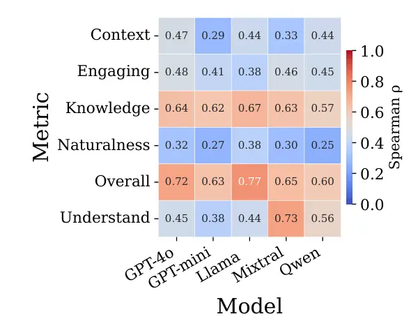

(a)

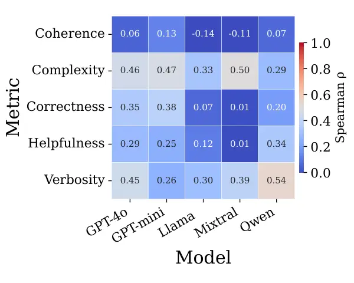

(b)

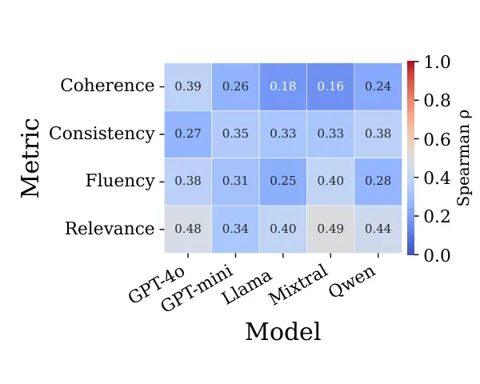

(c)

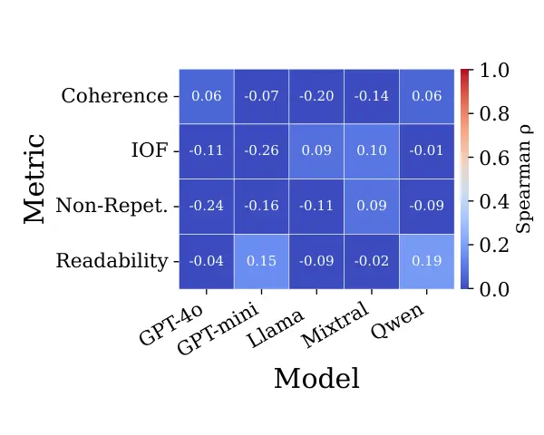

(d)

Figure 7: Spearman correlation ($`\rho`$) between LLM and human scores
under the Zero-shot condition across four datasets.

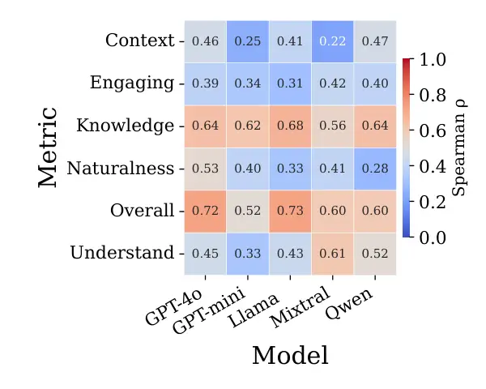

(a)

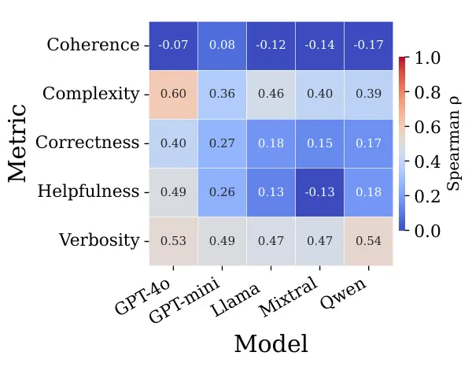

(b)

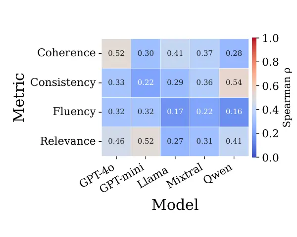

(c)

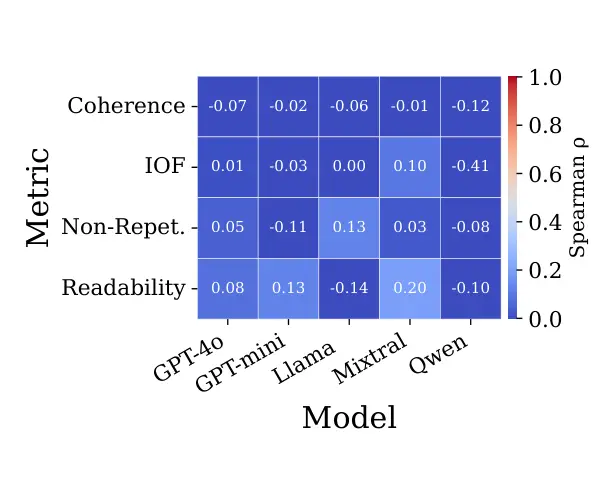

(d)

Figure 8: Spearman correlation ($`\rho`$) between LLM and human scores
under the Few-shot condition across four datasets.

(a)

(b)

(c)

(d)

Figure 9: Strictness versus leniency of LLM scoring behavior across
datasets under the zero-shot setting.
