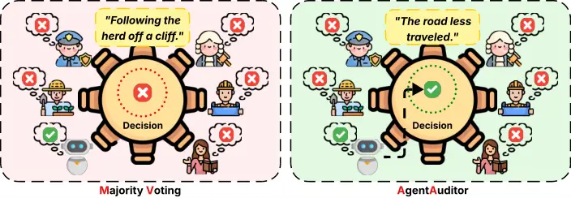
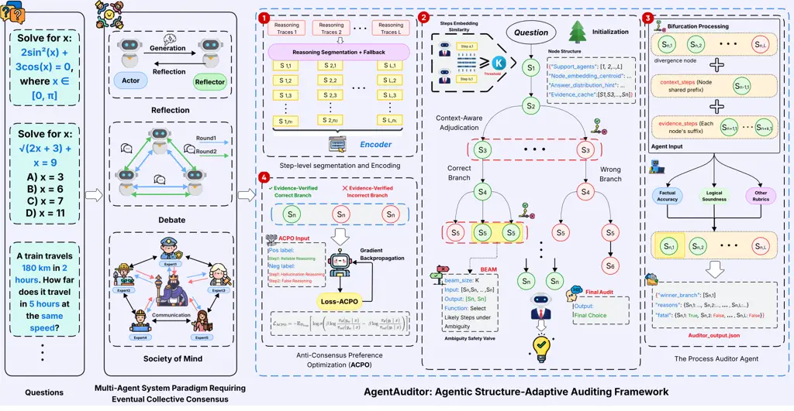
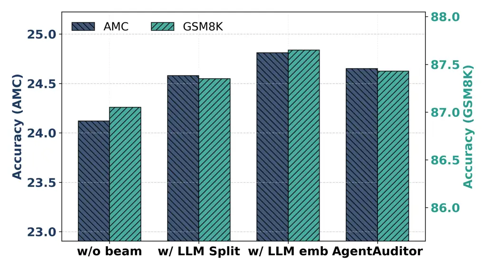
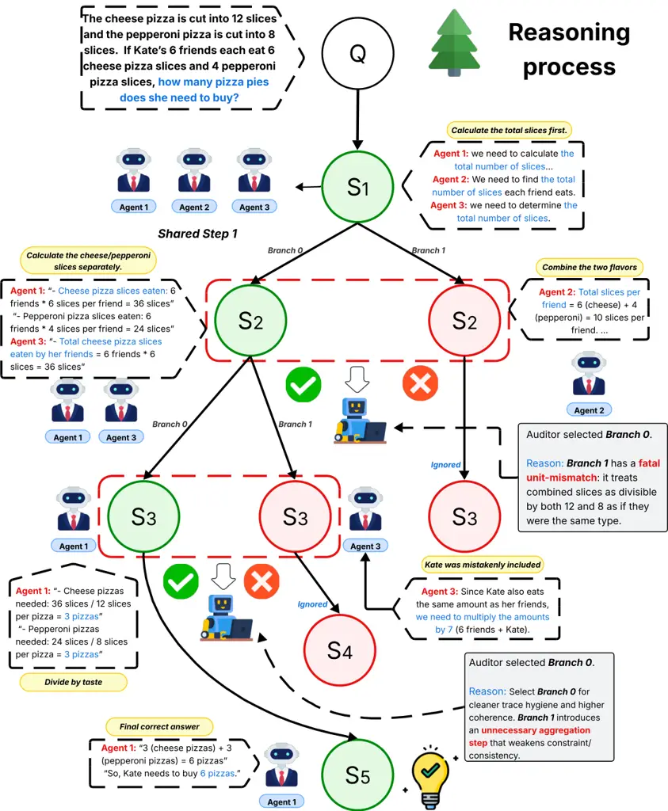

# Auditing Multi-Agent LLM Reasoning Trees Outperforms Majority Vote and LLM-as-Judge

Wei Yang^(\*), Shixuan Li^(\*), Gengshuo Liu, Heng Ping    Peiyu Zhang,
Paul Bogdan, Jesse ThomasonUniversity of Southern California
Email: [{wyang930,sli97750,pbogdan,jessetho}@usc.edu](mailto:)

###### Abstract

Multi-agent systems (MAS) can substantially extend the reasoning
capacity of large language models (LLMs). Most MAS frameworks aggregate
agent outputs via simple majority voting, discarding the evidential
structure of reasoning traces. Majority voting is brittle under
confabulation consensus, where agents share correlated biases and
converge on the same incorrect rationale. We introduce AgentAuditor,
which moves beyond frequency-based aggregation by organizing agent
traces into a Reasoning Tree that explicitly represents agreements and
divergences in their reasoning. AgentAuditor resolves conflicts by
comparing branch-level evidence at critical divergence points, turning
global adjudication into efficient, localized verification. We further
propose Anti-Consensus Preference Optimization (ACPO), which trains the
adjudicator with evidence-verified preference supervision to reduce
conformity to misleading majority cues. Across four MAS frameworks and
multiple reasoning benchmarks, AgentAuditor consistently improves
aggregation performance over majority voting, with gains of up to 5%
absolute accuracy while remaining token-efficient.

^(†)^(†)footnotetext: ^(\*) Equal contribution. ^($`\dagger`$)
Corresponding authors. ¹ Code:
https://github.com/weiyang930/AgentAuditor.git

## 1 Introduction

Multi-agent systems (MAS) built on large language models (LLMs) are
becoming an increasingly common paradigm for complex problem-solving
tasks Zhang et al. (2024a); Qiao et al. (2024); Han et al. (2025). By
orchestrating multiple LLM agents through debate and critique (Du et
al., 2023; Liu et al., 2024), dynamic computation graphs Zhang et al.
(2024c); Han et al. (2025), and structured communication
topologies (Gabriel et al., 2024; Li et al., 2025a), modern MAS can
expand reasoning beyond single-pass generation Park et al. (2023); Zhu
et al. (2025).

Despite rich upstream interaction, the final decision is often reduced
to majority voting Hong et al. (2023); Ning et al. (2023). Diverse
reasoning traces, intermediate evidence, and agent-level disagreements
are compressed into context-free answer counts Xie et al. (2023); Zhang
et al. (2024d).



Figure 1: Majority voting vs. AgentAuditor. _Left:_ Majority voting
leads to an incorrect consensus. _Right:_ AgentAuditor audits localized
branch evidence on a reasoning tree to select the correct minority
answer.

This compression is problematic because LLM agents are not independent
voters: they often share pretraining distributions, alignment biases,
and prompt-induced anchors. As a result, multiple agents may reinforce
the same erroneous rationale, producing a confabulation consensus in
which answer frequency no longer reliably tracks validity. We focus on
majority-failure cases, where the majority answer is wrong but at least
one minority trace contains the correct reasoning path.

We propose AgentAuditor, a structure-aware auditing framework for
evidence-based aggregation in MAS. AgentAuditor targets cases where the
correct reasoning path is present but outnumbered by a correlated
erroneous majority (Figure 1), and organizes collective reasoning traces
into a Reasoning Tree where agreements form shared prefixes and
disagreements become explicit branch points. A Structure-Adaptive
Auditor then performs localized adjudication at Critical Divergence
Points (CDPs), converting global trace evaluation into targeted
branch-level comparison. The core framework can be used with a frozen
auditor, and we further introduce Anti-Consensus Preference Optimization
(ACPO), which fine-tunes the auditor with evidence-verified preference
supervision to reduce conformity to popular-but-wrong branches. The main
contributions of this work are:

- •
  We identify confabulation consensus as a critical failure mode of
  multi-agent aggregation, where correlated reasoning errors make
  majority voting suppress correct minority evidence.
- •
  We propose AgentAuditor, a Reasoning Tree-based auditing framework for
  localized evidence comparison, together with ACPO, a training strategy
  that reduces conformity to misleading majority cues in the Auditor.
- •
  Extensive experiments across multiple MAS frameworks and reasoning
  benchmarks show that AgentAuditor consistently improves over majority
  voting, with particularly strong gains in majority-failure cases where
  correct answers appear only in minority branches.

## 2 Related Work

### 2.1 LLM-based Multi-Agent Reasoning

LLM-based multi-agent systems (MAS) have become a common strategy for
improving complex reasoning by enabling distributed exploration,
critique, and coordination Hong et al. (2023); Chen et al. (2023a); Wu
et al. (2024); Zhang et al. (2024c); Ning et al. (2023); Qiao et al.
(2024); Pan et al. (2024). Prior work spans (i) pre-structured
interaction protocols such as debate-style exchanges or fixed topologies
that regulate information flow and verification Du et al. (2023); Liu et
al. (2024), and (ii) self-organizing paradigms that dynamically route,
prune, or evolve collaboration graphs for efficiency and diversity Hu et
al. (2024); Zhuge et al. (2024); Zhang et al. (2024c). While these
methods primarily optimize how agents interact, they often leave the
final adjudication rule comparatively under-specified, which can make
the collective outcome vulnerable when agent errors are correlated (Wei
et al., 2025; Jiang et al., 2025; Alsadat and Xu, 2024; Lin et al.,
2025). A more comprehensive discussion is provided in Appendix. C.1.

### 2.2 Evaluation and Adjudication in MAS

A central challenge in multi-agent reasoning is converting diverse
reasoning traces into a reliable final decision. Many systems still rely
on majority voting or simple ensembling heuristics Chan et al. (2023);
Chen et al. (2024); Wei et al. (2025), whose reliability is closely tied
to the assumption that individual errors are sufficiently
independent Austen-Smith and Banks (1996). This assumption is fragile in
LLM-based MAS: agents often share pretraining distributions, alignment
preferences, and prompt-induced anchors, making their errors correlated
rather than independent Jiang et al. (2023); Qiao et al. (2024). Such
dependencies can produce confabulation consensus, where multiple agents
repeat the same unsupported rationale and converge on a plausible but
incorrect answer Mahaut et al. (2024); Coeckelbergh (2025).

To improve reliability, recent work explores referee agents, debate
adjudication, and peer-review style evaluation of reasoning
trajectories Abdelnabi et al. (2023); Du et al. (2023); Wang et al.
(2025). These approaches move beyond raw answer counting, but they
typically evaluate whole traces or single-agent outputs rather than
localizing the specific disagreement that separates competing
multi-agent reasoning paths Lambert et al. (2024); Setlur et al. (2024).
This motivates structure-aware adjudication mechanisms that compare
branch-level evidence at decision-critical divergences instead of
relying solely on answer frequency or full-trace judging. A fuller
related-work taxonomy and comparisons appear in Appendix C.2.

## 3 Problem setup.

Given a query $`q`$, a multi-agent system produces a set of agent
outputs $`\mathcal{O}=\{o_{1},\ldots,o_{N}\}`$, where each output
contains a reasoning trace and a final answer $`\hat{y}(o_{i})`$. An
aggregator maps these outputs to a single prediction,
$`\hat{y}=f(\mathcal{O},q)`$. Majority voting instantiates $`f`$ by
selecting the most frequent final answer, but this can fail when
correlated agents support the same erroneous hypothesis while a correct
solution appears only in a minority trace. We call this regime
confabulation consensus. Our goal is to design an aggregator that is
robust to answer multiplicity while remaining sensitive to branch-level
evidence. Appendix F.1 provides the full formal setup and objective.



Figure 2: Overall architecture of AgentAuditor framework. Given a
multi-agent slate of reasoning traces, AgentAuditor performs structural
semantic deduplication to construct a compact Reasoning Tree of distinct
hypotheses. It then audits only decision-critical Divergence Points by
comparing localized branch evidence and selecting plausible reasoning
paths for final aggregation. For learnable auditing, we train the
Auditor with Anti-Consensus Preference Optimization on consensus-trap
instances.

## 4 Methodology

In this section, we describe the main components and overall workflow of
AgentAuditor, whose architecture is illustrated in Figure 2. We
introduce the Reasoning Tree construction, localized evidence auditing,
and the subsequent aggregation procedure.

### 4.1 Epistemic Structure Construction

AgentAuditor operates on a structured abstraction of multi-agent
reasoning. Given free-form traces, we construct a Reasoning Tree that
clusters semantically equivalent reasoning steps and exposes
disagreements as branch points. Nodes correspond to recurring atomic
reasoning steps, edges encode step-to-step progression, and branches
expose substantive divergences, providing a compact substrate for
localized auditing under shared context.

#### 4.1.1 Trace Atomization

Let the raw output of agent $`a_{i}\in\mathcal{A}`$ be
$`o_{i}=(r_{i},\hat{y}_{i})`$, where $`r_{i}`$ is a trace text and
$`\hat{y}_{i}`$ is the final answer. Because direct comparison across
agents is brittle under lexical variation, we segment $`r_{i}`$ into
shorter text spans representing local reasoning steps. We use a
decomposition function $`\Phi:r_{i}\to T_{i}`$ to obtain

```math
T_{i}=\Phi(r_{i})=\langle s_{i,1},s_{i,2},\dots,s_{i,L_{i}}\rangle, \tag{1}
```

where each step $`s_{i,j}`$ is intended to capture a single logical
operation, factual assertion, or calculation. This abstraction provides
a common unit for cross-agent alignment.

#### 4.1.2 Reasoning Tree Generation

We construct a Reasoning Tree $`\mathcal{F}=(V,E)`$ by incrementally
inserting the atomized traces $`\mathcal{T}=\{T_{1},\dots,T_{N}\}`$ into
a shared representation space. Each node $`v\in V`$ represents a cluster
of aligned reasoning steps and maintains a support set
$`\mathcal{S}_{v}`$ recording which agents traverse it. All traces are
inserted from a virtual root node, which provides a common starting
point for tree construction but does not correspond to any
agent-generated reasoning step.

##### Semantic alignment and branching.

Let $`u`$ be the current node and $`s_{i,j}`$ the step to be inserted.
We compute a representation $`\mathbf{h}(s_{i,j})`$ and compare it with
the existing children $`\mathcal{C}(u)`$ of $`u`$ using a similarity
function. Let

```math
v^{*}=\operatorname*{argmax}_{v\in\mathcal{C}(u)}\operatorname{sim}(s_{i,j},v) \tag{2}
```

denote the best matching child. Given a similarity threshold $`\tau`$,
if $`\operatorname{sim}(s_{i,j},v^{*})\geq\tau`$, we integrate
$`s_{i,j}`$ into the corresponding node. Otherwise, we instantiate a new
child for $`s_{i,j}`$, creating a new reasoning branch. When multiple
steps are merged into the same node, its representation is updated as
the running mean of their step representations. In our implementation,
similarity is computed over the step representations using cosine
similarity.

##### Node attribution.

When inserting trace $`T_{i}`$, if step $`s_{i,j}`$ is assigned to node
$`v`$, we add the source agent $`a_{i}`$ to $`v`$’s support set:

```math
\mathcal{S}_{v}\leftarrow\mathcal{S}_{v}\cup\{a_{i}\}. \tag{3}
```

Thus, $`\mathcal{S}_{v}`$ records the agent support associated with each
reasoning branch. Support frequency is not treated by the local Auditor
as direct evidence of correctness, although majority support may later
be used as auxiliary information during inference.

### 4.2 Structure-Adaptive Evidence Auditing

Given the Reasoning Tree, AgentAuditor introduces an external Auditor to
adjudicate among competing branches. The Auditor receives localized
evidence extracted from the tree and selects the branch that is best
supported by the shared context. Thus, AgentAuditor resolves
disagreements through structure-adaptive auditing rather than evaluating
entire traces in isolation. The key idea is to localize adjudication to
the points where reasoning paths diverge, so the Auditor compares
branch-specific evidence under a shared context.

#### 4.2.1 Divergence Packet Construction

We traverse the Reasoning Tree $`\mathcal{F}`$ from the root and mark a
node $`u`$ as a Critical Divergence Point (CDP) when it has at least two
children, i.e., $`|\mathcal{C}(u)|\geq 2`$. For each CDP $`u`$, we
construct a _Divergence Packet_ that contains the shared context before
the split and compact branch-specific evidence after it. Let
$`H_{u}=\langle h_{1},\ldots,h_{m}\rangle`$ be the sequence of
representative step texts on the path from the root to $`u`$. For each
child $`v\in\mathcal{C}(u)`$, let
$`E_{v}=\langle e_{v,1},\ldots,e_{v,\ell_{v}}\rangle`$ be the next
$`\ell_{v}\leq k`$ representative step texts along that branch,
truncated earlier if another CDP is reached. The packet is

```math
\Psi_{u}=\Big\langle H_{u},\;\{(E_{v},\mathcal{S}_{v})\mid v\in\mathcal{C}(u)\}\Big\rangle. \tag{4}
```

Here, $`H_{u}`$ and $`E_{v}`$ are text sequences, and
$`\mathcal{S}_{v}\subseteq\mathcal{A}`$ records the agents whose traces
pass through branch $`v`$ as auxiliary support information. This packet
focuses the Auditor on the immediate logical consequence of the
divergence, rather than downstream verbosity or full-trace noise.

#### 4.2.2 Context-Aware Adjudication

Given $`\Psi_{u}`$, the Auditor acts as a discriminative function
$`f_{\theta}`$ that selects the most reliable outgoing branch based on
contextual evidence, rather than judging isolated final answers.

##### Auditing rubric.

The Auditor evaluates candidate branches under a structured rubric
$`\mathcal{R}`$ covering Factual Accuracy
($`\mathcal{R}_{\textsc{fact}}`$), which verifies arithmetic, stated
facts, and checkable claims; Logical Soundness
($`\mathcal{R}_{\textsc{log}}`$), which checks deductive validity and
coherence with the shared prefix $`H_{u}`$; Constraint Adherence
($`\mathcal{R}_{\textsc{con}}`$), which enforces problem-specific
constraints; Assumption Validity ($`\mathcal{R}_{\textsc{assump}}`$),
which checks whether introduced assumptions are explicit and well
supported; and Trace Hygiene ($`\mathcal{R}_{\textsc{hyg}}`$), which
favors concise and evidence-dense reasoning without unnecessary or
unsupported steps.

##### Discriminative output.

The Auditor returns a selected branch $`v^{*}`$:

```math
v^{*}=f_{\theta}(\Psi_{u};\mathcal{R}). \tag{5}
```

This design decouples generation from verification: instead of
re-solving the task from scratch, the Auditor compares the local
evidence that separates competing branches.

Starting from the root, AgentAuditor iteratively traverses the tree and
invokes $`f_{\theta}(\Psi_{u})`$ at each CDP. The selected branch
determines the primary traversal path, while an optional
beam-preservation mechanism can retain additional plausible branches to
reduce the risk of irreversible early pruning.

### 4.3 Adaptive Inference via Conditional Beam Search

Because a single early mis-adjudication can irreversibly prune the
correct lineage, we introduce a lightweight conditional beam mechanism
that can preserve alternative reasoning paths when additional protection
against early pruning is desired. At a CDP $`u`$, AgentAuditor can
optionally activate a beam-preservation mechanism instead of immediately
committing to a single branch. When enabled, multiple plausible outgoing
branches can be retained as active candidates and propagated through
subsequent divergences, providing additional protection against
irreversible early pruning. When disabled, AgentAuditor simply follows
the branch selected by the Auditor. If the surviving lineages eventually
yield the same final answer, that answer is returned directly. When
their final answers differ, the Auditor performs a final adjudication
over the surviving candidates, either by comparing their branch-level
evidence or by independently solving the original problem and matching
its derived answer. Otherwise, AgentAuditor falls back to the
majority-supported candidate as a conservative default.

## 5 Anti-Consensus Preference Optimization

Structure-adaptive auditing (Sec. 4) localizes where disagreements
should be resolved, but the Auditor must also remain evidence-driven
when support counts are misleading. We therefore propose Anti-Consensus
Preference Optimization (ACPO), which constructs preference supervision
from evidence-verified cases and trains the Auditor to decouple branch
validity from majority support.

### 5.1 The Sycophancy Challenge in Adjudication

When a divergence packet $`\Psi_{u}`$ contains branches with highly
imbalanced support, e.g.,
$`|\mathcal{S}_{\mathrm{maj}}|\gg|\mathcal{S}_{\mathrm{min}}|`$, an
instruction-tuned Auditor may prefer the majority branch even when its
evidence is weaker. We characterize this sycophancy bias as:

```math
\displaystyle P_{\pi_{\mathrm{ref}}}\!\left(y_{\mathrm{maj}}\mid\Psi_{u}\right)\;>\;P_{\pi_{\mathrm{ref}}}\!\left(y_{\mathrm{min}}\mid\Psi_{u}\right), \tag{6}
```

```math
\displaystyle\text{even when }y_{\mathrm{maj}}\neq y^{\star},
```

where $`y^{\star}`$ denotes the ground-truth answer when available.
Generic preference tuning may not explicitly correct this bias when
support frequency remains correlated with correctness in the training
data, allowing the model to use support count as a shortcut for
validity.

### 5.2 Constructing the “Consensus Trap” Dataset

To counter majority-induced priors, we construct a targeted preference
dataset $`\mathcal{D}_{\mathrm{trap}}`$ from evidence-verifiable cases
with competing correct and incorrect branches. Rather than restricting
supervision to majority-failure cases, we include different support
configurations so that branch correctness cannot be inferred from
support frequency alone. Given multi-agent traces with ground truth
$`y^{\star}`$, we retain instances in which correct and incorrect
reasoning branches coexist and can be reliably distinguished using the
ground-truth outcome. For each retained instance, we build its Reasoning
Tree, locate the earliest relevant divergence separating competing
outcomes, and identify a branch $`b_{\mathrm{gt}}`$ leading to
$`y^{\star}`$ and a branch $`b_{\mathrm{err}}`$ leading to an incorrect
answer. We then extract a divergence packet $`\Psi_{\mathrm{div}}`$
containing the shared context, short branch evidence, and support
statistics, and form preference triplets $`(x,y_{w},y_{l})`$ with
$`x=\Psi_{\mathrm{div}}`$, where $`y_{w}`$ selects $`b_{\mathrm{gt}}`$
and $`y_{l}`$ selects $`b_{\mathrm{err}}`$. We balance branch
presentation across preference examples to reduce positional and
support-related shortcuts, encouraging the Auditor to discriminate
branches based on their evidence rather than support frequency.

### 5.3 Optimization Objective

We fine-tune the Auditor policy $`\pi_{\theta}`$ from a fixed reference
model $`\pi_{\mathrm{ref}}`$ using DPO on
$`\mathcal{D}_{\mathrm{trap}}`$. For each triplet $`(x,y_{w},y_{l})`$,
where $`y_{w}`$ is the correct choice and $`y_{l}`$ is the incorrect
choice under the same audit input $`x`$, we optimize:

```math
\displaystyle\mathcal{L}_{\text{ACPO}}=-\mathbb{E}_{\mathcal{D}_{\mathrm{trap}}}\Bigg[ \displaystyle\log\sigma\!\Bigg(\beta\log\frac{\pi_{\theta}(y_{w}\mid x)}{\pi_{\mathrm{ref}}(y_{w}\mid x)} \tag{7}
```

```math
\displaystyle-\;\beta\log\frac{\pi_{\theta}(y_{l}\mid x)}{\pi_{\mathrm{ref}}(y_{l}\mid x)}\Bigg)\Bigg].
```

Here $`\beta`$ controls the strength of the implicit KL regularization
to $`\pi_{\mathrm{ref}}`$. Training on evidence-verified preferences
reduces support-driven shortcuts and encourages evidence-grounded
auditing.

| Category     | Method                | GSM8K        | AMC          | MATH         | MMLU         | Average      |
| ------------ | --------------------- | ------------ | ------------ | ------------ | ------------ | ------------ |
| Single-Agent | Vanilla               | 72.76        | 8.03         | 42.85        | 57.99        | 45.41        |
|              | CoT                   | 74.22        | 11.65        | 46.93        | 61.57        | 48.59        |
|              | SC (Self-Consistency) | 80.79        | 12.45        | 51.28        | 68.30        | 53.21        |
| LLM-Debate   | w/ MV                 | 83.52        | 19.28        | 54.85        | 67.59        | 56.31        |
|              | w/ LLM-as-Judge       | 83.17        | 18.07        | 55.20        | 67.02        | 55.87        |
|              | w/ AgentAuditor       | 87.43 (+3.9) | 24.65 (+5.3) | 57.93 (+3.1) | 69.65 (+2.1) | 59.92 (+3.6) |
| DyLan        | w/ MV                 | 82.03        | 19.68        | 55.32        | 66.85        | 55.97        |
|              | w/ LLM-as-Judge       | 83.85        | 16.87        | 54.27        | 67.13        | 55.53        |
|              | w/ AgentAuditor       | 87.58 (+5.5) | 23.53 (+3.9) | 58.12 (+2.8) | 68.37 (+1.5) | 59.40 (+3.4) |
| GPTSwarm     | w/ MV                 | 84.89        | 15.66        | 56.69        | 69.67        | 56.73        |
|              | w/ LLM-as-Judge       | 82.64        | 18.07        | 53.53        | 68.34        | 55.65        |
|              | w/ AgentAuditor       | 88.15 (+3.3) | 21.38 (+5.7) | 58.81 (+2.1) | 70.75 (+1.1) | 59.77 (+3.0) |
| AgentPrune   | w/ MV                 | 84.38        | 16.47        | 54.37        | 69.09        | 56.08        |
|              | w/ LLM-as-Judge       | 83.39        | 19.28        | 54.23        | 67.84        | 56.19        |
|              | w/ AgentAuditor       | 87.34 (+2.9) | 20.56 (+4.1) | 57.05 (+2.7) | 70.12 (+1.0) | 58.77 (+2.7) |

Table 1: Main Results (%) on Reasoning Benchmarks. We compare
AgentAuditor against standard Majority Voting (MV) across four different
Multi-Agent System (MAS) architectures. Baseline results for
single-agent methods are provided for reference. Values in parentheses
indicate absolute improvement over the MV baseline. Additional results
on the two QA benchmarks are reported in Appendix G.

## 6 Experiments

We evaluate AgentAuditor on six math-intensive and general reasoning
benchmarks GSM8K, MATH, AMC, MMLU, MuSiQue and TriviaQA. We compare
against representative single-agent baselines (Vanilla, CoT,
Self-Consistency) and widely used multi-agent collaboration frameworks
(LLM-Debate, DyLan, GPTSwarm and AgentPrune). AgentAuditor is integrated
as a drop-in adjudication module that replaces only the final
aggregation stage for fair comparison. All models are instantiated using
publicly available instruction-tuned checkpoints Llama3-3B/8B,
Qwen2.5-3B/7B Dubey et al. (2024); Bai et al. (2023). The full
experimental setup is provided in Appendix D.1.

### 6.1 RQ1: Does AgentAuditor consistently improve MAS aggregation?

Results in Table 1 demonstrate that AgentAuditor consistently
outperforms Majority Voting (MV) and LLM-as-Judge across four MAS
architectures and four reasoning benchmarks. Across these settings,
AgentAuditor achieves an average absolute improvement of approximately
3.2% over MV, with particularly clear gains on challenging benchmarks
such as AMC and GSM8K. These results highlight a fundamental limitation
of MV: by collapsing reasoning traces into context-free answer counts,
it allows a frequent but flawed rationale to override a correct minority
solution. In contrast, AgentAuditor constructs a Reasoning Tree to
expose substantive divergences and performs localized evidence audits at
Critical Divergence Points (CDPs), allowing aggregation to depend on the
quality of branch-level reasoning rather than answer frequency alone.
The consistent improvements across diverse MAS architectures further
suggest that structure-aware auditing and ACPO provide a general
aggregation mechanism that is robust to different forms of consensus and
reasoning errors.

### 6.2 RQ2: Performance under Majority Failure (Minority Correct)

|               | GSM8K                  | GSM8K                  | AMC                    | AMC                    |
| ------------- | ---------------------- | ---------------------- | ---------------------- | ---------------------- |
| Method        | MajC                   | MinC                   | MajC                   | MinC                   |
| MV            | $`100.00`$             | $`0.00`$               | $`100.00`$             | $`0.00`$               |
| LLM-as-Judge  | $`89.60`$              | $`6.70`$               | $`83.33`$              | $`72.73`$              |
| LLM-as-Solver | $`76.87`$              | $`34.65`$              | $`75.00`$              | $`3.64`$               |
| AgentAuditor  | $`\boldsymbol{97.28}`$ | $`\boldsymbol{65.35}`$ | $`\boldsymbol{91.67}`$ | $`\boldsymbol{81.82}`$ |

Table 2: Percent correctness under Majority-Correct (MajC) and
Minority-Correct (MinC) regimes. We evaluate aggregation and
adjudication methods on two complementary subsets: MajC (majority answer
is correct) and MinC (majority answer is wrong but a correct minority
exists; the “hard” majority-failure regime targeted by confabulation
consensus). AgentAuditor substantially improves robustness on MinC while
largely preserving performance on MajC.

Table 2 focuses on the regime that most clearly exposes confabulation
consensus: MinC instances where the majority answer is wrong even though
a correct minority hypothesis exists. This setting directly breaks
frequency-based aggregation, so MV deterministically achieves $`0\%`$ on
MinC by construction, reflecting that increased multiplicity of an
erroneous hypothesis cannot be voted away. In contrast, AgentAuditor
recovers a large fraction of these majority-wrong cases, reaching 65.35%
on GSM8K and 81.82% on AMC, the best results among all methods and
substantially outperforming LLM-as-Judge. This margin suggests that
generic judging is insufficient. Resolving majority-wrong cases requires
exploiting the structured disagreement in the slate and adjudicating
using branch-level evidence rather than support cues. This also explains
why LLM-as-Solver is substantially weaker on MinC: re-solving from
scratch is less reliable than auditing the localized evidence that
separates competing hypotheses. Importantly, AgentAuditor remains strong
on MajC cases (97.28% on GSM8K; 91.67% on AMC), indicating that improved
minority recovery does not come from broadly sacrificing standard
consensus instances, but from selectively correcting the hard
majority-wrong failures that voting fundamentally cannot address.

### 6.3 RQ3: Is AgentAuditor Token-Efficient?

Table 3 shows that AgentAuditor improves the accuracy-cost trade-off by
auditing only localized evidence rather than regenerating full
solutions. Concretely, AgentAuditor uses only $`973`$ total tokens per
sample, which is a $`44.8\%`$ reduction relative to LLM-as-Judge
($`1762`$) and a $`52.4\%`$ reduction relative to LLM-as-Solver
($`2046`$). The savings primarily come from inputs. AgentAuditor
consumes $`868`$ input tokens, roughly half of LLM-as-Judge and
LLM-as-Solver, because it audits only decision-critical divergence
packets instead of re-feeding entire multi-agent traces. Output cost
further differentiates the approaches. LLM-as-Solver spends $`487`$
output tokens to reconstruct solutions from scratch, which is expensive
and often redundant because the multi-agent slate has already surfaced
the competing hypotheses. By contrast, AgentAuditor remains
discriminative and generates only $`105`$ output tokens to resolve local
disagreements, so computation is concentrated on the minimal evidence
needed for selection. As the number or length of agent traces grows,
avoiding repeated full-trace inspection also provides a natural
advantage for scaling aggregation to larger reasoning slates.

| Method        | In Tkns              | Out Tkns             | Total                |
| ------------- | -------------------- | -------------------- | -------------------- |
| LLM-as-Judge  | $`1698`$             | $`64`$               | $`1762`$             |
| LLM-as-Solver | $`1559`$             | $`487`$              | $`2046`$             |
| AgentAuditor  | $`\boldsymbol{868}`$ | $`\boldsymbol{105}`$ | $`\boldsymbol{973}`$ |

Table 3: Per-sample token cost averaged across tasks. AgentAuditor uses
substantially fewer total tokens by auditing only decision-critical
divergences, while LLM-as-Solver incurs high output cost from
re-solving.

### 6.4 RQ4: Does AgentAuditor Generalize Across LLM Backbones?

Table 4 evaluates AgentAuditor under different backbone LLMs. Across all
tested backbones and MAS protocols, replacing majority voting with
AgentAuditor consistently improves the corresponding MV baseline,
indicating that the gains come from the adjudication mechanism rather
than being tied to a particular generator family. The improvements are
most pronounced on the weaker backbone (LLaMA-3B), where AgentAuditor
yields roughly +3.3% to +4.1% points over MV across protocols. As the
backbone strengthens to Qwen-3B and Qwen-7B, the MV baselines approach
saturation and the remaining errors concentrate on harder cases, so the
absolute gains shrink while remaining uniformly positive. The same trend
across LLM-Debate, DyLan, GPTSwarm, and AgentPrune further suggests that
the method is robust to differences in how multi-agent reasoning
trajectories are generated and coordinated. Moreover, the persistent
gains under stronger backbones indicate that structure-aware
adjudication remains useful even when the underlying agents already
achieve high standalone reasoning accuracy. These results indicate that
AgentAuditor behaves as a backbone-agnostic plug-in for multi-agent
aggregation, replacing frequency-driven selection with evidence-based
branch auditing.

|                  |              |              |              |
| ---------------- | ------------ | ------------ | ------------ |
| Model            | LLaMA-3B     | Qwen-3B      | Qwen-7B      |
| Vanilla          | 46.85        | 83.37        | 90.88        |
| CoT              | 50.14        | 84.56        | 90.98        |
| SC               | 54.21        | 88.60        | 92.95        |
| LLM-Debate w/ MV | 75.84        | 87.14        | 93.63        |
| w/ AgentAuditor  | 79.53 (+3.7) | 88.73 (+1.6) | 94.08 (+0.4) |
| DyLan w/ MV      | 76.47        | 88.10        | 93.15        |
| w/ AgentAuditor  | 79.81 (+3.3) | 88.93 (+0.8) | 93.63 (+0.5) |
| GPTSwarm w/ MV   | 69.19        | 86.78        | 92.27        |
| w/ AgentAuditor  | 73.28 (+4.1) | 88.09 (+1.3) | 92.84 (+0.6) |
| AgentPrune w/ MV | 65.02        | 86.43        | 92.44        |
| w/ AgentAuditor  | 68.65 (+3.6) | 87.92 (+1.5) | 93.15 (+0.7) |

Table 4: Performance (%) of AgentAuditor across different LLM backbones
on GSM8K. AgentAuditor yields consistent improvements over all
baselines, demonstrating strong generalization across model scales and
architectures.

### 6.5 RQ5: Do AgentAuditor Modules All Contribute?

Figure 3 isolates three design choices in AgentAuditor: conditional beam
search, the step-splitting module, and the embedding encoder. Removing
the beam search consistently degrades performance, indicating that
maintaining alternative lineages helps prevent irreversible commitment
errors from brittle early decisions. Conversely, replacing the step
splitter with an LLM-based alternative yields only marginal changes,
suggesting that structure-aware auditing is robust to segmentation
heuristics as long as coarse semantic boundaries are preserved. Finally,
using LLM-based embeddings provides a small but consistent gain in step
alignment and divergence detection. These results indicate that while
higher-fidelity representations help, the primary performance gains stem
from the core structure-aware auditing and anti-consensus training
rather than specific upstream components.



Figure 3: Key module ablations. Removing beam search hurts performance;
splitting and embedding variants have smaller effects.

### 6.6 RQ6: Case Study



Figure 4: Case Study. Majority Voting selects an incorrect consensus,
while AgentAuditor detects a unit mismatch and an unsupported population
assumption, identifies the invalid reasoning branches, and recovers the
correct minority path.

Figure 4 shows an example where Majority Voting fails under
confabulation consensus. Although the agents share a plausible
high-level plan, their traces diverge at decision-critical steps. Rather
than counting final answers or judging full traces, AgentAuditor audits
local branch evidence under the shared prefix. The Auditor flags one
branch for mixing flavor-specific quantities across different pizza
sizes and rejects another for introducing an unsupported entity (“Kate”)
into the headcount. These errors are locally plausible and can therefore
survive answer-level aggregation, even though they violate basic unit
and scope constraints once the relevant reasoning steps are compared
directly. By exposing these semantic incompatibilities, AgentAuditor
converts global aggregation into localized verification and recovers the
correct minority path. The example also illustrates why the tree
representation is useful beyond simple answer disagreement: it reveals
_where_ otherwise fluent reasoning paths become incompatible, allowing
the Auditor to focus on the evidence responsible for the final
disagreement. The local audits therefore concentrate verification on the
precise failure points rather than repeatedly re-evaluating complete
reasoning trajectories.

## 7 Conclusion

This paper introduces AgentAuditor, a structure-aware framework for
multi-agent LLM aggregation. By organizing reasoning traces into a
Reasoning Tree and auditing Critical Divergence Points, the framework
can recover correct minority paths that majority voting may suppress.
Experiments across MAS frameworks, reasoning benchmarks, and LLM
backbones show consistent gains with lower token cost, highlighting the
value of localized evidence-based aggregation. These results suggest
that modeling where reasoning paths diverge is more informative than
relying only on agreement at the final-answer level. Future work will
explore tool-augmented verification and broader agentic tasks.

## Limitations

AgentAuditor is most effective in majority-failure settings where
multiple agents produce meaningfully different reasoning paths and a
correct minority hypothesis exists among them. If the traces are nearly
identical, all agents follow the same incorrect reasoning, or the
correct solution is absent from the candidate set, structural auditing
has little evidence with which to recover the answer. Likewise, when the
underlying LLM or MAS framework is already very strong and majority
voting is close to saturation, the remaining headroom for improvement
can be limited. Therefore, the method should not be expected to improve
every instance or every multi-agent system; its main advantage lies in
cases of confabulation consensus, where an incorrect majority coexists
with a distinguishable correct minority path.

## Acknowledgments

The authors acknowledge the support by the National Science Foundation
(NSF) under the NSF Award 2243104 under the Center for Complex Particle
Systems (COMPASS), the CAREER Award CPS-1453860, NSF Mid-Career
Advancement Award BCS-2527046, the U.S. Army Research Office (ARO) under
Grant No. W911NF-23-1-0111, the Defense Advanced Research Projects
Agency (DARPA) Young Faculty Award and DARPA Director Fellowship Award
under Grant Number N66001-17-1-4044, Intel Faculty Awards, and a
Northrop Grumman grant. P.B. is also grateful to the National Institutes
of Health (NIH) for Grants R01 AG079957, “Interpretable machine learning
to synergize brain age estimation and neuroimaging genetics,” and RF1
AG082201, “Neurovascular calcification and ADRD in two nonindustrial
Native American populations,” and is grateful for the wonderful
experience of developing and receiving these two grants. The views,
opinions, and/or findings in this article are those of the authors and
should not be interpreted as official views or policies of the
Department of Defense, the National Institutes of Health, or the
National Science Foundation.

## References

- Abdelnabi et al. (2023) S. Abdelnabi, A. Gomaa, S. Sivaprasad, L.
  Schönherr, and M. Fritz LLM-deliberation: evaluating llms with
  interactive multi-agent negotiation games. arXiv preprint
  arXiv:2310.01444. Cited by: §C.2, §2.2.
- Alsadat and Xu (2024) S. M. Alsadat and Z. Xu Multi-agent
  reinforcement learning in non-cooperative stochastic games using large
  language models. IEEE Control Systems Letters. Cited by: §C.1, §2.1.
- Austen-Smith and Banks (1996) D. Austen-Smith and J. S. Banks
  Information aggregation, rationality, and the condorcet jury theorem.
  American political science review 90 (1), pp. 34–45. Cited by: §2.2.
- Bai et al. (2023) J. Bai, S. Bai, Y. Chu, Z. Cui, K. Dang, X. Deng, Y.
  Fan, W. Ge, Y. Han, F. Huang, et al. Qwen technical report. arXiv
  preprint arXiv:2309.16609. Cited by: §D.1, §6.
- Chan et al. (2023) C. Chan, W. Chen, Y. Su, J. Yu, W. Xue, S.
  Zhang, J. Fu, and Z. Liu Chateval: towards better llm-based evaluators
  through multi-agent debate. arXiv preprint arXiv:2308.07201. Cited by:
  §C.2, §2.2.
- Chang et al. (2025) C. Chang, Y. Shi, D. Cao, W. Yang, J. Hwang, H.
  Wang, J. Pang, W. Wang, Y. Liu, W. Peng, et al. A survey of reasoning
  and agentic systems in time series with large language models. arXiv
  preprint arXiv:2509.11575. Cited by: §C.1.
- Chen et al. (2024) J. Chen, X. Hu, S. Liu, S. Huang, W. Tu, Z. He,
  and L. Wen Llmarena: assessing capabilities of large language models
  in dynamic multi-agent environments. arXiv preprint arXiv:2402.16499.
  Cited by: §C.2, §2.2.
- Chen et al. (2023a) W. Chen, Y. Su, J. Zuo, C. Yang, C. Yuan, C.
  Qian, C. Chan, Y. Qin, Y. Lu, R. Xie, et al. Agentverse: facilitating
  multi-agent collaboration and exploring emergent behaviors in agents.
  arXiv preprint arXiv:2308.10848 2 (4), pp. 6. Cited by: §C.1, §2.1.
- Chen et al. (2023b) X. Chen, R. Aksitov, U. Alon, J. Ren, K. Xiao, P.
  Yin, S. Prakash, C. Sutton, X. Wang, and D. Zhou Universal
  self-consistency for large language model generation. arXiv preprint
  arXiv:2311.17311. Cited by: §C.2.
- Chen et al. (2026a) Y. Chen, J. Feng, W. Yang, M. Zhong, Z. Shi, R.
  Li, X. Wei, Y. Gao, Y. Wu, Y. Hu, et al. Self-compression of
  chain-of-thought via multi-agent reinforcement learning. arXiv
  preprint arXiv:2601.21919. Cited by: §C.1.
- Chen et al. (2025) Y. Chen, Q. Liu, Y. Zhang, W. Sun, X. Ma, W.
  Yang, D. Shi, J. Mao, and D. Yin Tourrank: utilizing large language
  models for documents ranking with a tournament-inspired strategy. In
  Proceedings of the ACM on Web Conference 2025, pp. 1638–1652. Cited
  by: §C.1.
- Chen et al. (2026b) Y. Chen, W. Yang, E. Zhang, S. Wang, Q. Liu, Z.
  Niu, B. Zhang, H. Li, R. Li, L. Yan, et al. UnityMAS-o: a general rl
  optimization framework for llm-based multi-agent systems. arXiv
  preprint arXiv:2605.26646. Cited by: §C.1.
- Cobbe et al. (2021) K. Cobbe, V. Kosaraju, M. Bavarian, M. Chen, H.
  Jun, L. Kaiser, M. Plappert, J. Tworek, J. Hilton, R. Nakano, et al.
  Training verifiers to solve math word problems. arXiv preprint
  arXiv:2110.14168. Cited by: §D.1.
- Coeckelbergh (2025) M. Coeckelbergh LLMs, truth, and democracy: an
  overview of risks. Science and Engineering Ethics 31 (1), pp. 4. Cited
  by: §2.2.
- Du et al. (2023) Y. Du, S. Li, A. Torralba, J. B. Tenenbaum, and I.
  Mordatch Improving factuality and reasoning in language models through
  multiagent debate. In Forty-first International Conference on Machine
  Learning, Cited by: §C.1, §C.2, §1, §2.1, §2.2.
- Dubey et al. (2024) A. Dubey, A. Jauhri, A. Pandey, A. Kadian, A.
  Al-Dahle, A. Letman, A. Mathur, A. Schelten, A. Yang, A. Fan, et al.
  The llama 3 herd of models. arXiv e-prints, pp. arXiv–2407. Cited by:
  §D.1, §6.
- Feng et al. (2024) X. Feng, Z. Chen, Y. Qin, Y. Lin, X. Chen, Z. Liu,
  and J. Wen Large language model-based human-agent collaboration for
  complex task solving. arXiv preprint arXiv:2402.12914. Cited by: §C.1.
- Gabriel et al. (2024) A. G. Gabriel, A. A. Ahmad, and S. K. Jeyakumar
  Advancing agentic systems: dynamic task decomposition, tool
  integration and evaluation using novel metrics and dataset. arXiv
  preprint arXiv:2410.22457. Cited by: §1.
- Han et al. (2025) A. Han, J. Hu, P. Wei, Z. Zhang, Y. Guo, J. Lu,
  and Z. Zhang JoyAgents-r1: joint evolution dynamics for versatile
  multi-llm agents with reinforcement learning. arXiv preprint
  arXiv:2506.19846. Cited by: §1.
- Hendrycks et al. (2020) D. Hendrycks, C. Burns, S. Basart, A. Zou, M.
  Mazeika, D. Song, and J. Steinhardt Measuring massive multitask
  language understanding. arXiv preprint arXiv:2009.03300. Cited by:
  §D.1.
- Hong et al. (2023) S. Hong, M. Zhuge, J. Chen, X. Zheng, Y. Cheng, J.
  Wang, C. Zhang, Z. Wang, S. K. S. Yau, Z. Lin, et al. MetaGPT: meta
  programming for a multi-agent collaborative framework. In The Twelfth
  International Conference on Learning Representations, Cited by: §C.1,
  §1, §2.1.
- Hu et al. (2024) S. Hu, C. Lu, and J. Clune Automated design of
  agentic systems. arXiv preprint arXiv:2408.08435. Cited by: §2.1.
- Jiang et al. (2023) D. Jiang, X. Ren, and B. Y. Lin Llm-blender:
  ensembling large language models with pairwise ranking and generative
  fusion. arXiv preprint arXiv:2306.02561. Cited by: §C.1, §2.2.
- Jiang et al. (2025) Z. Jiang, B. Zhang, A. Wei, and Z. Xu QLLM: do we
  really need a mixing network for credit assignment in multi-agent
  reinforcement learning?. arXiv preprint arXiv:2504.12961. Cited by:
  §C.1, §2.1.
- Joshi et al. (2017) M. Joshi, E. Choi, D. S. Weld, and L. Zettlemoyer
  Triviaqa: a large scale distantly supervised challenge dataset for
  reading comprehension. In Proceedings of the 55th Annual Meeting of
  the Association for Computational Linguistics (Volume 1: Long Papers),
  pp. 1601–1611. Cited by: §D.1.
- Kwon et al. (2023) M. Kwon, S. M. Xie, K. Bullard, and D. Sadigh
  Reward design with language models. arXiv preprint arXiv:2303.00001.
  Cited by: §C.2.
- Lambert et al. (2024) N. Lambert, V. Pyatkin, J. Morrison, L.
  Miranda, B. Y. Lin, K. Chandu, N. Dziri, S. Kumar, T. Zick, Y. Choi,
  et al. Rewardbench: evaluating reward models for language modeling.
  arXiv preprint arXiv:2403.13787. Cited by: §2.2.
- Li et al. (2025a) B. Li, Z. Zhao, D. Lee, and G. Wang Adaptive graph
  pruning for multi-agent communication. arXiv preprint
  arXiv:2506.02951. Cited by: §1.
- Li et al. (2026) S. Li, C. Yu, H. Wang, W. Yang, R. Rossi, F.
  Dernoncourt, X. Hu, P. Yu, C. Xiao, H. Zhang, et al. FORTIS:
  benchmarking over-privilege in agent skills. arXiv preprint
  arXiv:2605.09163. Cited by: §C.1.
- Li et al. (2025b) S. Li, W. Yang, P. Zhang, X. Xiao, D. Cao, Y.
  Qin, X. Zhang, Y. Zhao, and P. Bogdan Climatellm: efficient weather
  forecasting via frequency-aware large language models. arXiv preprint
  arXiv:2502.11059. Cited by: §C.1.
- Lin et al. (2025) M. Lin, S. Shi, Y. Guo, V. Tadiparthi, B.
  Chalaki, E. M. Pari, S. Stepputtis, W. Kim, J. Campbell, and K. Sycara
  Speaking the language of teamwork: llm-guided credit assignment in
  multi-agent reinforcement learning. arXiv preprint arXiv:2502.03723.
  Cited by: §C.1, §2.1.
- Liu et al. (2024) T. Liu, X. Wang, W. Huang, W. Xu, Y. Zeng, L.
  Jiang, H. Yang, and J. Li Groupdebate: enhancing the efficiency of
  multi-agent debate using group discussion. arXiv preprint
  arXiv:2409.14051. Cited by: §C.1, §C.2, §1, §2.1.
- Mahaut et al. (2024) M. Mahaut, L. Aina, P. Czarnowska, M.
  Hardalov, T. Müller, and L. Màrquez Factual confidence of llms: on
  reliability and robustness of current estimators. arXiv preprint
  arXiv:2406.13415. Cited by: §2.2.
- Ning et al. (2023) X. Ning, Z. Lin, Z. Zhou, Z. Wang, H. Yang, and Y.
  Wang Skeleton-of-thought: prompting llms for efficient parallel
  generation. arXiv preprint arXiv:2307.15337. Cited by: §C.1, §1, §2.1.
- Pan et al. (2024) B. Pan, J. Lu, K. Wang, L. Zheng, Z. Wen, Y.
  Feng, M. Zhu, and W. Chen Agentcoord: visually exploring coordination
  strategy for llm-based multi-agent collaboration. arXiv preprint
  arXiv:2404.11943. Cited by: §C.1, §2.1.
- Park et al. (2023) J. S. Park, J. O’Brien, C. J. Cai, M. R. Morris, P.
  Liang, and M. S. Bernstein Generative agents: interactive simulacra of
  human behavior. In Proceedings of the 36th annual acm symposium on
  user interface software and technology, pp. 1–22. Cited by: §1.
- Peiyuan et al. (2024) F. Peiyuan, Y. He, G. Huang, Y. Lin, H.
  Zhang, Y. Zhang, and H. Li Agile: a novel reinforcement learning
  framework of llm agents. Advances in Neural Information Processing
  Systems 37, pp. 5244–5284. Cited by: §C.1.
- Ping et al. (2025a) H. Ping, A. Bhattacharjee, P. Zhang, S. Li, W.
  Yang, A. Cheng, X. Zhang, J. Thomason, A. Jannesari, N. Ahmed, et al.
  Verimoa: a mixture-of-agents framework for spec-to-hdl generation.
  arXiv preprint arXiv:2510.27617. Cited by: §C.1.
- Ping et al. (2025b) H. Ping, S. Li, P. Zhang, A. Cheng, S. Duan, N.
  Kanakaris, X. Xiao, W. Yang, S. Nazarian, A. Irimia, et al. Hdlcore: a
  training-free framework for mitigating hallucinations in llm-generated
  hdl. In 2025 IEEE International Conference on LLM-Aided Design
  (ICLAD), pp. 108–116. Cited by: §C.1.
- Qian et al. (2024) C. Qian, Z. Xie, Y. Wang, W. Liu, K. Zhu, H.
  Xia, Y. Dang, Z. Du, W. Chen, C. Yang, et al. Scaling large language
  model-based multi-agent collaboration. arXiv preprint
  arXiv:2406.07155. Cited by: §C.1.
- Qiao et al. (2024) S. Qiao, N. Zhang, R. Fang, Y. Luo, W. Zhou, Y. E.
  Jiang, C. Lv, and H. Chen Autoact: automatic agent learning from
  scratch for qa via self-planning. arXiv preprint arXiv:2401.05268.
  Cited by: §C.1, §1, §2.1, §2.2.
- Qin et al. (2026) Y. Qin, L. Li, L. Song, W. Yang, J. Li, Y. Yang,
  and Y. Zhao Memory retrieval for changing preferences. arXiv preprint
  arXiv:2606.02976. Cited by: §C.1.
- Setlur et al. (2024) A. Setlur, C. Nagpal, A. Fisch, X. Geng, J.
  Eisenstein, R. Agarwal, A. Agarwal, J. Berant, and A. Kumar Rewarding
  progress: scaling automated process verifiers for llm reasoning. arXiv
  preprint arXiv:2410.08146. Cited by: §C.2, §2.2.
- Shang et al. (2024) Y. Shang, Y. Li, K. Zhao, L. Ma, J. Liu, F. Xu,
  and Y. Li Agentsquare: automatic llm agent search in modular design
  space. arXiv preprint arXiv:2410.06153. Cited by: §C.1.
- Trivedi et al. (2022) H. Trivedi, N. Balasubramanian, T. Khot, and A.
  Sabharwal Musique: multihop questions via single-hop question
  composition. Transactions of the Association for Computational
  Linguistics 10, pp. 539–554. Cited by: §D.1.
- Wan et al. (2025) Z. Wan, Y. Li, X. Wen, Y. Song, H. Wang, L. Yang, M.
  Schmidt, J. Wang, W. Zhang, S. Hu, et al. Rema: learning to meta-think
  for llms with multi-agent reinforcement learning. arXiv preprint
  arXiv:2503.09501. Cited by: §C.1.
- Wang et al. (2025) X. Wang, J. Wang, Y. Wang, P. Dang, S. Cao, and C.
  Zhang MARS: toward more efficient multi-agent collaboration for llm
  reasoning. arXiv preprint arXiv:2509.20502. Cited by: §C.2, §2.2.
- Wang et al. (2022) X. Wang, J. Wei, D. Schuurmans, Q. Le, E. Chi, S.
  Narang, A. Chowdhery, and D. Zhou Self-consistency improves chain of
  thought reasoning in language models. arXiv preprint arXiv:2203.11171.
  Cited by: §D.1.
- Wei et al. (2022) J. Wei, X. Wang, D. Schuurmans, M. Bosma, F. Xia, E.
  Chi, Q. V. Le, D. Zhou, et al. Chain-of-thought prompting elicits
  reasoning in large language models. Advances in neural information
  processing systems 35, pp. 24824–24837. Cited by: §D.1.
- Wei et al. (2025) Y. Wei, X. Shan, and J. Li LERO: llm-driven
  evolutionary framework with hybrid rewards and enhanced observation
  for multi-agent reinforcement learning. arXiv preprint
  arXiv:2503.21807. Cited by: §C.1, §C.2, §2.1, §2.2.
- Weng et al. (2026) M. Weng, D. Cao, W. Yang, Y. Sharma, and Y. Liu
  Temporalbench: a benchmark for evaluating llm-based agents on
  contextual and event-informed time series tasks. In Proceedings of the
  32nd ACM SIGKDD Conference on Knowledge Discovery and Data Mining V.
  2, pp. 9997–10008. Cited by: §C.1.
- Wu et al. (2024) Q. Wu, G. Bansal, J. Zhang, Y. Wu, B. Li, E. Zhu, L.
  Jiang, X. Zhang, S. Zhang, J. Liu, et al. Autogen: enabling next-gen
  llm applications via multi-agent conversations. In First Conference on
  Language Modeling, Cited by: §C.1, §2.1.
- Xie et al. (2023) Y. Xie, K. Kawaguchi, Y. Zhao, J. X. Zhao, M.
  Kan, J. He, and M. Xie Self-evaluation guided beam search for
  reasoning. Advances in Neural Information Processing Systems 36,
  pp. 41618–41650. Cited by: §C.2, §1.
- Xu et al. (2023) Z. Xu, S. Shi, B. Hu, J. Yu, D. Li, M. Zhang, and Y.
  Wu Towards reasoning in large language models via multi-agent peer
  review collaboration. arXiv preprint arXiv:2311.08152. Cited by: §C.2.
- Yan et al. (2025) B. Yan, Z. Zhou, L. Zhang, L. Zhang, Z. Zhou, D.
  Miao, Z. Li, C. Li, and X. Zhang Beyond self-talk: a
  communication-centric survey of llm-based multi-agent systems. arXiv
  preprint arXiv:2502.14321. Cited by: §C.1.
- Yang et al. (2026) W. Yang, D. Cao, J. Pang, M. Weng, and Y. Liu
  Adaptive collaboration with humans: metacognitive policy optimization
  for multi-agent llms with continual learning. arXiv preprint
  arXiv:2603.07972. Cited by: §C.1.
- Yang et al. (2025a) W. Yang, J. Pang, S. Li, P. Bogdan, S. Tu, and J.
  Thomason Maestro: learning to collaborate via conditional listwise
  policy optimization for multi-agent llms. arXiv preprint
  arXiv:2511.06134. Cited by: §C.1.
- Yang and Thomason (2026) W. Yang and J. Thomason Learning to
  deliberate: meta-policy collaboration for agentic llms with
  multi-agent reinforcement learning. In Proceedings of the AAAI
  Conference on Artificial Intelligence, Vol. 40, pp. 29820–29828. Cited
  by: §C.1.
- Yang et al. (2025b) W. Yang, M. Weng, J. Pang, D. Cao, H. Ping, P.
  Zhang, S. Li, Y. Zhao, Q. Yang, M. Wang, et al. Toward evolutionary
  intelligence: llm-based agentic systems with multi-agent reinforcement
  learning. Available at SSRN 5819182. Cited by: §C.1.
- Ye et al. (2026) W. Ye, W. Yang, D. Cao, Y. Zhang, L. Tang, J. Cai,
  and Y. Liu Ts-reasoner: domain-oriented time series inference agents
  for reasoning and automated analysis. Transactions on Machine Learning
  Research. Cited by: §C.1.
- Zhang et al. (2024a) C. Zhang, K. Yang, S. Hu, Z. Wang, G. Li, Y.
  Sun, C. Zhang, Z. Zhang, A. Liu, S. Zhu, et al. Proagent: building
  proactive cooperative agents with large language models. In
  Proceedings of the AAAI Conference on Artificial Intelligence, Vol.
  38, pp. 17591–17599. Cited by: §1.
- Zhang et al. (2026) E. Zhang, Y. Chen, Z. Niu, W. Yang, X. Wei, Y.
  Gao, Y. Wu, Y. Hu, and J. Mao OASES: outcome-aligned search-evaluation
  co-training for agentic search. arXiv preprint arXiv:2604.03675. Cited
  by: §C.1.
- Zhang et al. (2024b) G. Zhang, Y. Yue, Z. Li, S. Yun, G. Wan, K.
  Wang, D. Cheng, J. X. Yu, and T. Chen Cut the crap: an economical
  communication pipeline for llm-based multi-agent systems. arXiv
  preprint arXiv:2410.02506. Cited by: §C.1, §C.2.
- Zhang et al. (2024c) J. Zhang, J. Xiang, Z. Yu, F. Teng, X. Chen, J.
  Chen, M. Zhuge, X. Cheng, S. Hong, J. Wang, et al. Aflow: automating
  agentic workflow generation. arXiv preprint arXiv:2410.10762. Cited
  by: §C.1, §1, §2.1.
- Zhang et al. (2024d) W. Zhang, Y. Shen, L. Wu, Q. Peng, J. Wang, Y.
  Zhuang, and W. Lu Self-contrast: better reflection through
  inconsistent solving perspectives. arXiv preprint arXiv:2401.02009.
  Cited by: §C.2, §1.
- Zhu et al. (2025) G. Zhu, R. Zhou, W. Ji, and S. Zhao LAMARL:
  llm-aided multi-agent reinforcement learning for cooperative policy
  generation. IEEE Robotics and Automation Letters. Cited by: §1.
- Zhuge et al. (2024) M. Zhuge, W. Wang, L. Kirsch, F. Faccio, D.
  Khizbullin, and J. Schmidhuber Gptswarm: language agents as
  optimizable graphs. In Forty-first International Conference on Machine
  Learning, Cited by: §C.1, §2.1.

## Appendix A Potential Risks

Although AgentAuditor improves robustness to misleading majority
consensus, it does not guarantee correct aggregation. The Auditor may
still make incorrect branch-level judgments, especially when the
available reasoning traces are highly similar, contain subtle shared
errors, or do not include a correct hypothesis. Moreover, the structured
auditing process may create a stronger appearance of reliability than
simple voting, which could lead users to over-trust the final decision.
Its effectiveness may also depend on the quality and diversity of the
candidate reasoning generated by the underlying multi-agent system. In
open-ended or safety-critical domains, locally plausible but incorrect
evidence may remain difficult to detect without external grounding.
Therefore, the framework should be used with appropriate caution in
high-stakes applications, where additional verification, external tools,
or human oversight may be necessary.

## Appendix B Use of AI Assistants

We used ChatGPT for limited writing assistance, primarily to improve
grammar and presentation of the manuscript. We also used Claude for
code-quality improvement and debugging support during development. All
technical content, experimental results, analyses, and scientific
conclusions were produced, reviewed, and verified by the authors.

## Appendix C Related Work

### C.1 LLM-based Multi-Agent Collaboration for Reasoning

Recent advances in large language models (LLMs) Ping et al. (2025b);
Chang et al. (2025); Ye et al. (2026); Li et al. (2025b); Chen et al.
(2025); Yang et al. (2025b); Qin et al. (2026) have inspired a surge of
interest in multi-agent systems (MAS) as a means to extend single-model
reasoning capacity Wu et al. (2024); Chen et al. (2026b); Li et al.
(2026); Yan et al. (2025); Zhang et al. (2026); Yang et al. (2026); Ping
et al. (2025a). Early frameworks demonstrate that collective interaction
among LLMs can mitigate individual cognitive limitations, enabling
richer reasoning through distributed exploration and mutual
critique Hong et al. (2023); Chen et al. (2023a); Jiang et al. (2023);
Ning et al. (2023); Qiao et al. (2024); Pan et al. (2024). Existing
methods largely fall into two paradigms. _Prestructured collaboration_
imposes fixed interaction topologies, such as chains, trees, or debate
graphs, to orchestrate discussion and verification Du et al. (2023); Liu
et al. (2024); Qian et al. (2024). These designs enhance coherence but
remain bounded by static, human-specified structures that cannot adapt
to dynamic task complexity. In contrast, _self-organizing paradigms_
dynamically adjust collaboration graphs through routing, pruning, or
evolutionary mechanisms, exemplified by frameworks like DyLan, GPTSwarm,
and AFLOW Yang et al. (2025a); Shang et al. (2024); Zhang et al.
(2024b); Zhuge et al. (2024); Zhang et al. (2024c); Yang and Thomason
(2026); Chen et al. (2026a). While these approaches improve
communication efficiency and diversity, most focus on coordination
dynamics rather than epistemic reliability (Wan et al., 2025; Peiyuan et
al., 2024; Feng et al., 2024). Their optimization is procedural,
determining who speaks or when, rather than epistemological, leaving the
collective still vulnerable to correlated reasoning errors and
unverified consensus (Wei et al., 2025; Jiang et al., 2025; Weng et al.,
2026; Alsadat and Xu, 2024; Lin et al., 2025).

### C.2 Evaluation and Adjudication in Multi-Agent Reasoning

While multi-agent coordination improves the diversity of reasoning,
ensuring the correctness of collective outcomes remains a core
challenge. Early systems aggregate results through _majority voting_ or
rule-based ensembling Chan et al. (2023); Chen et al. (2024); Wei et al.
(2025), assuming that consensus approximates truth. In practice,
however, agents trained on similar distributions often exhibit
correlated errors, causing the majority to converge on plausible yet
incorrect answers, a phenomenon described as the "tyranny of the
majority" Du et al. (2023); Liu et al. (2024). To improve reliability,
recent frameworks introduce _referee_ or _reviewer_ agents that evaluate
peers’ reasoning trajectories Abdelnabi et al. (2023); Du et al. (2023);
Zhang et al. (2024b). Debate-style protocols exchange arguments before a
third-party judge determines the winner, while _self-consistency_ and
_peer review_ methods aggregate explanations instead of final
answers Chen et al. (2023b); Xu et al. (2023); Wang et al. (2025).
Although these approaches enhance reasoning control, they often depend
on heuristic templates or task-specific rules rather than a principled
notion of evidence and logical soundness. Meanwhile, research in _LLM
evaluation and verification_ explores automatic reasoning validation
through reward modeling Kwon et al. (2023); Setlur et al. (2024) and
reflective self-evaluation Xie et al. (2023); Zhang et al. (2024d), yet
these methods focus on single-agent reflection rather than distributed
adjudication across agents.

## Appendix D Experiments

### D.1 Experimental Setup

##### Tasks and Datasets.

We evaluate our framework on four representative reasoning benchmarks
that collectively assess both domain-specific and general reasoning
abilities of large language model (LLM) agents. GSM8K focuses on
grade-school mathematical reasoning through structured word problems.
MATH and AMC provide competition-level problems requiring multi-step
symbolic reasoning and algebraic manipulation. To measure general
reasoning competence, we further include the MMLU benchmark, which spans
multiple academic and professional domains. For all datasets Cobbe et
al. (2021); Hendrycks et al. (2020), we follow the official evaluation
splits and report the standard metrics: _Solve Rate_ for GSM8K, MATH,
and AMC, and _Accuracy_ for MMLU. Besides, we also evaluate on two
representative open-domain QA datasets: MuSiQue and TriviaQA Trivedi et
al. (2022); Joshi et al. (2017).

##### Baselines.

We compare our framework, AgentAuditor, against a comprehensive suite of
single- and multi-agent reasoning paradigms. Single-agent baselines
include the Vanilla prompting strategy, Chain-of-Thought (CoT) Wei et
al. (2022), and Self-Consistency (SC) Wang et al. (2022). Multi-agent
frameworks encompass debate-based and collaborative systems such as
LLM-Debate, and DyLan. We also consider dynamic workflow architectures,
including AgentPrune and GPTSwarm. To ensure a fair comparison,
AgentAuditor is integrated as a plug-in adjudication module that
replaces the final voting stage with our selection process, while
keeping the upstream candidate generation identical across all methods.

##### Data Construction.

To train the Auditor, we construct preference data from multi-agent
reasoning traces generated from the official training splits of each
domain. Specifically, we use GSM8K and the Hendrycks MATH training set
for mathematical reasoning, the auxiliary training split provided by
MMLU for multiple-choice knowledge tasks, and the official training
splits of each QA dataset for open-domain question answering. All
evaluation questions are collected from held-out splits, and we
explicitly remove overlapping questions when constructing training data
to prevent train–evaluation contamination.

Across all domains, we follow a unified preference construction
procedure. Given multi-agent reasoning traces, we first organize agent
trajectories into a reasoning tree and identify genuine divergence
points where different branches lead to different final answers. We
retain only forks where the ground-truth answer is present in at least
one branch, allowing the Auditor to learn branch selection rather than
answer generation. This design intentionally targets adjudication
failures rather than generation failures, since the Auditor is not
expected to synthesize missing solutions. The branch leading to the
correct answer is used as the preferred response, while the most
competitive incorrect branch is selected as the rejected response,
forming automatically derived preference pairs without additional human
annotation.

To reduce undesirable shortcuts during training, we further balance the
preference data against majority-following bias and randomize branch
presentation order through fork-level augmentation. This ensures that
the learned Auditor is trained to evaluate branch evidence rather than
relying on answer frequency or fixed branch positions.

##### Implementation Details.

Following common practice, we employ three agents and three rounds of
interaction unless otherwise specified. All models are instantiated from
publicly available instruction-tuned checkpoints, including
Llama-3.1-8B-Instruct, Llama-3.2-3B-Instruct, Qwen2.5-7B-Instruct, and
Qwen2.5-3B-Instruct Dubey et al. (2024); Bai et al. (2023). Across all
settings, we report the mean performance over three random seeds. To
ensure a fair and reproducible comparison, we keep the overall
experimental pipeline aligned with the baselines, including identical
evaluation protocols and consistent prompt formatting. Unless explicitly
noted, the AgentAuditor module shares the same backbone family as the
generator agents and does not require additional supervised training
beyond the preference optimization applied in our method variants.
Unless otherwise specified, we report results averaged over three random
seeds. For a subset of experiments, we report results from a single run
due to computational cost.

For multi-agent trace generation, we use nucleus sampling with
top-$`p=0.95`$, while varying the decoding temperature within
$`[0.7,1.0]`$ to encourage diverse but stable reasoning across agents.
The maximum generation length is searched within 512–1024 tokens
depending on the task and MAS protocol. The Auditor uses low-temperature
decoding with $`T\in[0.0,0.3]`$ to provide stable, single-pass
adjudication without additional self-consistency or multi-sample voting.
For preference optimization, we apply LoRA with rank $`r=16`$, scaling
factor $`\alpha=32`$, and dropout $`0.05`$. We search the learning rate
over
$`\{1\times 10^{-5},5\times 10^{-5},1\times 10^{-4},5\times 10^{-4}\}`$
and train for 1–3 epochs, selecting the configuration according to
validation performance. For the structural aggregation module, we search
the reasoning-tree merge threshold $`\tau`$ over a broad range within
$`[0.5,1.0]`$, together with several candidate beam sizes and decoding
budgets. Across these settings, we select hyperparameters using the same
validation criterion and keep the overall search budget comparable
across methods. All training experiments are run on 32 NVIDIA A100 GPUs
in total, and we fix all remaining optimization and settings to match
the corresponding baseline configurations as closely as possible.

##### Prompt Templates.

To support transparency and reproducibility, we document the instruction
prompt used by the AgentAuditor module. The prompt casts the model as a
process auditor that selects the most reliable reasoning branch at a
divergence point. Each candidate branch is provided as a structured
packet containing the number of supporting agents, a shared _Context_
prefix, and local _Evidence_ steps from that branch.

## Appendix E Theoretical Analysis: Why Voting Fails Under Correlated Errors and Why Structure Helps

This section provides a _supporting_ theoretical perspective on the
failure mode we target. Our goal is not to introduce a new theory or
claim general guarantees for arbitrary LLM behaviors. Instead, we use a
simple analytical lens to explain (i) why majority voting can fail when
agent errors are correlated, leading to confabulation consensus, and
(ii) why organizing redundant reasoning into semantic branches enables
evidence-based adjudication beyond raw answer frequency. The analysis
should be read as an interpretation of the underlying mechanism rather
than a complete characterization of all possible deployments.


Candidate Branch Packet Format. Each candidate in \<body\> is formatted
as follows.


### E.1 Majority Voting Under Correlated Correctness

Let $`X_{i}\in\{0,1\}`$ be the correctness indicator from Eq. (12), with
$`\mathbb{P}(X_{i}=1)=p`$ for all $`i`$. Define the sample mean
$`\bar{X}=\frac{1}{N}\sum_{i=1}^{N}X_{i}`$ and let $`\rho`$ denote the
average pairwise correlation in Eq. (13). Under this homogeneous
Bernoulli setting,

```math
\mathrm{Var}(\bar{X})\;=\;\frac{p(1-p)}{N}\,\Big(1+(N-1)\rho\Big). \tag{8}
```

###### Proposition E.1 (Failure of independence assumption).

If $`\rho=0`$ and $`p>1/2`$, then $`\mathrm{Var}(\bar{X})=O(1/N)`$ and
$`\bar{X}`$ concentrates around $`p`$, recovering the classical CJT
intuition. If $`\rho>0`$ is bounded away from $`0`$, then
$`\mathrm{Var}(\bar{X})`$ does not vanish as $`N\to\infty`$ and
approaches $`p(1-p)\rho`$. Thus, increasing the number of agents alone
does not guarantee increasingly reliable majority decisions under
persistent positive correlation.

##### Interpretation.

When errors are correlated, the ensemble can behave like an “echo
chamber”: a shared bias may simultaneously shift many agents toward the
same incorrect answer. Consequently, even a large $`N`$ may provide
substantially fewer independent signals than the raw number of agents
suggests. This motivates aggregation mechanisms that examine the
structure and validity of the underlying reasoning rather than relying
only on answer multiplicity.

### E.2 Reasoning Trees as Semantic Deduplication and Auditing as Discrimination

Our method organizes the multiset of raw outputs
$`\mathcal{O}=\{o_{1},\dots,o_{N}\}`$ into a set of semantic reasoning
branches. Abstractly, let

```math
\mathcal{T}:\{o_{1},\dots,o_{N}\}\;\mapsto\;\{B_{1},\dots,B_{K}\},\qquad K\leq N, \tag{9}
```

where each branch $`B_{k}`$ represents a distinct reasoning lineage and
may be supported by multiple agents. When many agents produce
semantically redundant variants of the same trajectory, $`K`$ can be
substantially smaller than $`N`$. The Reasoning Tree aligns such
redundant reasoning into shared nodes and lineages, reducing the extent
to which repeated variants are treated as independent evidence.

At each divergence, the resulting decision can be viewed locally as an
evidence-based comparison among competing branches. For intuition,
consider a simplified two-branch case with one correct branch
$`B_{\mathrm{cor}}`$ and one erroneous branch $`B_{\mathrm{err}}`$. Let
the Auditor choose between them using the corresponding divergence
packet containing shared context and branch-specific evidence. Define
its _discrimination accuracy_ as

```math
q\;=\;\mathbb{P}\!\left(\text{Auditor selects }B_{\mathrm{cor}}\;\middle|\;B_{\mathrm{cor}},B_{\mathrm{err}}\right). \tag{10}
```

###### Proposition E.2 (Branch-level auditing reduces direct multiplicity bias).

Suppose an observed MAS slate contains $`n_{\mathrm{err}}`$ outputs
supporting an erroneous branch $`B_{\mathrm{err}}`$ and
$`n_{\mathrm{cor}}`$ outputs supporting a correct branch
$`B_{\mathrm{cor}}`$, with $`n_{\mathrm{err}}>n_{\mathrm{cor}}`$. Under
perfect answer extraction, majority voting deterministically selects
$`y_{\mathrm{err}}`$. After the traces are organized into semantic
branches, the local decision is no longer determined solely by the
number of redundant outputs. In the two-branch toy case, the probability
that the Auditor selects the correct branch is $`q`$ from Eq. (10).
Thus, branch-level auditing can recover consensus-error instances that
majority voting necessarily misses in this setting; when $`q>1/2`$, the
Auditor favors the correct branch more often than random selection.

##### Interpretation.

The key shift is from a purely _frequency-driven_ decision (“how many
agents said this?”) toward a _validity-sensitive_ comparison (“which
branch is better supported by evidence and logic?”). The Reasoning Tree
groups redundant reasoning while exposing the semantic points at which
competing hypotheses diverge, allowing the Auditor to concentrate
verification on these localized differences. Support information may
still serve as auxiliary context, but it no longer uniquely determines
the local branch decision. This perspective helps explain why the
approach is particularly useful in majority-failure settings where
correlated errors inflate the apparent support of an incorrect
hypothesis while a distinguishable correct minority remains available.

## Appendix F Method

### F.1 Problem Formulation

We study answer aggregation for a single query (problem) $`q`$ with a
unique ground-truth answer $`y^{\star}`$. A multi-agent system (MAS)
instantiates $`N`$ agents $`\mathcal{A}=\{a_{1},\dots,a_{N}\}`$ and
produces a set of candidate outputs
$`\mathcal{O}=\{o_{1},\dots,o_{N}\}`$, where each $`o_{i}`$ contains an
agent’s reasoning trace and a final answer. Let $`\hat{y}(o_{i})`$
denote the final answer extracted from $`o_{i}`$.

##### Majority voting.

A standard aggregator is majority voting (MV),

```math
\hat{y}_{\mathrm{MV}}=\operatorname*{argmax}_{y}\sum_{i=1}^{N}\mathbb{I}\big[\hat{y}(o_{i})=y\big], \tag{11}
```

which estimates the mode of the empirical answer distribution. Under the
classical Condorcet Jury Theorem (CJT), if each agent is correct with
probability $`p>1/2`$ and the correctness events are independent, then
$`\mathbb{P}(\hat{y}_{\mathrm{MV}}=y^{\star})\to 1`$ as $`N\to\infty`$.

##### Confabulation consensus (correlated errors).

In LLM-based MAS, agent errors can be highly correlated due to shared
pretraining, prompt anchoring, and interaction dynamics, leading to
_confabulation consensus_: many agents converge to the same (but
incorrect) answer with similar reasoning patterns. To formalize this
regime, define the correctness indicator

```math
X_{i}=\mathbb{I}\big[\hat{y}(o_{i})=y^{\star}\big],\qquad i\in\{1,\dots,N\}, \tag{12}
```

and the average pairwise correlation

```math
\rho=\frac{2}{N(N-1)}\sum_{1\leq i<j\leq N}\mathrm{Corr}(X_{i},X_{j}). \tag{13}
```

We refer to _hard_ instances as those for which $`\rho`$ is
non-negligible (often $`\rho>0`$), violating the independence assumption
in CJT. Equivalently, one can view correlated errors as arising from a
latent “bias” variable $`Z`$ that, when activated, increases the
probability that many agents produce the same incorrect answer
$`y_{\mathrm{err}}\neq y^{\star}`$ with
$`Z\sim\mathrm{Bernoulli}(\pi)`$:

```math
\displaystyle\mathbb{P}\big(\hat{y}(o_{i})=y_{\mathrm{err}}\mid Z=1\big) \displaystyle\gg \tag{14}
```

```math
\displaystyle\mathbb{P}\big(\hat{y}(o_{i})=y_{\mathrm{err}}\mid Z=0\big).
```

In this regime, MV can be dominated by the multiplicity of a shared
error mode, i.e., $`\hat{y}_{\mathrm{MV}}=y_{\mathrm{err}}`$ even when a
minority of agents output $`y^{\star}`$.

##### Goal.

We seek an aggregation procedure $`f`$ that maps a set of candidate
outputs $`\mathcal{O}`$ to a single final prediction $`\hat{y}`$,

```math
\hat{y}=f(\mathcal{O},q), \tag{15}
```

such that it is (i) _robust to quantity_: it does not automatically
privilege an answer solely because it appears many times, and (ii)
_sensitive to validity_: it can recover $`y^{\star}`$ when the correct
reasoning exists but is outnumbered by correlated errors. Our method
operationalizes this goal by (a) _structural semantic deduplication_ of
redundant reasoning and (b) _auditing_ at critical divergence points,
moving beyond purely frequency-based aggregation toward evidence-based
discrimination.

## Appendix G Additional Experiments on Open-domain Question Answering

While the main experiments evaluate AGENTAUDITOR on mathematical and
general reasoning benchmarks, we further investigate whether
structure-aware auditing can generalize to knowledge-intensive question
answering tasks. Different from mathematical reasoning, open-domain QA
requires agents to resolve factual inconsistencies, incomplete evidence,
and conflicting answer hypotheses, providing a complementary testbed for
evaluating evidence-based adjudication.

We conduct additional experiments on two open-domain QA benchmarks,
MuSiQue and TriviaQA, under a native three-agent collaboration setting.
Given the same set of candidate reasoning traces, we compare four
aggregation strategies: (1) Majority Voting (MV), which selects the most
frequent answer among agents; (2) flat LLM-as-Judge, which directly
ranks candidate answers without exploiting reasoning structure; (3)
AGENTAUDITOR with prompting only; and (4) a trained AGENTAUDITOR with
branch-level preference supervision. All methods operate on the same
candidate set, isolating the effect of the aggregation strategy.

### G.1 Experimental Setup

##### Datasets.

We evaluate on two representative open-domain QA datasets: MuSiQue and
TriviaQA. MuSiQue focuses on multi-hop reasoning over retrieved
contexts, while TriviaQA evaluates factual question answering over broad
knowledge domains. Unlike mathematical benchmarks where correctness is
primarily determined by formal derivations, these datasets introduce
diverse factual hypotheses and naturally occurring disagreements among
agents.

For evaluation, we use alias-aware exact match (EM) following standard
QA evaluation protocols. Since official test answers are unavailable, we
report results on held-out development questions. We evaluate on the
full MuSiQue development set and a deduplicated TriviaQA subset
containing 3k unique questions.

##### Multi-agent generation.

For each question, we generate responses from three independent LLM
agents with different reasoning configurations, producing a set of
candidate reasoning traces and final answers. We use the native $`K=3`$
setting, where the candidate budget is fixed before aggregation.
Therefore, Majority Voting over three agents (MV@3) serves as the
budget-matched baseline.

All aggregation methods receive the same candidate set. In particular,
AGENTAUDITOR does not generate additional solutions; instead, it
performs branch-level adjudication over the existing reasoning traces.
This setting allows us to evaluate whether improved aggregation can
recover correct answers already present in the multi-agent population.

##### Training the fork-based Auditor.

To evaluate the benefit of learning evidence-based adjudication, we
further train the Auditor using disjoint subsets from the official
training splits of each QA dataset. For each training instance, we
construct a Reasoning Tree over the agent traces and identify divergent
branches leading to different final answers. Using the ground-truth
answer, we create preference supervision by selecting the branch that
leads to the correct answer as the preferred response and an incorrect
branch as the rejected response.

This training procedure does not require additional human annotation.
The preference labels are automatically derived from task-provided
ground truth and answer aliases. The resulting model is trained to
distinguish evidence-supported branches rather than relying on
superficial cues such as answer frequency.

##### Evaluation Protocol.

We compare all approaches under identical candidate sets and report
exact match accuracy. Statistical significance is measured using
two-sided McNemar tests against MV@3. Unless otherwise specified, all
comparisons use the same three-agent traces and differ only in the final
aggregation strategy.

### G.2 Main Results on Open-domain Question Answering

Table 5 summarizes the performance of different aggregation strategies
on open-domain question answering. Across both MuSiQue and TriviaQA,
AGENTAUDITOR consistently improves over Majority Voting under the same
three-agent candidate budget.

| Method                 | MuSiQue-ctx | TriviaQA |
| ---------------------- | ----------- | -------- |
| Majority Voting (MV@3) | 29.79       | 59.87    |
| LLM-as-Judge (flat)    | 30.45       | 58.53    |
| AGENTAUDITOR (Prompt)  | 32.31       | 60.93    |
| AGENTAUDITOR (Trained) | 34.17       | 63.37    |
| Improvement over MV@3  | +4.38       | +3.50    |

Table 5: Main results on open-domain question answering. All methods
operate on the same native $`K=3`$ agent candidates. Numbers show exact
match (EM) accuracy, and improvements are measured against MV@3 using
two-sided McNemar tests.

On MuSiQue-ctx, Majority Voting achieves 29.79% EM accuracy, while the
trained AGENTAUDITOR improves performance to 34.17%, yielding a gain of
+4.38 absolute points. The prompt-only Auditor already provides a
substantial improvement over voting (32.31%), suggesting that explicitly
exposing reasoning divergence and performing branch-level comparison is
beneficial even without additional training. Training further
strengthens this behavior by improving the Auditor’s ability to identify
evidence-supported branches.

A similar trend is observed on TriviaQA. The trained Auditor achieves
63.37% EM accuracy, outperforming MV@3 by +3.50 points. Notably, the
prompt-only Auditor also surpasses Majority Voting (60.93% vs. 59.87%),
demonstrating that the structural formulation of adjudication itself
provides consistent benefits across different QA characteristics.

In contrast, the flat LLM-as-Judge baseline does not consistently
improve over Majority Voting. On MuSiQue, it only provides a marginal
and statistically insignificant improvement (30.45% vs. 29.79%,
$`p=0.368`$). On TriviaQA, it actually decreases performance to 58.53%
($`p=0.035`$). This gap indicates that simply asking an LLM to rank
candidate answers is insufficient for reliable multi-agent aggregation.
The improvement of AGENTAUDITOR comes from exploiting the intermediate
structure of reasoning traces and evaluating competing branches at their
decision-critical divergence points, rather than from applying a
stronger standalone judge model.

### G.3 Localized Gains on Contested Questions

AGENTAUDITOR is designed to resolve disagreements among agents rather
than replace reliable consensus. We therefore analyze whether the
observed improvements are concentrated on questions where agents provide
conflicting hypotheses. We divide evaluation instances into two groups:
unanimous questions, where all agents produce the same final answer, and
contested questions, where multiple distinct answers appear among the
candidate branches.

Table 6 reports the performance breakdown on these two subsets. As
expected, all aggregation methods produce identical predictions on
unanimous questions, since no adjudication is required. In contrast, the
majority of improvements come from contested questions, where
AGENTAUDITOR can exploit the structural differences among competing
reasoning branches.

| Dataset     | Method               | Overall | Unanimous | Contested |
| ----------- | -------------------- | ------- | --------- | --------- |
| MuSiQue-ctx | MV@3                 | 29.79   | 37.56     | 24.59     |
|             | LLM-as-Judge         | 30.45   | 37.56     | 25.69     |
|             | AGENTAUDITOR Prompt  | 32.31   | 37.56     | 28.80     |
|             | AGENTAUDITOR Trained | 34.17   | 37.56     | 31.91     |
| TriviaQA    | MV@3                 | 59.87   | 77.07     | 44.01     |
|             | LLM-as-Judge         | 58.53   | 77.07     | 41.45     |
|             | AGENTAUDITOR Prompt  | 60.93   | 77.07     | 46.06     |
|             | AGENTAUDITOR Trained | 63.37   | 77.07     | 50.74     |

Table 6: Performance on unanimous and contested questions. AGENTAUDITOR
improves primarily on contested instances where agent branches disagree.

On MuSiQue-ctx, unanimous questions account for 40.1% of the evaluation
set, while contested questions account for the remaining 59.9%. The
trained Auditor improves contested-question accuracy from 24.59% with
Majority Voting to 31.91%, while leaving unanimous questions unchanged.
Similarly, on TriviaQA, the Auditor improves contested-question accuracy
from 44.01% to 50.74%, confirming that the gains originate from
resolving agent disagreement rather than altering already-consistent
decisions.

To further understand how AGENTAUDITOR improves over voting, we analyze
its override behavior on contested questions. An override occurs when
the final prediction selected by an aggregation method differs from the
Majority Voting decision. A reliable adjudicator should not simply
override more frequently; instead, it should override only when
alternative branches provide stronger evidence.

| Dataset     | Method               | Override Rate | Override Precision |
| ----------- | -------------------- | ------------- | ------------------ |
| MuSiQue-ctx | LLM-as-Judge         | 49.2          | 21.9               |
|             | AGENTAUDITOR Prompt  | 41.5          | 21.0               |
|             | AGENTAUDITOR Trained | 50.3          | 25.8               |
| TriviaQA    | LLM-as-Judge         | 45.7          | 29.8               |
|             | AGENTAUDITOR Prompt  | 28.0          | 28.4               |
|             | AGENTAUDITOR Trained | 25.6          | 38.8               |

Table 7: Override behavior on contested questions. Override precision
measures the fraction of overrides that lead to correct predictions.

The override analysis reveals an important distinction between
structure-aware auditing and flat judging. On MuSiQue-ctx, the trained
Auditor overrides Majority Voting on 50.3% of contested questions and
achieves higher override precision than the flat LLM-as-Judge (25.8% vs.
21.9%). On TriviaQA, the difference is even more pronounced: the trained
Auditor makes fewer overrides (25.6%) but achieves substantially higher
precision (38.8%), whereas the flat judge overrides 45.7% of contested
questions with lower precision.

These results suggest that the advantage of AGENTAUDITOR does not come
from aggressively replacing majority decisions. Instead, the Auditor
learns to identify when the majority branch is unreliable and
selectively switches to evidence-supported alternatives. This behavior
directly aligns with the goal of structure-aware adjudication: resolving
critical disagreements by comparing branch-level evidence rather than
following answer frequency alone.

### G.4 Recoverability Analysis: Generation Errors vs. Aggregation Errors

While AGENTAUDITOR improves aggregation accuracy, not all multi-agent
errors can be resolved through better adjudication. If none of the
generated agent traces contains the correct answer, the failure is
caused by generation rather than aggregation and cannot be corrected by
any selection strategy.

To quantify this distinction, we partition Majority Voting errors into
two categories: (1) generation-limited errors, where the ground-truth
answer is absent from all candidate branches; and (2)
aggregation-recoverable errors, where at least one agent produces the
correct answer but the aggregation strategy selects an incorrect branch.

Table 8 reports the corresponding analysis.

| Dataset     | Method               | Recovery Efficiency | Leakage |
| ----------- | -------------------- | ------------------- | ------- |
| MuSiQue-ctx | LLM-as-Judge         | 51.2                | 0/1410  |
|             | AGENTAUDITOR Prompt  | 43.2                | 0/1410  |
|             | AGENTAUDITOR Trained | 64.8                | 0/1410  |
| TriviaQA    | LLM-as-Judge         | 53.0                | 0/917   |
|             | AGENTAUDITOR Prompt  | 36.6                | 0/917   |
|             | AGENTAUDITOR Trained | 47.7                | 0/917   |

Table 8: Error decomposition and recovery efficiency. Recovery
efficiency measures the fraction of aggregation-recoverable Majority
Voting errors corrected by each method. Leakage measures whether a
method produces a correct answer when the ground truth is absent from
all candidate branches.

On MuSiQue-ctx, among the errors made by Majority Voting, 83.1% are
generation-limited, meaning that the correct answer never appears in the
three-agent candidate set. Only 16.9% of errors are
aggregation-recoverable. Within this recoverable subset, the trained
AGENTAUDITOR corrects 64.8% of cases, substantially improving over the
prompt-only Auditor.

A similar pattern appears on TriviaQA. Although the overall QA accuracy
is higher than MuSiQue, most Majority Voting failures remain
generation-limited (76.2%). Among the remaining recoverable errors, the
trained Auditor successfully recovers 47.7% of cases while introducing
zero leakage.

The zero-leakage property is particularly important for interpreting the
role of AGENTAUDITOR. Unlike a solver-based approach that may generate
new answers, AGENTAUDITOR only selects among existing reasoning
branches. Therefore, its improvements come from better evidence-based
extraction and adjudication rather than producing unsupported solutions.

These results reveal the practical capability boundary of multi-agent
aggregation. Improving the aggregator can recover a substantial fraction
of failures caused by incorrect selection, but further progress requires
improving the upstream agent generation process when correct evidence is
absent from the candidate pool.

### G.5 Structure-aware Adjudication vs. Flat LLM-as-Judge

A natural question is whether the improvement of AGENTAUDITOR simply
comes from using an additional LLM-based evaluator. To answer this
question, we compare AGENTAUDITOR with a flat LLM-as-Judge baseline
under the same candidate set and inference budget.

The flat judge receives the question and all candidate answers with
their reasoning traces, and directly selects the most reliable candidate
without any explicit representation of reasoning structure. In contrast,
AGENTAUDITOR first constructs a structured representation of agent
reasoning and performs localized adjudication at divergence points.
Therefore, the two approaches differ only in how candidate evidence is
organized and compared.

| Dataset     | Method               | EM    | $`\Delta`$ vs. MV@3 |
| ----------- | -------------------- | ----- | ------------------- |
| MuSiQue-ctx | Majority Voting      | 29.79 | –                   |
|             | LLM-as-Judge         | 30.45 | +0.66               |
|             | AGENTAUDITOR Prompt  | 32.31 | +2.52               |
|             | AGENTAUDITOR Trained | 34.17 | +4.38               |
| TriviaQA    | Majority Voting      | 59.87 | –                   |
|             | LLM-as-Judge         | 58.53 | -1.34               |
|             | AGENTAUDITOR Prompt  | 60.93 | +1.06               |
|             | AGENTAUDITOR Trained | 63.37 | +3.50               |

Table 9: Comparison between flat LLM-as-Judge and structure-aware
AGENTAUDITOR. All methods use the same native $`K=3`$ candidate traces.

The results show a consistent gap between flat judging and
structure-aware auditing. On MuSiQue-ctx, the flat LLM-as-Judge baseline
only marginally improves over Majority Voting and the improvement is not
statistically significant. On TriviaQA, it performs worse than Majority
Voting, suggesting that directly ranking multiple plausible answers can
introduce unreliable overrides.

In contrast, AGENTAUDITOR consistently improves over voting on both
datasets. The prompt-based Auditor already provides gains without
additional training, while the trained Auditor further increases the
margin. This indicates that the primary source of improvement is not
merely the presence of an LLM evaluator, but the structured comparison
of competing reasoning branches.

To further understand this difference, we analyze the quality of
overrides on contested questions. A flat judge tends to make frequent
overrides without sufficiently distinguishing when the majority branch
is actually reliable. For example, on TriviaQA, the flat judge changes
the Majority Voting decision for 45.7% of contested questions, but only
29.8% of these overrides are correct, resulting in an overall
degradation.

The trained AGENTAUDITOR behaves differently. It makes fewer overrides
(25.6% of contested questions) but achieves a much higher override
precision of 38.8%. This selective behavior allows the Auditor to
preserve reliable consensus while intervening when branch-level evidence
indicates that the majority hypothesis is incorrect.

These findings demonstrate that AGENTAUDITOR is not equivalent to
applying a generic LLM judge after generation. The improvement arises
from explicitly modeling where agent reasoning paths diverge and
evaluating the local evidence responsible for the disagreement.

### G.6 Robustness Analysis of the Learned Auditor

Since the trained Auditor is optimized from branch-level preference
supervision, we further investigate whether it learns genuine
evidence-based adjudication or relies on superficial positional cues. In
particular, a potential failure mode is that the Auditor memorizes the
presentation order of candidate branches or develops a preference for a
specific agent position.

To evaluate this concern, we perform a branch permutation test. For each
evaluation instance, we keep the question, candidate reasoning traces,
and answers unchanged, while randomly shuffling the order in which
branches are presented to the Auditor. A position-dependent model would
change its decision after permutation, whereas a content-based Auditor
should remain stable.

| Dataset     | Original EM | Permuted EM | $`\Delta`$EM | Decision Flip Rate |
| ----------- | ----------- | ----------- | ------------ | ------------------ |
| MuSiQue-ctx | 34.83       | 35.17       | +0.33        | 11.9               |
| TriviaQA    | 65.06       | 64.11       | -0.95        | 6.1                |

Table 10: Branch-order robustness of the trained AGENTAUDITOR. Only the
presentation order of candidate branches is changed; all semantic
content remains identical.

As shown in Table 10, changing the branch presentation order has
negligible impact on the final accuracy. On MuSiQue-ctx, the EM accuracy
slightly increases from 34.83% to 35.17%, while TriviaQA decreases by
less than one percentage point. These variations are within normal
evaluation noise and indicate that the trained Auditor does not rely on
fixed branch positions.

Although some individual decisions change after permutation, these
changes are mostly restricted to contested questions where multiple
branches are semantically similar. Importantly, the end-to-end accuracy
remains stable, demonstrating that the Auditor’s decisions are primarily
driven by the evidence contained in the reasoning branches rather than
their ordering.

This robustness analysis further supports the interpretation that
AGENTAUDITOR learns content-based branch adjudication instead of
exploiting superficial identifiers. Together with the previous analyses,
these results show that the gains of the trained Auditor originate from
structure-aware evidence comparison and selective correction of
unreliable consensus.

## Appendix H Case Study

Figure 5 illustrates an example where _Majority Voting_ fails due to
confabulation consensus, while AgentAuditor succeeds by focusing
adjudication on decision-critical semantic divergences. All agents share
an apparently consistent macro-plan (compute slice totals, then convert
slices to pies). However, this shared prefix hides two qualitatively
different error modes that only become salient once we inspect _where_
the reasoning topology first forks into incompatible semantic
commitments (CDPs). In this instance, two out of three agents reach
incorrect answers through different yet locally fluent transformations,
so aggregating by final answer amplifies error even when the traces
appear coherent at a glance.

CDP-1: Type/unit mismatch induced by premature aggregation. The first
substantive divergence occurs when one agent collapses flavor-specific
quantities into a single scalar “total slices per friend” (6+4) and
proceeds as if this combined count could be converted under both
denominators (12 slices per cheese pie and 8 slices per pepperoni pie).
This is a latent _type error_: “cheese-slice” and “pepperoni-slice” are
not interchangeable because they belong to distinct conversion regimes.
Once merged, the quantity can no longer be mapped consistently back to
pie counts without reinstating the per-flavor partition. AgentAuditor
identifies this as an early inconsistency and favors the branch that
preserves flavor-wise accounting (36 cheese slices and 24 pepperoni
slices), effectively enforcing a basic invariant for correctness:
unit-consistent conversions must be completed before any cross-type
summation.

CDP-2: Constraint violation via an unsupported multiplicative
assumption. A later divergence appears during the slice-to-pie
conversion stage, where another agent introduces an extra “$`\times 7`$”
factor by implicitly including Kate as an additional eater (6 friends +
Kate), even though the statement specifies only the friends’
consumption. Unlike CDP-1, this is a _scope/quantifier error_ that
changes the population being counted. AgentAuditor identifies this
branch as inconsistent with the problem statement and favors the
alternative grounded in the stated entities and quantities. The Auditor
also favors _trace discipline_, avoiding unnecessary transformations or
unsupported assumptions that can remain locally plausible and survive
naive voting.

Why structural tree auditing helps. This case highlights how structural
tree auditing reshapes the failure surface relative to majority voting.
Majority voting operates only on final answers and therefore cannot
distinguish between unit-consistent, statement-grounded reasoning and
fluent but invalid reasoning that violates an earlier invariant or
constraint. In contrast, the Reasoning Tree exposes the earliest
semantic fork points, allowing the Auditor to localize verification to a
small number of CDPs rather than re-evaluating entire traces. By
identifying the unit mismatch at CDP-1 and the scope violation at CDP-2,
AgentAuditor prevents locally plausible errors from dominating
aggregation simply because they receive greater support. The selected
reasoning path preserves the relevant quantities and constraints,
performing clean per-flavor conversions (36/12 and 24/8) and yielding
the correct purchase count: 3 cheese pies and 3 pepperoni pies, totaling 6. More broadly, the example shows that structural auditing helps by
exposing the specific semantic commitments responsible for disagreement
rather than relying only on final-answer selection.


Figure 5: Case Study. An example where majority voting converges to an
incorrect consensus due to correlated fluent errors. AgentAuditor audits
only decision-critical divergence points, detects a flavor-unit mismatch
and an unsupported population assumption, prunes the invalid branches
early, and selects the correct per-flavor conversion path.
