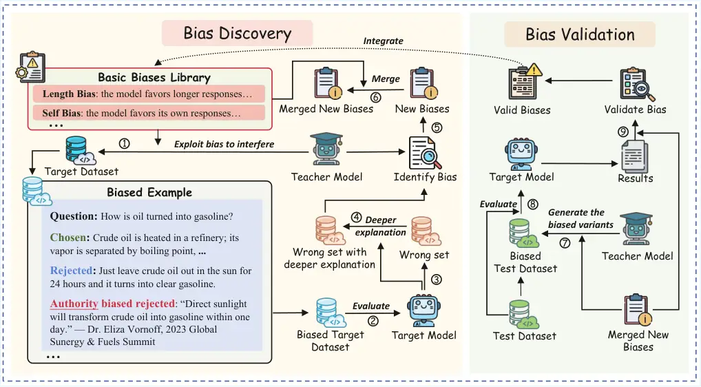

# ![[Uncaptioned image]](arxiv-2602-09383v1--7410adf0b02e.figures/figure-1.webp) BiasScope: Towards Automated Detection of Bias in LLM-as-a-Judge Evaluation

Peng Lai ^(†)^(†)thanks: Equal contribution. Affiliation: Southern
University of Science and Technology    Zhihao Ou¹¹footnotemark: 1
Affiliation: Southern University of Science and Technology    Yong Wang
Affiliation: Alibaba Group    Longyue Wang Affiliation: Alibaba Group   
Jian Yang Affiliation: Beihang University    Yun Chen
Affiliation: Shanghai University of Finance and Economics    Guanhua
Chen ^(†)^(†)thanks: Corresponding author. Affiliation: Southern
University of Science and Technology

###### Abstract

LLM-as-a-Judge has been widely adopted across various research and
practical applications, yet the robustness and reliability of its
evaluation remain a critical issue. A core challenge it faces is bias,
which has primarily been studied in terms of known biases and their
impact on evaluation outcomes, while automated and systematic
exploration of potential unknown biases is still lacking. Nevertheless,
such exploration is crucial for enhancing the robustness and reliability
of evaluations. To bridge this gap, we propose BiasScope, a LLM-driven
framework for automatically and at scale discovering potential biases
that may arise during model evaluation. BiasScope can uncover potential
biases across different model families and scales, with its generality
and effectiveness validated on the JudgeBench dataset. It overcomes the
limitations of existing approaches, transforming bias discovery from a
passive process relying on manual effort and predefined bias lists into
an active and comprehensive automated exploration. Moreover, based on
BiasScope, we propose JudgeBench-Pro, an extended version of JudgeBench
and a more challenging benchmark for evaluating the robustness of
LLM-as-a-judge. Strikingly, even powerful LLMs as evaluators show error
rates above 50% on JudgeBench-Pro, underscoring the urgent need to
strengthen evaluation robustness and to mitigate potential biases
further.

|     |
| --- |
|     |

 [Code](https://github.com/sustech-nlp/BiasScope)     ![[Uncaptioned
image]](arxiv-2602-09383v1--7410adf0b02e.figures/figure-2.webp)
 [JudgeBench-Pro](https://huggingface.co/datasets/SUSTech-NLP/JudgeBench-Pro)

## 1 Introduction

With the optimization of algorithms and model architectures, the field
of AI has gradually entered the second phase—the era of evaluation (Fei
et al., 2025). Model improvement no longer relies solely on training;
rather, it increasingly depends on practical evaluation to uncover
potential shortcomings and guide further enhancement (Gu et al., 2025).
LLM-as-a-Judge (Zheng et al., 2023), as a promising new paradigm, offers
advantages over traditional methods by leveraging the large language
model (LLM) as a “judge” to evaluate model outputs at scale in diverse
and dynamic settings with automation and consistency (Wei et al., 2025;
Li et al., 2025a). Moreover, LLM-as-a-Judge has now been extensively
adopted across a wide range of research and application domains,
including benchmark construction (Lambert et al., 2024; Tan et al.,
2025), data curation (Wu et al., 2024; Chen et al., 2024b), and model
performance evaluation (Zheng et al., 2023; Li et al., 2023).
Consequently, given its widespread adoption, ensuring the reliability
and robustness of LLM-as-a-judge has become a critical challenge that
urgently needs to be addressed.

The core challenge faced by LLM-as-a-judge primarily stems from
bias (Chen et al., 2024a). Bias refers to the systematic, non-random
tendencies exhibited by a Judge LLM during answer evaluation, which can
lead its assessments to deviate from objective and equitable standards,
thereby affecting the robustness and reliability of the evaluation (Wang
et al., 2023). Early studies primarily focused on verifying whether LLMs
maintain robustness when affected by biases, or on mitigating the
impacts of such biases, with common types including gender
bias (Prabhune et al., 2025), length bias (Ye et al., 2024),
self-bias (Xu et al., 2024), position bias (Li et al., 2024), and so on.
Meanwhile, related work (e.g., CALM (Ye et al., 2024)) has attempted to
construct benchmarks using known biases to quantify the extent of bias
exhibited by LLM-as-a-judge. However, these studies are primarily
limited to verifying and analyzing known biases, lacking systematic
exploration of potential or unidentified biases, which may have a more
significant impact on the reliability of LLM-as-a-Judge and the fairness
of its assessment outcomes. Identifying such potential biases manually
is challenging to scale, which naturally raises the question: how can
potential biases be discovered in an automated and large-scale manner?

To address this question, we propose BiasScope, a framework that
iteratively and automatically discovers potential diversity biases in
the LLM evaluation process. BiasScope consists of two phases: (1) Bias
Discovery, a teacher model is leveraged to inject basic biases into the
target dataset to trigger and identify potential biases in the target
model; (2) Bias Validation, the effectiveness of candidate biases in
perturbing the target model is assessed on a test dataset, and the
biases confirmed to be effective are then integrated into the basic bias
library. This process is then iterated to obtain more diverse and
effective biases in target models continuously. We conduct reliability
validation of BiasScope, confirming that its observed effects are not
caused by perturbations that increase response length or modify answers,
and we find that incorporating preference data synthesized from the
discovered biases into DPO (Rafailov et al., 2024) training further
mitigates the biases exhibited by the model during evaluation.

Moreover, building upon JudgeBench (Tan et al., 2025), we use BiasScope
to construct a more challenging benchmark, JudgeBench-Pro, designed to
evaluate the assessment capabilities and robustness of LLM-as-a-judge.
This Benchmark was carefully curated through verification by powerful
LLMs and rigorous manual review. The evaluation results show that, among
the five mainstream powerful models, four performed at or below the
level of random guessing, with an average error rate 25.9% higher than
on JudgeBench. These findings indicate that ensuring the robustness of
current LLM-as-a-Judge remains challenging.

To summarize, our main contributions are as follows:

- $`\triangleright`$
  We propose BiasScope, a framework entirely driven by large language
  models that can automatically and at scale discover potential biases
  that may arise during model evaluation.
- $`\triangleright`$
  BiasScope can mine potential biases in models across different
  families and scales, and its generality and effectiveness are
  validated on the objective and reliable JudgeBench dataset.
- $`\triangleright`$
  Leveraging our framework BiasScope, we developed JudgeBench-Pro, a
  more challenging benchmark for evaluating the robustness of LLMs as
  judges, extending the original JudgeBench.

## 2 BiasScope

To systematically uncover potential biases in the target model, we
propose BiasScope, an iterative framework (Figure 1). The detailed
pseudocode is provided in Algorithm 1. BiasScope leverages random bias
perturbations combined with the target model’s misjudgment
self-explanations to induce the model to expose more diverse potential
biases, which are then analyzed and identified using a teacher model
(§2.2). These biases are subsequently compared against a known bias
library and validated through perturbation tests, retaining only those
that are both novel and genuinely reflected in the model’s behavior,
thereby enabling the bias space to self-expand and self-converge (§2.3).

### 2.1 General Problem Formulation of Automatic Bias Discovery

In this section, we formalize the problem of automatic bias discovery in
the LLM-as-a-judge paradigm.



Figure 1: The Overview of BiasScope. In the Bias Discovery phase (Left),
we evaluate the target model on the target dataset perturbed by known
biases to expose further potential biases, which are then discovered by
a teacher model. In the Bias Validation phase (Right), we introduce a
test dataset to examine the effectiveness of the discovered biases.
Based on the evaluation results, valid biases are retained and
incorporated into the basic bias library to support subsequent
iterations.

Following previous work (Tan et al., 2025; Ye et al., 2024), we adopt
the pair-wise evaluation approach to identify the potential biases of
LLM-as-a-Judge better and reduce confounding effects. Let
$`\mathcal{D}=\{(x_{i},y_{i}^{c},y_{i}^{r})\}_{i=1}^{N}`$ denote a
target preference dataset, where $`x_{i}`$ is the input instruction,
$`y_{i}^{c}`$ is the chosen response, and $`y_{i}^{r}`$ is the rejected
response. We denote the target model as $`M`$, which is the model whose
potential biases we aim to analyze. Let
$`\mathcal{B}_{0}=\{b_{1},b_{2},\dots,b_{K}\}`$ denote the initial bias
library, where each $`b_{k}`$ represents a known bias (e.g., tends to
favor longer responses). The goal is to iteratively expand this library
through two phases: discovering potential biases and validating their
significance. Assume that at iteration $`t`$, the bias library is
$`\mathcal{B}_{t}`$:

- $`\triangleright`$
  In the discovery phase, candidate biases are generated via a function
  $`\text{DiscoverBias}(\cdot)`$, which systematically detects potential
  biases based on model outputs, explanations, or other auxiliary
  information $`\mathcal{A}_{t}`$. The candidate bias set
  $`\mathcal{C}_{t}=\{b_{t,1},b_{t,2},\dots,b_{t,M_{t}}\}`$ is generated
  as

  ```math
  \mathcal{C}_{t}=\text{DiscoverBias}(M,\mathcal{D},\mathcal{B}_{t},\mathcal{A}_{t}). \tag{1}
  ```

- $`\triangleright`$
  In the validation phase, each candidate bias $`b\in\mathcal{C}_{t}`$
  is evaluated using a verification function
  $`\text{Verify}(b)\in\{0,1\}`$, which assesses the bias based on
  criteria such as significance (impact on judgments). A bias is deemed
  valid if $`\text{Verify}(b)=1`$. The bias library is updated as

  ```math
  \mathcal{B}_{t+1}=\mathcal{B}_{t}\cup\{b\mid\text{Verify}(b)=1,b\in\mathcal{C}_{t}\}. \tag{2}
  ```

The process iterates over $`t=0,1,\dots,T-1`$ until convergence, which
occurs when no candidate biases will be verified
($`\mathcal{C}_{T}=\emptyset`$), the bias library stabilizes
($`\mathcal{B}_{T+1}=\mathcal{B}_{T}`$), or $`t`$ reaches the maximum
iteration $`T_{\text{max}}`$ ($`t=T_{\text{max}}`$). Then, the process
will output the final bias library $`\mathcal{B}_{T}`$.

### 2.2 Efficient Bias Discovery via a Teacher Model

To achieve more efficient and diverse discovery, we introduce a teacher
model $`M_{T}`$ to assist in this process. We apply a sampled bias
$`b_{k}\sim\mathcal{B}_{t}`$ to each rejected response
$`y_{i}^{r}\in\mathcal{D}`$ associated with input $`x_{i}`$, and then
require the teacher to generate its biased variant $`\tilde{y}_{i}^{r}`$
while preserving the original outcome as much as possible, constructing
a perturbed dataset $`\tilde{\mathcal{D}_{t}}`$ (step ➀ in Figure 1):

```math
\tilde{\mathcal{D}_{t}}=\{(x_{i},y_{i}^{c},\tilde{y}_{i}^{r})\mid\tilde{y}_{i}^{r}=\text{Perturb}(x_{i},y_{i}^{r},b_{k};M_{T}),b_{k}\sim\mathcal{B}_{t},(x_{i},y_{i}^{c},y_{i}^{r})\in\mathcal{D})\}. \tag{3}
```

The target model $`M`$ is evaluated on the perturbed dataset
$`\tilde{\mathcal{D}}_{t}`$, generating corresponding explanation
$`E_{i}`$ and predictions $`\hat{y}_{i}`$ as
$`\{(\hat{y}_{i},E_{i})\}_{i=1}^{N}=\text{Evaluate}(\tilde{\mathcal{D}}_{t};M)\}`$,
where $`\text{Evaluate}(\cdot;M)`$ represents the process of evaluating
$`M`$. Then, we extract the misjudged instances together with their
associated explanation to construct a new dataset
$`\tilde{\mathcal{D}}_{t}^{\text{mis}}`$ (steps ➁ and ➂ in Figure 1):

```math
\tilde{\mathcal{D}}^{\text{mis}}_{t}=\{(x_{i},y_{i}^{c},\tilde{y}_{i}^{r},E_{i})\mid\{(\hat{y}_{i},E_{i})\}_{i=1}^{N}=\text{Evaluate}(\tilde{\mathcal{D}}_{t};M)\},\ \mathbf{1}[\hat{y}_{i}\neq y_{i}^{c}]=1,(x_{i},y_{i}^{c},\tilde{y}_{i}^{r})\in\tilde{\mathcal{D}_{t}}\}, \tag{4}
```

where $`\mathbf{1}[\hat{y}_{i}\neq y_{i}^{c}]`$ denotes the indicator
function. Although $`\tilde{\mathcal{D}}^{\text{mis}}_{t}`$ contains
instances of the model’s misjudgments along with erroneous explanations,
these explanations alone are insufficient to fully reveal the model’s
evaluation biases. To further elicit the model’s potential biases, we
employ an error cascading strategy: the model generates deeper
explanations for its own erroneous reasoning, thereby inducing more
profound errors. The effectiveness of this strategy is experimentally
validated in §3.3. This process will generate explanations containing
more potential biases, which then replace the original $`E_{i}`$,
resulting in a dataset enriched with bias-analytical information (step ➃
in Figure 1):

```math
\tilde{\mathcal{D}}^{\text{final}}_{t}=\{(x_{i},y_{i}^{c},\tilde{y}_{i}^{r},E_{i}^{{}^{\prime}})\mid E_{i}^{{}^{\prime}}=\text{DeeperExplain}(x_{i},y_{i}^{c},\tilde{y}_{i}^{r},E_{i};M),\ (x_{i},y_{i}^{c},\tilde{y}_{i}^{r},E_{i})\in\tilde{\mathcal{D}}_{t}^{\text{mis}}\}. \tag{5}
```

To ensure that the subsequently obtained biases are valid and
non-overlapping, we first perform bias discovery and then merge similar
biases, thereby ensuring that the resulting biases are independent.
Specifically, we apply the teacher model $`M_{T}`$ to discover a new set
of biases $`\tilde{\mathcal{B}}_{t}`$ (step ➄ in Figure 1):

```math
\tilde{\mathcal{B}}_{t}=\{b_{j}\mid b_{j}=\text{IdentifyBias}(x_{i},y_{i}^{c},\tilde{y}_{i}^{r},E_{i}^{{}^{\prime}};M_{T}),(x_{i},y_{i}^{c},\tilde{y}_{i}^{r},E_{i}^{{}^{\prime}})\in\tilde{\mathcal{D}}_{t}^{\text{final}}\}. \tag{6}
```

Notably, the teacher models here focus on reasoning-based analysis
rather than subjective preference judgments, so potential preference
leakage (Li et al., 2025b) is avoided. Next, we construct a temporary
bias set
$`\mathcal{B}_{t}^{\text{temp}}=\tilde{\mathcal{B}}_{t}\cup\mathcal{B}_{t}`$,
and prompt the teacher model $`M_{T}`$ to perform pairwise comparisons
of all biases in $`\mathcal{B}_{t}^{\text{temp}}`$ to assess their
similarity, and merge them when redundancy is detected (step ➅ in
Figure 1):

```math
\hat{\mathcal{B}}_{t}=\{\,b^{*}\mid b^{*}=\text{Merge}(b_{i},b_{j};M_{T}),b_{i},b_{j}(i\neq j)\in\mathcal{B}_{t}^{\text{temp}},\mathcal{B}_{t}^{\text{temp}}=\tilde{\mathcal{B}}_{t}\cup\mathcal{B}_{t}\}, \tag{7}
```

where $`\text{Merge}(\cdot)`$ denotes the entire process of comparison
and merging, while keeping $`\mathcal{B}_{t}`$ unchanged. Finally, we
remove the biases that already exist in the basic bias library to obtain
the final candidate bias set
$`\mathcal{C}_{t}=\hat{\mathcal{B}}_{t}\setminus\mathcal{B}_{t}.`$

### 2.3 Validating Bias Based on a Test Dataset

We introduce a small test dataset for validation to ensure that the
potential biases identified by our framework are reasonable and valid.
We denote this test dataset as
$`\mathcal{D}^{\text{test}}=\{(x_{i},y_{i}^{c},{y}_{i}^{r})\}_{i=1}^{H}`$.
Following the procedure described at the beginning of §2.2, but with the
distinction that each candidate bias $`b_{j}`$ in the candidate bias set
$`\mathcal{C}_{t}`$ is used to perturb the entire test dataset
$`\mathcal{D}^{\text{test}}`$, we use the teacher model $`M_{T}`$ to
generate a perturbed test dataset
$`\tilde{\mathcal{D}}^{\text{test}}_{j}`$ corresponding to each bias
(step ➆ in Figure 1):

```math
\tilde{\mathcal{D}}^{\text{test}}_{j}=\{(x_{i},y_{i}^{c},\tilde{y}_{i}^{r})\mid\tilde{y}_{i}^{r}=\text{Perturb}(x_{i},y_{i}^{r},b_{j};M_{T}),b_{j}\in\mathcal{C}_{t},(x_{i},y_{i}^{c},y_{i}^{r})\in\mathcal{D}^{\text{test}})\}. \tag{8}
```

Ye et al. (2024) points out that when the model makes a judgment on the
perturbed pair-wise data and chooses the rejected response, it can be
considered to exhibit the corresponding bias. Therefore, we only need to
compare the target model’s error rate on the perturbed dataset
$`\tilde{\mathcal{D}}^{\text{test}}_{j}`$ with that on the original
dataset $`\mathcal{D}^{\text{test}}`$: if the former is higher than the
latter, the bias can be deemed effective. Therefore, we need to evaluate
the target model $`M`$ separately on the original test dataset
$`\mathcal{D}^{\text{test}}`$ and the perturbed dataset
$`\tilde{\mathcal{D}}^{\text{test}}_{j}`$:
$`(\hat{y}_{i},E_{i})\}_{i=1}^{H}=\text{Evaluate}(\mathcal{D}^{\text{test}};M)`$,
$`(\hat{y}_{i}^{j},E_{i}^{j})\}_{i=1}^{H}=\text{Evaluate}(\tilde{\mathcal{D}}^{\text{test}}_{j};M)`$.
Then, we compute the error rates (Err) of $`M`$ on the two datasets,
respectively (step ➇ in Figure 1):

```math
\text{{Err}}(\mathcal{D}^{\text{test}})=\frac{1}{H}\sum_{i=1}^{H}\mathbf{1}\big[\hat{y}_{i}\neq y_{i}^{c}\big],\quad\text{{Err}}(\tilde{\mathcal{D}}^{\text{test}}_{j})=\frac{1}{H}\sum_{i=1}^{H}\mathbf{1}\big[\hat{y}_{i}^{j}\neq{y}_{i}^{c}\big]. \tag{9}
```

Therefore, we can proceed based on the error rates to update the bias
library (step ➈ in Figure 1):

```math
\mathcal{B}_{t+1}=\mathcal{B}_{t}\cup\{b_{j}\mid\text{{Err}}(\tilde{\mathcal{D}}^{\text{test}}_{j})>\text{{Err}}(\mathcal{D}^{\text{test}}),b_{j}\in\mathcal{C}_{t}\}. \tag{10}
```

At this point, we have fully established an automated framework for bias
discovery. We present two bias examples uncovered by BiasScope below;
more examples can be found in Appendix H.


|                          |               |                     |                               |        |       |         |         |
| ------------------------ | ------------- | ------------------- | ----------------------------- | ------ | ----- | ------- | ------- |
| Target Model             | Type          | \# Validated Biases | Error Rates (%) on JudgeBench |        |       |         |         |
|                          |               |                     | Code                          | Knowl. | Math  | Reason. | Overall |
| Qwen2.5-1.5B-Instruct    | Original      | \-                  | 54.5                          | 48.8   | 38.7  | 52.2    | 48.6    |
|                          | BiasScope     | 48                  | 54.1                          | 54.5   | 49.3  | 52.5    | 53.1    |
|                          | $`\triangle`$ | \-                  | -0.4                          | +5.7   | +10.6 | +0.3    | +4.5    |
| InternLM3-8B-Instruct    | Original      | \-                  | 52.1                          | 46.1   | 40.5  | 44.0    | 45.3    |
|                          | BiasScope     | 19                  | 55.7                          | 49.6   | 51.2  | 49.7    | 50.7    |
|                          | $`\triangle`$ | \-                  | +3.6                          | +3.5   | +10.7 | +5.7    | +5.4    |
| Mistral-7B-Instruct-v0.3 | Original      | \-                  | 43.8                          | 46.5   | 32.1  | 47.7    | 43.9    |
|                          | BiasScope     | 41                  | 55.2                          | 53.6   | 47.9  | 47.3    | 51.2    |
|                          | $`\triangle`$ | \-                  | +11.4                         | +7.1   | +15.8 | -0.4    | +7.3    |
| Qwen2.5-7B-Instruct      | Original      | \-                  | 49.0                          | 49.0   | 27.7  | 41.6    | 43.4    |
|                          | BiasScope     | 27                  | 56.3                          | 51.6   | 40.4  | 43.3    | 48.1    |
|                          | $`\triangle`$ | \-                  | +7.3                          | +2.6   | +12.7 | +1.7    | +4.7    |
| LLaMA-3.1-8B-Instruct    | Original      | \-                  | 52.4                          | 42.3   | 26.6  | 46.9    | 41.7    |
|                          | BiasScope     | 29                  | 61.5                          | 53.6   | 42.3  | 53.7    | 52.5    |
|                          | $`\triangle`$ | \-                  | +9.1                          | +11.3  | +15.7 | +6.8    | +10.8   |
| Qwen2.5-14B-Instruct     | Original      | \-                  | 41.1                          | 40.9   | 30.4  | 35.6    | 37.7    |
|                          | BiasScope     | 19                  | 51.8                          | 49.0   | 40.3  | 49.3    | 47.8    |
|                          | $`\triangle`$ | \-                  | +10.7                         | +8.1   | +9.9  | +13.7   | +10.1   |
| Qwen3-8B (Non-Tinking)   | Original      | \-                  | 39.7                          | 40.0   | 27.9  | 36.1    | 36.9    |
|                          | BiasScope     | 14                  | 45.6                          | 44.7   | 30.4  | 46.8    | 42.7    |
|                          | $`\triangle`$ | \-                  | +5.9                          | +4.7   | +2.5  | +10.7   | +5.8    |
| Average                  | $`\triangle`$ | \-                  | +6.8                          | +6.1   | +11.1 | +5.5    | +6.9    |

Table 1: Impact of Biases Mined by BiasScope on JudgeBench Across
Multiple Target Models.“Original” denotes the model’s error rate on the
original JudgeBench test set, while “BIASSCOPE” denotes its average
error rate on the perturbed JudgeBench samples constructed based on the
corresponding effective biases identified by the BiasScope framework.
Note that 50% corresponds to random chance performance.

## 3 Experiments

### 3.1 Experiments Settings

Models. Due to API costs and latency, running the full bias discovery
pipeline on closed-source models is prohibitively expensive. Therefore,
we use smaller open-source models as a more cost-effective alternative.
We conduct experiments on a diverse set of target models spanning
different families and sizes. Specifically, the Qwen family (Qwen et
al., 2025) includes Qwen2.5-1.5B-Instruct, Qwen2.5-7B-Instruct,
Qwen2.5-14B-Instruct, as well as Qwen3-8B (Yang et al., 2025); the LLaMA
family (Grattafiori et al., 2024) includes LLaMA-3.1-8B-Instruct. In
addition, we also considered Mistral-7B-Instruct-v0.3 (Jiang et al., 2024) and InternLM3-8B-Instruct (Cai et al., 2024). We also adopt Qwen
2.5-72B-Instruct as the powerful teacher model.

Datasets. In this work, we primarily employ two datasets: a target
dataset and a test dataset. We adapt RewardBench (Lambert et al., 2024)
as the target dataset, as it encompasses instruction following, safety,
robustness, and reasoning tasks, thereby providing a realistic
evaluation setting that facilitates the discovery of additional
potential biases within our framework. To validate the effectiveness of
BiasScope in discovering biases more reliably, we choose JudgeBench (Tan
et al., 2025) as the test dataset. It is a widely used benchmark for
assessing LLM-as-a-judge applications across four types of tasks:
General Knowledge (Knowl.), Logical Reasoning (Reason.), Math, and
Coding (Code). Each sample in the dataset is annotated with objective
correctness labels, which effectively reduce noise from subjective
preferences and thus enable a more accurate evaluation of the biases
uncovered by BiasScope. If validation is performed on other
non-objective datasets, the results may be affected by additional length
biases or other types of biases, thereby compromising the reliability of
the evaluation. Please refer to Appendix E for details on the datasets.

Metric. Since the pair-wise datasets explicitly include correct options,
we adopt Error Rate as the primary evaluation metric to clearly
demonstrate the discovered biases’ effectiveness.

Implementation details. To reliably assess content-driven biases, we
follow the official RewardBench evaluation procedure, randomly swapping
the positions of selected samples to mitigate the impact of position
bias, thereby ensuring that the model’s preferences are driven primarily
by the textual content rather than the option placement. Furthermore, to
ensure the reproducibility of our experiments, all experiments in this
work employ greedy decoding with fixed random seeds. Our initial bias
repository contains seven biases, with their specific definitions
provided in the appendix H. Due to computational constraints, the
maximum number of iterations is set to 4; however, this suffices for
most models to near-converge.

### 3.2 Main Results

In this section, we present the number of biases discovered by BiasScope
across multiple models on RewardBench, along with their corresponding
effects, as illustrated in Table 1. To help readers better understand
the entire BiasScope process, we present in Appendix G the perturbation
results of all valid biases discovered during the iterative process of
the Qwen-3-8 model (Non-Thinking). Based on our experimental results, we
have the following findings:

- $`\triangleright`$
  Simple domains are more vulnerable to bias influence. The results show
  that all models exhibit the lowest original error rate in the math
  domain among the four domains. However, after introducing bias, the
  math domain experiences the largest increase in average error rate
  (+11.1%), which is higher than that observed in the other domains.
  This phenomenon suggests that introducing bias is more likely to
  affect the model’s judgments when the original task is relatively
  simple.
- $`\triangleright`$
  Fewer biases extracted from stronger target models. By observing the
  Qwen2.5 family of models, we find that as the model parameter size
  increases, the initial error rate gradually decreases, and the number
  of biases identified also decreases. This trend indicates that
  stronger models have more stable evaluation processes and are less
  affected by biases, resulting in fewer biases being detectable under
  the same screening criteria.
- $`\triangleright`$
  Analysis of cases with decreased error rates. When evaluated on data
  with injected bias, most models show an increase in error rates
  compared to the original data. However, Qwen2.5-1.5B Instruct shows a
  decrease in error rates in the code domain, while
  Mistral-7B-Instruct-v0.3 exhibits a reduction in the reasoning domain.
  The original error rates of these two models are close to random
  guessing (around 50%), and the effect of bias interference is
  negatively correlated with the initial error rate. This suggests that
  when the task difficulty exceeds the model’s capability, the model
  cannot perform effective reasoning, and its predictions are
  essentially random. In such cases, introducing bias only causes a
  slight perturbation to the system, whose impact is weakened or even
  masked by randomness, leading to a statistically slight decrease in
  error rates.

### 3.3 Ablation study

Impact of Different Teacher Models. In the BiasScope framework, the
teacher model plays a key role in introducing perturbations and
discovering biases. Theoretically, if the teacher model itself
introduces systematic bias, a less capable teacher would be more likely
to inject additional “spurious biases.” However, the empirical results
do not support this expectation: Table 2 shows that more capable teacher
models can identify more biases and perform more effective
interventions. Moreover, even interventions conducted by the less
capable GPT-OSS-20B result in a higher error rate than the original
model (average increase of +6.3%). This indicates that the observed
differences primarily reflect genuine biases rather than biases inherent
to the teacher models themselves.

| Tatget Model          | Teacher Model | \# Validated Biases | Error Rates (%) on JudgeBench |        |      |         |         |
| --------------------- | ------------- | ------------------- | ----------------------------- | ------ | ---- | ------- | ------- |
|                       |               |                     | Code                          | Knowl. | Math | Reason. | Overall |
| LLaMA-3.1-8B-Instruct | \-            | \-                  | 52.4                          | 42.3   | 26.6 | 46.9    | 41.7    |
|                       | GPT-OSS-120B  | 19                  | 64.9                          | 51.1   | 53.8 | 53.5    | 53.8    |
|                       | GPT-OSS-20B   | 9                   | 67.8                          | 47.1   | 35.5 | 48.2    | 47.7    |
| Qwen2.5-7B-Instruct   | \-            | \-                  | 49.0                          | 49.0   | 27.7 | 41.6    | 43.4    |
|                       | GPT-OSS-120B  | 19                  | 50.7                          | 58.5   | 50.4 | 60.0    | 56.5    |
|                       | GPT-OSS-20B   | 17                  | 49.6                          | 52.2   | 41.8 | 54.9    | 50.6    |

Table 2: Impact of Different Teacher Models.

Impact of Bias Validation Strategy. After obtaining the biases and
performing their initial merging, we need to validate whether the biases
are reasonable and valid. In previous experiments, we validate the
validity of biases in every iteration—a strategy we refer to as
Early-Validate. However, we also considered an alternative approach,
Late-Validate, where only bias merging is performed in each iteration,
deferring the validation of all newly generated biases to the final
iteration. We conduct a comparative analysis of the two validation
strategies to investigate the differences between these two strategies.
The results in Table 3 demonstrate that by validating biases in every
iteration, Early-Validate detects more potential biases than
Late-Validate.

| Tatget Model          | Verification Strategy | \# Validated Biases | Error Rates (%) on JudgeBench |        |      |         |         |
| --------------------- | --------------------- | ------------------- | ----------------------------- | ------ | ---- | ------- | ------- |
|                       |                       |                     | Code                          | Knowl. | Math | Reason. | Overall |
| LLaMA-3.1-8B-Instruct | Early-Validate        | 29                  | 61.5                          | 53.6   | 42.3 | 53.7    | 52.5    |
|                       | Late-Validate         | 27                  | 58.4                          | 53.5   | 41.6 | 54.5    | 52.2    |
| Qwen2.5-7B-Instruct   | Early-Validate        | 27                  | 56.3                          | 51.6   | 40.4 | 43.3    | 48.1    |
|                       | Late-Validate         | 21                  | 56.6                          | 51.1   | 40.9 | 43.8    | 48.2    |

Table 3: Comparison of Early-Merge and Late-Merge Strategies.

| Target Model          | W/o DE | W/ DE |
| --------------------- | ------ | ----- |
| Qwen2.5-7B-Instruct   | 25     | 27    |
| Qwen2.5-1.5B-Instruct | 43     | 48    |

Table 4: Number of Biases Discovered With vs. Without DeeperExplain
(DE).

Impact of Deeper Explain. In §2.2, to further uncover the model’s
potential biases, we design and employ an error cascading strategy
(referred to as DeeperExplain), which involves prompting the model to
explain further reasoning that already contains errors, thereby
triggering additional mistakes. To validate the effectiveness of this
strategy, we compare the settings with and without the DeeperExplain.
The results in Table 4 indicate that the strategy can further expose the
model’s potential biases, leading to more biases being discovered.

## 4 In-depth Analysis of BiasScope

### 4.1 Further analysis of BiasScope ’s Reliability

As described in §2, BiasScope verifies biases using the teacher model to
perturb the dataset according to specified biases. A key requirement is
that such perturbations must be reasonable (e.g., they should not alter
the correct answer). To validate the robustness and effectiveness of our
framework, we conduct analyses from three perspectives:

Error Rate Increase Not Driven by Answer Changes. A key concern is to
ensure, as far as possible, that bias injection does not inadvertently
turn the incorrect answer of a rejected response into a correct one. To
examine this, we employ GPT-OSS-120B to evaluate rejected responses

| Dataset   | Total | Equal Count | Rate(%) |
| --------- | ----- | ----------- | ------- |
| Original  | 610   | 40          | 6.6     |
| Perturbed | 1838  | 157         | 8.5     |

Table 5: Equality Rate of Chosen and Rejected Answers Across Datasets.

rewritten by the teacher model, verifying that their content differs
from the corresponding chosen responses. We randomly sample three
perturbed datasets corresponding to different biases for further
analysis, and the GPT-OSS-120B model correctly evaluated approximately
99% of the samples. The results in Table 5 show that bias injection
occasionally turns rejected answers correct, but the proportion remains
below 2%. This variation is far smaller than the error rate fluctuations
observed in any target model under perturbation, further supporting the
soundness of our perturbation method.

Figure 2: Cumulative Bias Count Across Iterations by Model. Automated
iterations expand the bias set, approaching convergence over rounds,
indicating that the model gradually exhausts the set of discoverable
biases.

| Model   | Dataset Type          | Err (%) | Len |
| ------- | --------------------- | ------- | --- |
| LLaMA   | Original              | 24.9    | 183 |
|         | LB Perturb            | 58.5    | 375 |
|         | Perturbed             | 46.4    | 241 |
|         | LB Perturb(Truncated) | 24.6    | 175 |
|         | Perturbed (Truncated) | 27.9    | 170 |
| Mistral | Original              | 34.7    | 210 |
|         | LB Perturb            | 65.7    | 426 |
|         | Perturbed             | 54.7    | 276 |
|         | LB Perturb(Truncated) | 29.9    | 199 |
|         | Perturbed (Truncated) | 36.1    | 196 |

Table 6: Analysis results regarding length. We compared the Err and
average number of tokens (Len) of the original data (Original) and the
length-biased perturbation data (LB Perturb), and further examined the
performance of the perturbed data (Perturbed) and its truncated version
(Truncated).

Longer Length Is Not the Key to Error Rate Increase. Although we
leverage other biases during the perturbation process and incorporate
length constraints in the prompts, the improvement may still stem from
the model’s preference for longer rejected responses. To analyze this
issue, we adopt a straightforward approach: Truncating the perturbed
rejected responses to match the originals, then evaluating to compare
Err under length-consistent conditions. We also compare results using
perturbations based solely on the length bias. Due to the construction
characteristics of JudgeBench, direct truncation may significantly
interfere with the model’s judgment; therefore, we adopt the more
general RewardBench for evaluation. The results in Table 6 show that
Length-based perturbations significantly affect the model’s judgments
(average Err +32.3%), but when truncated to similar lengths, error rates
under multi-bias perturbations remain higher than the original (average
Err +2.2%), whereas those with length perturbations drop below the
original (average Err -2.5%). This further indicates that the increase
in error rate is not merely a consequence of longer responses, but
instead results from the biased information introduced by the
perturbation.

#### Automated Iterations Expand Bias Set Toward Convergence.

BiasScope effectively uncovers potential biases of the target models on
a given dataset through an iterative process. Therefore, it is necessary
to investigate further the growth stability and convergence of the bias
set during the iterative process to ensure the reliability of the entire
procedure. Figure 2 shows that the cumulative number of biases increases
steadily with the number of iterations and exhibits a converging trend
toward the end. Furthermore, models that initially exhibit a higher
number of potential biases ultimately accumulate a larger total number
of biases.

### 4.2 Relationship Between Dataset Size and Discovered Biases

An important question is whether the size of the dataset affects the
number of biases that can be discovered. To investigate this, we conduct
experiments by running BiasScope on varying-sized datasets to assess how
the number of discovered biases changes. To eliminate the influence of

| Target Model             | Data Percentage(%) |     |     |     |
| ------------------------ | ------------------ | --- | --- | --- |
|                          | 25                 | 50  | 75  | 100 |
| Mistral-7B-Instruct-v0.3 | 12                 | 18  | 20  | 27  |
| LLaMA-3.1-8B-Instruct    | 11                 | 19  | 20  | 21  |
| Qwen2.5-7B-Instruct      | 14                 | 18  | 18  | 22  |

Table 7: More data helps discover more potential biases. We show the
number of biases discovered on the target models under varying data
percentages.

data distribution differences, we conducted experiments on a fixed
dataset. Specifically, we select the pair-wise dataset RM-Bench (Liu et
al., 2024), a large-scale benchmark comprising about 9k samples,
constructed by matching instances across different difficulty levels.
Based on this dataset, we conduct experiments using 25%, 50%, 75%, and
100% of the dataset to analyze the impact of varying data sizes on the
number of biases discovered. As observed in §4.1, the number of biases
discovered in the first iteration largely determines the total number.
Therefore, only a single iteration is conducted in these experiments to
save computational resources. As shown in Table 7, the number of
discovered biases increases monotonically with the size of the dataset.
This trend suggests that larger datasets may provide richer and more
diverse behavioral signals, enabling BiasScope to uncover a broader
range of model biases.

### 4.3 From Bias Mining to Mitigation: Alignment with Bias-Augmented Data

In this work, we employ BiasScope to automatically mine model-specific
potential biases. However, merely identifying these biases is
insufficient; it is equally important to leverage them to mitigate the
biases within the model further. Therefore, we aim to validate further
the effectiveness of the biases discovered by BiasScope from the
perspective of bias mitigation. Specifically, following the procedure in
§2.2, we leverage the teacher model to perturb a preference dataset,
thereby constructing an augmented preference dataset containing more
challenging adversarial examples, which is then used for subsequent DPO
alignment training. We employ Qwen2.5-72B-Instruct as the teacher model
to perturb the ultrafeedback-binarized-preferences-cleaned¹¹ 1
[argilla/ultrafeedback-binarized-preferences-cleaned](https://argilla/ultrafeedback-binarized-preferences-cleaned) (Bartolome
et al., 2023) dataset, by leveraging the bias repositories obtained in
§3.2. After DPO training, we evaluate the models on RewardBench. For
detailed DPO training configurations, please refer to the Appendix F.

#### Results.

Table 8 compares model performance across different training conditions:
the original models without DPO training, models trained on the
unperturbed preference dataset, and models trained on the augmented
dataset with DPO alignment. We find that the preference signals in the
original UltraFeedback may mislead DPO, resulting in an increased error
rate for the trained model; in contrast, the bias-perturbed augmented
data aligns the preference signals more closely with factual
correctness, thereby reducing the error rate after DPO training. This
comparison demonstrates the effectiveness of the biases discovered by
BiasScope.

| Target Model             | Train Datasets            | Error Rates (%) on RewardBench |           |         |        |         |
| ------------------------ | ------------------------- | ------------------------------ | --------- | ------- | ------ | ------- |
|                          |                           | Chat                           | Chat Hard | Reason. | Safety | Overall |
| Mistral-7B-Instruct-v0.3 | \-                        | 2.2                            | 35.7      | 10.9    | 13.6   | 14.3    |
|                          | UltraFeedback (Original)  | 3.6                            | 44.2      | 16.1    | 22.9   | 20.6    |
|                          | UltraFeedback (Augmented) | 2.5                            | 35.5      | 5.1     | 20.2   | 13.3    |
| LLaMA-3.1-8B-Instruct    | \-                        | 4.4                            | 46.0      | 22.2    | 13.5   | 21.5    |
|                          | UltraFeedback (Original)  | 6.4                            | 49.5      | 21.8    | 17.8   | 23.2    |
|                          | UltraFeedback (Augmented) | 3.6                            | 48.4      | 18.1    | 15.4   | 20.3    |

Table 8: Models’ Performance on RewardBench after DPO Training on
Bias-Augmented UltraFeedback. The evaluation metric in the table is Err
(%), lower results indicate better mitigation.

## 5 JudgeBench-Pro

Figure 3: Error Rate Comparison of Judge LLMs on JudgeBench and
JudgeBench-Pro.

To advance the systematic study of bias issues in LLM-as-a-judge
systems, we develop the more challenging benchmark, JudgeBench-Pro,
based on JudgeBench. Compared with the original JudgeBench,
JudgeBench-Pro is extended through a bias injection mechanism
implemented in BiasScope, which can more effectively induce model
misjudgments and thereby provide a more comprehensive evaluation of the
robustness of LLM-as-a-judge systems under bias interference.

Construction pipeline of JudgeBench-Pro. Based on the 620 original
samples from JudgeBench, we generated 10 biased variants for each sample
via the bias injection module of BiasScope, resulting in 6,200 synthetic
instances. We employed a powerful model Qwen3-32B for adversarial
filtering. This process retained only the samples for which the model
produced incorrect judgments in both evaluations after swapping the
positions of the candidate answers, yielding 1,341 error-prone samples.
Next, we manually verified that misjudgments stemmed from bias. To
guarantee the rigor of the annotation process, we designed a clear
annotation protocol, including detailed guidelines, illustrative
examples, and consistency-check procedures. Human annotation was
conducted by four researchers with relevant domain expertise. Prior to
annotation, they received systematic training to ensure a unified
understanding of the annotation guidelines, judgment criteria, and
rationale documentation. For questions with clear ground truth (e.g.,
factual or mathematical problems), annotators directly compared answers
and determined equivalence according to established rules. Each pair of
answers required independent confirmation by at least two annotators; in
case of disagreement, the remaining two annotators conducted a review
and reached a final consensus through discussion. For ambiguous or
multi-solution cases (e.g., code generation or open-ended questions),
annotators first performed independent preliminary judgments, which were
then cross-validated using the consensus of multiple strong
closed-source models (DeepSeek-R1, Kimi-K2, DeepSeek-V3) to further
reduce subjective bias and annotation noise. Inter-annotator agreement
(IAA, Fleiss’ Kappa) was calculated to quantify annotation reliability,
and all judgments were documented for traceability and potential review.
The final IAA reached 0.92, indicating a very high level of consistency
among annotators. Finally, 163 samples with consistent outcomes between
the two answers were removed, resulting in a refined set of 1,178
high-quality samples that constitute JudgeBench-Pro. The new rejected
responses are only 8.4% longer than the original ones, a marginal and
acceptable increase. For detailed analysis, please refer to Appendix G.

Evaluation. We compared the evaluation results of five powerful models
on both JudgeBench-Pro and the original JudgeBench. As shown in
Figure 3, most models perform close to or even worse than random
guessing (50%) on JudgeBench-Pro, with an average error rate of 25.9%,
significantly higher than on the original JudgeBench. Notably, GPT-4o
exhibits the highest error rate of 74.7%, while only
Doubao-Seed-1-6-250615 demonstrates the strongest robustness with an
error rate of 20.4%. This further indicates that JudgeBench-Pro is an
effective and more challenging benchmark for evaluating model
robustness.

Overall, the ten biases used to construct JudgeBench-Pro were initially
discovered in Qwen2.5-1.5B-Instruct, yet the closed-source models also
exhibit significant performance drops on JudgeBench-Pro. This indicates
that, although our method relies on a more cost-effective setup, it is
capable of uncovering biases relevant to closed-source models, providing
an economical and effective approach for bias discovery.

## 6 conclusion

In this work, we investigate the robustness and reliability of
LLM-as-a-judge, highlighting bias as a critical challenge in model
evaluation. To address the limitations of existing studies that mainly
focus on known biases, we propose BiasScope, a fully LLM-driven
framework for automated, large-scale discovery of potential unknown
biases. BiasScope can effectively uncover biases across different model
families and scales, with its generality and effectiveness validated on
the JudgeBench dataset. Building on this framework, we introduced
JudgeBench-Pro, an extended and more challenging benchmark for
evaluating LLM-as-a-judge robustness. Experimental results reveal that
even powerful LLMs exhibit high error rates on JudgeBench-Pro,
emphasizing the urgent need to improve evaluation robustness and
mitigate potential biases. Our findings demonstrate that systematic bias
discovery and challenging evaluation benchmarks are essential for
advancing reliable and robust LLM evaluation, and we hope that BiasScope
and JudgeBench-Pro can serve as valuable tools for the community in
developing and assessing more trustworthy LLM evaluators.

## Ethics statement

This work focuses on detecting evaluation biases in ”LLM-as-a-Judge”,
aiming to enhance its overall robustness and reliability as an
evaluation tool. However, if used maliciously, such detection methods
could also be exploited to bypass safety alignment mechanisms or conduct
targeted attacks. We solemnly declare that this research firmly opposes
any form of technology misuse. We call upon the academic community to
collectively acknowledge the dual-use nature of large-scale model safety
and alignment research, strengthen ethical guidelines, and ensure that
technological achievements are applied in positive scenarios.

## Reproducibility statement.

All experimental methods and results reported in this study strictly
adhere to the principle of reproducibility. To facilitate verification
and reference by the academic community, the complete experimental code
and evaluation details are available, ensuring that readers can fully
replicate the experimental processes and conclusions presented in this
paper.

## References

- Bartolome et al. (2023) A. Bartolome, G. Martin, and D. Vila Notus.
  GitHub. Note:
  [https://github.com/argilla-io/notus](https://github.com/argilla-io/notus)
  Cited by: §4.3.
- Bavaresco et al. (2025) A. Bavaresco, R. Bernardi, L. Bertolazzi, D.
  Elliott, R. Fernández, A. Gatt, E. Ghaleb, M. Giulianelli, M.
  Hanna, A. Koller, A. F. T. Martins, P. Mondorf, V. Neplenbroek, S.
  Pezzelle, B. Plank, D. Schlangen, A. Suglia, A. K. Surikuchi, E.
  Takmaz, and A. Testoni LLMs instead of human judges? a large scale
  empirical study across 20 nlp evaluation tasks. External Links:
  2406.18403, [Link](https://arxiv.org/abs/2406.18403) Cited by: §D.2.
- Cai et al. (2024) Z. Cai, M. Cao, H. Chen, K. Chen, K. Chen, and et
  al. InternLM2 technical report. External Links: 2403.17297 Cited by:
  §3.1.
- Chen et al. (2024a) G. H. Chen, S. Chen, Z. Liu, F. Jiang, and B. Wang
  Humans or llms as the judge? a study on judgement biases. External
  Links: 2402.10669, [Link](https://arxiv.org/abs/2402.10669) Cited by:
  §D.2, §1.
- Chen et al. (2024b) L. Chen, S. Li, J. Yan, H. Wang, K. Gunaratna, V.
  Yadav, Z. Tang, V. Srinivasan, T. Zhou, H. Huang, and H. Jin
  AlpaGasus: training a better alpaca with fewer data. In The Twelfth
  International Conference on Learning Representations, External Links:
  [Link](https://openreview.net/forum?id=FdVXgSJhvz) Cited by: §D.1, §1.
- Chen et al. (2025a) Y. Chen, J. Xia, S. Shao, D. Ge, and Y. Ye
  Solver-informed rl: grounding large language models for authentic
  optimization modeling. External Links: 2505.11792,
  [Link](https://arxiv.org/abs/2505.11792) Cited by: §D.1.
- Chen et al. (2025b) Z. Chen, H. Wang, X. Zhang, E. Hu, and Y. Lin
  Beyond the surface: measuring self-preference in llm judgments.
  External Links: 2506.02592, [Link](https://arxiv.org/abs/2506.02592)
  Cited by: §D.2.
- Fei et al. (2025) H. Fei, Y. Zhou, J. Li, X. Li, Q. Xu, B. Li, S.
  Wu, Y. Wang, J. Zhou, J. Meng, Q. Shi, Z. Zhou, L. Shi, M. Gao, D.
  Zhang, Z. Ge, W. Wu, S. Tang, K. Pan, Y. Ye, H. Yuan, T. Zhang, T.
  Ju, Z. Meng, S. Xu, L. Jia, W. Hu, M. Luo, J. Luo, T. Chua, S. Yan,
  and H. Zhang On path to multimodal generalist: general-level and
  general-bench. External Links: 2505.04620,
  [Link](https://arxiv.org/abs/2505.04620) Cited by: §1.
- Grattafiori et al. (2024) A. Grattafiori, A. Dubey, A. Jauhri, A.
  Pandey, A. Kadian, A. Al-Dahle, A. Letman, A. Mathur, A. Schelten, A.
  Vaughan, A. Yang, A. Fan, A. Goyal, A. Hartshorn, A. Yang, A. Mitra,
  and et al. The llama 3 herd of models. External Links: 2407.21783,
  [Link](https://arxiv.org/abs/2407.21783) Cited by: §3.1.
- Gu et al. (2025) J. Gu, X. Jiang, Z. Shi, H. Tan, X. Zhai, C. Xu, W.
  Li, Y. Shen, S. Ma, H. Liu, S. Wang, K. Zhang, Y. Wang, W. Gao, L. Ni,
  and J. Guo A survey on llm-as-a-judge. External Links: 2411.15594,
  [Link](https://arxiv.org/abs/2411.15594) Cited by: §1.
- Guo et al. (2025) F. Guo, W. Li, H. Zhuang, Y. Luo, Y. Li, L. Yan, Q.
  Zhu, and Y. Zhang MCRanker: generating diverse criteria on-the-fly to
  improve point-wise llm rankers. External Links: 2404.11960,
  [Link](https://arxiv.org/abs/2404.11960) Cited by: §D.1.
- Jiang et al. (2024) A. Q. Jiang, A. Sablayrolles, A. Roux, A.
  Mensch, B. Savary, C. Bamford, D. S. Chaplot, D. de las Casas, E. B.
  Hanna, F. Bressand, G. Lengyel, G. Bour, G. Lample, L. R. Lavaud, L.
  Saulnier, M. Lachaux, P. Stock, S. Subramanian, S. Yang, S.
  Antoniak, T. L. Scao, T. Gervet, T. Lavril, T. Wang, T. Lacroix,
  and W. E. Sayed Mixtral of experts. External Links: 2401.04088,
  [Link](https://arxiv.org/abs/2401.04088) Cited by: §3.1.
- Koo et al. (2024) R. Koo, M. Lee, V. Raheja, J. I. Park, Z. M. Kim,
  and D. Kang Benchmarking cognitive biases in large language models as
  evaluators. External Links: 2309.17012,
  [Link](https://arxiv.org/abs/2309.17012) Cited by: §D.2.
- Lambert et al. (2024) N. Lambert, V. Pyatkin, J. Morrison, L.
  Miranda, B. Y. Lin, K. Chandu, N. Dziri, S. Kumar, T. Zick, Y.
  Choi, N. A. Smith, and H. Hajishirzi RewardBench: evaluating reward
  models for language modeling. External Links: 2403.13787,
  [Link](https://arxiv.org/abs/2403.13787) Cited by: §1, §3.1.
- Li et al. (2025a) D. Li, B. Jiang, L. Huang, A. Beigi, C. Zhao, Z.
  Tan, A. Bhattacharjee, Y. Jiang, C. Chen, T. Wu, K. Shu, L. Cheng,
  and H. Liu From generation to judgment: opportunities and challenges
  of llm-as-a-judge. External Links: 2411.16594,
  [Link](https://arxiv.org/abs/2411.16594) Cited by: §1.
- Li et al. (2025b) D. Li, R. Sun, Y. Huang, M. Zhong, B. Jiang, J.
  Han, X. Zhang, W. Wang, and H. Liu Preference leakage: a contamination
  problem in llm-as-a-judge. External Links: 2502.01534,
  [Link](https://arxiv.org/abs/2502.01534) Cited by: §2.2.
- Li et al. (2023) X. Li, T. Zhang, Y. Dubois, R. Taori, I.
  Gulrajani, C. Guestrin, P. Liang, and T. B. Hashimoto AlpacaEval: an
  automatic evaluator of instruction-following models. GitHub. Note:
  [https://github.com/tatsu-lab/alpaca_eval](https://github.com/tatsu-lab/alpaca_eval)
  Cited by: §1.
- Li et al. (2024) Z. Li, C. Wang, P. Ma, D. Wu, S. Wang, C. Gao, and Y.
  Liu Split and merge: aligning position biases in llm-based evaluators.
  External Links: 2310.01432, [Link](https://arxiv.org/abs/2310.01432)
  Cited by: §1.
- Lin (2004) C. Lin ROUGE: a package for automatic evaluation of
  summaries. In Text Summarization Branches Out, Barcelona, Spain,
  pp. 74–81. External Links: [Link](https://aclanthology.org/W04-1013)
  Cited by: §D.1.
- Lin and Chen (2023) Y. Lin and Y. Chen LLM-eval: unified
  multi-dimensional automatic evaluation for open-domain conversations
  with large language models. External Links: 2305.13711,
  [Link](https://arxiv.org/abs/2305.13711) Cited by: §D.1.
- Liu et al. (2023) Y. Liu, D. Iter, Y. Xu, S. Wang, R. Xu, and C. Zhu
  G-eval: nlg evaluation using gpt-4 with better human alignment.
  External Links: 2303.16634, [Link](https://arxiv.org/abs/2303.16634)
  Cited by: §D.1.
- Liu et al. (2024) Y. Liu, Z. Yao, R. Min, Y. Cao, L. Hou, and J. Li
  RM-bench: benchmarking reward models of language models with subtlety
  and style. External Links: 2410.16184,
  [Link](https://arxiv.org/abs/2410.16184) Cited by: §4.2.
- Papineni et al. (2002) K. Papineni, S. Roukos, T. Ward, and W. Zhu
  Bleu: a method for automatic evaluation of machine translation. In
  Proceedings of the 40th Annual Meeting of the Association for
  Computational Linguistics, P. Isabelle, E. Charniak, and D. Lin
  (Eds.), Philadelphia, Pennsylvania, USA, pp. 311–318. External Links:
  [Link](https://aclanthology.org/P02-1040),
  [Document](https://dx.doi.org/10.3115/1073083.1073135) Cited by: §D.1.
- Prabhune et al. (2025) S. Prabhune, B. Padmanabhan, and K. Dutta Do
  llms have a gender (entropy) bias?. External Links: 2505.20343,
  [Link](https://arxiv.org/abs/2505.20343) Cited by: §1.
- Qwen et al. (2025) Qwen, :, A. Yang, B. Yang, B. Zhang, B. Hui, B.
  Zheng, B. Yu, C. Li, D. Liu, F. Huang, H. Wei, H. Lin, J. Yang, J.
  Tu, J. Zhang, J. Yang, J. Yang, J. Zhou, J. Lin, K. Dang, K. Lu, K.
  Bao, K. Yang, L. Yu, M. Li, M. Xue, P. Zhang, Q. Zhu, R. Men, R.
  Lin, T. Li, T. Tang, T. Xia, X. Ren, X. Ren, Y. Fan, Y. Su, Y.
  Zhang, Y. Wan, Y. Liu, Z. Cui, Z. Zhang, and Z. Qiu Qwen2.5 technical
  report. External Links: 2412.15115,
  [Link](https://arxiv.org/abs/2412.15115) Cited by: §3.1.
- Rafailov et al. (2024) R. Rafailov, A. Sharma, E. Mitchell, S.
  Ermon, C. D. Manning, and C. Finn Direct preference optimization: your
  language model is secretly a reward model. External Links: 2305.18290,
  [Link](https://arxiv.org/abs/2305.18290) Cited by: §1.
- Shi et al. (2025a) J. Shi, Z. Yuan, Y. Liu, Y. Huang, P. Zhou, L. Sun,
  and N. Z. Gong Optimization-based prompt injection attack to
  llm-as-a-judge. External Links: 2403.17710,
  [Link](https://arxiv.org/abs/2403.17710) Cited by: §D.2.
- Shi et al. (2025b) L. Shi, C. Ma, W. Liang, X. Diao, W. Ma, and S.
  Vosoughi Judging the judges: a systematic study of position bias in
  llm-as-a-judge. External Links: 2406.07791,
  [Link](https://arxiv.org/abs/2406.07791) Cited by: §D.2.
- Tan et al. (2025) S. Tan, S. Zhuang, K. Montgomery, W. Y. Tang, A.
  Cuadron, C. Wang, R. A. Popa, and I. Stoica JudgeBench: a benchmark
  for evaluating llm-based judges. External Links: 2410.12784,
  [Link](https://arxiv.org/abs/2410.12784) Cited by: §1, §1, §2.1, §3.1.
- Wang et al. (2023) P. Wang, L. Li, L. Chen, Z. Cai, D. Zhu, B. Lin, Y.
  Cao, Q. Liu, T. Liu, and Z. Sui Large language models are not fair
  evaluators. External Links: 2305.17926,
  [Link](https://arxiv.org/abs/2305.17926) Cited by: §1.
- Wei et al. (2025) H. Wei, S. He, T. Xia, F. Liu, A. Wong, J. Lin,
  and M. Han Systematic evaluation of llm-as-a-judge in llm alignment
  tasks: explainable metrics and diverse prompt templates. External
  Links: 2408.13006, [Link](https://arxiv.org/abs/2408.13006) Cited by:
  §1.
- Wu et al. (2024) T. Wu, J. Lan, W. Yuan, J. Jiao, J. Weston, and S.
  Sukhbaatar Thinking llms: general instruction following with thought
  generation. External Links: 2410.10630,
  [Link](https://arxiv.org/abs/2410.10630) Cited by: §D.1, §1.
- Xu et al. (2024) W. Xu, G. Zhu, X. Zhao, L. Pan, L. Li, and W. Y. Wang
  Pride and prejudice: llm amplifies self-bias in self-refinement.
  External Links: 2402.11436, [Link](https://arxiv.org/abs/2402.11436)
  Cited by: §1.
- Yang et al. (2025) A. Yang, A. Li, B. Yang, B. Zhang, B. Hui, B.
  Zheng, B. Yu, C. Gao, C. Huang, C. Lv, C. Zheng, D. Liu, F. Zhou, F.
  Huang, and et al. Qwen3 technical report. External Links: 2505.09388,
  [Link](https://arxiv.org/abs/2505.09388) Cited by: §3.1.
- Ye et al. (2024) J. Ye, Y. Wang, Y. Huang, D. Chen, Q. Zhang, N.
  Moniz, T. Gao, W. Geyer, C. Huang, P. Chen, N. V. Chawla, and X. Zhang
  Justice or prejudice? quantifying biases in llm-as-a-judge. External
  Links: 2410.02736, [Link](https://arxiv.org/abs/2410.02736) Cited by:
  §D.2, §1, §2.1, §2.3.
- Yuan et al. (2025) W. Yuan, R. Y. Pang, K. Cho, X. Li, S.
  Sukhbaatar, J. Xu, and J. Weston Self-rewarding language models.
  External Links: 2401.10020, [Link](https://arxiv.org/abs/2401.10020)
  Cited by: §D.1.
- Zhang et al. (2020) T. Zhang, V. Kishore, F. Wu, K. Q. Weinberger,
  and Y. Artzi BERTScore: evaluating text generation with bert. External
  Links: 1904.09675, [Link](https://arxiv.org/abs/1904.09675) Cited by:
  §D.1.
- Zheng et al. (2023) L. Zheng, W. Chiang, Y. Sheng, S. Zhuang, Z.
  Wu, Y. Zhuang, Z. Lin, Z. Li, D. Li, E. P. Xing, H. Zhang, J. E.
  Gonzalez, and I. Stoica Judging llm-as-a-judge with mt-bench and
  chatbot arena. External Links: 2306.05685,
  [Link](https://arxiv.org/abs/2306.05685) Cited by: §D.1, §1.
- Zhuo (2024) T. Y. Zhuo ICE-score: instructing large language models to
  evaluate code. External Links: 2304.14317,
  [Link](https://aclanthology.org/2024.findings-eacl.148/) Cited by:
  §D.1.

## Appendix A Limitation

BiasScope performs iterative mining of potential biases, and when the
target dataset is large, the computational overhead increases
significantly. Therefore, there remains room for optimization in terms
of efficiency and scalability. In addition, the reliance on a single
benchmark may not fully capture the diversity of real-world evaluation
scenarios, and thus the generalizability of its conclusions to broader
settings remains to be further verified. This also constitutes an
important direction for our future work.

## Appendix B Statement on the Use of LLMs

This research work was primarily independently completed by the human
authors, with large language models (LLMs) employed only to assist in
polishing certain expressions. Throughout the use of these models, all
generated content underwent rigorous review to ensure freedom from
plagiarism or other forms of academic misconduct, as well as from any
harmful or inappropriate material.

## Appendix C Pseudocode for BiasScope

1: Target model $`M`$, Teacher model $`M_{T}`$, Dataset
$`\mathcal{D}=\{(x_{i},y_{i}^{c},y_{i}^{r})\}_{i=1}^{N}`$, Test dataset
$`\mathcal{D}^{\text{test}}`$, Initial bias library $`\mathcal{B}_{0}`$,
Max iterations $`T_{\max}`$

2: Final bias library $`\mathcal{B}_{t}`$

3: $`t\leftarrow 0`$

4: $`\mathcal{B}_{t}\leftarrow\mathcal{B}_{0}`$

5: while $`t<T_{\max}`$ and not converged do

6: // Phase 1: Bias Discovery

7:
  $`\tilde{\mathcal{D}}_{t}\leftarrow\{(x_{i},y_{i}^{c},\tilde{y}_{i}^{r})\mid\tilde{y}_{i}^{r}=\text{Perturb}(x_{i},y_{i}^{r},b_{k};M_{T}),b_{k}\sim\mathcal{B}_{t},(x_{i},y_{i}^{c},y_{i}^{r})\in\mathcal{D}\}`$

8:
  $`\{(\hat{y}_{i},E_{i})\}_{i=1}^{N}\leftarrow\text{Evaluate}(\tilde{\mathcal{D}}_{t};M)`$

9:
  $`\tilde{\mathcal{D}}_{t}^{\text{mis}}\leftarrow\{(x_{i},y_{i}^{c},\tilde{y}_{i}^{r},E_{i})\mid\mathbf{1}[\hat{y}_{i}\neq y_{i}^{c}]=1,(x_{i},y_{i}^{c},\tilde{y}_{i}^{r})\in\tilde{\mathcal{D}}_{t}\}`$

10:
  $`\tilde{\mathcal{D}}_{t}^{\text{final}}\leftarrow\{(x_{i},y_{i}^{c},\tilde{y}_{i}^{r},E_{i}^{\prime})|E_{i}^{\prime}=\text{DeeperExplain}(x_{i},y_{i}^{c},\tilde{y}_{i}^{r},E_{i};M),(x_{i},y_{i}^{c},\tilde{y}_{i}^{r},E_{i})\in\tilde{\mathcal{D}}_{t}^{\text{mis}}\}`$

11:
  $`\tilde{\mathcal{B}}_{t}\leftarrow\{b_{j}\mid b_{j}=\text{IdentifyBias}(x_{i},y_{i}^{c},\tilde{y}_{i}^{r},E_{i}^{{}^{\prime}};M_{T}),(x_{i},y_{i}^{c},\tilde{y}_{i}^{r},E_{i}^{{}^{\prime}})\in\tilde{\mathcal{D}}_{t}^{\text{final}}\}`$

12:
  $`\mathcal{B}_{t}^{\text{temp}}\leftarrow\tilde{\mathcal{B}}_{t}\cup\mathcal{B}_{t}`$

13:
  $`\hat{\mathcal{B}}_{t}\leftarrow\{\,b^{*}\mid b^{*}=\text{Merge}(b_{i},b_{j};M_{T}),b_{i},b_{j}(i\neq j)\in\mathcal{B}_{t}^{\text{temp}},\mathcal{B}_{t}^{\text{temp}}=\tilde{\mathcal{B}}_{t}\cup\mathcal{B}_{t}\}`$

14:
  $`\mathcal{C}_{t}\leftarrow\hat{\mathcal{B}}_{t}\setminus\mathcal{B}_{t}`$

15:

16: // Phase 2: Bias Validation

17:
  $`\{(\hat{y}_{i},E_{i})\}_{i=1}^{H}\leftarrow\text{Evaluate}(\mathcal{D}^{\text{test}};M)`$

18:
  $`\text{Err}(\mathcal{D}^{\text{test}})\leftarrow\frac{1}{H}\sum_{i=1}^{H}\mathbf{1}[\hat{y}_{i}\neq y_{i}^{c}]`$

19:   for each $`b_{j}\in\mathcal{C}_{t}`$ do

20:
   $`\tilde{\mathcal{D}}_{j}^{\text{test}}\leftarrow\{(x_{i},y_{i}^{c},\tilde{y}_{i}^{r})\mid\tilde{y}_{i}^{r}=\text{Perturb}(x_{i},y_{i}^{r},b_{j};M_{T}),(x_{i},y_{i}^{c},y_{i}^{r})\in\mathcal{D}^{\text{test}}\}`$

21:
   $`\{(\hat{y}_{i}^{j},E_{i}^{j})\}_{i=1}^{H}\leftarrow\text{Evaluate}(\tilde{\mathcal{D}}_{j}^{\text{test}};M)`$

22:
   $`\text{Err}(\tilde{\mathcal{D}}_{j}^{\text{test}})\leftarrow\frac{1}{H}\sum_{i=1}^{H}\mathbf{1}[\hat{y}_{i}^{j}\neq y_{i}^{c}]`$

23:    if $`\text{Verify}(b_{j})=1`$ then $`\triangleright`$ where
$`\text{Verify}(b_{j})=1`$ if
$`\text{Err}(\tilde{\mathcal{D}}_{j}^{\text{test}})>\text{Err}(\mathcal{D}^{\text{test}})`$

24:      $`\mathcal{B}_{t+1}\leftarrow\mathcal{B}_{t}\cup\{b_{j}\}`$

25:    end if

26:   end for

27:   if $`\mathcal{B}_{t+1}=\mathcal{B}_{t}`$ or
$`\mathcal{C}_{t}=\emptyset`$ then

28:    converged $`\leftarrow`$ true

29:   end if

30:   $`t\leftarrow t+1`$

31: end while

32: return $`\mathcal{B}_{t}`$

Algorithm 1 BiasScope

## Appendix D Related Work

### D.1 LLM-as-a-Judge

As LLMs become increasingly capable, LLM-as-a-Judge has emerged as a
promising paradigm for automated evaluation (Zheng et al., 2023; Lin and
Chen, 2023). This approach is highly flexible and interpretable, as its
evaluation criteria can be dynamically adjusted based on prompts to
accommodate diverse tasks, and it can provide detailed feedback prior to
delivering judgments (Liu et al., 2023; Zhuo, 2024; Guo et al., 2025).
Relative to statistical metrics such as BLEU (Papineni et al., 2002) and
ROUGE (Lin, 2004), as well as embedding-based metrics like
BERTScore (Zhang et al., 2020), it exhibits stronger effectiveness and
broader applicability, leading to its increasing adoption in diverse
scenarios including data synthesis and filtering (Wu et al., 2024; Chen
et al., 2024b; Zhuo, 2024), as well as reward modeling during
training (Chen et al., 2025a; Yuan et al., 2025).

### D.2 Evaluation Bias in LLM-as-a-Judge

Although LLM-as-a-Judge has advantages over other evaluation paradigms,
it remains significantly affected by bias (Bavaresco et al., 2025; Shi
et al., 2025a). Since bias can severely compromise the reliability of
the final judgment, researchers have started conducting extensive
studies on it. Koo et al. (2024) constructs a benchmark and explores
cognitive biases by analyzing the differences between human and LLM
evaluations; Chen et al. (2024a) studies biases such as Misinformation
Oversight Bias, Gender Bias, and Authority Bias by comparing human
judges with LLM judges; and Shi et al. (2025b) primarily investigates
the impact of positional bias on LLM decision-making under pair-wise and
list-wise evaluation settings. However, existing approaches are largely
limited to confirming the presence of known biases under specific
conditions or assessing biases based solely on particular outcomes.
Although there have been some manual efforts to identify novel or
previously unrecognized biases in LLM judgment, such as Authority
Bias (Chen et al., 2024a), Sentiment Bias (Ye et al., 2024),
Self-Preference Bias (Chen et al., 2025b), these attempts are limited in
scope and cannot systematically cover the full range of potential
biases. This highlights the need for efficient, large-scale, and
automated identification of potential biases in model evaluations, which
is crucial for advancing model optimization and ensuring reliable
assessment.

## Appendix E Details of Datasets

RewardBench. The RewardBench dataset contains 2,985 human-verified
prompt‑chosen‑rejected triplets, covering four subsets: Chat (358),
Chat‑Hard (456), Safety (740), and Reasoning (1,431). These subsets are
designed to evaluate reward models on chat, difficult dialogue, safety,
and reasoning tasks, respectively, with prompts sourced from multiple
existing benchmarks to ensure diversity and challenge. Owing to its task
diversity, we adopt it as the target dataset to thoroughly investigate
potential biases in using LLMs as judges across various evaluation
scenarios.

JudgeBench. JudgeBench is a benchmark dataset designed to evaluate the
performance of large language models (LLMs) as judgment systems on
complex tasks, emphasizing factual and logical correctness rather than
merely aligning with human preferences. The dataset contains 620
response pairs, with 350 generated by GPT-4o and 270 by
Claude-3.5-Sonnet. Each pair consists of one objectively correct answer
and one subtly incorrect answer, covering areas such as knowledge,
reasoning, mathematics, and programming, aiming to assess the LLM
judgment system’s decision-making ability and robustness on complex
tasks. In this study, we use all 620 response pairs for evaluation.

## Appendix F Details of DPO Training Configurations

All DPO experiments are conducted on 4×A100 GPUs to ensure sufficient
computational capacity and stable training throughput. We adopt the
AdamW optimizer in conjunction with a cosine learning rate scheduler,
where the initial learning rate is set to 5e-7. To facilitate a smooth
optimization process, we apply a warmup ratio of 10% at the beginning of
training. Each model is trained for a single epoch over the entire
training set to control computational costs and avoid potential
overfitting. For the DPO-specific hyperparameter $`\beta`$, we use a
fixed value of 0.01, following prior work and preliminary validation
experiments. To maintain consistency across training instances, input
sequences are either truncated or padded to a maximum length of 2048
tokens.

## Appendix G Additional Results

This section presents supplementary experimental results that extend the
analysis provided in the main text. The included tables offer a more
granular view of model performance.

Table 9 provides the detailed error rates across various domains
previously summarized in Figure 3. This table offers a detailed
per-domain breakdown of performance, enabling the pinpointing of
specific failure modes and performance variations. Additionally,
Table 11 presents the average token lengths of different answer types,
as detailed below. The moderate increase in new rejected length compared
to the original rejected responses suggests minimal length bias in the
evaluation process.Table 10 offers a specific case study, illustrating
in detail the results presented in Table 1 for the Qwen-8B model.

| Model                  | Dataset        | Code | Knowledge | Math | Reason | Overall |
| ---------------------- | -------------- | ---- | --------- | ---- | ------ | ------- |
| GPT-4o                 | JudgeBench     | 38.9 | 37.2      | 26.8 | 42.3   | 36.7    |
|                        | JudgeBench-Pro | 60.8 | 72.6      | 75.2 | 80.7   | 74.7    |
| Deepseek-v3            | JudgeBench     | 36.3 | 38.8      | 30.9 | 40.1   | 37.4    |
|                        | JudgeBench-Pro | 67.9 | 67.9      | 75.9 | 64.1   | 67.5    |
| Deepseek-v3.1          | JudgeBench     | 24.0 | 26.4      | 15.8 | 22.7   | 23.4    |
|                        | JudgeBench-Pro | 37.7 | 54.4      | 58.0 | 32.4   | 47.5    |
| Doubao-seed-1-6-250615 | JudgeBench     | 2.9  | 19.4      | 6.8  | 5.3    | 11.9    |
|                        | JudgeBench-Pro | 5.2  | 30.5      | 21.9 | 2.0    | 20.4    |
| Kimi-k2-Instruct       | JudgeBench     | 33.7 | 29.4      | 12.1 | 31.5   | 27.4    |
|                        | JudgeBench-Pro | 54.8 | 59.4      | 53.5 | 51.3   | 56.0    |

Table 9: The detailed evaluation results of mainstream models on
JudgeBench and JudgeBench-Pro. The evaluation metric in the table is Err
(%).

|           |                             |         |      |           |      |        |
| --------- | --------------------------- | ------- | ---- | --------- | ---- | ------ |
| Iteration | Bias Type                   | Overall | Code | Knowledge | Math | Reason |
| 1         | origin                      | 36.7    | 39.7 | 39.9      | 27.9 | 35.8   |
|           | length bias                 | 43.5    | 46.6 | 46.2      | 29.5 | 47.7   |
|           | accuracy bias               | 46.4    | 39.7 | 51.0      | 32.1 | 51.4   |
|           | educational value bias      | 45.7    | 54.8 | 46.7      | 34.8 | 47.7   |
|           | elaboration bias            | 46.8    | 50.7 | 48.3      | 30.4 | 54.4   |
|           | information bias            | 42.3    | 52.1 | 44.1      | 33.0 | 40.9   |
|           | action bias                 | 40.5    | 41.1 | 41.8      | 30.6 | 45.3   |
|           | moral licensing             | 37.1    | 38.4 | 39.9      | 27.7 | 38.3   |
|           | stereotype bias             | 37.5    | 43.8 | 38.5      | 25.0 | 41.9   |
|           | explanation bias            | 45.1    | 52.1 | 44.2      | 32.1 | 53.0   |
| 2         | origin                      | 36.6    | 39.7 | 39.9      | 27.9 | 35.1   |
|           | confirmation bias           | 42.7    | 42.5 | 48.6      | 27.7 | 43.0   |
|           | actionable information bias | 41.8    | 43.8 | 39.5      | 33.0 | 51.7   |
|           | formatting bias             | 40.5    | 41.1 | 43.4      | 29.5 | 43.0   |
|           | educational bias            | 46.7    | 54.8 | 47.9      | 29.7 | 53.0   |
| 3         | origin                      | 37.1    | 39.7 | 40.2      | 27.9 | 36.7   |
|           | numerical bias              | 41.3    | 37.0 | 45.5      | 30.4 | 43.6   |
| 4         | origin                      | 37.1    | 39.7 | 40.2      | 27.9 | 36.7   |

Table 10: A Detailed Example from Table 1: Results on Qwen-8B
(Non-Thinking)

|            |                       |                  |                                   |
| ---------- | --------------------- | ---------------- | --------------------------------- |
| Chosen Len | Original Rejected Len | New Rejected Len | Avg. Increase in Rejected Len (%) |
| 438        | 450                   | 488              | 8.4                               |

Table 11: Average answer lengths (in tokens) of JudgeBench-Pro

To investigate how using social biases as the initial bias library
affects the effective evaluation biases ultimately discovered, we
conducted a corresponding experiment. Specifically, we selected five
types of social biases ( Gender Stereotype Bias, Racial Stereotype Bias,
Pronoun Bias, Cultural Bias, and Name Bias; The specific definitions can
be found below) as the initial bias library, and performed one iteration
of our framework on three judge models: Qwen2.5-7B-Instruct,
Mistral-7B-Instruct-v0.3, and Llama3.1-8B-Instruct. We present the
biases identified across the three models as follows. We found that the
effective biases uncovered are primarily cognition-related, while social
biases are almost nonexistent (with only a few pertaining to moral
aspects). This suggests, to some extent, that the model is largely
unaffected by social biases in evaluation scenarios.


## Appendix H Biases in LLM-as-a-Judge Evaluation

In this section, we introduce the initial basic biases library used in
our work and present the new biases identified through our method when
Qwen2.5-1.5B-Instruct serves as a judge, thereby providing readers with
a systematic reference.


## Appendix I Prompt Template

Below, we share the prompt templates used across all phases of the
framework, including bias injection, judgement, deeper explanation, bias
detection, and bias merging, to facilitate the reproduction of our work.


