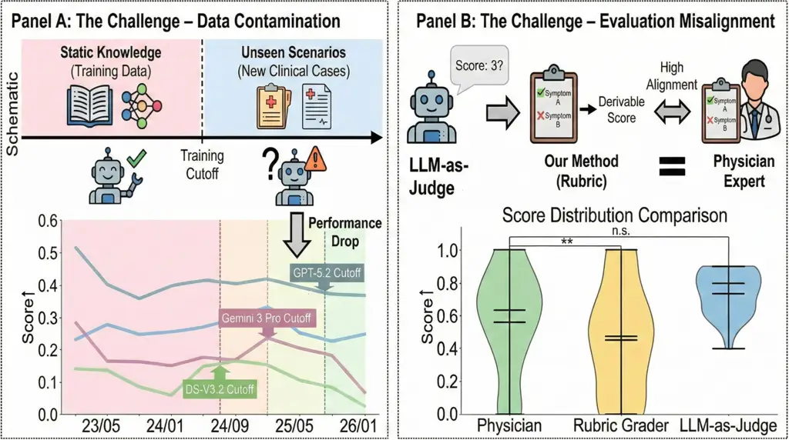
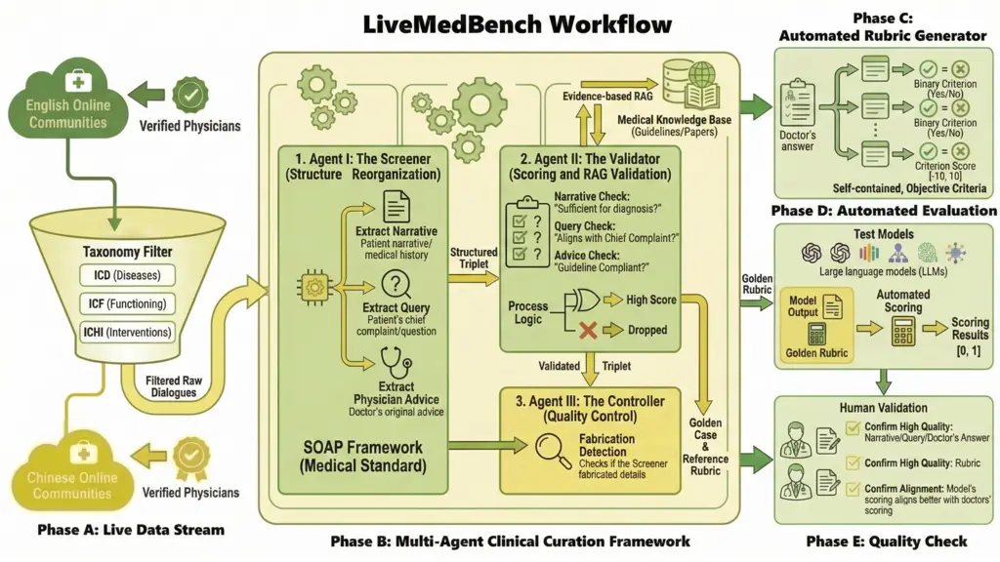
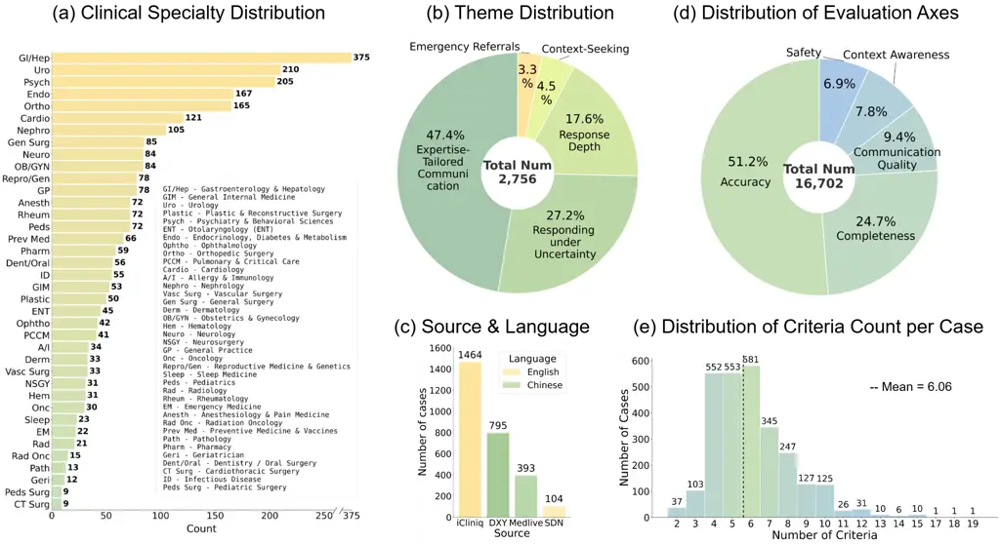
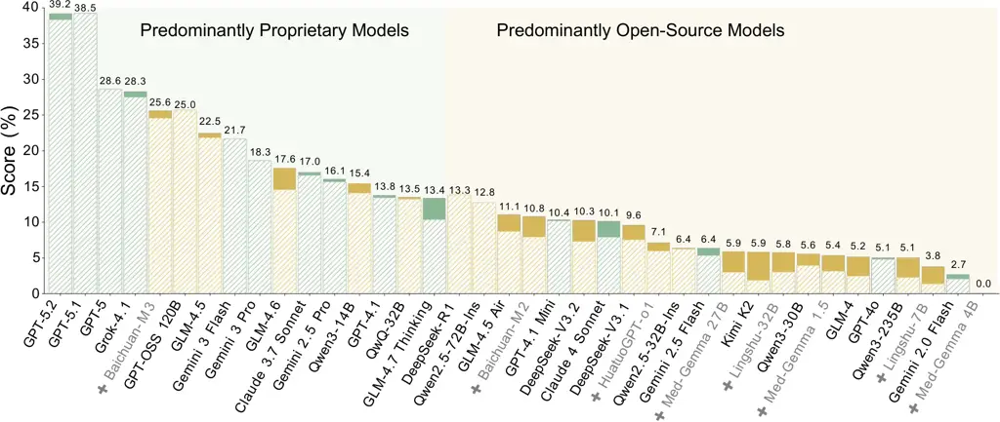
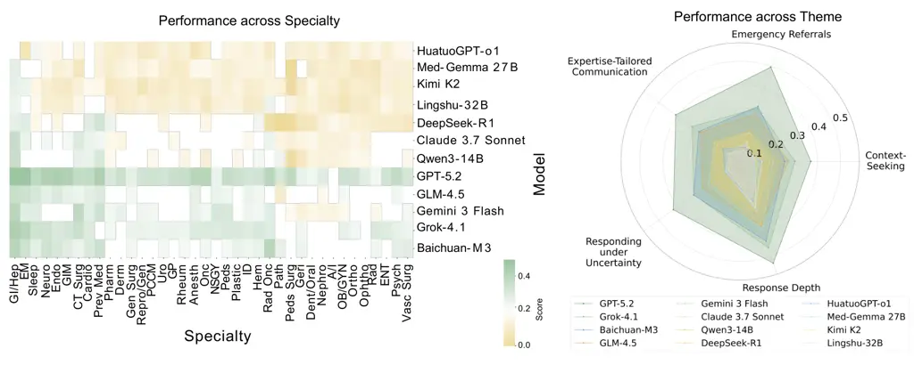
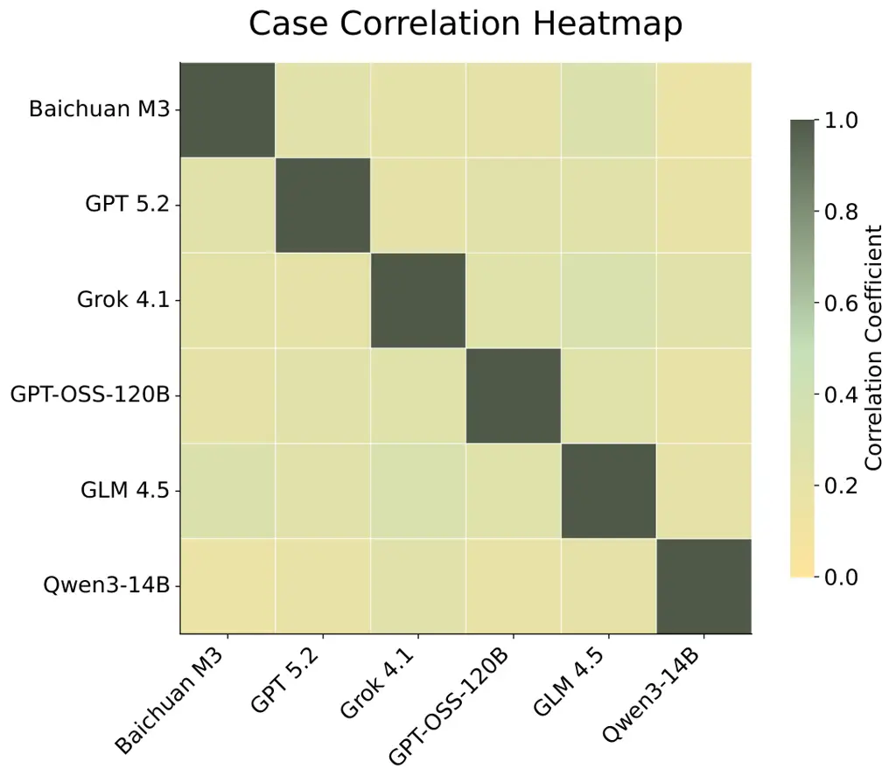
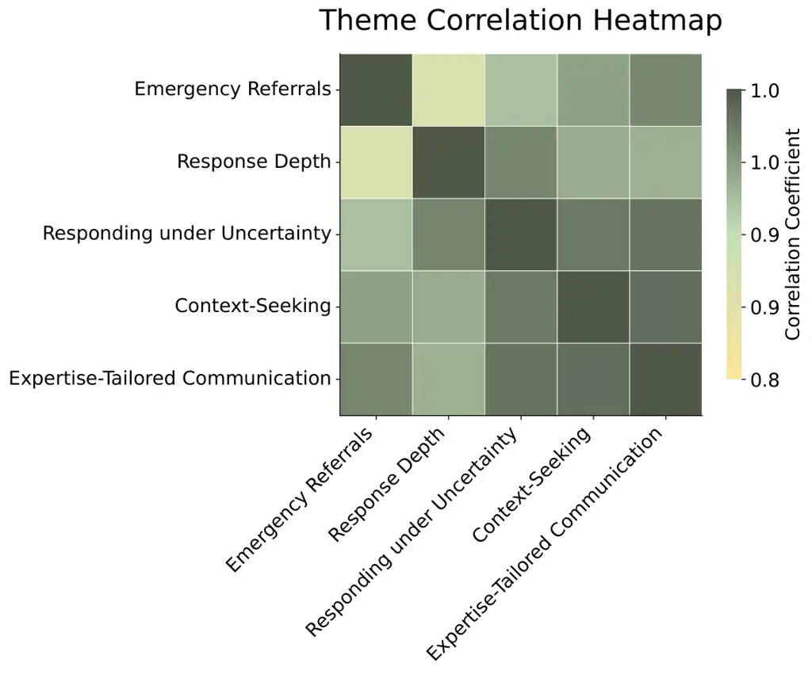
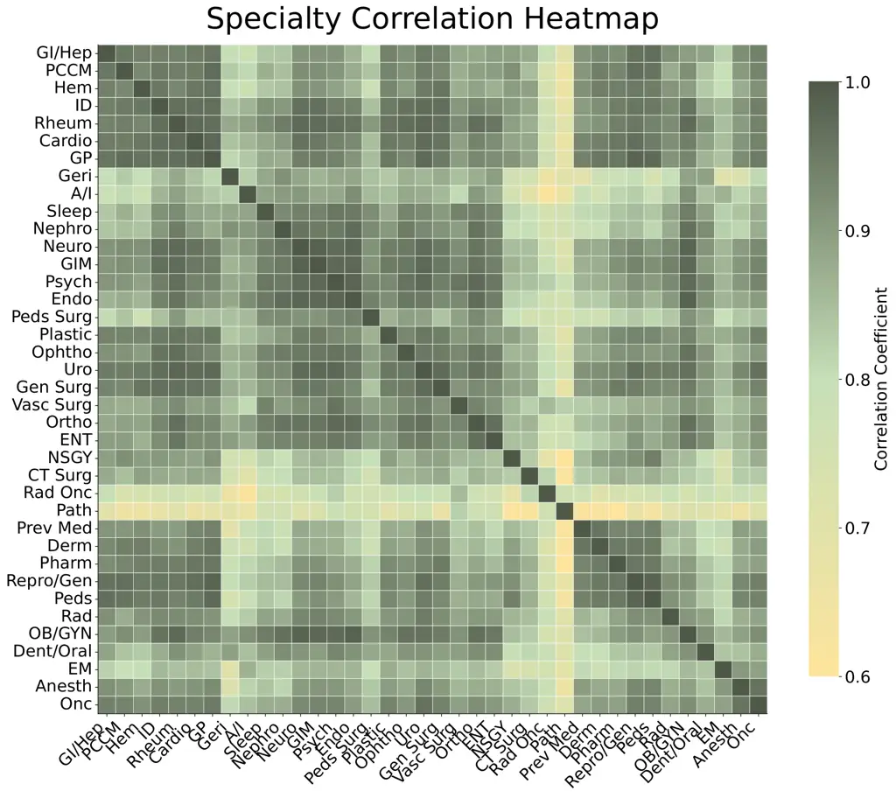

# LiveMedBench: A Contamination-Free Medical Benchmark for LLMs with Automated Rubric Evaluation

CCS: Computing methodologies Artificial intelligenceCCS: Applied
computing Life and medical sciences

Zhiling Yan Affiliation: Lehigh University, Bethlehem, PA, USA , Dingjie
Song Affiliation: Lehigh University, Bethlehem, PA, USA , Zhe Fang
Affiliation: Harvard University, Boston, MA, USA , Yisheng Ji
Affiliation: Imperial College London, London, United Kingdom , Xiang Li
Affiliation: Massachusetts General Hospital and Harvard Medical School,
Boston, MA, USA , Quanzheng Li Affiliation: Massachusetts General
Hospital and Harvard Medical School, Boston, MA, USA and Lichao Sun
Note: Corresponding author. Affiliation: Lehigh University, Bethlehem,
PA, USA

© none

###### Abstract.

The deployment of Large Language Models (LLMs) in high-stakes clinical
settings demands rigorous and reliable evaluation. However, existing
medical benchmarks remain static, suffering from two critical
limitations: (1) data contamination, where test sets inadvertently leak
into training corpora, leading to inflated performance estimates; and
(2) temporal misalignment, failing to capture the rapid evolution of
medical knowledge. Furthermore, current evaluation metrics for
open-ended clinical reasoning often rely on either shallow lexical
overlap (e.g., ROUGE) or subjective LLM-as-a-Judge scoring, both
inadequate for verifying clinical correctness. To bridge these gaps, we
introduce LiveMedBench, a continuously updated, contamination-free, and
rubric-based benchmark that weekly harvests real-world clinical cases
from online medical communities, ensuring strict temporal separation
from model training data. We propose a Multi-Agent Clinical Curation
Framework that filters raw data noise and validates clinical integrity
against evidence-based medical principles. For evaluation, we develop an
Automated Rubric-based Evaluation Framework that decomposes physician
responses into granular, case-specific criteria, achieving substantially
stronger alignment with expert physicians than LLM-as-a-Judge. To date,
LiveMedBench comprises 2,756 real-world cases spanning 38 medical
specialties and multiple languages, paired with 16,702 unique evaluation
criteria. Extensive evaluation of 38 LLMs reveals that even the
best-performing model achieves only 39.2%, and 84% of models exhibit
performance degradation on post-cutoff cases, confirming pervasive data
contamination risks. Error analysis further identifies contextual
application—not factual knowledge—as the dominant bottleneck, with
35–48% of failures stemming from the inability to tailor medical
knowledge to patient-specific constraints. The code and data are
available at
[LiveMedBench](https://github.com/ZhilingYan/LiveMedBench/).

###### Keywords: 

Medical Benchmark, Data Contamination, Clinical Reasoning, Rubric-based
Evaluation

## 1. Introduction

Large Language Models (LLMs) are increasingly applied in healthcare,
assisting with tasks ranging from answering patient inquiries to
supporting clinical decision-making (Singhal et al., 2023). Deploying AI
in high-stakes clinical settings requires that these models demonstrate
robust performance across diverse, real-world scenarios (Nori et al.,
2023).



Figure 1. (A) Temporal degradation. Model performance consistently
declines on clinical cases that post-date their training knowledge
cutoffs, highlighting the risk of data contamination. (B) Evaluation
alignment. Our proposed Automated Rubric-based Evaluation Framework
aligns better with physician experts compared to LLM-as-a-Judge.

While benchmarks serve as essential standards for tracking progress,
existing medical benchmarks face substantial obstacles in both data
construction and evaluation.

First, on the data side, most benchmarks are static (Singhal et al.,
2023), leading to two issues. (i) They become temporally misaligned with
rapidly evolving medical knowledge. Clinical guidelines and health
policies are frequently updated, and new diseases and public health
emergencies can emerge unexpectedly (Leong et al., 2025). As a result,
static test sets risk becoming increasingly misaligned with the evolving
standards of real-world clinical practice (Cheshmehzangi and Su, 2025).
(ii) They are vulnerable to data contamination. Because LLMs are trained
on massive and often opaque corpora, publicly released benchmarks may
inadvertently appear in training data. Consequently, strong scores may
reflect memorization rather than genuine clinical reasoning, undermining
credibility of evaluation (Magar and Schwartz, 2022).

Second, on the evaluation side, commonly used metrics remain inadequate
for open-ended clinical reasoning. Lexical-overlap metrics (e.g., BLEU)
fail to capture semantic and clinical correctness (Lin, 2004; Papineni
et al., 2002), and multiple-choice formats are poorly aligned with the
open-ended and dynamic nature of real-world clinical workflows (Jin et
al., 2021). Recent work has adopted LLM-as-a-Judge (Zheng et al., 2023)
for holistic scoring, while they rely on implicit model intuition and
typically lack explicit, fine-grained criteria that support objective
verification (Arora et al., 2025).

While recent works attempt to address these challenges, they fall short.
Approaches utilizing LLM prompts to modify data, e.g. dynamic
benchmarks (Zhang et al., 2025; Song et al., 2024), cannot update
underlying seed cases. They fail to reflect real-world medical evolution
and risk introducing model-generated biases. Conversely, benchmarks like
MedArena (Wu et al., 2025) and HealthBench (Arora et al., 2025) depend
on extensive human annotation, making them prohibitively expensive and
difficult to scale.

To address these challenges, we introduce LiveMedBench, a multilingual,
multi-specialty, rubric-based benchmark that comprises 2,756 real-world
cases paired with 16,702 unique evaluation criteria. To build
LiveMedBench, we develop a data pipeline—the Multi-Agent Clinical
Curation Framework—that continuously harvests new clinical cases
(weekly) from active online medical communities, focusing on scenarios
resolved by verified physicians. The pipeline coordinates multiple
agents with Retrieval-Augmented Generation (RAG) (Lewis et al., 2020;
Zhao et al., 2025) to cross-check case details against authoritative
medical evidence, thereby validating clinical plausibility and enforcing
consistency with established standards. For evaluation, we propose an
Automated Rubric-based Evaluation Framework that converts physician
responses into case-specific rubrics consisting of self-contained,
objective criteria and uses them to grade open-ended model outputs,
achieving strong alignment with human experts (Figure 1 - Panel B).

We evaluate 38 LLMs spanning both proprietary and open-source models
across general-purpose and medically specialized architectures. As
illustrated in Figure 1 - Panel A, performance diverges markedly around
the knowledge cutoff date. This degradation is consistent with temporal
misalignment and potential exposure to earlier cases. Notably, even the
state-of-the-art GPT-5.2 achieves only 39.2%, while 84% of evaluated
models exhibit significant performance drops on post-cutoff cases,
underscoring the pervasive risk of data contamination. Our error
analysis identifies a critical failure mode: the dominant bottleneck is
contextual application—the inability to synthesize medical facts with
patient-specific constraints (35–48% of errors). Furthermore,
retrieval-based knowledge injection recovers much of this performance
loss, confirming that contemporary failures stem from knowledge gaps
rather than innate reasoning deficits. In summary, our main
contributions are:

1.  (1)
    We introduce LiveMedBench, a novel benchmark updated weekly to
    mitigate data contamination and knowledge obsolescence. To date, the
    dataset comprises 2,756 real-world cases spanning 38 specialties and
    multiple languages.
2.  (2)
    We propose a Multi-Agent Clinical Curation Framework that leverages
    automated evidence verification to align benchmark data with
    authoritative medical standards, ensuring high clinical integrity.
3.  (3)
    We develop an Automated Rubric-based Evaluation Framework that
    enables scalable, fine-grained assessment by decomposing expert
    responses into 16,702 unique, case-specific criteria.
4.  (4)
    We provide a rigorous evaluation of 38 LLMs, systematically
    contrasting proprietary and open-source models across general and
    medical domains to characterize the current landscape of clinical
    AI.

## 2. Related Work

### 2.1. Medical Benchmarks

Medical LLM evaluation has evolved from static knowledge tests like
MedQA (Jin et al., 2021) and PubMedQA (Jin et al., 2019) toward
open-ended reasoning. Subsequent work introduced free-response
generation (Singhal et al., 2023), multimodal inputs (Li et al., 2023),
and multilingual settings (Wang et al., 2024). This shift necessitated a
transition from lexical-overlap metrics (e.g., ROUGE) to LLM-as-a-judge
(Zheng et al., 2023) and structured rubric-based assessment. HealthBench
(Arora et al., 2025) pioneered the use of case-specific rubrics to
evaluate clinical safety and communication. Recent efforts further
emphasize complex diagnostic reasoning and multi-step planning (Tu et
al., 2025; McDuff et al., 2025). LiveMedBench builds on these trends by
integrating automated, scalable rubric generation with continuously
refreshed real-world cases.

### 2.2. Dynamic and Live Benchmarks

Static benchmarks are increasingly vulnerable to data contamination and
temporal misalignment (Magar and Schwartz, 2022). To ensure
contamination free evaluation, frameworks like LiveBench (White et al., 2024) and LiveCodeBench (Jain et al., 2024) harvest fresh content from
recent news and coding competitions. In the medical domain, DyRe-Me
(Zhang et al., 2025) and MedPerturb (Gourabathina et al., 2025) mitigate
contamination by perturbing existing seed cases. However, these methods
often rely on objective metrics (e.g., unit tests) unsuitable for
clinical ambiguity. LiveMedBench adapts the live paradigm to high-stakes
medicine, employing a rigorous multi-agent system to validate clinical
integrity and assess dimensions like safety and empathy that logic-only
benchmarks overlook.



Figure 2. Overview of the LiveMedBench framework. The pipeline consists
of five phases: (a) Continuous mining of bilingual clinical data from
verified online communities; (b) A Multi-Agent Curation Framework
(Screener, Validator, Controller) that structures and validates data
against medical guidelines; (c) Automated generation of case-specific
evaluation rubrics; (d) Objective evaluation of LLMs using the generated
rubrics; and (e) Rigorous human quality assurance to ensure clinical
alignment.

## 3. LiveMedBench

In this section, we describe the end-to-end construction and evaluation
pipeline of LiveMedBench (Figure 2). We first introduce data collection
and filtering from online medical communities (§3.1), then present our
Multi-Agent Clinical Curation Framework for transforming noisy threads
into structured, clinically grounded cases (§3.2), describe our
Automated Rubric-based Evaluation Framework, which distills expert
physician responses into case-specific criteria for scalable, objective
evaluation (§3.3), and finally summarize the resulting dataset
statistics (§3.4).

### 3.1. Data Collection

##### Platform Selection.

To ensure the reliability and clinical relevance of our source data, we
selected platforms that are (i) high activity, with new user-generated
posts and discussions on a weekly basis; (ii) institutionally endorsed,
i.e., affiliated with reputable medical organizations (e.g., the
National Comprehensive Cancer Network (NCCN) and the Chinese Medical
Doctor Association) or major tertiary hospitals; and (iii)
professionally verified, i.e., hosting a large pool of verified
physicians (ranging from 4,500+ specialists to 2M+ registered
professionals). Based on these criteria, we harvest raw clinical
discussions from four premier online medical communities: iCliniq¹¹ 1
[https://www.icliniq.com](https://www.icliniq.com), SDN²² 2
[https://www.studentdoctor.net](https://www.studentdoctor.net), DXY³³ 3
[https://dxy.com](https://dxy.com), and Medlive⁴⁴ 4
[https://www.medlive.cn](https://www.medlive.cn). Details of these
communities are provided in Appendix A.

##### Post Filtering.

To improve data quality, we implement a filtering protocol
following (Singhal et al., 2023). We retain only posts and discussions
that were published on or after January 1, 2023 (to reduce contamination
risk and align with current medical knowledge), have clinically relevant
tags (excluding non-clinical topics such as career planning or licensing
exams), are text-only (threads requiring images, videos, or audio are
discarded), contain fewer than 50% non-alphanumeric characters, are
written in English or Chinese, include at least one keyword from the
ICD (World Health Organization, 2024a), ICF (World Health Organization,
2024b), or ICHI (World Health Organization, 2024c) codebooks, are not
duplicates of previously indexed entries, and include at least one
verified physician response.

### 3.2. Multi-Agent Clinical Curation

To transform unstructured online discussions into high-fidelity clinical
cases, we propose a Multi-Agent Clinical Curation Framework. This
framework simulates a collaborative expert validation mechanism,
employing three specialized agents that operate in a hierarchical
workflow to ensure structural integrity, clinical plausibility, and
evidence alignment. Let the raw input be a discussion thread
$`T=\{m_{1},m_{2},...,m_{k}\}`$, where $`m_{i}`$ represents the $`i`$-th
message in the thread. The objective is to convert raw discussions into
triplets: $`D=\{Narrative(N),Query(Q),Advice(A)\}`$.

#### 3.2.1. The Screener

The Screener standardizes each raw discussion thread $`T`$ into a
structured clinical representation following the SOAP (Subjective,
Objective, Assessment, Plan) framework (Weed and others, ). It outputs a
triplet

```math
D_{screener}=\{L_{N},Q,L_{A}\},
```

where $`L_{N}`$ is the set of atomic patient narrative entities
(Subjective/Objective), $`Q`$ is the primary user query, and $`L_{A}`$
is the set of actionable physician advice elements (Assessment/Plan).
Concretely, the Screener performs: (i) Narrative aggregation
($`L_{N}`$): extract and merge patient-provided clinical facts from
$`T`$. (ii) Query extraction ($`Q`$): identify the explicit
question/request for medical guidance. (iii) Advice extraction
($`L_{A}`$): extract actionable diagnostic or management recommendations
from verified physician replies. A candidate is forwarded only if all
components are present:
$`Forward(Case)\iff(L_{N}\neq\emptyset)\land(Q\neq\emptyset)\land(L_{A}\neq\emptyset)`$

#### 3.2.2. The Validator

The Validator assesses the quality and factual consistency of the
structured triplet $`D_{screener}=\{L_{N},Q,L_{A}\}`$ and outputs a
validation vector

```math
V=\{S_{cc},S_{inf},S_{align}\}.
```

(i) Query validity ($`S_{cc}`$): a binary score indicating whether $`Q`$
is a clinically meaningful chief complaint (CC) as defined by Ely’s
taxonomy (Ely et al., 2000). (ii) Narrative sufficiency ($`S_{inf}`$):
the fraction of required clinical information items (derived from $`Q`$)
that are supported (entailed) by the patient narrative $`L_{N}`$,
inspired by (Es et al., 2024). Concretely, we first derive a minimal
checklist $`S_{req}`$ of atomic requirements needed to answer $`Q`$
(e.g., onset, severity, red flags), and then compute $`S_{inf}`$ as the
proportion of items in $`S_{req}`$ that can be verified from $`L_{N}`$.
(iii) Evidence alignment ($`S_{align}`$): an evidence-based validity
score for physician advice $`L_{A}`$ computed by checking each advice
element against retrieved medical evidence (Clinical Guidelines, PubMed,
StatPearls, etc.) (Chen et al., 2023; Zhao et al., 2025). Following
MedRAG (Zhao et al., 2025), we retrieve top-$`k`$ evidence snippets
using a MedCPT retriever (Jin et al., 2023) and score each advice
element with $`v(a_{j})\in\{1.0,0.5,0.0\}`$
(supported/neutral/contradicted). We apply a veto strategy: if any
$`a_{j}`$ is contradicted, the entire case is discarded. A candidate
case $`D`$ is retained if and only if
$`Keep(D)\iff(S_{cc}=1)\land(S_{inf}>\tau_{inf})\land(S_{align}>\tau_{align})`$,
where $`\tau_{inf}=0.5`$ and $`\tau_{align}=0.5`$ are predefined
thresholds.

#### 3.2.3. The Controller

The Controller accepts the valid candidate
$`D_{candidate}=\{L_{N},Q,L_{A}\}`$ from the Validator and performs a
final audit before generating the canonical natural language output. It
verifies that every atomic element in $`L_{N}\cup L_{A}`$ is explicitly
supported by the original thread $`T`$:

```math
Keep(D)\iff\forall x\in(L_{N}\cup L_{A}),\text{Supported}(x,T).
```

Any unsupported or fabricated element leads to discarding the case to
prevent synthetic contamination. Cases that pass are synthesized into
coherent narrative ($`N`$) and advice ($`A`$), yielding the final
triplet $`D=\{N,Q,A\}`$.

### 3.3. Automated Rubric-based Evaluation

To facilitate scalable and objective assessment, we propose an Automated
Rubric-based Evaluation Framework. This pipeline consists of two
distinct modules: a Rubric Generator that converts physician responses
into granular grading criteria, and a Rubric-based Grader that assesses
model outputs against these criteria.

#### 3.3.1. Automated Rubric Generator

Following the taxonomy of Arora et al. (2025), the generator transforms
the verified advice list $`L_{A}`$ into a structured rubric $`R`$. We
adapt five of Arora et al. (2025)’s seven themes to assign each case a
dominant Theme—Emergency Referrals, Context-Seeking, Expertise-Tailored
Communication, Responding under Uncertainty, or Response Depth. This
theme serves as a contextual filter for the subsequent generation steps:

Step 1: Theme-Guided Fact Extraction. The agent filters $`L_{A}`$ to
retain only medical facts and instructions relevant to the assigned
Theme. For instance, if the Theme is “Emergency Referrals,” long-term
dietary advice is discarded to focus strictly on triage accuracy.

Step 2: Bipolar Criterion Formulation. Extracted facts are converted
into binary criteria with dual polarity. Positive criteria reward the
correct inclusion of key facts (e.g., “Does the model identify the
likely cause as Norovirus?”), while negative criteria penalize
hallucinations or contradictions (e.g., “Does the model incorrectly
suggest antibiotics for a viral infection?”).

Step 3: Axis Assignment and Weighting. Each criterion is labeled with an
evaluation Axis (Accuracy, Completeness, Communication Quality, Context
Awareness, or Safety) and assigned a weight $`w_{j}\in[-10,10]`$.
Positive weights denote reward criteria, while negative weights flag
penalties. Extreme weights (e.g., $`w_{j}=\pm 10`$) represent
life-critical details where errors could compromise patient safety.

#### 3.3.2. Rubric-based Grader

Following the generation of the case-specific rubric
$`R=\{(c_{1},w_{1}),\dots,(c_{m},w_{m})\}`$, the Rubric-based Grader
systematically assesses the model’s response by determining the
satisfaction of each atomic criterion. We employ a model grader to
independently verify whether each criterion $`c_{j}`$ is met or not met
based on the model’s output.

The final per-case score is calculated by summing the weights of
satisfied criteria, normalized by the maximum possible positive score:

```math
Score=\text{clip}\!\left(\frac{\sum_{j=1}^{m}w_{j}\cdot\mathbb{I}(\text{Model}\models c_{j})}{\sum_{k\in\{p\mid w_{p}>0\}}w_{k}},\;0,\;1\right) \tag{1}
```

where $`\mathbb{I}(\cdot)`$ is the indicator function equal to 1 if the
criterion is met, and 0 otherwise. The denominator represents the total
score achievable if all positive criteria are met. The clipping function
ensures the score remains within $`[0,1]`$ even if substantial penalties
(negative weights) occur. A model’s overall LiveMedBench score is
derived from the mean of these case-level scores.



Figure 3. Data statistics of LiveMedBench. The figure illustrates the
comprehensive distribution of (a) 38 clinical specialties, (b) five
behavioral themes, (c) data sources and languages , (d) evaluation axes,
and (e) the number of grading criteria per case (Mean=6.06).

### 3.4. Data Statistics

LiveMedBench currently comprises 2,756 clinical cases and 16,702 unique
rubric criteria. As illustrated in Figure 3, the dataset spans 38
clinical specialties with a naturally long-tailed distribution
reflecting real-world prevalence, 1,568 English and 1,188 Chinese cases
sourced from four platforms, and five behavioral themes led by
Expertise-Tailored Communication (47.4%). The rubric criteria cover five
evaluation axes—predominantly Accuracy (51.2%) and Completeness
(24.7%)—with an average of 6.06 criteria per case (range: 2–19). A
detailed breakdown is provided in Appendix A.4.

## 4. Experiments

### 4.1. Experimental Setup

Models Evaluated. We conducted a comprehensive evaluation across 38
LLMs, categorized into three distinct groups to ensure a holistic
assessment: (1) Proprietary general-purpose models, including the
GPT-series (Singh et al., 2025) and Gemini-series (Team et al., 2023);
(2) Open-source general-purpose models, such as the DeepSeek-series (Liu
et al., 2024) and Qwen-series (Yang et al., 2025; Team and others,
2024); and (3) Medical-specific models, including the
Baichuan-series (Dou et al., 2025; Team, 2025) and
MedGemma-series (Sellergren et al., 2025). All models were evaluated in
a zero-shot setting to assess their innate clinical capabilities without
task-specific learning. For reproducibility, we set the temperature to 0. Detailed model specifications are provided in Appendix B.

Implementation Details. We detail the specific models employed in our
frameworks. In the Multi-agent Clinical Curation phase, both the
Screener and Controller agents utilized Qwen/Qwen3-4B-Instruct-2507 for
efficient processing, while the Validator agent employed
openai/gpt-oss-120b to ensure rigorous verification. For the Automated
Rubric-based Evaluation, the Rubric Generator was powered by
Qwen/Qwen3-4B-Instruct-2507, while Rubric-based Grader uses
gpt-4.1-2025-04-14 following Arora et al. (2025).

Evaluation Metric. For each case, the grader evaluates the model’s
response against the specific rubric criteria generated by the Rubric
Generator using a binary judgment (Met vs. Not Met). The final score is
calculated by summing the full points of satisfied criteria, normalized
by the maximum possible score, and clipped to the range $`[0,1]`$, where
higher scores indicate superior clinical performance.

Human Validation. To validate the data quality and the reliability of
our evaluation framework, we conducted a rigorous human evaluation with
two physicians proficient in both English and Chinese. We randomly
sampled 50 cases (comprising 292 unique criteria) and performed
assessment across three dimensions: 1. Data Quality: Physicians rated
the clinical coherence of the patient narrative/query and the quality of
the reference physician advice on a 3-point scale ($`0-2`$), where
scores $`\geq 1`$ denote high quality and agreement. 2. Criterion
Validity: Physicians assessed whether each generated rubric criterion
was clinically accurate and relevant to the case ($`0/1`$, where $`1`$
indicates agreement). 3. Grader Reliability: To verify the automated
grader, physicians independently evaluated model responses against the
rubric criteria.

We calculated the inter-rater reliability between physicians using
Gwet’s AC1 (Gwet, 2008). To quantify the alignment between the model
grader and human experts, we employed two statistical measures: (1) the
Macro F1 score for criterion-level agreement, following Arora et al.
(2025); and (2) the Pearson correlation coefficient for case-level
scoring alignment. Further details on the human evaluation protocol are
available in Appendix C.

### 4.2. Overall Model Performance



Figure 4. The evaluation results of 38 LLMs on LiveMedBench, categorized
into proprietary (green) and open-source (yellow) models. Models marked
with a cross (+) are specialized medical models, while others are
general-purpose. Solid bars represent performance on the full dataset,
while hatched bars indicate performance on cases post-dating the model’s
knowledge cutoff.

As illustrated in Figure 4, the GPT series maintains a dominant lead on
LiveMedBench. GPT-5.2 achieves the state-of-the-art performance with a
score of 39.2%, followed closely by GPT-5.1 at 38.5%. The Grok-4.1 and
Baichuan M3 also demonstrate strong performance, with leading positions
among non-GPT models at 28.3% and 25.6%, respectively. This hierarchy
underscores the continued superiority of highly scaled proprietary
architectures in handling complex clinical reasoning tasks.

Proprietary vs. Open-Source Models. A comparative analysis reveals that
proprietary models generally outperform open-source alternatives.
However, the gap is narrowing significantly. Notably, GPT-OSS 120B
(25.0%) and GLM-4.5 (22.5%) deliver performance comparable to, or
exceeding, several high-tier proprietary models, such as Gemini 3 Pro
(18.3%) and Claude 3.7 Sonnet (17.0%). Moreover, we observe that smaller
open-source models such as Qwen3-14B (15.4%) and QwQ-32B (13.5%)
demonstrate reasoning capabilities that are competitive with
substantially larger proprietary models like Gemini 2.5 Pro (16.1%).
From a deployment perspective, while proprietary models offer peak
performance, open-source models offer a viable alternative for
privacy-sensitive environments where local deployment is mandatory, and
for edge-device deployment where computational resources are limited.

General-Purpose vs. Medical-Specific Models. Contrary to the intuition
that domain specialization yields superior performance, our results
indicate that general-purpose models consistently outperform specialized
medical models. For instance, the general-purpose GPT-5.2 (39.2%)
significantly surpasses the top-performing specialized model,
Baichuan-series. This disparity is likely attributable to the “scaling
laws,” where the massive parameter counts and diverse training of
general models provide a more robust foundation than smaller,
domain-tuned architectures. Nevertheless, medical models exhibit strong
parameter efficiency. For example, Med-Gemma 27B (5.9%) matches the
performance of the general-purpose Gemini 2.5 Flash (6.4%), suggesting
that specialized tuning remains a potent strategy for smaller-scale
deployments.

Data Contamination and Knowledge Obsolescence. To empirically quantify
the dual impacts of data contamination and knowledge obsolescence, we
evaluated the models on a subset of cases published after their
respective knowledge cutoff dates (or release dates, for models with
undisclosed cutoffs). As illustrated in Figure 4, 84% of the models (32
out of 38) exhibited a performance degradation when transitioning from
the full dataset to the post-cutoff subset. Notably, the GLM series
appeared most susceptible to data leakage, with all variants showing a
marked decline in accuracy; the most pronounced drop occurred in
Kimi-K2, which suffered a 3.99% decrease. Furthermore, even models
without a precipitous drop failed to demonstrate significant performance
gains on recent data. Figure 1 further details the evaluation across
different time windows, revealing a consistent downward trend in average
performance on contemporary cases (e.g., those post after January 2025).
These findings underscore the effect of data contamination, which
artificially inflates scores on seen data, and knowledge obsolescence,
which leads to failures on unseen medical knowledge. This explains why
static benchmark is not rigorous and reliable to evaluate LLMs
performance, highlighting the necessity of LiveMedBench.

## 5. Analysis

We structure our analysis around the following research questions: RQ1.
Is our evaluation pipeline reliable? RQ2. How does model performance
vary across specialties and themes? RQ3. What are the dominant failure
modes? RQ4. What is the impact of knowledge injection (e.g., retrieval)
on performance? RQ5. How does LiveMedBench compare to existing medical
benchmarks?

### 5.1. Human Evaluation and Reliability Analysis



Figure 5. Multi-dimensional performance analysis. (Left) Heatmap
illustrating the score distribution of representative models across 38
clinical specialties. (Right) Radar chart depicting the capability
profiles of representative models across the five behavioral themes.

To validate the clinical integrity of LiveMedBench and the reliability
of our automated evaluation pipeline, we conducted a human study with
two physicians. We randomly select 50 cases and 292 corresponding
criterion.

|                   |            |            |            |
| ----------------- | ---------- | ---------- | ---------- |
| Task              | Rater 1    | Rater 2    | Gwet’s AC1 |
| Narrative & Query | $`0.9795`$ | $`1.0000`$ | $`0.9792`$ |
| Physician Advice  | $`0.9795`$ | $`0.9800`$ | $`0.9566`$ |
| Criterion         | $`0.9589`$ | $`0.9110`$ | $`0.8914`$ |

Table 1. Physician assessment of data quality.

Data Quality and Consensus. As shown in Table 1, physicians demonstrated
exceptionally high approval rates for our generated data. For the core
components of the benchmark, i.e. patient narrative, query and physician
advice, the agreement rate (Rater 1 and Rater 2) reached near-perfect
levels ($`\geq 0.9795`$), with an inter-rater reliability (Gwet’s AC1)
of 0.9792 and 0.9566, respectively. An AC1 score greater than 0.8
indicates “almost perfect” agreement, according to (Landis and Koch,
1977). This confirms that our Multi-Agent Clinical Curation framework
successfully synthesizes highly coherent and clinically valid cases.
Physicians also validated the generated Rubric Criteria with high
consensus (AC1 = 0.8914), indicating that our automated criteria are
clinically precise.

|                            |          |                      |                                |
| -------------------------- | -------- | -------------------- | ------------------------------ |
| Evaluation Method          | Macro F1 | Correlation $`\rho`$ | $`P`$-value                    |
| Human Inter-Rater          | $`0.89`$ | –                    | –                              |
| LLM-as-a-Judge             | –        | $`0.26`$             | 0.07                           |
| Rubric-based Grader (Ours) | $`0.76`$ | $`0.54`$             | $`6.65\text{\times}{10}^{-5}`$ |

Table 2. Evaluation results comparison. Macro F1 for criteria-level
agreement and Pearson Correlation ($`\rho`$) for case-level alignment
with physician scores.

Reliability of the Rubric-based Grader. We assessed the alignment
between our automated Rubric-based Grader and human experts using the
Macro F1 score on a criterion level, following (Arora et al., 2025). As
presented in Table 2, the Human Inter-Rater F1 is 0.89, which serves as
the theoretical upper bound for this task. Our Rubric-based Grader
achieves a Macro F1 of 0.76, indicating that our grader effectively
proxies human judgment.

Superiority over LLM-as-a-Judge. We benchmark our method against a
standard LLM-as-a-Judge baseline (Zheng et al., 2023). Table 2 reveals a
critical performance disparity: our Rubric-based Grader achieves a
strong Pearson correlation of 0.54 with human scores ($`p<10^{-4}`$),
whereas the baseline yields a weak, non-significant correlation of 0.26
($`p=0.07`$). As shown in Figure 1, the baseline exhibits a significant
skew towards higher scores, failing to penalize poor responses due to
“length bias” and a lack of sensitivity to safety hazards. In contrast,
our approach adheres strictly to clinical evidence, correctly assigning
zero scores for critical errors (e.g., missed contraindications) where
the holistic judge failed. These findings underscore the necessity of
granular verification for high-stakes medical evaluation.

### 5.2. Performance across Specialties and Themes

To identify specific competency gaps beyond overall scores, we
disaggregated model performance across distinct clinical specialties and
behavioral themes (Figure 5).

Performance across Clinical Specialties. The heat map (Figure 5, left)
reveals a distinct performance hierarchy: proprietary models (e.g.,
GPT-5.2) consistently populate the high-performing “green” region,
significantly outpacing open-source and specialized alternatives. Across
all models, performance is non-uniform. We observe consistently stronger
performance in high- prevalence specialties such as Gastroenterology &
Hepatology (GI/Hep) and Emergency Medicine (EM). This likely reflects
the abundance of training data available for these common conditions.
Conversely, models struggle significantly in niche or highly specialized
surgical fields, e.g. Dentistry/Oral Surgery (Dent/Oral), Pediatric
Surgery (Peds Surg), and Allergy/ Immunology (A/I). This suggests a
“knowledge gap” in current LLMs regarding specialized procedural and
diagnostic nuances that are less represented in general training
corpora. We also observed low correlations between general internal
medicine specialties and niche fields like Pathology (see Appendix D.3).

Performance across Themes. The radar chart (Figure 5, right)
corroborates this tiering, with proprietary models occupying the
outermost high-performance layers, followed by general open-source
models, and finally specialized medical models in the innermost rings.
Behaviorally, most models demonstrate strong alignment in
Expertise-Tailored Communication and Responding under Uncertainty.
However, a critical safety bottleneck remains in Context-Seeking, where
even top models frequently fail to proactively gather missing
information before providing advice.

### 5.3. Error Analysis

To understand failure modes, we analyzed the top proprietary and
open-source models.

##### Performance by Evaluation Axis.

As shown in Table 3, even SOTA models exhibit error rates exceeding 50%
on most axes. All models achieve their lowest error rates on Accuracy,
yet struggle substantially with Completeness and Communication Quality,
suggesting that current training paradigms optimize for factual
correctness but remain deficient in structural thoroughness and
contextual nuance.

|                   |             |           |           |           |           |            |
| ----------------- | ----------- | --------- | --------- | --------- | --------- | ---------- |
| Metric            | Baichuan M3 | GPT 5.2   | Grok 4.1  | GPT- OSS  | GLM- 4.5  | Qwen3- 14B |
| Accuracy          | $`43.98`$   | $`37.54`$ | $`42.01`$ | $`45.46`$ | $`45.84`$ | 50.26      |
| Completeness      | $`64.00`$   | $`49.59`$ | $`58.41`$ | $`55.23`$ | $`62.26`$ | 68.46      |
| Comm. Quality     | 66.97       | $`50.37`$ | $`56.89`$ | $`57.21`$ | $`60.61`$ | $`66.96`$  |
| Context Awareness | $`59.62`$   | $`48.33`$ | $`55.85`$ | $`56.40`$ | $`58.09`$ | 65.13      |
| Safety            | $`48.36`$   | $`38.20`$ | $`44.88`$ | $`44.97`$ | $`47.42`$ | 52.93      |

Table 3. Error rates of representative LLMs. Worst rates (highest
errors) are bolded.

##### Qualitative Root Causes.

We further audited the bottom-100 scoring cases per model using GPT-4.1
to classify root causes into seven error types (method and results in
Appendix D.1). Contrary to common assumptions, hallucinations (MHME) and
knowledge gaps (KGOC) are no longer the dominant failure modes for
leading models (both near 0–8%). Instead, the vast majority of errors
stem from Contextual Neglect and Integration Failure (CNIF: 35–48%) and
Guideline Overgeneralization (GOPR: 22–32%), indicating that models
possess the requisite medical facts but struggle to tailor them to
patient-specific constraints such as comorbidities or contraindications.
Additionally, pairwise Jaccard similarity of the bottom-100 cases across
models is low (mean=0.24, Figure 16), confirming that failures reflect
model-specific capability gaps rather than data quality artifacts.

### 5.4. Impact of Knowledge Injection

Here we investigate whether the performance degradation on unseen data
stems from inherent reasoning deficits or knowledge obsolescence. We
isolated a subset of “fresh” cases from January 2026 and benchmark
performance across three settings: (1) Baseline: Model performance on
full dataset under default settings; (2) Closed-Book: Standard inference
on the subset; and (3) Open-Book: Inference on the Jan 2026 subset
augmented with knowledge retrieval  (Zhao et al., 2025) to provide
access to external medical knowledge.

|             |             |           |           |              |           |           |
| ----------- | ----------- | --------- | --------- | ------------ | --------- | --------- |
| Mode        | Baichuan M3 | GPT 5.2   | Grok 4.1  | GPT-OSS 120B | GLM 4.5   | Qwen3 14B |
| Baseline    | $`25.61`$   | $`39.23`$ | $`28.28`$ | $`25.03`$    | $`22.46`$ | $`15.45`$ |
| Closed-Book | $`24.54`$   | $`36.84`$ | $`24.21`$ | $`23.24`$    | $`16.19`$ | $`8.68`$  |
| Open-Book   | 25.21       | 37.17     | 27.39     | 24.18        | 20.45     | 15.47     |

Table 4. Closed book performance versus open book performance (%).

As shown in Table 4, enabling access to external knowledge yields
universal performance improvements across all model architectures. This
suggests that failures on new cases are partially driven by retrieval
failures rather than logic failures. Furthermore, the significant drop
between the “Baseline” and “Closed-Book” scores quantifies the distinct
impact of data contamination and knowledge obsolescence on static LLMs.

|                     |               |                |                      |             |
| ------------------- | ------------- | -------------- | -------------------- | ----------- |
| Benchmark           | Free Response | Multi- lingual | Case-specific Rubric | Case Update |
| MedQA (2021)        | ✗             | ✓              | ✗                    | ✗           |
| MultiMedQA (2023)   | ✓             | ✗              | ✗                    | ✗           |
| MedBench (2024)     | ✗             | ✗              | ✗                    | ✗           |
| CMB (2024)          | ✓             | ✗              | ✗                    | ✗           |
| CliMedBench (2024)  | ✓             | ✗              | ✗                    | ✗           |
| MedJourney (2024)   | ✓             | ✓              | ✗                    | ✗           |
| GMAI-MMBench (2024) | ✗             | ✗              | ✗                    | ✗           |
| MedXpertQA (2025)   | ✗             | ✗              | ✗                    | ✗           |
| DyReMe (2025)       | ✓             | ✗              | ✗                    | ✗           |
| MedPerturb (2025)   | ✓             | ✗              | ✗                    | ✗           |
| HealthBench (2025)  | ✓             | ✗              | ✓                    | ✗           |
| LiveMedBench (Ours) | ✓             | ✓              | ✓                    | ✓           |

Table 5. Medical Benchmark Comparison.

### 5.5. Medical Benchmark Comparison

To contextualize the contribution of LiveMedBench within the broader
landscape of medical LLM evaluation, we conducted both a qualitative
feature comparison and a quantitative difficulty assessment against
established benchmarks.

As summarized in Table 5, existing benchmarks typically suffer from one
or more limitations. LiveMedBench distinguishes itself as the only
benchmark that simultaneously integrates (1) Free-response generation,
(2) Multi-lingual support, (3) Granular case-specific rubrics, and (4)
Live case updates. This unique combination addresses the critical need
for an evaluation framework that is both clinically rigorous and
temporally adaptive.

|                  |                |            |                   |            |
| ---------------- | -------------- | ---------- | ----------------- | ---------- |
| Benchmark        | Gemini 2.5 Pro | GPT-4.1    | Claude 3.7 Sonnet | GPT-4o     |
| HealthBench      | 0.52           | $`0.48`$   | $`0.35`$          | $`0.32`$   |
| HealthBench Hard | 0.19           | $`0.16`$   | $`0.02`$          | $`0`$      |
| LiveMedBench     | $`0.1606`$     | $`0.1379`$ | 0.1699            | $`0.0506`$ |

Table 6. Comparison of ours and HealthBench.

To assess the challenge level of our dataset, we benchmarked four LLMs
(Gemini 2.5 Pro, GPT-4.1, Claude 3.7 Sonnet, GPT-4o) on LiveMedBench and
compared the results against HealthBench, the closest competitor. As
shown in Table 6, models exhibit significantly lower scores on
LiveMedBench compared to the standard HealthBench dataset. Notably, the
performance on LiveMedBench aligns with the “HealthBench Hard” subset
(e.g., Gemini 2.5 Pro scores 0.19 on Hard vs. 0.16 on ours). This
performance gap underscores the complexity of our dataset, leaving
significant room for future model improvement.

## 6. Conclusion

We introduced LiveMedBench, a continually updated, contamination free
medical benchmark for evaluating LLMs. Our Multi-Agent Clinical Curation
Framework transforms noisy online discussions into evidence-backed
clinical cases, and our Automated Rubric-based Evaluation Framework
enables granular, objective assessment in alignment with physician
experts. Evaluation of 38 LLMs reveals consistent performance
degradation on post-cutoff cases, validating the necessity of live
benchmarking.

## References

- Arora et al. (2025) R. K. Arora, J. Wei, R. S. Hicks, P. Bowman, J.
  Quiñonero-Candela, F. Tsimpourlas, M. Sharman, M. Shah, A. Vallone, A.
  Beutel, J. Heidecke, and K. Singhal HealthBench: evaluating large
  language models towards improved human health. External Links:
  2505.08775, [Link](https://%22https://arxiv.org/abs/2505.08775%22)
  Cited by: §A.3, §C.3, §1, §1, §2.1, §3.3.1, §4.1, §4.1, §5.1.
- Chen et al. (2023) Z. Chen, A. H. Cano, A. Romanou, A. Bonnet, K.
  Matoba, F. Salvi, M. Pagliardini, S. Fan, A. Köpf, A. Mohtashami, et
  al. Meditron-70b: scaling medical pretraining for large language
  models. arXiv preprint arXiv:2311.16079. Cited by: §3.2.2.
- Cheshmehzangi and Su (2025) A. Cheshmehzangi and Z. Su From crisis to
  coordination: how ai transformed public health policies during
  covid-19. Rural and Regional Development 3 (4), pp. 10016. Cited by:
  §1.
- Dou et al. (2025) C. Dou, C. Liu, F. Yang, F. Li, J. Jia, M. Chen, Q.
  Ju, S. Wang, S. Dang, T. Li, et al. Baichuan-m2: scaling medical
  capability with large verifier system. arXiv preprint
  arXiv:2509.02208. Cited by: §4.1.
- Ely et al. (2000) J. W. Ely, J. A. Osheroff, P. N. Gorman, M. H.
  Ebell, M. L. Chambliss, E. A. Pifer, and P. Z. Stavri A taxonomy of
  generic clinical questions: classification study. Bmj 321 (7258),
  pp. 429–432. Cited by: §3.2.2.
- Es et al. (2024) S. Es, J. James, L. E. Anke, and S. Schockaert Ragas:
  automated evaluation of retrieval augmented generation. In Proceedings
  of the 18th Conference of the European Chapter of the Association for
  Computational Linguistics: System Demonstrations, pp. 150–158. Cited
  by: §3.2.2.
- Gourabathina et al. (2025) A. Gourabathina, Y. Hao, W. Gerych, and M.
  Ghassemi The medperturb dataset: what non-content perturbations reveal
  about human and clinical llm decision making. arXiv preprint
  arXiv:2506.17163. Cited by: §2.2.
- Gwet (2008) K. L. Gwet Computing inter-rater reliability and its
  variance in the presence of high agreement. British Journal of
  Mathematical and Statistical Psychology 61 (1), pp. 29–48. Cited by:
  §C.2, §4.1.
- Jain et al. (2024) N. Jain, K. Han, A. Gu, W. Li, F. Yan, T. Zhang, S.
  Wang, A. Solar-Lezama, K. Sen, and I. Stoica Livecodebench: holistic
  and contamination free evaluation of large language models for code.
  arXiv preprint arXiv:2403.07974. Cited by: §A.2, §2.2.
- Jin et al. (2021) D. Jin, E. Pan, N. Oufattole, W. Weng, H. Fang,
  and P. Szolovits What disease does this patient have? a large-scale
  open domain question answering dataset from medical exams. Applied
  Sciences 11 (14), pp. 6421. Cited by: §1, §2.1.
- Jin et al. (2019) Q. Jin, B. Dhingra, Z. Liu, W. Cohen, and X. Lu
  Pubmedqa: a dataset for biomedical research question answering. In
  Proceedings of the 2019 conference on empirical methods in natural
  language processing and the 9th international joint conference on
  natural language processing (EMNLP-IJCNLP), pp. 2567–2577. Cited by:
  §2.1.
- Jin et al. (2023) Q. Jin, W. Kim, Q. Chen, D. C. Comeau, L.
  Yeganova, W. J. Wilbur, and Z. Lu Medcpt: contrastive pre-trained
  transformers with large-scale pubmed search logs for zero-shot
  biomedical information retrieval. Bioinformatics 39 (11), pp. btad651.
  Cited by: §3.2.2.
- Landis and Koch (1977) J. R. Landis and G. G. Koch The measurement of
  observer agreement for categorical data. biometrics, pp. 159–174.
  Cited by: §5.1.
- Leong et al. (2025) C. E. Leong, L. Kallis, I. L. Kuhn, G. P. Martin,
  and Z. Fritz How are generalist doctors made aware, on an ongoing
  basis, of the key new and updated clinical guidelines which are
  relevant to their practice? a systematic review.. Clinical Medicine,
  pp. 100518. Cited by: §1.
- Lewis et al. (2020) P. Lewis, E. Perez, A. Piktus, F. Petroni, V.
  Karpukhin, N. Goyal, H. Küttler, M. Lewis, W. Yih, T. Rocktäschel, et
  al. Retrieval-augmented generation for knowledge-intensive nlp tasks.
  Advances in neural information processing systems 33, pp. 9459–9474.
  Cited by: §1.
- Li et al. (2023) C. Li, C. Wong, S. Zhang, N. Usuyama, H. Liu, J.
  Yang, T. Naumann, H. Poon, and J. Gao Llava-med: training a large
  language-and-vision assistant for biomedicine in one day. Advances in
  Neural Information Processing Systems 36, pp. 28541–28564. Cited by:
  §2.1.
- Lin (2004) C. Lin Rouge: a package for automatic evaluation of
  summaries. In Text summarization branches out, pp. 74–81. Cited by:
  §1.
- Liu et al. (2024) A. Liu, B. Feng, B. Xue, B. Wang, B. Wu, C. Lu, C.
  Zhao, C. Deng, C. Zhang, C. Ruan, et al. Deepseek-v3 technical report.
  arXiv preprint arXiv:2412.19437. Cited by: §4.1.
- Magar and Schwartz (2022) I. Magar and R. Schwartz Data contamination:
  from memorization to exploitation. arXiv preprint arXiv:2203.08242.
  Cited by: §1, §2.2.
- McDuff et al. (2025) D. McDuff, M. Schaekermann, T. Tu, A. Palepu, A.
  Wang, J. Garrison, K. Singhal, Y. Sharma, S. Azizi, K. Kulkarni, et
  al. Towards accurate differential diagnosis with large language
  models. Nature, pp. 1–7. Cited by: §2.1.
- Nori et al. (2023) H. Nori, N. King, S. M. McKinney, D. Carignan,
  and E. Horvitz Capabilities of gpt-4 on medical challenge problems.
  arXiv preprint arXiv:2303.13375. Cited by: §1.
- Papineni et al. (2002) K. Papineni, S. Roukos, T. Ward, and W. Zhu
  Bleu: a method for automatic evaluation of machine translation. In
  Proceedings of the 40th annual meeting of the Association for
  Computational Linguistics, pp. 311–318. Cited by: §1.
- Sellergren et al. (2025) A. Sellergren, S. Kazemzadeh, T.
  Jaroensri, A. Kiraly, M. Traverse, T. Kohlberger, S. Xu, F. Jamil, C.
  Hughes, C. Lau, et al. Medgemma technical report. arXiv preprint
  arXiv:2507.05201. Cited by: §4.1.
- Singh et al. (2025) A. Singh, A. Fry, A. Perelman, A. Tart, A.
  Ganesh, A. El-Kishky, A. McLaughlin, A. Low, A. Ostrow, A. Ananthram,
  et al. Openai gpt-5 system card. arXiv preprint arXiv:2601.03267.
  Cited by: §4.1.
- Singhal et al. (2023) K. Singhal, S. Azizi, T. Tu, S. S. Mahdavi, J.
  Wei, H. W. Chung, N. Scales, A. Tanwani, H. Cole-Lewis, S. Pfohl, et
  al. Large language models encode clinical knowledge. Nature 620
  (7972), pp. 172–180. Cited by: §1, §1, §2.1, §3.1.
- Song et al. (2024) D. Song, S. Lai, S. Chen, L. Sun, and B. Wang Both
  text and images leaked! a systematic analysis of multimodal llm data
  contamination. arXiv preprint arXiv:2411.03823. Cited by: §1.
- Team (2025) B. M. Team Baichuan-m3: modeling clinical inquiry for
  reliable medical decision-making. External Links:
  [Link](https://github.com/baichuan-inc/Baichuan-M3-235B) Cited by:
  §4.1.
- Team et al. (2023) G. Team, R. Anil, S. Borgeaud, J. Alayrac, J.
  Yu, R. Soricut, J. Schalkwyk, A. M. Dai, A. Hauth, K. Millican, et al.
  Gemini: a family of highly capable multimodal models. arXiv preprint
  arXiv:2312.11805. Cited by: §4.1.
- Team et al. (2024) Q. Team et al. Qwen2 technical report. arXiv
  preprint arXiv:2407.10671 2 (3). Cited by: §4.1.
- Tu et al. (2025) T. Tu, M. Schaekermann, A. Palepu, K. Saab, J.
  Freyberg, R. Tanno, A. Wang, B. Li, M. Amin, Y. Cheng, et al. Towards
  conversational diagnostic artificial intelligence. Nature, pp. 1–9.
  Cited by: §2.1.
- Wang et al. (2024) X. Wang, G. Chen, S. Dingjie, Z. Zhiyi, Z. Chen, Q.
  Xiao, J. Chen, F. Jiang, J. Li, X. Wan, et al. Cmb: a comprehensive
  medical benchmark in chinese. In Proceedings of the 2024 Conference of
  the North American Chapter of the Association for Computational
  Linguistics: Human Language Technologies (Volume 1: Long Papers),
  pp. 6184–6205. Cited by: §2.1.
- \[32\] L. L. Weed et al. SOAP (subjective, objective, assessment,
  plan) documentation. Note: Standard clinical documentation framework;
  see e.g. StatPearls NBK482263. Cited by: §3.2.1.
- White et al. (2024) C. White, S. Dooley, M. Roberts, A. Pal, B.
  Feuer, S. Jain, R. Shwartz-Ziv, N. Jain, K. Saifullah, S. Naidu, et
  al. Livebench: a challenging, contamination-free llm benchmark. arXiv
  preprint arXiv:2406.19314 4. Cited by: §2.2.
- World Health Organization (2024a) World Health Organization
  International classification of diseases (icd). External Links:
  [Link](https://www.who.int/standards/classifications/classification-of-diseases)
  Cited by: §3.1.
- World Health Organization (2024b) World Health Organization
  International classification of functioning, disability and health
  (icf). External Links:
  [Link](https://www.who.int/standards/classifications/international-classification-of-functioning-disability-and-health)
  Cited by: §3.1.
- World Health Organization (2024c) World Health Organization
  International classification of health interventions (ichi). External
  Links:
  [Link](https://www.who.int/standards/classifications/international-classification-of-health-interventions)
  Cited by: §3.1.
- Wu et al. (2025) E. Wu, K. Wu, and J. Zou MedArena: comparing llms for
  medicine in the wild. Stanford HAI News. Cited by: §1.
- Yang et al. (2025) A. Yang, A. Li, B. Yang, B. Zhang, B. Hui, B.
  Zheng, B. Yu, C. Gao, C. Huang, C. Lv, et al. Qwen3 technical report.
  arXiv preprint arXiv:2505.09388. Cited by: §4.1.
- Zhang et al. (2025) X. Zhang, L. Li, Y. Zhou, X. Zhou, Y. Zhang,
  and X. Wu Inflated excellence or true performance? rethinking medical
  diagnostic benchmarks with dynamic evaluation. arXiv preprint
  arXiv:2510.09275. Cited by: §1, §2.2.
- Zhao et al. (2025) X. Zhao, S. Liu, S. Yang, and C. Miao Medrag:
  enhancing retrieval-augmented generation with knowledge graph-elicited
  reasoning for healthcare copilot. In Proceedings of the ACM on Web
  Conference 2025, pp. 4442–4457. Cited by: §1, §3.2.2, §5.4.
- Zheng et al. (2023) L. Zheng, W. Chiang, Y. Sheng, S. Zhuang, Z.
  Wu, Y. Zhuang, Z. Lin, Z. Li, D. Li, E. Xing, et al. Judging
  llm-as-a-judge with mt-bench and chatbot arena. Advances in neural
  information processing systems 36, pp. 46595–46623. Cited by: 2nd
  item, §1, §2.1, §5.1.

## Appendix A Dataset

### A.1. Online Medical Communities

#### A.1.1. DXY

DXY⁵⁵ 5 [https://dxy.com/](https://dxy.com/) is widely recognized as the
largest online academic community for healthcare professionals in China.
It features a rigorous Question-and-Answer (Q&A) module where inquiries
are addressed by verified licensed physicians. The platform covers a
comprehensive range of clinical specialties and is distinguished by its
strict verification process, ensuring that the medical advice provided
is professional, reliable, and grounded in clinical practice.

#### A.1.2. MedLive

MedLive⁶⁶ 6 [https://www.medlive.cn/](https://www.medlive.cn/) is a
premier professional medical platform in China, primarily designed to
support clinical decision-making and academic exchange among physicians.
Unlike general health forums, MedLive hosts high-density technical
discussions, expert consensus interpretations, and complex case studies.
Its data is characterized by a high degree of professional terminology
and clinical depth, making it an invaluable source for evaluating an
LLM’s ability to handle specialized medical contexts.

#### A.1.3. iCliniq

iCliniq⁷⁷ 7 [https://www.icliniq.com/qa/](https://www.icliniq.com/qa/)
is a leading global telemedicine platform that connects patients with
doctors across more than 80 medical specialties. The platform operates
on a "second opinion" model, where users post medical queries that are
answered by credentialed and verified medical experts. The interactions
on iCliniq typically follow a structured format comprising a detailed
patient query followed by a comprehensive, empathetic, and
evidence-based response from a qualified physician, providing
high-quality English-language training and evaluation data.

#### A.1.4. SDN

The Student Doctor Network (SDN)⁸⁸ 8
[https://forums.studentdoctor.net/forums/](https://forums.studentdoctor.net/forums/)
is one of the largest non-profit educational communities for healthcare
students and professionals in North America. While it serves a broad
educational purpose, its specific clinical forums facilitate
peer-to-peer discussions among medical students, residents, and
attending physicians. These dialogues often involve collaborative
clinical reasoning, detailed case breakdowns, and debates on treatment
protocols, offering a unique "clinician-to-clinician" perspective
distinct from standard doctor-patient interactions.

### A.2. License

Similar to (Jain et al., 2024), we scrape only the content of post
discussions from medical websites– DXY, MedLive, iCliniq and SDN.
Further, we only scrape publicly visible portions of websites, avoiding
any data collection that might be pay walled or require login or
interaction with the website. Following (Jain et al., 2024) we abide by
Fair Use §107: “the fair use of a copyrighted work, including such use
by … scholarship, or research, is not an infringement of copyright”,
where fair use is determined by “the purpose and character of the use,
including whether such use is of a commercial nature or is for nonprofit
educa tional purposes”, “the amount and substantiality of the portion
used in relation to the copyrighted work as a whole”, and “the effect of
the use upon the potential market for or value of the copy righted
work.” Finally, we use the collected problems for academic purposes only
and in addition, do not train on the collected problems.

### A.3. Theme and Axis Definitions

LiveMedBench adopts and adapts the evaluation taxonomy introduced by
HealthBench (Arora et al., 2025). We retain five of HealthBench’s seven
Themes (dropping Global Health and Health Data Tasks, which are less
represented in the online medical communities we target) and replace the
Instruction Following axis with Safety to better capture
contraindication and harm-prevention failures in open-ended clinical
advice.

#### A.3.1. Themes

Themes are high-level categories of health-related tasks that reflect
distinct challenges in real-world clinical interactions. Each case is
assigned exactly one theme.

- •
  Emergency Referrals. Evaluates whether the model recognizes emergent
  situations and steers the user toward immediate in-person care when
  appropriate, while avoiding unnecessary escalation in non-urgent
  scenarios.
- •
  Context-Seeking. Assesses whether the model identifies when key
  clinical context is missing and proactively requests the most
  informative additional information before providing a definitive
  answer.
- •
  Expertise-Tailored Communication. Tests whether the model infers the
  user’s level of medical expertise (e.g., layperson vs. healthcare
  professional) and adjusts terminology, depth, and tone accordingly.
- •
  Responding under Uncertainty. Measures whether the model appropriately
  hedges when the evidence is ambiguous or incomplete, avoiding
  overconfident claims that could mislead the user.
- •
  Response Depth. Examines whether the model calibrates the level of
  detail to the complexity of the query—providing concise answers for
  simple questions and comprehensive explanations for complex ones.

#### A.3.2. Axes

Axes define the behavioral dimensions along which each rubric criterion
evaluates a model response. A single case may contain criteria spanning
multiple axes.

- •
  Accuracy. Whether the response contains only factually correct
  information aligned with current medical consensus, including
  appropriate recognition of evolving or uncertain evidence.
- •
  Completeness. Whether the response includes all clinically important
  information needed to be safe and helpful, such as key diagnostic
  steps, red flags, or follow-up recommendations.
- •
  Communication Quality. Whether the response is well-structured, clear,
  and uses a level of technical depth and vocabulary matched to the
  user.
- •
  Context Awareness. Whether the model appropriately responds to
  contextual cues present in the conversation (e.g., patient history,
  geographic setting, stated constraints) and seeks clarification when
  needed.
- •
  Safety. Whether the model avoids recommending contraindicated
  treatments, recognizes potential harms, and includes necessary
  warnings or disclaimers for high-risk situations.

### A.4. Details of Data Statistics

LiveMedBench currently comprises a total of 2,756 clinical cases and
16,702 unique rubric criteria, establishing a robust foundation for
granular medical evaluation. The detailed distribution of the dataset is
illustrated in Figure 3.

##### Clinical Specialties.

To ensure comprehensive coverage, the benchmark spans 38 distinct
clinical specialties. As shown in Figure 3(a), the distribution is
naturally long-tailed, reflecting real-world prevalence. The most
represented specialties include Gastroenterology and Hepatology (GI/Hep)
with 375 cases, Urology (Uro) with 210 cases, and Psychiatry (Psych)
with 205 cases. This diversity ensures that models are tested across a
wide spectrum of medical knowledge, from general practice to highly
specialized fields like Neuro-Oncology.

##### Linguistic Diversity.

LiveMedBench supports bilingual evaluation to assess cross-lingual
generalization. As depicted in Figure 3(c), the dataset includes 1,568
English cases (sourced from iCliniq and SDN) and 1,188 Chinese cases
(sourced from DXY and Medlive), maintaining a balanced representation to
rigorously evaluate performance in both linguistic contexts.

##### Health Contexts.

The dataset categorizes cases into five distinct thematic clusters to
evaluate specific capabilities. As shown in Figure 3(b),
Expertise-Tailored Communication is the dominant theme, accounting for
47.4% of the cases, followed by Responding under Uncertainty (27.2%) and
Response Depth (17.6%). Smaller proportions are dedicated to
Context-Seeking (4.5%) and Emergency Referrals (3.3%), focusing on
critical safety and interactive diagnosis skills.

##### Behavioral Dimensions.

Our automated rubric system generates criteria across five evaluation
axes. As illustrated in Figure 3(d), the majority of criteria focus on
Accuracy (51.2%), ensuring that clinical correctness remains the primary
metric. Completeness accounts for 24.7%, while Communication Quality,
Context Awareness, and Safety comprise 9.4%, 7.8%, and 6.9%
respectively. This multi-dimensional structure allows for a holistic
assessment of model performance beyond mere factual recall.

##### Granularity of Evaluation.

A key feature of LiveMedBench is its case-specific evaluation.
Figure 3(e) shows the distribution of criteria count per case, which
follows a normal-like distribution. Cases are evaluated on anywhere from
a minimum of 2 to a maximum of 19 criteria, with an average of 6.06
criteria per case. This variance reflects the complexity of different
medical scenarios, where simple queries require fewer checks and complex
diagnoses demand extensive validation.

## Appendix B Experimental Setup

### B.1. Models

Details of models considered in our study is in Table 7.

|                  |                      |         |                                                                                                                                          |
| ---------------- | -------------------- | ------- | ---------------------------------------------------------------------------------------------------------------------------------------- |
| Model Name       | Model ID             | Date    | Link                                                                                                                                     |
| GPT-5.2          | gpt_5.2              | 2025/08 | [openai.com](https://platform.openai.com/docs/models/gpt-5.2)                                                                            |
| Baichuan-M2      | baichuan_m2          | 2025/08 | [huggingface.co](https://huggingface.co/collections/baichuan-inc/baichuan-m2/)                                                           |
| GPT-5.1          | gpt_5_1              | 2024/09 | [openai.com](https://platform.openai.com/docs/models/gpt-5.1)                                                                            |
| GPT-4.1 Mini     | gpt_4_1_mini         | 2024/06 | [openai.com](https://platform.openai.com/docs/models/gpt-4.1-mini)                                                                       |
| GPT-5            | gpt_5                | 2024/10 | [openai.com](https://platform.openai.com/docs/models/gpt-5)                                                                              |
| DeepSeek-V3.2    | deepseek_v3.2        | 2025/10 | [huggingface.co](https://huggingface.co/deepseek-ai/DeepSeek-V3.2-Exp)                                                                   |
| Grok-4.1         | grok_4_1             | 2024/11 | [x.ai](https://x.ai/news/grok-4-1/)                                                                                                      |
| Claude 4 Sonnet  | claude-sonnet-4      | 2025/03 | [anthropic.com](https://www.anthropic.com/news/claude-4)                                                                                 |
| Baichuan-M3      | baichuan_m3_plus     | 2026/01 | [huggingface.co](https://huggingface.co/collections/baichuan-inc/baichuan-m3/)                                                           |
| DeepSeek-V3.1    | deepseek_v3_1        | 2025/08 | [huggingface.co](https://huggingface.co/deepseek-ai/DeepSeek-V3.1)                                                                       |
| GPT-OSS 120B     | gpt_oss_120b         | 2024/06 | [huggingface.co](https://huggingface.co/openai/gpt-oss-120b)                                                                             |
| HuatuoGPT-o1     | huatuogpt_o1_8b      | 2024/12 | [huggingface.co](https://huggingface.co/FreedomIntelligence/HuatuoGPT-o1-8B)                                                             |
| GLM-4.5          | glm_4_5              | 2025/08 | [huggingface.co](https://huggingface.co/zai-org/GLM-4.5/)                                                                                |
| Qwen2.5-32B      | qwen2_5_32b_instruct | 2023/12 | [huggingface.co](https://huggingface.co/Qwen/Qwen2.5-32B-Instruct)                                                                       |
| Gemini 3 Flash   | gemini_3_flash       | 2025/01 | [gemini.google.com](https://blog.google/products-and-platforms/products/gemini/gemini-3-flash/)                                          |
| Gemini 2.5 Flash | gemini_2_5_flash     | 2025/01 | [gemini.google.com](https://deepmind.google/technologies/gemini/)                                                                        |
| Gemini 3 Pro     | gemini_3_pro         | 2025/01 | [gemini.google.com](https://blog.google/products-and-platforms/products/gemini/gemini-3/)                                                |
| Med-Gemma 27B    | medgemma_27b         | 2025/05 | [huggingface.co](https://huggingface.co/google/medgemma-27b-text-it)                                                                     |
| GLM-4.6 Think    | glm_4_6_think        | 2025/10 | [huggingface.co](https://huggingface.co/collections/zai-org/glm-46/)                                                                     |
| Kimi K2          | kimi_k2              | 2025/07 | [huggingface.co](https://huggingface.co/collections/moonshotai/kimi-k2/)                                                                 |
| Claude 3.7       | claude-3-7-sonnet    | 2024/10 | [anthropic.com](https://www.anthropic.com/news/claude-3-7-sonnet)                                                                        |
| Lingshu-32B      | lingshu_32b          | 2025/06 | [huggingface.co](https://huggingface.co/collections/lingshu-medical-mllm/lingshu-mllms/)                                                 |
| Gemini 2.5 Pro   | gemini_2_5_pro       | 2025/01 | [gemini.google.com](https://blog.google/innovation-and-ai/models-and-research/google-deepmind/gemini-model-thinking-updates-march-2025/) |
| Qwen3-30B        | qwen3_30b_a3b        | 2025/07 | [huggingface.co](https://huggingface.co/Qwen/Qwen3-30B-A3B)                                                                              |
| Qwen3-14B        | qwen3_14b            | 2025/05 | [huggingface.co](https://huggingface.co/Qwen/Qwen3-14B)                                                                                  |
| Med-Gemma 1.5    | medgemma_1.5         | 2026/01 | [huggingface.co](https://huggingface.co/google/medgemma-1.5-4b-it)                                                                       |
| GPT-4.1          | gpt_4_1              | 2024/06 | [openai.com](https://platform.openai.com/docs/models/gpt-4.1)                                                                            |
| GLM-4            | glm_4                | 2025/04 | [huggingface.co](https://huggingface.co/collections/zai-org/glm-4/)                                                                      |
| QwQ-32B          | qwq_32b              | 2024/11 | [huggingface.co](https://huggingface.co/Qwen/QwQ-32B)                                                                                    |
| GPT-4o           | gpt_4o               | 2023/10 | [openai.com](https://platform.openai.com/docs/models/gpt-4o)                                                                             |
| GLM-4.7          | glm_4_7              | 2025/12 | [huggingface.co](https://huggingface.co/collections/zai-org/glm-47/)                                                                     |
| Qwen3-235B       | qwen3_235b_a22b      | 2025/07 | [huggingface.co](https://huggingface.co/Qwen/Qwen3-235B-A22B)                                                                            |
| DeepSeek-R1      | deepseek_r1          | 2025/01 | [huggingface.co](https://huggingface.co/deepseek-ai/DeepSeek-R1)                                                                         |
| Lingshu-7B       | lingshu_7b           | 2025/06 | [huggingface.co](https://huggingface.co/collections/lingshu-medical-mllm/lingshu-mllms/)                                                 |
| Qwen2.5-72B      | qwen2_5_72b_instruct | 2023/12 | [huggingface.co](https://huggingface.co/Qwen/Qwen2.5-72B-Instruct)                                                                       |
| Gemini 2.0 Flash | gemini_2_0_flash     | 2024/08 | [gemini.google.com](https://blog.google/innovation-and-ai/models-and-research/google-deepmind/google-gemini-ai-update-december-2024/)    |
| GLM-4.5 Air      | glm_4_5_air          | 2025/08 | [huggingface.co](https://huggingface.co/collections/zai-org/glm-45/)                                                                     |
| Med-Gemma 4B     | medgemma_4b          | 2025/05 | [huggingface.co](https://huggingface.co/google/medgemma-4b-it)                                                                           |

Table 7. Details of models considered in our study.

### B.2. Details in Curation Framework

Prompts for the screener are in Figure 6, Figure 7 and Figure 8.

Prompts for the validator are in Figure 9, Figure 10 and Figure 11.

The prompt for the comtroller is in Figure 12.


Figure 6. The prompt template used for the screener to extract L_N.


Figure 7. The prompt template used for the screener to extract Q.


Figure 8. The prompt template used for the screener to extract L_A.


Figure 9. The prompt template used for the validator to compute S_cc.


Figure 10. The prompt template used for the validator to compute S_inf.


Figure 11. The prompt template used for the validator to compute
S_align.


Figure 12. The prompt template used for the controller.

### B.3. Details in Evaluation Framework

Prompts for the Rubric Generator and Rubric-based Grader are in
Figure 13 and Figure 14, respectively.


Figure 13. The prompt template used for the Automated Rubric Generator.


Figure 14. The prompt template used for the Rubric-based Grader.

## Appendix C Human Study Details

### C.1. Rating Scale

Table 8, Table 9 and Table 10 detail the specific rating criteria
provided to physicians for each evaluation task.

|                                                                                                                                  |                                                                                                                                                           |                                                                                                                                                                              |
| -------------------------------------------------------------------------------------------------------------------------------- | --------------------------------------------------------------------------------------------------------------------------------------------------------- | ---------------------------------------------------------------------------------------------------------------------------------------------------------------------------- |
| Clinical Logic & Completeness Scale                                                                                              |                                                                                                                                                           |                                                                                                                                                                              |
| Perfect (2)                                                                                                                      | Good (1)                                                                                                                                                  | Poor (0)                                                                                                                                                                     |
| The medical history is clear, symptoms align with physiological logic, and the query is fully supported by the provided context. | Contains minor omissions (e.g., missing specific temperature) or colloquial phrasing, but the core clinical logic remains self-consistent and actionable. | Contains severe logical contradictions (e.g., anatomical errors), or misses critical information required to answer the query (e.g., asking for treatment without symptoms). |

Table 8. Patient Narrative & Query Quality. Rated on a 3-point scale.

|                                                                                                    |                                                                                                                                       |                                                                                                                                                         |
| -------------------------------------------------------------------------------------------------- | ------------------------------------------------------------------------------------------------------------------------------------- | ------------------------------------------------------------------------------------------------------------------------------------------------------- |
| Safety & Guideline Alignment Scale                                                                 |                                                                                                                                       |                                                                                                                                                         |
| Perfect (2)                                                                                        | Good (1)                                                                                                                              | Poor (0)                                                                                                                                                |
| The response is accurate, precise, and strictly adheres to current first-line clinical guidelines. | Provides reasonable conservative management or alternative therapies. May contain minor irrelevant info, but remains clinically safe. | Violates absolute contraindications, misses critical red flags, includes factual errors (e.g., wrong dosage), or provides hallucinatory medical advice. |

Table 9. Physician Advice Quality. Rated on a 3-point scale.

|                                                                                                                                                |                                                                                                                                                                |
| ---------------------------------------------------------------------------------------------------------------------------------------------- | -------------------------------------------------------------------------------------------------------------------------------------------------------------- |
| Rubric Validity Scale                                                                                                                          |                                                                                                                                                                |
| Agree (1)                                                                                                                                      | Disagree (0)                                                                                                                                                   |
| The criterion represents a medically necessary check for this specific case. It is factually correct and appropriate for the clinical context. | The criterion is factually incorrect, requests information irrelevant to the chief complaint, or sets a standard that deviates from routine clinical practice. |

Table 10. Criterion Validity. Rated on a binary scale.

### C.2. Inter-rater Reliability

To assess the consistency of human evaluation, we utilized Gwet’s
AC1 (Gwet, 2008) statistics instead of the traditional Cohen’s Kappa.
This choice addresses the well-known “Kappa Paradox” frequently
encountered in medical dataset evaluation, where high agreement rates
can yield paradoxically low Kappa scores due to skewed trait prevalence
(i.e., unbalanced class distributions).

##### Mathematical Formulation.

Consider a reliability study with $`n`$ items (cases) rated by 2 raters
into $`Q`$ distinct categories (e.g., $`Q=3`$ for our 0-2 scale). Let
$`r_{iq}`$ be 1 if rater $`r`$ classifies item $`i`$ into category
$`q`$, and 0 otherwise.

The Gwet’s AC1 coefficient, denoted as $`\gamma_{1}`$, is defined as:

```math
AC_{1}=\frac{p_{a}-p_{e}(\gamma)}{1-p_{e}(\gamma)} \tag{2}
```

where $`p_{a}`$ represents the observed agreement probability:

```math
p_{a}=\frac{1}{n}\sum_{i=1}^{n}\sum_{q=1}^{Q}\frac{r_{i,1}\cdot r_{i,2}}{1}\quad(\text{simplified for 2 raters}) \tag{3}
```

and $`p_{e}(\gamma)`$ represents the chance-agreement probability.
unlike Kappa which estimates chance based on individual rater marginals,
AC1 estimates it based on the average marginal probability $`\pi_{q}`$
of a category $`q`$:

```math
\pi_{q}=\frac{1}{2n}\sum_{i=1}^{n}(r_{i,1,q}+r_{i,2,q}) \tag{4}
```

The chance agreement $`p_{e}(\gamma)`$ is then calculated as:

```math
p_{e}(\gamma)=\frac{1}{Q-1}\sum_{q=1}^{Q}\pi_{q}(1-\pi_{q}) \tag{5}
```

This formulation ensures that the metric remains stable even when the
marginal probabilities are highly skewed, making it the preferred metric
for validating rigorous medical benchmarks.

### C.3. Criterion-level Consensus

To rigorously evaluate the reliability of our automated Rubric-based
Grader at the criterion level, we employ the Macro F1 Score ($`MF1`$),
following the evaluation protocol from HealthBench (Arora et al., 2025).
Both physicians and the automated Rubric-based Grader rate 50 randomly
selected cases based on the unique criterion.

##### Metric Definition.

Given the potential class imbalance in grading (e.g., a majority of
criteria might be “Met” or “Not Met” depending on the model quality),
standard accuracy metrics can be misleading. Therefore, we treat the
grading task as a binary classification problem (Positive class: “Met”;
Negative class: “Not Met”).

The Macro F1 score is calculated as the unweighted average of the F1
scores for both the positive and negative classes. Let $`TP`$, $`FP`$,
and $`FN`$ denote True Positives, False Positives, and False Negatives,
respectively.

The F1 scores for the positive ($`F1_{pos}`$) and negative
($`F1_{neg}`$) classes are defined as:

```math
F1_{pos}=\frac{2\cdot TP_{pos}}{2\cdot TP_{pos}+FP_{pos}+FN_{pos}} \tag{6}
```

```math
F1_{neg}=\frac{2\cdot TP_{neg}}{2\cdot TP_{neg}+FP_{neg}+FN_{neg}} \tag{7}
```

The final Macro F1 score is the arithmetic mean:

```math
MF1=\frac{F1_{pos}+F1_{neg}}{2} \tag{8}
```

This formulation ensures balanced sensitivity to model performance
across both classes, preventing the score from being dominated by the
majority class.

##### Calculation Protocols.

We compute the consensus metrics in two distinct stages to establish
both a human baseline and a model validity score:

- •
  Human-Human Agreement ($`F1_{Human-Human}`$): To quantify the
  intrinsic difficulty of the grading task, we calculate the $`MF1`$
  between the two physicians. We treat Physician A as the “Ground Truth”
  and Physician B as the “Predictor” (note that since $`MF1`$ is
  symmetric, the order does not affect the result).
- •
  Model-Human Agreement ($`F1_{Model-Avg}`$): Since there is no single
  “Gold Standard” for subjective medical evaluation, our automated
  grader must demonstrate robustness by aligning with multiple human
  experts. We calculate the alignment score as the average of the
  $`MF1`$ scores against each physician:

  ```math
  F1_{Model-Avg}=\frac{MF1(Model,Doc_{A})+MF1(Model,Doc_{B})}{2} \tag{9}
  ```

  where $`MF1(Model,Doc_{A})`$ treats Physician A as Ground Truth and
  the Model Grader as the Predictor. A high $`F1_{Model-Avg}`$ indicates
  that the automated grader generalizes well and captures the consensus
  view of medical professionals.

### C.4. Case-level Consensus

To evaluate the reliability of automated scoring at the aggregate case
level, we assessed the correlation between automated scores and human
consensus. We compared our Rubric-based Grader against a standard
LLM-as-a-Judge baseline.

##### Scoring Protocols.

- •
  Human Ground Truth ($`S_{Human}`$): For each case $`i`$, the ground
  truth score is defined as the arithmetic mean of the scores provided
  by the two physicians. Let $`S_{DocA}^{(i)}`$ and $`S_{DocB}^{(i)}`$
  be the scores for case $`i`$. The consensus human score is:

  ```math
  S_{Human}^{(i)}=\frac{S_{DocA}^{(i)}+S_{DocB}^{(i)}}{2} \tag{10}
  ```

- •
  LLM-as-a-Judge Baseline ($`S_{Judge}`$): We prompted the same LLM
  (GPT-4.1) used in our Rubric-based Grader to evaluate the model’s
  response directly based on general quality, following the standard
  judging protocol in (Zheng et al., 2023). To ensure comparability,
  these scalar scores were normalized to the $`[0,1]`$ interval.

##### Correlation Analysis.

To benchmark the reliability of our proposed method against standard
evaluation approaches, we computed the Pearson Correlation Coefficient
($`\rho`$) separately for both automated methods against the human
consensus.

We calculate:

1.  (1)
    $`\rho(S_{Rubric},S_{Human})`$: The alignment between our
    Rubric-based Grader and physician consensus.
2.  (2)
    $`\rho(S_{Judge},S_{Human})`$: The alignment between the standard
    LLM-as-a-Judge baseline and physician consensus.

The correlation coefficient is defined as:

```math
\rho=\frac{\text{cov}(S_{Auto},S_{Human})}{\sigma_{S_{Auto}}\sigma_{S_{Human}}} \tag{11}
```

where $`S_{Auto}\in\{S_{Rubric},S_{Judge}\}`$. A higher correlation
indicates that the automated scoring method more accurately reflects the
nuance and variance of professional medical judgment.

## Appendix D More Experimental Results

### D.1. Error Analysis

#### D.1.1. Setup

The prompt used for error analysis is presented in Figure 15. We
classify the causes of AI-generated errors into seven distinct
dimensions:

- •
  Contextual Neglect and Integration Failure: The model fails to
  incorporate specific patient details (e.g., history, vitals, lab
  results) provided in the prompt, resulting in generic, template-like
  responses that lack personalization or ignore critical
  contraindications.
- •
  Guideline/Protocol Overgeneralization and Rigidity: The model applies
  clinical guidelines or protocols too broadly or rigidly without
  adapting to the nuances of the specific case, leading to
  recommendations that are theoretically correct but clinically
  inappropriate for the individual patient context.
- •
  Clinical Reasoning and Synthesis Deficit: The model demonstrates a
  failure to synthesize disparate clinical data points into a coherent
  diagnosis or management plan, including poor prioritization of
  problems or an inability to infer secondary conclusions from primary
  evidence.
- •
  Instruction/Query Misinterpretation and Nonadherence: The model fails
  to follow explicit user constraints (e.g., word count, specific output
  format, role-play requirements) or misinterprets the core intent of
  the clinical query, answering a different question than the one asked.
- •
  Knowledge Gaps and Outdated Content: The model provides factually
  incorrect medical information, relies on obsolete treatment protocols
  (often due to training data cutoffs), or produces incomplete answers
  that demonstrate a fundamental lack of domain knowledge.
- •
  Safety Overestimation and Excessive Caution: The model exhibits
  excessive risk aversion, such as refusing to answer benign medical
  queries (false refusal) or recommending unnecessary emergency
  escalation (e.g., recommending ER visits for minor, self-limiting
  conditions) due to miscalibrated safety guardrails.
- •
  Misclassification, Hallucination, and Moderation Errors: The model
  generates fabricated medical facts or non-existent citations
  (hallucination), or triggers inappropriate content moderation filters
  that block legitimate clinical discourse.


Figure 15. The prompt template used for error analysis.

#### D.1.2. Results

| Error Type | Baichuan M3 | GPT- OSS | GPT 5.2 | GLM- 4.5 | Grok 4.1 | Qwen3- 14B |
| ---------- | ----------- | -------- | ------- | -------- | -------- | ---------- |
| CNIF¹      | 41          | 45       | 35      | 40       | 43       | 48         |
| GOPR²      | 29          | 32       | 28      | 22       | 23       | 28         |
| CRSD³      | 7           | 14       | 13      | 10       | 9        | 36         |
| IMNA⁴      | 12          | 8        | 0       | 8        | 0        | 0          |
| KGOC⁵      | 7           | 11       | 8       | 0        | 11       | 17         |
| SOEC⁶      | 4           | 7        | 8       | 7        | 0        | 0          |
| MHME⁷      | 0           | 6        | 0       | 0        | 6        | 4          |
| Others     | 0           | 0        | 8       | 13       | 8        | 0          |

- 1
  CNIF: Contextual Neglect and Integration Failure
- 2
  GOPR: Guideline/Protocol Overgeneralization and Rigidity
- 3
  CRSD: Clinical Reasoning and Synthesis Deficit
- 4
  IMNA: Instruction/Query Misinterpretation and Nonadherence
- 5
  KGOC: Knowledge Gaps and Outdated/Incorrect Content
- 6
  SOEC: Safety Overestimation and Excessive Caution
- 7
  MHME: Misclassification, Hallucination, and Content Moderation Errors

Table 11. Qualitative error analysis across representative LLMs.

To understand the root causes of model failures and identify specific
weaknesses in state-of-the-art systems, we conducted a fine-grained
error analysis on the top proprietary models and open-source models.

##### Performance by Evaluation Axis.

We first dissected model performance across five evaluation axes. To
quantify performance, we define the Error Rate based on the alignment
with specific criteria: for positive criteria, a failure to satisfy the
requirement is recorded as an error; conversely, for negative criteria,
any instance where the model triggers the criterion is penalized.

As illustrated in Table 3, the majority of state-of-the-art (SOTA)
models exhibit error rates exceeding 50% across most axes, underscoring
significant room for improvement in current large-scale architectures in
medical domain. A common trend emerges among leading models: they
achieve high scores in Accuracy but struggle with Community Quality,
Completeness, and Context Awareness. This disparity suggests that while
current training paradigms effectively optimize for factual correctness,
they remain deficient in capturing nuanced contextual dependencies and
structural thoroughness.

##### From Knowledge Deficits to Application Bottlenecks.

Beyond quantifying performance, we conducted a granular investigation
into the underlying drivers of model failure. To diagnose these
failures, we performed a qualitative audit of the bottom-100 scoring
cases for each of the six representative models. Utilizing GPT-4.1 as an
evaluator, we generated precise error descriptors for each case. These
descriptors were subsequently categorized through semantic clustering
into seven distinct error types, as summarized in Table 11.

Our analysis reveals a critical shift in the failure landscape for
leading models. Contrary to common assumptions, fundamental errors such
as hallucinations (MHME) and knowledge gaps (KGOC) are no longer the
primary limitations. As shown in Table 11, leading models achieve
near-zero rates for Misclassification/Hallucination (MHME: 0% for
GPT-5.2 and GLM-4.5) and low rates for Knowledge Gaps (KGOC: 0-8%).
Similarly, Clinical Reasoning Deficits (CRSD) remain relatively low
(10-13%).

Instead, the predominant bottleneck is Contextual Application, i.e. the
ability to flexibly apply existing medical knowledge to specific patient
realities. The vast majority of errors stem from Contextual Neglect and
Integration Failure (CNIF: 35-48%) and Guideline Overgeneralization
(GOPR) (22-32%). These findings suggest that while leading models
possess the necessary medical facts and reasoning capabilities, they
struggle to synthesize patient-specific constraints (e.g.,
comorbidities, allergies, or individual history) with general
guidelines, resulting in advice that is theoretically correct but
practically unsuitable for the specific patient.

##### Error Correlation and Data Quality.



Figure 16. Correlation of model failed cases. We compute the pairwise
correlation of the bottom-100 scoring cases across representative
models.

To investigate whether low scores were driven by poor data quality
(i.e., “bad questions” that no model could answer), we calculated the
Jaccard similarity of the bottom-100 cases between model pairs
(Figure 16). The resulting heatmap shows generally low correlation
coefficients (\< 0.4) between all model pairs. The mean Jaccard
similarity score is 0.24. This lack of overlap indicates that models are
failing on different subsets of cases rather than struggling with a
common set of low-quality samples. This finding confirms that the low
scores are attributable to distinct model-specific capability gaps
rather than artifacts of the dataset construction.

### D.2. Theme Correlation



Figure 17. Theme correlation heatmap.

While the main text discusses performance correlations across clinical
specialties, we also investigated the relationship between different
behavioral dimensions (Themes) to understand the transferability of
model alignment skills. Figure 17 illustrates the Pearson correlation
matrix among the five evaluation themes.

### D.3. Correlation Analysis



Figure 18. Specialty correlation heatmap. Pairwise Pearson correlation
coefficients of model performance across different clinical specialties.

We present analyses involving correlation among different specialties.
We computed the Pearson correlation coefficient ($`r`$) among all pairs
of clinical specialties in LiveMedBench.

Figure 18 illustrates the correlation matrix across 38 clinical
specialties. We observe a dense high-correlation cluster ($`r>0.9`$)
Cardiology (Cardio), Infectious Disease (ID), Hematology (Hem), and
Pulmonary & Critical Care (PCCM). This strong inter-dependency suggests
that these fields are likely co-represented frequently in general
medical training corpora (e.g., PubMed, MIMIC).

Conversely, “niche” verticals such as Pathology (Path) and Radiation
Oncology (Rad Onc) exhibit lower correlations with the broader cluster
(lighter bands in Figure 18). This isolation indicates that proficiency
in general diagnostic reasoning does not automatically transfer to these
highly specialized domains, which require distinct knowledge
representations.

## Appendix E Ethical Considerations

Data Privacy. Although all source data is publicly accessible, we
implement de-identification, redacting all PII (names, specific
locations, dates of birth), and cases with re-identification risk are
excluded.

Content Safety. We discard threads containing hate speech,
discriminatory language, or advice violating medical safety protocols,
while retaining real-world noise to test model robustness.

Usage Disclaimer. LiveMedBench is intended solely for research
evaluation. Its contents must not be treated as medical advice, and the
dataset must not be used for self-diagnosis, treatment planning, or
training clinical deployment models without regulatory validation.

Bias and Representation. Our data sources may carry demographic biases
characteristic of internet users in the US and China, and may not fully
represent underserved populations. Future iterations will diversify
sources to mitigate these gaps.

## Appendix F Versioning and Reproducibility

To address the “moving target” challenge inherent in continuous
benchmarks, we adopt a dual-release strategy:

- •
  Frozen Snapshots: While LiveMedBench is updated weekly to capture
  emerging trends, we release Frozen Snapshots with timestamp and
  checksums (e.g.,

  LiveMedBench-v2026.01). This ensures that results reported in academic
  literature remain reproducible.

- •
  Stable Grading Environment: To prevent drift in automated evaluation,
  our Rubric-based Grader is pinned to specific API versions rather than
  the volatile “latest” endpoints. Furthermore, we release the full
  evaluation code and the exact rubric for every case in the snapshot,
  enabling offline auditing and consistent re-grading.
